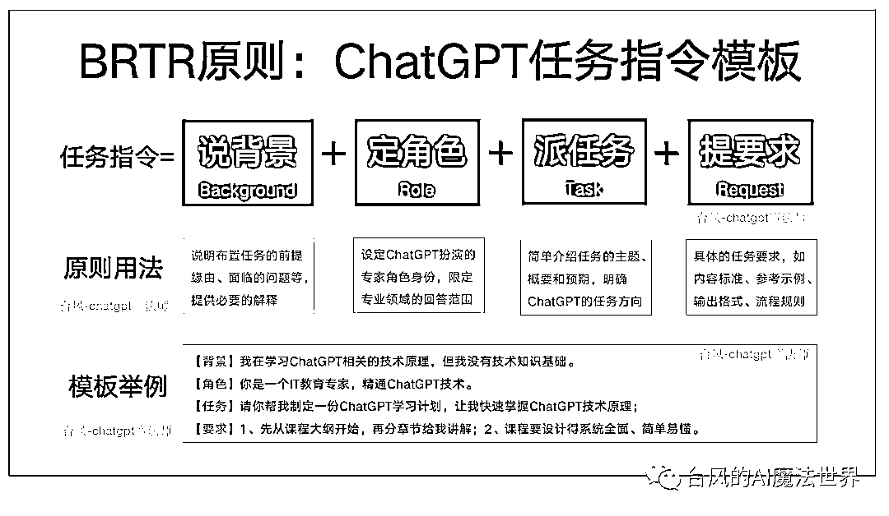

# ('ChatGPT 任务指令万能模板：人人都能学会的 BRTR 原则', (2, 34))

你有没有发现，同样是用ChatGPT，有人几句话就能拿到理想答案，有人却反复折腾还摸不着门？差别往往在于会不会“下指令”。

我是台风，一个整天研究ChatGPT的“魔法师”，也是龙哥盟ChatGPT航海教练、《ChatGPT产品商业俱乐部》创始人，公众号矩阵大概有近2万粉丝。

之前我写过一篇《人人都能学会的ChatGPT角色指令调教指南》，还做了配套的角色生成器，但主要偏向产品应用场景。后来每天都有朋友加我，问有没有更通用的方法。为了帮更多新人快速上手，我硬是挤出20多个小时，打磨了一篇4000多字的干货长文，核心就是这套“BRTR”任务指令原则。

所谓BRTR，其实特别简单：任务指令 = 说背景(B) + 定角色(R) + 派任务(T) + 提要求(R)。这组框架是我从生活和工作里高效布置任务的话术中提炼出来的，能让ChatGPT更快理解你的真实意图，少走弯路，避免一次次追问和返工。

当然，BRTR不是谁凭空发明的，更像是许多ChatGPT重度用户深度使用后，慢慢形成的一种共识。为了进一步降低门槛，我还配了一个“ChatGPT指令生成器”，只需要按着BRTR的框架，就能一键生成任务指令模板，方便你参考借鉴。

指令生成器地址：https://ai.gptprompts.com.cn
完整长文地址：https://xq6mz7nkknp.feishu.cn/docx/L2eMdbYAfoIqBQxfA6ScKtI5nch

已经有不少朋友在评论区反馈“亲测好用”，希望这套方法也能帮到你。
