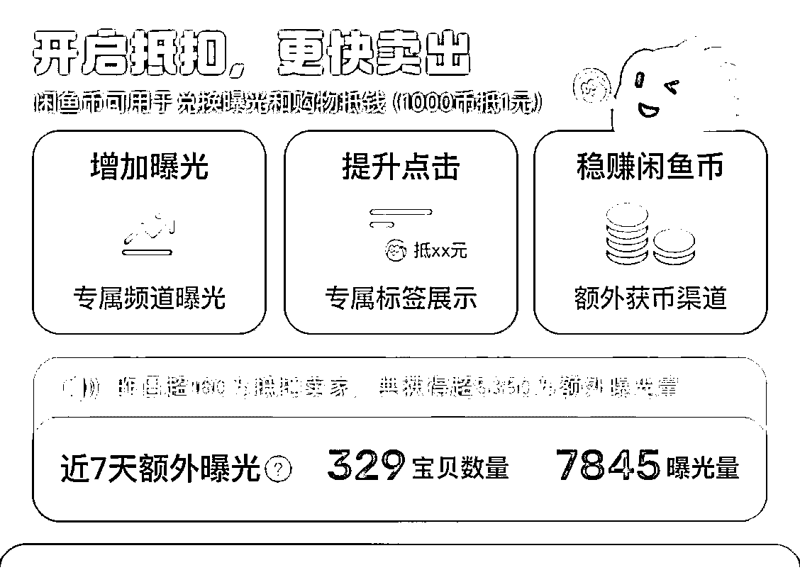

# ('照着抄就可以见到效果的闲鱼二手书实操干货', (2, 22))

闲鱼二手书实操：真正做到“抄作业也能见效”的干货来了

大家好，我是大闵。摸爬滚打电商行业多年，过去主要在淘系深耕，如今在一家少儿编程公司做电商总监。私下里，我打理着9个闲鱼店铺，月利润稳定在1万以上。今天不扯虚的，把我在闲鱼卖二手书的实操经验全交出来。

为什么选闲鱼而不是淘宝？一是闲鱼适合当副业，不占太多心力，有自动化软件帮忙，上架发货能省下一大截时间；二是闲鱼的运营门槛比淘宝低太多，尤其适合新手。

整篇内容分两块：先说运营实操，看完就能上手，关键是你得坚持；再跟店铺开了但还没出单、证也还没下来的朋友聊聊心态。

我最常对群友说的一句话是：别瞎焦虑，也别满脑子胡思乱想，先把产品上满再说。很多人货都没铺齐，就开始纠结多地发货会不会违规、某本书怎么传不上去——这些全是空烦恼。

选品是第一道关。我自己的做法是：只去孔夫子的大学教材频道，按销量排序来挑。政治敏感的、封面有女性照片的艺术类、带宗教元素的，统统避开；小说我从来没卖过。人生就是一堆选择题，会选题比会解题重要，把这些回报低、风险高的坑提前踩掉，后面运营自然顺。

图片怎么弄？实拍、干净、别加水印；俯拍比斜拍舒服；有手持书就选手持；近景好过远景；光线亮比光线暗强。

接下来是效率问题。手动上架，一天顶多50本，500本要拖到十天；上了软件，一小时就能搞定。什么“手机上架权重高”“闲管家上架权重高”的说法都是谣言。手机上架唯一的优势就是能开粉丝专享价，每天挑本热销书用一下就够了。

我说的软件，是朋友华少开发的，圈内不少人都知道了。它专门为二手书商服务，功能包括：批量上架、自动修改孔夫子地址、同步订单到闲鱼发货、批量降价1分钱抢曝光、消息聚合、去重防违规、黑名单书禁上架。目前还在测试阶段，免费，需要的可以找我开账号。

标题怎么起？30个字尽量撑满，把用户搜索词和吸引点击的词都塞进去。开头放“二手正版”“正版二手”“正版好品相”“毕业了卖书”这些词，再加上【】强调。逻辑就是：用户搜一本书时，面对一排一样的图，你要让他最想点你。基础公式就是书名+作者+第几版+出版社，足够凑满30字。书籍标题不复杂，搜得最多的是书名，你只要把属性词带全就行。不会写就看同行，看完再比他多优化一步。

描述页也别随便填。先告诉买家是正版，帮他卸下防备；再说明品相，教材有字迹很正常，降低心理预期；最后写清售后、不议价、偏远地区不包邮。这些东西没有标准答案，讲明白就好。想要更打动人，还能加些感性内容，特别是童书。往环保、支持正版对孩子的益处、盗版书的危害方面靠拢。没灵感就去搜“给孩子买二手书的意义”，百度会给你一堆可抄的句子，组合一下就是好文案。我卖二手绘本时，末尾会挂一句抄来的话，大意是：最怕看到诚实的人被迫说谎、正直的人被迫弯腰、理想主义者被迫接受理想破碎，但我们可以选择做最好的自己，拒绝盗版，至少给孩子一个干干净净的世界。风格这东西因人而异，你也可以写出自己的。但千万别在描述里写“旧书非新书，玻璃心绕道”这种赶人话，你这是做生意，不是跟网友斗气。

定价方面，别想太复杂。考虑前期投入和人工成本，不是非加价30%不可。孔夫子的书有时候比新书还贵，你还怎么加30%？没有绝对标准，盈亏都是你自己的，热门书我加1块钱也卖，看情况。比价可以多参考淘宝同行。看到别人卖得便宜也别慌，旧书有品相差异，而且任何时候都有人比你便宜——朋友卖二手车还便宜我两万呢，这就是信息差。闲鱼上同样存在信息差，买家未必能看到那个更低价。

客户处理上，没那么多存心找茬的。书就几块钱，有人说笔记多，我直接补他2块；说书有问题，那就退。遇到不讲理的，走平台规则，别把时间和心情搭进去，有那功夫不如去选品。价格贵一点的书，让上家发货时拍视频留底，也提醒买家拍个开箱视频，防患于未然。和气赚钱，小本生意不奢望把顾客捧成上帝，能太平挣钱就很好。

人和人相处，其实就是框架的争夺。别让别人的情绪轻易拉走你。比如买菜被摊主骂，你回骂就掉进他的框架；你反而问他一句“老板是不是遇到什么难事了？”这就是你的框架，说不定他还心生愧疚。做买卖也一样，别被买家的节奏带着走。

下面说每天要做的操作。

每天至少找出10个上传很久但始终没销量的链接，下架后直接删除。注意是删，不是下架重发。就算这书在别人手里卖爆，你这里不卖货，也别留——不出业绩的链接，留着没意义。

然后去京东、当当的24小时图书榜，挑24小时销量最高的10本书。这几本书一定要有价差空间。比如新书卖40，孔夫子收来的旧书加价后卖20，值得做；如果新书25、旧书只能卖24，就别碰了。

用这10本替换删掉的10本。如果新选的书和你店内已有的链接重复，但那个链接又没销量，也删掉重来。再强调一遍：是删，不是下架。

上架的时候，先把价格挂高一点。比如你打算卖20，就先挂30，等上架后用手机改价到20，能吃到降价曝光（多规格用闲管家操作）。新品上架时“成色”先别选，等上架后用手机点“优化”再选，又蹭一次优化曝光（多规格除外）。

另外，很多教材带配套练习册，或分成上下册，记得做多规格，一个链接把小册子、上册、下册、整套都安排进去，可以参考淘宝做得好的二手书店怎么组合。

把新选的这些和你卖得好的书，能推几本就推几本，每天早上8点记得抢“超级擦亮”。2块钱能买1000次曝光，经常下午就被抢光了。这基本是市面上能捡到的最便宜流量，能抢就抢。入口是“我的-超级擦亮-抢超级擦亮”。账号多的更划算：比如名下3个闲鱼号，主号2元可推30个产品，新号能推3个，经营一段时间的号能推10个。一天花6块钱，3个店能推36到50个产品。如果前一天数据好，第二天还会额外送推广机会，可以多花几个2元，我最高纪录是一天花3次。

每天重复上面这套，本质上就是优胜劣汰。有销量的留，占着位置不产出的，就算曝光再高、降价也没动静，果断删。时间充足就多操作几本，但至少每号要更新10本。那些暂时还没删的，可以每天降1分钱，连续5天还没出单，也删。注意，降价只是手段，目标是曝光。

有人问我：“航海马上开始了，许可证还没下来怎么办？”我的想法是：如果你真心看好这个项目，证早一点晚一点有什么关系？晚开几十天，难道会少赚几百万？如果你不看好，那就趁早止损，去做你能落地的事。不要为了199块打卡保证金糊弄自己，更别被沉没成本绑住。好比自助餐不好吃还硬吃，钱反正花了，吃不吃都亏，何必折磨自己。

要是看好，就把时间线拉长到一年以上。闲鱼二手书是稳定、长期、可复制的项目，起步早晚没那么关键。早入局的人不一定就比你赚得多，二八法则哪儿都存在，真正坚持到最后的人永远是少数。等你跑顺了，每天上架、下架、优化这类轻运营，比其他电商项目轻松太多。收益稳定后，你甚至能找一个实习生接手，自己再去做别的事情。

所以真的不用焦虑，也不用看着别人的成绩干瞪眼。只跟昨天的自己比，就够了。

最后，送大家几句话。

第一，多数问题自己都能解决，百度、ChatGPT摆在那里，别伸手就找人要，练出解决问题的能力才是真本事。第二，要学会跟大哥，站在高人的肩膀上前进，但得分辨真假。第三，能省的钱就省，把预算花在自我成长上。第四，那些八卦、短视频、追剧、游戏，都是让你上瘾又没营养的东西，少碰；没意义的社交，能不去就不去。现实点，人与人本质上就是价值交换，别让自己的价值只体现在喝酒时被人想起。

