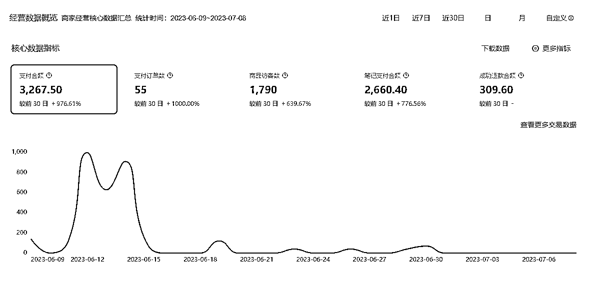
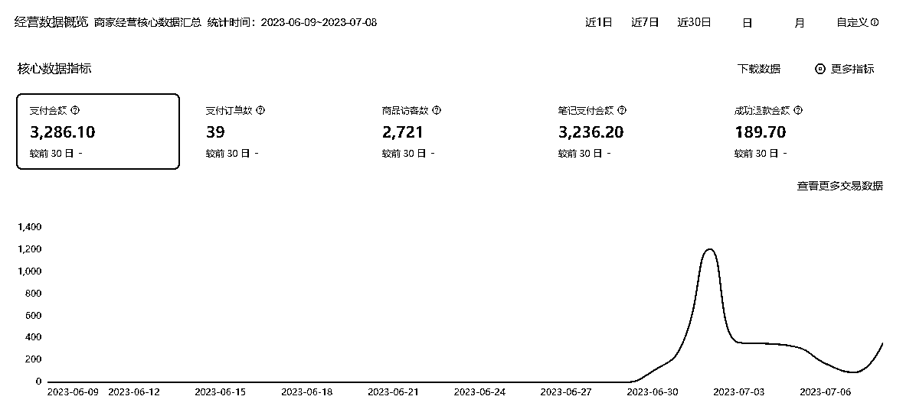

# 心态稳住就赢了：我用最后一周把电商新手期做到3000+的实操复盘

> 来源：[https://pu6uadh9h1.feishu.cn/docx/CdxgdDCB8opj0LxiUZccdq0Tngg](https://pu6uadh9h1.feishu.cn/docx/CdxgdDCB8opj0LxiUZccdq0Tngg)

# 先做个自我介绍

大家好，我叫前行。3月18号才加入赚钱，算是彻头彻尾的新手。加入之前从未碰过副业，是赚钱让我打开了认知，原来赚钱的路径这么多，项目也这么多，而且天花板完全够我啃。

特别感谢拉我进来的那位朋友，给我分享了赚钱66个副业项目，让我有机会第一次拿到工资以外的第一笔钱、第一百块、第一千块……

下面复盘的是我从5月份起做的第一个副业——小红书店铺项目。对我而言意义很大。

截止到2023年7月10日，我一共试过5家店。前三家做饰品、防晒、玩具，都没起色。

从第四家开始转做食品，终于有了初步反馈。但问题不少，目前只是勉强把0到1的路走通了，1到1.5的阶段还在摸索。

这是我拿到的部分结果。

这次分享想给还在0到1打转的朋友一点信心，也算自己做一次复盘。

关于现在的这个小红书店铺，我的结论很简单：心态放平，执行做到位，反馈自然会来。

整篇文章我会围绕三点展开：保持平常心、把执行拉满、以及目前遇到的瓶颈和求助。

# 一、平常心是长期作战的基础

做了五家店之后我才明白，心态直接决定效率和结果。心态稳，内驱力才持续，执行力才跟得上。

我总结了三类最容易把心态带崩的情况：

1、初心要清晰：我们做项目是为了高效变现，而不是先把所有细节想透。

很多新人一上来就纠结一堆事：拼多多面单怎么填、一天发几条、图文还是视频、怎么找上家、退货怎么办、地址怎么写……这些问题确实重要，但绝不是起步就该解决的。

提前钻牛角尖会消耗大量精力，而且解决了也不一定出单。你把精力耗在没结果的环节上，热情就会被一点点磨没。

正确的节奏是跟着节点走，到哪一步解决哪一步。有单之后再去精挑细选上家，跟没单时找上家的心态完全不一样。

2、流量起伏、违规提示都很正常，别玻璃心。

从0到1阶段，本质就是搬运和试错。笔记没流量、不稳定、被提示违规，都是常态。

别觉得是平台针对你。把心态稳住，多做几条熟练了，数据自然会上来。实在不行就关店重养号重开，桌子不离开，机会就在。

3、用SOP对冲懒惰和拖延。

给自己制定每日行动清单，形成习惯，用流程对抗借口。

总的来说，先启动再优化。先把0到1跑出来，再谈后面的事。

# 二、执行力才是兑现的唯一路径

整体跑通的链路是：养号→开店→选品→发笔记→数据复盘。选品、发笔记、数据复盘是一个闭环，要持续滚动，保持不断出单。

1、养号
养号就是养权重，权重差和权重高，平台给的流量完全是两个世界。
具体方法大佬都讲过很多了，这里强调两点：
① 养号期同时就是选品期，只刷准备售卖的类目，尤其盯低粉<1000但单品销量>1000的账号，直接对标选品。
② 开店前先发3-5条互动笔记，24小时互动能在200以上，基本就是健康号。小眼睛数值越高，后续拿到大流量的概率越大。

2、开店
强烈建议办个体户，花600块认证成企业专业号再开店。
好处有两点：一是店铺可关联3个个人号一起推，相当于4个号同时带货；二是个人号被限流后可解绑换号继续推，不会一死全死。
我第一家能变现的店就是个人店，限流后直接没救了。后来认证企业号后，虽然也被限流，但可以换号继续推。

3、选品
选品从养号就开始了。在发现页持续刷，重点看低粉高赞高销量的笔记：粉丝<1000，销量>1000或赞藏>500，都是可直接对标或模仿的对象。

额外提醒：尽量选自己有资源、感兴趣或比较懂的品类。我之前折腾饰品、防晒、玩具都没结果，5月航海最后一周换成自己熟悉的食品类，才有了小收获，后面也打算深耕这条线。

工具方面，我之前用蝉小红会员看周榜，选粉丝少销量大的品测试。会员到期后试抖音精选联盟选品，也能出单。

一个小细节：上架时做几个规格，并在规格旁标注XX%用户选择，利润高的给高比例，再配合促销券。比如卖糕点：1盒29.9 25%用户选择，2盒49.9 55%用户选择，3盒69.9 87%用户选择。从众心理多少能提转化。

4、发笔记
这一步最考验效率。现阶段带货笔记以视频为主，去重和二创能力基本是硬门槛。

非常推荐奇杰老师关于批量剪辑去重的文章，核心是批量去重思维，而不是照抄步骤。

我自己去重做得不够好就不班门弄斧了。经验是：有流量有单后，尽量自己实拍买来拍，彻底规避去重风险。我两家出单的店铺最后都是因非原创被限流。

关于发帖频率，建议单号先发10条左右，间隔约1小时。在不确定什么内容更吸睛时，多发多测是优势。发多了能看出数据规律，再针对性优化。素材源头就是爆款视频，选品阶段就可以开始收集。

5、数据复盘
这是我目前最弱的环节，后面要补上。小红书商家后台能看到哪条笔记带出单，能分析内容优劣；还能看到加购数、商品访客、点击率等指标，都是优化的方向。

我的个人SOP参考：

1、养号：新号每天刷3次，每次10分钟左右，看见喜欢、高赞、多评论的就点赞收藏评论。刷完发一条互动笔记测权重，操作3-5天，小眼睛稳定在200以上就开始发商品笔记。
2、选品：刷发现页或用第三方工具，每天至少锁定一个品，2-3天上架一次。
3、发笔记：每天抽1-2小时批量剪辑，每个账号发10条定时发布。第一天10条都是同一个品，有单就继续推，没单第二天发8条老品+2条新品，再没单就换品循环测试。
4、数据复盘：每周复盘一次，有精力就每天看。核心关注转化率、商品访客数、商品点击率、哪条笔记出单。

# 三、现在卡在哪，我想请教大家

0到1我已经跑通了，目前最大的困境是无法稳定持续出单和放大。

我开的两家店，都是在一周变现3000+后被限流，提示非原创。大概率是去重没做到位。我现在一次能批量出20条视频，去重技术需要继续深耕，同时也在考虑逐步转向实拍，看能否把流量稳定住。

另外一个痛点是转化率偏低，不知道该如何提升。

总结下来有两类问题想请教：

1、去重做到位后，是否就能实现持续稳定出单和放大？是否应该把主要精力放在批量去重能力上？
2、转化率低该怎么破？是不是要更聚焦用户痛点+解决方案？该如何拆解对标账号的转化逻辑并模仿？

非常感谢各位大佬的指点，也欢迎一起交流。

最后说一句我反复提醒自己的话：保持平常心，执行力拉满，一起把0到1跑通，再持续爆单。

# 四、致谢

感谢带我进入赚钱的朋友，感谢赚钱团队、航海教练、志愿者以及所有无私分享经验的圈友和大佬。

谢谢大家，让我们一起龙哥盟。