# 盲盒交友风口再起，玩法迭代后的实测复盘

> 来源：[https://uklrrqhpyq.feishu.cn/docx/DZFDdCYUCo7DK4x9qUMckKn9nSe](https://uklrrqhpyq.feishu.cn/docx/DZFDdCYUCo7DK4x9qUMckKn9nSe)

各位朋友好，我是乔橘，继续聊赚钱。

上回跟大家拆解的 00 后用盲盒交友 30 天赚 23 万的案例，被选为精华。配方还在，味道变了。这次是我最近两周实测的新打法，项目正处上升期，立刻整理出来跟大家同步。

上期帖子讲的是整个模式的骨架和收尾阶段的复盘，今天这篇聚焦在新验证出的操作细节，跑通后转化很顺。

# 数据先行

## NO1 先看数据

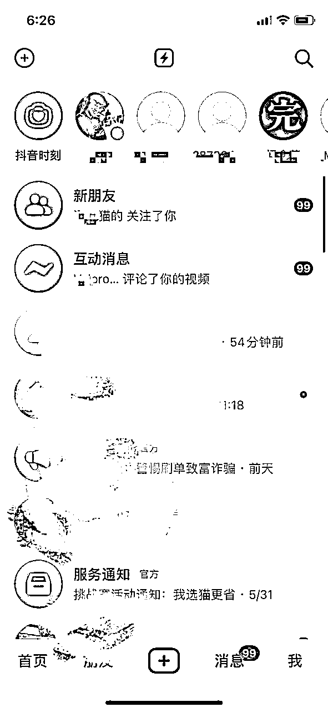

单条内容带来的导流表现：

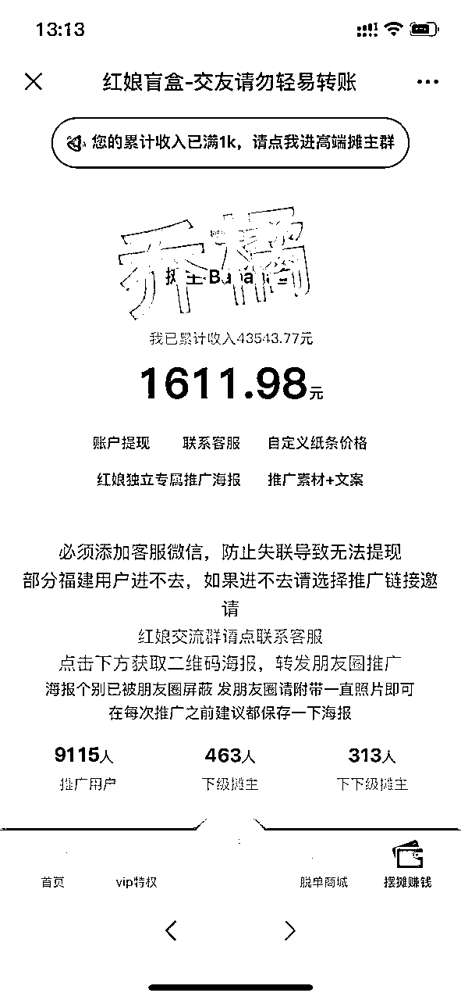

当日流水情况：

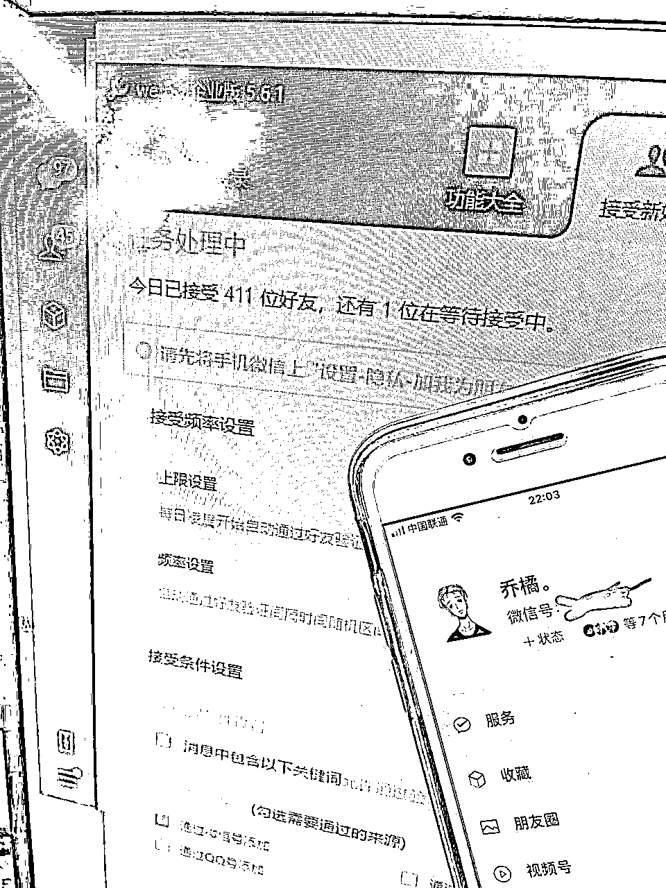

单账号单日拉进私域的人数：

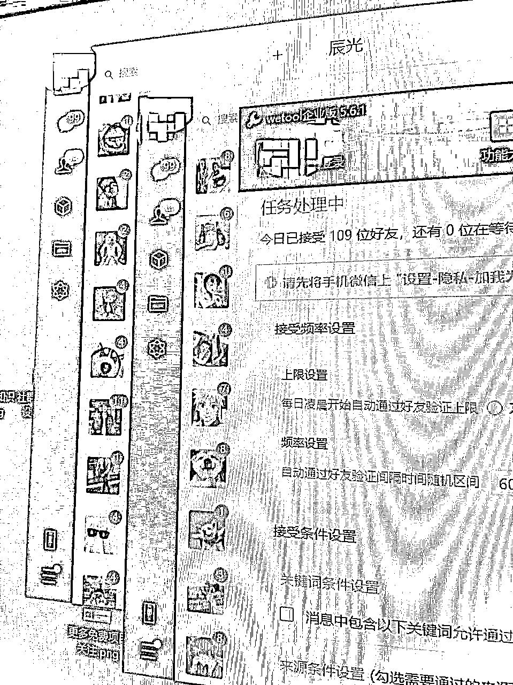

单账号单日私域新增另一视角：

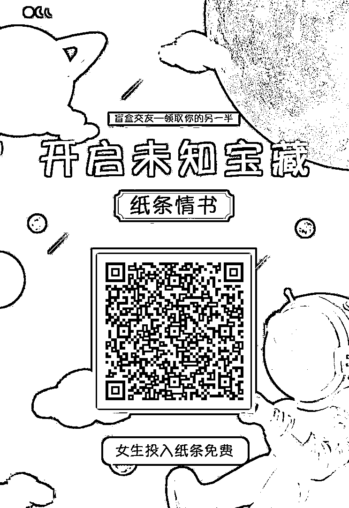

对接小程序的入口二维码：

## NO2 变现逻辑

前文已介绍过整体框架：00后靠盲盒交友项目，1个月怒赚23w 复盘总结

这里再浓缩一下闭环：抖音承接流量，导流到微信做私域沉淀，变现落在盲盒线上交友的小程序/H5，用户付费抽卡，团队吃分佣。

重心放在同城用户。引流环节相对轻，真正的决胜点在微信内的转化，耐心听我讲完。

## NO3 实操拆解

视频制作的参考教程：

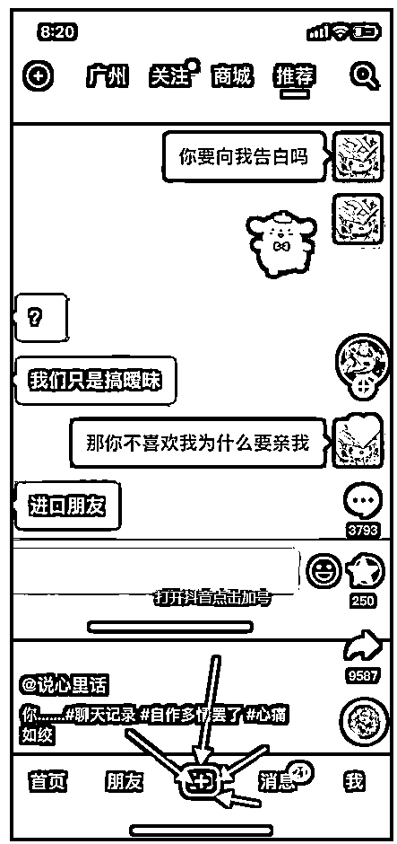

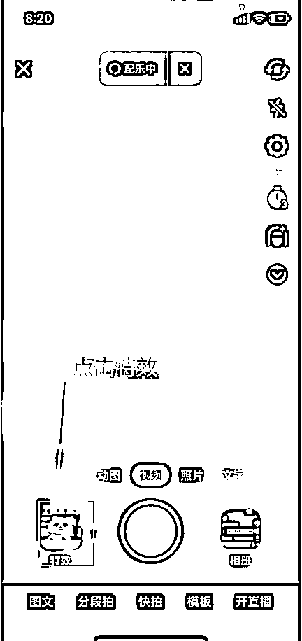

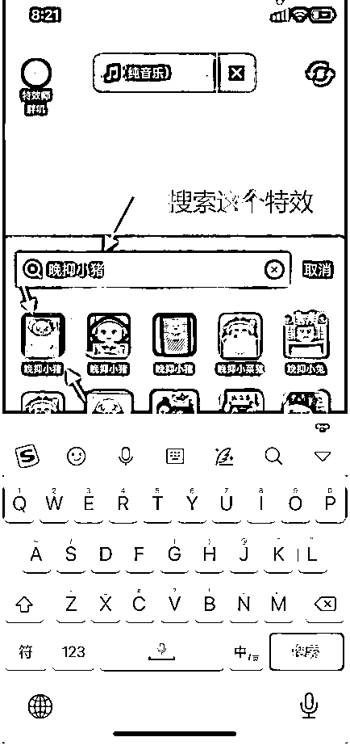

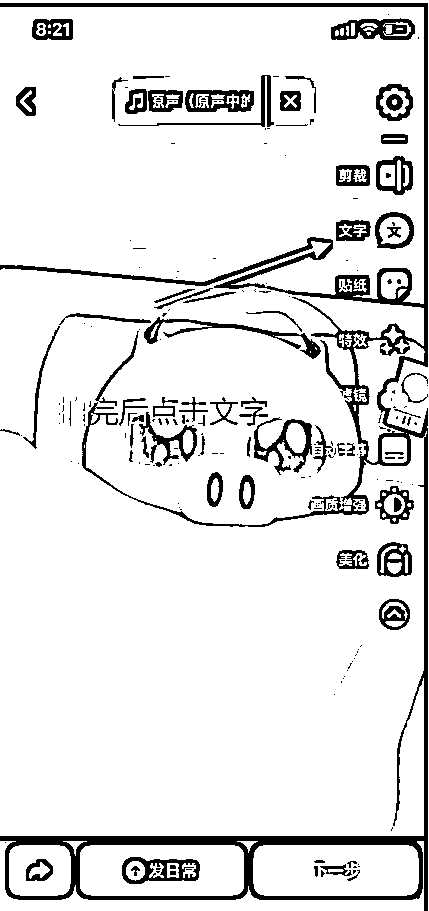

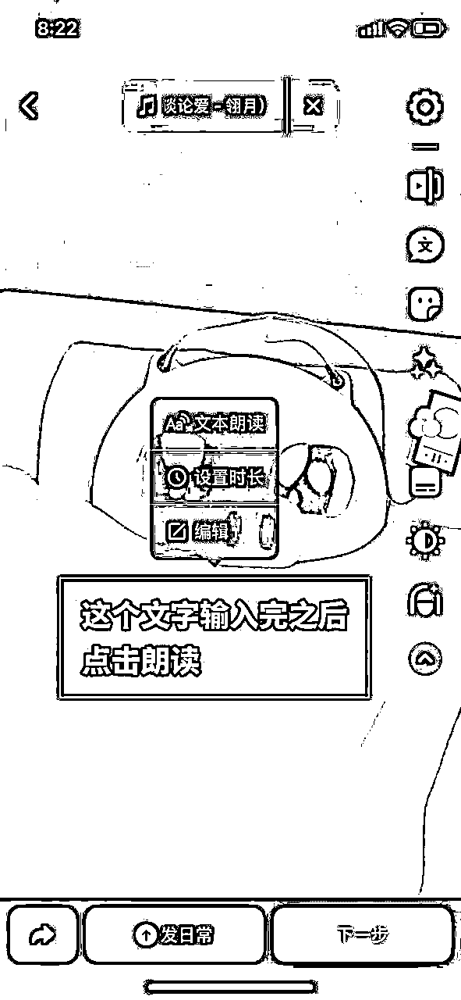

以上为成片效果，学会剪辑后就开始养号。

## NO4 号分类型

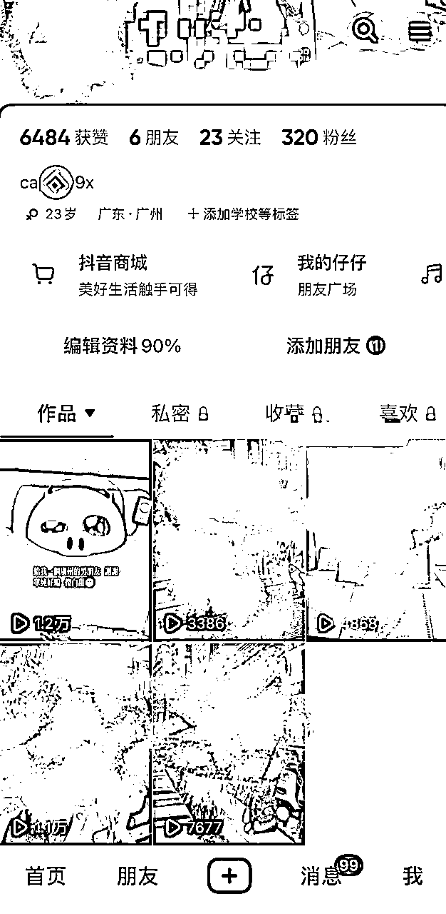

涉及肖像的素材记得打码处理。

操作要点：

1. 名称选女性感，头像与封面风格保持一致。
2. 抖音简介直接放微信号，号尽量简短，勿加多余说明。老号注册超过7天可直接上号，新号注册不足7天，先发数条风景类日常养号，等发布引流内容时再修改简介。
3. 首页保留引流作品建议不超过2条，第3条发布时把旧的隐藏或删除，穿插风景照塑造真实人设。
4. 新账号前三天每天刷半小时视频，发风景照养水温，第4-5天开始投放引流内容。

简介被系统清空的应对办法：

第1天简介写成：喜欢周杰伦的《晴天》，养了1只猫1只狗，平时爱玩王者。字数偏多更稳妥。

间隔2小时以上再改一次，加一句“分享日常朋友圈”，帮助二次审核通过。

第2天在末尾加上微信号，成功率很高。该方法是我多次测试得出的。

## NO5 发布规则

标题：自由发挥即可，避免出现引导性质的敏感词。

话题标签：#广州 #恋爱脑 #cpdd 也可按本地情况替换。

地理位置：定位到地级市，例如广州市、深圳市、佛山市，不要只定位到省。

# 私域成交

进来的用户基本都有交友诉求，统一先礼貌性回绝，持续聊天的看时间安排，可适当互动，但禁止出现敏感内容。成交主要靠朋友圈，占比接近98%。

刚加的好友，消息哪怕回个表情也不要冷落，否则易被删除。

### NO6 风险规避

1. 微信内不做任何交易，强制跳转到二维码内完成。
2. 朋友圈的二维码不要堆叠，发新删旧。
3. 保持朋友圈始终只留一张二维码，降低被举报成功的概率。
4. 发布美女图注意尺度，防止色情低俗判定。
5. 售后必须跟进，盲盒搜不到、抽不到等情况及时处理。
6. 抽到联系方式却加不上的，引导联系客服退款。
7. 对于多次未中的用户，通用话术：都是概率问题，我也无能为力，配个表情缓和气氛。
8. 用户调侃可以不回，但涉及付费盲盒的问题必须回复。

核心原则：绝不主动推用户去玩，必须被动响应。用户询问才解释，不主动营销，这是我实测转化最高的关键。

### NO7 朋友圈内容与节奏

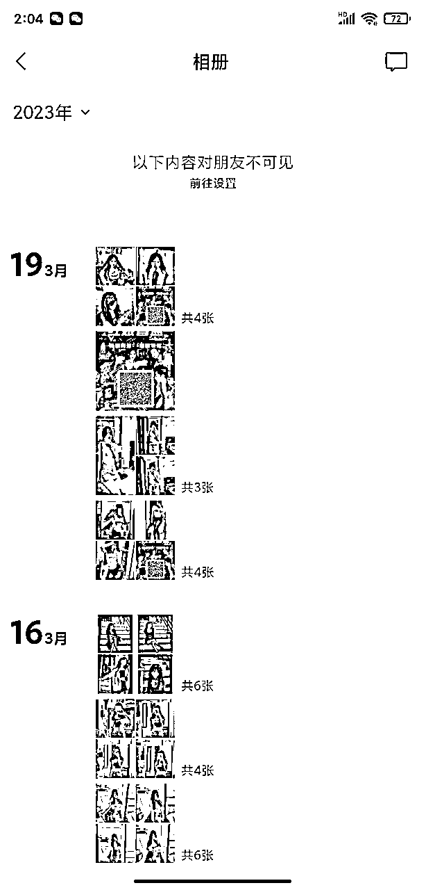

上述图片均源于盲盒平台小程序内。

偶尔发布一点生活日常，避免沦为纯广告号。朋友圈可见设为3天。

建议发布时间：

中午11点 尚可

下午3点 一般

晚上7点 尚可

晚上10点 人数适中

晚上12点 人数最多

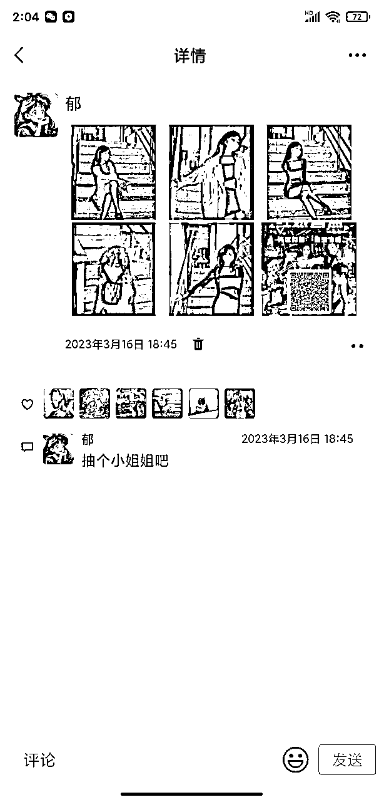

### NO8 官方应对话术

1. 付费交友能筛掉乱发自拍钓鱼的人，大家都是奔着恋爱去的，好好把握吧大哥
2. 盲盒交友是双向自愿，不保证100%通过好友，需看双方意愿，不强迫
3. 别问我具体干嘛，我是红娘，会收集小姐姐投稿发朋友圈并放进盲盒
4. 这里是盲盒交友，小姐姐都会放进盲盒里！

### NO9 朋友圈猎奇文案

盲盒自带好奇心，几块钱就会让人想试：

1. 2块钱来谈场恋爱吧
2. 新妹妹入驻，十连抽中奖概率高！
3. 十连抽五连抽更划算
4. 新投稿妹妹已入库，快来试试
5. 今天看黄历，宜抽对象

### NO10 角色定位

盲盒代理小姐姐，上班之余兼职做盲盒，可自行设定。

也可以塑造成个人女号，顺带推广盲盒赚点零花钱，更容易触发用户的交友心理。

# 放大验证

与上次一样，继续带团队扩量，这次约近100人参与，仅两天就看到明显回报，流量来得有点快，接不住。

提醒：最近 we tool 大量封号，站外导流的封号风险始终存在，多加注意。
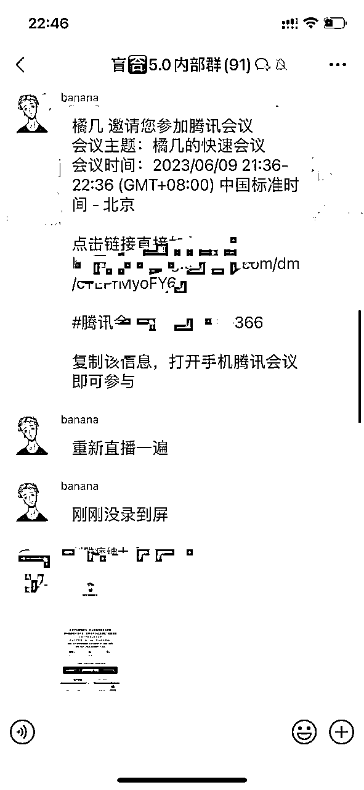

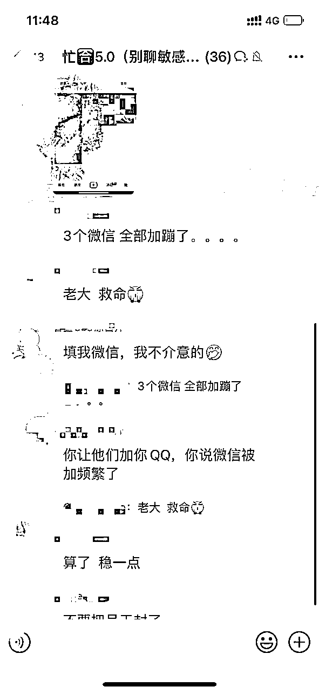

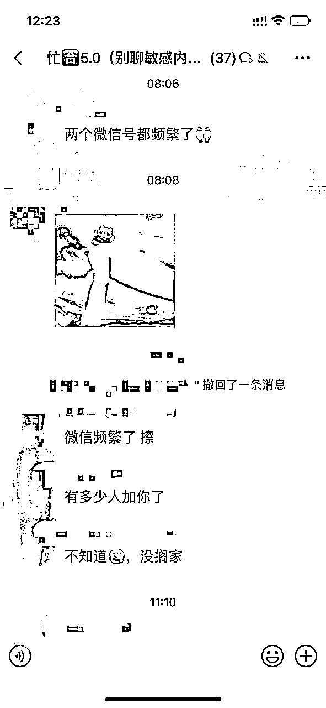

# 总结

我经历过多次风口，当全网都在讨论可以做时，项目往往已进入红海。

这个玩法我测试到现在约两周，发布于2023/6/27，门槛低、上手快，小白也能快速获得正反馈。

项目结构简单、无壁垒，随后会迅速泛滥。可赚的空间有限，我更希望没感受过风口的朋友，能体验一下流量带来的快感。

钱不是一个人能赚完的，能帮到一批人就好。若有未说明的细节，欢迎点我头像私聊，或在评论区提问。

最后，别再等明天了，现在就打开抖音剪辑发布。

一起赚钱有术~