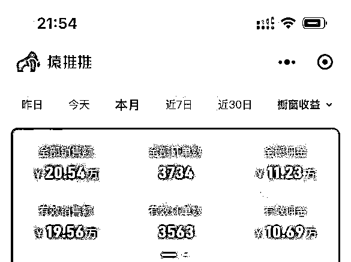
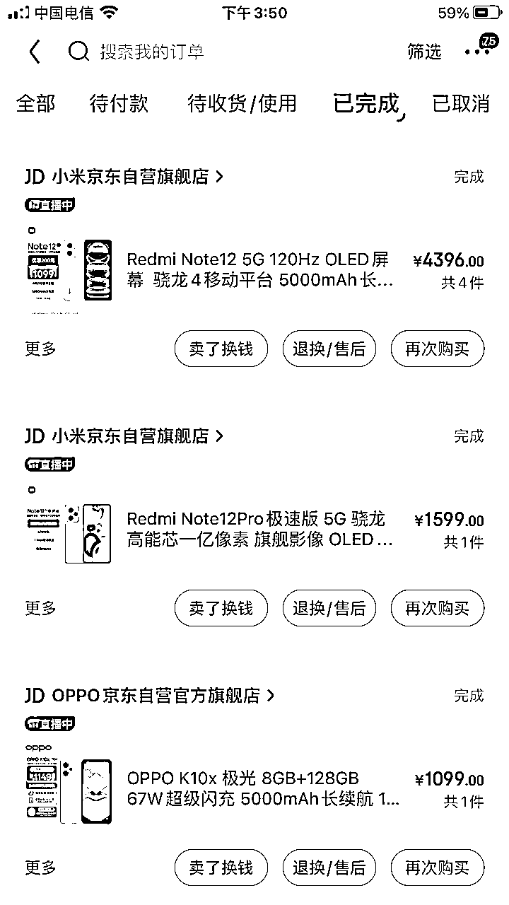
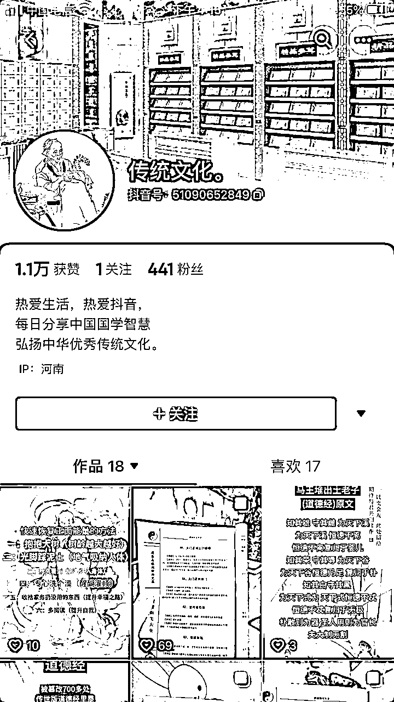
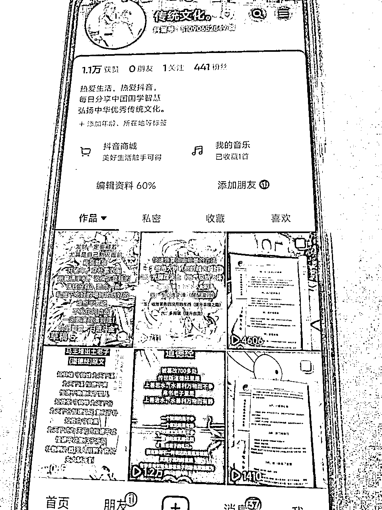

# 抖音养生赛道带货实战：如何连续三月稳定拿下10万佣金复盘

> 来源：[https://ka8a2qs38ja.feishu.cn/docx/GfnFdc7jboqR40xOAHUcAxCLnbb](https://ka8a2qs38ja.feishu.cn/docx/GfnFdc7jboqR40xOAHUcAxCLnbb)

各位朋友好，我是微笑，河南00后创业者，主攻养生垂类做了9个月，今天把6月份的真实操作和踩坑经验彻底拆开讲。

### 六月操作复盘

我核算下来，养生号的最终产出取决于一个核心变量：账号体量。基于这个判断，我就一条路走到底做矩阵扩张，添置手机设备、办理流量卡、发动亲友帮忙实名认证，

截止6月底，我手上已经铺开了60个抖音号，这条路绝不轻松，中间卡点不少，但靠着一股想把它做成的劲头，全都一一攻克了。

古话说得好：世上无难事，只怕有心人。

下面我把从冷启动到选品带货的关键环节具体展开。

### 冷启动做到千粉

目前千粉起号大致两条路：

1.靠作品自然涨到1000粉
2.直接买粉

##### 自然涨粉到1000

6月初市面上主流的起号套路是图文混剪+专家授课音频，实际跑下来风险很高，不是没到千粉就被限流，就是刚达标就被封30天。

结论：单纯用中医养生内容去做冷启动，当前环境基本不通。

那我转念一想，如果换成国学、情感、生肖、佛学这类内容起号会不会可行？因为受众画像高度重合，都是中老年群体，承接养生品类应该也顺滑。

我的实操方案是转用国学内容起号，下面这几个号就是我和学员的真实对标案例。

我本人以及私教学员，用情感、国学题材起的号，后续挂养生链接出单都很顺畅，【亲测有效】

##### 买粉起号

买粉就是找渠道付费刷粉丝，我的成本在140元左右。优势是跳过从0到1000粉的漫长积累阶段。

我咨询过不少带货前辈，大家普遍否定刷粉，说会影响权重、标签不准。可我自己去跑数据后，出单不仅顺畅，还出现了爆单情况……

再次印证一句话：别只听他人说，自己去测才算数。

## 选品带货环节

关于如何看榜单、找高赞带货视频以及1:1拆解复制的具体方法，我在之前的帖子里已经写过，这里不再赘述。

### 实操中常见的卡点

前面提到过，收益的决定因素是账号数量，但还有一个被忽视的关键：账号权重。

举个直观的例子，若大家都在推同一个爆款，素材都差不多，那谁更容易爆单？权重高的那个。

因此光有数量不够，还得把每个号的权重做上去。我复盘后发现，提升权重主要有两条路：

1.粉丝做到1万+
2.真人出镜口播

粉丝体量大=权重高，这是业内共识。

真人出镜的优势在于面孔唯一性，原创度天然占优，原创度上去了，权重自然跟着上去。权重上去后，同样的带货内容，平台会优先推你，你爆单的概率就高了，这点我已多次验证。

账号数量 × 账号权重 = 爆单概率最大化

##### 账号播放量掉、带不动单

很多同行都会遇到这种状况：之前能稳定出单的号，突然播放跌到几十几百；或者纯流量内容能到几千上万，挂链接的视频却只有几百播放。

解决办法一：先回炉发国学等涨粉内容，把粉丝补到几千以上，再重新发带货视频，转化立刻变顺。

解决办法二：开无人直播，把带货视频当成引流素材去跑播放，导流到无人直播间完成成交。

### 我的心态变化

从去年9月的短视频零基础，到现在带起一个团队，实现连续三个月佣金10万+，6月还有学员跟着我单月佣金破十万。

不到一年时间，变化巨大。

我每天早盘规划、晚间复盘，再加上大量阅读。

其实成功没那么难，勤奋+谦卑，几乎任何赛道都能拿到体面结果。

回顾下来，让我成长最快的核心是：真诚待人、乐于分享。

我新手期月入只有几千时，就把自己的号、爆单产品分享给文哥训练营的伙伴。每次有新方法论，我都第一时间公开。因为我信奉：成全他人，自己先成。

### 致谢

我是4月加入赚钱的，自从进来后收入一路稳步抬升，多亏赚钱有术星球里的干货帖子，有行业大咖的实战经验，也有深度思考，对我这种爱学习的人来说是巨大增益。

我前两个月的复盘贴发出来后，很多做养生号的同行主动来找我聊，这些交流反馈成了我保持稳定收益的重要支撑。也正因如此，我会坚持每个月更新一次复盘。

感谢赚钱这个平台一路助推我成长！

最后要感谢我的谱姐、梁靠谱，每次请教她都能直指问题要害，以后找老婆我就要找这样的贤内助，哈哈哈。