# 好友仅一千二，我靠朋友圈半年做到了14万+，这条路可以复制

> 来源：[https://bokm2adr1g.feishu.cn/docx/KzUMduAqLo5y21xgihUclePjnMe](https://bokm2adr1g.feishu.cn/docx/KzUMduAqLo5y21xgihUclePjnMe)

大家好，我是小鹿。很高兴在这里跟大家见面。

五月航海期间受邀在“朋友圈运营航海”分享《朋友圈广告这样发，不抵触还想追着看》，先简单自我介绍一下。我做文案撰写已五年，文字变现累计到七位数。现在做私域文案教练，也是“5力吸金文案模型”的提出者。

这几年带过上千名学员实现文案变现，现阶段专注私域成交系统搭建，希望能帮一万名伙伴跑通自成交闭环。

截至现在，微信好友只有1193+，六个月内通过朋友圈累计到账14万+。

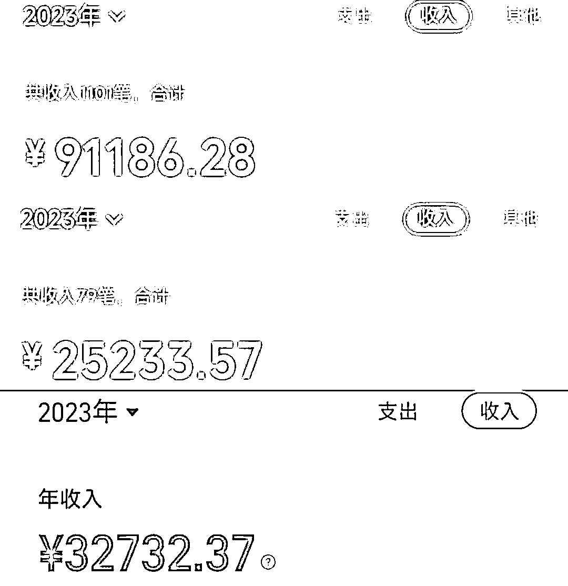

这个数字是在好友基数并不大的情况下达成的。如果你的通讯录比我多，认真看完这篇，你也能做出具备吸金能力的朋友圈。

本文在原分享基础上做了扩充整理，全文约14158字，阅读约23分钟。

### 内容目录
#### 一、路径复盘：朋友圈变现三阶段
1.1 起步期：代理分销
1.2 成长期：打造付费圈子
1.3 成熟期：塑造个人品牌
#### 二、落地打法：朋友圈变现五步法
2.1 朋友圈内容版图
2.2 故事化发圈技巧
2.3 文案通用框架
2.4 广告如何发出不被屏蔽
2.5 防折叠操作细节
#### 三、心法总结：真诚是长期主义

# 一、路径复盘：朋友圈变现三阶段

我的变现轨迹大致可分为三段：最开始做分销带货，随后搭建付费社群，最后聚焦个人品牌。

## 1.1 起步期：代理分销

分销的本质是帮别人卖货，品类可以是线上课程，也可以是实体日用品。我早期主推的知识付费品类，比如知识星球、各类线上课。选择标准很简单：自己亲身学习过，确实用到价值才推荐。

加入赚钱、成为合伙人后，手上的推品佣金更高，只需把真实的学习体感写清楚，就能完成成交。那段时间没有自有产品，分销收入是主要现金流。

对零基础的新手来说，分销是最快切入朋友圈变现的方式。核心前提是“有东西可卖”。起步阶段没产品、没影响力，可以先从正在学习的付费内容里挑选。

比如龙哥盟，一单分销佣金493元，十单就是4930元，已接近普通职场人的月薪。

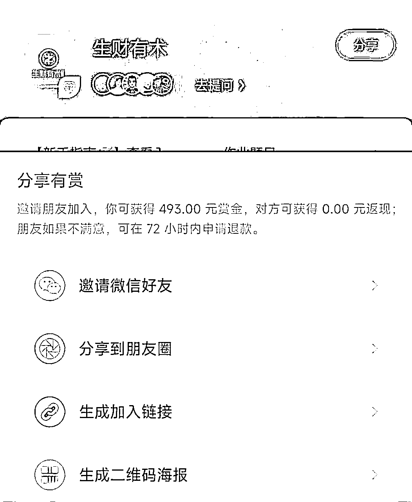

有货源的朋友也可以直接做实物。分销的上手门槛低、交付压力小。但风险也很明显：文案写偏、策略失误就可能不出单，严重时还会被平台限流。

你一定见过朋友圈一天十条广告刷屏的账号，第一反应就是拉黑。可不曝光又没流量。这就要求文案必须精准、有共鸣。

具体方法会在第二部分详细拆解。

另外要提醒，如果未来想走个人品牌路线，前期选品一定要慎重。别还没做起来，就因带错货砸了自己的信誉。

### 分销案例拆解
下图是我分销龙哥盟时写的一条朋友圈，可以参考。

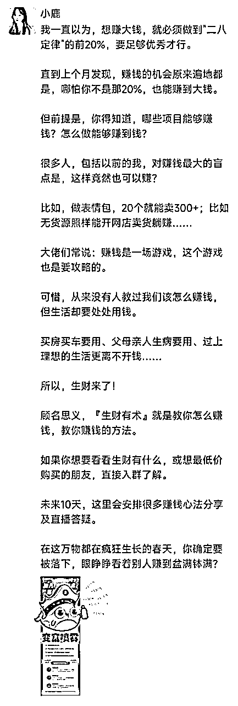

开头先放一个认知：想赚很多钱必须足够优秀。随后反转：赚钱的关键不只是优秀，更在于信息差。

接着举例表情包项目、无货源电商，引出“赚钱像打游戏，没人教你规则，但生活处处要花钱”。最后引入龙哥盟，定位为教赚钱的知识星球，并给出免费入群听分享的福利。收尾一句：在万物生长的春天，你确定要被落下眼睁睁看着别人赚满？

结构拆解为：爽点【不够优秀也能赚钱】+痛点【生活处处需花钱】+方案【龙哥盟的赚钱攻略】

想写类似带货文，可照搬这个思路：先说明产品能带来什么好处，再解释为什么必须买，最后给出产品信息和下单路径。本质是“提出问题—剖析问题—给出答案”。

## 1.2 成长期：打造付费圈子

付费社群是做自己的产品。比如理白学长的自律养成社群，还有早起打卡、周记打卡等。

我做的第一个自有产品是《引爆朋友圈变现力》年度圈子，核心是教学员用朋友圈文案实现成交和影响力。适合想做朋友圈变现、想打造个人品牌的伙伴。

从帮别人卖到卖自己的，收益从抽成变成100%，成就感也更高，同时能沉淀品牌势能。

但社群有门槛，需要给到价值。技能型价值，例如我擅长文案；品质型价值，例如理白的高度自律。核心是提供干货价值或情绪价值，缺一不可。

另外，付费社群对私域运营能力要求高。微信好友不到四位数，或不习惯写朋友圈、发朋友圈，建议先打好基础再启动，否则容易挫败。

### 社群启动案例
确定要开《引爆朋友圈变现力》后，我直接在朋友圈公布权益、价格、交付，官宣文案如下。

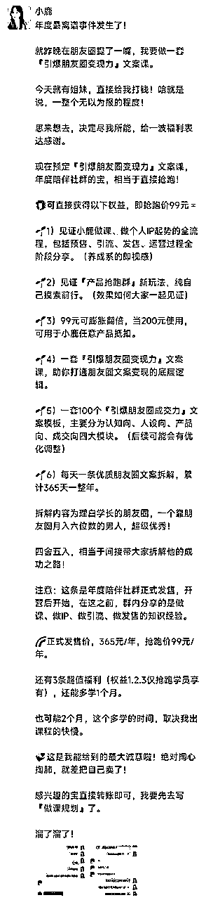

讲清缘由、权益、价格、交付即可，当天晚上就有8人报名。原因是我本身有文案背景，圈内有一定认知，且首发定价低、交付足，性价比很高。

有趣的是，这个想法前一天才在朋友圈试水，第二天就落地了。这件事告诉我：想做的事，大胆公开说出来，你永远不知道表达本身会吸引谁。

随后我追加了报名人数的动态，第二天介绍课程适配人群，第三天晒学员下单故事，持续营造热度。

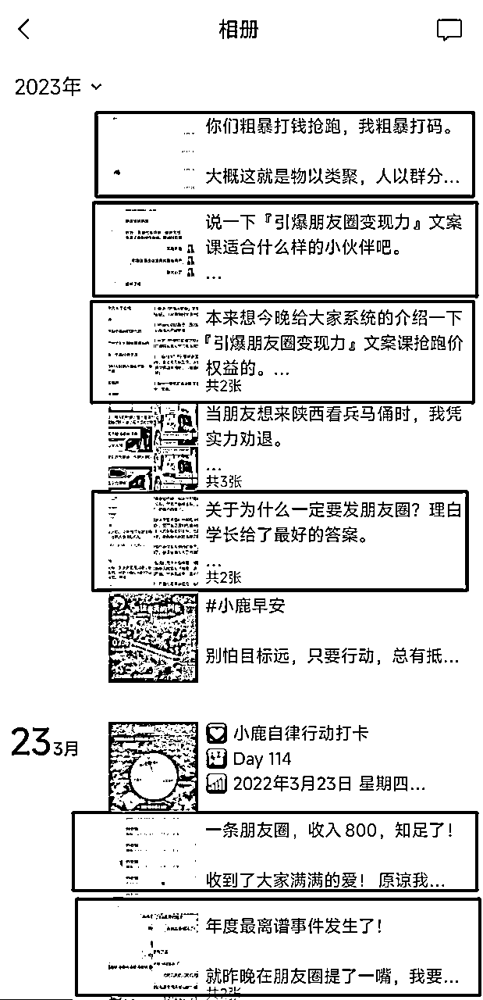

那条动态主要说明课程能带来什么，适合哪些人，方便对号入座。

第二天又有一波报名，睡前又发一次晒单，连续两天强化热销氛围。

提醒一点，如果报名人数不多，可以单个讲用户的下单故事。选择时最好聚焦同一目标人群，讲一个人的故事，把痛点和卖点融合进去。

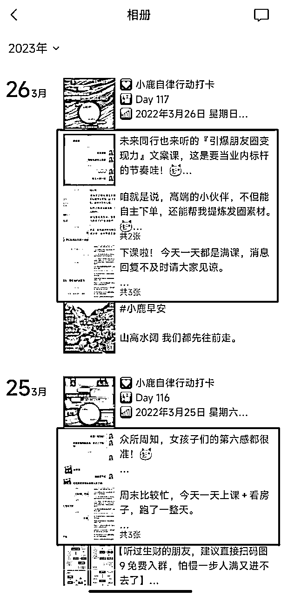

人类天生爱听故事，有细节的故事更真实、可信。预售约三天，招收52人，涨价到199元，首轮发售结束。具体发圈节奏参考第二部分。

## 1.3 成熟期：塑造个人品牌

我理解的个人品牌，是能为某一类人群解决某一类具体问题。可以是课程，可以是陪伴式成长，核心都是交付价值。

做个人品牌对影响力和能力要求较高，不是短期能完成。

个人品牌等于把自己做成IP，像超级个体。可以有硬实力，也可以有高影响力，总之要有差异点让人愿意跟随。

比如娱乐类IP是明星，品牌IP是龙哥盟，超强个人IP是梁靠谱。可以看到，做个人IP对小白不友好。

但一旦形成势能，个人价值会持续攀升，后续业务都有稳定拥趸。KK的1000铁杆粉丝理论很经典：拥有1000个铁杆粉丝就足以自给自足。做IP就是积累这1000人的过程。

### 个人IP实操经验
我以《引爆朋友圈变现力》文案方向为例，教大家如何用朋友圈文案变现。定位确定后，围绕它做产品体系，目前年度圈子已有140+成员。

产品矩阵包括年度陪伴社群+知识星球，基础朋友圈变现文案课以及私域变现底层逻辑课。

逻辑是：先定定位，再做产品，持续招生沉淀影响力，形成闭环。

要强调，个人品牌需要长期沉淀。小白建议沿着分销带货→付费社群→个人IP逐步演进。

# 二、落地打法：朋友圈变现五步法

## 2.1 朋友圈内容版图

带学员半年，最常见的问题是“不知道发什么”。其实不是没素材，是不想分享。朋友圈本质是表达，你是否愿意展示工作和生活。

可从四个维度发力：

### 生活向
分享衣食住行点滴。今天吃什么、路上风景、买了什么小物件等。也可以发家人趣事、感动瞬间。

例如我发的绿植就是典型生活内容。

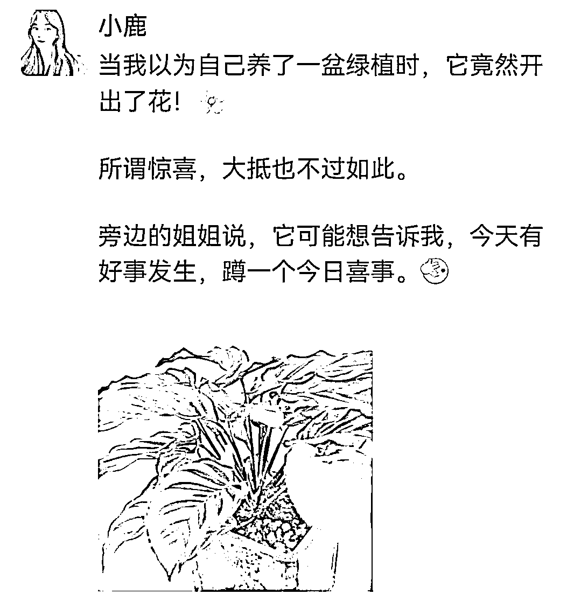

这些细节让账号更立体、更有温度。生活内容也是人设搭建的一部分，比纯广告更可信、更亲近。

### 人设向
指专业人设。比如我的定位是朋友圈文案，就持续输出相关方法。

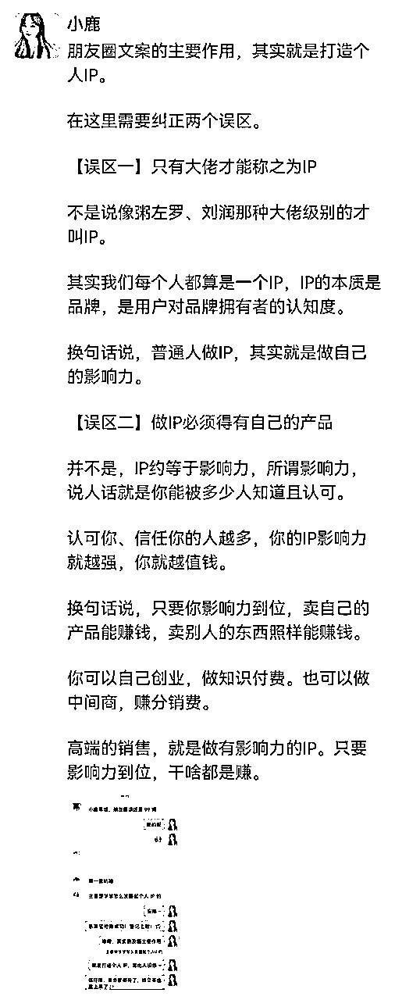

提醒：讲干货要结合具体案例，可以是学员故事，也可以是自己的经历。具体技巧见2.2故事发圈法。

没有明确定位的朋友，可以从性格品质切入，展示真诚热情等特质。没产品时我就是这么做的，当时定位是知识付费推荐者，需要塑造真诚分享的形象。

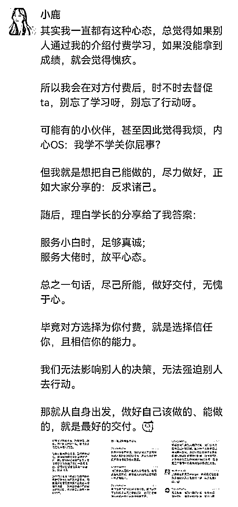

人设最核心的是真实。社恐硬装社牛一定会翻车。

### 认知向
让人看完有“学到东西”的满足感。可以是自己的感悟、书中金句、电影台词的二次输出。

比如靠谱在群里的发言让我很有共鸣，就发了条朋友圈，核心观点是成交不能靠硬劝，硬劝出来的成交会进退两难。

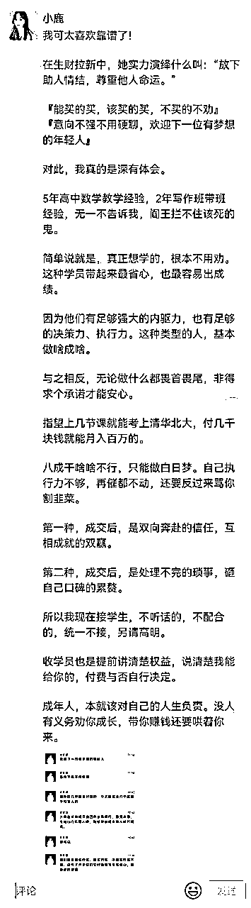

做知识付费的朋友应该很有体会。

### 产品向
即广告，建议以软广为主，硬广仅在正式发售、涨价等节点使用一次。

软广形式多样：用户下单故事、咨询故事、反馈故事、使用场景故事。

例如这条软广从认知切入讲圈子价值，分享真实体感和生活场景。

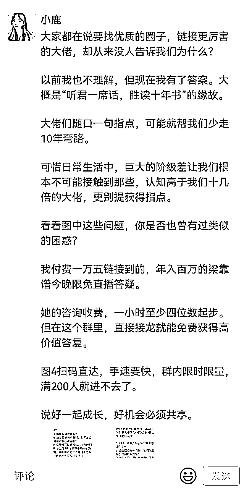

最高级的营销是走心的经验分享。你自己都读不下去的内容，用户不会买单。

## 2.2 故事化发圈技巧

软广多用故事，日常内容也建议用故事包装，提升代入感。

### 短故事
一条朋友圈讲一个小故事，500字内说清楚。适合表达一个观点或一件事。

比如我发过有人盗用内部资料引流的故事，开头抛悬念，中间是评论区艾特原创的高潮，结尾落到团队凝聚力。

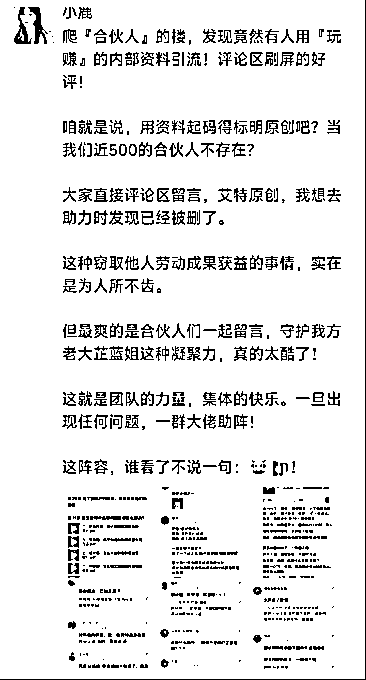

这类内容没有带货意图，纯分享也行。注意完整性，有头有尾有收束。没有开头会让人莫名其妙，没有结尾会烂尾或变成连续剧。若想做连续剧，需提前预告。

### 长故事
一条发不完，需要多条连发。结构可类比文章，是并列式，比如连续发五条用户故事。

长故事的好处是，看到任意一条感兴趣就会点进主页连看。

比如3月24日我的朋友圈围绕《引爆朋友圈变现力》文案抢跑群展开，形成长故事合集。

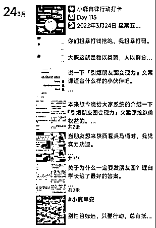

第一条解释为什么要发好朋友圈，第二条介绍抢跑群权益。

## 2.3 文案万能框架
故事引入→痛点/认知挖掘→产品/方案呈现→行动指令

先给价值再给产品，先共情再成交。

## 2.4 广告不反感的原则
克制刷屏：每天3-5条，硬广不超过1条；
软广为主：用故事包装；
真实交付：只推体验过的内容；
用户视角：发前自问对他人是否有用。

## 2.5 防折叠小技巧
原创手打，避免系统判定复制；
避开高频敏感词，用口语化表达；
评论区互动降低折叠率；
减少朋友圈堆放链接和二维码，可引导私聊。

# 三、心法总结

回顾从分销到社群再到个人品牌，核心并不是技巧，而是真诚。

真诚推荐、真诚交付、真诚表达。朋友圈既是名片也是告白，每条内容都在定义你的形象。

变现没有捷径，持续做好内容、做好自己就是最稳的路径。

愿你的朋友圈既记录生活，也创造价值。
共勉。

自媒体语境下，朋友圈早已不单是生活展示窗，它更像一台可以静默成交的生意机器。很多人发圈却陷入两难：直接推销担心被屏蔽，纯记录又容易沉寂，忙活半天连询问都没有。其根源往往不在货本身，而在于缺少一套让人愿意持续停留、慢慢建立信任的叙述方式。

下面这篇内容不谈空洞理论，直接拆解朋友圈变现的可执行路径。无论主营课程、商品还是个人品牌，下面的方法都能把朋友圈从随意晒一晒，升级为一套自我运转的成交闭环。

先从故事法讲起。把一个完整的产品上线流程，用四条动态串成一条叙事线。首条点明产品作用，第二条展开权益与价值，第三条界定最合适的受众，第四条呈现下单或使用反馈。中间穿插几条纯生活向的记录，正好给商业密集的信息留出呼吸空间。四条下来，一个从价值传递到购买验证的销售故事就讲完了。

你在做账号运营时，也可以借鉴这种「一日一主线」的打法。所谓主线，不是讲时长，而是当天所有内容围绕一个有引力的主题收束。可选当天主推的单品，也可选一次正在经历的学习成长事件。产品叙事的逻辑线通常是：功能点—权益清单—匹配人群—结果反馈，顺序可以灵活调换，关键是始终围绕产品展开，不跑偏。

若当天主题换成个人成长，节奏可以这样排：早晨抛出一件正在困扰自己的问题，中午分享找到的可行解法，傍晚更新把方法实际用了一次的效果。管用与否、体感如何，一目了然。就连休闲娱乐也能做成连贯叙事：清晨出发爬山，中午晒山巅风光，夜里吐槽双腿酸软。整体朋友圈会因此更有层次与人情味。

再往上走一步，连续剧式叙事把时间轴拉长。前面讲的是一天或一周的内容组织，连续剧则是以月、季甚至年来推进。我自己的「引爆朋友圈变现力」课程就是典型案例：从最初的想法萌芽，到群组搭建完成，再到持续运营更新，朋友圈里几乎每天都能看到它的进展轨迹。换言之，我在公开记录这门课从0到1再到成熟放大的完整成长史。

这类长线故事既能塑造产品与品牌，也能立人设，甚至可以复刻成用户成长档案。例如学员小米代理的英语学习机，就可锁定一位真实使用者，持续记录孩子在学习过程中的变化。若没有可长期追踪的对象，也可用自家孩子的学习轨迹作为样本，清晰呈现产品带来的能力跃迁。

关于连续剧叙事，有一句话很到位：人们真正记住你，不是你第一天站出来时，而是当他们很久之后发现你还在持续发光。长线内容的高级之处在于复利效应。陌生人点开你的主页时，能看到一条完整的成长轨迹，信任感就在这几分钟的浏览里迅速累积。

上述三种故事法并非单选。短故事可以拼成日线，日线积累后就成了连续剧，构成层层递进的关系。把这套链条搭起来，朋友圈就能演变成一套自动获客、默默吸金的私域系统。

回顾要点：用故事法搭建可复利的自动成交闭环，先打通短故事，再串成日故事，最后沉淀为连续剧，让朋友圈像一部可追的纪录片，立体展示你与产品。

讲完故事心法，再看写作落地模板。底层源自5W2H七问框架：WHAT是什么、WHY为什么、WHO谁、WHEN何时、WHERE何处、HOW怎么做、HOW MUCH多少。

在朋友圈操作中，我把它拆成两类可套用的结构。第一层是基础三问：是什么—为什么—怎么做。这个逻辑几乎适配任何内容，哪怕只有个模糊念头，也能依此输出一条顺畅的动态。

产品类：是什么=呈现产品本体；为什么=点出核心卖点；怎么做=给出下单指引。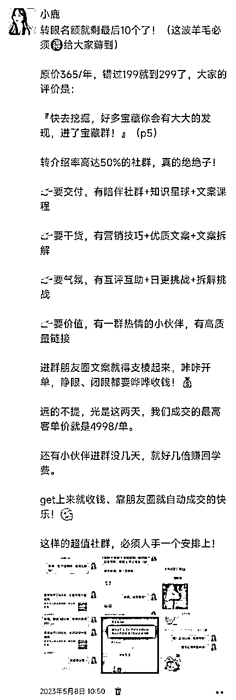

生活类：是什么=交代分享主题；为什么=给出个人感悟；怎么做=发起互动引导。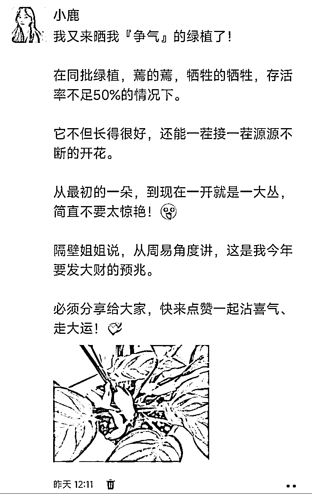

认知类：是什么=抛出观点；为什么=解释成因；怎么做=给出行动建议。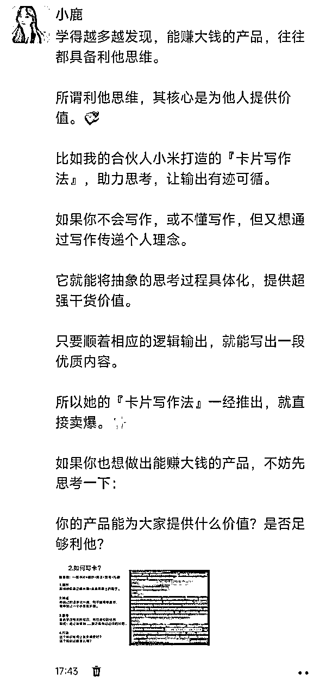

人设类：是什么=亮明立场；为什么=结合过往经历；怎么做=说明下一步做法。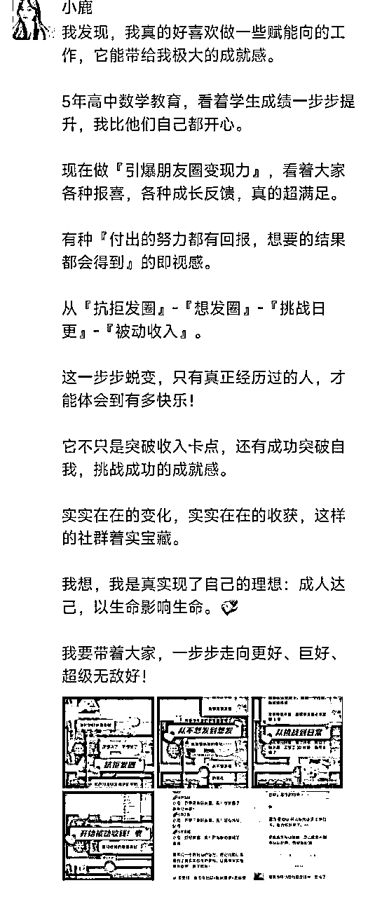

只要主题明确，用此框架写作基本畅通。第二层是场景框架，对应谁、何时、何处。好文案自带画面感，核心就是交代清时间、人物、地点与事件。

生活圈示例：谁是我自己，何时是下班时段，何处是回家的路上，发生了什么是我拍到光影穿透树叶的瞬间。简短一句就有了小剧场感。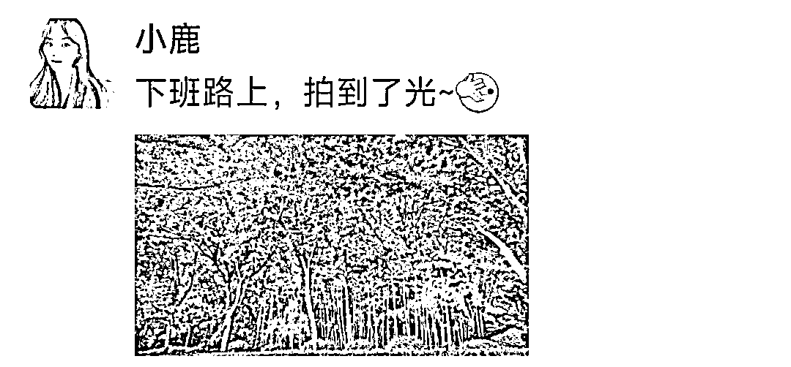

产品圈示例：谁是我和几位大佬，何时是社群运营至今，何处是私信对话框，发生了什么是我主动申请优质文案授权。场景立刻立起来。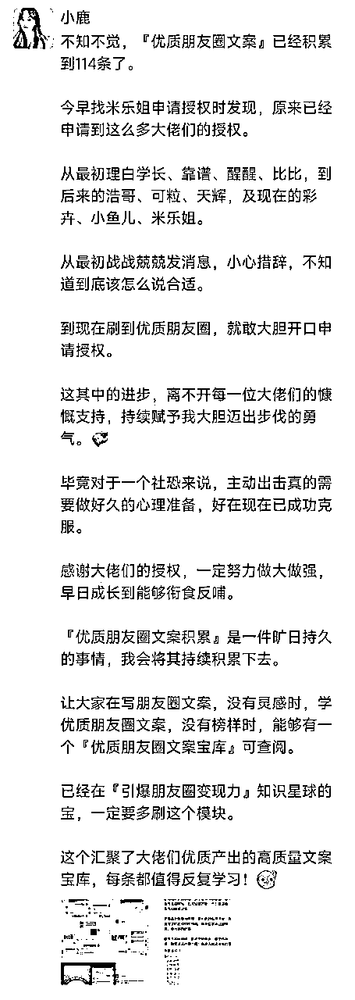

换到自己的产品，也只需把四个维度理清。仍以小米的英语学习机为例：谁是孩子，何时是睡前或饭后，何处是床边或客厅，干什么是在用学习机沉浸阅读跟读。哪怕写得不细，读者也能自动脑补画面。

还要注意，两个框架可以融合使用。例如晒办公室里长势喜人的绿植：是什么/谁在哪何时=此刻我在办公室晒心爱的绿植；为什么/何处何事=办公室环境适宜，绿植存活率高且持续开花；怎么做/互动引导=点赞沾喜气。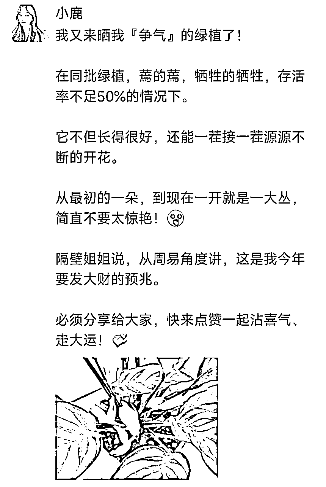

模板是为无灵感时撑开思路而生，最高级的写法是心中无模板，顺势输出，只要逻辑自洽就是好文案。

再谈广告如何发才能不被嫌弃，甚至让人主动蹲更新。先纠正一个认知：硬广并非洪水猛兽，节奏合适的硬广能把控营销节律，关键时刻还能促单。

按新品从预售到发售再到涨价的生命周期，硬广可分为三段。第一段预售期要给足价值感。预售做得好，往往决定整波成交。以618为例，通常提前半个月启动预售，既养期待也测市场，还能收集真实需求反哺优化。预售动态可从三角度切入。

一是干货价值。预售本质是空手套白狼，需要用超值感来对冲。曾有一条低价课预售文案发完当晚就有8位好友转账，通讯录不足600人，3天转化50人。核心是列出6大权益，让性价比直观可感。这要求前期做好用户画像与卖点梳理。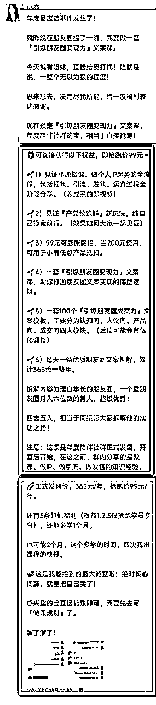

二是情绪价值。用故事给出预售契机，比如被姐妹无条件信任支持，因而回馈超值福利。付费的不仅是产品，更是相互信任的回馈，情绪往来拉近距离。

三是观赏价值。排版是否舒服决定停留时长。技巧包括多用短句，段落控制在2到4行，适当加小表情，配图清晰干净，数量选1、2、3、4、6、9等整数。

预售结束进入正式发售，重点是仪式感。可用倒计时海报，或在官宣贴下做点赞抽奖、有奖问答。后續所有活动都可在此贴下通知，曾互动的人都会收到提醒。仪式感核心是参与感，从课程命名投票到海报款式选择，都能制造养成式快乐，同时积累影响力与分销。我社群首批50人靠朋友圈，后续多为转介绍。

第三段是涨价逼单。涨价前用软广预热，正式涨价需官宣。很多人担心劝退，关键在价值叙述。需说明：一是产品升级，知识付费可从图文到音视频，实物可升级材质用料；二是交付者成长，服务人数多了经验更丰富，或自身又学到新能力。总之要让用户明白为何涨价，觉得性价比依然拉满。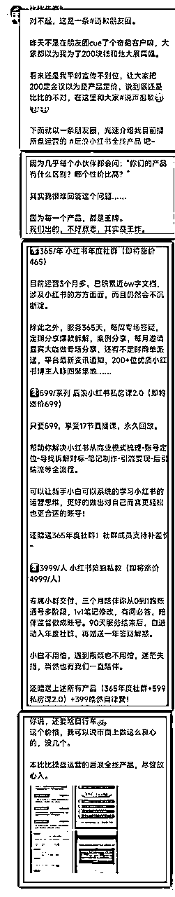

软广部分更灵活，需把握软硬平衡。可从三方面入手。第一善用故事促成交。用户故事可按路径拆：咨询故事，表达一种说不清的特别感被吸引；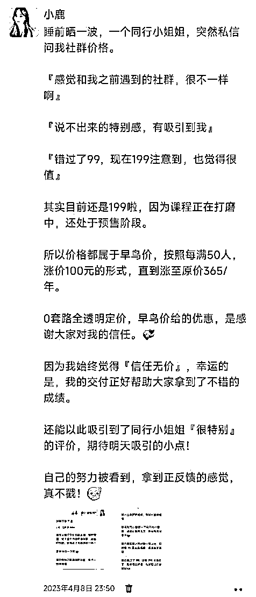成交故事，晒大咖付费增强背书；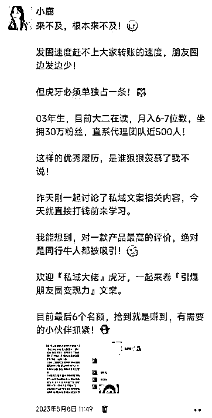报喜故事，晒学员成果比晒自己更有说服力。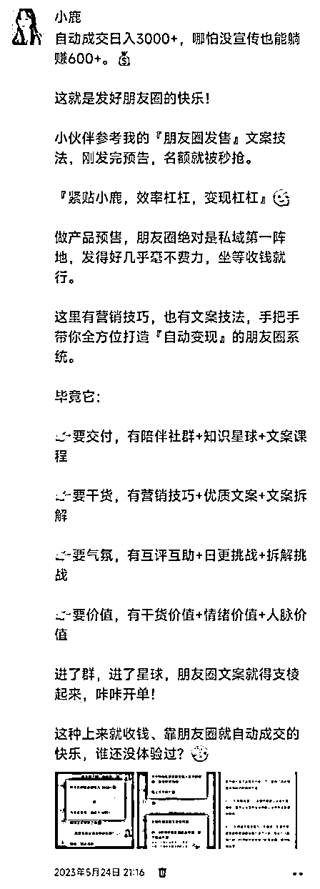实体产品则沿使用路径设计故事。

个人故事同样可作为软广：成长故事，如从社恐到打开自己，与产品共同成长；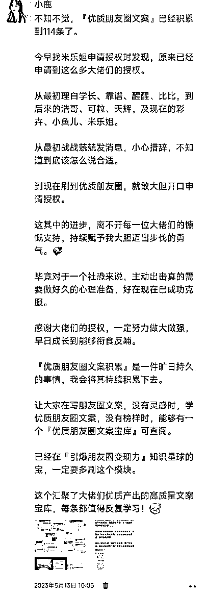人设故事，表达对赋能工作的热爱与成就感。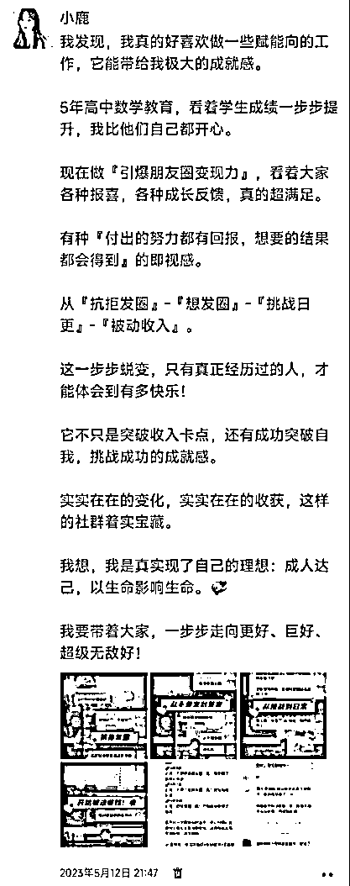这既在卖产品，也在卖一个人。

产品故事也不例外：产品理念，比如打造专属个人IP风格的朋友圈灵魂；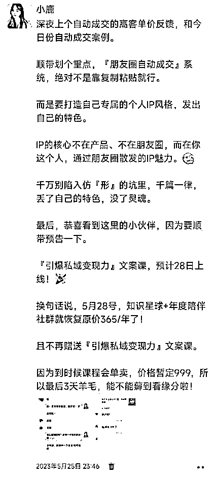产品迭代，从预售到落地的全记录。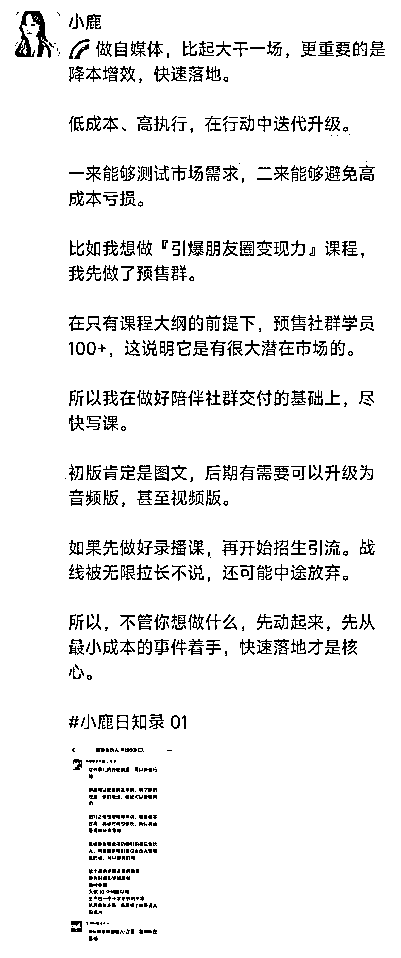养成系视角让信任日积月累，看客即使此刻无需求，也会记住品牌。

第二招是具体场景刻画。可用形象化类比，比如乔布斯说把一千首歌装进口袋，场景瞬间清晰；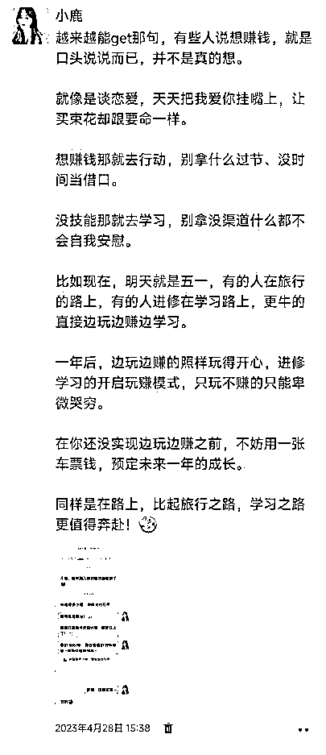细节化描述，多用动词呈现画面，如睡后收入的自动到账感；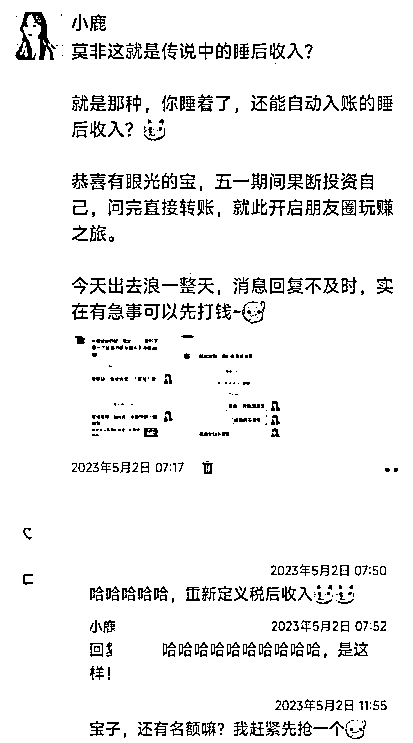情绪词带入，描写学习氛围的温暖与感动，比罗列卖点更动人。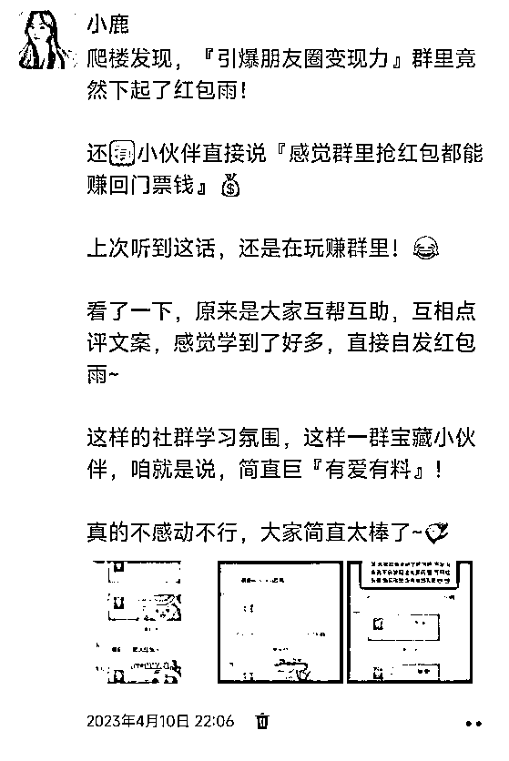

第三招是日常植入心机。日复盘可自然带出文案私教业务；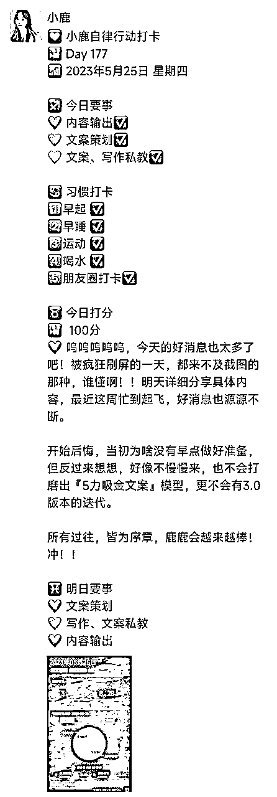日知录用成长故事引出产品；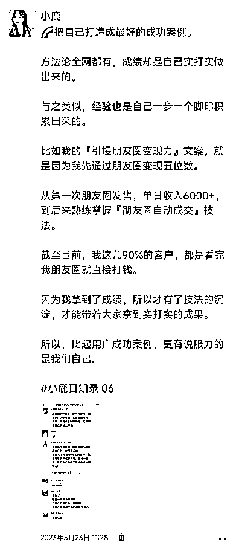碎碎念里夹带用户下单故事。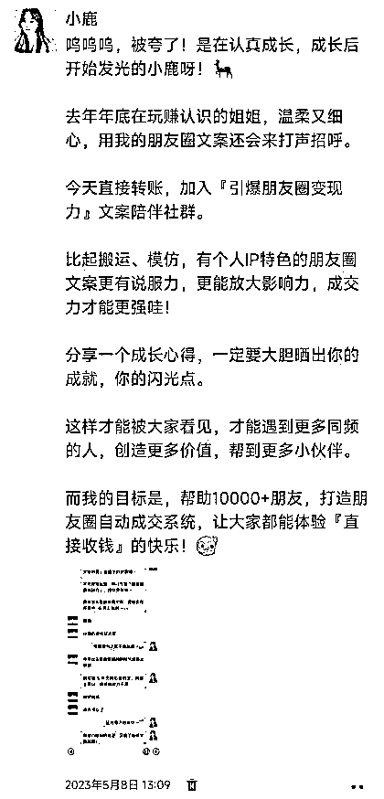朋友圈处处都是广告位，关键在于自然不刻意。

总结来说，朋友圈运营是文案力、故事力、营销力、影响力、成交力五力协同。长期打磨，才能搭建专属的私域自动成交系统。

最后解决被折叠问题。微信近期收紧审核，被折叠后只剩一行，对运营打击很大。主因是文案原创度低与图片重复度高。复制粘贴的文案极易被折叠，大规模重复使用同一张图也会触发判定。应对方法很简单：写自己的话，发自己的图。

从故事线到写作框架，从硬广节奏到软广温度，从日常植入到防折叠细节，朋友圈玩法的本质是信任经营。一条有血有肉的展示，胜过百遍自卖自夸。只要持续输出，把每日内容视为资产沉淀，你的自动成交系统终将显现。

朋友圈又被折叠？先别急着删，你多半踩中了这几个隐藏雷区。

先说最常见的原创度问题。像小来早安这类自动打卡日签图，用的人如果没手动换图，系统送给所有人的常常是同一张图。大家都在朋友圈刷同款，你再跟风发，平台自然会判定内容重复，顺手就给你折叠。解法其实很朴素：把原创度拉高一点。

文案部分，能自己打就不要偷懒粘贴。就算是转述别人观点，也老老实实逐字敲出来，既能避开重复识别，也能顺便加深一次理解。如果你有多个矩阵号要同步内容，宇轩在《高效营销手册》里提过两个办法：一是用讯飞输入法，先把文案存进剪贴板，再到朋友圈里粘贴发布，亲测有效；二是先把内容丢到飞书，再从飞书复制回朋友圈，也能减少被折叠的概率。

配图部分，优先用自己随手拍的东西。平时吃个饭、路上看到的风景、生活里的碎碎念，都能成为素材。要用网图的话，尽量挑高清、不容易刷屏的；如果实在喜欢圈里好友发过的图，也别直接保存就发，加个滤镜、裁切一下，都属于二次加工，能有效避免系统“认脸”。

第二类硬伤是营销感太强。怎么判断自己“营销味”超标？一是数量多，一天发圈超过 8 条；二是频率高，两小时内连发 3 条以上；三是一眼硬广，满屏都是“原价 XXX，现价只要 XXX，巨划算”这种话。这种内容最容易被盯上。

解决思路也很直接：一天控制在 8 条以内；如果当天灵感爆棚想发满 5 条，那相邻两条至少间隔 2 小时；价格、优惠、折扣这类敏感信息不要写在正文里，放到评论区，或者做成带花字的图片。评论区被折叠的概率通常比正文低。顺手给你列一份容易踩雷的敏感词清单，建议收藏后自查：

营销、订单、爆品、客单、预定、顾客、优惠、基础、店内、特价、搭配、限时、特惠、限定、限购、定制、套餐、新品、推荐、价格、高定、品质、制作、模式、保证、上新、包邮、现货、秒杀、必买、自制、客户、数量、名额、下单、折扣、满减、活动、售价、客服、火爆、上架、抢购……

第三，账号权重低也会导致折叠。权重就是平台对你的信任分。通常来说，“零违规、有互动、使用频率正常”的人设，权重都没啥问题。容易出事的，是新号注册后马上刷营销内容，或者频繁加好友、来回改资料、朋友圈突然刷屏。这类行为一多，账号权重下降，折叠也就跟着来了。

想把权重养回来，核心就是“像个正常人”：多发原创内容和生活随手拍；更新节奏别忽冷忽热，不要平时消失，某天突然连发十几条；基础认证尽量做全，绑个银行卡，用微信付付款，偶尔登一下购物或社交平台。让系统觉得你是个真实用户，比什么技巧都管用。

第四，还有一些不能完全用常理解释的影响因素。按阿明在龙哥盟的测试，下面几条值得参考：

互动率很关键。你和某位好友互动越多，他看到你朋友圈被折叠的概率就越低；如果你俩长期零互动，对方刷到你时更容易看到“折叠版”。所以想保护朋友圈，就多去目标用户和你欣赏的大佬评论区点赞互动。

手机机型也有影响。安卓机折叠率低，苹果机折叠率高。同一条朋友圈，可能在安卓手机上是完整体，到了 iPhone 上就被折叠了。

最后还有“玄学”：同一条朋友圈，同样的手机型号，连着同一个 WiFi，一个设备看折叠，另一个设备看正常；甚至同一个内容，有的好友看是折叠的，有的好友看完全没有。这种情况属于概率问题，碰到了只能认。

如果已经被折叠，或者不确定会不会被折叠，还有两张补救牌。

第一张牌：开头写得足够勾人。只要前几个字能让人产生好奇，哪怕被折叠，对方也会忍不住点开看全文。比如这样一条：

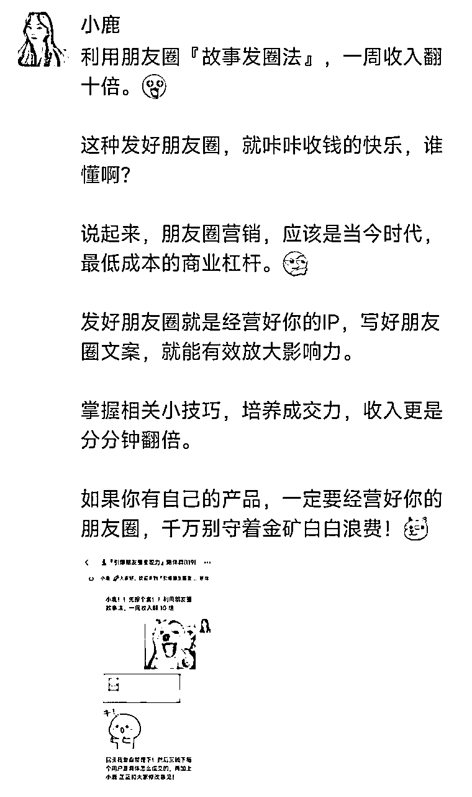

配文写“一周赚到过去十倍的收入”，想搞钱的宝子看到这里，大概率还是会点进去看个究竟。

第二张牌：培养铁杆粉丝。真正认可你的人，根本不在乎系统折不折叠，他们会习惯性定期点进你的朋友圈，翻一翻你最近发了什么。我就遇到过有好友集中连续给我点赞，一看就是专门花时间来回看内容。这种用户远胜于偶然刷到的路人，也是朋友圈打造个人 IP 的最后目标：让人主动追着你看。

小结一下：原创不够，就多写多拍；营销感重，就控制数量、拉开间隔、把优惠放评论区；权重低，就按正常人去养号；碰到互动、机型、玄学这些问题，多互动、用安卓、拼运气。万一已经被折叠，用钩子式开头加铁杆粉丝，基本也能兜底。

技巧说完，最后聊点心法。

我从小文案作者到尝试朋友圈带货，再到搭建付费社群、做个人产品体系，用半年时间让副业达到了 14.9w 的收入。但这一路最有效的东西，不是任何话术，而是“真诚”。信任这个东西，在知识付费赛道里最值钱。真诚能让人放心下单，我社群初期没什么名气，也照样做到了 50% 的转介绍率，靠的正是这条。

不要焦虑。赚钱圈子里确实有人日入五位数、月入七位数，但他们的位置多半是几年沉淀换来的。我自己能有今天的成绩，也是因为先有了五年文案功底，再把这项能力迁移到朋友圈而已。想走捷径的，先怀疑一下；想走长路的，就允许自己慢一点。起步阶段，只跟过去的自己比，一段时间只盯一件事，每天前进一小步，稳稳地走，自然能走远。

也谢谢梁靠谱、理白老师带我进入龙哥盟，谢谢一路提供帮助的教练和志愿者。愿我们都能先积累、再爆发，一点一点把路走宽。