# 找到属于自己的坐标怎么找

> 来源：[https://imste3bktg.feishu.cn/docx/NxvFdGa1vo1HIixg6BycIlygnGY](https://imste3bktg.feishu.cn/docx/NxvFdGa1vo1HIixg6BycIlygnGY)

提语：

只要把自己梳理清楚，定位其实并不难...

# START

# 开场

大家好，我是小宝，做职业生涯规划和变现助力的。

在陪伴咨询里，很多人打开招聘网站，岗位成百上千，却卡在“我到底能干嘛”这个点上。跟赚钱圈的朋友聊，也常听到类似困惑：项目一堆，抓不住手。

归根结底是定位没拎清，不知道该从哪个角度切入。今天就用职业发展的视角，拆一拆如何快速锁定方向。

职业发展通常要过三关：生存关、成长关、意义关。

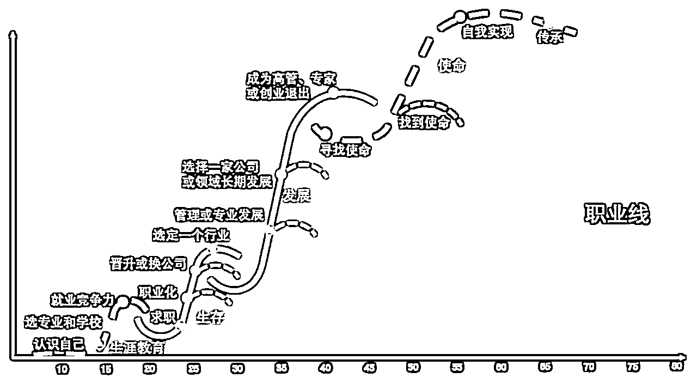

每过一关都会撞上典型问题。起步阶段要确定职业方向；中期要处理家庭与工作的拉扯；遇到瓶颈时要止损再找新路径；35岁后要么触顶要么卡壳，都得重新找出口换赛道。这些问题说白了都是定位问题。

早期定位对应职场前3-5年，就是找一个能待下去的方向。中期是已经带团队有了家庭，要厘清工作和生活怎么配比。发展受阻是原有赛道跑不动了，需要换定位来突围。后期的转型往往在35岁以后，可能是到顶了，也可能是被困住了，需要重新校准方向重新出发。

因为不同阶段的环境、诉求、资源都在变，定位本质上是一个动态调整的过程。

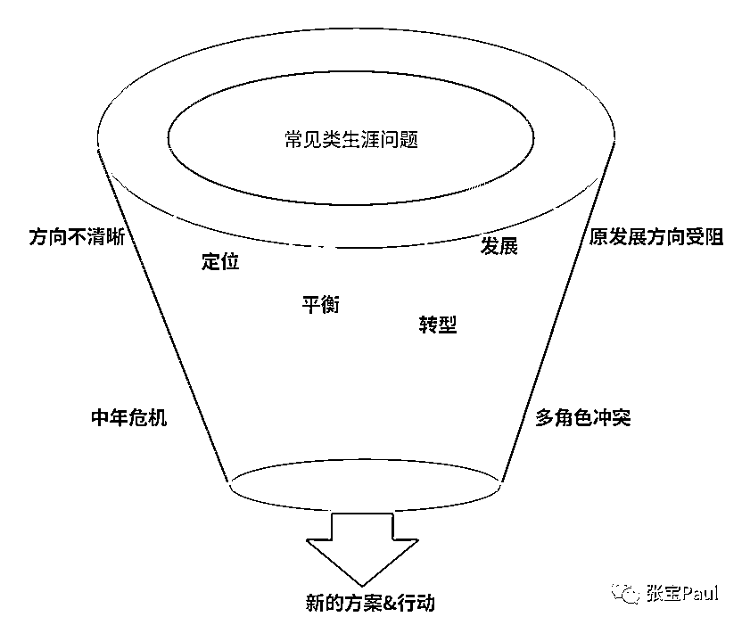

定位这么重要，为什么很多人就是做不好？关键在于自我认知和环境认知不够。

比如找工作，你清楚自己的长处、技能、资源和兴趣吗？你了解市场上究竟有哪些岗位，这些岗位要什么能力，你和它们怎么匹配？

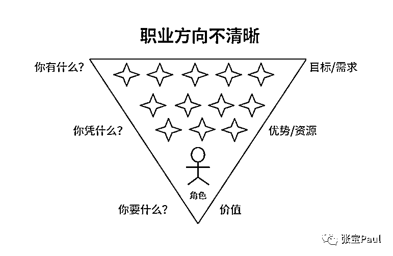

再说副业或创业，你知道自己真的适合做哪块吗？你的用户画像是什么样？怎么触达、怎么变现、怎么交付？

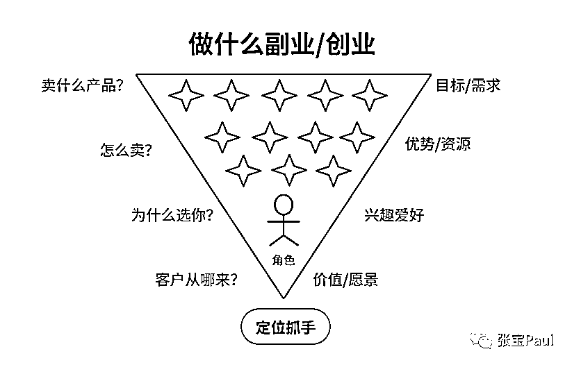

定位模糊的代价很直观：频繁换工作、干一行厌一行、上班像上坟，最后中年回头空手而归。

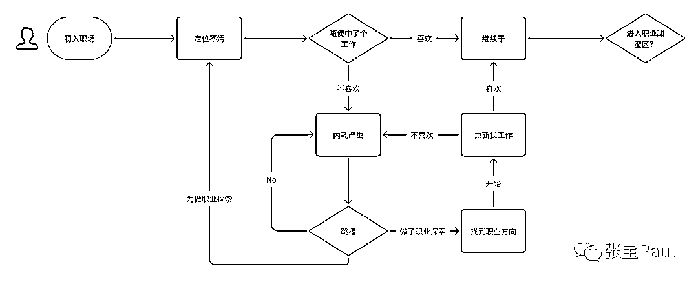

今天聊聊，在不做付费咨询的前提下，怎么系统盘点自己、找到清晰定位。

全文脉络如下，想跳读可以定位，但建议通读，效果更好。

一、定位的基础认知
二、定位常踩的坑
三、如何精准锁定定位

# ONE

## 定位的基础认知

先问自己：定位到底是什么？

从职业视角看，就是在人生的岔路口，选一条适合自己的路。

选路前，先看清三个变量。

1. 意图要清晰
你要的是什么。想创业就走创业线，想打工就走打工线，想深造就走深造线。目标不明确，路就没意义。

2. 自我要清楚
想创业不是说想就能成。你手上有什么牌？钱、人脉、能力、资源够不够？牌面太差直接上场基本就是亏。

3. 环境要看清
即便你牌面不错，还得看牌桌。身边同行都挤满了，赛道拥挤你也很难冒头。这时候换一条人少的路，或者去打工、学习，反而更稳。

定位就是意图、自我、环境三者的交集。换句话说就是：我是谁，处于什么环境，想去哪里。

拿开车打比方：地图上有桃园、深大南、南山三处出发地，想去中山公园玩，意图明确时，桃园最近最优。

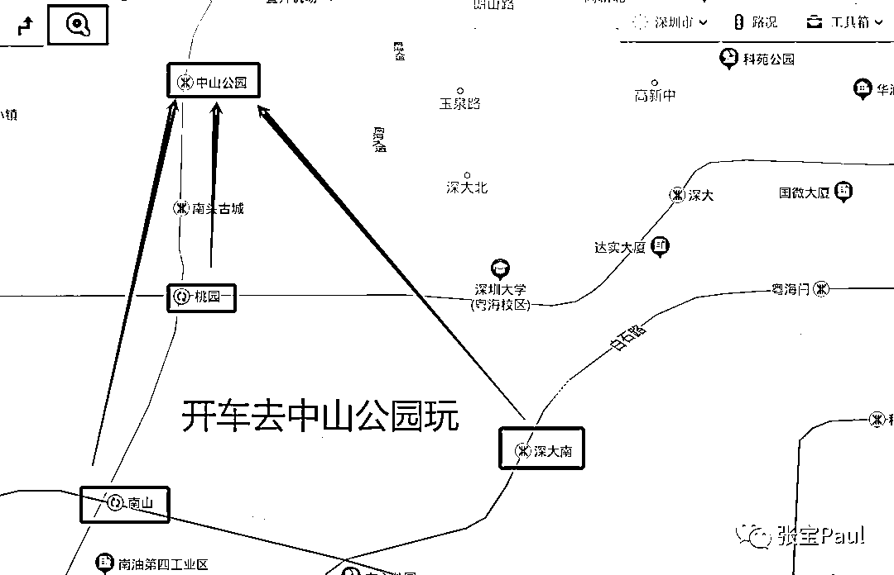

如果把环境改了，桃园虽然近但封路了，这时选一路顺畅的南山出发就更合理。

如果把自我改了，车坏了只能走路，那就选离目的地最近的桃园出发最省力。

可见定位好坏受意图、自我、环境三要素共同影响，任何一个变，路径也要跟着变。

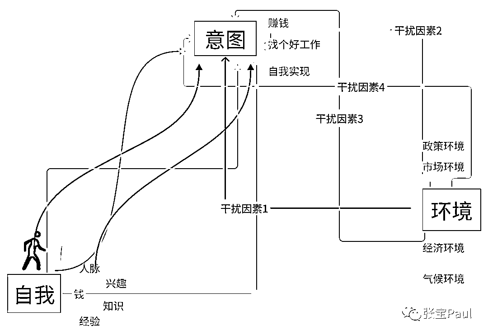

职业或商业里，自我会随年龄、能力、资源、偏好而变；环境会随时间推移而变；意图也会随阶段而变。所以定位不是一次定终身，而是不断迭代的。

# TWO

## 定位里常见的误区

1. 定位不是一成不变的
小时候想当宇航员，长大可能想开公司。人会变，资源环境会变，定位自然要变。

2. 只做机械匹配
定位≠基本情况+报告评估+简单匹配。忽略了人的主观能动性、意愿、认知在执行中的变化，就是把人当成数据表。

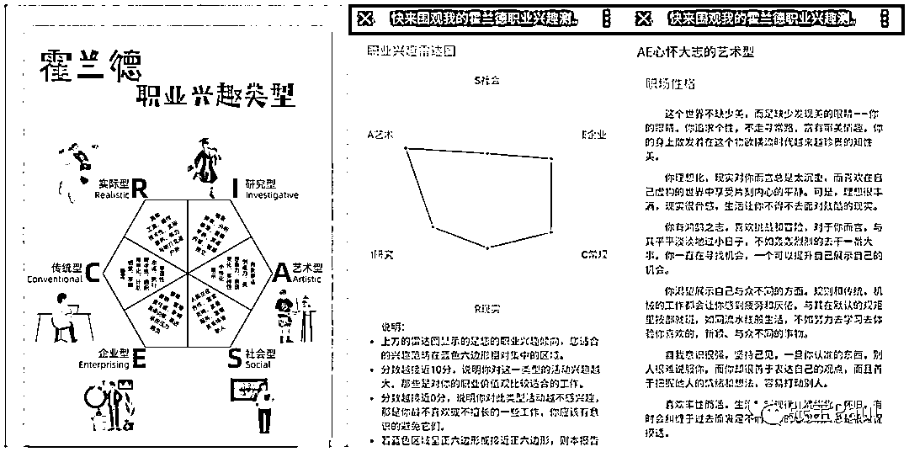

3. 把别人贴的标签当成定位
“你讲课好，去当老师吧”“你会说话，去做销售吧”。这其实是营销定位，是别人眼中的你，不是你行动的指南。很多人按标签起步后，后劲不足，明明跑通了模式却不快乐、内耗严重。因为那不是真正想做的事，没有韧性撑过逆境。

真正的定位是活的，是在实践中迭代，在探索中成长，彼此反哺。

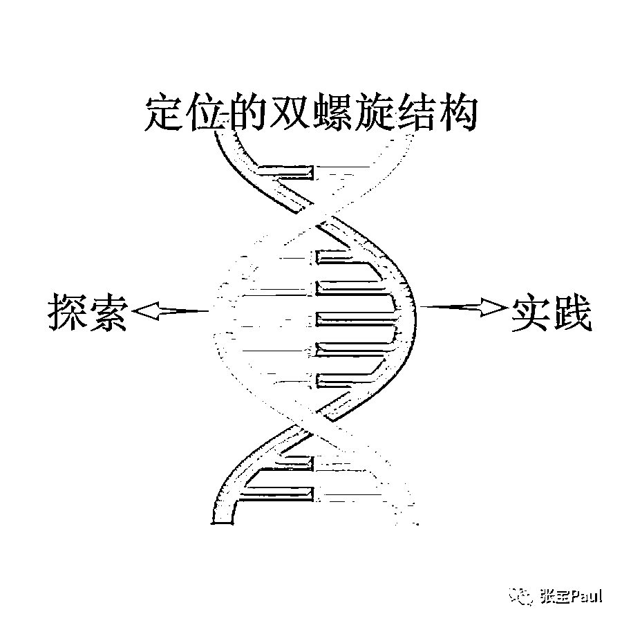

做副业创业找商业定位，也一样从三要素出发。

# THREE

## 从意图出发找定位

做事的核心目标是什么？想要什么回报？钱、价值感、情绪满足、生活方式都可能。

在商业里，意图必须围绕客户痛点展开。解决真痛点才能产生利润，定位才有价值。

需求看似很多，但要从你的意图出发收敛。

比如想赚钱，先盘点自我有什么能力资源。盘完发现很多职场人焦虑迷茫，于是想做职业生涯规划师来服务这群人。

怎么做？是去机构上班？是和同行合伙开公司？是做自由职业？还是先做课程变现？解决什么问题？迷茫？转型？平衡？求职？简历？面试？...范围一下子就扩散了。

问题太宽，等于靶子看不清，只能乱射，效率极低。

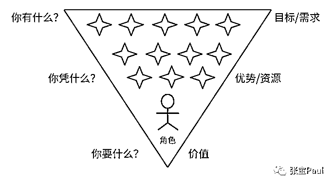

想把模糊需求变清晰，需要戴上一副“高倍镜”。

怎么戴上这副镜子？用三维细分法把需求具体化：什么场景下，为什么人，解决什么问题。

三个细分维度：

1. 场景细分
用户在何种情境下接触你的服务。家里、咨询室、公司、咖啡厅、户外、通勤路上，需求完全不一样。
在家偏重性价比和效率，电话沟通即可；咨询室重氛围体验；公司场景要微咨询快速解决；户外重便利性；通勤路上可能只想听课程。

2. 人群细分
每个人收入、学历、偏好、年龄、地域、角色都不同。
小学生可能只要生涯启蒙；大学生可能只为完成作业；毕业3年内的求职迷茫；毕业3-8年的平衡晋升；毕业8年以上的转型再就业；还有地域、性别、职业差异。需求各不相同。

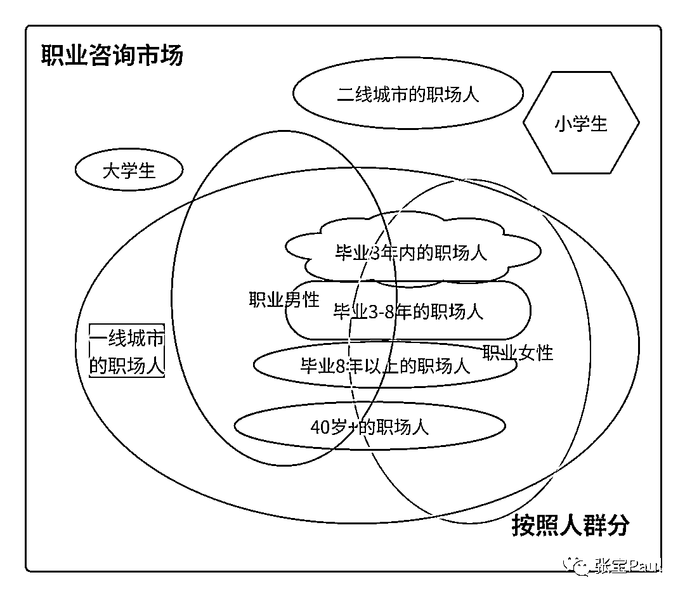

人群不同，市场就被进一步切碎。

3. 用途细分
用户为达成什么目的使用你的服务。
有的为找方向顺利就业，有的为突破晋升瓶颈，有的为平衡工作与家庭，有的为应对中年危机，有的为改善职场关系，有的为简历优化快速入职。

用途一变，产品形态也不一样。

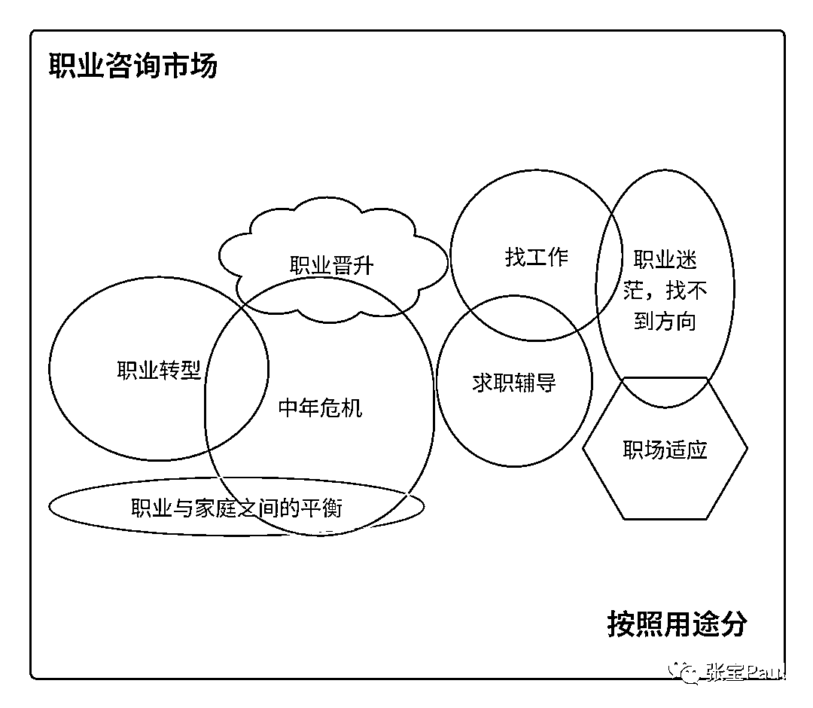

把意图拆细后，市场就清晰了。把场景、人群、用途随机组合，就能看到大量具体需求。

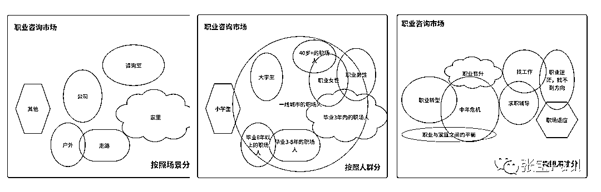

例如：线下咨询室，服务毕业8年以上职场人，解决转型问题。又如：居家线上服务，解决毕业3年内新人迷茫定位问题。

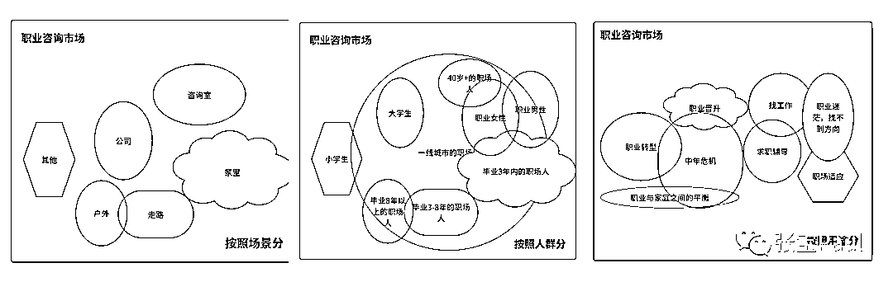

不断组合，你就能覆盖市场的大部分细分点。然后从中挑一个“好需求”来设计产品。

好需求三个标准：

1. 需求要真实
小学生去公司要求职是伪需求。拿不准就先跑最小可行验证，测概念是否成立。

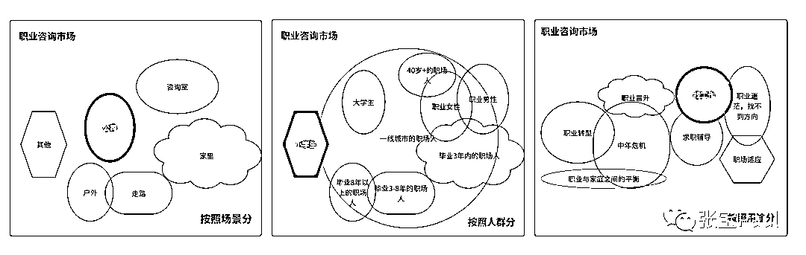

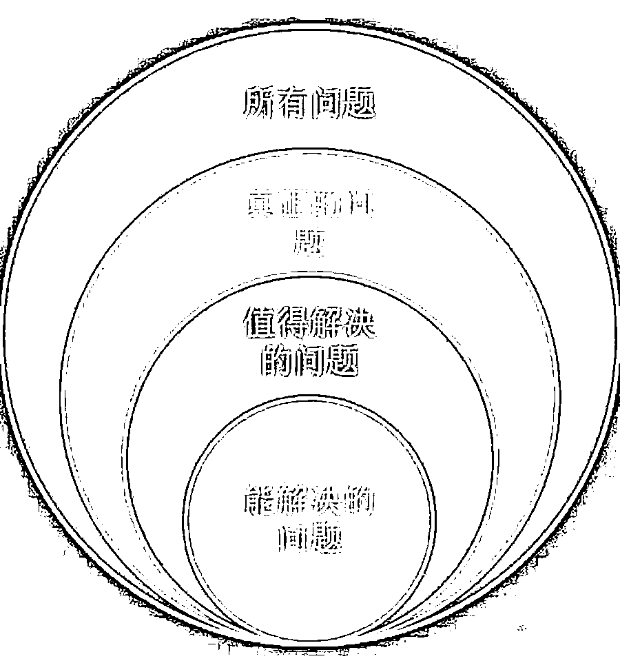

2. 市场要够大
需求真实还不够，要有体量。大学生为作业做规划，需求存在但付费上限低，天花板快。40岁+人群的转型需求，能产生的利润空间是多少，都需要调研评估。

3. 竞争要够小
大市场必然竞争激烈。越刚需竞争越猛。要不断细化找到差异点，形成小而精的定位。做职业规划的人很多，专做40岁以上高端人群转型的少，再细分到资产100万以上的高净值人群就更少，客户一想到这个定位就直接联想到你。

这就是从意图出发，通过场景、人群、用途三重筛选，锁定可行动的定位。

# FOUR

## 从自我出发找定位

意图给出了市场机会，自我决定你能不能吃下。

你有专业能力吗？有资源吗？有启动资金吗？有时间精力吗？客户为什么选你而不是别人？

AI在冲击大量工作，职业咨询相对抗风险，但不同的人做起来效果完全不同。行业大咖和普通从业者的起点、资源、影响力、专业度都不同，竞争策略不能照搬。

同样是细分市场，你的年龄、性别、资源、专业背景、获客能力都是差异点。

90后加上多年互联网运营和知识付费分销经验，更懂同龄运营人群，也更会做新媒体获客，这就是独特的切入策略。

怎么盘点自我？

1. 盘点资源
资源是未来行动的底座，分内在和外在。

内在资源包括可兑换价值的知识技能经验，也包括思维认知、热情等放大器。

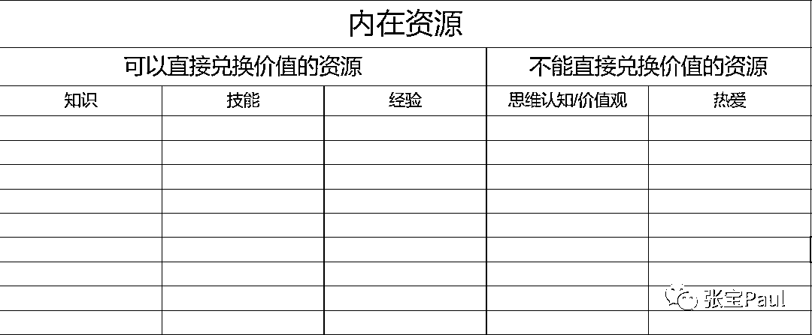

盘点会发现：懂职业规划、会摄影剪辑、运营经验丰富、对人际沟通充满热情等。资源有了还不够，还要看认知和热爱是否匹配。内向的人去做销售，不善数据的人去做数据分析，都会很吃力。

你有没有认真想过这么一件事：哪怕你手里握着不少现成的资源，只要没看清自己是个内向的人，也不了解做销售到底需要哪些关键动作，那这事儿就很容易走偏。

现实中，销售往往要求你每天跟大量陌生人打交道，主动建立关系。而一个内向的人，既不擅长也不喜欢这种社交方式，最终的结果就是：既很难开单，又让自己陷入巨大的精神内耗。试想一下，每次面对陌生客户，都要先给自己打半天气，然后用并不流利的话去沟通，这画面光是想想就让人头皮发麻。

这时候，“思维认知”这个内在资源就开始起作用了。它让你清醒地认识到：你并不适合亲赴一线做销售。就算有客户资源，硬靠自己冲到前线去成交，反而是件糊涂事。真正聪明的做法是“扬长避短”——看见自己的短板，去找擅长销售的人合作，两个人补位，事情一下就顺了。

就像靠谱在赚钱圈子里分享过的观点：她如果真去做盖洛普咨询师，也能胜任，但那个过程会让自己极度拧巴。与其硬扛，不如做更适合自己的事。

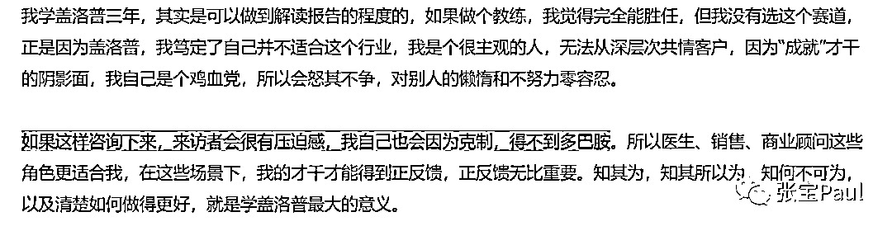

短视频火了，你冲进去做短视频；小红书无货源火了，你跟着做小红书；ChatGPT火了，你又转头去做ChatGPT……

你说这是风口，来钱快，自己多少懂点，就算不懂也没关系，先入场再说，快速捞一笔。这当然可以理解，毕竟谁会和钱过不去呢？

可如果遇到了阻碍，或者根本没赚到钱呢？

短视频火了，你也去拍了。但你本身不擅长表达、不上镜，拍出来的内容总差点意思。每天都很痛苦，拍了一两个月没什么水花，也没变现。这时候你还坚持得下去吗？就算咬牙坚持，终于跑通了业务，也赚到了钱——但很快，越来越多的人涌进赛道，你的粉丝不再增长，视频收入开始下滑。同行越来越多，有人做得比你更好，价格比你更低。

你想转行做培训，教别人做短视频，又得重新研发课程、投入精力，最后依然不如意。问题接踵而至，钱越来越难赚，而你对这件事本来就没有多少热情。赚得到钱，还能忍一忍；赚不到钱，怎么办？

坚持？天天做自己不喜欢的事，迟迟拿不到结果，越死磕越痛苦。

放弃？也许这是个有前景的赛道，坚持就有机会，但你已经投入了那么多时间、精力和金钱，却始终没有正反馈。光靠“坚持”二字，又能撑多久？

更扎心的是：如果一件事必须靠死死苦撑才能做下去，那这件事大概率也成不了。

那还有别的路吗？有。

前面提到，思维认知是一种内在资源，能帮我们看清事情背后的系统，拆解成事的关键：我们有哪些资源？能不能做？该怎么做？

而另一个常被忽略的内在资源，叫“热爱”。

一开始就选择一件自己真正喜欢的事，效果会完全不同。你不会感到煎熬，哪怕后来遇到困境、钱变难赚，你也依然愿意继续。因为你享受这个过程，不觉得它是负担，反而乐在其中。正是这种热爱，会驱动你投入更多的时间与精力，从而把这件事做得更好。

热爱会让人不自觉地把事情做到极致；会让人沉浸在心流中；也会让人在逆境里依然不肯放手。

人生漫长，晴雨交加。可你若心怀热爱，即使岁月荒芜，也能奔山赴海，静待一树花开。

思维认知与热爱，就是资源的放大器，它们会推着你把事做成。

外在资源，则负责帮你提升成事机会与效率。比如人脉、资金、独家信息，这些都能拿来直接用。

比如你想跟风转行做职业咨询。如果你没钱报班、没人脉帮你进入圈子，只靠自己瞎折腾，效率会极低。但如果你有资金，直接砸钱上最贵的课程、请最好的老师做督导，结果自然天差地别。

再比如AI、大数据、物联网、自动驾驶、大健康、新能源，这些行业听起来都是大趋势，收入高，不容易被AI替代。可它们跟你有什么关系？

你说：我可以转行去做啊！

假设你之前一直在传统制造业做汽车性能测试，现在三十岁，突然想从零开始转行大健康。这并非不可以，但它显然不是“好选择”。因为你过去积累的资源没有一致性，无法迁移，也没有足够的认知储备，只会白白浪费曾经的积累。反过来，如果转行去自动驾驶领域，那你之前的汽车专业知识、经验和人脉都能派上用场。转行方向和过往资源保持一致性，就像顺水行舟，轻松得多。

那么，怎么关注资源、整合资源来帮助我们决策？考虑三个点：

第一，资源的内容关联性。比如你已经工作五年，平时喜欢看生涯类书籍，还常帮职场新人解决发展问题——这就是内容上的关联。

第二，资源的时间关联性。过去和现在积累的生涯知识、助人经验，都能为未来开启职业规划咨询做准备。此刻的积累，正是为未来铺路。

第三，资源的系统关联性。从全局视角看，整个职业咨询系统里有什么？可能有哪些同行？谁未来是你的客户？如何吸引他们？有哪些前辈可以链接？哪些人可能成为协助者？看到这些关联，你就能站在更高处整合资源。

比如你想完成从职场人到职业咨询师的转变，你需要专业力和商业力。你可以加入咨询师同行的圈子，一起成长；开一个公众号、视频号，系统输出知识，用输出倒逼自己输入，同时默默积累潜在客户；从公益咨询开始，逐步提升客单价，验证自己的专业功底；邀请同行和前辈为你背书；设计产品、做训练营、做内部分享——机会可能先从自己公司里长出来。

这样一来，你手里的资源就通过系统被有机地串联起来，彼此发力。就像买房，不要只盯着自己攒的那点工资。想攒首付，跳出来看，这个系统里还有哪些资源可用：信用卡、贷款、双方父母支持、朋友借款……组合起来，你可能很快就能上车。

与其只盯着自己手里已有的资源，不如学会有效整合资源，这才是高效开启事业的关键。

接着，我们要看看自我当下拥有的“选项”。

一个刚入职场的新人，在纠结做销售、运营、IT、设计还是建筑工程师时，真实情况往往是：他对这些行业的了解很浅，也没有对应的资源和技能，很多选择根本算不上“选项”。只有抛掉那些虚假的自我认知，才能从真实选项中找到一个可切入的定位点。

怎么找到？先看三个“我”。

看过去的我——我积累过人脉、金钱、能力、知识、经验和技能吗？

看未来的我——我有什么期待？未实现的梦想、想赚多少钱、想体验什么生活？

看当下的我——我可以从哪里切入？先录一个短视频，还是先写一篇文章？

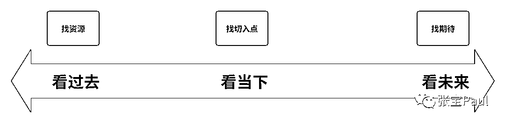

再看找选项的三个维度：

能做的——力所能及，资源所至。比如你现在就能做短视频运营、做培训，这些都不太难。

想做的——心生好奇，跃跃欲试。比如想跑通自由职业，然后开着房车环球旅居。

期待的——志向所在，努力追寻。比如你想带领更多人重新设计人生，让他们按自己的意愿过一生。

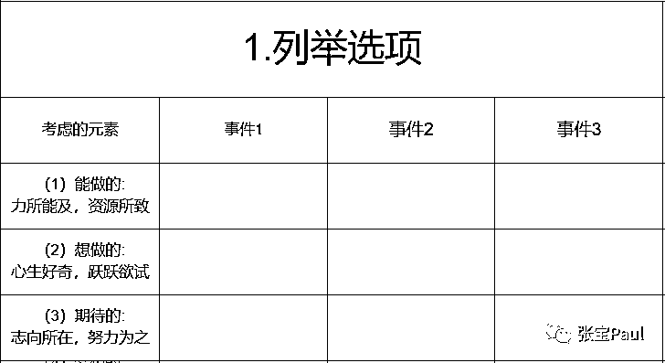

列出一堆选项之后，先别急着冲。我们需要戴上高清眼镜，做一轮初步筛选。

第一，要符合客观规律——什么阶段做什么事。比如我曾经特别喜欢亲子领域，想当育儿老师。但一个单身没娃的人，贸然投入亲子讲师赛道，注定前路坎坷。更扎实的做法是：先做好本职，或去亲子教育机构上班，同时努力学习育儿知识，等自己有娃后再进入这个领域，自然顺理成章。

第二，问问内心的期待——你真正想要的是什么？是钱、权力、名气、一个梦想，还是做自己喜欢的事？正如很多咨询中的人，明明有一份收入高、事少、离家近的工作，外人觉得完美，他们却觉得压抑、不快乐，价值感无法实现。你眼中的好，不一定是他人眼中的好。真正想要什么，只有自己知道。

第三，关注价值——看热爱程度、看资源情况、看机会成本。

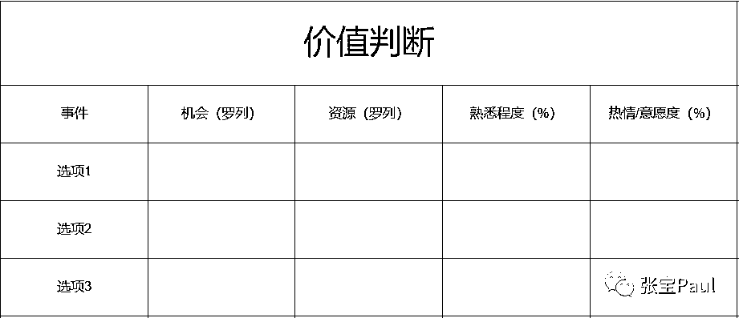

先看热爱度。这件事你有多热爱？哪怕没资源、没钱、困难重重，你也愿意做。只有足够的热爱，才能让人勇往直前。比如短视频带货混剪可能赚钱，但如果你不热爱，靠打鸡血撑不了多久；而一个喜欢读书的人，做一个读书账号，哪怕没什么收入，也乐于分享。做这件事毫无压力，反而享受过程，慢慢地自然会有果实回报——钱、粉丝、机会，那都是热爱给你的嘉奖。

再看资源是否有延续。资源是过去的积累，不用就是浪费。如果现在要做的事和过去资源有链接，成事概率会翻倍。比如你想做销售，你有辩论赛经验、演讲经验、培训经验，这些都有延续性。而想做职业咨询，如果没同理心、没共情力、没专业知识，那就很难，因为过去没有任何相关积累，全部从零开始，自然难上加难。

最后看机会成本。我们每天都在做选择，但时间、资源、金钱都有限。得到一样东西，往往要放弃另一些东西。那些被放弃的，就是你选择的代价。理解机会成本，能让我们更理性。

机会成本可以从三方面理解：

最大——我写这篇文章需要五小时。如果这五小时我去做别的事能赚500元，那么我写这篇文章的机会成本就是500元。机会成本一定是放弃的“最大代价”，而不是随便哪个代价。

必然——机会成本一定是一个真实可选项。不能说“我这五小时不去接一条十万的广告，所以机会成本是十万”——这不可能也不真实。我又不是头部博主，没有金主爸爸找我。但五小时去接私活赚500元，是真实能做到的，这才是机会成本。

所有——我们所有选择都有代价。比如我晚上基本不用电脑，那么这台电脑晚上的机会成本，就是把它租给需要的人所能获得的租金。

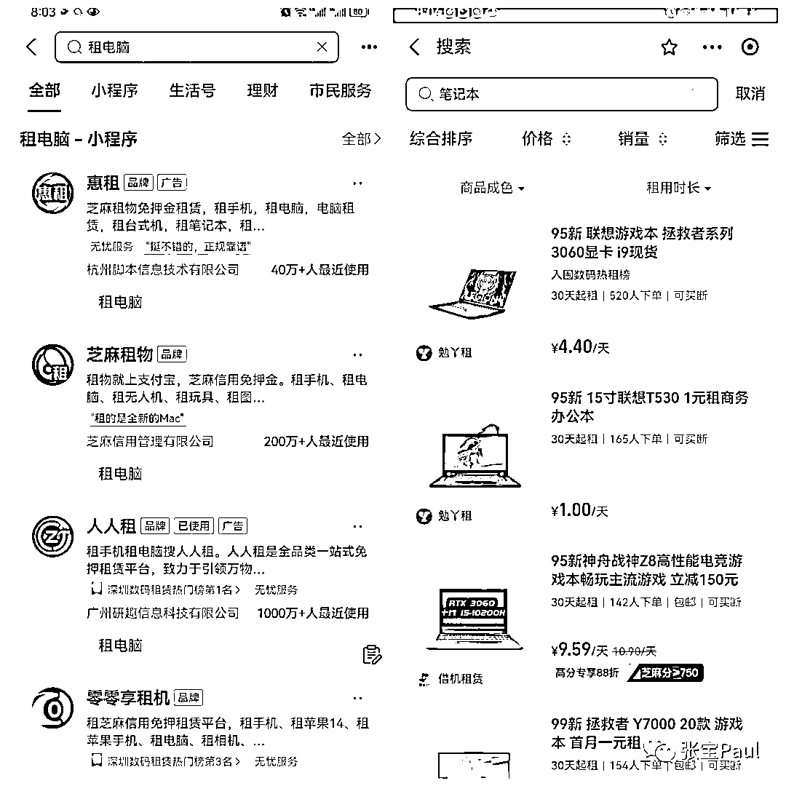

一句话理解机会成本：鱼与熊掌不可兼得，放弃的鱼，就是你选择熊掌的代价。

所以从“自我”出发做定位时，要关注三件事：看资源是否一致，判断能不能做；看有哪些真实选项，找到切入点；看这件事的价值，判断值不值得做。

很多时候，我们的定位还要看环境。

疫情突然到来，原本好好的行业面临倒闭风险；在线教育抓住机会快速发展，可“双减”政策一下，又不得不转型。怎么办？

第一条路：做出差异化。

你进入的行业一片红海，竞争激烈，那就通过差异化让自己与众不同，增加胜算。

就拿矿泉水来说。百岁山说“我们是水中贵族”；农夫山泉说“我们不生产水，我们是大自然的搬运工”；依云说“来自阿尔卑斯山底”；昆仑山说“天然的才是健康的”；怡宝说“你我的怡宝”。这就是差异化定位，给客户一个选你的理由，让你从无数矿泉水品牌中脱颖而出。

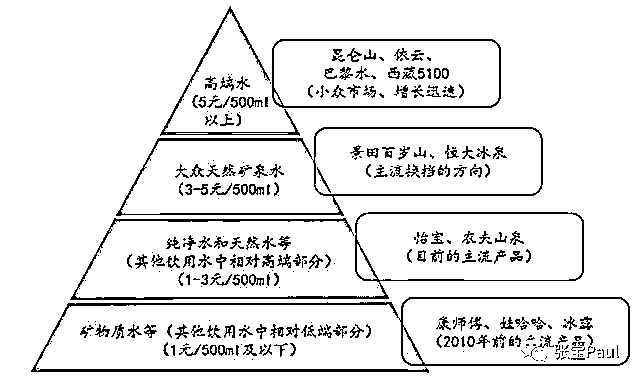

再看看短视频领域，教画画的博主多如牛毛。如果你也拍那种普通的绘画教学视频，大概率卷不出来。而博主米雷，靠“真人出镜+绘画+变装+超高颜值”，快速圈粉600多万。

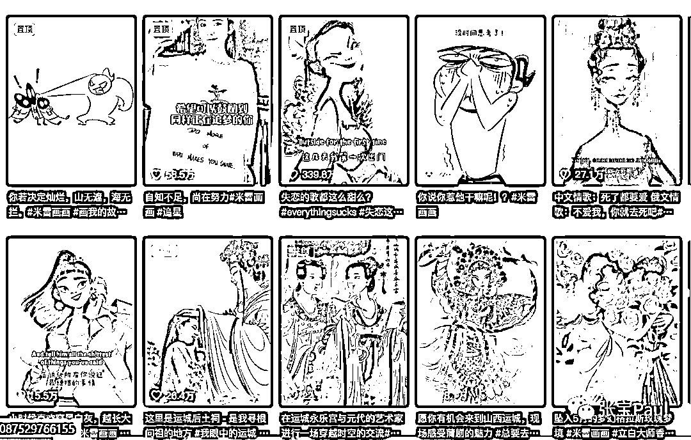

怎么做出差异化？可以从身份、场景、动作/道具、态度、视角入手。比如你是教英语的知识博主，就可以用这些维度去发散填空，做一张表，然后随机组合，差异化定位就出来了。

比如：英语老师+说唱+情景剧+恶搞，成了抖音博主“杨家成”，圈粉1900万+。

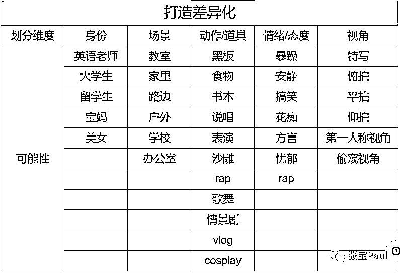
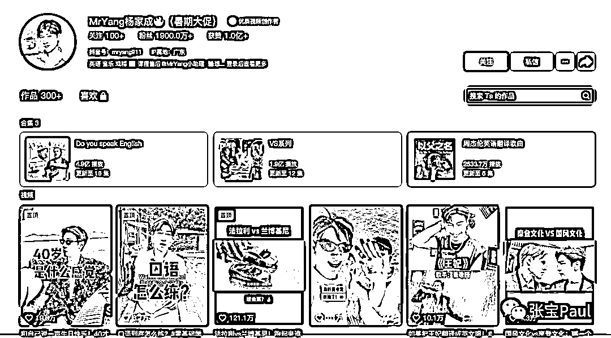

英语老师+Rap+家里+性感美女，成了博主“阿飞Kathy”，圈粉50万+。

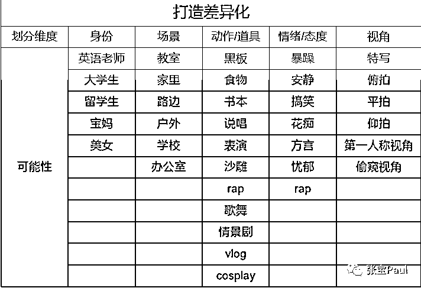
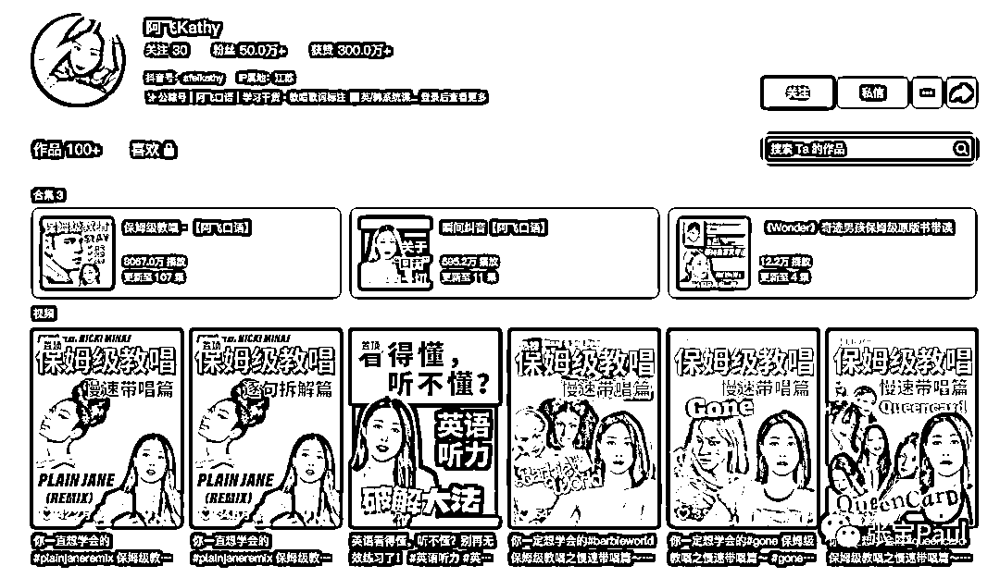

宝妈+家里+Cosplay+搞笑，成了博主“恩恩姥姥”，快速圈粉700万+。

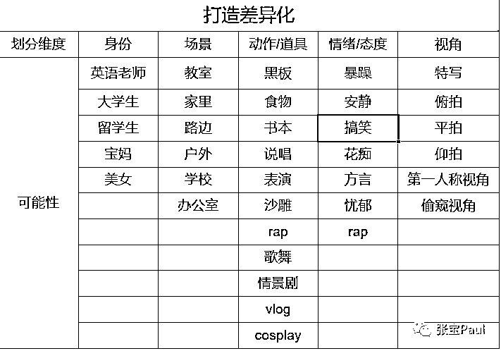
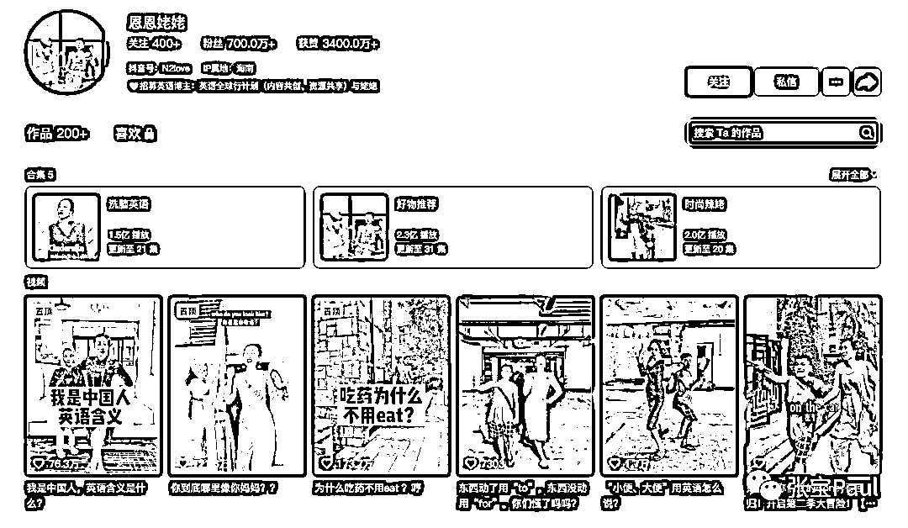

所以，当你进入一个竞争激烈的市场，打造差异化是从竞争中突围的关键。

第二条路：找蓝海。

既然红海太卷，为什么不绕过内卷，去一个没那么挤的地方？谁爱卷谁卷。

还记得前面按“意图”找定位吗？用“人群、场景、用途”细分，再随机组合，可以找到竞争较小的细分市场。

拿饮料市场举例子。碳酸饮料是可乐和百事的天下，茶饮领域康师傅、统一占了60%。在这样一片红海，做一个新品牌格外难。但仔细看，传统茶饮主打高糖甜茶，碳酸饮料又出了名不健康。随着消费者健康意识上升，碳酸饮料市场触顶——健康，正是市场裂缝。

元气森林看到了“一边熬夜一边保温杯里泡枸杞”的年轻人：想要劲爽口感，又想要健康；想喝饮料，又怕长胖。于是主打“0糖0脂0卡”的气泡水一出现，立刻圈粉无数。它瞄准的是18-35岁、居住在一线新一线二线城市、对健康有要求的消费者。

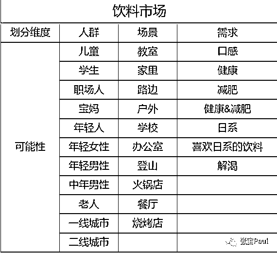

在巨头林立的饮料市场，元气森林硬是找到一个更细分的市场，5年估值达到150亿美元，撕开了一道裂缝。

同样的例子还有拼多多。在电商竞争白热化时，拼多多瞄准了那些不会用淘宝、京东的五六十岁人群——他们有购物需求，但不懂独立App，于是基于微信场景的小程序应运而生。靠这个新人群、新场景，拼多多快速上市，闯进了一个几乎全新的市场。

找到蓝海市场，就像把车从乡村土路开上高速，想慢都难。

最后总结一下：

一个好的定位，能极大提高我们“成事”的概率，让人赢在起跑线。

从意图、自我、环境三个方面做全局判断：明确你的需求，找到能帮你实现需求的用户需求，通过解决用户需求来创造价值，进而满足自己。基于自我看资源是否延续，看选项是否真实，看价值是否值得。基于环境做差异化，或找蓝海。定位想清楚了，路才会越走越顺。

定位这件事，说到底就是把模糊的机会变成清晰的落点。

第一步，先把目标用户拆清楚。不要笼统地说“给所有人”，而是拿三把尺子去量：是面向哪类人群、在什么场景里使用、用来解决什么具体用途。把人群、场景、用途拆开来再组合，就能拼出很多细分的切入角度。找到角度后，用三条硬性筛选来做判断：这个需求是真的存在且刚需吗？市场体量够不够大，能养活自己吗？竞争对手是不是已经挤满了？三条都过关，市场才值得去占。

第二步，盘点的是自己。就算市场再好，不适合自己也白搭。先问热爱：你对这个方向是发自内心的喜欢吗，能不能支撑你长期投入？再看资源：你手上现有的经验、人脉、渠道能不能复用到这里，形成起步优势？最后算账：投入这个方向的机会成本高不高，付出和回报是否匹配？自我适配不过关，再好的市场也会做得疲惫。

第三步，要看大环境怎么走。外部在变，策略就要跟着变。在已经很拥挤的红海里，别硬碰硬，用差异化去凿出自己的高地，做出别人没有的独特价值，让人一眼记住你是谁。也可以反其道而行，走蓝海策略，主动避开内卷最激烈的板块，去找需求还被忽视、竞争还不多的空白地带先卡位。

把市场判断、自我评估、环境研判三层对齐，定位自然就准了。祝你能快速锁定属于自己的那块场域，稳稳启动。

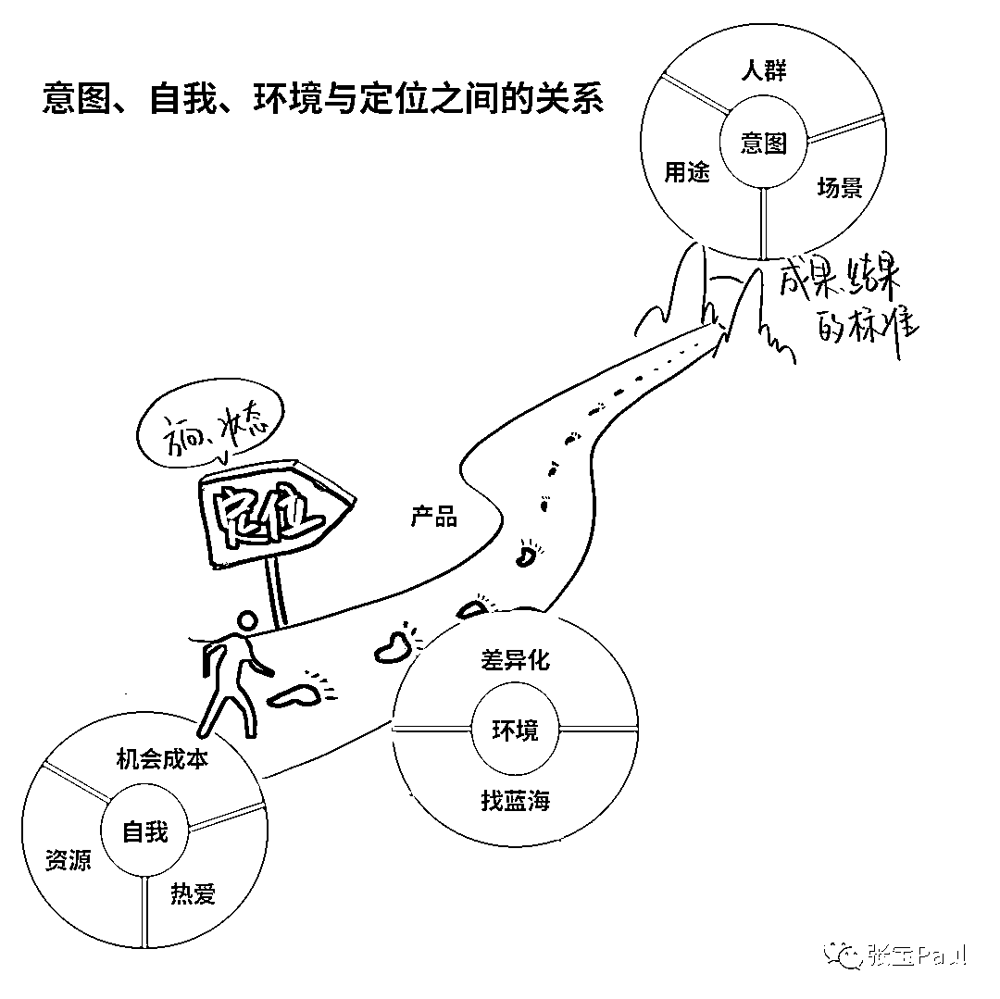

*   - The End -