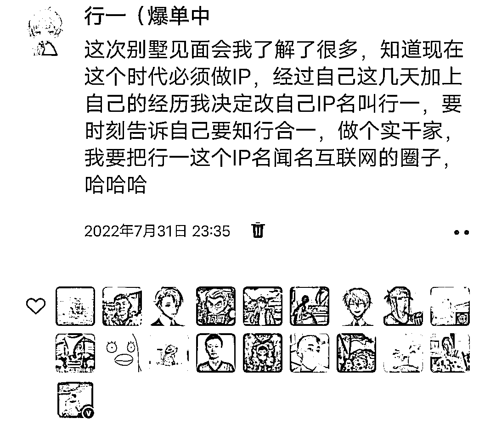
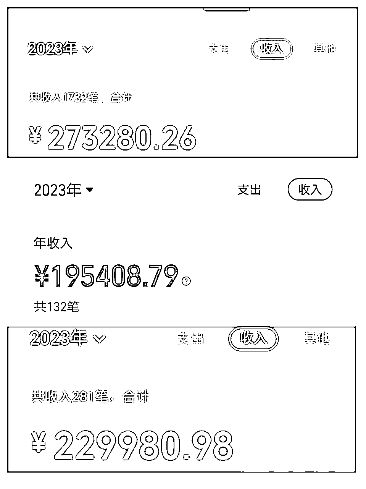
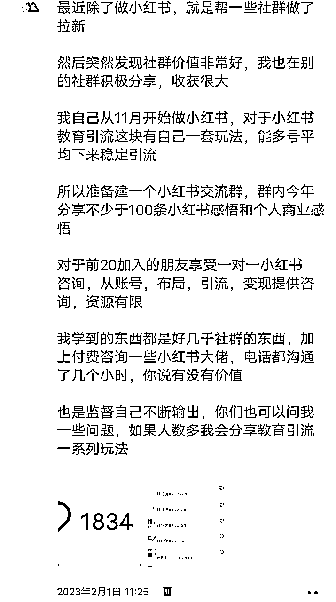
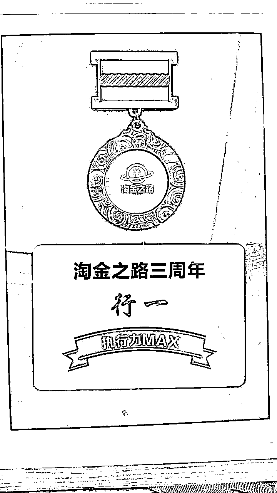
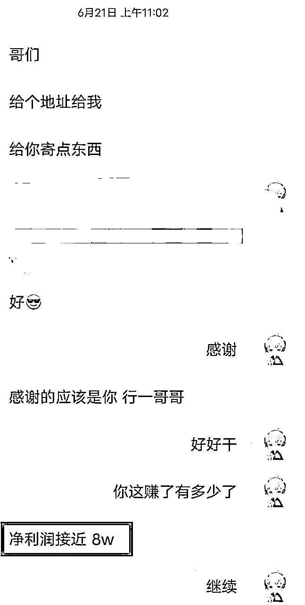
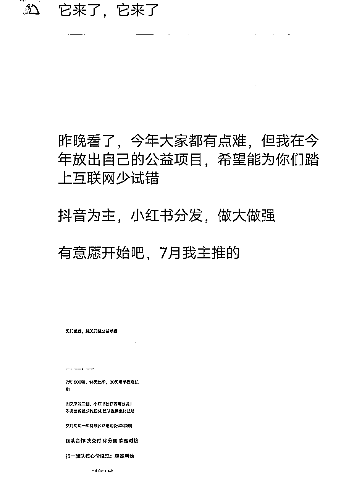
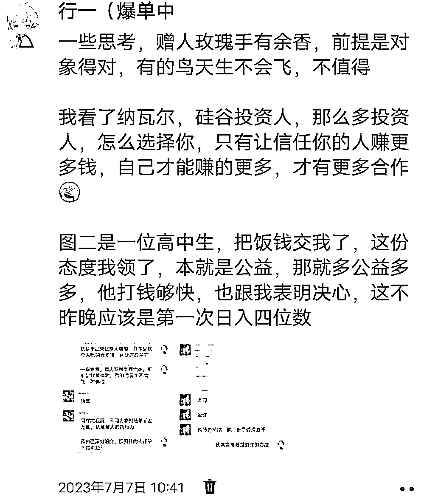

# 一年做 IP，我拿到人生第一份百万成绩单

> 来源：[https://wxm1taza3m.feishu.cn/docx/RQ8Tdrx8doQD8Bx4lWEcjCaEnqg](https://wxm1taza3m.feishu.cn/docx/RQ8Tdrx8doQD8Bx4lWEcjCaEnqg)

各位圈内朋友好，我是行一，02 年在校大学生，一个始终在路上自我迭代的学习者。

眼下我手上运营着两支工作室，一支主攻小红书电商自营，一支专注于流量自营。21 岁的我能走到现在这一步已经很满足，但前进的步伐不会停。

回溯到一年前的一场线下聚会，我见到偶像拱卒哥哥和狗哥，当晚也结识了靠谱姐姐，是我至今最感激的引路人。那天晚上互联网大佬们的一席指点，对我影响极深。

再回头审视这个 IP 的起源，感慨万千，起步的过程远比想象中艰难。正是围绕这个 IP 的深耕，让我不到一年时间就实现了人生第一个百万，并完成第一家公司的成立。下面是我今年的收益截图：

再算上当下私域资产与工作室业务资产的累积，百万的里程碑已经达成，我正朝八位数进发。

近期认识我的人会知道我已落脚长沙。上个月在长沙的首场赚钱见面会上，我分享了我的小红书实操经验。有人好奇，东北的自营工作室都已搭建好，为何敢独自前往一座陌生城市开启新征程。那座城市有兄弟们的承诺，也是我下一阶段的起点。

能走到今天，离不开兄弟们的托举与贵人的扶持，但根本前提还是自身过硬。因为够强，别人才愿意带你，愿意跟你，这本身也是一种能力。

接下来我将以更坦诚利他的方式做一场分享，有收获的朋友可以支持一下这个弟弟：

# 目录

一、行一 IP 的成长轨迹
二、行一 IP 的运作方法
三、行一 IP 感恩的对象
四、行一 IP 接下来要做的事

# 一、行一 IP 的成长轨迹

## 从短视频带货实操者到流量操盘手

在正式做 IP 之前，我主做短视频带货。决定all in IP 后，团队内不少方向被我砍掉，我带着团队死磕流量。当时的承接方案是在做倒爷式撸货业务，帮助他人承接流量，对当时的大学生而言适配度很高。

当撸货模型跑通后，我开始接触小红书引流。那段日子基本全天候刷小红书，追踪当下爆款风向，研究别人如何引流。早先我已深耕过小红书虚拟项目，玩法已成体系，所以上手引流并不吃力。

一个原本深耕剪辑带货的实战派，忽然切换到流量派，跨度很大。好在靠小红书引流卖资料，我把底层逻辑和可复制的方法论吃透了，这也为后续的流量自营打下了基础。

三個月的持续引流，为我沉淀了近6000人的私域流量池，这批用户也成了我后续操盘的底气。

## 首个付费社群的诞生

这是我创办的第一个付费社群。最初只是想让自己更聚焦小红书，同时把脑中的一些想法输出出来，筛选出第一批铁粉。起因很偶然，是在为他人拉新社群时突发念头。

没想到这个社群对我帮助巨大，向上帮我链接了大量资源，向下筛出了一批执行力极强的人。更重要的是，它逼着我做输出，我的输出方式是费曼学习法，保持真诚利他。

## 为他人社群担任教练

从被看见到被需要，要感谢偶像狗哥及其团队。我曾带过小红书引流和小红书电商的行动营，这是我第一次从实干者转变为社群教练。

带队的初心很简单，是对狗哥长期帮助和他公众号文章的感恩。我对此次授课极为上心，课件也是我初做私教时的版本，投入的用心程度带来了强烈的反响。

后来多次被社群邀请，持续带队千人规模的小红书电商营。分享得越多越幸运，帮助他人最终也是帮助自己。

## 第一次登台领奖

在创业路上，人生第一次拿到互联网领域奖项，比拿奖学金更让我高兴。

执行力是我的生存方式，看到一个模式能赚钱，当晚没搞明白就睡不着。这种偏执现在仍在调整，确实曾带来健康问题。

我一直相信，专注把一件事做到极致，就是最硬的护城河，也是天花板。所以半年多来，我始终死守小红书这个赛道，对平台的每一次调整都高度敏感。

## 真诚利他的实战营体系搭建

起初因为小红书电商直营团队的货款缺口，我推出了第一个服务型产品——小红书电商私教。早期带了20位学员，其中十几位后来都成了小红书千单级别选手。

在校时，我能带零基础大学生同时运营3个号，单月带来1w+利润，这也验证了我的带教能力。

多亏了这批私教铁粉，他们提供了第一笔启动资金，让我在一个月内把外扩内衣类目做到多个号榜单前列，那阵子基本是无视规则疯狂扩张。

随着我真诚分享实战经验，以及在外部社群的带队身份，开始被一些前辈看中，邀我合作后端。起初有些忐忑，但我清楚自己有三年实操沉淀，深知新人该怎么起步。

在搭建自己的实战营和为他人操盘后端的过程中，我一边跟学员共学，一边复盘自己的经历。方法论+复盘论的结合，让我的实战营产品越做越扎实。

我每天都用费曼学习法做迭代，比如把晚上给直营团队的复盘整理到群里再内化吸收，输出越多理解越深。

实战营的内核始终是真诚利他，越分享越幸运。如今在小红书电商领域已算头部，而小红书电商的底层本质是短视频带货，可拆解为账号数量、账号权重、选品策略、稳定更新。把这些维度拆细去优化，就能让项目走得更久。

## 公益项目的启动

行一 IP 背后是那批铁粉的支持。为回馈当初的助力，今年七月我启动了公益项目，用自己的资源免费带人。

公益一方面是对铁粉的感谢，一方面也是为自己 IP 周年做一个纪念。

写到这里，一年间 IP 的主线已梳理完毕，后续的故事才更精彩。

# 二、行一 IP 的操盘逻辑

在动笔前我已复盘过自己的 IP 起源。最初不过是灵光一现发个朋友圈，根本没有系统操盘思路。看到别人做什么我就跟做什么，中间也有贵人的推一把，最终才有了现在的成绩。

但在实操中，我发现了一些正确的事，正是这些事推动了我成长，可以提炼出来。

## 做出成绩的能力

在做 IP 之前，我经历过独自实操、组建团队的完整周期。经历过投入无回报的阶段，看别人出结果自己却卡住的阶段，也有项目果实被团队成员侵占的阶段。三年多的积累，让我沉淀出方法论+复盘论，这是我带人做实战项目的基石。

## 向上关系的经营能力

从优势来看，我擅长关系构建。战略思维是第一，其次是关系经营，这为我带来了很多机会。

向上我心存感恩，看到比我优秀的人，第一时间点赞评论，因为我从他的输出里获益良多。请教时我会先发红包，尊重对方时间即尊重自己时间。

线上线下我都如此。看到同行的账号做得好，我会主动私信加微信，见面就发红包请喝奶茶。大多数人愿意交流，我会真诚以待，分享自己的玩法。对方能理解我的成果，我的信任感也就建立起来了，之后会电话交流，最终变成朋友。

玩法会过时，人始终不变。向上经营好关系，无论项目还是合作，资源自然会来。这对长期做项目有极大助益。

## 向下关系的筛选能力

向下我只带值得带的人，筛选标准仍是初心时的自己。我是小白起来的，清楚什么样的人能带，有的人不值得投入，不带才是对彼此的负责。

未来想做大最缺的是人，所以向下我非常看重人。从公众号来的粉丝中，有一位高中生，在学校时我就劝他好好读书，不要急着赚钱。假期来找我时，我看重的是他的决心。信任我的人我不会辜负，结果也证明了他能成事。

再举一个例子，向下识人决定了项目上限。小红书电商的异常值机会，就是之前做虚拟项目的线上团队成员告诉我的，我在2月中旬了解后立刻下场测试，最终大爆单，一个月内搭建起直营团队，该项目为我带来近50w纯利。

## 真诚利他的价值观

有人问我一年破局的关键是什么，我的回答只有四个字：真诚利他。

向上我愿意帮人，向下我也愿意带人，一边是资源互换，一边是带人实操赚钱。他们给我带来的反哺远超预期，很多是意料之外的资源。

把经验分享出来让大家执行，一年后你们也能破局。在做项目的过程中分享，在做成后分享，积累的资源会非常强。

# 三、行一 IP 感恩的人和事

感谢各个社群的线下见面会，很多干货都在小圈子里交流，收获巨大。

感谢赚钱提供这样一个生态，越分享越幸运，感谢龙哥大的搭建。

感谢木易哥、盗坤哥、晓文哥的干货分享，作为实干派的弟弟，我深有共鸣。

感谢拱卒哥和狗哥的提携，感谢芷蓝姐和靠谱姐的私下指点。

感谢赚钱的家人和长沙赚钱对我这个初来乍到的弟弟给予的认可。

# 四、行一 IP 未来规划

## 1. 死磕流量

目前已有两家直营，分别是小红书电商直营和流量直营。接下来我会持续死磕流量，后端体系已基本完善。

我会切入抖音和小红书的商业流量获取，用现有能力扩大公域入口。在流量即留量的时代，用真诚利他的方式维护好一千个铁粉。

## 2. 直营孵化

项目成熟后就可以孵化。我计划孵化多个类似的直营工作室抱团发展，在项目上形成垄断，掌握核心护城河。

## 3. 投资

利用现有资源对人和事进行投资，从C端向B端延伸。团队做小，业务做大，以阿米巴模式实现最大化共赢。

## 4. 为赚钱孵化器助力

个人成长离不开这个圈子。我希望在长沙赚钱的线下模式中传递自己的价值观，为孵化器贡献资源，这本身就是未来的共赢模式。

# 总结

IP 已经运营一年，我把它梳理清楚了。初心不会变，知行合一。一个 IP 必须做自己热爱的事，创业是创新而非消耗，这就是我的差异化。

接下来我会沿着既定路线前行。我的最大护城河，是通过真诚利他建立起的人际关系网，这既是赚钱的价值观，也是我的价值观。越分享越幸运，一起龙哥盟。