# 从抖音截流到快手变现：一套利益绑定模型带非技术新人一年做到2亿GMV

> 来源：[https://kkehvdiodf.feishu.cn/docx/T4nbd8JO3ohfpdxn78jcHn2Xnnh](https://kkehvdiodf.feishu.cn/docx/T4nbd8JO3ohfpdxn78jcHn2Xnnh)

## 前言自述

我叫天堂地狱，赚钱有术老兵编号677，总部在河南，是乐云智能科技的发起人，背景是运营。六年前机缘巧合读到龙哥的一篇内容，果断加入了当时编号765的赚钱社群，到现在依旧庆幸那次选择。

这六年里，赚钱不断刷新我对商业底层逻辑的认知，塑造了我在这个方向的判断体系。对我个人而言价值庞大。身边同行询问项目方向时，我通常让他们先在赚钱沉淀约二十万字精选内容阅读，再来沟通。这样既能建立对话基准，又能打开后续协作可能。

本次输出原本准备拆成两篇：其一讲抖音爆款内容迁移到快手做信息流投放的方法论；其二讲如何把这套方法固化成可复制的平台化协作体系。写到最后发现两者高度耦合，合并为一篇更完整。

## 整体架构

提到短视频信息流投放做到千万级甚至上亿流水，普遍印象是需要精英操盘手、充足资源、稀缺货源。其实这套打法的核心是组织架构设计，让不同层级的角色以利益共担的方式运转。

在这个框架里，发起端负责搭建规则与平台，招募具备资源的管理者，管理者再去发展一批高度自驱的执行合伙人。单项目发起方投本金25%，拿25%分红。只要SOP被严格执行，执行端有人冲前线，风控端有人兜底，发起方基本锁定确定性收益，自己只负责迭代打法、规则与情报。

各方的收益逻辑清晰：

发起方几乎不承担人力、场地、社保等开支，即可持有项目四分之一股权。

管理方核心价值是培养比自己更用心的操盘者，自持四分之一股权拿四分之一利润。我们团队正处管理层，单组年流水约3000万，类似小组还有数个，全年目标锁定2亿。

执行端只要按既定标准运行，就能成为单店最大受益者。起量后管理层会主动跟进运营，因为利润与他们绑定。风险由自己主导，所以风控意识是硬门槛。

这种利益共享的结构，比单纯招募员工更能撬动规模、压低风险，且迁移性强。下面先说玩法，再拆架构细节。

## 投放打法总览

近期样本：47个店铺，月度投放SKU超600个，GMV约400万。没有黑科技，核心逻辑是抖音侧完成需求验证，快手侧承接竞争不足的流量，利用平台成本保护机制实现信息差套利。

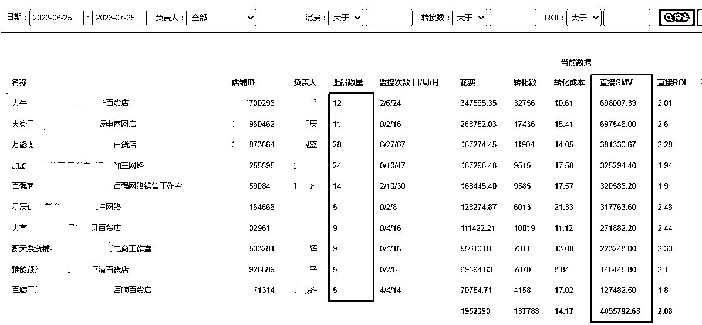

全程无需拍摄，无需专业投放师，关键是抓住抖音已验证、快手尚未饱和的时间窗口。我们只截取抖音三日内起势、点赞过五千的视频，通过混剪去重生成十余版素材后进行大盘通投。

通投结果大致三类：

无反馈，直接换品；
起势但成本失控，亏损控制在数百内即止损换品；
起势且具备盈利空间，单品最低利润数千，上品可达十几万，随后对接厂家发货，客服可外包。

按内部统计，十个测试里约1个盈利、6个持平、3个小亏。小亏换大赚的结构是常态。

## 运营拆解

一名操盘手通常跟2-3家店，每家每日上一个SKU，每个SKU做7-10版素材，每版开4个广告位。流程覆盖开店、选片、对接、定价、剪辑、上计划、盯数据、筛选优质计划、优化、起量后复谈价格、持续跟进。

核心是速度：素材发现、货源确认、定价、投放的响应越快，窗口期越长。

### 起量之前

开店：个体执照开通快手小店，保证金1000元，部分类目更高。完成收款绑定与基础装修，重点是开通磁力金牛，可走服务商。

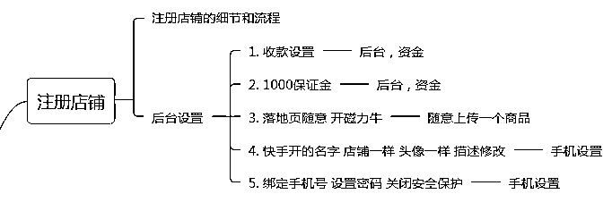

选品本质是选视频。分三级：混剪搬运、复刻拍摄、自拍定制。混剪成本最低，适合零经验人群；复刻需投入拍摄；自拍有独占期但风险最高。我们以批量混剪为主，同时试探复刻方向。

判断标准：抖音三日内起量、有小黄车、低粉高赞、越新越好。搬运越早竞争越小。

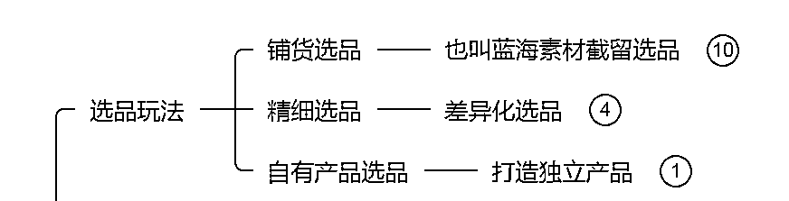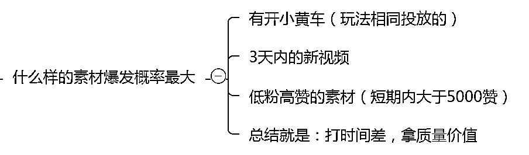

素材获取渠道：

养号刷流。为每批店铺配一个抖音号，日刷配合少量下单，3-7天可达可用状态，后续越用越准。垂直号对应垂直店，这是情报核心。

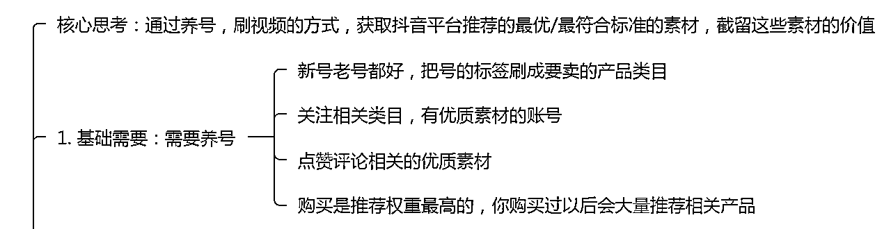

抖音商城辅助。进入商城视频推荐区，筛选近期点赞高的带货视频，可作补充。

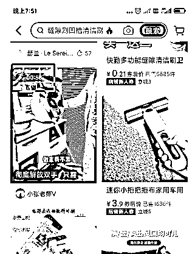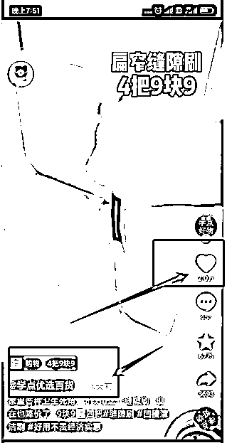

工具类软件如悠米云、EDX也有人用，但年费较高，前期前两种方式已足够。

首次对接货源不必抠价，只需确认供货与大致成本。好素材往往对应稀缺供应链，需在厂家群、中转仓里发图询价。热卖品中转仓常有备货。

定价仅用9.9、19.9、29.9三档，通过定价计算器得出投放出价与极限ROI。目标ROI约2.3。

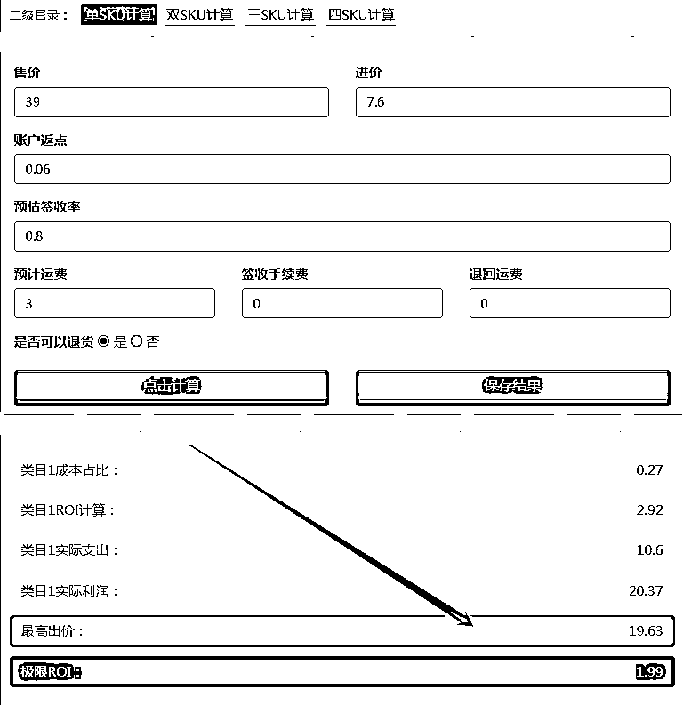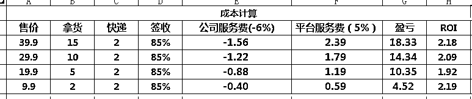

起量前允许先放量再提利，起量后可通过多SKU、议价、降本等方式回收利润。

混剪逻辑：快手去重容忍度约30%。以主素材为核心，搭配7个左右同品数据尚可的素材重组，加颗粒与蒙版生成新片。

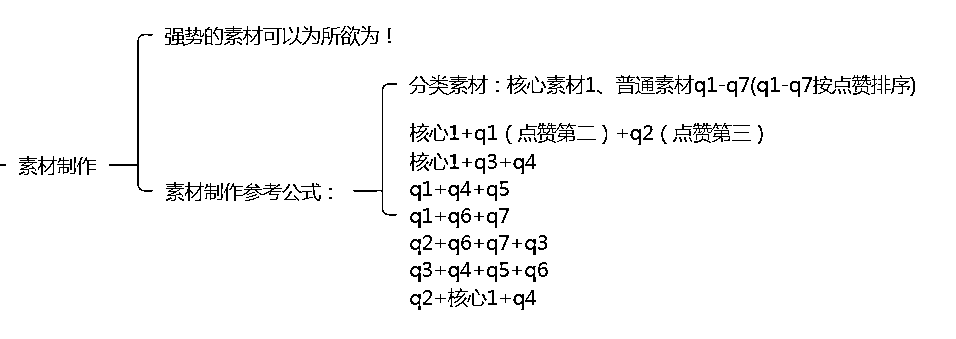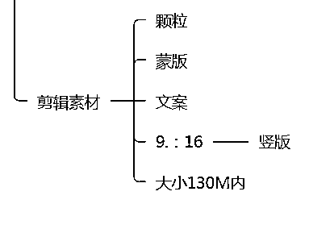

上计划：单店单日单品，1个素材开4个计划，排除电商负反馈、不排除电商反馈、成本保护与最大转化组合，实质是广撒网。

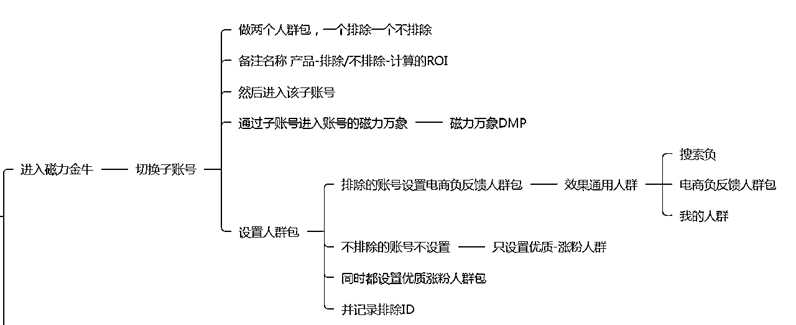

监控设置30分钟巡检一次，消耗超过止损线的2倍且无转化即自动关闭。

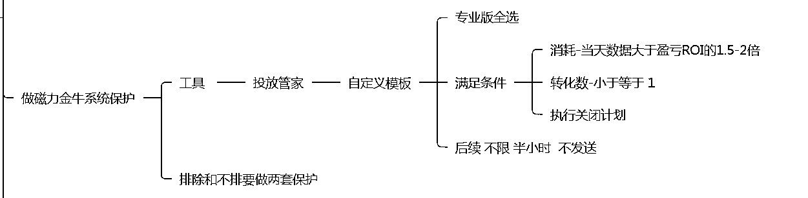

单条计划跑24-48小时，无起量或触发止损即淘汰。算下来一个团队月度可投放超千条计划，只要有一条跑开，日单量即可上千。

盯盘阶段依靠前期算好的ROI阈值判断，起势后若成本飘红，亏几十到数百即停。进入正向后，判断需结合产品、价格、同行情况手工决策。

### 起量之后

利润回补是核心：

二次议价。上量后99%的品都有10%-25%的议价空间，物流也能谈。中转仓集中发货可拿到全国最低物流价。

降本。去掉不影响体验的赠品、电池、外包装，单件省几毛，日销上万即是数千。

定制。量稳定后可谈规格微调、材质替换、瓶身容量微调，都是工厂常规操作。

出价调整。调价是常用也是最后手段，轻易调量会掉。一般做1-2次微调，若无其他空间且价格不可接受再降价。若产品市占独有，则可逐步收敛利润。若利润充裕，也可适度抬价抢量。

配套环节：客服全部外包，起量前几乎无需求，起量后单人扛不住，花数百元外包即可。义乌代发服务商提供仓储、备货、调货、账期，运营可专注投放。

总结：用抖音验证过的视频迁移到快手，用平台成本保护做低成本试错，再用平台-管理-合伙人-执行的利益共享架构，让每个人像为自己经营一样干活。技术门槛低，关键是流程纪律与执行速度，这套思路同样可以迁移到其他品类与渠道。

在代发这条赛道里，服务商背后往往自带供应链，甚至能代为寻源。平时把目标品类的图片丢过去，对方就能给出可落地的货源方案。

我们内部也把工厂和代发商的联系方式归拢到群里，主要是为了加速找货。这一行有很强的规模效应，一旦单量打开，就必须拿到全网最具性价比的供给，否则投放的竞争力会迅速被稀释。

#### 工具与软件方向

选品工具的本质，是比拼谁先捕捉到优质素材。因此EDX、优米云这类系统定价才居高不下。

我们现在在自研一套能自动巡检抖音、并归档合格素材的工具，正在招数据研发方面的伙伴，联系方式 wxx712159，付费委托或联合开发均可沟通。

另外，批量建计划与投放监测的系统我们已经内部跑通，能明显提效。此系统目前仅限内部账号使用，整套方法论对外如何开放还在验证。

即便不接入这套系统，项目依然可以推进，只是效率会有差异。

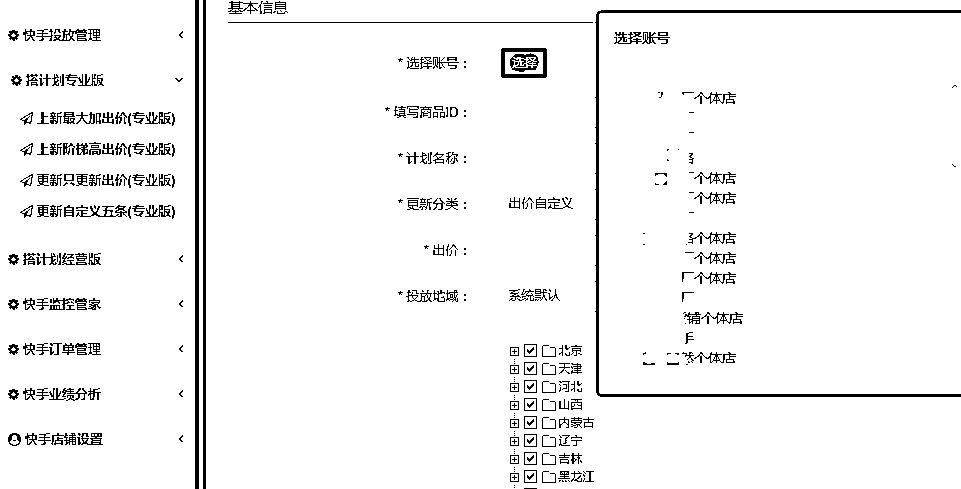

# 四、框架的拆解细节

整体来看，这套打法是对互联网项目平台化分工的一种实践迁移，让零经验的操盘手也能嵌入到相对复杂的体系里，各司所长，实现价值叠加。

前面做了概括，下面展开讲我对这个架构的理解。

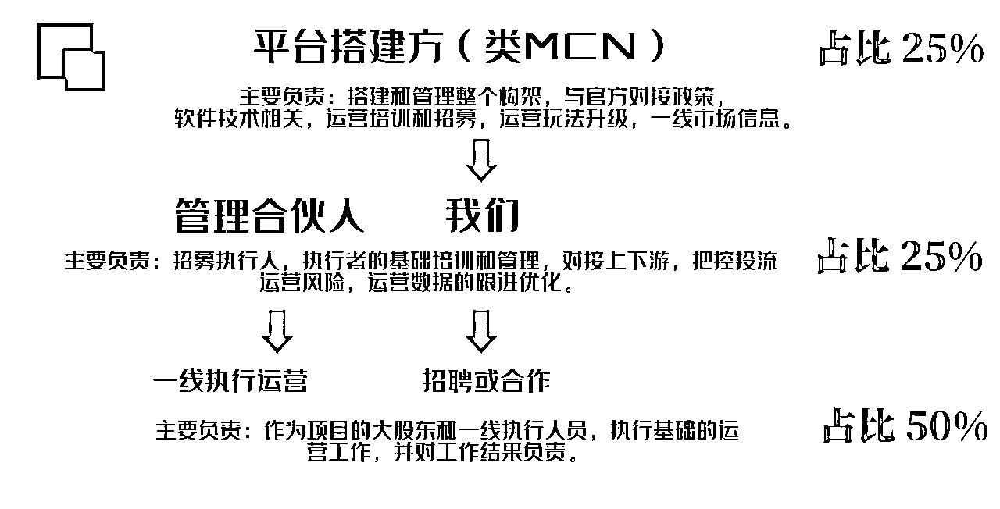

整体拆成三个角色，权责明晰，按比例分成。

顶层平台方出资占25%，收益占25%。

中间枢纽组出资占25%，收益占25%。

前端执行方出资占50%，收益占50%。

## 平台方的收益逻辑

不用投入大量人力培养、不用承担场地水电与社保成本，在架构内几乎无风险拿下25%份额的项目参与权。

### 官方对接端 快手对接

扮演类似MCN的角色，实时获取政策口径、返佣、加白、收紧预警等一手资源。

小体量团队很难拿到官方倾斜政策，也难以第一时间知晓规则变动。

比如今年部分类目需要额外资质，平台方可以提前预警并完成授权分发给下游运营。

比如违规罚款的红线与判定标准，能第一时间同步，避免踩线。

体系内玩法迁移的情报共享：

此前玩法在抖音起势后，抖音竞争加剧，团队第一时间整体迁徙到快手。

### 技术与软件支撑

组建研发小组，提供ERP、中枢数据仓等工具。长期沉淀的数据对运营与管理都有决策价值。

例如去年夏季空调扇的爆发数据，今年当刷到相似品类的优质素材时，可以快速判断起量概率。

再比如某些品类跑量尚可，但大盘长期偏弱，就能判断不必强投，及时止损。

### 运营方法沉淀

把经过验证的运营步骤固化成可复用的流程，而非零散知识，确保中枢与执行层落地一致。

本文分享的作业流程，正是在该架构下长期迭代出来的结果。

### 货源网络搭建

长期运转累计对接了数千家工厂、数百家仓储中转商，每个中转商背后又接入大量工厂自有仓，部分位于义乌，可配合全国囤货发货与链接搭建，关系稳固的还能提供账期支持。新品上架基本可做到即时匹配。

### 客服与发货外包

将客服与履约环节全部外包，执行方可以更聚焦在选品与投放。

### 整体团队统筹

平台负责定期培训、组织架构跟进与技术支持。因为体量效应，谈资源更高效，体系内成员共享同一套服务能力。

## 中间管理者的收益逻辑

关键在于培养一批比自己更上心的合伙人来执行，自己出资25%拿25%收益即可。

我们团队就处于这个层级，核心任务包括：

### 招募与管理执行者

每个管理节点都要搭建并管控自己的小队。在此架构下，用较少投入和较低风险获取稳定的分红收益。

### 基础培训与日常管理

需要具备扎实的运营与管控经验，从建号标准到起量后的操作规范都要熟练，并筛选培养一批靠谱的执行人才。

### 上下衔接的信息枢纽

所有信息流转都经由管理者中转。执行层的各类问题乃至违规处罚，均由管理者承担。带队效果直接影响整体分成。

### 投放风险把控

这是管理者的核心职责。下层执行者经验不足是常态，顶层平台只负责输出通用流程与规则，风险识别与过程干预需要管理者来完成。

具体包括跟进潜力品、把控投放节奏、指导出价调整、素材更换、成本优化等后续动作。

## 前端执行者的收益逻辑

严格按流程操作即可成为单店的大股东，拿下50%的出资与分成。

选品效率与风险意识是执行者必须具备的能力，毕竟盈亏占比最高，自己就是店主。

### 开店投入

尽管称之为下层执行者，实际上他们是体系内的个体大股东，也是业务落地的主力。

### 选品与搬运

核心玩法很直接：大量挖掘在抖音已验证的起量产品，通过固定化流程迁移到快手。只要体量足够、风险可控、竞争不饱和，就具备盈利基础。

每一次选品、投放、测款都可以视作一局博弈，标准化流程能让胜率高于1，大量重复操作带来稳定收益，这背后依赖执行层的高强度执行。

### 投放跟进

根据自身能力监控起量后的数据，超出能力范围时需及时上报直属管理者协同制定方案。

作为店主兼大股东，对结果有直接利益牵引，亏损也由自己承担。

只要具备学习意愿与执行力，按流程即可批量产出达标素材。大批量的素材池能测出更多潜力品，再由管理层配合平台服务体系放大效果，最终按比例分配收益。

在这个机制里，平台通过架构吸纳大量管理者与执行者，却不需承担薪资、社保、办公成本，风险控制也下沉到一线，成功将传统重资产的二类电商投放，转化为轻资产的协作模式。

这正是本文想分享的第二个核心观点。

后续篇幅已接近8000字，今天的分享先到这里。

# 欢迎交流

V：wxx712159

近期时间相对宽裕，我会在赚钱继续输出内容，也希望与更多同行深入交流。

# 我可提供的资源

1. shopee店铺实操经验及部分资料共享
2. 智能电销系统的免费试用权限
3. 本文相关议题的对接与讨论

# 感谢赚钱有术的平台，愿共同成长！