# 本地家教牵线一个月撬动7000+流水，保姆级拆解同城中介玩法

> 来源：[https://l45krcw9v3.feishu.cn/docx/TgYYdRwBdoY1IpxurtrchCKCnog](https://l45krcw9v3.feishu.cn/docx/TgYYdRwBdoY1IpxurtrchCKCnog)

大家好，我是九歌。做自媒体起家，长期深耕互联网项目和同城流量。最近刚把一个小众但体量很大的赛道跑通——同城家教中介。只跑了一个月，流水就到7000多，单笔最高信息费拿了720。下面把整套打法拆给你看。

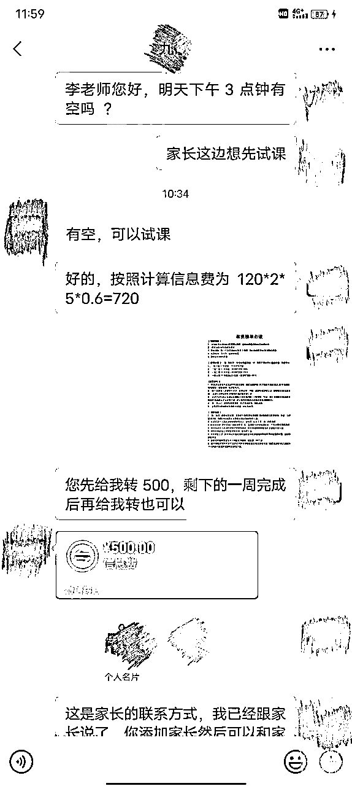

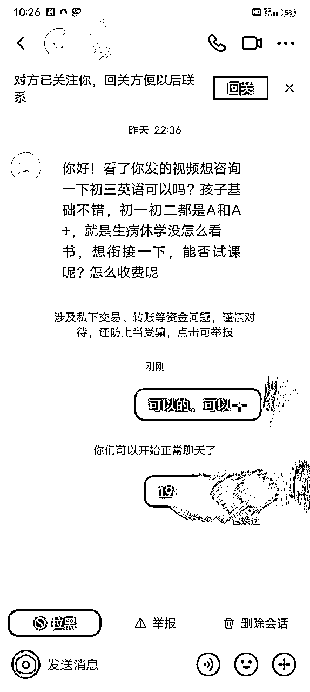

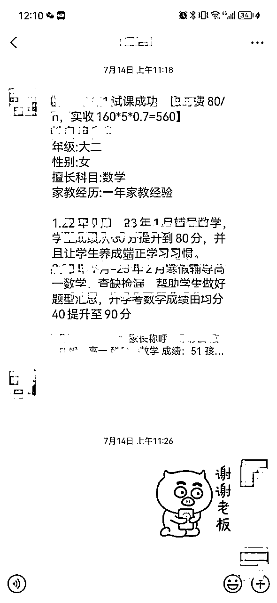

# 1、项目是什么

乍一看家教中介没什么特别，真正上手才发现早有人在多年以前就闷声做起来了。双减之后机构大面积萎缩，但家长的补课需求非但没降，反而更焦虑了。中考高考竞争越卷，家长对一对一辅导的依赖越强。

家教中介的本质很简单：手里同时攥着老师资源和家长资源，中间做撮合，从中收取信息服务费。同样的撮合逻辑放到任何行业都通用。

# 2、为什么入局

五月份刷视频号、抖音时，经常刷到本地家教类账号。内容做得非常糙，评论区却全是家长在追问联系方式、价格。需求旺盛到肉眼可见，当时我只是有感而发。

后来在赚钱风向标里看到不少人也在讨论这个赛道。

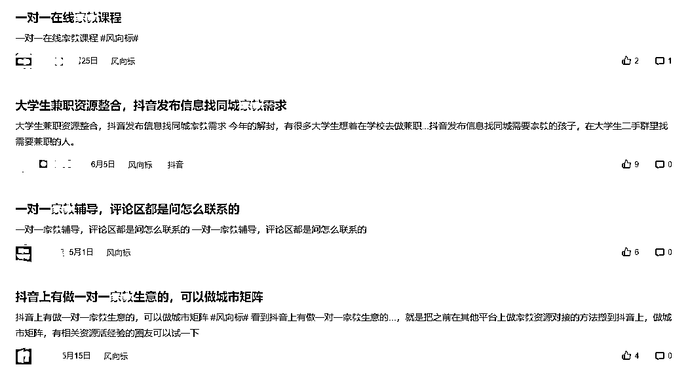

一个项目在圈子里出现频率高，通常意味着它具备可复制性。可惜赚钱上还没有成型的复盘帖，只能自己去探路。

我又专门在视频号、抖音、公众号检索了一遍，发现家长的求助量非常大，全在评论区问怎么联系、多少钱、怎么安排。可以想象供给端是多么饥渴。

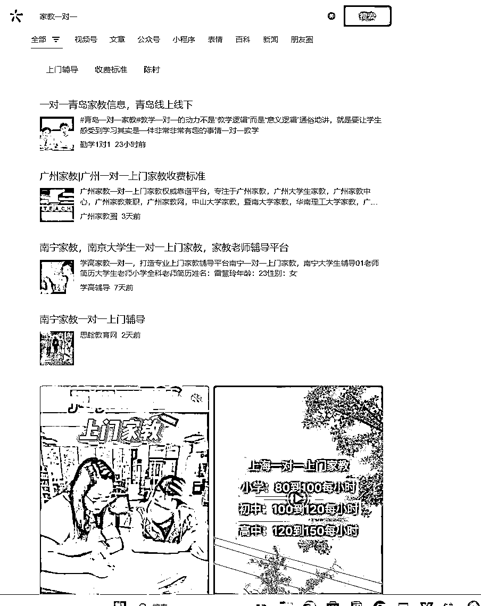

我一开始还担心会触碰双减红线。恰好我有一个初中同学此前在机构带课，双减后转做自由家教。翻看他往年的收款记录，收入相当可观。于是联络上这位多年未联系的同学。

和同学聊了他的接单和服务流程。他对中介模式并不熟，客户几乎全靠熟人介绍。聊完收获的信息不少，也更坚定了我的判断。他把我拉进几个家教群，我花了一周时间研究链路，同步养号、搭私域。

# 3、私域搭建

## 3.1 跟着同行学最快

想快速上手，最省事的就是抄同行。按关键词去加几位同行，以家长身份混进去，问询价格、流程、服务方式。过程中顺手把微信地区改成了深圳。

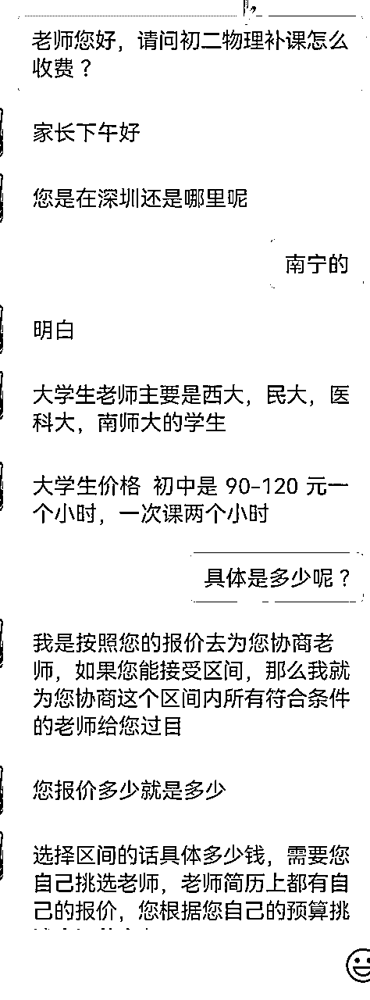

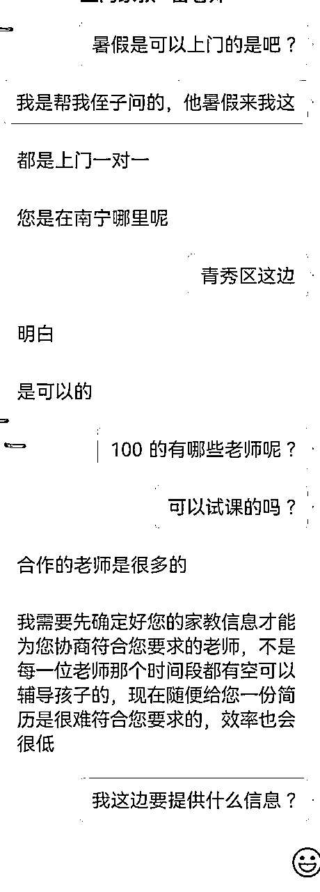

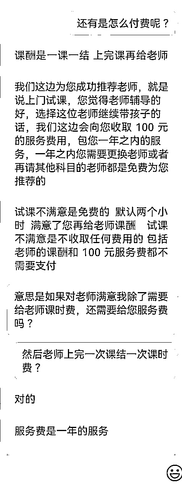

加了几家同行后发现收费模式分两种：有人向家长收费，有人向老师收费。我最终选的是家长免费、向老师收信息费的路线。同时拿到了不少话术模板和沟通SOP，基本把全流程摸清了。

## 3.2 微信号

我直接用的常用个人号。朋友已经把我拉进群，为了统一就没换号。号上用的是真名，身份更自然。

## 3.3 朋友圈内容

有了同行样本，前期发圈素材就有了。开头我只发两张同类图测试。

配文基本是：假期辅导预约开启，有需求的家长私聊对接老师。

观察同行，朋友圈大致分三类：家长需求、老师名片、促单软广。

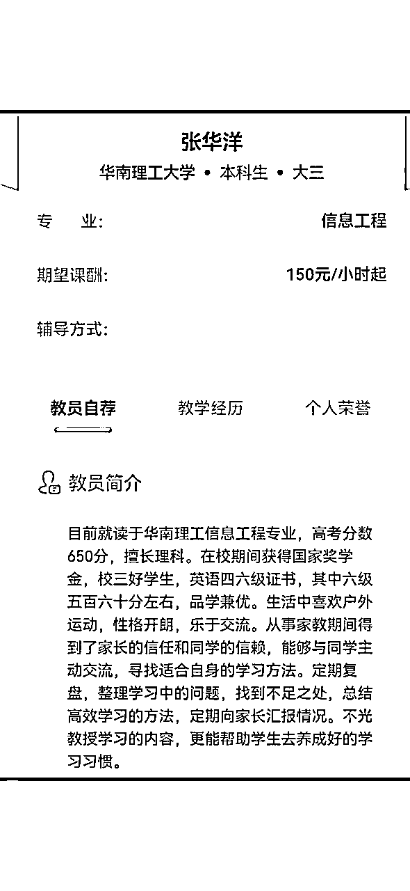

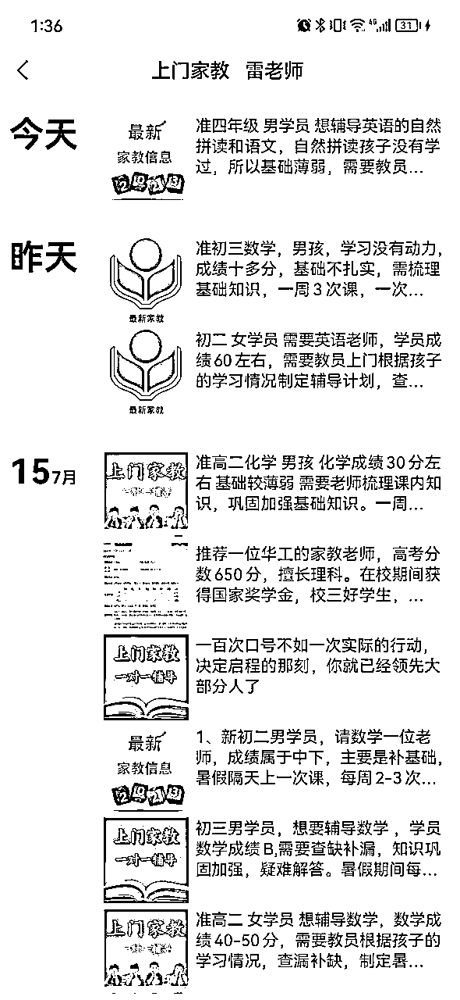

同行朋友圈基本分为三种内容，一种是家教信息，一种是老师信息，一种是营销信息。

为了不让人觉得是个冷冰冰的黄牛号，我也会混进一些生活感的动态。

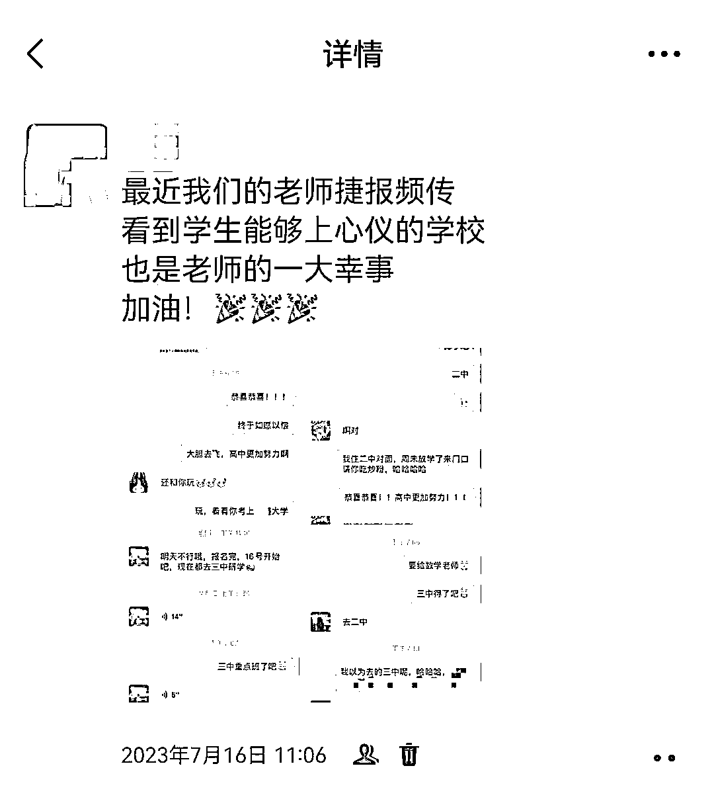

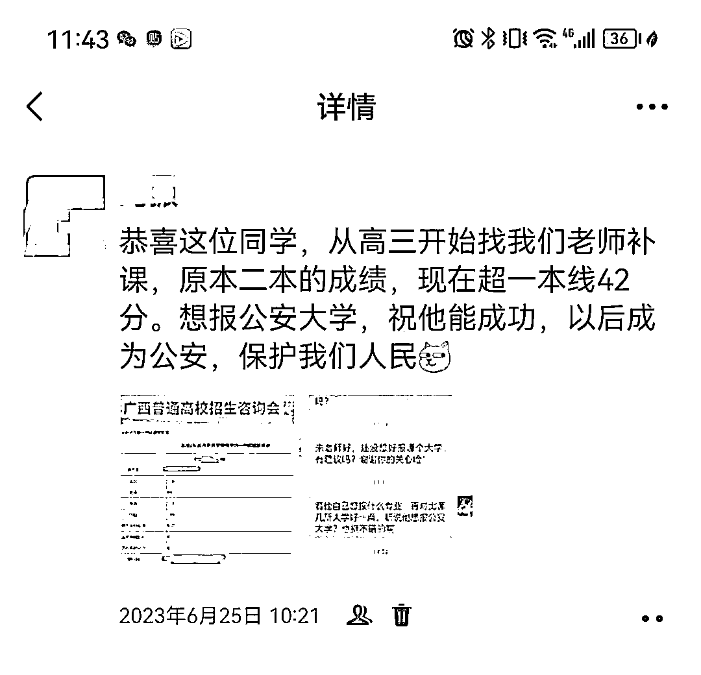

## 3.4 标签体系

做私域，标签必须先行，方便筛选和定向推送。我给这个项目打了五类标签：

A.家教老师：发布家长需求时定向可见
B.家长：标识客户身份
C.小学生 / D.中学生 / E.高中生：给家长打孩子年级标签，利于二次复用

因为我同时在做同城流量，所有进来的用户都打好标签，方便后续做交叉营销。

到这里，私域骨架就搭好了，接下来就是拉人。

# 4、老师端的获取

抖音、视频号发第一批作品没多久就有家长来咨询。先把家长需求记录下来发到朋友的群里，结果多数没人接。后来才明白，群里基本是专职老师，课时要求高。

我当时引流的是大学生家教，性价比高、价格友好，所以转化卡住了。于是转头去补老师资源，用了两个办法就解决了。

## 4.1 找在校大学生合作

项目初期问题会很多，有经验的人带一下最省时间。我本想找同学合作，他单节课450元左右，月入3万+，但他只做专职家教，对中介流程不熟，也没意愿。

于是转向在校大学生合作，既能长期做同城项目，也能借学生身份做信任背书。小红书、抖音上找了一圈，最后锁定一个西大研究生，内容以生活为主，信任感强，聊完达成合作。

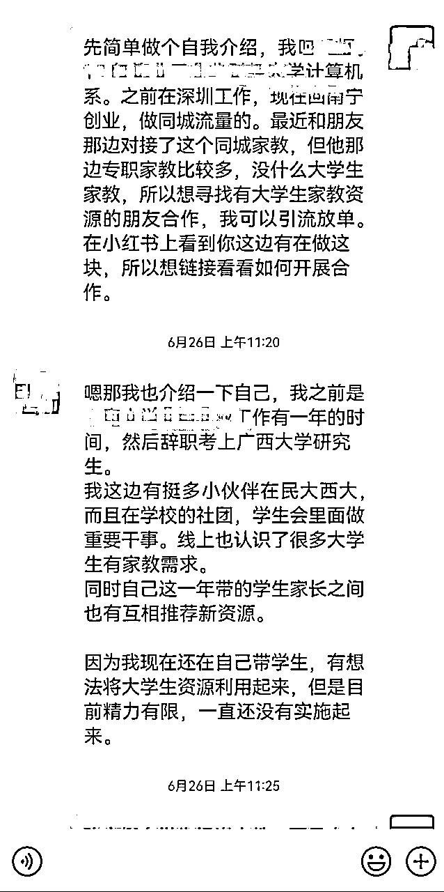

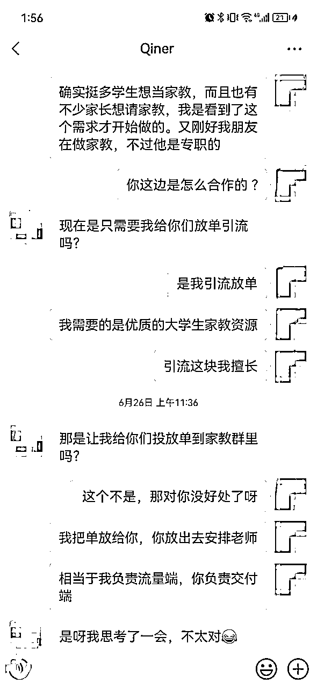

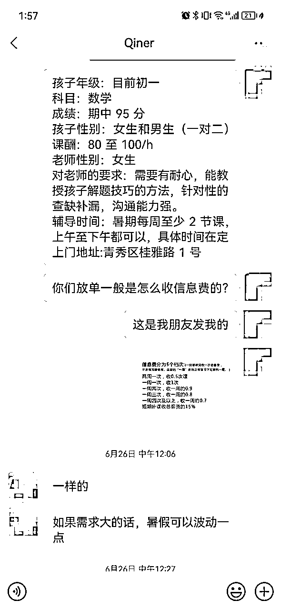

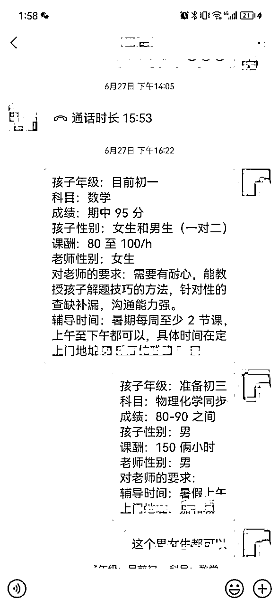

大学生做背书，接老师非常顺畅。

## 4.2 用同城流量倒灌

我手上已有7000+的同城私域，这成了加速器。家教中介也是建立在既有同城流量上的二次变现。

研究同行发现大家都在做公众号，且排版几乎一样。我也有同城公众号，于是照着模板发了一篇推文，顺势引来不少老师和家长。

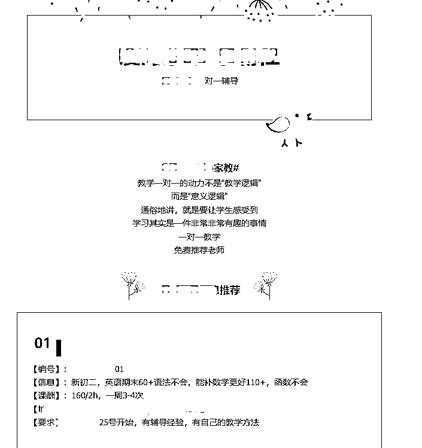

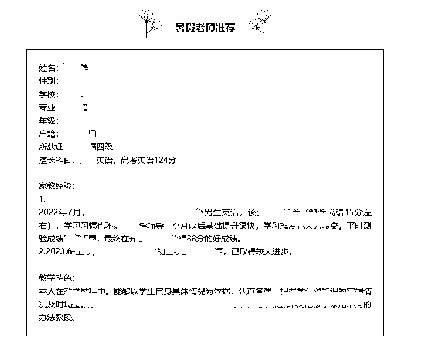

数据上看转发量很高，还有大学生主动介绍同学来入驻。说明同城流量是相当稳的入口。

## 4.3 QQ家教群

这个方案我只是小范围测试，老师端其实已经够了。操作很简单，搜索“城市+家教”即可进群。

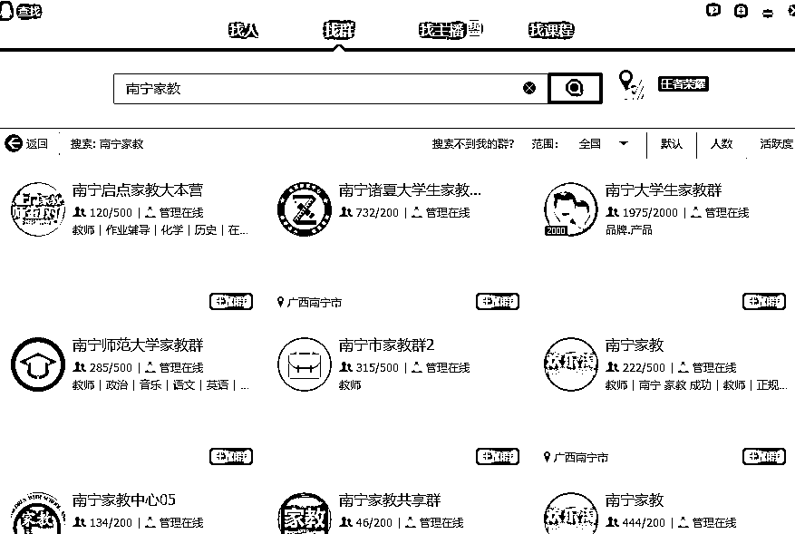

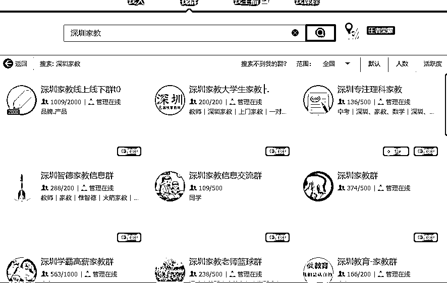

多数群是禁言的，禁言就挨个加群友私聊；可发言的群里呆几天后发招募，降低门槛、稍微抬价，很快就会有老师主动加你。告诉他们“已收到家长需求，稍等确认”，就能把老师沉淀住。

掌握以上方式后，老师资源就可以持续滚动了，大学生之间会互相介绍。关键还是要不断补家长端。

## 4.4 老师管理

每引进一位老师就打标签，记录可授科目、年级段。让老师发简历，我整理成图片模板发朋友圈，看起来更专业。也可用飞书文档集中管理，方便查找和分发。具体方式按个人习惯即可。

标签和备注一定要规范。

# 5、家长端的获取

家长流量我主打三种方式：同城流量转化、抖音引流、付费找本地KOL推广。目前前两种效果最好，第三种我只测过一次，性价比不高，暂缓。

## 5.1 同城流量变现

同城公众号推文末尾放微信二维码，直接把存量流量做二次变现。有同城基础，后续可玩的打法很多。

## 5.2 抖音引流

这是目前最精准且可复制的渠道。

### 5.2.1 昵称

昵称要能做搜索和截流。常见写法：城市+家教+姓氏+老师，或城市+一对一家教。

### 5.2.2 头像背景

背景不用刻意营销，地标建筑即可，或干脆不设。

### 5.2.3 简介

新号不要写太多，会被限流。简洁为王：城市+一对一家教，全城覆盖，免费试课。

### 5.2.4 置顶

置顶三条作品做三联屏，联系方式填手机号。实测放微信号的转化低于手机号，可能跟年龄层有关。私信回复微信号，加粉率也低于电话。

### 5.2.5 内容方向

账号垂直的本质是人群垂直。想请家教的家长，不只关心家教，还关心升学、学区、教育政策。围绕本地家长关注点发内容，自然就是垂直。

内容可分三类：带家教钩子的图文/视频、本地教育资讯、中高考相关热点。之前用张雪峰的教育解读图文，一次就来了20多个精准私信。

### 5.2.6 内容制作

#### 1、图文

门槛最低，也是主流。网图多用百度、小红书搜“大学生上课”等关键词，选图后用美图秀秀消除水印，再用黄油相机简单排版。

下载有水印可用小程序去水印解决。

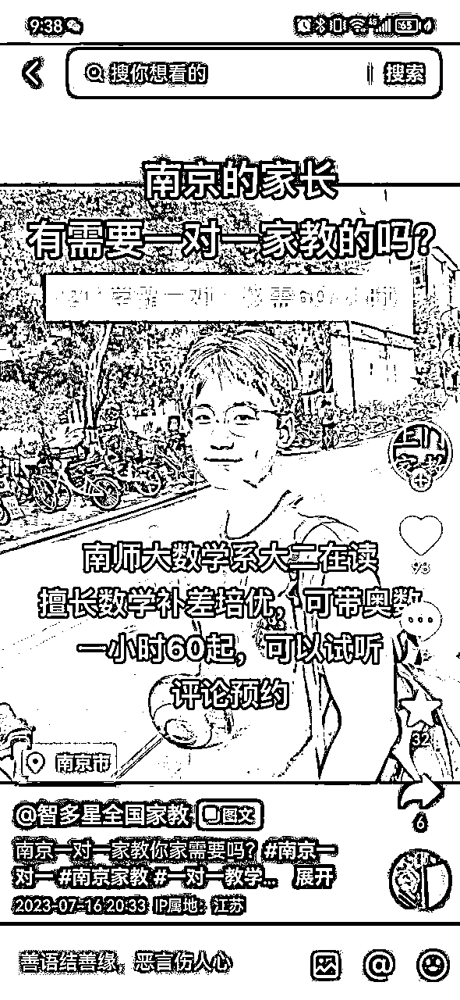

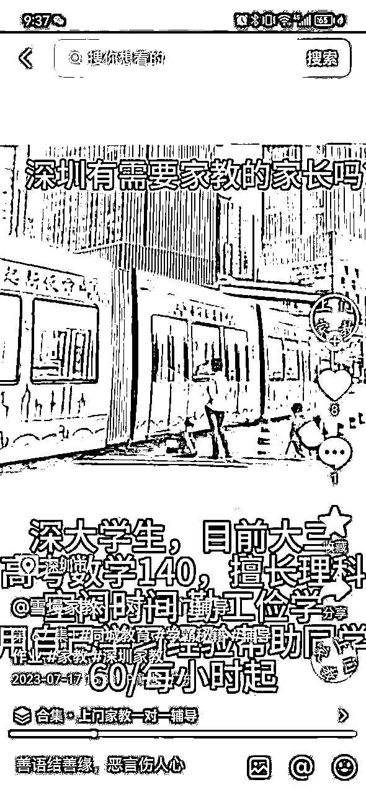

文案模板：
“城市的叔叔阿姨们好，我是XX在读研究生，暑假开一对一，60元/小时起”
“城市有需要补课的家长吗？XX学生大三，高考数学139分，擅长XXX，60元/小时起”

#### 2、视频

直接把图文加转场特效即成视频，也可出镜或做配音混剪。目前我主要用图文+特效的模式。

### 5.2.7 发布技巧

发帖时不要正文写字，容易违规，只挂标签即可：#同城教育 #一对一私教 #城市 #城市家教

定位建议选本地最好的三所初中或高中轮流定位。朋友说，好学校的学生即使偏科也更愿意补。

### 5.2.8 截流

昵称带城市关键词，可在同城非竞争行业账号下评论互动。我曾在做门窗的本地商家账号下互动，后来对方主动加我咨询孩子补课，直接成交。

只要是正面互动，多去同城账号下点赞评论，有来有往即可。

### 5.2.9 敏感词规避

家教赛道有一定审核风险，需人工规避：

1、文案和图片尽量用“jia教”或“陪学”，避免直接写“家教”
2、避免“独家方法”
3、避免“勤工俭学”
4、避免“提分”

我曾因此被禁言3天和7天。现在很多大号也悄悄改掉了这些词。

# 6、成交链路

家长进微信后，流程很短。

①破冰
家长您好，是找家教吗？我们有大学生家教和资深家教，大学生来自XX大学等本地名校，勤工俭学，资深老师有多年经验。请问孩子几年级？

②信息收集
需要补哪科？当前成绩？居住地？对老师有什么要求？

③填表
家长称呼/联系电话/孩子年级/科目/成绩/性别/可接受课酬/老师性别/老师要求/辅导时间/上门地址

统一话术：方便填下这些信息，匹配会更准。

## 6.1 表格管理

初期人少可不做表，人多了必须用表。我用飞书文档建表，给每个需求编号，记录状态，避免遗漏。表里放需求信息，去掉家长电话，加对接情况和备注，老师也能自助查阅。

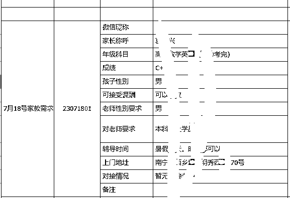

## 6.2 匹配

拿到需求后把电话抹掉发朋友圈，定向展示给老师群。评论区放飞书链接，引导老师自取。也可直接把需求编号发给合作伙伴加速撮合。

## 6.3 意向确认

老师有意向就把简历推给家长，家长不满意就换人。满意后和老师沟通信息费，不同城市标准不一，可先假装老师混进同城群探价。老师多了就直接发信息费标准表，合适就继续。

大部分家长会要求试课，试课后基本都成交。

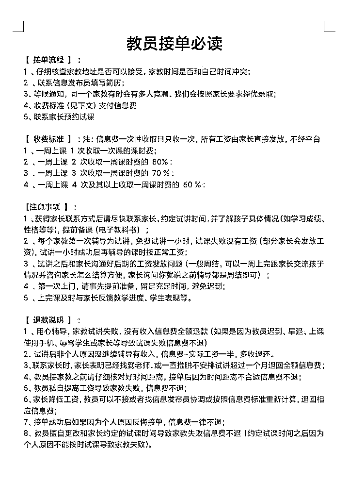

## 6.4 交付

收完信息费后，把家长微信推给老师，并告知家长：老师马上加您，详细沟通上课安排，请注意通过。

试课结束后，别忘了第一时间在老师和家长之间做一次双向回访。跟家长聊聊，老师教得怎么样？是否合心意？再向老师打听一下，孩子课堂配合度如何，家长好不好相处？

这两轮沟通下来，试课的结果基本就心中有数了。如果双方都满意，那这笔信息费就顺理成章落袋。万一没成，也别急着退还费用——先稳住，继续帮家长物色更合适的家教，降低老师绕过你私下成交的风险。

从我自己跑下来的经验看，这个行业“跳单”其实很少见。家教的圈子就那么大，一旦名声坏了，基本很难立足。再加上和老师处好关系，彼此信任，飞单自然会被挡在门外。说到底，做服务，态度和善比什么都重要。

最后总结一下：这个项目属于典型的“越做越值钱”的积累型生意，可行性不低，而且家长资源含金量极高。一旦手上攒下一批家长粉，后面孩子的各类考试、升学规划、志愿填报，都是可延伸的转化点。

不过有一点要提醒——这生意急不得。我最初上手的十天里，基本没什么收入，因为资源还没攒够。真正的转化往往出现在半个月之后，而且会越做越顺，成交额也会逐步走高。

所以想入局的朋友，别指望一上来就收获满满，脚踏实地一步步实操。坚持十天半个月，你会发现转化慢慢就有了，而且效率和金额都在往上走。

本期拆解到此结束。如果你对这个项目有其他更好的玩法或想法，欢迎随时聊聊。

我是九歌，2023，一起赚钱有术！