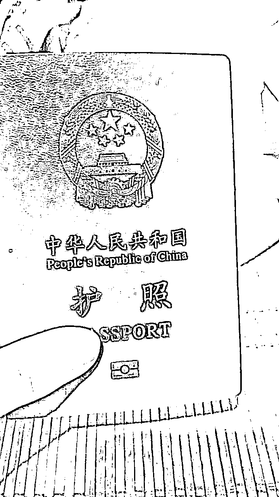
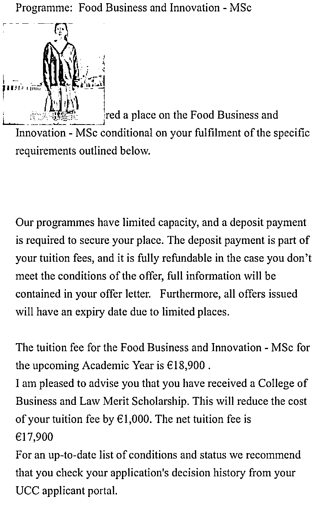
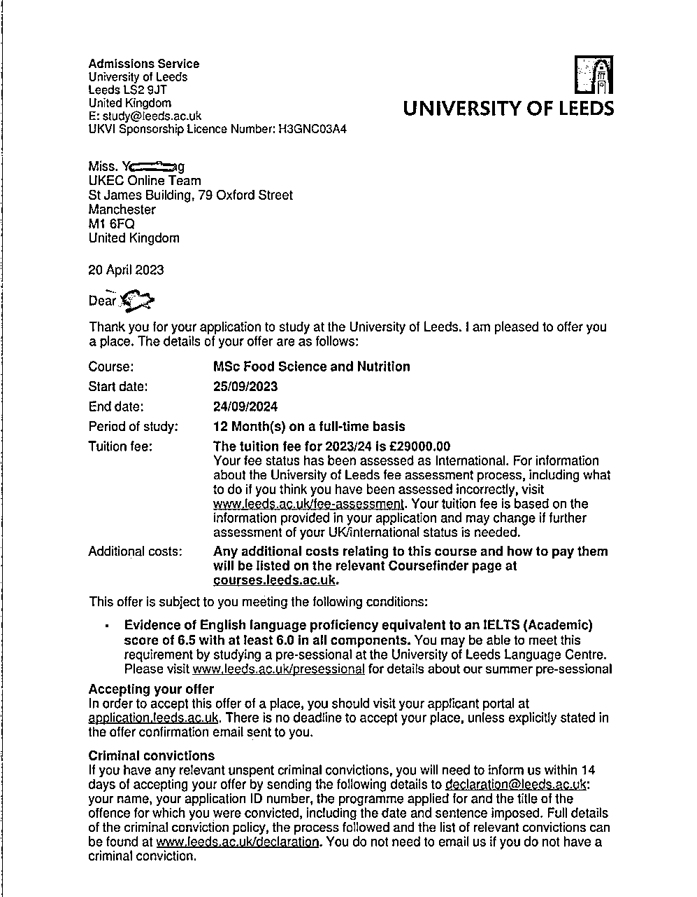
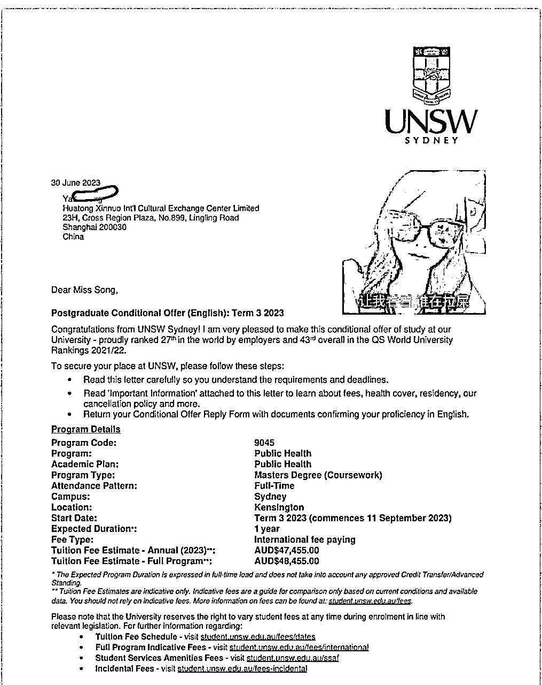
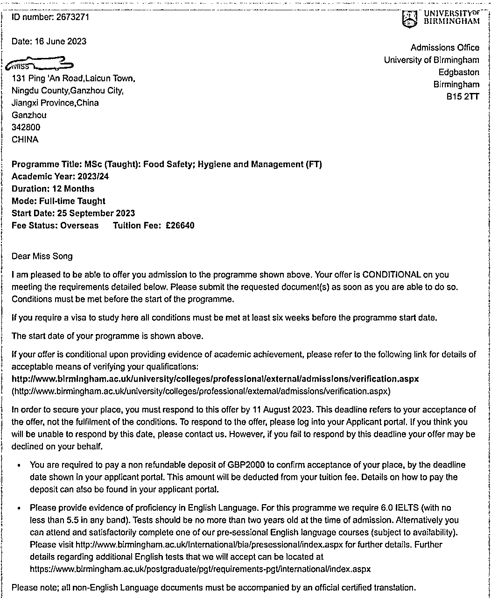

# ('专科起点，贫民背景如何拿到qs19的名校offer？', (2, 28))

专科出身、家境贫寒，我是怎样拿到QS19名校offer的？

如果有人告诉我，一个高考只有369分、专科均分70.5、本科均分77.23，没搞过科研、也拿不出一封学术推荐信的普通学生，有一天居然能收到QS19新南威尔士大学的offer，我大概会觉得对方在开玩笑。可如今，这件事真的发生在了我身上。

我老家在江西赣州的小村子，父母都是小学文化，家里普通得不能再普通。当年高考落榜，家里连专科的学费都拿不出来，我爸基于家里的情况，劝我专科也别上了。后来出国留学的钱，也都是东拼西凑出来的。

学习上，我是名副其实的“学渣”：高考369分（全国卷），专科GPA 2.55，均分70.50；本科GPA 2.8726，均分77.23。没参加过任何学术研究，也提供不了学术推荐信。

但我一直挺独立。高考之后就开始自己赚钱，专科和本科的学费生活费，基本都是自己挣的。发传单、送快递、进电子厂做临时工，很多底层工作我都干过。后来偶然接触互联网，做直播、写内容、持续输出，慢慢攒了几万粉丝，也有了一些收入。本科毕业后，我进了圈友沈小善的公司，做本专业相关工作，积累了不少实战经验——这段经历后来成了申请中很重要的一张牌。

决定留学前，我一直在看曹大的文章、星球和直播。他提醒年轻人，有条件就出去看看，这句话在我心里种下了一颗种子。说实话，我以前从没想过自己能留学，连护照都没办过。可有了念头之后，我开始主动关注相关信息，经常刷到中国人在海外工作和生活的视频。后来这个念头越来越强，加上那阵子工作状态不太对，我专门花了好几天时间，把抖音和小红书上在海外生活的中国博主动态翻了个遍。

出发之前，我认真想过目的。留学对我来说不是件轻松的事，时间、金钱、精力都要付出很多。我做任何事都喜欢算投入产出比，最重要的一个问题是：最坏的结果是什么？我能不能接受？

我把这件事放到五年后、十年后去看，答案一下子清晰了：留学能让我拥有更多可能性，拥有更强的市场竞争力，对个人、家庭和后代都有好处。最坏的结果，不过是花两年时间和四五十万，没有找到更多机会，但换来了不一样的视野、一定的语言能力和一个硕士学历，然后靠自己把这笔钱赚回来。这个结果我能接受，甚至也觉得有好处，于是下定了决心。

一开始我最担心费用。家里条件摆在那，我对学校排名没有执念，只想要一个讲英语、花费不太高、最好能让我在当地赚钱的地方。综合比较后，我选定了爱尔兰——花费比英国低，毕业后还有两年本地工作机会。

找中介时，我咨询了好几家都嫌贵，最后在闲鱼上找到一个个体户，收了我几千块。申请爱尔兰学校时，我提交了专科成绩单、专科毕业证、本科成绩单、本科学位证、本科毕业证，外加一封学校推荐信和一封同事推荐信。个人简介里，我重点突出工作经验，并且根据申请专业来写。我申请的都是数字营销相关，因为营销是我真正感兴趣的底层能力。

可这相当于跨专业申请，我成绩不占优，学校背景也一般，收到了一大堆拒信。那段时间特别焦虑，一边等结果一边自我怀疑，连雅思都没有好好准备。就在我一度以为要没学上的时候，爱尔兰科克大学给我发来了offer（QS前300，当地认可度不错）。当时中介说我是“弯道超车”，他也是这所学校的毕业生，现在在国内某大厂做数据分析。

拿到offer后，我做了一件很关键的事：给曹大报喜。曹大鼓励我再往前冲一冲，试试QS前100，还给我讲了不少回国后的福利待遇。听完我眼睛都亮了，心里也更有底气——毕竟爱尔兰已经有学可上，可以拿来保底。于是，我开始冲击更高排名的学校。

那是2023年3月。我找了好几家中介，问他们我这个情况能不能上QS前100，得到的答复几乎都是“不可能，除非先读预科”，言下之意要多花一年时间和金钱。

因为有曹大的鼓励，我没被这些话吓退。继续找，总算遇到一个相对靠谱的中介，也花了点钱。他很坦诚：你这个背景有点悬，我不能保证一定申上，中途的申请费你自己承担；申QS200我还有把握，但QS前100真的难；而且只能按你原来专科、本科的专业方向来申请。我说没问题，专业可以继续读，你帮我申就行。他把QS前100里所有和我专业相关、可能因为工作经历被破格考虑的学校都筛了出来，一共四所，全部申请。

申请这批学校时，我写的个人简介和陈述信跟申请爱尔兰时完全不同，因为方向不一样。我的核心故事是：小学一年级就开始自己做饭，后来自发做营养相关内容的短视频，积累了几百万播放；持续写文字，在互联网有几万粉丝；大学起自己赚钱，独立能力强，工作经历丰富；做过食品相关工作，毕业后又做了减肥内容。我想展现自己的热情、行动力和结果，比如在直播间讲减肥，帮助多少人减了多少体重。

2023年5月初，英国利兹大学（QS75）的offer来了。我马上又跑去给曹大报喜。

曹大说，要不要再大胆一点，试试QS前50？他甚至点名了澳洲的新南威尔士大学。我申请时，它还排在QS43；等我拿到offer时，它已经飙到QS19了。

申请澳洲学校和申请英国学校完全是两套材料，还要额外付申请费。澳洲大部分硕士是两年或1.5年，一年制非常少，新南威尔士恰好有几个一年制专业。学校比较看重工作经验，我又重新补充了不少材料。从大学起，我就基本没断过做各种能养活自己的工作，这点确实比一般学生丰富。就这样，我幸运地拿到了新南威尔士的offer。

offer和拒信陆续到齐，接下来是做选择。我最后选了英国利兹大学，原因写在文章里：https://mp.weixin.qq.com/s/KJ1axg8mvzCXTH9X1PRntg

拿到offer之后也别闲着。我把语言成绩交上去、换了uncon offer，就开始去小红书找校友。只要搜学校名，能看到很多同校学生在晒offer；搜得再细一点，连同专业的人都能找到。评论区通常有人求“组织”，你也可以跟着找。遇到同校的人，就一个个私信，请对方拉你进学院群、租房群、二手群。

还有一个方法：去关注在本地工作生活的华人博主，偶尔也有英国本地博主。勇敢去评论、去私信，问能不能加个好友、请教一些问题，这也是在另一个国度提前积累人脉的机会。

准备出国要用的东西也一样，去小红书看攻略，在二手群和学院群里勇敢发言，和大家一起讨论，能得到不少实用建议。最重要的一点是：别害怕，别害羞，拒绝就拒绝，冷场就冷场，没关系的，换下一个继续就好。

回想整个过程，像做梦一样。从去年12月初到今年7月中，差不多八个月，从决定出国到交完语言成绩、拿到自己的学生ID，留学这件事彻底落定。那段时间我没有上班，每天坚持写公众号、在付费群输出内容，其余时间全部用来推进申请。

英语成绩，我真的磨了很久很久。想提醒英语基础不太好的朋友：如果真想出去，请把重心放在雅思上。雅思成绩两年有效，但别幻想轻松过。开始学之前，先看攻略，把网上关于“雅思怎么学、用什么资料”的视频和文章都过一遍，再制定学习计划，严格去执行。还有一个关键点：战线别拉得太长，一两个月就去考一次，先摸清自己的水平。我用的是“同桌英语”模考，剑4到剑17都有，和正式机考基本一致。

接着就是拼耐心。国外学校效率真的很慢，offer发得也晚。比如伯明翰QS84的offer，我六月底才收到。

那段等待特别磨人。我自己最大的心得是：别光听中介怎么说，要听从自己内心的声音，再用行动去验证。回头看申请路，很多中介其实并不了解海外大学真正想要什么样的人才——我这个案例就是证明。

我从没想过，一个出身底层、彻头彻尾的“学渣”，居然能拿到QS19的名校offer。所以，不管现在多差、别人怎么否定你、你做的事看起来有多不可能，别放弃，持续行动，剩下的交给时间。

最后，感谢一路给过我光的人：感谢勇敢没放弃的自己，感谢我的大贵人曹大指路，感谢开明的父母，感谢付费群小伙伴的陪伴，感谢卷烟厂厂友的滋养，也感谢赚钱有术——如果没进赚钱有术，我的命运之轮可能不会转到现在。

也谢谢读到这里的你。如果我能帮上什么忙，不用客气，可以直接联系我（V：9479948）。