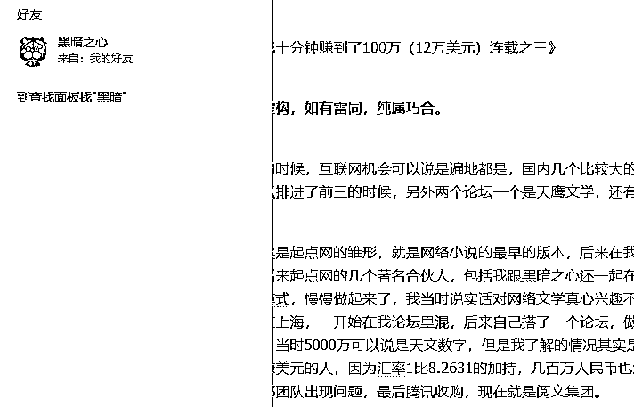

# 那一年，十分钟到手十二万美元，第四章连载

> 来源：[https://tj51bxige8.feishu.cn/docx/UVYLdjUyuo60vQx69SecPd7ZnTg](https://tj51bxige8.feishu.cn/docx/UVYLdjUyuo60vQx69SecPd7ZnTg)

大家好，我是静水流深，目前在英文工具站担任教练。

在杭州的线下聚会上，我当面答应过龙哥，后面会持续输出更多有干货的出海内容，让龙哥盟越做越好。

之前我分享过《三个单人就能操作的海外变现案例》。

随后又放出一个新方向，这个项目同样一个人就能扛，人人可复制，月入万美金是底线：

https://tj51bxige8.feishu.cn/docx/M0hMdjWj3o8WtNxZdv4cLnfenIh

依旧有不少人持怀疑态度，今天我就用手上正在跑的一个实盘项目来拆解。事实上这个玩法我一年前在星球丝绸之路里就提醒过会员可以做，只不过没人做到我这个量级。

ChatGPT爆火那阵子，我在龙哥盟独家发过一篇稿件，后来因内容敏感被星球官方下架：

https://tj51bxige8.feishu.cn/docx/TSZBdBfynoBINux2htWcefrtnHc

上个月我又发了《靠 Wise 推荐计划，日躺赚一万英镑+》，反响很热烈，再次感谢大家的点赞支持。

最近高考刚结束，龙哥抛出了一个讨论点：上985和年入百万哪个更难？

这就引出了本篇的切入点《考上985和年入100万哪个更难？这期航海挖的坑，今天来填》

之所以以连载形式在赚钱独家更新，是因为航海那次我答应过船友们要还债。这次我把标题做了调整，之后就用这个名字持续更新。内容会围绕我这二十多年在互联网圈，特别是海外互联网圈里见过的事和踩过的机会展开，希望能给各位带来一些可用的启发。

没看过前文的同学可以先补：

《那一年，我十分钟赚到了100万（12万美元）连载之二》

《那一年，我十分钟赚到了100万（12万美元）连载之三》

本连载内容纯属虚构，如有雷同纯属巧合。

进入本世纪初，国内的淘金机会多到数不清，西陆社区里活跃的海外掘金论坛更是层出不穷。当年我的第九城市论坛一度冲进西陆前三，另外两家与我齐名的分别是天鹰文学和广告商信誉点评。

天鹰文学本质上就是起点网的雏形，是网络文学最原始的形态。后来在我的第九城市论坛里，也冒出了江南武士、黑暗之心等一批后来加入起点网的核心合伙人。我和黑暗之心还在深圳欢乐谷一起玩过。那帮人找到了一个可复制的商业模式，越做越大，盛大后来以5000万人民币收购了他们。5000万在当时听起来像天价，但摊到人头上因为人多，其实到手并不多。那会儿我自己也在赚美元，汇率在1比8.2631左右，几百万人民币换成美元也没多少。后续的事情大家都知道了，起点内部团队出现分歧，腾讯收购，最终变成阅文集团。唯一让我印象深刻的是，黑暗之心几乎是纯技术出身，最后却成了上市公司的大老板。所以一定要明白，很多事首先敢想敢干，你才有资格去谈梦想的实现。

另一个常年排进西陆前三的论坛，就是广告商信誉点评论坛。里面讨论的并不是国内的广告联盟，当时国内根本没有广告联盟，讨论的都是国外的。帖子里的表达基本都是暗语，比如“C字头的联盟最近结算了吗？”、“D这个广告现在还能正常出账吗？”诸如此类。就是这样一个论坛，也能在西陆里长期位居前列。我也是在那里学到核心方法，后来才有了名气。

起初我只是一个个人站长，因为要挂banner广告，才去广告商信誉点评里打探信息。后来发现一个奇特现象：论坛里几乎没人晒自己的网站，却经常有人晒出巨额支票寄到国内的照片。那时候的广告费全是美国寄支票过来，再去中国银行托收。有一次，多来米还在运营时，他们搞了一个广告联盟，推了香港CPC 0.1港币的广告，我的流量已经不小了，但有个人一天的收入是我的十倍，我当时百思不得其解。

慢慢地，有人点破了这个局：这个论坛里的人，网站根本没人看，除了自己扫一下。只要申请到广告联盟的投放代码，挂到网站上就行。

这句话放在普通人眼里可能没什么，但我立刻反应过来了，那群人全是EMUer，EMU是什么可以去翻我连载前面的章节。当时俄罗斯人开发了一款叫CACA的软件，它的原理很简单：把广告代码填进去，导入一堆代理服务器地址，软件就能自动模拟大量用户访问、观看并点击广告。换句话说，只要有广告联盟账号和代码，不需要真实流量，只需要开着CACA和一堆代理，就等于拥有了一个访问量巨大的网站。

2002年左右，靠这种方式起家的人，正是活跃在广告商信誉点评里的那批高手。他们是互联网起步期第一批实现财务自由的人，虽然没有创造出什么有价值的企业，但钱是实打实赚到手的。

当我接触到CACA时，已经是吃残汤了。因为第一次互联网泡沫破裂，纳斯达克濒临崩盘，大量热钱蒸发。CPM、CPC这类效果难判定的广告形式被广告主抛弃，CJ、Linkshare，以及当时还没有被CJ收购的befree，都很难拿到CPC广告主。而CACA恰恰是为CPC设计的，行业淘汰从此刻开始，有钱的跑了，没赚到钱的退了。

直到有一天，广告商信誉点评里一个大佬晒肌肉，说befree里有一个N开头的CPA广告，简直是金主爸爸，一个月做了十几万美元。2002年一个月十几万美元是什么概念？汇率还在1比8以上。

我顺着线索去找，最后锁定在Netflix，推广注册佣金17美元，但要求用户购买会员，这要怎么操作？后来在某个私密的西陆论坛里，看见两位广告商信誉点评的老熟人在做交易，其中一人要买信用卡生成器软件。我瞬间明白了，原来用生成的卡号去过Netflix的会员注册。

这个漏洞到现在都没完全堵上。国外很多在线支付系统并不会实时校验信用卡真伪和额度，这和信用卡诞生的历史有关。信用卡刚出来时都是刷卡机复制信息，后续再去银行结算，所以不少在线支付至今沿用这个逻辑。虽然现在很多通道已做实时校验，但仍有系统存在漏洞。这也是为什么至今仍有人在做国外返利网培训，核心逻辑就是我上面说的这些。

有了这个漏洞，赚钱就变得异常简单。当时我们拉了一个小群，就两三个人，互相测试分享。我用Buy.com的漏洞，换到了一个当时最经典的广告主漏洞，那就是Dell。Dell有多猛？基本生成的卡都能通过，佣金也不审核直接发放。有人问，你们买那么多Dell电脑都用假卡，Dell不找你们麻烦吗？其实企业在货款没到账前是不会发货的，Dell当时广告部门管理混乱，有效订单无效订单都算有效，才造成了这个漏洞。

最经典的一幕就发生在那时。广告联盟都是次月结算上月佣金，所以我们通常在每月最后一天才开始冲量。那天我正好在网吧打CS，一边打一边操作，结果忘了Dell的服务器佣金是4%，而普通电脑只有1%。一波操作下来，佣金直接冲到12万多美元，耗时也就是平时网购的几分钟。后来befree还发邮件问我为什么业绩暴涨，我回了一句可能是流量比较大吧，毕竟我的流量全是CACA造出来的。随后一张12万多美元的支票寄到了武汉，当时我最担心的不是被查，而是支票在路上丢了。

因为这些操作不适合在公开论坛讨论，再加上第一次互联网泡沫破裂，广告商信誉点评逐渐没落，后来Discuz崛起，我就创办了大家所熟知的中国站长与广告论坛。