在闲鱼卖二手书，真能月入过万吗？这篇文章不讲虚的，直接拆解一套实战打法。

大家好，我是明哥，坐标厦门。我的经历有点杂：学机械出身，卖过家具，后来一头扎进代码世界，靠写公众号运营攒下了人生第一个100万。加入赚钱有术差不多三年，今天第一次正经发帖。最近小半年我重仓闲鱼二手书，目前手上有两本证（账号），跑通了整套流程，也沉淀了一套自己的方法论，拿出来跟兄弟们聊聊。

**先交代一下成绩：**

1. 入局两个半月左右，两本证加一起营业额接近6万（已扣除退款），净利润2.3万。其中第二本证只跑了45天。
2. 摊下来日均利润约300元。前期账号少拉低了平均值，现在单账号的日均产出其实更高。

第一本证（运营两个多月）

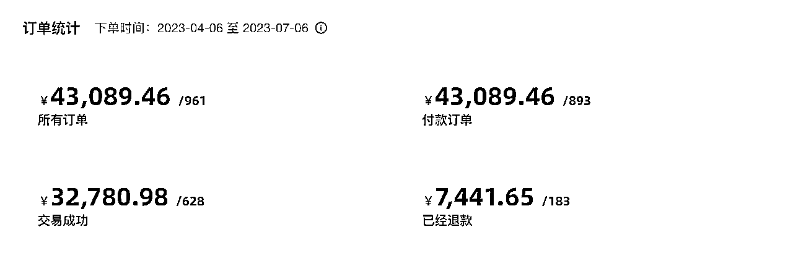

第二本证（运营一个半月）

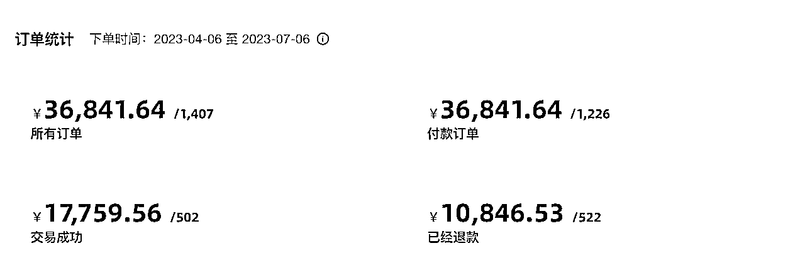

日入300确实不算多，但注意——这只是两本证的数据，意味着这套模式具备很强的复制放大潜力。社群里十几本证、几十个号的人不在少数。我之所以没急着铺量，一来要上班、要写公众号，二来为了把上架和运营效率拉满，我自己动手开发了一套带完整界面的二手书管理工具（我管它叫“闲大师”），目前市面上我见过的同类系统里，功能最全、效率最高的应该就是它。6个号已经是我精力的极限了。上个月系统终于全部完工，效率翻了数倍，接下来终于有余力继续加号了。

这套系统的底层逻辑，融合了我独创的「0分钟选品法」：极限操作下，5分钟就能让一个账号500本书全部上满。

说来也巧，上周一位圈友随手推荐了一下，这套原本只给自己用的系统，现在也有了小几十个真实用户——其中一个原因可能是某款圈内知名工具开始收费了。于是那些还没拿到结果、还在观望的圈友，开始慢慢接入我这个“小而美、快而全”的闲大师。

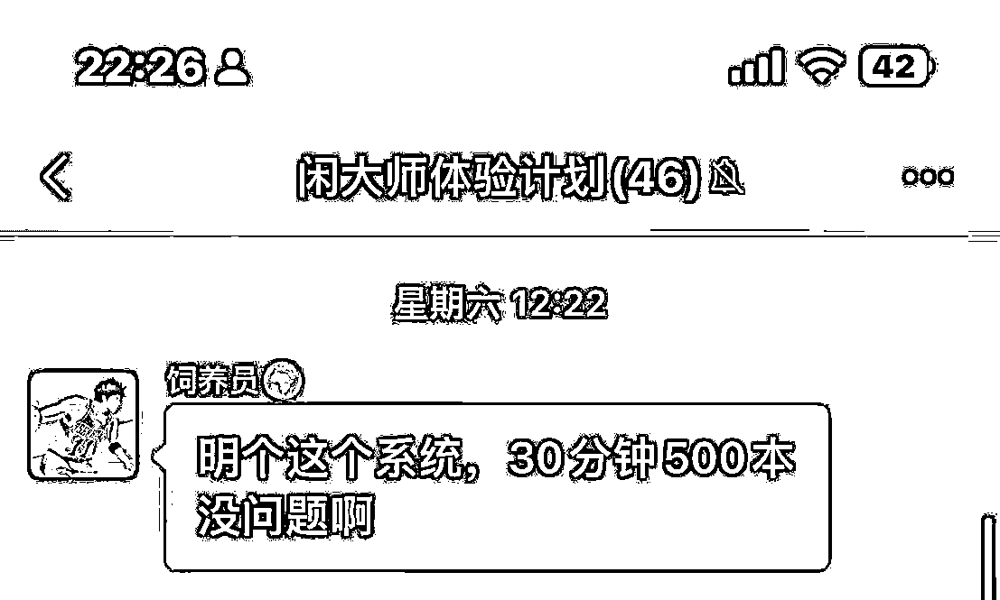

（30分钟？还是太小看我这套系统了）

注意，这套系统背后有一套运营哲学，不理解底层逻辑，光用工具是使不出劲的。所以这篇文章除了讲干货和核心逻辑，也会配合闲大师实操演示。放心，这不是又臭又长的软件说明书，读下去你会有所收获。

详细的使用文档可以参考官方说明。

我的运营心法，浓缩成两句话：

* 用最多的时间，做有用的事。
* 用最少的时间，做重复的事。

---

## 01 用最多的时间，做有用的事

电商领域，尤其是无货源模式，“选品选对了，等于抱住财神爷大腿”。

二手书项目里，很多新手的选品方式都很雷同：盯着热门领域的热门书，比如孔夫子网的7天热销榜，几乎是每个人入门的必经之路。我的第一单也来自销量榜，但这路子有硬伤：

* **太“常规”了。** 你能想到的别人也能想到，竞争白热化，属于红海打法。
* **榜单是粗放的大类目，** 不是细分类目，而且每个类目只有区区5页，数量有限，撑不起后续“换血”的持续供给。

只围着销量打转，思维就僵住了。咱们不妨把高中那点排列组合知识捡起来——理论上，一本书的任何属性都能成为选品维度：

- 原价
- 售价
- 作者
- 领域
- 销量
- 受众
- 出版年份
- 印次
- 出版社
- 是否套装

这些维度任意组合，能衍生出无穷玩法，每个组合在现实中都有验证过的成功案例。

下面分享我常用的四种选品思路，权当抛砖引玉。

### 思路一：售价×销量 → 打造“10元店”

街头巷尾的10元饰品店，永远挤满人，尤其受学生党偏爱。这类店客户群体明确，客源不愁；统一定价，买家没有砍价习惯，连售前咨询压力都省了。

二手书能不能复制这套逻辑？搞个“9.9元包邮书店”，听着便宜得离谱，但真有的赚！孔夫子上4块钱包邮的书一抓一大把，而且销量还很旺。

我在这套系统上的操作方式如下：

* 销量条件设为大于50，确保有基础销量背书，避开冷门货。
* 价格区间锁定0-10元（建议定价区间），低价书利润普遍有50%。

然后页面上直接全选、批量上架。选品加上架，前后不到10秒就能搞定，而且这个思路可以稳定地持续“换血”（“换血”的概念后面细说）。

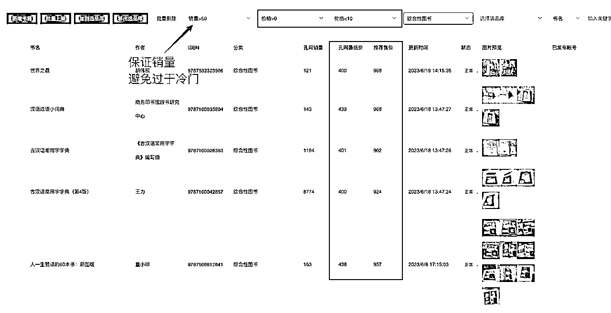

### 思路二：售价×原价 → 做“溢价书店”

溢价是什么意思？就是书的实际售价超过了它封面上的定价。

这类书通常有固定受众，溢价格空间相当大，比如：

- 冷门行业大咖的绝版书
- 某专业考试必啃的经典教材

在系统里这样筛选：

* 选好类目（系统书库庞大，避免查询太慢）
* 价格区间选50元以上
* 原价区间选50元以下

以50元为阈值（可灵活调），就能精准筛出有溢价空间的宝贝。

### 思路三：受众×质量 → 经营“高回购”店铺

你买衣服一般怎么买？我自己常去“写生”这个牌子，设计低调有质感，质量也扛打，虽然单价偏高，但一年四季我都愿意反复回购。

这就是“高回购”店铺的典型画像。

二手书领域同样存在这类高回购类目。买这类书的客户，绝大多数是行业爱好者——他们搜书不是冲着具体书名来的（不是搜索入口），而是冲着“看书”这事儿来的。只要你店铺做得足够垂直专业，等他们读完书荒了，自然会回来逛，就像逛商场一样。

做这类目，一定要用心做好主页专栏，方便客户“逛街”。否则店铺里500本书堆着，书再好、价再低，顾客也无从下脚。

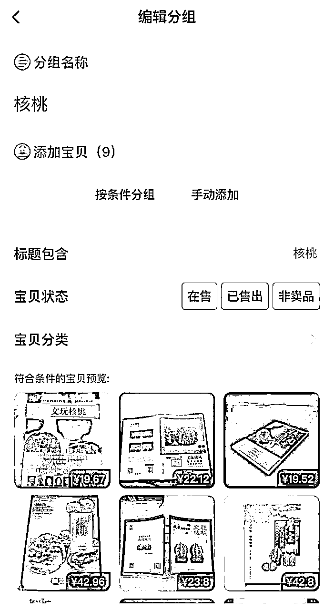

### 思路四：作者×受众 → 锁定“粉丝群体”

但凡有流量的明星，都自带粉丝群。这些粉丝爱偶像的一切，包括他们写的书——买回去收藏的大有人在。还有人专门做这门生意，我以前就遇到好几个客户，隔三差五来问：这本书还有吗？再来几本！

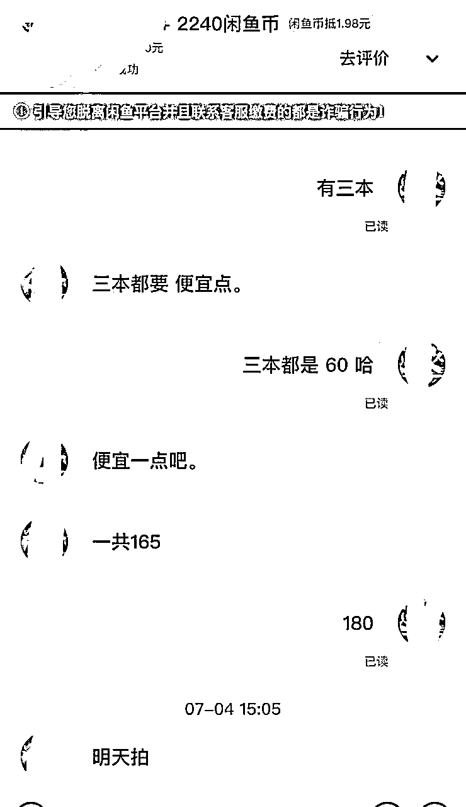

其实不光明星，某细分领域的大佬同样有铁杆粉丝群。

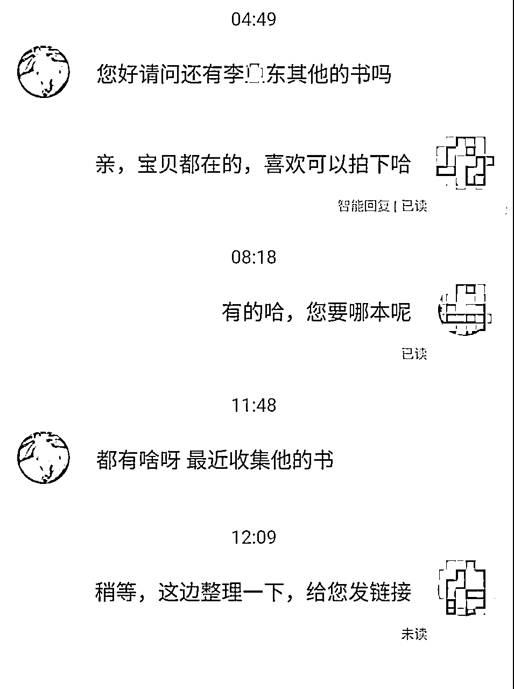

当客户点名要某位作者的书时，在系统里操作：

* 直接按作者名搜索
* 遇到重名作者，用类目二次过滤
* 书太多的话，用销量排除掉客户大概率不会要的
* 然后页面上直接批量上架

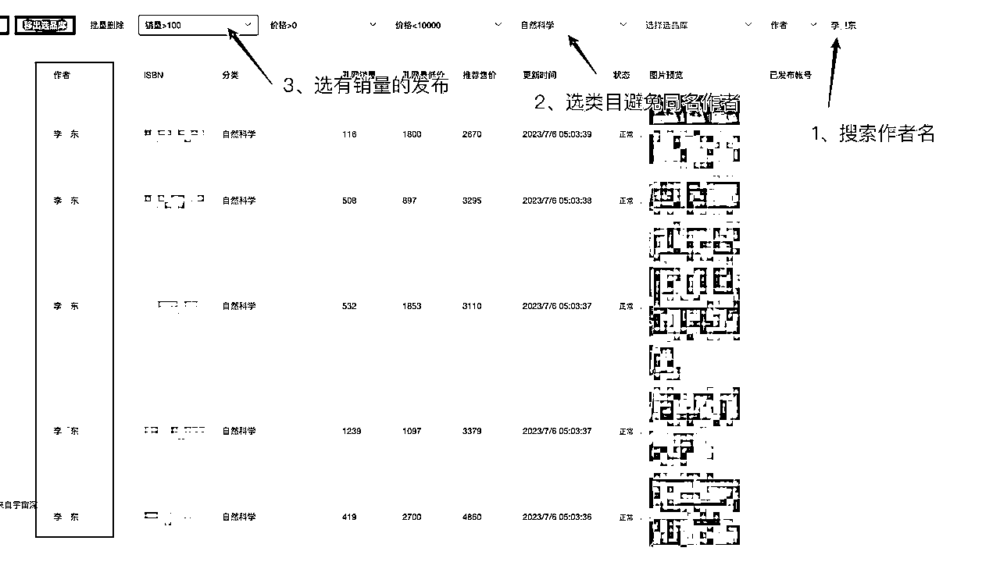

以上是我翻牌子最勤的四种选品思路。只要账号定位清晰了，上架时基本就是0分钟选品：设好条件、搜索、直接上架，就这么简单。

而且这些思路全部建立在数据筛选之上，完全不存在选品枯竭的焦虑。

---

## 02 用最少的时间，做重复的事

闲鱼的平台基因决定了店铺运营动作相对单一，但二手书项目的问题是商品量实在庞大——人均1500个商品起步。不靠软件辅助，运营时间和精力投入是恐怖的。

我把自己每天要做的事分成两类：

### 第一类：手机端，抠细节，养账号

闲鱼做二手书其实不需要专门养号，有资格就能直接上书，但保持账号活跃度，会获得一定的流量倾斜。我每天雷打不动做的事包括：

* **坚持擦亮**：一键擦亮+超级擦亮
* **发布后优化商品**：发布完立刻优化
* **开启闲鱼币**：曝光和浏览会大幅提升
* **基础任务**：签到、升级小店
* **浏览动作**
* **定时重启闲鱼**：说来玄学，经常重启后就接到询单

这些动作里，擦亮和签到属于点一下就行，但不省心的是那些耗时的：优化一个商品差不多3秒，开一个闲鱼币2-3秒。对于每天都要“换血”的我，如果全手工操作，等于每天搭进去好几个小时。于是我就写了《闲大师工具箱》来自动处理这些重复劳动。

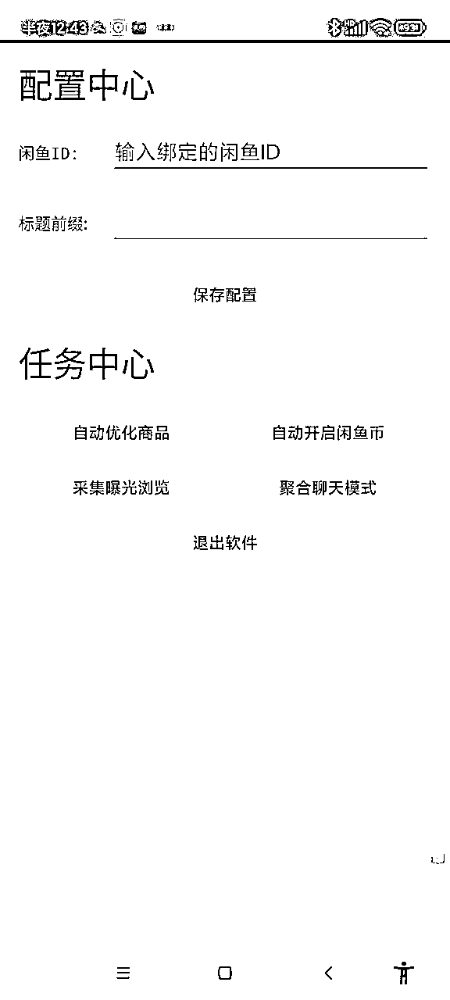

### 第二类：SOP化运营，策略式降价，起链接

软件能辅助完成这些运营动作。

#### 阶段一：先涨后降，步步为营

上架时统一加价，为后续降价预留空间。

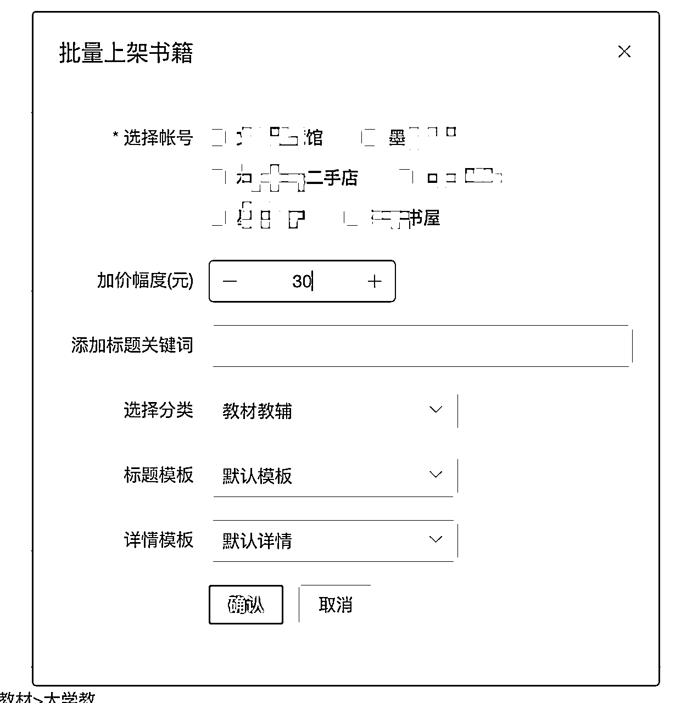

系统会记录这个降价空间，方便后续把控降价力度，每次降完价数据也会同步刷新。

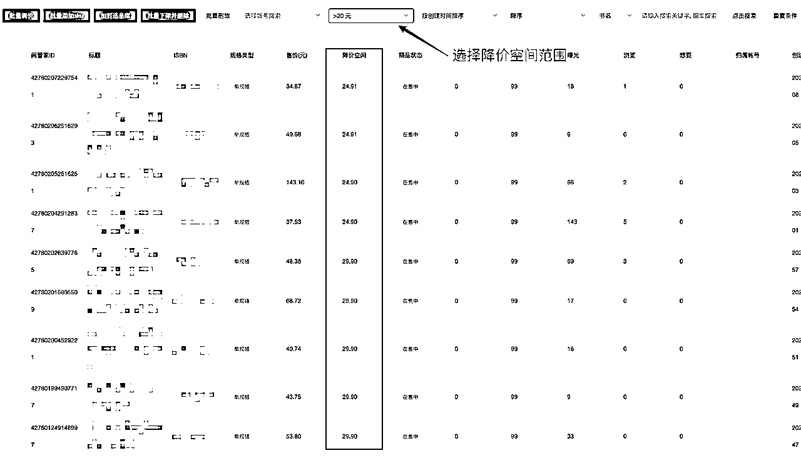

#### 阶段二：明降暗涨，利润翻番

常有这种局面：上架时还有利润，但孔夫子的低价书被买断后，等你出单时利润已经没了。这时如果直接涨价，闲鱼会断你流量。更聪明的解法是设置多个SKU——明面上降价，实际暗地里涨了。利润保住了，还能吃到闲鱼降价给的大波曝光红利。

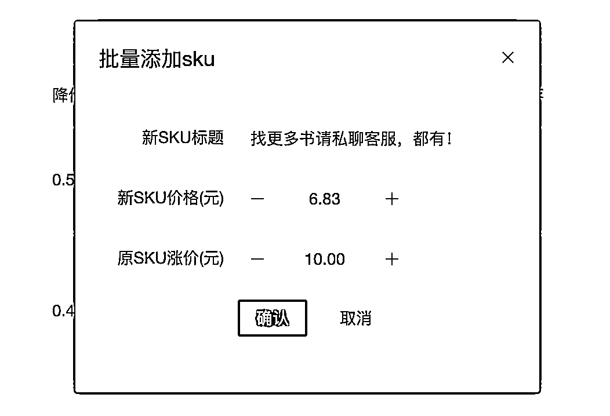

#### 阶段三：小额降价，坚持为王

前面两轮大额降价走完后，商品会拿到“累计降价%”的标签，这时的曝光会非常猛。

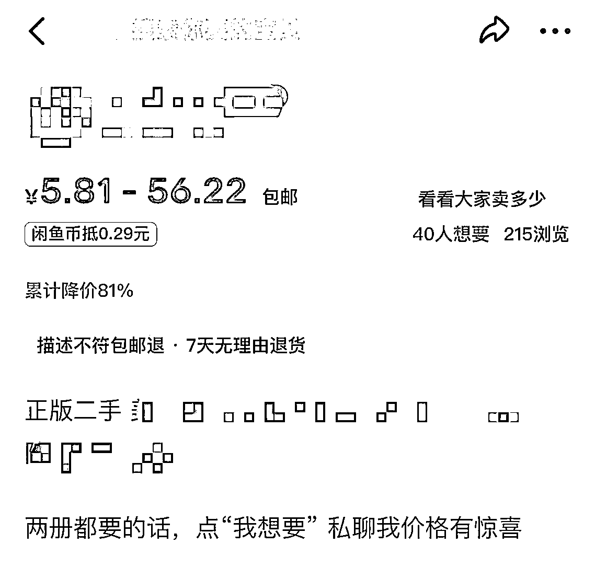

但要的是长久稳定曝光，就得每天做批量小额降价，正常是降价0.01元。无论单规格还是多规格，系统都支持。

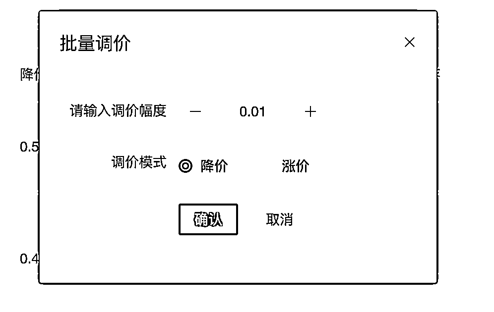

#### 阶段四：虚拟货源，无本万利

经过前三轮运营，商品会持续出单。好卖的书，可以顺手加一个电子书SKU。虚拟产品比实体书香太多：

- 零售后
- 零成本
- 回款快

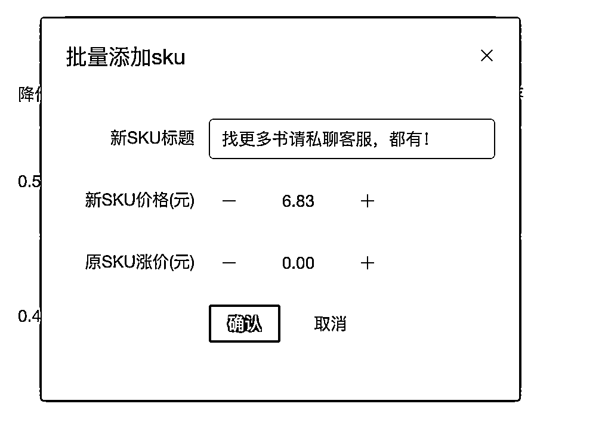

系统数据库已经接通了z-lib的千万级电子书库——你在别处找得到、找不到的，zlib基本都有。关于PDF这个特殊SKU，闲大师会自动判断：只有zlib里真实可下载的书才允许上架，避免客户下单后交不出货的尴尬。

#### 阶段五：持续换血，持续出单

闲鱼的流量分配是公平的：你持续运营，它就持续给量。没有爆发式增长，只有均衡的流量分配。

一个闲鱼账号目前上限500本书，这里面大部分都是炮灰——没点击、没浏览、甚至没曝光，是纯纯的死链接。对待这些书，下架后换一波新书上架，能让账号始终保持活跃状态。

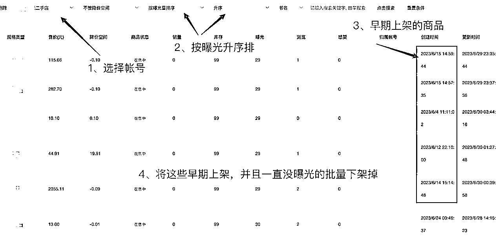

经过长时间迭代换血，最后沉淀下来的都是自带流量和销量的品，账号出单会越来越稳定。

---

## 写在最后

刚入局二手书时，我也用过社群里某大佬的系统（简称某系统）。但那个系统需要一本一本地搜索添加，还要手动完善价格图片，我整整花了一周才把500本书码齐，差点磨灭了新项目该有的激情。

得承认，那套系统是二手书工具的先行者，有里程碑意义——它终结了纯手工上书的时代，开启了一种新模式。但实际体验确实有短板（这一条仅代表我个人感受，若有冒犯多多包涵）：

1. 只能Windows上书，Mac用户得装虚拟机。
2. 上书流程过于冗长，搭选品库的时间远超我可支配的时间。
3. 缺乏数据分析能力，选品和运营两端都跟不上。
4. 降价要排队，没法立即生效，也不能多规格降价，运营工具支持捉襟见肘。

市场是多元的。与此同时，也有圈友在开发Chrome插件来辅助上书，直接从孔夫子同步，虽然没亲测过，但光看设计，速度确实快。

我根据目前已知的工具，把已上线的功能做了个全面对比（客观呈现，功能如有错漏欢迎联系我更正）：

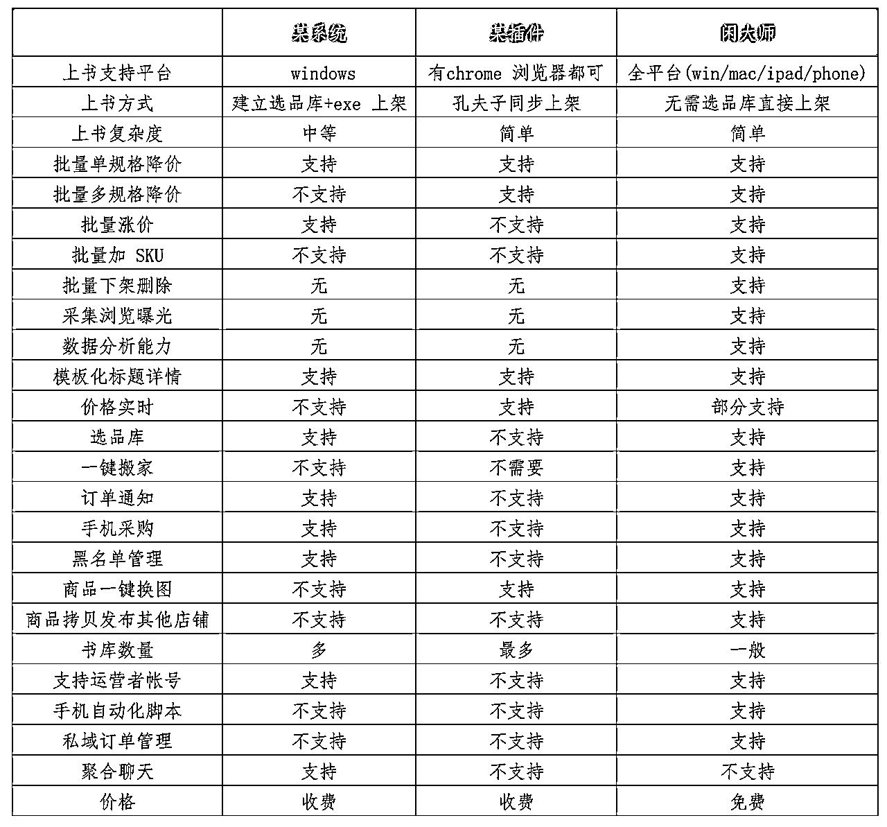

数据截止时间：2023年7月7日已上线的功能。

说起来，开发闲大师的初心确实为了自用。我坚信二手书是个能长期做的副业，但平时上班没法投入太多精力，所以干脆写个软件把效率顶上去。

整理完这些资料，我才惊觉闲大师功能如此齐全，居然只有我自己在用——这也太暴殄天物了。

经过一番思想斗争，我在朋友圈发了帖子，被一位老乡圈友看到。他试用后确实觉得好用，主动帮我自发宣传，这才有了第一批大约40多位尝鲜用户。经过一周的测试迭代，功能加了不少，bug也修了很多。现在系统已经相对稳定，决定开放给赚钱里正在做二手书的兄弟们。

如果认可我这套运营逻辑，可以联系我（微信: stromwbm）。因为服务器配置有限，用户多起来后，希望大家别暴力操作，鼠标轻一点，没必要的操作少一点，感谢理解。

以上是我做二手书项目以来的全部思考，验证有效，并且已经落地成了软件。抛开零散的客服时间，每天只需要投入1个多小时做运营维护。系统已进入稳定运营阶段，下一阶段就是扩大账号量，先办它10本证，目标早日月入5万。

最后，感谢赚钱有术。三年来在社群里学了本事、交了朋友，也实实在在赚了些钱，心怀感恩。还要感谢三位福建圈友：@叫我李同学 和 @诗与远方 帮忙推荐了早期体验用户——没有他们，就没有闲大师和大家的相遇。另外特别感谢赚钱大师兄 @杨涛 对本文的指导，他不断提醒我要真诚分享、拿出真干货，不能辜负大家读帖的宝贵时间。

如果大家对二手书项目或者闲大师有任何问题，欢迎评论区交流，知无不言，言无不尽。