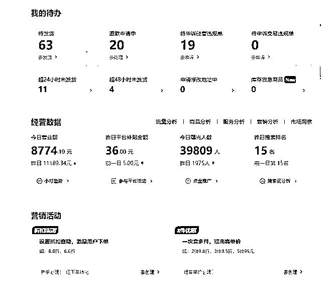
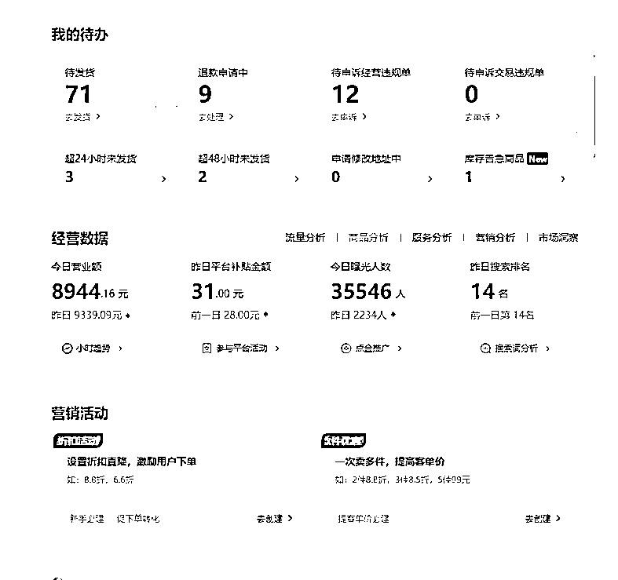
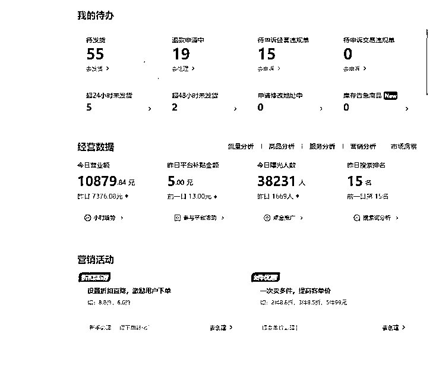
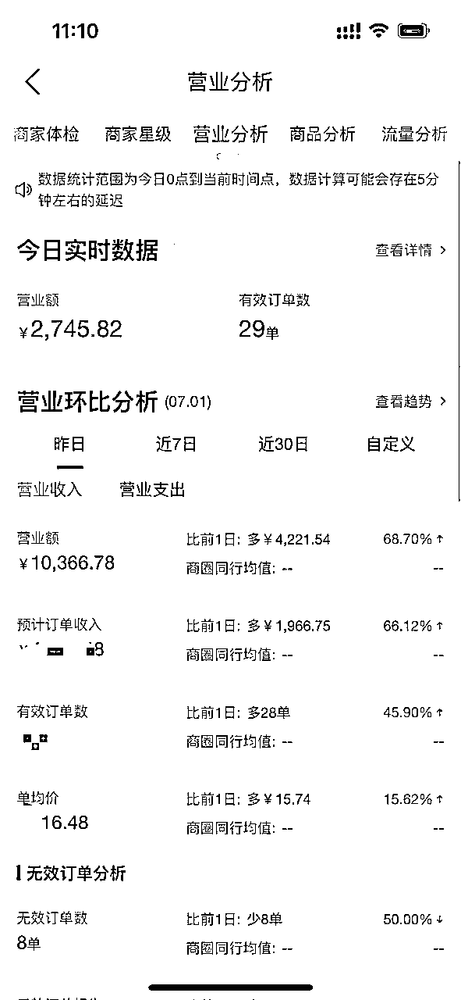
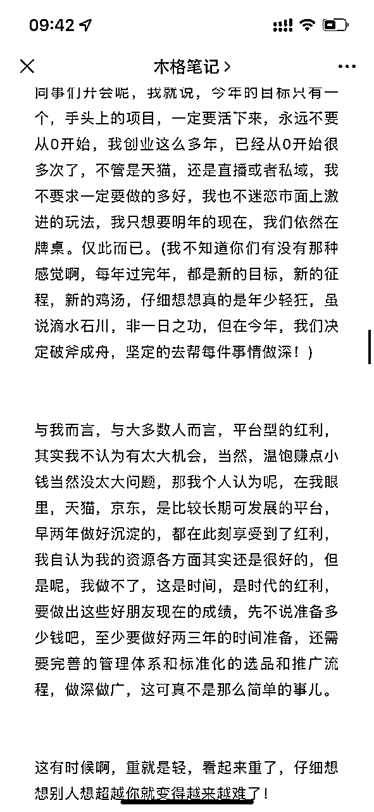
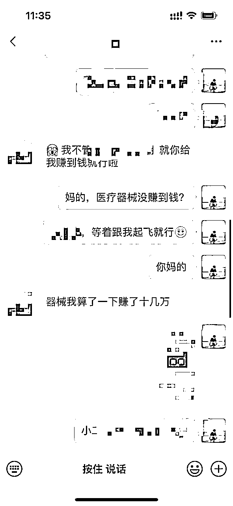
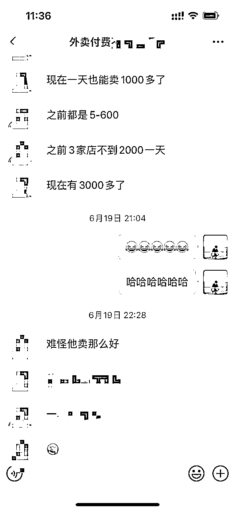
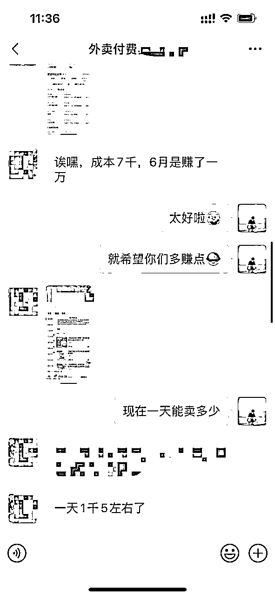

# 美团二类医疗店群：八个月从零到月赚三十万，我的慢速复盘

> 来源：[https://e8bqmagdu0.feishu.cn/docx/YZIIdsceXofIIgxWRhKctepxn4e](https://e8bqmagdu0.feishu.cn/docx/YZIIdsceXofIIgxWRhKctepxn4e)

赚钱的伙伴们好，我是木格。今天把我们美团这条路的真实走法摊开讲讲。过去八个月，从起步到现在月度利润稳定在三十万以上，是怎么一步步走过来的，哪些坑踩过，哪些选择坚持了。【文末会附上运营思路和开店流程】

先上一组我们现有店铺的实际表现

去年十一月到今年年初，我在美团上分享过两拨内容，一拨是电商板块，一拨是药房板块。很幸运坚持下来了，也会继续沿着这条线走下去。今天就把这段路复盘清楚，我们当时是怎么决策、怎么做执行的。

https://mp.weixin.qq.com/s/JD0K5u5C3Z3el5STCarcyw 想看更早的心路，可以回看几个月前那篇文章。我的轨迹大致是这样：

去年下半年先做美团电商，年底切到医疗器械，随后进入大药房。整个周期里，我始终没去大规模铺店，店铺数量一直控制在个位数。并非不挣钱，而是刻意放慢。熟我的人都知道，我在天猫和抖音小店都吃过亏。那两个风口我选了最快打法，最后虽然赚了点快钱，团队能力、认知都没跟上，反倒是当年看不上、只做慢活的同行，现在已远远把我甩在后面。拿天猫举例，普通玩家一年几百万，头部一家店一年几千万。起步晚、店不多的他们，如今却遥遥领先。这件事给了我很强的体感：看得见才相信，我绝不再犯第三次。

“有时候慢即是快，重即是轻。看起来笨重了，别人想追上你却越来越难。”

当时我的想法很简单，宁愿少赚一点、慢一点，也要活下来、走对路。电商→器械→药房，每一步都在刻意降速。

到现在医疗器械只有五六家，其中一家因提现流水问题这两天刚关闭，月利润两三万，可惜了。大药房目前也只有寥寥几家，渠道刚跑通，正准备逐步扩张，单店月利润能做到五六万。说实话，这点体量还谈不上真正赚钱，我觉得还能再深很多。供应链和流量渠道都还有两年的积累空间。所以文里写的“店群”二字，我觉得最好加个引号。想做长期生意，最终一定是要跳出店群逻辑的。

我想表达的核心就两点：一是赛道本身有机会，二是我们走得非常慢。半年多过去，就走到这一步。放在以前，我大概率已经开出上百家店了。这次我没有。文章里反复说慢一点、稳一点，我是用实际行动在证明。

红利还在

我依然觉得现在是红利期。流量规模比不上抖音，但竞争少、商家少。

另外是平台调性。做过京东的人会懂，比较稳。跟抖音那种三天钓鱼两天撒网不同，美团店铺一旦起来，只要运营不出大问题，基本能稳定下来，好好维护就行。

关于深耕

我的资源算不上顶尖，但过去一年电商圈我没看到太多好项目。最近跑杭州、西安，聊了很多朋友，大家对当下环境普遍偏悲观。相比市面上那些热闹的玩法，医疗赛道更适合长期深耕。这也是我们坚持的原因。

三个月前我们做过一期医疗器械训练营，我可以明确说，80%以上的人都拿到了结果。如果你做培训就知道，这个比例意味着什么。一般能有30%的人出结果就已经很不错了。

像这样的案例还有很多，我平时其实不太爱晒。今天写到这儿，想起去年重启做IP时写下的第一句话：“真诚、利他，永远是对未来最好的价值投资。”

我的交付做得一般，但效果好，主要是赛道选对了。店铺能下来，就不怕赚不到钱，照做基本都能成。

前阵子在视频号直播我也说了，做不到就跟猪没区别。话难听但真实。我说这些不是为了招生，我会把我们现在在用的两种运营打法完全公开。之前没讲是怕影响内训社学员，现在大家大多已盈利，也在做更需要沉淀的事，不影响了。这不是一两天就能被后来者追上的。

运营打法拆开讲

①大量铺货。注意别去传百货类，易被停业整顿。按类目正常上架，挂热搜词，符合条件的就上。医疗类目严打较多，进口、OTC等敏感品别碰。选品流程理顺后就是铺，尽量铺。玩法特点是一天营业额两千左右比较常见，出效快，但链接多风险也高。目前还没被严抓，但风险自担。

②做精品。拿授权，天猫1688都能找配合平台活动和推广。只上百来两百个SKU就够，我更偏爱这种。起店慢，前期一个月可能就几百块，两个月能到一两千，但很持久。

两种路径都走得通。透露一个细节，第一种玩法能做到几天回本，从财务角度看已经很优秀了。第二种是细水长流的打法，优化供应链、运营和选品，保守估计一家店一年赚二十万左右问题不大。

坦白讲，原本计划还想写深一点的机会点，比如测试、流量、工商、资源、运营深度、供应链这几个维度。这个项目看似简单，门槛能做到很高。我想想，现在写大家可能还没参考价值，等大家先上手，过两个月我再做深度分享。

关于开店

“从资质办理到店铺落地大概要一个月左右，不是像抖音淘宝拼多多那样说开就开，时间本身就是壁垒。” 流程我放在结尾了。

最后说点近期的思考

创业第七年了，从18岁到25岁，经历过大起大落。我从不避讳失败和错误选择，这些对未来都有价值，吃亏趁早。

做长线就要承受长期痛苦，屏蔽诱惑，一步走错步步错，要看大局。做短线就要做好随时被淘汰的准备，能捞多少捞多少，别又想捞钱又想立牌坊。

人这一生最重要的是选择，项目、合伙人、人生方向都是。

我们选择深耕大药房，慢慢做、定长远规划，不求一口吃宽。这给了我们未来的希望。

现在希望我做的所有事，像我的公众号、像我们的药房一样，有迹可循、有积累、有沉淀，“走宅路，做时间的朋友”。

共勉

关于开店，我整理了一份文档：美团医疗器械店申请流程 By 木格

PS：【有药品供应链或有药品经营许可证、有相关经验的朋友，欢迎联系我一起合作，做点有深度的事！】