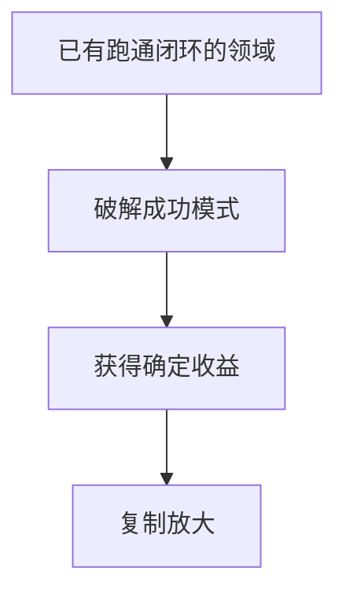

# 第 0 章 生财思维：在确定与不确定之间做选择

## 学习目标

- 理解生财思维与创业思维的本质区别
- 掌握确定有解优先原则的决策准则
- 了解生财思维的适用范围与局限

## 0.1 生活类比

想象你在一个陌生的城市里寻找一家餐厅。生财思维的做法是打开手机地图，搜索"附近评分最高的餐厅"，然后看着别人留下的评价和导航路线，沿着已经有人走过的路到达目的地。这条路上可能有堵车，但你知道方向没错，终点确实存在。而创业思维则是走出城区，来到一片没有人标记过的荒野，手里没有地图，只能凭借星空和直觉判断方向。你可能会发现一片美丽的高地，但更可能迷路在荆棘之中。这两种心态，正是我们在"用已有方法赚钱"和"去探索未知的赚钱方式"之间做选择时的真实写照。本章要回答的核心问题是：当面对一个赚钱机会时，你该用哪一种思维来决策？

## 0.2 概念地图

```
生财思维 vs 创业思维
    ├── 生财思维：解题模式
    │   ├── 前提：已有成功案例
    │   ├── 行动：破解成功的模式
    │   └── 状态：确定有解
    ├── 创业思维：探路模式
    │   ├── 前提：结果不确定
    │   ├── 行动：探索方向
    │   └── 状态：不确定有没有解
    └── 决策原则：确定有解优先
        └── 适用范围：依赖场域成熟度，排除未知地带
```

## 0.3 生财思维vs创业思维——解题与探路的分岔口

> [20230829_03_生财思维] "大量的人已经赚到钱了，我们要做的是去破解而已"

这句话看似朴素，却道出了生财思维的灵魂。它的前提是：**这条路上已经有人走通了**。你要做的不是创造一条新路，而是把别人走过的路复盘一遍，找出他们赚钱的因果链条，然后复制执行。

我们再看它的对立面——创业思维。素材中这样描述：

> [20230829_03_生财思维] "后者是不确定有没有解"

创业思维的前提恰恰相反：**没有人验证过这条路能否走通**。你面对的不是一道已知有解的题，而是一片未知的场域。你可能需要发明答案，也可能发现此题无解。

两种思维的核心差异可以用一个表来概括：

| 维度 | 生财思维 | 创业思维 |
|------|---------|---------|
| 起点 | 已有成功案例 | 空白地带 |
| 目标 | 破解成功模式 | 探索方向 |
| 确定性 | 确定有解 | 不确定有解 |
| 行动方式 | 解题（逆向拆解） | 探路（试错迭代） |
| 失败原因 | 破解失败（模式没看透） | 方向错误（此题无解） |

**为什么这个区分如此重要？** 因为它决定了你的资源分配方式。用生财思维去处理一个没有成功案例的领域，你会到处碰壁却找不到参照系；用创业思维去对待一个已经被验证的赛道，你会浪费大量时间在无意义的试错上。两者的匹配关系是：**生财思维用于成熟场域，创业思维用于未知场域**。这个匹配原则将贯穿全章。

## 0.4 生财思维的核心定义与分解

> {生财思维}**定义**（来源：《生财思维》）

"在已有跑通闭环领域，通过破解成功模式来获得确定收益的思维方式。"我们可以把它拆成三个要素：

**要素一：已有跑通闭环的领域。** 这是生财思维的入场券。闭环的意思是"有人已经完整地走通了从投入到赚钱的全过程"，包括产品、流量、转化、交付、复购。没有闭环的领域，生财思维无从谈起。

**要素二：破解成功模式。** 这个"破解"不是抄作业，而是逆向工程（reverse engineering）：分析成功者做了什么、在哪个节点赚到钱、为什么用户愿意付费、成本结构如何。破解的产物是一份可复制的流程图，包含关键步骤和资源清单。

**要素三：获得确定收益。** 由于路径已被验证，执行后的预期收益不是"可能赚钱"，而是"按概率赚钱"——只要执行到位，大概率会有结果。

这三个要素构成一个完整链条：



这个链条展示了生财思维从入场到变现的完整路径。第一个环节是过滤器——领域不成熟则直接出局；第二个环节是**核心杠杆**——模式破解得越透，执行成本越低，成功概率越高；第三个环节是结果验证——收益反馈会告诉我们破解是否成功。

## 0.5 确定有解优先原则

> {确定有解优先原则}**方法**（来源：《生财思维》）

**定义：** 在多个可选机会中，优先选择那些已被验证有解的路径。即"能确定有解的，就不要赌不确定的"。

为什么这条原则成立？我们做一个小推导。假设你面临两个机会 A 和 B：

- A：确定有解，复制成本高，成功概率 p₁ ≈ 0.9
- B：不确定有解，探索成本低，成功概率 p₂ ≈ 0.1

期望收益对比为：

$$
E_A = p₁ \times R_A - C_A \quad,\quad E_B = p₂ \times R_B - C_B
$$

即使 R_B 远大于 R_A，只要 p₂ 足够小，E_B 仍然小于 E_A。这个推导揭示了一个关键直觉：**确定性本身就是一种收益**，它让你的投入更可能转化为产出。

需要强调的是，这条原则**不是否定探索**，而是规定优先级：在资源有限的条件下，先吃确定性的果实，再用剩余资源去探索未知。它像投资里的资产配置——大部分仓位放在稳健资产，小部分用来博取超额收益。

**适用范围与边界：** 这条原则成立的前提是"存在已验证的成功案例"。如果你身处一个全新的市场（比如 2010 年的直播带货），没有闭环可破解，此时生财思维无效，必须切换到创业思维。因此生财思维依赖"场域成熟度"：场域越 mẹo，确定性越高；场域越新，确定性越低。

### 共识与分歧

由于本章素材源自同一篇文献，不涉及多方对照，我们暂不讨论共识与分歧。如果后续补充资料，可以从这两方面展开：一是"破解"的程度（完全复制 vs 部分创新）；二是确定性的度量（案例数量 vs 案例质量）。【需要补充文献】

## 0.6 设计中的取舍

**为什么不用"创新优先"代替"确定有解优先"？**

创新的诱惑在于高上限——你可能发现一个全新的蓝海，带来数十倍于复制者的回报。但它的代价是高风险、高试错成本，且时间不可控。生财思维选择的不是"放弃创新"，而是"延迟创新"：先用成熟模式建立现金流和认知，再基于实战经验去创新。

**这个取舍的代价是什么？**

代价是你可能错过早期红利（因为你在等"确认有解"的信号），或者在成熟的赛道中面临激烈的同质化竞争。但换来的好处是：**每一步都有反馈、有参照**，你的决策是建立在真实数据而非幻想之上。这个取舍本质上是用"可能性"换"确定性"，用"爆发力"换"存活率"。

## 0.7 动手练习

- 列出你所在行业的 3 个成功案例，尝试拆解其商业模式闭环，标注关键环节
- 将"大量的人已经赚到钱了，我们要做的是去破解而已"改写为你自己的决策准则
- 选取一个你感兴趣的未知领域，分析它是否满足生财思维的前提条件
- 对比两种思维的资源配置差异，画出各自的投入产出对比图

## 0.8 本章小结

这一章我们学习了生财思维与创业思维的本质区别。首先区分了两种思维的定义：生财思维从已有成功案例出发、以解题为导向，创业思维从空白地带出发、以探路为导向。其次我们掌握了确定有解优先原则——在机会选择中，优先选择已被验证有解的路径，因为它能显著降低期望收益的不确定性。接着我们深入拆解了生财思维的三个要素（成熟场域、成功模式、确定收益），并推导了"确定性本身就是收益"的核心直觉。最后我们明确了生财思维的适用范围与局限：它高度依赖场域成熟度，在未有成功案例的未知地带会失效。

本章我们一起学习了以下概念：

| 概念 | 解释 |
|------|------|
| 生财思维 | 在已有成功案例领域破解成功模式的思维 |
| 创业思维 | 在结果不确定情境下探索方向的思维 |
| 确定有解优先原则 | 决策时优先选择已被验证有解的路径 |

下一章中，我们将学习生财思维的具体实践方法——如何在识别出"确定有解"的领域后，执行破解成功模式的完整的系统化流程。
