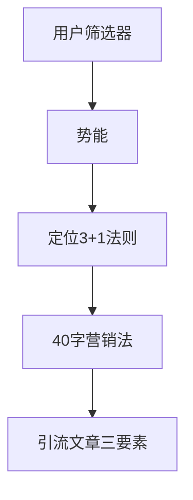
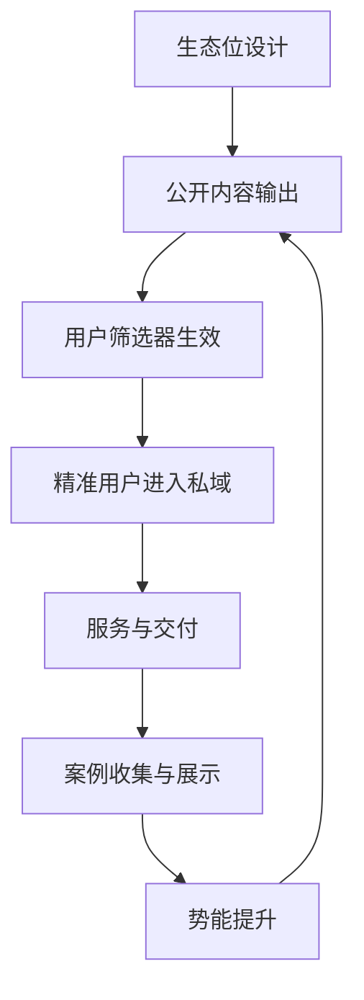
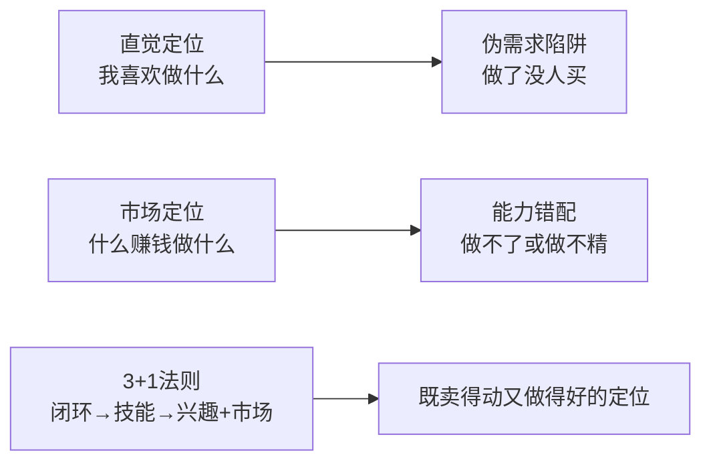
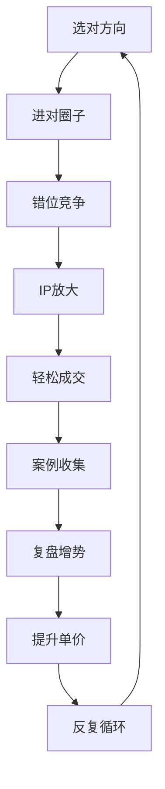

# 第 2 章 知识付费心法——从用户筛选到IP势能

## 学习目标

- 理解知识付费的核心商业模式
- 掌握用户筛选器与势能概念
- 学会定位3+1法则
- 理解标准化可复制前不组建团队的原则

## 2.1 生活类比

想象你是个淘金者。如果看到一片矿脉就盲目开挖，把所有砂石都搬回家再慢慢筛选，你会发现大多数时间都浪费在搬运和抛弃废料上，真正值钱的黄金寥寥无几。更聪明的做法是先做一个筛子——在矿场入口就地筛掉不含金的砂石，只让有潜力的矿石进入下一步提炼流程。知识付费的私域经营正是如此：你要先设计一张"门票"（筛选器），把不是目标用户的"砂石"挡在门外，再对真正有付费意愿和需求的"矿石"倾注服务精力。这样一来，你不仅省下了大量服务成本，还因为专注服务精准用户而把体验做得更好，形成口碑的正向循环。这就是"先筛选后服务"这条心法的直觉来源。

## 2.2 概念地图



## 2.3 用户筛选器与势能

核心逻辑一句话：**想在私域赚到1000万以上，就要明白"先筛选后服务"这个逻辑。** 千万级营收的私域生意，拼的不是服务了多少人，而是服务了"谁"。[P001, p.1]

> [P001, p.1] "想在私域赚到1000万以上，就要明白先筛选后服务这个逻辑"

直觉层面，这条心法反直觉。多数新手做私域时，恨不得把所有潜在用户都拉进社群，以为"人越多越好"。但私域的本质不是流量池，而是**信任资产池**——每份信任都需要服务去兑现。如果用户本来就不匹配你的产品定位，你越是热情服务，越是透支自己的时间和精力，最终要么累垮，要么服务品质下降，把真正的目标用户也劝退了。

**过滤漏斗**设计（来源：《知识付费心法》）

```
1. 设计一个"生态位"——即你独特的价值主张和内容方向
2. 通过公开内容（文章/短视频）广播这个生态位
3. 吸引来的用户天然带有筛选特质：认可你、需要你
4. 对筛选后的用户提供服务，形成高满意度
5. 高满意度带来转介绍，进一步放大筛选效果
```

这个流程展示了"筛选→服务→口碑→再筛选"的飞轮结构。每一步都在做减法，但每一步都在提升剩下用户的精度和忠诚度——这就是私域营收破千万的前提。

### 生态位即筛选器

什么是"生态位"？自然界中，每种生物都有属于自己的生存空间和资源利用方式。放到知识付费里，生态位就是你在用户心智中占据的那个"独一无二的位置"。比如"教普通妈妈做辅食"和"教一百个高管做时间管理"，二者服务的完全是两拨人。

**生态位**定义：你是"谁"、你为"谁"解决"什么问题"的集合，是天然的筛选机制。

选生态位的三个判断标准：

- 你有资格讲——要么出过结果，要么有深度实践。
- 目标人群足够大且付费意愿强。
- 市场竞争不充分，你能错位。

### 势能：虚拟但可感知

筛选器解决的是"谁进来"的问题，势能解决的是"凭什么相信你"的问题。势能是一种虚拟的、可感知的能量——它看不见摸不着，但用户能通过你的外化表达感知到。[P001, p.2]

**势能**定义：通过对外展示形成的、他人可感知的专业权威度和影响力储备。

它和"实力"的区别在于：实力是你实际拥有的能力，势能是你让别人感知到的能力。有人实力很强但闷声不响，势能低，产品卖不动；有人实力中等但善于表达和展示，势能高，产品反而畅销。

> **势能构建公式**（来源：《知识付费心法》）

$$
\text{势能} = \text{真实积累} \times f(\text{对外展示})
$$

两个乘数缺一不可。没有真实积累，展示会露馅；有了积累却不展示，势能趋近于零。这个公式揭示了势能是一个"表达函数"——它不直接等于能力，而是能力经过对外表达后的放大映射。正因如此，做IP（个人品牌）的人必须接受一个现实：你要花大量时间在"被看见"上，而不是只埋头做事。

### 数据流：筛选器如何流转到势能



这张流程图展示了从生态位到势能的完整闭环。**公开内容**既是筛选器（过滤不匹配的人），又是势能的放大器（强化匹配者的信任）。两者互为因果：筛选器保证进来的人是"对的人"，势能保证这群人愿意"付费购买"。

## 2.4 定位3+1法则

你决定做知识付费，第一个问题就是"做什么方向"。大多数人凭直觉选方向：我喜欢什么就做什么。但这条路径往往是最大的坑。《知识付费心法》提出了一个**定位3+1法则**，给出了完全不同的优先级排序。

> [P001, p.3] "定位3+1法则：首先考虑跑通的闭环，其次考虑可被包装成产品的技能，最后才是自己喜欢的，迎合市场是底线"

**定位3+1法则**使用顺序（来源：《知识付费心法》）

```
1. 找闭环：本领域是否有人已经跑通了"流量→转化→交付"的完整闭环
2. 找技能：你是否有可被包装成产品/服务出售的技能或方法论
3. 找兴趣：以上两者都满足后，再看这个领域你是否真心喜欢
+1. 迎合市场：无论选了什么，最终必须有人愿意为此付费
```

注意这个排序的深意：**兴趣排在最后**。这不是说兴趣不重要，而是说兴趣不能作为第一决策依据。如果你的兴趣领域没人跑通商业闭环，你大概率要花数年去教育市场，期间现金流断裂，兴趣也被磨灭。相反，如果先选一个已被验证的赛道（闭环存在），再复用你已有的技能（能力匹配），最后在其中找到你相对喜欢的细分——这就是职业化的选择方式。

**为什么先找闭环？**

- 闭环意味着需求被验证过了，有人已经挣到钱了。
- 你可以观察他们怎么做，站在前人肩膀上优化而不是从零发明。
- 风险降维：市场需求是确定的，剩下的只是你的差异化问题。

**为什么要找可包装的技能？**

一个能作为产品的技能需要满足三个条件：

| 条件 | 说明 |
|------|------|
| 可标准化 | 能拆解成固定的方法步骤，而不是靠灵感和手感 |
| 可传达 | 能通过课程/咨询/社群等方式传递给他人 |
| 可验证 | 有明确的交付物或结果指标，用户能感知到价值 |

满足这三条，你才可能把一个"个人能力"转变为"可售商品"。否则用户付费购买的是你这个人本身，永远做不大。

**为什么要迎合市场？**

这是最后的底线。你不需要让所有人都喜欢你，但必须让至少一部分细分人群觉得"这就是我需要的"。迎合市场不是讨好所有人，而是在细分赛道内精准满足真实需求。如果市场不买单，一切都是自嗨。

### 方法演进：从直觉定位到3+1法则



对比直觉定位和市场定位的失败模式，3+1法则的进化之处在于：它把"市场需求"和"个人能力"叠加起来，再用"兴趣"做深层驱动，用"市场验证"做最终裁决——四者的交集才是最优解。

## 2.5 40字营销法

有了定位，下一步是获客和转化。《知识付费心法》给出了一套40个字的营销口诀，涵盖了从选方向到LTV提升的完整闭环。

> [P001, p.4] "40个字营销方法：选对方向，进对圈子，错位竞争，IP放大，轻松成交，案例收集，复盘增势，提升单价，反复循环"

我们将这40个字拆解为三个阶段来看。

**阶段一：获客前置（选对方向 → 进对圈子 → 错位竞争 → IP放大）**

```
1. 选对方向：基于3+1法则定位
2. 进对圈子：进入目标用户聚集的社群/平台
3. 错位竞争：找到竞争对手没做的角度切入，不正面硬刚
4. IP放大：通过内容输出放大个人品牌势能
```

这四个步骤做的是**杠杆**:选对方向是支点，进对圈子是杠杆的着力点，错位竞争是避开锋线，IP放大是用力方向。四者叠加，你就能以较低的获客成本进入目标用户视野。

**阶段二：成交与证据（轻松成交 → 案例收集）**

轻松成交的意思是成交阻力要小——低门槛产品切入、流程顺畅、话术自然。而案例收集是这个环节的暗线：每次成交、每次交付，都要刻意沉淀用户案例和反馈。

> **成交势能公式**（来源：《知识付费心法》）

$$
\text{成交率} \propto \frac{\text{信任}(\text{势能})}{\text{决策摩擦}}
$$

这个公式展示了成交与势能的本质关系：势能越高、决策摩擦越低，成交率越高。案例收集正是同时作用于分子和分母——好案例提升势能（信任），清晰的案例展示降低了用户的决策摩擦（"他都能成，我也可以"）。

**阶段三：放大与循环（复盘增势 → 提升单价 → 反复循环）**

- **复盘增势**：每个案例都能复盘出方法论，把隐性经验显性化，反哺内容输出，势能再次升级。
- **提升单价**：当用户信任累积到一定阈值，你可以推出更高客单价的产品满足他们的进阶需求。
- **反复循环**：整个链路不是一次性动作，而是不断循环的飞轮。

这三个阶段构成了营销的完整生命周期：



这个循环展示了从"获客"到"提价"再到"回流获客"的永动结构。关键点在于：**每一次循环都在积累势能，而势能会让下一轮循环的获客成本更低、成交更轻松。** 所以营销不是一次性动作的叠加，而是一个指数级的增强回路。

## 2.6 标准化可复制前不组建团队

很多IP做了一段时间，业务量上来了，第一反应就是"我该招人了"。但《知识付费心法》给出了一条明确的边界：**在营销流程不具备标准化、可复制性之前，不要过早尝试组建团队。**

> [P001, p.5] "在你的营销流程不具备标准化、可复制性之前，不要过早去尝试组建团队"

**为什么？**

| 早期自营阶段 | 盲目扩张团队的后果 |
|------|------|
| 你亲自服务，客户满意度可控 | 新人不懂你的方法论，交付质量参差不齐 |
| 你亲自谈单，成交路径清晰 | 销售话术因人而异，转化不可控 |
| 你一个人跑通全流程 | 流程未固化，新人来了不知道做什么 |
| 成本低、迭代快 | 固定成本高企，转型困难 |

**标准化**是指：你能把"从加好友到成交到交付"的每一步流程写成SOP（标准作业程序）。**可复制**是指：一个新员工拿着SOP，不需要你手把手教，就能执行到80分以上。这两个条件满足之前，团队的边际产出是负的——你花在管理、协调、纠错上的精力，远超你省下的时间。

**做IP要接受鱼与熊掌不可兼得的现实**。做IP的本质势必要把时间花在"对外展示"上，这意味着你要牺牲一部分"埋头做事"的个人时间。如果你既想做IP又想要传统的全职团队管理节奏，会两头落空。标准化的意义恰恰在于：把可复制的部分交给体系，把必须由你输出的部分精炼到最少，这才是一个人能同时做好IP和经营者的底层原因。

**扩张时机判断矩阵**：

| 判断维度 | 未达标时 | 达标后 |
|------|------|------|
| 是否有SOP文档 | 无 | 有且已迭代3版以上 |
| 新人上手周期 | 需要你全程带 | 可以照SOP独立执行 |
| 你对流程的依赖 | 离了你就不转 | 离了你也能转 |

**潜在陷阱**：有些IP为了"体面"而招人，有些是为了对冲焦虑，有些是为了赶超竞品的团队规模。这三种动机都属于非理性扩张。正确的扩张时机只取决于一个指标：**标准化程度是否已经能支撑一个陌生人对客交付 80 分。**

## 2.7 设计中的取舍

**为什么不能直接"边服务边筛选"？**

可以，但效率和体验都会下降。边服务边筛选意味着你在交付前无法判断对方是否是精准用户，容易把大量服务精力浪费在低匹配用户上。先筛选后服务的本质是一次性把"诊断"前置——用生态位和内容把不合适的人挡在门外，剩下的人基本是诚心求药的。代价是你需要花时间做内容、做生态位定位，短期内见效慢，但长期看这是复利最高的路径。

**做IP势必要接受"鱼与熊掌不可兼得"？**

做IP需要不断对外输出，这天然与"全神贯注埋头研发"相冲突。你没法同时做到最大的影响力输出和最深度的专注研发——除非用标准化把研发后的交付冻结成SOP，让团队按模板执行。这就是"标准化可复制前不组建团队"这条定理的深意：**标准化不是扩张的充分条件，而是让你从重复劳动中解放出来的杠杆，只有获得了这个杠杆，你才接得住IP带来的流量。**

## 2.8 动手练习

- 对照本章的生态位三问法，为你的知识付费业务写下三个候选生态位，评估哪一个竞争最小、付费意愿最强。
- 用"定位3+1法则"重新审视你当前的方向：闭环存在吗？技能可包装吗？兴趣排在第几位？市场验证了吗？
- 画出你自己的40字营销循环图，标出目前最薄弱的环节（获客、成交还是提价）。
- 检查你当前的业务流程是否能写成SOP。试写一个最小版本的SOP并找人试执行，记录差距。

## 2.9 本章小结

这一章中我们学习了知识付费的核心心法体系。首先我们理解了"先筛选后服务"的私域经营原则，懂得用生态位设计天然过滤用户，然后我们探讨了势能的概念——通过对外展示形成可感知的虚拟能量，接着我们掌握了定位3+1法则的决策顺序：闭环、技能、兴趣+迎合市场，然后我们拆解了40字营销法构建从获客到提价的飞轮闭环，最后我们讨论了标准化可复制前不组建团队的限制条件，理解了做IP需要接受鱼与熊掌不可兼得的时间分配现实。

本章我们一起学习了以下概念：

| 概念 | 解释 |
|------|------|
| 用户筛选器 | 先筛选后服务的私域经营原则 |
| 势能 | 通过对外展示形成可感知的虚拟能量 |
| 定位3+1法则 | 闭环→技能→兴趣+迎合市场 |
| 40字营销法 | 从选方向到案例到提价的反复循环闭环 |
| 标准化先于扩张 | 营销流程可标准化复制前不组建团队 |

下一章中，我们将进一步深入具体的**引流文章三要素**——当筛选器和势能搭建完毕，如何通过具体的文字内容在公开渠道精准获取第一批种子用户。请准备好你的纸笔，我们马上进入写作实操。
