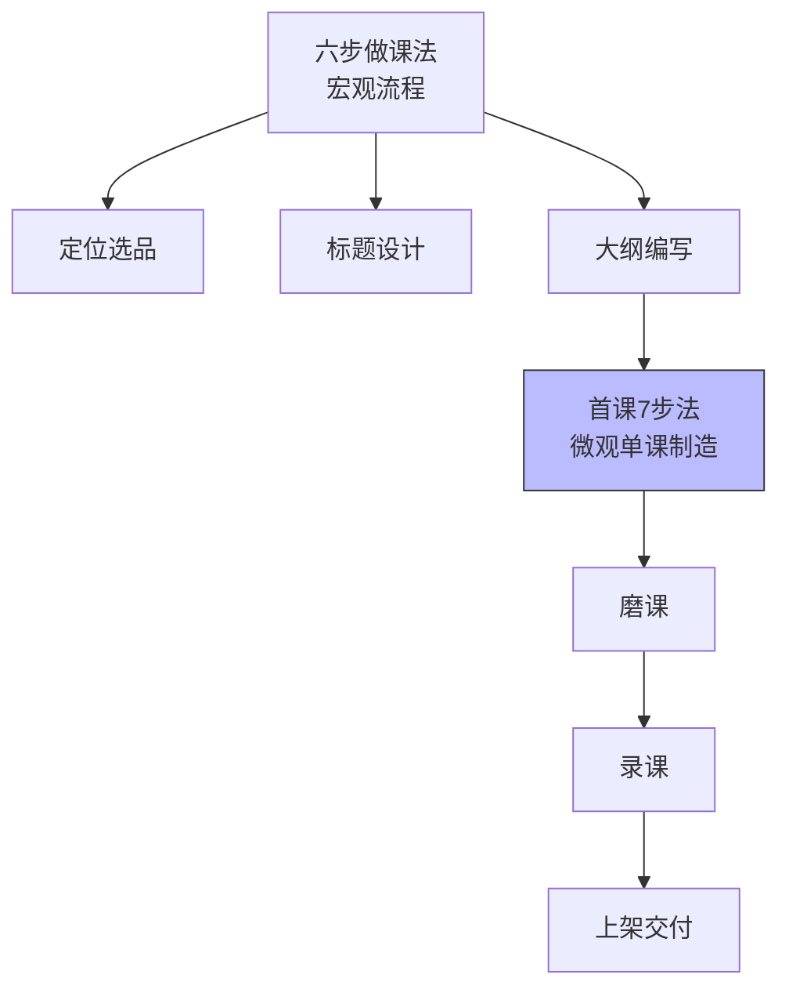

# 第 4 章 闪电做课法——AI时代的内容生产线

## 学习目标

- 理解用AI做课的降本增效动机
- 掌握闪电做课法的六步流程
- 学会首课7步法的单课制造
- 理解AI+知识付费的时代背景

## 4.1 生活类比：从手工坊到流水线

想象一位老手艺人，他花了十年练就了一门绝活，每件作品都要亲手打磨。他一天只能做一件，售价虽高，但产量有限，永远无法满足市场的需求。后来，他引入了工业化的流水线——把制作过程拆解成标准化的工序，每一道工序都有明确的规范和工具辅助。结果，他的产量提高了十倍，成本降了下来，但每一件产品的品质依然可控。**闪电做课法**正是这场"工业化革命"在知识付费领域的翻版。传统做课是手工作坊：一位老师从选题到录制到上架，全凭个人经验，一节课要磨上好几天。而AI时代的做课，是把"做课"拆解成一条可复制的流水线，每一道工序都有AI作为"智能工具"加持。你不需要成为全能的课程制作人，你只需要掌握这条流水线的操作手册，就能源源不断地生产出高质量课程。

## 4.2 概念地图

```
闪电做课法
├── 动机：AI+知识付费时代红利
│   ├── 传统做课周期长成本高
│   ├── 大模型压缩开发周期
│   └── 知识快速产品化
├── 六步做课法（宏观流程）
│   ├── 定位选品
│   ├── 标题设计
│   ├── 大纲编写
│   ├── 磨课
│   ├── 录课
│   └── 上架交付
└── 首课7步法（微观单课）
    ├── 精细化单课生产
    ├── 完整价值体验
    └── 转化率与完课率奠基
```

## 4.3 为什么要用AI做课

> [BqBud_AI做课] "2023是AI元年，AI+知识付费是时代潮流"

这句话是整个闪电做课法的**出发点**。它告诉我们一个简单但关键的事实：AI做课不是一种可选项，而是一个时代趋势。就像2010年的移动互联网浪潮一样，抓住趋势的人获得了红利，观望的人则被甩在了后面。

**首先，传统做课的痛点是什么？**

传统做课是一个典型的手工活：

| 环节 | 传统方式 | 痛点 |
|------|----------|------|
| 选题 | 凭个人经验判断 | 容易踩坑，做了没人买 |
| 大纲 | 反复手动修改 | 耗时数周 |
| 内容 | 逐字逐句写稿 | 一节课要写3-5天 |
| 录制 | 设备调试、重录 | 环境噪音、口误频发 |
| 上架 | 手动配图、写文案 | 繁琐且低效 |

这个表格展示了一个残酷的现实：传统做课的成本高到让人望而却步。你可能有一个好想法，但一想到要花一个月才能做出一门课，热情就消退了。

**其次，AI如何改变这个局面？**

> **核心机制**：大模型压缩开发周期

关键在于，大模型把做课中的"脑力劳动"——选题判断、大纲设计、文案撰写——从数天压缩到了数分钟。你可以让AI在10分钟内生成10个选题方案，再从中挑选最优解。这个过程不是简单地"让AI替你干"，而是**人机协同**：你负责判断和决策，AI负责生成和迭代。

**最后，知识快速产品化意味着什么？**

产品化意味着你的经验、技能、认知，可以快速封装成一个标准化的商品——课程。在传统模式下，知识产品化需要经过漫长的"内容生产"环节。而在AI时代，**知识产品化的瓶颈从"生产"转移到了"判断"**：你不缺内容产能，你缺的是对市场需求的精准判断。

> **闪电做课法**定义（来源：《闪电做课法——AI时代的内容生产线》）

$$
\text{做课成本} \approx \frac{\text{判断决策时间}}{\text{AI生成速度} \times \text{人工审核次数}}
$$

这个公式展示了闪电做课法的核心逻辑：做课的总成本不再取决于"生成内容"的时间，而取决于"决策审核"的时间。AI负责大量生成，你负责快速筛选。如果你的决策速度快，你就能真正做到"闪电"做课。

## 4.4 六步做课法——宏观生产线

> [BqBud_AI做课] "定位→标题→大纲→磨课→录课→上架"

这句话给出了一条完整的做课流水线，也就是**六步做课法**。它把做课这一复杂的创作过程，拆解成了六个可标准化的工序。下面我们逐一拆解。

> **六步做课法**方法（来源：《闪电做课法——AI时代的内容生产线》）

```
1. 定位选品：确定课程面向的人群和解决的核心问题
2. 标题设计：设计一个高点击率的课程标题
3. 大纲编写：搭建课程的知识框架和章节结构
4. 磨课：反复打磨课程内容，确保逻辑清晰、价值明确
5. 录课：录制课程视频，保证音画质量
6. 上架交付：将课程上架到平台，完成交付闭环
```

这段伪代码展示了六步做课法的完整流程。每一步都对应一个明确的可交付成果：定位产出"用户画像+需求文档"，标题产出"课程标题"，大纲产出"章节框架"，磨课产出"逐字稿/课件"，录课产出"视频成品"，上架产出"在线课程"。

**简要拆解各步骤：**

- **定位选品**：这是最关键的一步。你需要回答两个问题：你的目标用户是谁？他们要解决什么痛点？AI可以帮你列出100个潜在选题，并由你筛选出最有付费意愿的一个。
- **标题设计**：标题决定了课程的打开率。你可以在同一演讲中提供并比较5个标题方案，选择最吸引人的一个。
- **大纲编写**：大纲是课程的骨架。AI可以根据你定位的需求，自动生成章节结构。
- **磨课**：这是确保课程质量的反复迭代过程。把大纲中的每一节展开成完整的逐字稿。
- **录课**：使用录屏工具或虚拟数字人完成录制。
- **上架交付**：生成课程封面、详情页文案、营销话术，一键上架。

**六步法的核心洞察：**

六步法不是六个孤立的步骤，而是一个**串联的管道**。前一步的输出就是后一步的输入。定位错了，标题再吸引人也是"挂羊头卖狗肉"；大纲乱了，磨课再有耐心也是白费。因此，AI在每一步中扮演的角色是"加速器"而不是"替代者"——最终的方向判断依然由你来掌控。


这张流程图展示了六步做课法的串行依赖关系。注意定位选品（红色）是起点，上架交付（蓝色）是终点。中间任何一步出了问题，都会影响最终交付的质量。

## 4.5 首课7步法——单课制造

> [BqBud_AI做课] "首课7步法"

六步做课法解决了"如何做完一门课"的宏观问题，但还留下一个微观问题：**单节课具体怎么做？** 首课7步法就是回答这个问题的答案。

> **首课7步法**方法（来源：《闪电做课法——AI时代的内容生产线》）

```
1. 热点切入：用近期热点事件引出话题
2. 痛点共鸣：描述目标用户的真实困境
3. 方案预告：给出课程核心解决方案的概览
4. 知识点讲解：拆解核心概念，逐步讲解
5. 案例演示：用真实案例演示知识点的应用
6. 实操演练：邀请用户跟着动手实践
7. 价值升华与CTA：总结价值，引导用户购买或关注
```

这段伪代码展示了首课7步法的完整结构。这7步不是随意的排列，而是按照心理学中的"钩子-认知-行动"模型设计的：前3步负责"钩住"用户，中间3步负责"教会"用户，最后1步负责"促使"用户行动。

**为什么"首课"如此关键？**

| 指标 | 首课的影响 |
|------|------------|
| 转化率 | 用户通过首课决定是否购买完整课程 |
| 完课率 | 首课体验好，用户才会继续学习后续章节 |
| 口碑传播 | 首课是用户分享给朋友的概率最高的内容 |

这个表格展示了首课对课程商业表现的三重影响。首课不仅是内容的起点，更是**信任的起点**。用户只给了你"一节课"的机会来证明你的价值，错过了就永远失去了他。

**首课的精细化生产要点：**

- **每一分钟都要有信息量**：首课不要有冗长的自我介绍或铺垫，直接切入价值。
- **制造"啊哈时刻"**：在课程前半段就要让用户产生"这个课有用"的顿悟感。
- **留好钩子**：结尾不仅要总结，更要预告下一节的价值，让用户产生"想继续学"的冲动。
- **可交付的获得感**：让用户学完首课就能用上一个小的技巧或工具。

**首课7步法与六步做课法的关系：**



这张图展示了两个方法之间的关系：六步做课法是宏观生产线，首课7步法是这条生产线上"最核心工序"的微观操作手册。当我们走到"大纲编写"和"磨课"时，就用首课7步法来指导具体怎么做。

## 4.6 设计中的取舍

**为什么用AI生成的课程内容不会"千篇一律"？**

这是一个常见的担忧。如果所有人都用AI做课，那课程内容是否会趋同？实际上不会。AI生成的内容只是"原材料"，而你作为课程创作者的**判断力、经验、个人风格**，才是决定课程差异化的关键。AI可以帮你写出10个课程大纲的草稿，但只有你能判断哪个大纲更契合你自己的知识体系和学员的真实需求。AI是画笔，你才是画家。

**为什么不是让AI全自动录课？**

既然AI的能力这么强，为什么不直接让AI自动生成课程并上架？答案是：**信任和温度**。学员购买课程，买的不仅是知识，还有"老师的经验和陪伴"。一个虚拟老师从头到尾的课程，虽然成本低，但学员的信任度会大打折扣。这背后的trade-off是：全自动化省了时间但丢了信任，半自动化（人机协同）保留了温度但需要你投入时间。对于大多数知识付费创业者来说，后者是更优解。

**为什么首课要精细化而非追求速度？**

你可能会问：既然是"闪电做课"，为什么首课反而要精细化？这不是自相矛盾吗？这里的关键在于**边际收益的差异**。一门课有30节课，如果你平均用力，每节课都是80分，那这门课的体验是"平平无奇"。但如果你把主要精力投放在首课上，做出一个95分的首课，用户的付费意愿会大幅提升。首课的精细化投入，是这门课中边际收益最高的投资。

## 4.7 动手练习

- 用AI工具（如DeepSeek）生成10个你所在领域的选题，从中筛选出1个你认为最有付费意愿的，并写出你的筛选理由。
- 针对你选出的选题，用AI生成3个候选标题，用"四元素法"（数字、人群、痛点、结果）评估哪个最吸引人。
- 使用六步做课法，为你的选题生成一个完整的课程大纲，并标出哪一节是你的"首课"。
- 将大纲中的首课展开写成完整的逐字稿，然后用首课7步法核对你的逐字稿是否覆盖了全部7个环节。
- 将你的首课逐字稿中前3步（热点切入、痛点共鸣、方案预告）压缩到90秒内，练习如何快速抓注意力。
- 尝试用AI生成课程的营销文案（课程卖点、适合人群、你将收获），与人工写的版本对比，找出差异并思考如何互补。

## 4.8 本章小结

这一章中我们学习了闪电做课法——一套结合AI能力与知识付费流程的快速做课方法论。首先我们理解了为什么要在AI时代做课：传统做课周期长、成本高，而大模型能显著压缩开发周期，让知识快速产品化；其次我们掌握了六步做课法的宏观流程——从定位选品、标题设计、大纲编写，到磨课、录课、上架交付，形成了一条完整的内容生产线；接着我们学习了首课7步法，掌握了单节课精细化生产的操作模板，理解了首课对于转化率和完课率的决定性作用；然后我们讨论了设计中的人机协同取舍；最后以动手练习巩固了本章的全部核心技能。

本章我们一起学习了以下概念：

| 概念 | 解释 |
|------|------|
| 闪电做课法 | AI+知识付费结合实现快速做课 |
| 六步做课法 | 定位→标题→大纲→磨课→录课→上架 |
| 首课7步法 | 单节课的内容制造模板 |

现在你已经掌握了高效的做课方法。但在课程上架之后，如何让更多学员看到并购买你的课程呢？这就是下一章要讨论的重点：AI时代的推广与卖课策略。我们将学习如何利用AI工具进行精准营销、内容种草和社群运营，让你的课程真正实现"卖得出去"。

