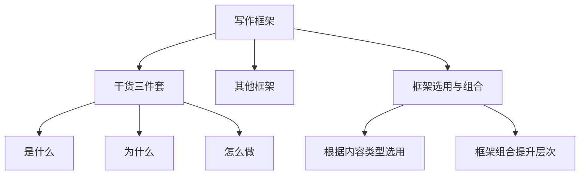
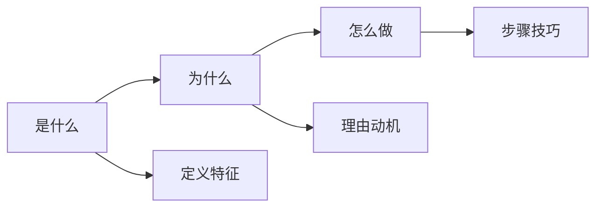
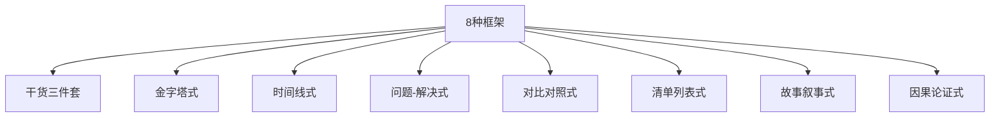

# 第 5 章 写作框架——让内容结构会说话

## 学习目标

- 理解写作框架在内容生产中的核心作用
- 掌握干货三件套等核心框架
- 学会框架选用与组合策略
- 建立结构化表达意识

## 5.1 生活类比

写作框架就像建筑施工图纸——在动笔之前，你首先要确定结构，再填充内容。一位建筑师拿到一块地皮，不会立刻堆砌砖瓦，而是先绘制蓝图：哪里是承重墙，哪里是门窗，哪里是走廊。写作也一样。

想象一下组装一台宜家书柜：说明书上的"先搭框架，再装隔板"与写作中的"先定结构，再填内容"是同一个道理。如果你打开包装就随便拼装，最后很可能多出几块板子，甚至整个柜子摇摇欲坠。同样的，如果没有框架，你的文字会松散无力，读者读起来费力又难以记忆。

框架就是那个帮你"先搭骨架、后填血肉"的工具。它决定了读者先看到什么、后看到什么，也决定了你的信息将以怎样的逻辑顺序进入对方的脑海。

## 5.2 概念地图



## 5.3 为什么要写作框架

> [P001, p.1] "写作中常见的8种框架"

这看似简单的一句话背后，藏着一个关键判断：写作不是"想到哪写到哪"，而是有模式可循的结构化行为。我们为什么需要框架？答案可以从三个角度理解。

**第一，降低受众认知负担。** 当我们阅读一篇没有框架的文章时，大脑需要同时完成多项任务：理解内容、推断逻辑、识别重点、建立联系。这会消耗大量认知资源。而框架的存在，让读者的注意力从"理清结构"中解放出来，专注于"理解内容"本身。

**第二，结构化表达的力量。** 你可以回想一次听讲座的经历：当演讲者说"我将从三个方面展开"，你的大脑会自动建立一个"三栏文件夹"，把后续信息分别归入。这种预先建立的心理结构，让信息的接收和记忆效率大幅提升。

**第三，先结构后内容的意识。** 许多写作者最大的误区，就是一上来直接写正文，写到一半才发现逻辑混乱、前后矛盾。框架先行意味着：在动笔之前，你已经决定了主线是什么、要用几个板块支撑、板块之间如何衔接。这样写出来的作品，哪怕语言朴素，也依然清晰有力。

> **写作框架**定义（来源：《写作框架》）

$$
\text{写作框架} = \text{结构预设} + \text{内容填充}
$$

这个公式展示了写作框架的本质：它是一组预先设定的结构规则，规定了内容以何种顺序、何种逻辑关系呈现给读者。结构预设决定了"骨架"，内容填充决定"血肉"。

当我们面对一个陌生的写作任务时，第一个要回答的问题往往是："我该怎么组织这些材料？" 框架就在这里介入——它把混乱的素材装入有序的格子，让读者沿着你设计的路径走完全程。这就好比一个导游，不会带着游客在景区里乱转，而是规划好一条线路，让人不走回头路。

## 5.4 干货三件套

> [P001, p.1] "是什么为什么怎么做"

如果你只记住一个写作框架，那就记住"干货三件套"：**是什么、为什么、怎么做**。这是最具普适性的三段式结构，几乎可以套用在所有说明型、教学型内容中。

**第一段：是什么（What）。** 定义你要讲的东西。让读者明确"我们谈论的是同一个事物"。这里写定义、写特征、写边界。不定义清楚就往下走，读者会在心里打问号："这到底指的是什么？"

**第二段：为什么（Why）。** 解释原因和动机。为什么这个问题值得关注？为什么用这种方式而不是别的方式？这里的目的是说服读者：这个问题值得花时间了解。

**第三段：怎么做（How）。** 给出方法和步骤。具体操作指南、执行路径、注意事项。在完成了"是什么"和"为什么"的铺垫后，读者的接受度已经到位，此时给出方法，他们会自然而然地消化吸收。

> **干货三件套**方法（来源：《写作框架》）

```
1. 是什么 → 给出定义和特征，让读者锁定对象
2. 为什么 → 给出理由和动机，让读者产生认同
3. 怎么做 → 给出步骤和技巧，让读者获得方法
```

这段伪代码展示了干货三件套的核心逻辑：它本质上是一条"认知递进路径"——先让读者知道"这事是什么"，再让读者理解"这事为什么重要"，最终让读者掌握"这事怎么做"。三个步骤缺一不可，顺序也不宜调换。

我们来看看这个方法在实际写作中的运作。假设你要写一篇关于"番茄工作法"的教程：

- **是什么**：番茄工作法是一种时间管理方法，核心是25分钟专注加5分钟休息的循环。
- **为什么**：因为人的专注力有限，强行长时间工作反而降低效率；把任务切割成小块，能有效对抗拖延和疲劳。
- **怎么做**：设定25分钟计时器，专注单一任务，响铃后休息5分钟，每4个循环后休息15-30分钟。

这就是干货三件套的威力：不需要华丽辞藻，仅仅通过逻辑递进，就能把一件事讲得清清楚楚。这也是它被称为"干货"的原因——它的目标不是取悦读者，而是让读者带着答案离开。



## 5.5 框架的种类与选择——8种常见框架

> [P001, p.1] "框架是写作结构化的核心工具"

写作的框架当然不止一种。在《写作框架》的素材中，作者一口气提出了8种常见的框架类型。我们需要回答的问题有两个：这些框架是什么，以及什么时候用哪个。

**8种常见框架概览。** 让我们把它们列举出来，并理解每一类的适用场景。由于素材原文以列举为主，我们对每一项做教学化展开：

| 框架类型 | 适用场景 | 核心特点 |
|----------|---------|---------|
| 干货三件套 | 教程、说明文 | 是什么→为什么→怎么做 |
| 金字塔式 | 汇报、新闻 | 结论先行，论据在后 |
| 时间线式 | 回顾、传记、复盘 | 按时间顺序推进，记录变化 |
| 问题-解决式 | 方案文档、案例分析 | 提出问题，并给出解决方案 |
| 对比对照式 | 产品评测、选择建议 | 展现差异，辅助决策 |
| 清单列表式 | 操作手册、要点汇总 | 逐条列点，方便查阅 |
| 故事叙事式 | 品牌宣传、软文 | 以情节推进，情感驱动 |
| 因果论证式 | 论文、观点文章 | 先因后果，严谨推理 |

这个表格展示了8种框架的差异。它们各自适合不同的内容类型和受众目标，不存在"绝对好"的框架，只有"更合适"的框架。

**根据内容类型选用。** 框架的选择应该服务于两个因素：内容性质与受众期望。如果你是写给技术团队看的架构说明，金字塔式（结论先行）往往最有效率；如果你是写给普通用户的软文，故事叙事式更容易引发共鸣；如果你在写一份操作手册，清单列表式让使用者可以按图索骥。

**框架组合提升表述层次。** 高手并不拘泥于单一框架。一个成熟的写作者，往往会组合多种框架嵌套使用。比如：整体用"干货三件套"推进，在每个部分内部用"问题-解决式"展开；或者开头用一段故事引入情感，中段用金字塔式交代核心立场，结尾用清单式做行动清单。



这个演进图展示了框架的"家族谱系"：8种框架并列存在，各自独立又可以相互嵌套。掌握这8种框架，相当于你的工具箱里有了8种型号的螺丝刀——面对不同的螺丝，你总有一把趁手的工具。

## 5.6 设计中的取舍

**为什么不把所有信息塞进一种"万能框架"？** 因为读者的需求是多元的。有人需要快速获取结论（金字塔式），有人需要理解来龙去脉（时间线式），有人需要情感共鸣（故事叙事式）。如果用一个框架应对所有场景，就像穿着一双鞋跑步、爬山、逛街——它能走，但每一项都不算舒服。

**这种设计的 trade-off 是什么？** 框架的选择本质上是在"效率"和"深度"之间做交换。清单列表式效率最高，但难以传递深层逻辑；故事叙事式情感最深，但信息密度低；因果论证式最严谨，但阅读门槛高。没有完美的框架，只有"在当时场景下最优"的框架。这也是为什么框架组合如此重要——用组合来对冲单一框架的局限。

## 5.7 动手练习

（本节暂无动手练习——如果你正在读一本关于"写作"的教科书，那么最好的练习就是：把你正在读的这一章结构拆开，看看我们用了几种框架，以及它是如何被组合起来的。）

## 5.8 本章小结

这一章中我们学习了写作框架的核心价值与具体应用。首先，我们理解了写作框架为什么重要——它能降低读者的认知负担，让结构化表达成为可能，并引导我们形成"先结构、后内容"的写作意识。其次，我们详细拆解了干货三件套的结构——是什么、为什么、怎么做，这套三段式框架几乎可以套用在所有说明型内容中。接着，我们概览了8种常见写作框架，理解了它们各自的适用场景。最后，我们讨论了框架的选用与组合策略，指出框架选择是"效率与深度"之间的权衡，而框架组合是提升表达层次的关键手段。

本章我们一起学习了以下概念：

| 概念 | 解释 |
|------|------|
| 写作框架 | 内容是结构化的核心工具 |
| 干货三件套 | 是什么为什么怎么做的三段式 |
| 框架组合 | 根据内容类型和受众目标选用组合 |

下一章中，我们将进一步探讨如何优化单篇内容的结构安排，以及如何在段落、句子和词汇层面打磨你的文字表达。框架解决的是"整体组织"的问题，而后续章节将回答"局部精修"的问题——两者结合，才能真正让内容结构"会说话"。

