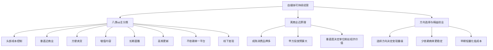
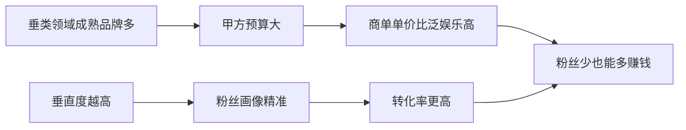

# 第 6 章 自媒体可持续经营八类模式

## 学习目标

-   理解自媒体可持续盈利的八类模型
-   掌握离商业近的变现原理
-   学会根据自身禀赋选择自媒体赛道
-   理解多平台分发与精益创业理念

## 6.1 生活类比

想象你正在选择一份职业。同样是销售岗位，医药代表的单笔提成可能上千元，而快消品销售员的单笔提成可能只有几块钱。两者的努力程度相似，但收入天花板却天差地别。自媒体赛道选择也是如此：不同领域的变现能力差异巨大，选对了方向，事半功倍；选错了方向，再努力也可能事倍功半。本章要讨论的，就是如何在你正式进场之前，先看清八类真正能赚钱的up主模型，以及"离商业近"这条核心变现原理。

## 6.2 概念地图



## 6.3 八类自媒体盈利模型

> [P001, p.1] "未来只有这八类up主才能真正赚到钱"

这句话给所有内容创作者画了一条明确的及格线。它不是说你必须同时满足八条才能活下来，而是提醒你：可持续经营的自媒体，几乎都至少命中其中之一。

这八类模型，本质上是从不同维度回答了同一个问题——**你靠什么持续获得收入**？我们逐一拆解：

| 模型类型 | 核心逻辑 | 典型特征 |
|---------|---------|---------|
| 头部成本控制 | 你已经是头部，重点在于控制成本提升毛利 | 已有稳定流量，有团队、有供应链 |
| 垂直近商业 | 垂直领域离交易近，粉丝少但客单价高 | 领域有成熟品牌与高预算甲方 |
| 方便卖货 | 内容天然适配带货场景 | 测评、开箱、穿搭类 |
| 增值内容 | 内容本身可定价销售 | 课程、咨询服务、知识付费 |
| 长期直播 | 直播场景高频且信任度高 | 直播带货、打赏、连麦咨询 |
| 高频更新 | 靠更新频次维持流量与推荐权重 | 资讯、日更类栏目 |
| 不依赖单一平台 | 多平台分发，降低平台政策风险 | 全平台矩阵运营 |
| 线下变现 | 将线上影响力转为线下收益 | 线下演讲、见面会、实体店引流 |

表：八类盈利模型一览（来源：[P001, p.1]）

第一类"头部成本控制"解决的是**规模问题**。当你已经在某个垂类做出知名度，收入的增长率不再来自流量翻倍，而是来自成本下降——比如自制取代外包、批量采购压低素材成本。头部up主的竞争，本质是运营效率的竞争。

第二类"垂直近商业"解决的是**单位价值问题**。这是本章最核心的一条，我们在下一节详细展开。

第三类到第六类解决的是**变现路径问题**。方便卖货的赛道天然有交易场景；增值内容把粉丝关系转化为付费关系；长期直播把一次性观看变成持续陪伴；高频更新则用内容密度换取算法推荐权重。这四条路径并不互斥，很多头部up主同时命中两条以上。

第七类"不依赖单一平台"解决的是**风险分散问题**。平台政策、算法调整、封号风险，任何一个单一平台都可能让创作者一夜归零。多平台分发的本质，是给自己上保险。

第八类"线下变现"解决的是**信任变现问题**。线上粉丝关系积累到一定程度，你在线下的一小时可能比线上一个月的广告收入还高。

## 6.4 离商业近的变现原理

> [P001, p.2] "离商业近的领域粉丝不多但挣钱不少"

这句话是本章的灵魂。它揭示了一个反直觉的事实：**粉丝数不是收入的唯一决定因素，单位粉丝的经济价值才是**。

为什么垂直领域的粉丝更值钱？我们需要拆解背后的因果链：

$$
\text{变现收入} = \text{粉丝数} \times \text{单位粉丝经济价值}
$$

这个公式展示了收入的两个乘数因子。大多数新人只关注第一个因子"粉丝数"，而忽略了第二个因子。但恰恰是第二个因子，决定了同样拥有10万粉丝的up主，年收入可能相差50倍。

那么单位粉丝经济价值又由什么决定？

$$
\text{单位粉丝经济价值} \propto \frac{\text{甲方投放预算}}{\text{垂直赛道竞争者数量}}
$$

这个公式展示了：当某个垂直领域存在大量成熟消费品牌、且这些品牌有充足的广告投放预算时，赛道内的up主即使粉丝量不大，也能获得高单价商单。反之，如果赛道内品牌稀少、预算干涸，那么即使粉丝再多，也难以为继。

我们把这两条因果链合并，就得到了"离商业近"的完整逻辑：



图：离商业近原理的数据流（来源：[P001, p.2]）

这条原理对创作者有直接的选赛道指导意义：**在启动自媒体之前，先问自己三个问题**——这个领域有没有成熟品牌？这些品牌愿意在内容上花多少钱？我的垂直度能让甲方信服吗？

## 6.5 方向选择与精益创业

> [P001, p.3] "自媒体早期必须轻量化低成本"

确定赛道之后，下一个问题是如何启动。这里要引入精益创业的思想。

精益创业的核心是"最小可行产品"（MVP）——以最低成本、最快速度验证你的内容方向是否有效。对于自媒体，这意味着：

```
精益创业启动流程：
1. 选定一个垂直领域（由"离商业近"原理指导）
2. 用手机+免费剪辑工具制作第一支测试视频
3. 发布到1-2个平台观察数据
4. 根据数据反馈调整内容方向
5. 验证跑通后再投入设备、团队与付费工具
```

这段流程展示了自媒体的精益启动方式。它的核心理念与软件行业的敏捷开发一脉相承：先验证，再放大。与其一开始就购买专业设备、组建团队，不如先用最小资源验证内容是否有人看、赛道是否有人投放。

方向选择决定了变现量级，但方向选择这件事本身不需要花大钱。一个人在咖啡厅用手机录制的3分钟干货视频，与花5万元搭建的直播间，在"验证方向"这件事上是等价的。你只需要确认三件事：你的内容有人看吗？这个赛道有品牌预算吗？你能持续产出吗？

另一个常被忽略的点是：**少依赖商单更稳定**。商单收入本质上是你把内容定价权交给了甲方，一旦甲方削减预算，你的收入立刻断崖。因此，优秀的创作者会把内容本身变成资产——无论是课程、衍生品还是线下服务——让收入来源多元化，而不是单一依赖商单。

## 6.6 多源对照

本节素材来源只有 [P001] 一篇，但它本身包含了三层递进：分类（八类模型）、原理（离商业近）、方法（精益创业）。我们对照这三层之间的关系：

**共识**

- 三层结构之间是互为表里的关系：八类模型是现象分类，"离商业近"解释了为什么某些类别能赚到更多钱，精益创业则给出了进入这些赛道的最低成本路径。三者缺一不可。

**分歧**

- 分歧主要体现在路径优先级上。八类模型内部，有的模型适合"无资源的新人"入场（如垂直近商业、高频更新），有的则要求你已经有相当体量后才能解锁（如头部成本控制、线下变现）。[P001] 并未对"新人应该优先选择哪一类"给出明确排序——这一点需要创作者根据自己的禀赋判断。 [需要补充文献]

## 6.7 设计中的取舍

**为什么不直接模仿头部up主的模式？**

头部成本控制模式的前提是"你已经是头部"。这意味着你必须有稳定的流量基本盘，才有资格谈成本优化。新人没有流量，模仿"控制成本"是没有意义的——你根本没有成本可以控制。正确的姿势是先用精益创业方式跑通内容验证，再逐步向八类模型靠拢。

**"方便卖货"和"垂直近商业"的区别是什么？**

方便卖货侧重的是"内容与交易场景的适配性"，比如测评类内容天然适合带货；而垂直近商业侧重的是"赛道本身的商业密度"，比如金融、法律、医疗这类高客单价领域。两者的交集处是最优选择：一个既垂直、又方便卖货的赛道，变现效率最高。但注意，垂直度提高的同时，也会收窄你的受众面，这是一个需要权衡取舍的点。

## 6.8 动手练习

（注：本章素材未提供具体练习，练习将结合理论自行设计。）

-   **练习一**：列出你感兴趣的自媒体赛道，用"离商业近"的三要素（成熟品牌多、预算大、垂直度高）逐一打分，选出一个你最适合启动的赛道。
-   **练习二**：为你的赛道设计一个"精益创业"最小验证方案：不花一分钱预算，在一周内完成内容测试。
-   **练习三**：对照八类模型，分析你关注的3个头部up主分别命中哪些模型，推测他们的主要收入结构。

## 6.9 本章小结

这一章中我们学习了自媒体可持续经营的八类模式及其背后的变现逻辑。首先我们划定了八类能够真正盈利的up主分类，从头部成本控制、垂直近商业、方便卖货到线下变现八个维度；其次我们深入拆解了"离商业近"的变现原理，理解了为什么垂直领域的粉丝虽然少但赚钱更多；接着我们讨论了方向选择与精益创业的关系，明确了自媒体早期轻量化、低成本启动的必要性；然后我们通过多源对照剖析了三层结构的内在联系；最后我们分析了模式选择的取舍问题。整体来看，赛道选择决定了变现量级的上限，而精益创业决定了你到达那个上限的速度和成本。

本章我们一起学习了以下概念：

| 概念 | 解释 |
|------|------|
| 八类盈利分类 | 头部成本控制、垂直近商业、方便卖货、增值内容、长期直播、高频更新、不依赖单一平台、线下变现八类可持续盈利up主模型 |
| 离商业近原理 | 垂直领域拥有成熟品牌与高预算甲方时，粉丝量不大也能获得高收入，单位粉丝经济价值由赛道商业密度决定 |
| 精益创业 | 自媒体早期必须轻量化、低成本启动，用最小可行产品验证内容方向后再加大投入 |

下一章中，我们将进入自媒体经营的实战运营环节，讨论如何将本章选择的赛道从理论落地到日常的内容生产与流量运营中去。

