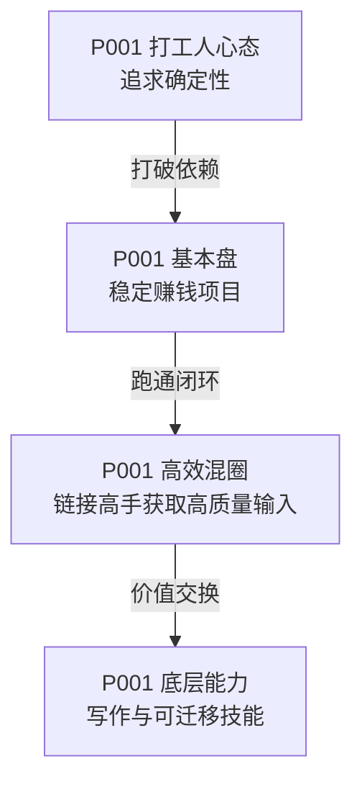

# 第 7 章 从项目思维到个体户——自由职业转型

## 学习目标

- 理解打工人心态对转型的阻碍
- 掌握基本盘概念与先跑闭环原则
- 学会高效混圈的方法
- 掌握可随身带走底层能力的培养

## 7.1 生活类比

转型自由职业，很像学游泳。你不可能第一次下水就直奔深水区——那只会让你呛水甚至溺水。正确的做法是先在浅水区站稳脚跟，找到一个能让你脚踩实地的地方，再慢慢练习换气和划水。这个"能站稳的地方"，就是你的基本盘。当你把基本盘做扎实了，再往深水区试探，去混更高级的圈子、链接更厉害的人，最后练就一身无论在哪片水域都能游的底层能力（换气、踩水、漂浮）。这四步，恰好对应了自由职业转型的路径。

## 7.2 概念地图

```
打工人心态 → 基本盘 → 高效混圈 → 底层能力
    │           │          │           │
    │           │          │           └─ 可随身带走的能力
    │           │          └─ 以提供价值和链接高手为目的
    │           └─ 先跑通闭环再做知识付费
    └─ 追求确定性是最大阻碍
```

## 7.3 打工人心态与兜底心态

转型自由职业，你面对的第一个敌人不是市场，不是客户，而是你自己脑子里那把"追求确定性"的尺子。

> [P001] "打工人转型自由职业最难的是打工人心态。"

这句话出自《20230808_08_自由职业》，短短十几个字，却点出了转型路上最大的拦路虎。

**打工人心态**定义（来源：《20230808_08_自由职业》）

```
打工人心态 = 追求确定性 + 依赖组织分配 + 回避风险
```

这个定义揭示了三个核心特征。第一，追求确定性意味着你希望每个月的工资条数字不变，希望每项任务都有明确的责任人，希望每份工作都有人兜底。第二，依赖组织分配意味着你习惯等着被安排任务，而不是自己寻找机会。第三，回避风险意味着你倾向于选择那些"做了至少不会更差"的选项，而不是"可能大赚也可能大亏"的选项。

这三种特质在职场里是优秀的代名词，但放到自由职业的赛道上，就成了你前进的刹车片。

为什么？因为自由职业的本质恰恰是反确定性的：收入不确定、客户不确定、项目不确定。如果你带着打工人心态闯进来，你会发现每一天都是煎熬——你会反复追问"下个月有没有单子"，你会因为一个客户流失而整夜失眠，你会忍不住想退回公司去要那份"确定"的工资。

> 打工人心态转型方法（来源：《20230808_08_自由职业》）

```
方法：打破职场依赖 → 接受不确定性 → 建立兜底心态（留足3-6个月开销）
```

结合该方法，这里有一个可供参考的演进方向，且从逻辑上可以被视为一种阶段式的自我重塑：

1. 打破职场依赖，先从兼职或周末接单开始，不急于裸辞；
2. 接受不确定性，把"收入波动"看作自由职业的正常状态，而非异常状态；
3. 建立兜底心态，用 3-6 个月的生活费储备给自己留退路，反而能帮助你在做决策时更从容。

这段步骤展示了转型的路径依赖：你不可能一天之内从一个追求确定性的打工人变成拥抱不确定性的个体户，你需要过渡期、需要安全垫、需要心理建设。

这里有一个关键认知：兜底心态不是为了让你随时准备逃回职场，而是为了让你在自由职业的深水区游泳时，不至于因为呛了一口水就慌得游回岸边。

## 7.4 基本盘与先跑闭环

当你熬过了心态关，接下来要做的事情非常具体：找到一个能稳定赚钱的项目，把它跑成一个闭环。

> [P001] "找到一个能赚钱的项目作为基本盘。"

**基本盘**定义（来源：《20230808_08_自由职业》）

```
基本盘 = 一个你每天做、能稳定带来现金流、且可复制的项目
```

这个定义包含三个要素。第一，"每天做"意味着基本盘不能是那种一年才碰一次的大项目，它应该是高频、可重复的。第二，"能稳定带来现金流"强调的是现实性——自由职业首先是一门生意，不是情怀。第三，"可复制"意味着这个项目不依赖于你个人的超常发挥，而是有一套可执行的标准流程。

为什么要强调"先跑闭环"？

> 先跑闭环要求（来源：《20230808_08_自由职业》）

```
顺序：先跑通赚钱闭环 → 再做知识付费
```

这个顺序在大量自由职业者掉过的坑里得到过印证：很多人一上来就想做知识付费，写课程、开训练营、做社群，结果发现根本卖不动。原因很简单：你没有先证明自己能在市场上赚到钱。

知识付费的本质是"卖方法论"，而方法论的信任基础是你自己用这套方法论赚到过钱。你没跑通过闭环，你说的话就没有说服力；你跑通了闭环，哪怕只是一个几千块的咨询单子，你讲的每句话都有了实证支撑。

这里有一个非常重要的推论：先做能稳定赚钱的项目，哪怕它看起来很"low"、很小，因为基本盘的核心功能是给你持续的正反馈和现金流，让你有底气去探索更大的机会。没有基本盘，你所有的冒险都是裸奔；有了基本盘，你才有资格谈诗和远方。

## 7.5 高效混圈与底层能力

基本盘稳定之后，你的下一步是往更高的圈层走。这就要聊到高质量输入的问题。

> [P001] "输出的本质是输入，输入的本质是和高手交流。"

这句话值得反复咀嚼。写作和输出是自由职业者最重要的获客方式，但很多人的输出质量上不去，根本原因不是写作技巧不行，而是输入质量太低。

**高效混圈**定义（来源：《20230808_08_自由职业》）

```
高效混圈 = 以提供价值和链接高手为目的参与社群，而非漫无目的地围观
```

仔细体会这个定义："以提供价值"排在前。很多人混圈是去"索取"的——求资源、求介绍、求合作——但高手的时间极其昂贵，你凭什么都拿走而不付出？

> 高效混圈要点（来源：《20230808_08_自由职业》）

1. 每次参与社群，先想清楚你能提供什么价值——哪怕是帮人解答一个小问题；
2. 主动链接高手，但不要一上来就谈合作，先让对方记住你是个"靠谱的人"；
3. 把与高手交流中得到的认知沉淀成文字，成为你下一次输出的素材。

这段清单展示了混圈的"双向性"：你提供价值换来了高质量输入，高质量输入又提升了你的输出质量，输出质量又吸引更多高手来链接你——这是一个正向飞轮。

那么，什么能力是自由职业者最值得刻意培养的？

> 底层能力定义（来源：《20230808_08_自由职业》）

```
底层能力 = 无论换到哪个行业、哪个平台都能带走并复用的能力
```

其中，写作被明确列为超级个体最重要的底层能力，因为写作能力在不同载体间的迁移成本最低——把一篇长文转成短视频脚本只需要改结构，把脚本转成直播口播只需要改语气。你写的每一篇内容都是你的资产，积累在你的账号上，持续为你带来流量和客户。

> 底层能力培养要点（来源：《20230808_08_自由职业》）

```
刻意练习 = 每天固定时间输出 + 定期复盘迭代 + 跨场景迁移应用
```

**方法演进图**



这段流程展示了自由职业转型的四步走：心态关→基本盘→混圈→底层能力，每一步都是下一步的基础，跳步必然翻车。

## 7.6 多源对照

当前章节的素材仅来源于单一文献《20230808_08_自由职业》，因此对于以下概念暂不存在多源交叉验证。如果读者想了解不同流派对"自由职业转型"的看法，可以参考其他文献，但本书暂不展开。

### 共识

在单一素材内部，"转型次序"是内在一致的：先解决心态问题，再建立基本盘，随后通过混圈放大影响力，最后沉淀为可迁移的底层能力。

### 分歧

目前缺乏可对照的分歧点。`[需要补充文献：例如对比"自由职业是否必须先跑闭环再做品牌"的不同立场]`

## 7.7 设计中的取舍

自由职业转型路径中，最值得追问的问题之一是：

**为什么不是先做品牌再做闭环？**

很多人的直觉是：先打造个人品牌，知名度上来了，客户自然就来了。但这条路径的危险在于，品牌建设是慢变量，它需要数月甚至数年的持续输出才能见效，而你在品牌还没建起来的这段时间里，没有任何现金流。没有现金流，你的试错容错率几乎为零——你连每个月的基础开销都覆盖不了，哪还有心气儿去持续输出？

反过来，先跑闭环的逻辑是"先生存后发展"：用一个哪怕很小的项目先赚到钱，维持基本生存，然后拿多余的时间和精力去建设品牌。这样做的代价是，品牌的起步会比较慢，你前期做的事情看起来不够"高级"。但好处是，你有足够的耐心等品牌长出来，而不是被生存压力逼着做短视的决策。

**为什么不一开始就把所有时间投入混圈？**

这个问题同样值得思考。混圈固然能带来高质量输入，但也看你的匹配度与消化能力。如果基本盘薄弱，你所处圈层及与高手对话时的底气会有明显不同；如果没有足够的实践沉淀，你拿到的高质量输入也只是过眼云烟。先巩固基本盘，再混圈，交流中产生的东西才能化为己用。

## 7.8 动手练习

- 列出你当前对"确定性"的三个具体依赖点（例如按时发薪、固定考核、团队协作），逐一设计对应的"自由职业替代方案"。
- 写出当前你最可能跑通闭环的一个具体项目（例如独立开发、咨询服务、内容创作），规划出从获客到交付再到收款的最短路径。
- 选一个你所在的行业社群，记录你未来一周"提供价值"的具体行为，并在下一次输出中沉淀这些素材。
- 每天固定 30 分钟写作，连续坚持一周，记录输出过程中你的思考密度和素材消耗速度。

## 7.9 本章小结

这一章中，我们讨论了从打工人转型自由职业的完整路径。首先从最难打的"心态关"说起，认识到了追求确定性是转型最大的阻碍，并学会用兜底心态与不确定性共处；其次明确了基本盘的概念，懂得了要先跑通一个赚钱闭环再做知识付费的正确次序；接着重点探讨了高效混圈的方法，理解了"提供了什么价值"比"认识了什么高人"更重要，以及高质量输入对输出的加持；最后我们把目光放长远，梳理了写作等底层能力的培养思路，以及如何刻意地让它成为自己能随身带走的资产。

本章我们一起学习了以下概念：

| 概念 | 解释 |
|------|------|
| 打工人心态 | 追求确定性的心态是转型最大阻碍 |
| 基本盘 | 能稳定赚钱可跑通闭环的项目是转型依托 |
| 高效混圈 | 以提供价值和链接高手为目的参与社群 |

下一章中，我们将从一个更宏观的视角来审视自由职业者的日常运营，学习如何把基本盘项目体系化、流程化，构建一台真正属于自己的赚钱系统，而不是靠着单打独斗和灵感来过活。
