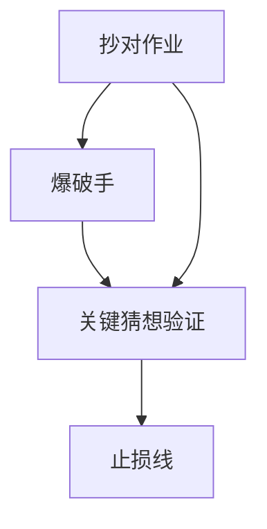
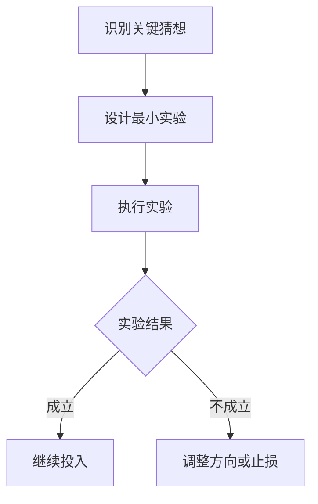

# 第 8 章 提高项目成功率的 7 个方法

## 学习目标

- 理解不轻易从0到1验证项目的核心原则
- 掌握抄对作业与模仿验证路径的方法
- 理解爆破手与关键猜想验证
- 学会设置止损线


## 8.1 生活类比

提高项目成功率，就像学车考驾照。一个从没摸过方向盘的新手，如果直接买辆新车开到市区上路，大概率会出事故——不是因为你的学习能力差，而是因为你没有经历过系统的"已验证路径"：驾校教练会先教你规范动作（打方向、踩离合、看后视镜），再带你在封闭场地练习，最后才让你上真实道路。这个过程帮你压缩了试错成本，避免了在真实道路上用真金白银买教训。做项目也一样，不要轻易从 0 到 1 去验证一个完全没人做过的项目，而是要找到一个"已考过驾照的教练"，去模仿他验证过的路径。


## 8.2 概念地图



> 概念地图树状图：

```
抄对作业
├── 不轻易从0到1验证项目
├── 模仿已验证路径
└── 压缩试错成本
爆破手
├── 明确项目负责人
├── 匹配团队基因
└── 验证关键猜想而非财务指标
关键猜想验证
├── 验证最关键业务假设
└── 聚焦验证关键点
止损线
├── 减少多余动作
└── 防止过度投入
```

## 8.3 抄对作业与模仿验证

> [P001, p.5] "不要轻易从0到1验证项目"

项目一开始，我们的第一反应往往是"我要做出一个前所未有的创新产品"。这在直觉上很吸引人，但在实践中成本极高。从 0 到 1 意味着每一个环节都是未知的、未经验证的，每一步都可能踩坑。

**抄对作业**的定义（来源：《项目成功7法》）

所谓"抄对作业"，不是指抄袭别人的代码或产品，而是指**模仿已经被市场或前人验证过的路径**。具体来说：

```
抄对作业 = 找到一个已被验证的路径 + 模仿其执行方式 + 仅在必要处做微调
```

这个公式展示了"抄对作业"的本质：你不需要重新发明轮子，只需要找到那个被验证过的轮子，并把它正确地装到你的车上。这里的"对"有两个含义：第一，路径本身是对的（已被验证）；第二，你要模仿的对象是对的（与你的条件匹配）。

举例来说，假设你是一个小团队，想做一个电商平台。与其从零开始设计所有的推荐算法、支付流程和物流系统，不如先研究一个已成功的同行（比如已有的中小型电商平台），把它的核心流程走一遍，理解它为什么能跑通，然后再决定在哪些地方做差异化。

这时你可能会问：那创新呢？创新不是被扼杀了吗？答案是：创新依然存在，但它发生在"模仿已验证路径"之后——当你先跑通了基本盘，你才有资本在某个点上大胆创新。这就像学车，你先学会了标准动作，才能在路上自由发挥。


### 8.3.1 为什么不轻易从 0 到 1？

从 0 到 1 的试错成本极高。原因有三个：

| 原因 | 说明 |
|------|------|
| 未知变量太多 | 从 0 到 1 时，每一个环节都有不确定性，你很难判断失败的原因到底是哪一个变量导致的 |
| 时间成本不可控 | 从 0 到 1 需要反复试验，而市场窗口期不等人 |
| 资金消耗快 | 每一次试错都需要真金白银，小团队尤其承受不起 |

因此，**抄对作业的核心价值在于压缩试错成本**：别人已经替你踩过坑了，你只需要沿着他的脚印走，就能避开大部分陷阱。


## 8.4 爆破手与关键猜想验证

> [P001, p.5] "爆破手安排匹配团队基因的负责人"

模仿了路径之后，接下来需要有人去执行。这就引出了"爆破手"的概念。

**爆破手**的定义（来源：《项目成功7法》）

爆破手是指**匹配团队基因的项目负责人**。他不是随便挑一个能力强的人，而是挑一个"基因"和团队、和项目最匹配的人。

```
爆破手 = 团队基因匹配 × 项目关键需求
```

这个公式展示了爆破手的选择标准：不只是看这个人的个人能力有多强，而是看他是否和团队的文化、技术栈、做事风格相匹配，以及他是否对项目的关键需求有深刻理解。

为什么"基因匹配"这么重要？因为一个项目在执行过程中会遇到大量决策，而这些决策往往是模糊的、没有标准答案的。只有当爆破手的直觉和团队的基因一致时，他才能做出"符合团队风格"的判断，而不需要事事请示、事事沟通。

爆破手的核心任务不是盯财务指标，而是**验证关键猜想**。

> **关键猜想验证**方法（来源：《项目成功7法》）

```
1. 识别项目的关键业务假设（而非财务指标）
2. 设计最小实验来验证这个假设是否成立
3. 用实验结果决定继续、调整还是止损
```

这段伪代码展示了关键猜想验证的完整流程。请注意第 1 步的措辞：**关键业务假设**，而不是财务指标。为什么？

因为财务指标是滞后指标——它反映的是"过去做得好不好"。而关键业务假设是领先指标——它决定"未来能不能做成"。比如，你做一个社交产品，财务指标可能是"月收入"，但关键猜想可能是"用户是否愿意每周发布内容"。如果用户根本不愿意发布内容，那么即便你短期靠补贴冲出了漂亮的财务数字，长期也一定会失败。

关键猜想验证的流程可以图示如下：



所以，爆破手的职责就是：**不看账本，看猜想**。他要盯住那个"如果它不成立，整个项目就没有意义"的核心假设，然后用最少的资源和最快的速度去验证它。


## 8.5 减少动作与止损线

> [P001, p.5] "减少多余动作设置止损线"

当我们验证了关键猜想之后，接下来最重要的不是"大干快上"，而是**减少多余动作**。

**止损线**的定义（来源：《项目成功7法》）

止损线是指**在项目启动前预先设定的一个阈值，一旦达到这个阈值，无论项目看起来多有希望，都必须停止投入**。

```
止损线 = 预先设定的边界条件（时间 or 资金 or 关键指标）
```

这个公式展示了止损线的本质：它是一个**预先承诺**。你不是在项目进行到一半时才决定要不要继续，而是在项目开始之前就决定"如果到了这个点还没成功，我就撤"。

为什么需要止损线？因为人有损失厌恶心理——一旦投入了沉没成本，就很难理性地承认失败。止损线是一个外在的约束，它帮你对抗这种心理偏差。

减少多余动作的方法可以概括为：

```
多余动作 = 一切与验证关键猜想无关的工作 → 删掉
```

具体来说，一个项目在推进过程中会涌现出大量"看起来有用"的事情：做一个漂亮的官网、写详细的技术文档、优化 UI 细节、参加行业大会……这些事本身没有错，但它们**不服务于关键猜想的验证**。在项目早期，它们就是多余动作。

那么，如何判断一个动作是否是多余的？一个简单的检验标准是：

| 动作类型 | 是否服务于关键猜想验证 | 结论 |
|---------|----------------------|------|
| 写技术文档 | 否（在验证期） | 多余，推迟 |
| 做最小可用的核心功能 | 是 | 保留 |
| 优化 UI 细节 | 否（在验证期） | 多余，推迟 |
| 投入资金做市场推广 | 否（猜想未验证时） | 多余，推迟 |
| 让种子用户试用核心功能 | 是 | 保留 |

所以，减少多余动作的本质是把有限的资源集中在关键路径上，而止损线则是保证你即使失败了，也不会伤筋动骨。

这里有一个重要的互动设计：**止损线应该在项目启动前就和团队达成共识**。如果止损线是事后定的，那它就没有约束力——因为一旦项目进展不顺利，团队总能找到理由把线往后挪。

### 8.5.1 止损线为什么不是财务指标？

我们前面提到，验证关键猜想时不要看财务指标。同理，止损线也不应该是"亏到多少钱就停"，而应该是"关键猜想在什么期限内没有被验证就停"。因为财务损失是一个渐变过程，你总会觉得"再撑一下也许就回本了"。但关键猜想是一个二元判断——要么成立，要么不成立。用它做止损线更清晰、更不容易自欺欺人。


## 8.6 多源对照

### 共识

本章的素材源（《项目成功7法》）将"抄对作业→爆破手→关键猜想验证→止损线"整合为一条完整的方法链。所有环节共享同一个核心共识：**项目的失败通常不是执行不够努力，而是验证了错误的东西**。

### 分歧

由于本素材是单源方法论而非综述性论文，目前对其中的概念缺乏多源对照。以下标注需要补充文献：

- [需要补充文献] 关于"爆破手"的人格特质与团队基因匹配的实证研究。
- [需要补充文献] 关于"止损线"阈值设定的定量方法论（例如基数的统计依据）。
- [需要补充文献] 关于"关键猜想验证"与精益创业中"最小可行产品（MVP）"的关系及差异。
- [需要补充文献] 关于"减少多余动作"与敏捷开发中"范围蔓延"控制的案例对照。


## 8.7 设计中的取舍

- 问：既然模仿已验证路径这么好，为什么还要有爆破手？
- 答：模仿路径解决的是"做什么"的问题，而爆破手解决的是"谁来做"的问题。路径再正确，如果执行者与团队基因不匹配，也会在执行过程中走样。取舍在于：找到一个基因完全匹配的负责人可能需要更长时间，但这比路径对了人错了的综合成本要低。

- 问：为什么止损线不能只看财务指标？
- 答：财务指标滞后且受外部环境干扰，它的波动不能反映项目本身是否成立。关键猜想是领先指标，它在更早的时间点告诉你"这个项目到底有没有戏"。代价是：识别"真正的关键猜想"本身需要判断力，这恰恰是爆破手的价值所在。

- 问：止损线会不会扼杀一个好项目？
- 答：有可能。如果止损线设置得太紧，你可能在项目即将突破的前夜撤退。但这是一个权衡问题：宁可杀掉 10 个"可能成功"的项目，也不能让 1 个必败的项目拖垮整个团队。止损线的本质不是精度，而是纪律。


## 8.8 动手练习

- 复盘你最近参与或观察的一个项目，识别它的"关键猜想"是什么？这个猜想在项目启动时是否被明确写下来了？
- 以一个你熟悉的项目为例，列出至少 5 个"多余动作"，然后判断它们分别是服务于关键猜想验证、还是服务于团队心理安慰。
- 为你的下一个项目设计一条止损线：写出具体的阈值条件（时间的、资源的或指标上的），并解释为什么选这个条件。
- 寻找两个你身边的成功项目案例，尝试反推出它们"抄的作业"是什么——即它们模仿了哪个已被验证的路径。
- 模拟一次"爆破手"的任命过程：你有一个新项目，列出团队中 3 个候选人的基因画像，并说明谁最匹配、为什么。


## 8.9 本章小结

这一章中我们学习了提高项目成功率的四个核心方法。首先，我们讨论了为什么不要轻易从 0 到 1 验证项目，并提出了"抄对作业"原则——通过模仿已验证路径来压缩试错成本；其次，我们引入了"爆破手"的概念，强调项目负责人必须匹配团队基因，从而在执行过程中做出符合团队风格的决策；接着，我们讲解了关键猜想验证，指出项目的成败取决于核心业务假设是否成立，而非财务指标的波动；最后，我们讨论了减少多余动作和设置止损线，因为项目失败往往不是执行不够努力，而是验证了错误的东西。

本章我们一起学习了以下概念：

| 概念 | 解释 |
|------|------|
| 抄对作业 | 不轻易从0到1验证项目，通过模仿已验证路径压缩试错成本 |
| 爆破手 | 匹配团队基因的项目负责人，负责在执行过程中做出关键决策 |
| 关键猜想验证 | 验证项目最关键的业务假设而非财务指标 |
| 止损线 | 预先设定的边界条件，防止对注定失败的项目过度投入 |

下一章中，我们将进入更高阶的实战章节，学习如何根据这一整套方法框架，在真实项目中制定并执行一份完整的验证计划。你将看到这些原则如何在资源有限、时间紧迫的现实约束下落地生根。

