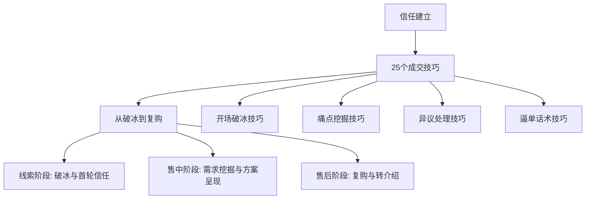
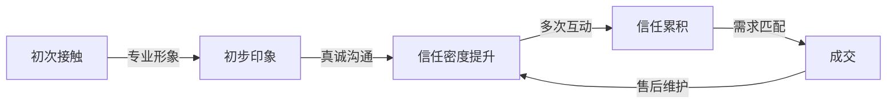
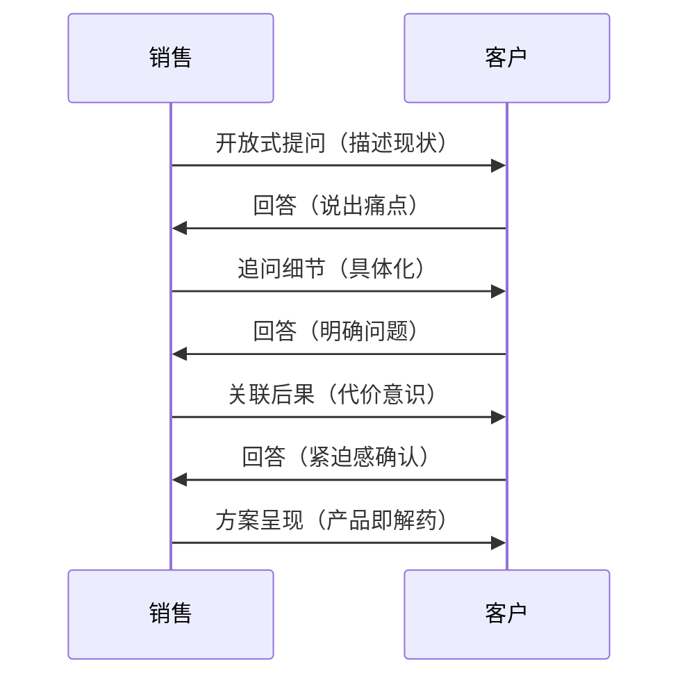
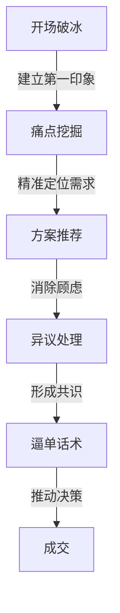
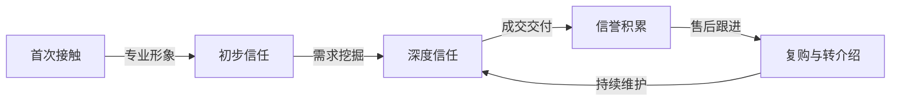

# 第 9 章 微信成交——把流量装进朋友圈的信任漏斗

## 学习目标

-   理解私域成交中信任作为底层引擎的作用
-   掌握 25 个微信成交技巧的核心方法
-   学会从破冰到复购的信任建设
-   理解私域关系经营的长期逻辑

## 9.1 生活类比

微信成交像经营一家老店：靠信任让客人回头，而不是一次性坑客。想象你走进一家街角的面馆，第一次去时你并不确定味道如何，所以你会观望、会犹豫。但如果老板热情地招呼你，厨房干净透亮，你吃了一次觉得物有所值，那么下次路过时你大概率会直接进门，甚至带朋友来。私域微信成交的逻辑完全一样——每次朋友圈的分享、每条私聊的消息，都是在积累你这家"店"的信誉。你不必追求每一个陌生人都立刻下单，你要做的是让每个与你接触过的人，哪怕这次没买，也在心里给你留下一个"这个人靠谱"的标签。当信任攒得够多，成交就是客人自愿回头的自然结果。这就解释了为什么那些在微信上疯狂刷屏、死缠烂打的人往往做不成生意——他们没有经营信任，而是在透支信任。

## 9.2 概念地图



## 9.3 信任作为私域成交的底层引擎

> [P001, p.1] "核心在于高效建立信任"

这句话是整章最重要的论断：微信私域成交的底层引擎不是流量，不是话术，而是信任。为什么？因为微信是一个强关系的私人社交场，没有平台背书，没有交易担保，你面对的每一笔生意都发生在"人和人"之间。公域电商有平台的评价系统、售后保障甚至第三方支付托管，但微信里这些都很薄弱。买家看到的只是你的头像和朋友圈，他凭什么把一个陌生人放进购物车？

直觉上，这就像你在一个陌生人家里买东西。平台商城里你是"顾客"，卖家有平台约束；但在微信里，你是"客人"，卖家的信誉就是他的个人品牌。所以信任不是一个加分项，它是成交的**必要前置条件**——没有信任，一切技巧都失去载体。

**信任建立**定义（来源：《微信成交技巧》）

$$
\text{成交概率} = f(\text{信任密度}, \text{需求匹配度})
$$

这个公式展示了成交的两大核心变量。信任密度是指对方心里你"靠谱"的程度，需求匹配度是你的产品与他当前问题的契合程度。你会发现，需求匹配度再好，若信任密度为零，对方依然会犹豫——因为他怕被骗。反过来，信任密度很高但需求不匹配时，对方会把你推荐给朋友（转介绍），依然产生价值。

如何高效建立信任？素材给出了两个关键动作：

1. **专业形象的呈现**：你的朋友圈内容、你的语言风格、你回答问题的方式，都必须让用户感觉到"这人不是随便卖货的，他是这个领域的行家"。
2. **真诚沟通的叠加效应**：信任不是一次性的，而是每次互动都在原有基础上累加。一次真诚的答疑、一次主动的售后回访，都在增加"信任池"的水位。

这两个动作的关系可以用下面的数据流图来表示：



这张图展示了信任建立的循环回路：每一次专业且真诚的互动都在提升信任密度，成交不是终点，售后又反过来继续为信任池蓄水。这就是为什么私域成交的核心不是"卖一单就走"，而是"长期经营关系"。

## 9.4 25 个微信成交技巧

> [P001, p.2] "25个提升成交率的具体技巧"

如果说信任是引擎，那么这 25 个技巧就是油门的档位——它们帮你把信任转化为具体的成交动作。素材将这些技巧概括为四个维度：**开场破冰、痛点挖掘、异议处理、逼单话术**。下面我们逐一拆解每一类的核心逻辑。

### 9.4.1 开场白设计：破冰的黄金七秒

> [P001, p.3] 开场白设计

微信上的第一次接触，你只有极短的时间让对方决定是否继续聊下去。如果开头是"在吗？"，对方大概率会无视。好的开场白要达到三个目的：**表明身份、提供价值、给出理由**。

**开场白设计**方法（来源：《微信成交技巧》）

```
1. 表明身份：让对方知道你是谁，为什么加他
2. 提供价值：第一句话就给他一个明确的好处
3. 给出理由：说明你为什么此刻来找他
4. 低压迫感：不给对方"必须回应"的压力
```

这段伪代码展示了开场白的四个要素。关键在第 4 步——低压迫感。在微信场景中，对方觉得被冒犯、被推销，就会立即关闭对话。所以开场白更像"递名片"而非"拽袖子"。

有效开场白和无效开场白的对照如下表所示：

| 无效开场白 | 有效开场白 |
|------------|------------|
| "在吗？" | "之前看到你提过孩子学习的问题，我整理了份资料，需要的话可以发你" |
| "加个好友吧，交个朋友" | "我是 XX 老师，专注数学辅导 5 年，刚看到你发了道难题，顺手解了发你" |
| "我这边有个好产品推荐给你" | "你上周问的择校问题，我刚好认识招办的人，帮你打听了下" |

这张表格展示了同一个目标（开启对话）的两种表达路径。你会发现有效开场白的关键不是"我要卖"，而是"我关心你的问题"——这就自然地把对话从"推销"转向了"帮助"。

### 9.4.2 痛点挖掘：问出对方真正的问题

> [P001, p.4] 痛点挖掘

开场破冰之后，最忌讳的是立刻报价格。你需要先搞清楚对方到底为什么需要你的产品。痛点挖掘的核心方法是**引导式提问**。

**痛点挖掘**方法（来源：《微信成交技巧》）

```
1. 开放式提问：让对方描述现状（"你现在最大的困扰是什么？"）
2. 追问细节：把模糊的感受具体化（"具体是哪个环节不顺利？"）
3. 关联后果：帮对方意识到不解决的代价（"这个问题拖了多久了？"）
4. 确认紧迫感：让对方自己说出"确实需要尽快解决"
```

这段伪代码展示了痛点挖掘的四步推进。每一步都让对方多说、你多听。前期你提供价值积累信任，中期通过提问精准定位需求，最后满足对方"你说出了我心里话"的认同感——这时你的产品就不再是"你推销的东西"，而是"对方自己找到的解药"。

这四个步骤的关系可以用时序图来表达：



这张时序图展示了痛点挖掘从"泛泛而谈"到"精准锁定"的收敛过程。每次提问都是为了缩小问题的边界，直到对方自己承认"这个问题必须解决"。

### 9.4.3 异议处理：把"不"转化成"为什么"

> [P001, p.5] 异议处理

当客户说出"太贵了""我再想想""不需要"，你的第一反应不应该是否认或退让，而是把它当作一次了解对方深层顾虑的机会。异议处理的黄金法则是：**不反驳、不辩解、先认同、后澄清**。

**异议处理**方法（来源：《微信成交技巧》）

```
1. 认同情绪：先表示理解（"我理解你的顾虑"）
2. 追问根源：搞清楚异议的真正原因（"是哪方面让你觉得贵？"）
3. 陈述事实：用数据和案例回应（而非空洞保证）
4. 给出选择：让客户在"买"和"不买"之外看到"怎么买"
```

这段伪代码展示了异议处理的四步。前两步的关键是情绪安抚，后两步的关键是信息补充。很多销售败在第一步——对方一提异议就立刻反驳，导致信任瞬间崩塌。记住：异议不是拒绝，而是信息缺口。

异议处理的分支路径可以用以下表格来对比：

| 客户异议 | 错误回应（伤信任） | 正确回应（建信任） |
|----------|--------------------|--------------------|
| "太贵了" | "不贵啊，已经很便宜了" | "确实不算便宜，不过你可以看下我们老客户的复购率，他们为什么愿意回头？" |
| "我再想想" | "好的，那您想好了再找我" | "完全没问题，想的时候可以重点想一个问题：这个问题不解决会继续付出什么成本？" |
| "不需要" | "怎么会不需要呢？" | "好的，那我不打扰了。不过还是想送您一份我整理的常见问题手册，以备不时之需" |

这张表格展示了同一异议的两种应答路径。错误回应的共同点是用"对抗姿态"回应，正确回应的共同点是"先接纳、后引导"。接纳保护信任，引导创造转机。

### 9.4.4 逼单话术：把犹豫变成行动

> [P001, p.6] 逼单话术

逼单不是强迫，而是帮对方跨过"最后的犹豫"。大多数客户在成交前一秒都在想"万一不好呢"——你的任务是把这个"万一"拆掉。

**逼单话术**方法（来源：《微信成交技巧》）

```
1. 假设成交法：用"接下来怎么安排"代替"你要不要买"
2. 二选一法：给出两个选项，都是"买"，区别在"怎么买"
3. 限时效应：用合理的时间窗口制造紧急感（但不虚假）
4. 风险逆转：提供试用、退款承诺，把对方的风险降为零
```

这段伪代码展示了逼单的四种核心策略。它们共同的逻辑是：**把决策从"买不买"变成"怎么买"**。当你问"你要 A 还是 B 方案？"时，对方已经默认了购买，只是在选方案。而"限时优惠"和"风险逆转"则是从两个方向降低对方的心理门槛。

到这里，你可以看到 25 个技巧的内在脉络：



这条链路展示了从陌生到成交的完整路径：每一步都是在做减法——减掉对方的陌生感、减掉需求的模糊性、减掉决策的阻力。25 个技巧本质上不是 25 个独立的招数，而是同一件事在不同阶段的变奏：**持续提升信任密度，持续降低决策门槛**。

## 9.5 从破冰到复购的信任建设

> [P001, p.7] "从破冰到复购"

如果说上一节讲的是"单次成交的战术"，这一节讲的是"长期经营的战略"。素材明确指出，信任建设是一个三阶段的持续动作：**首次接触**建立专业形象，**售中**挖掘需求，**售后**维护并沉淀复购。

**信任建设三阶段**方法（来源：《微信成交技巧》）

| 阶段 | 核心动作 | 长期效果 |
|------|----------|----------|
| 破冰期（首次接触） | 建立专业形象、避免急于推销 | 让对方记住"你是行家" |
| 售中期（需求挖掘与方案呈现） | 精准提问、按需推荐 | 让对方感到"你懂我" |
| 售后期（交付与跟进） | 主动回访、超额交付 | 让对方觉得"值得信" |

这张表格展示了信任建设的三个关键阶段及其各自的长期效果。你会发现，三阶段的共同逻辑是：**每一次接触都要为下一次接触做铺垫**。破冰期的信任不是为了这单，而是为了售中期对方愿意说实话；售中期的专业表现不是为了这笔佣金，而是为了售后期对方愿意复购。

复购的底层逻辑是**终身客户价值**（LTV）思维：

$$
LTV = \text{客单价} \times \text{购买频次} \times \text{客户生命周期}
$$

这个公式展示了复购的巨大意义：三个因子中，只要把"客户生命周期"从一次交易延长到三年，你的收入就是原来的三倍不止。而延长生命周期靠的不是技巧，是信任的持续积累——这就是为什么素材反复强调"不要坑一次性客"。

三阶段的发展路径可以用下图来总结：



这张图展示了信任建设的飞轮效应：每完成一轮完整的"破冰→售中→售后"，信任密度都在原有基础上增加一档。当复购和转介绍启动，你就拥有了自增长的信任飞轮——这才是微信私域成交的终局形态。

## 9.6 设计中的取舍

**为什么微信私域成交的核心不是"话术"而是"信任"？**

因为微信的生态天然缺少平台背书。天猫有店铺评分、有担保交易，淘宝有七天无理由，甚至抖音的直播间也有平台审核。但微信里，一个陌生人加你微信，他能看到的一切就是你的朋友圈——那 20 条动态就是他的全部判断依据。在这种情况下，任何话术如果缺乏信任支撑，都会变成"套路"。反过来，如果信任密度足够高，哪怕你的话术笨拙，客户也会包容。这是一个不对称的杠杆：话术的收益递减，信任的收益递增。

**这种设计的 trade-off 是什么？**

信任模式的优势是长期稳定、复购率高、转介绍成本极低，但它也有明显的代价——**慢**。信任的积累需要时间，你可能需要半个月的朋友圈铺垫才换来第一单，而流量型打法可能一条广告就能出单。但它透支未来——杀鸡取卵式的成交会让你的声誉在圈子里迅速传开，微信的强连接属性决定了口碑的传播速度和破坏力都远超公域。所以这里的取舍本质上是**短期利润与长期资产**的取舍。信任模式下，你放弃的是"快"，得到的是"稳、多、久"。微信业态的残酷之处在于：你永远可以靠技巧做成一单，但你只能靠信任做成一辈子的生意。

## 9.7 动手练习

（素材原文未提供具体练习内容，以下练习基于本章知识点设计，供读者实践巩固。）

-   练习一：回顾你最近一周的朋友圈内容，用"专业形象"的标准逐条打分，找出 3 条最不符合专业形象的内容并重新设计。
-   练习二：挑选一个你熟悉的产品，写出 5 个开场白，要求每个开场白都包含"表明身份、提供价值、给出理由"三个要素，并对比其效果差异。
-   练习三：角色扮演——模拟客户提出"太贵了"的异议，练习用"先认同情绪→追问根源→陈述事实→给出选择"四步法回应，并录音复盘。
-   练习四：梳理你现有的微信客户，按"破冰期、售中期、售后期"三个阶段分类，为每一类制定不同的跟进计划，明确下一个动作是什么。
-   练习五：以你自己为例，计算一个客户的 LTV（客单价 × 购买频次 × 生命周期），然后思考：如果只做一次性生意，你损失了多少潜在收入？

## 9.8 本章小结

这一章我们深入探讨了微信私域成交的核心逻辑。首先我们确立了"信任"作为私域成交底层引擎的地位——因为没有平台背书，私人场景中信任是第一变量；其次我们拆解了 25 个成交技巧，将其归纳为开场破冰、痛点挖掘、异议处理和逼单话术四个维度，每一个维度都有具体的方法论和话术模板；接着我们讨论了从破冰到复购的信任建设路径，强调了破冰期建立专业形象、售中期精准挖掘需求、售后期主动维护这三阶段的持续投入；最后我们通过 LTV 公式和三阶段模型，理解了为什么"信任密度"决定了私域成交的长期上限。整个章节的底层逻辑可以用一句话概概括：**微信成交的本质不是卖货，而是经营一个信任池，成交只是水位足够高时的自然溢出**。

本章我们一起学习了以下概念：

| 概念 | 解释 |
|------|------|
| 信任建立 | 私域成交的底层引擎，决定了所有话术是否有载体 |
| 25 个成交技巧 | 涵盖开场破冰、痛点挖掘、异议处理、逼单话术，本质是分阶段的信任释放 |
| 信任建设 | 从接触、售后全流程持续提升信任密度，形成复购飞轮 |

掌握了私域成交的信任模型和话术技巧之后，我们即将进入企业管理的下一个维度：**团队激励**。下一章我们将学习如何从"管人"走向"激发人"，探讨物质激励与精神激励的组合设计、从个体目标到组织目标的对齐机制，以及如何通过日常管理动作保持团队张力。你会发现，带团队和做私域成交在本质上遵循同一个底层逻辑——**尊重人性、经营信任、长期主义**。
