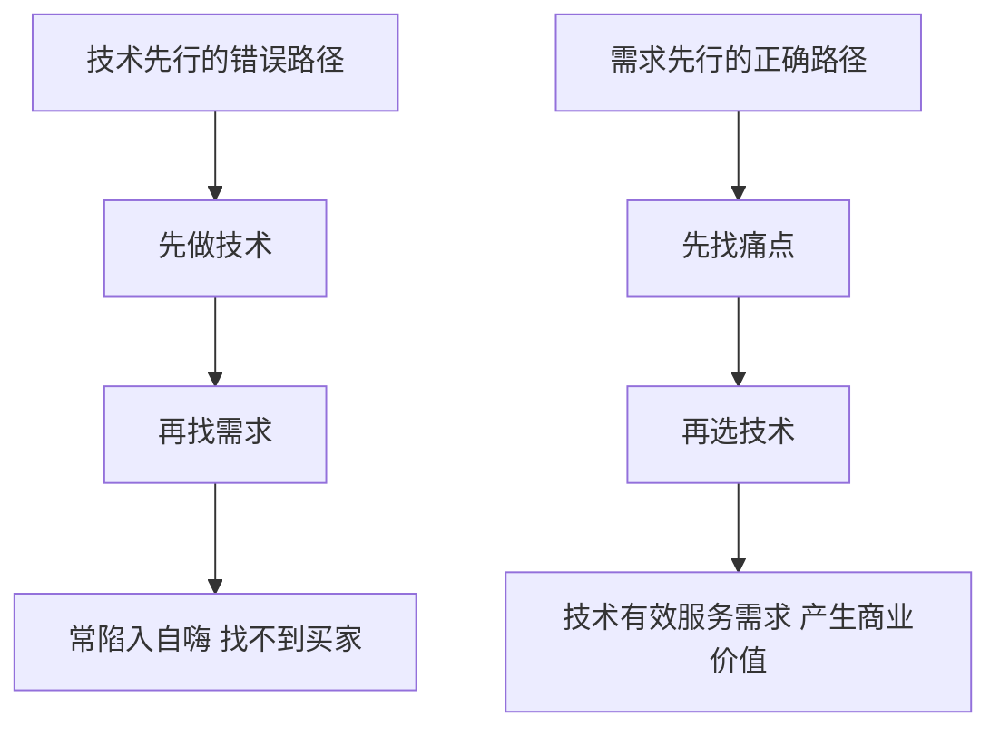
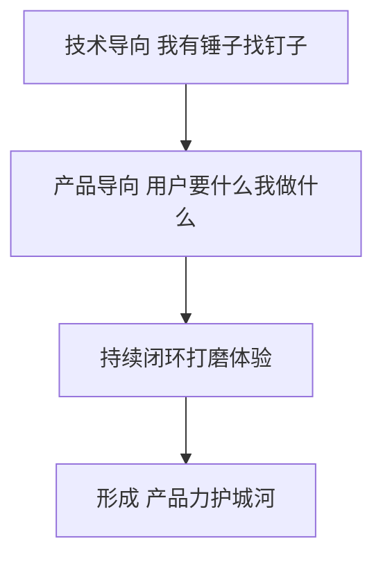
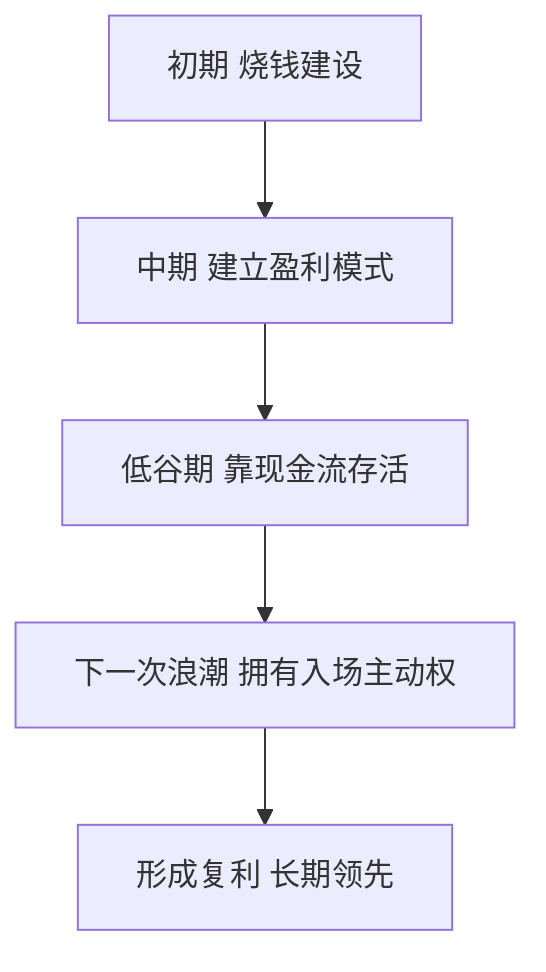

# 第 10 章 AI商业化——从技术炫技到产品落地

## 学习目标

- 理解技术只是工具需求才是王道的商业化本质
- 掌握产品力是核心的商业化原则
- 理解持续盈利与等待浪潮的长期主义
- 学会识别技术自嗨陷阱

## 10.1 生活类比

**锤子与钉子：技术是锤子，需求才是钉子。** 想象一个木匠走进工具房，看到一排排崭新的锤子——有钛合金的、有碳纤维的、有防震手柄的，每一把都闪闪发光、参数惊人。木匠当然会欣赏这些锤子，但他不会因为锤子好看就到处找东西乱敲。他先看手里的图纸和客户的要求，确定了要修的是哪把椅子、哪张桌子，才去挑一把最合适的锤子。AI 商业化正是如此：技术再先进、模型再大、指标再漂亮，如果找不到一个真实存在的"钉子"——即用户急需解决的痛点——再好的锤子也只能挂在墙上落灰。反过来，一旦找准了那根钉子，哪怕锤子普通一些，只要趁手，就能把活干好。

## 10.2 概念地图

```
技术工具论→需求优先→产品力核心→持续盈利
```

## 10.3 技术工具论与需求优先

**为什么需要？** 当我们听到"AI 商业化"时，第一反应往往是"我们有什么好技术"，而不是"用户缺什么"。但这种思维顺序是反的。技术是手段，需求才是目的。如果先有技术再找需求，就像先造了一把锤子再找钉子，很容易陷入"技术自嗨"——做出来的东西虽然技术含量高，却没人愿意为之付钱。我们先看看源头素材怎么说，再进行拆解。

> [IC4Ww_AI商业化] "技术只是工具，需求才是王道"

这句话看似朴素，却是 AI 商业化的第一性原理。它把技术与需求放到了清晰的优先级上：技术服务于需求，而不是反过来。

我们来逐层拆解这个论断。首先从直觉上讲，商业的本质是交换价值，而价值的一端必须站着"有人需要"这个前提。如果你的技术不能回答"用户为什么需要它"这个问题，那么它做的再多也只是一个精美的实验室产物。技术人员的习惯思维是"我能做什么"，商业人员的思维是"用户要什么"，商业化要求你强制切换到后者。

其次，从形式化的角度看，我们可以把商业化成功概率建模成一个条件概率：

> **需求优先定理**（来源：《AI商业化》）

$$
P(\text{商业成功} \mid \text{先进技术}) \approx P(\text{真实需求存在}) \times P(\text{技术能有效满足需求})
$$

这个公式展示了核心技术先进只是必要条件而非充分条件。即便有先进技术，真实的用户需求是更大的乘性因子——如果需求根本不存在（P 接近于 0），那么技术再先进，成功概率仍然趋近于零。这就是所谓"锤子与钉子"的定式：锤子（技术）决定了你能否把钉子敲进去，但前提是你得先找到那根钉子（需求）。

具体来看，技术自嗨陷阱有三个典型症状：

1. 以技术指标（参数量、算力、榜单分数）代替用户价值指标。
2. 在发布会上演示炫酷 demo，却说不清目标用户是谁。
3. 把"我们做得出"当成"用户需要"来论证。

**数据流图**：正确与错误的商业化路径对比。



## 10.4 产品力核心论

如果需求是钉子，那么产品力就是敲钉子时的那股巧劲——用精准的力量把钉子一次性敲到位。技术是辅助，产品力才是商业化核心。

> [IC4Ww_AI商业化] "产品力永远是核心"

这里说的"产品力"，不是指技术的堆砌，而是指**精准定义并解决用户关键问题**的能力。换句话说，产品力是"问题定义×方案匹配×体验交付"的复合能力。技术在其中只扮演一个子模块。

让我们对比两种公司的思维模式：

| 维度 | 技术驱动型思维 | 产品力驱动型思维 |
|------|----------------|------------------|
| 出发点 | 我们有什么技术 | 用户有什么痛点 |
| 成功指标 | 指标榜单、论文 | 用户留存、付费率 |
| 迭代方式 | 加参数量、堆算力 | 反复打磨体验 |
| 失败模式 | 技术领先但没人买 | 产品平庸但有人用 |

这个表格展示了产品力思维的底层逻辑：商业化评价的是"用户问题是否被解决"，而非"技术是否炫酷"。

我们再从方法论层面看产品力的打造。素材没有给出现成伪代码，但我们能提炼出一个可循环的工程闭环：

> **产品力打磨闭环**（来源：《AI商业化》）

```
1. 定义目标用户的"关键问题"（KPI 明确的那个痛点）
2. 用最小可行产品（MVP）快速验证解决方案
3. 收集真实使用数据 识别体验障碍
4. 回到第 1 步 重新校准问题定义
```

这段伪代码展示了产品力不是一次性的设计，而是一个持续循环的校准过程。每一步都在回答同一个问题：我们在解决用户真正在乎的那个问题吗？技术哪怕换了三套方案，只要闭环在转，产品力就在积累。

注意，这里并不是说技术不重要。技术是产品力的燃料——没有先进技术，很多关键问题（如实时翻译、图像识别）根本无解。但技术是"必要条件中的一部"，而不是"充分条件"。一个精准定义并解决关键问题的平庸技术产品，远胜于一个技术先进却解决不了关键问题的炫技产品。

**方法演进图**：从技术导向到产品导向的思维迁移。



## 10.5 持续盈利与长期主义

AI 行业有一个显著特点：技术浪潮波动剧烈，热点轮换快。今天大模型火热，明天可能转向具身智能，后天可能是 AI for Science。如果你没有一份稳定的现金流，就很难熬过技术低谷期，也就谈不上在下一次浪潮来临时有实力参与竞争。

> [IC4Ww_AI商业化] "持续盈利掌握主动权，等待下一次浪潮"

这句话点出了商业化中最重要的"时间维度"。商业化不是短期冲刺，而是一场需要耐力与节奏感的马拉松。

我们来拆解这条论断的逻辑链条：

1. **建立可持续盈利模式**：首先，你的产品必须能持续产生正向现金流。一次性的融资不能算数，只有来自真实用户的持续付费，才能证明产品力经受住了市场检验。
2. **认清商业浪潮周期**：技术发展呈现出明显的周期性——上升期（资本涌入、热度飙升）、泡沫期（估值虚高）、低谷期（泡沫破裂、行业洗牌）、复苏期（沉淀后的再增长）。你要能判断自己处在周期的哪个阶段。
3. **耐心等待跨越低谷**：低谷期对没有盈利能力的公司是灭顶之灾，但对有现金流储备的公司，反而是低成本扩张、招募人才、巩固市场的窗口期。

我们可以把这一过程形式化为周期模型：

> **商业周期穿越策略**（来源：《AI商业化》）

$$
\text{生存概率}(t) \propto \frac{\text{持续盈利能力}(t)}{\text{消耗速率}(t) \times \text{衰退深度}(t)}
$$

这个公式展示了持续盈利的作用：分子上，盈利是你的生存燃料；分母上，消耗速率是你烧钱的速度，衰退深度是低谷期的残酷程度。要想穿越低谷，要么扩大分子（多赚钱），要么缩小分母（控成本），两者都需要提前布局、长期主义思维。

同样重要的是"等待下一次浪潮"的战略姿态。AI 行业的规律是：每一次技术泡沫破裂后，都会沉淀出真正可用的技术形态，然后进入下一个更有价值的增长周期。如果你倒在了低谷期，那么下一波浪潮就与你无关了。拥有持续盈利，意味着你掌握了"何时入场、以什么姿势入场"的主动权。

**时序图**：从投入到穿越周期的完整路径。



## 10.6 多源对照

本章素材均来自单一来源《AI商业化》，因此多源对照只能进行**内部一致性检验**——检查三个核心论断之间是否自洽。

### 共识

三章核心观点——技术工具论、产品力核心论、持续盈利原则——在逻辑上形成了一条完整的价值链：**需求优先（定方向）→ 产品力打磨（做执行）→ 持续盈利（保节奏）**。三者缺一不可，且顺序不能颠倒。没有需求优先，产品力无从谈起；没有产品力，盈利模式无法持续；没有持续盈利，就无法等待下一次浪潮。这条链就是 AI 商业化的完整闭环。 [IC4Ww_AI商业化]

### 分歧

同一素材内部暂未发现明显分歧。但我们可以指出一个**潜在的张力**需要读者自行判断：

- **需求优先 vs. 技术引领**：素材强调"需求才是王道"，但现实中存在少量"技术引领需求"的成功案例（如 iPhone 发布前用户并不知道自己需要触屏手机）。素材对这类"开创性需求"的讨论有所欠缺，建议读者结合[需要补充文献：关于突破性创新（disruptive innovation）与需求创造的研究]进行交叉验证。

## 10.7 设计中的取舍

**为什么不用"我们有先进技术"作为商业方案？** 技术先进并不天然导致商业成功，正如键盘再贵也不会替你写出小说。技术的价值必须通过"满足真实需求"这一中间环节才能兑现。如果先有技术再找需求，大概率进入技术自嗨陷阱：你开发的东西技术上完美，但没有人愿意付钱。

**这种设计的 trade-off 是什么？** 需求优先的代价是，你可能放弃了"定义市场"的主动权，转而进入红海竞争（因为显性需求往往已有玩家在做）。而持续盈利的代价是，你可能在低谷期显得保守，错失一些高风险、高回报的"赌未来"的机会。真正的平衡点在于：用需求优先框定安全边界，用产品力制造差异化，用持续盈利储备远征的燃料。[需要补充文献：红海竞争与蓝海战略的对比研究]

## 10.8 动手练习

- 找三个"技术很新但没人用"的 AI 产品，分析它们缺失了"需求优先"链条中的哪一环。
- 为一个已有的 AI 工具（如翻译软件、图像生成器）重新定义"目标用户的关键问题"，提出一个新的产品力打磨方向。
- 估算你的项目在"低潮期"能存活多久：列出每月固定的消耗速率和预期的盈利模型，计算盈亏平衡点。
- 复盘一个你经历过的"技术自嗨"时刻，用三句话总结它失败在需求链条的哪个位置。

## 10.9 本章小结

这一章中我们系统讨论了 AI 商业化的底层逻辑。首先我们确立了"技术工具论"的基石——技术只是锤子，需求才是钉子，技术先进不等于商业成功，必须找到真实痛点才谈得上价值交付；其次我们深入探讨了"产品力核心论"，它要求我们精准定义并解决用户的关键问题，技术只是辅助模块，产品力才是商业化成败的胜负手；接着我们分析了"持续盈利原则"，它让我们认清商业浪潮的周期性，通过建立可持续的盈利模式来掌握主动权，耐心穿越低谷，等待下一次浪潮。

本章我们一起学习了以下概念：

| 概念 | 解释 |
|------|------|
| 技术工具论 | 拥有先进技术不等于成功关键是找到需求 |
| 产品力核心论 | 技术只是工具产品力才是商业化核心 |
| 持续盈利原则 | 持续盈利才能等待浪潮积累实力 |

下一章中，我们将会把视角从 AI 商业化切换到技术落地的具体场景，深入探讨在真实业务环境中，如何将 AI 能力嵌入产品系统、设计服务流程、并建立评估与迭代机制，把本章的商业化原则落实为可执行的技术路线图。

