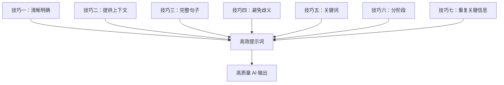
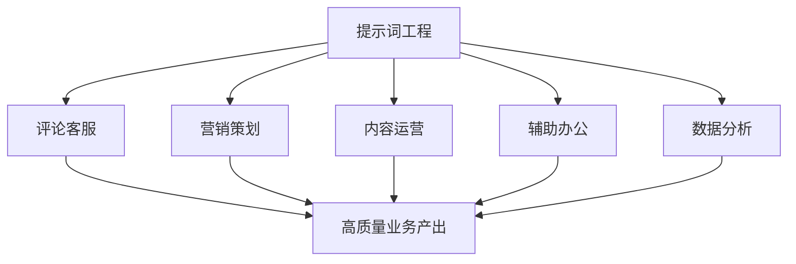

# 第 11 章 ChatGPT 实战——从提示词到内容生产线

## 学习目标

-   理解提示词工程在AI使用中的核心作用
-   掌握提示词编写的7个技巧
-   学会场景化应用ChatGPT的方法
-   理解AI的能力概览与边界

## 11.1 生活类比

提示词就像导演给演员的指令：如果导演只说"演得好一点"，演员只能靠猜；但如果导演说"在这场戏里，你是一个刚刚失去亲人的中年人，你要在窗前沉默三十秒，然后缓慢地转过身来，用颤抖的声音说出台词"，演员就能精准地演出你想要的画面。ChatGPT也是如此，它的"表演水平"取决于你的"执导能力"，指令越清晰、越具体、越有上下文，它就越能产出你想要的结果。设想一下，当你向 ChatGPT 提出"帮我写一篇产品文案"时，它只能泛泛而谈；但当你补充了产品定位、目标用户、语气风格、字数要求之后，它就能像一位了解你需求的资深文案一样，交出令人满意的作品。这就是提示词工程的魅力：它不是玄学，而是一门可以系统学习的"沟通技术"，让你从"AI 能做什么"进化到"AI 能为我做什么"。

## 11.2 概念地图

```
提示词定义→7大技巧→场景应用→能力边界
```

## 11.3 提示词工程与编写技巧

### 11.3.1 为什么需要提示词工程？

> "提示词是高效使用 ChatGPT 的关键"
>
> ——《ChatGPT实战》

如果你把 ChatGPT 想象成一位知识渊博但从不主动开口的助手，那么提示词就是你递给它的"需求说明书"。没有这份说明书，它只能给出最笼统、最保守的回答；有了这份说明书，它才能发挥全部潜力，产出贴合你需求的内容。提示词工程就是研究"如何写好这份说明书"的技术，它决定了你与 AI 协作的上限。

从技术角度看，提示词工程本质上是对大语言模型的"条件引导"。模型根据你提供的文本（即提示词）来预测最可能的后续内容，因此提示词的质量直接决定了输出的质量。以下是几个关键原则的对比：

| 原则 | 不好的提示词 | 好的提示词 |
|------|-------------|-----------|
| 清晰明确 | "写点东西" | "写一段 200 字的产品介绍，重点突出续航能力" |
| 提供上下文 | "帮我翻译" | "帮我将下面这段商务邮件翻译成日语，语气要正式礼貌" |
| 完整句子 | "总结" | "请用 3 句话总结这篇文章的核心观点，并点明作者立场" |
| 避免歧义 | "写个方案" | "请为我的咖啡店写一份周末促销活动方案，预算 500 元以内" |
| 关键词 | "分析" | "请从成本、收益、风险三个维度分析这个决策" |
| 分阶段 | "帮我写作" | "第一步先列出大纲，第二步写引言，第三步再扩写成全文" |
| 重复关键信息 | "把它改好" | "请把刚才那封道歉信的语气改得更诚恳，特别注意不要出现推卸责任的表述" |

### 11.3.2 七个核心技巧

> **提示词技巧**（来源：《ChatGPT实战》）

```
1. 清晰明确：不要模糊表达，直接说明你要什么
2. 提供上下文：给足背景信息，让 AI 理解你的处境
3. 使用完整句子：避免碎片化指令，完整语义更利于理解
4. 避免歧义：用限定词锁定含义，消除多种可能的解读
5. 使用关键词：突出核心诉求，引导输出方向
6. 分阶段提问：将复杂任务拆解为多个步骤逐步完成
7. 重复关键信息：重要约束条件在提示词中多次强调
```

**技巧一：清晰明确。** 这是七条技巧的基石。模糊的指令只能得到模糊的答案。我们来看一个例子：与其说"帮我写个文案"，不如说"帮我写一篇面向 25-35 岁职场女性的护肤品牌小红书文案，字数 300 字，语气活泼亲切，末尾加上购买引导"。

**技巧二：提供上下文。** AI 没有你的背景知识，你需要把"它该知道的"告诉它。比如向 ChatGPT 求助工作问题时，应当说明你的行业、公司规模、目标受众等关键背景。举例而言，"我们是一家初创教育公司，想做一版面向家长的课程介绍，请帮我列出三个不同的切入角度"就比"帮我列几个课程介绍角度"有效得多。

**技巧三：完整句子。** 碎片化的关键词组合容易被模型误解，而完整的自然语言句子携带更丰富的语义信息。例如，"会议纪要 要点 行动项"这种碎片输入，远不如"请帮我整理今天会议纪要的要点，并标出需要我跟进的行动项"更加可靠。

**技巧四：避免歧义。** 同一个词在不同的语境下可能传递完全不同的信息。当你使用"分析"这个词，AI 可能需要你明确指出是从什么角度、用什么框架来分析。比如你不妨这样表达："请从财务可行性的角度分析这个方案"，这样就消除了它在"技术可行性"和"财务可行性"之间犹豫不决的可能。

**技巧五：使用关键词。** 关键词如同给 AI 装上了"导航"，让它直奔你关心的主题。在写提示词时，把核心诉求压缩成几个关键词放在显眼位置，比如"请从**成本、收益、风险**三个维度分析"，关键词的引导作用非常显著。

**技巧六：分阶段提问。** 复杂任务一次问完往往得到粗糙的结果，但拆解成多轮对话后，每轮输出质量都会提升。你可以这样推进："第一步，请帮我列出这篇文章的大纲；第二步，根据这个大纲扩写引言部分；第三步，把引言中提到的案例展开成一个完整段落"——这就像是把一个大型项目分解为可执行的里程碑。

**技巧七：重复关键信息。** 人类的沟通中重要的事情要说三遍，与 AI 沟通也是如此。如果你需要一条关键约束贯穿始终，就在提示词的前、中、后分别强调它。例如写文案时，在开头说"预算有限"，中间再次强调"必须在 500 元预算内完成"，结尾以"请注意这是一次预算极度有限的促销活动"收尾，AI 就能始终把这条约束记在心中。

### 11.3.3 七个技巧的协同力量

虽然我们逐一介绍了七个技巧，但实际使用中它们往往是协同作用的。举个例子，一个高效的"复合提示词"可能同时包含清晰的目标、充分的上下文、完整的表述、明确的限定、核心关键词、阶段化指令和重复的约束条件。



从这幅图中你可以看到，七条技巧并非孤立的"锦上添花"，而是共同构成了一套完整的提示词编写方法论。其中技巧一和技巧二是地基，决定了输出的基本质量；技巧三和技巧四是结构，保证了语义传达的完整性；技巧五、六、七是优化层，让输出精度进一步提升。

## 11.4 场景化应用方法

> "ChatGPT 广泛应用于各种场景"
>
> ——《ChatGPT实战》

掌握了提示词技巧之后，下一步就是把它放到具体场景中去检验。提示词技巧是"内功"，场景化应用则是"招式"。

| 场景 | 核心诉求 | 提示词示例片段 |
|------|---------|--------------|
| 评论客服 | 快速、礼貌、有温度 | "请帮我回复这条用户投诉，语气诚恳，先道歉再给解决方案" |
| 营销策划 | 创意、差异化、可落地 | "请为我的奶茶店设计一个夏季营销方案，包含 3 个创意点" |
| 内容运营 | 高频、稳定、符合调性 | "请用轻松幽默的语气写一篇关于职场压力的公众号短文" |
| 辅助办公 | 效率、规范、准确 | "请帮我将这份会议记录整理成结构化摘要，标注决策项" |
| 数据分析 | 洞察、归纳、可视化建议 | "请分析这组销售数据的趋势，并指出值得关注的异常点" |

### 11.4.1 评论与客服场景

在客服场景中，ChatGPT 可以扮演"语气调节器"。企业的统一话术常常显得生硬，而 ChatGPT 可以在保持信息准确的前提下，根据不同用户的情绪状态灵活调整语气。例如，当用户愤怒投诉时，你可以让 AI"先用共情语句安抚情绪，再说明解决方案，最后表达感谢"。

### 11.4.2 营销策划场景

营销策划对创意要求高，ChatGPT 的价值在于"发散"。你给它一个产品和一个目标人群，它能快速产出多个切入角度。值得注意的是此时技巧五（关键词）最有用：请明确指出你期望从哪些维度获得创意，比如"从情感共鸣、社交传播、限时促销三个角度分别给出方案"。

### 11.4.3 内容运营场景

内容运营的本质是"规模化产出质量稳定的内容"。此时提示词技巧三（完整句子）和技巧六（分阶段）的组合特别有用：先让 AI 列出内容大纲，然后逐段扩写，最后统一风格校准。这样既能保证产出的速度，也能守住内容质量的底线。

### 11.4.4 辅助办公场景

辅助办公追求的是"减少重复劳动"。会议纪要整理、邮件撰写、日程规划、文档摘要——这些任务模式固定、结构清晰，非常适合用 ChatGPT 来加速。提示词技巧二（提供上下文）在这里最为关键：你提供越清晰的背景信息（参会人、决策事项、待办行动），AI 产出的纪要就越可用。

### 11.4.5 数据分析场景

数据分析并不是让 AI 替你做统计学处理，而是让 AI 帮你"看懂数据"。当你把一组销售数据或用户反馈交给它时，它可以帮你归纳趋势、找出异常、提出待验证的假设。此时技巧四（避免歧义）特别关键——你需要明确指出从哪个维度分析，以免它给出过于泛泛的结论。



五个场景共享同一套提示词方法论，但因诉求不同，各技巧的权重会有所差异。这张图帮你快速定位：不同场景应该优先调用哪些技巧。

## 11.5 GPT 能力概览与边界

> "GPT-4 在高级推理能力方面超越"
>
> ——《ChatGPT实战》

理解工具的边界，是高效使用工具的前提。GPT-4 的能力与边界是一体两面：它拥有令人惊叹的理解和生成能力，但也存在不可忽视的局限。

### 11.5.1 GPT-4 的能力概览

GPT-4 相较于前代模型，主要在三方面有显著提升：**识图能力**、**长文本处理**和**高级推理**。

- **识图能力**：GPT-4 支持图像输入，能理解图片中的内容、图表和数据可视化信息，这意味着你可以直接向它提问一张截图或图表的内容。
- **长文本处理**：GPT-4 支持更长的上下文窗口，可以一次性处理整本书级别的文本量，这对文档分析、书籍总结等场景有重大意义。
- **高级推理**：GPT-4 在逻辑推理、数学问题求解、代码生成等需要多步思考的任务上表现显著提升，能处理更复杂、更间接的问题。

### 11.5.2 GPT-4 的边界

> **能力边界**（来源：《ChatGPT实战》）

```
1. 知识截止于 2021 年 9 月，超出此时限的信息可能缺失或过时
2. 偶尔会生成错误信息（幻觉），需要用户验证
3. 没有真实世界感知，无法感知用户所处情境
4. 不具备真正的"理解"，只是在做概率预测
```

**知识截止日期。** GPT-4 训练数据的截止时间是 2021 年 9 月，这意味着它不了解此后的新闻、政策、产品和技术进展。当它面对超出知识截止日期的问题时，它可能会一本正经地给出过时甚至虚构的信息。例如询问它 2023 年发布的新产品特性，它就可能给出一个貌似合理但事实上并不存在的回答。

**幻觉问题。** 大语言模型的目标是生成"最可能的下一个 token"，而非保证事实正确。这意味着它会偶尔"一本正经地胡编乱造"——引用不存在的论文、编造错误的数据、杜撰人物生平。因此对 AI 提供的事实性信息，始终保持审慎态度并交叉验证，是每一个使用者的必修课。

**缺少真实世界感知。** GPT-4 不连接你的浏览器、摄像头或定位系统，它不知道此刻你所在的城市、你的日程安排、你正在看的屏幕内容。它的一切"了解"都来自你的描述和你提供的文本。这就是为什么提供上下文如此重要——你不告诉它，它就永远不会知道。

**概率性理解。** 严格来说，GPT-4 并不是"理解"了你的问题，而是在计算"基于你提供的文字，最可能应该输出的文字"。这一底层机制解释了它为什么会犯错、为什么会编造、为什么在逻辑严密但表述罕见的问题上会翻车。不过这不妨碍它在多数情况下给出非常有用的回答——关键在于我们如何使用它。

### 11.5.3 能力与边界的协同使用

理解能力与边界，是为了更聪明地使用工具。当我们知道 GPT-4 知识截止于 2021 年 9 月，就可以在涉及近期信息的提问中主动补充资料；当我们知道它可能产生幻觉，就可以在关键事实出现时保持警惕并进行二次确认；当我们知道它缺乏真实世界感知，就应该在提示词中提供足够详尽的上下文——这恰好呼应了我们在 11.3 节学到的"提供上下文"技巧。

因此，能力边界的认知不是让你对 AI 失去信心，而是让你成为更聪明的使用者：**知道它能做什么，你就敢于托付任务；知道它不能做什么，你就不会盲目信任**。

## 11.6 多源对照

本章内容主要基于《ChatGPT实战》一书的系统梳理。在提示词工程这一主题上，业界和学界存在多种不同的视角，但均与本书观点形成互补关系。由于本章素材来源相对单一，此处以该书的框架为主干，同时补充业界的通用经验，以帮助你获得更全面的认知。

### 共识

-   提示词质量直接影响输出质量，这是所有实践者的共识。
-   清晰、具体、有上下文的提示词普遍优于模糊、碎片化的提示词。
-   分阶段执行复杂任务能够显著提升最终产出质量。
-   场景化应用需要考虑不同场景的差异，而非一套提示词打天下。

### 分歧

-   关于"是否应该使用复杂提示词模板"，有观点认为越详细的模板越好，也有人主张简洁提示词更能激发模型的潜力，因为过多的约束可能限制创造性输出。
-   关于"AI 能力边界"的定位，《ChatGPT实战》强调知识截止日期和幻觉风险，而一些更乐观的实践者认为，随着插件和联网能力的引入，这些边界正在被逐渐打破。
-   关于"提示词工程是否是一门可学的技能"，本书持肯定态度并系统总结了七个技巧，而一些研究者认为提示词工程的效果因人而异，更多依赖于使用者的语言表达天赋。 `[需要补充文献]`

## 11.7 设计中的取舍

### 为什么需要提示词工程？为什么不直接用自然对话？

自然对话当然也能使用 ChatGPT，但效果往往不稳定。就像你可以随口让一位大厨"做点好吃的"，他也能做出不错的菜，但如果你想吃到特定的口味、份量和呈现方式，就需要明确地点菜。提示词工程本质上就是把"模糊的自然对话"升级为"精准的需求表达"——它增加了你表达的成本，但换来的是稳定且符合预期的输出。

### 这种设计的 trade-off 是什么？

提示词工程的代价是时间与学习成本。为了让 AI 产出精准内容，你需要在提示词上投入构思时间——提供上下文、限定范围、避免歧义、重复关键信息。这个投入在简单任务上可能显得"得不偿失"（比如你只想要一句简单的问候语，完全不需要写一段详尽的提示词）。它的收益体现在复杂任务上：当任务要求高、输出质量直接关系到业务成果时，精心设计的提示词带来的产出质量提升是巨大的。因此，成熟的 AI 使用者会在简单任务上保持轻量交互，在复杂任务上花时间打磨提示词——这种"按需投入"的策略是最高效的使用方式。

### 为什么依赖用户的提示词质量而不让 AI 自主追问？

一个有趣的设计选择是：为什么 ChatGPT 不主动追问用户的意图，而是被动地根据提示词输出？从产品设计角度看，主动追问会增加交互轮次，降低响应速度；但从使用体验看，如果用户提示词模糊，AI 的猜测常常令人失望。折中的方案是：你可以通过提示词技巧二（提供上下文）弥补这一缺陷，也可以明确要求 AI"在你需要更多信息时先向我提问再回答"——这实际上是把追问的权利交给了用户自己来控制。

## 11.8 动手练习

-   用七个技巧分别改写你日常工作中的一个模糊提示词，观察输出质量的差异。
-   选取一个你熟悉的工作场景，设计三组不同质量的提示词，对比输出效果，总结规律。
-   在你常用的 AI 工具上测试它的知识截止日期，提出 5 个超出该日期的问题，检验其回答的准确性。
-   尝试让 ChatGPT 分阶段完成一个复杂任务（如一份营销方案），与一次性提问的效果进行对比。
-   设计一个"能力边界测试集"：包含近期新闻、虚构事实、逻辑陷阱三类问题，测试你的 AI 工具的反应并分类记录。

## 11.9 本章小结

这一章中我们系统学习了 ChatGPT 的实战应用方法——从提示词工程到场景化应用，再到能力边界的认知。首先我们通过生活类比理解了提示词工程的核心价值，把它比作导演对演员的执导；其次我们详细学习了提示词编写的七个核心技巧：清晰明确、提供上下文、完整句子、避免歧义、关键词、分阶段和重复关键信息，并通过对比表格直观感受了每个技巧的实际效果；接着我们把技巧放到了五个具体场景（评论客服、营销策划、内容运营、辅助办公、数据分析）中去应用，理解了不同场景对技巧权重的不同需求；随后我们分析了 GPT-4 的能力概览（识图、长文本、高级推理）与边界（知识截止日期、幻觉、缺少世界感知、概率性理解），并讨论了能力与边界如何协同使用；最后我们通过多源对照和设计取舍的讨论，深化了对提示词工程的理解。

本章我们一起学习了以下概念：

| 概念 | 解释 |
|------|------|
| 提示词工程 | 高效使用 ChatGPT 的关键技术 |
| 提示词技巧 | 清晰明确提供上下文完整句子避免歧义等 7 个技巧 |
| 场景应用 | 评论客服营销内容运营辅助办公等场景 |

下一章中，我们将把本章所学的提示词工程方法论进一步延伸，探索如何将 ChatGPT 嵌入更复杂的工作流中——从单次对话升级为多轮协作，从"让 AI 帮你做一件事"进化为"让 AI 成为你生产流程中的关键环节"。

