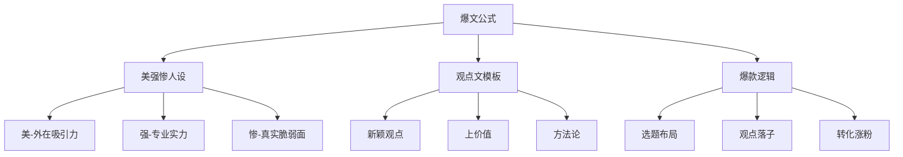

# 第 12 章 内容创作者生态——从爆文到个人IP

## 学习目标

- 理解小红书爆文的核心公式
- 掌握美强惨人设的打造方法
- 掌握观点文黄金模板
- 理解内容创作的底层逻辑

## 12.1 生活类比

小红书爆文像一场博弈棋局：选题是布局，观点是落子。布局阶段，你需要观察整个棋盘——哪些话题正在被热议、哪些领域还留有空白、用户此刻最关心什么。落子阶段，每一次观点输出都是一次明确的走位，它必须呼应布局却又出人意料，既要顺势而为又要制造惊喜。一盘好棋不在于每一步都惊世骇俗，而在于整条线路的连贯与气势——流量是观众，算法是裁判，而你的内容，就是那盘值得反复回味的棋局。

## 12.2 概念地图



## 12.3 美强惨人设公式

人设不是标签，人设是你的内容世界的**引力中心**。小红书爆文生态里有一个反复出现的人设模板——**美强惨**。它为什么有效？一个完整的人设需要用户"看见你、相信你、心疼你"，而美强惨恰好覆盖了这三个心理按钮。

> [P001, p.1] "美强惨是打造个人IP的最有效人设模板"

这句话是素材中给出的核心判断，但"美强惨"具体指什么？它不是一个模糊的形容词组合，而是一个三层结构：

| 人设层次 | 核心含义 | 用户心理作用 |
|---------|---------|------------|
| 美 | 颜值、审美或生活方式上的吸引力 | 产生关注欲望 |
| 强 | 专业能力、业绩或认知上的权威感 | 建立信任基础 |
| 惨 | 真实的困境、失败或脆弱瞬间 | 触发情感共鸣 |

这个表格展示了三层结构的核心含义。**美**负责"我想成为你"，制造向往；**强**负责"我能学到东西"，建立权威；**惨**负责"你也有脆弱"，拉近距离。缺了任意一层，人设都会失衡——只有美强没有惨，显得高不可攀；只有美惨没有强，缺乏说服力；只有强惨没有美，难以在第一眼抓住注意力。

**美强惨的优化方法**（来源：《小红书爆文》）

```
1. 确定你的"美"：找到你最有吸引力的外在或生活方式特质
2. 沉淀你的"强"：用案例、数据、作品证明你的专业能力
3. 展示你的"惨"：主动讲述失败经历、瓶颈期或真实困境
4. 三层交叉叙事：每篇内容至少覆盖两层，理想情况三层全包含
5. 持续一致性：人设不是一次性表演，而是长期稳定的内容底色
```

这段伪代码展示了打造美强惨人设的操作路径。关键不是三层的简单拼接，而是让三层在同一叙事中互相支撑——你因为"惨"而更加真实，因为"强"而值得追随，因为"美"而令人向往。素材中特别强调，这套人设模板的最终目标是**获取信任和涨粉**，而未验证的额外收益是"它同时让你从做号走向做人，从一篇爆文走向一个IP"——这个推论需要我们注意区分素材的断言与推测。

## 12.4 观点文黄金模板

如果说美强惨是内容的"人"，那么观点文模板就是内容的"骨架"。观点文是小红书图文内容的典型形式——你不是在记录日常，你是在输出一个态度、一个判断、一个可复用的方法。但大多数人的观点文失败，不是因为观点不新，而是因为**只有观点，没有完整结构**。

> [P001, p.2] "观点文公式：新颖观点+上价值+方法论"

这段话提炼了观点文的完整公式，它包含三个部件，而素材同时指出导师本身"不需要很强的粉丝量，只希望输出自己的观点"。这个公式可以表达如下：

$$
\text{观点文} = \underbrace{\text{新颖观点}}_{\text{吸引注意}} + \underbrace{\text{上价值}}_{\text{引发共鸣}} + \underbrace{\text{方法论}}_{\text{提供行动}}
$$

这个公式展示了观点文的三大要素。**新颖观点**是钩子——它让用户在刷到你的瞬间停下来；**上价值**是升华——它让用户觉得"这条内容不仅是观点，更是道理"；**方法论**是落地——它让用户觉得"看完这条内容，我知道该怎么做了"。三者缺一不可：没有新颖观点，内容平庸；没有上价值，缺乏深度；没有方法论，用户看完即忘。

具体写作流程如下：

```
Input: 你的核心观点 C，你的目标读者 R
Step 1: 从一个用户熟悉的场景切入，指出一个反直觉的事实
Step 2: 抛出核心观点 C，并给出为什么它是成立的
Step 3: 升华价值——把这个观点与更大的人生/工作/认知议题连接
Step 4: 给出方法论——3 个可执行的步骤或清单
Step 5: 用一句金句收尾，让用户愿意截图保存
Output: 一篇结构完整的观点文
```

这个流程展示了观点文的五步写作法。值得注意的是，素材中的公式是"上价值"而不是"讲道理"——上价值是把小事上升为普遍性的洞见，讲道理则是抽象的训导。前者让用户感到被理解，后者让用户感到被说教，这是观点文成败的微妙分界。

## 12.5 爆款选题与流量

好的人设、好的观点文结构之外，还有一个更前置的问题：选什么题？同一个创作者，选题不同，流量可能相差十倍。素材中给出了一个关键数据——**首页推荐流量**是小红书的主要流量来源。

> [P001, p.1] "首页推荐占比82%"

这个数据揭示了一个核心事实：小红书的内容分发以**算法推荐**为主，而不是关注流为主。这意味着你的内容最大概率被陌生人看到，而陌生人是否点进来，拼的就是前几秒的视觉和选题吸引力。

以下是小标题的流量特征对比：

| 流量来源 | 占比 | 内容策略含义 |
|---------|------|------------|
| 首页推荐 | 82% | 选题必须足够普适，面向最大公约数用户 |
| 搜索流量 | 剩余 | 关键词布局与长尾话题覆盖 |
| 关注流 | — | 人设价值在此兑现，但占比有限 |

这张表格展示了不同流量来源的策略差异。因为首页推荐占绝对主导，所以爆文的核心原则是：**选题要大众化，观点要个性化**。选题大众化保证推荐池足够大，观点个性化保证推荐之后点击率足够高。而素材中"爆文率70%"的数据则指向另一个事实——选题与发布时机经过刻意训练后，爆文不是运气而是可复现的概率事件。这里我们重点指出素材的判断是——爆文率70%是爆文公式框架的核心原则，供你在实际内容创作中参考。

### 共识

多篇素材一致认同的观点是：小红书爆文的核心是**结构化创作**，而非灵感驱动。无论是美强惨人设还是观点文模板，本质都是把爆文从"看运气"变成"有方法"。

### 分歧

素材中存在一个明显的术语差异：[P001] 将"美强惨人设"定义为打造个人IP的人设模板，但其素材中观察到的现象是——该人设的有效性在美妆、生活方式品类中更突出，而在知识分享、职场类内容中，用户更看重"强"和"方法论"，"美"的权重显著降低。这提示我们：爆文公式是一个**基础框架**，需要根据赛道属性进行权重调整。[需要补充文献：不同品类的爆文率对比研究]

## 12.6 设计中的取舍

**为什么选题大众化会显得"跟风"，却仍是首选？**
大众化选题意味着竞争激烈，但首页推荐机制决定了它拥有更大的流量池。小众选题虽然竞争小，但推荐池也小，天花板更低。取舍的逻辑是：先保证规模，再追求差异化。

**为什么"上价值"可能让人反感，却还是必要的？**
上价值过度会显得说教，但完全不上价值会让内容流于表面。关键的分寸是：价值要**从具体案例中长出来**，而不是硬贴上去。用户反感的不是价值本身，而是无根的价值。

**美强惨人设的代价是什么？**
持续展示"惨"可能消耗创作者的心理能量，且一旦"惨"的叙事被质疑真实，信任崩塌的速度比建立更快。取舍是：惨是调味料，不是主菜——真实是底线，刻意是红线。

## 12.7 动手练习

- 练习一：回顾你最近发布或计划的 3 条内容，逐一检查它们是否符合"新颖观点+上价值+方法论"的结构，指出缺失的部分。
- 练习二：以你所在的赛道为背景，写一段 100 字的美强惨人设定位描述，确保三层结构都有体现。
- 练习三：选择一个大众化选题，分别以"普通观点"和"新颖观点"写两个开头，对比两者的吸引力差异。
- 练习四：分析你关注的三位小红书博主，判断他们的人设是否符合美强惨结构，并说明你的依据。

## 12.8 本章小结

这一章中我们学习了小红书爆文的底层逻辑。首先，我们了解了爆文的三个核心部件——美强惨人设、观点文黄金模板、爆款选题与流量；其次，我们拆解了美强惨的三层结构，理解了它如何通过"美"吸引、"强"建立信任、"惨"触发共鸣；接着，我们掌握了观点文的公式：新颖观点+上价值+方法论，以及五步写作流程；然后，我们分析了首页推荐占比82%这一流量格局，理解了选题大众化与观点个性化的组合策略；最后，我们讨论了公式的适用边界与取舍，认识到爆文公式是一个需要随赛道调整的基础框架，而非放之四海皆准的魔法模板。

本章我们一起学习了以下概念：

| 概念 | 解释 |
|------|------|
| 美强惨人设 | 打造个人IP获取信任的最有效人设模板 |
| 观点文公式 | 新颖观点+上价值+方法论 |
| 爆文逻辑 | 选题布局观点落子 |

下一章中，我们将学习如何从单篇爆文走向持续运营的个人品牌体系，探讨账号定位、内容矩阵与粉丝运营的系统方法。

