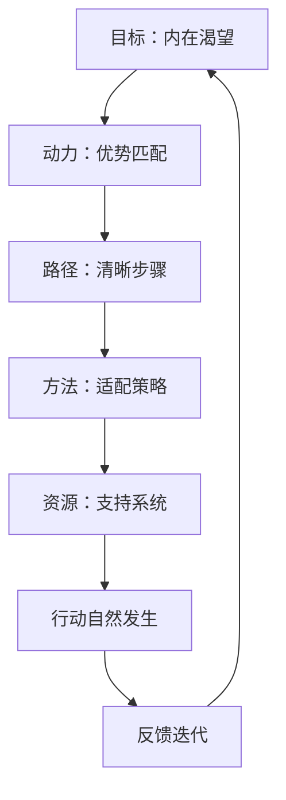
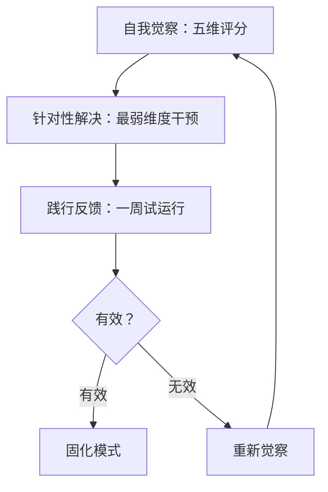
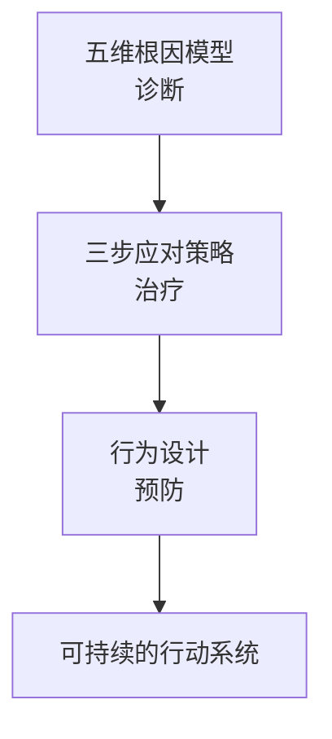

# 第 13 章 拖延症——从自我对抗到行为设计

## 学习目标

- 理解拖延症的五维根因模型
- 掌握目标动力路径方法资源五个维度
- 学会三步应对拖延策略
- 理解自我觉察与行为设计

## 13.1 生活类比

想象你的车陷在了泥潭里。你越是猛踩油门，车轮越是空转，车身反而陷得越深。这时你需要做的不是更用力，而是下车观察：哪个轮子失去了抓地力？是路况太软还是方向偏了？然后从五个不同的发力点逐一疏通——垫石头、清淤泥、调整方向——最后轻轻给油，车就出来了。拖延也是这样：我们习惯性地责怪自己"不够自律"，像猛踩油门一样自我批评，结果越陷越深。而真正有效的做法，是从目标、动力、路径、方法、资源这五个维度逐一检查，找到卡住的环节，用设计替代对抗，让行动自然发生。

## 13.2 概念地图

```
拖延症——从自我对抗到行为设计
├── 拖延五维根因模型
│   ├── 目标：内在真正渴望
│   ├── 动力：与个人优势匹配
│   ├── 路径：清晰可行的步骤
│   ├── 方法：适配的策略工具
│   └── 资源：时间精力支持系统
├── 三步应对拖延策略
│   ├── 自我觉察：五维度诊断
│   ├── 针对性解决：逐维修复
│   └── 践行反馈：迭代调整
└── 从自我对抗到行为设计
    ├── 告别意志力对抗
    ├── 用系统设计破解拖延
    └── 可落地的行为干预机制
```

## 13.3 拖延五维根因模型

> [P001, p.5] "目标动力路径方法资源是战胜拖延的5个维度"

这段话是整章的核心纲领。它告诉我们：拖延并不是一个单一的问题，而是五个维度中某个（或某几个）环节出了故障。我们太习惯把拖延归结为"懒"或"意志力差"，但事实上，拖延是一台多部件协作的机器，任何一环失灵都会导致整体停转。

### 13.3.1 目标：不是欲望，而是内在真正渴望

直觉上，我们以为目标就是"我想做什么"。但素材明确提出一个更严格的区分：

> 目标概念**定义**（来源：《拖延症根因与解决》）

```
目标 = 内在真正渴望，而非外在强加的欲望
```

这个定义展示了第一层拆解：如果你的目标来自"应该"而不是"想要"——比如"我应该考证"而不是"我渴望探索这个领域"——那这个目标本身就缺乏持续牵引力。外在目标是大脑的"任务清单"，内在渴望才是行动的"燃料"。没有燃料，任何引擎都发动不了。我们常说的"三分钟热度"，本质上是目标与内在渴望不匹配的信号。

### 13.3.2 动力：与个人优势匹配

即便目标足够内在，如果动力机制与你的个人优势错位，行动依然会卡壳。

> 动力匹配**方法**（来源：《拖延症根因与解决》）

```
动力 = f(个人优势, 任务特征)
```

这段伪代码展示了动力不是一个固定值，而是一个匹配函数。举个例子：一个擅长社交、从互动中获取能量的人，如果被要求独自埋头写一份报告，他的动力系统天然会抗拒；而同样的任务交给一个享受独处思考的人，动力就会顺畅得多。这不是谁"更自律"的问题，而是动力与优势是否对齐的问题。识别自己的优势类型，再把任务调整到优势轨道上，动力才会持续供给。

### 13.3.3 路径、方法与资源：缺一不可

目标明确了，动力充足了，但如果你不知道走哪条路、用什么工具、靠什么支撑，行动依然会停在原地。

以下表格展示了三个维度各自回答的核心问题：

| 维度 | 核心问题 | 故障信号 |
|------|---------|---------|
| 路径 | 下一步具体做什么？ | "我知道要做什么，但不知道怎么做" |
| 方法 | 用什么策略和工具？ | "试了很多办法都没效果" |
| 资源 | 时间、精力、支持够不够？ | "每天太忙了，根本没空" |

路径、方法、资源三者互相支撑，缺一不可——这就像汽车的导航、方向盘和油表：没有导航你不知道往哪开，没有方向盘你无法调整方向，没有油你根本走不了多远。很多拖延者只盯着"目标"一个维度，反复给自己打鸡血，却忽略了路径模糊、方法错配、资源枯竭这三个同样致命的故障点。素材给出的策略是"逐一疏通"，即像体检一样，五个维度逐个检查、逐个修复，而不是笼统地责怪自己"不够努力"。



这个数据流图展示了五维模型的闭环运作方式：从目标出发，经过动力、路径、方法、资源四个维度的逐级过滤，最终导向行动；而行动的反馈又回灌到目标层，形成持续迭代的循环。任何一个环节断裂，整个链条都会停摆，这正是"五维缺一不可"的结构含义。

## 13.4 三步应对拖延策略

> [P001, p.6] "通过五维度自我觉察和针对性行动"

如果说五维根因模型是"诊断工具"，那么三步应对策略就是"治疗方案"。诊断和治疗的分离是一个关键设计：先看清楚问题出在哪，再有针对性地动手修，而不是盲目用力。

### 13.4.1 第一步：自我觉察

> 自我觉察**方法**（来源：《拖延症根因与解决》）

```
1. 对照五维模型，给每个维度打分（1-10）
2. 标记分数最低的 1-2 个维度
3. 记录具体卡壳情境（何时、何事、何感受）
```

这段伪代码展示了自我觉察的操作化流程。它把模糊的"我为什么拖延"拆解为可量化的五维评分。请注意第三步——记录具体情境——这一步极其重要，因为它防止我们陷入笼统的自我批评。一个典型的觉察日记可能是这样的："周三下午要写周报（目标清晰，8分），但一想到要整理数据就烦（动力不足，3分），因为上周试过 Excel 透视表没成功（方法错配，4分）。"这样的记录直接把问题定位到了"动力"和"方法"两个维度，而不是泛泛地说"我很拖延"。

### 13.4.2 第二步：针对性解决

觉察完成之后，下一步不是"全面改造"，而是"精准修复"。

> 针对性解决**方法**（来源：《拖延症根因与解决》）

```
根据最薄弱维度选择干预策略：
- 目标薄弱 → 重新连接内在渴望，追问"我为什么在乎这件事"
- 动力薄弱 → 调整任务形式，匹配个人优势
- 路径薄弱 → 拆解为最小可行步骤，明确下一步
- 方法薄弱 → 更换工具或策略，寻求新方案
- 资源薄弱 → 预留专属时间块，建立外部支持
```

这段伪代码展示了干预策略的"维度-动作"映射关系。这里有一个关键的设计理念：不做平均用力，只打最薄弱的环节。如果五个维度平均分都是 6 分，你全都补一遍，效果反而不如集中火力把最低的那个 3 分维度修到 7 分。这个思路借鉴了木桶原理的变体——不是补所有的板，而是先补最漏的那一块。针对性解决的价值在于：它把"意志力消耗"降到最低，让你把有限的精力花在刀刃上。

### 13.4.3 第三步：践行反馈

> 践行反馈**方法**（来源：《拖延症根因与解决》）

```
1. 设定一周践行期
2. 每日记录行动结果与感受
3. 周末复盘：哪个干预有效？哪个无效？为什么？
4. 根据复盘结果调整下一次干预
```

这段伪代码展示了反馈回路的操作方式。它的核心是一个"小步快跑"的迭代循环：先预设一个干预方案，然后小范围试运行一周，用真实数据检验效果，再根据结果调整方案。这个设计回避了一个常见陷阱——"一次性完美解决方案"。很多人制定计划时追求完备，结果计划本身变成了新的拖延。践行反馈法恰恰相反：它接受"第一次方案可能不完美"，但用一周数据快速纠偏。这本质上是一种实验思维：把每一次干预当作假设检验，而不是最终判决。



这个时序图展示了三步策略的执行循环。值得注意的是，无效结果不是"失败"，而是一个重新觉察的起点——这恰恰体现了整个方法的设计哲学：它把拖延从"道德缺陷"重新定义为"系统故障"，而系统故障是可以被诊断和修复的。

## 13.5 从自我对抗到行为设计

> [P001, p.7] "从自我对抗到行为设计"

这一句话是整个章节的哲学转向。它标志着我们对拖延的思考框架发生了根本变化：从"我 vs. 拖延"的对立模式，转变为"我设计系统让拖延自然失效"的共建模式。

### 13.5.1 告别意志力对抗

直觉上，我们应对拖延的第一反应是"再逼自己一把"。但素材明确否定了这条路径：

> 设计转向**定义**（来源：《拖延症根因与解决》）

```
旧模式：意志力对抗 → 消耗越来越大 → 反弹越来越强
新模式：行为设计 → 消除阻力 → 行动自然发生
```

这个对照揭示了为什么意志力对抗会失败——它能短期压制拖延，但每一次压制都在消耗你的自控力储备，而自控力是有限资源。更关键的是，对抗模式强化了"拖延是可耻的"这一负面认知，导致你越对抗越焦虑，越焦虑越拖延，形成恶性循环。行为设计则完全不同：它不要求你"更有意志力"，而是通过调整环境、流程和默认选项，让拖延的阻力被预先消除。比如，不想去健身房？那就把运动服前一晚放门口。这不是靠意志力，而是靠设计。

### 13.5.2 用系统设计破解拖延

> 系统设计**方法**（来源：《拖延症根因与解决》）

```
以五维根因模型为基础，建立可重复的行为干预机制：
1. 预设默认选项（降低启动阻力）
2. 建立环境触发器（让行动可见）
3. 设计最小行动单元（减少执行压力）
4. 绑定即时反馈（加速正向循环）
```

这段伪代码展示了行为设计的具体工具集合。四个机制各有分工：预设默认选项解决了"路径"维度的启动模糊；环境触发器把行动的提示镶嵌进日常空间；最小行动单元把"写一章论文"改成"打开文档写一句话"，消除了任务重量带来的心理压力；即时反馈则利用大脑对短期奖励的偏好，在行动结束后立刻给出正向信号。这四者合起来构成一个"防拖延"的操作系统，它不依赖你的临时意志，而依赖长期稳定的环境结构。

### 13.5.3 三种视角的统一

至此，我们可以把这一章的三个单元串成一条完整的逻辑链：

| 视角 | 核心问题 | 回答 |
|------|---------|------|
| 五维根因模型 | 拖延从哪来？ | 目标、动力、路径、方法、资源五个维度中的薄弱环节 |
| 三步应对策略 | 怎么解决？ | 觉察 → 针对性修复 → 反馈迭代 |
| 行为设计 | 如何可持续？ | 用系统替代意志力，让好行为成为默认 |

这个表格展示了三重视角的分工：五维模型是"诊断学"，三步策略是"治疗学"，行为设计是"预防医学"。诊断让你看清问题，治疗让你修复故障，预防让你不再复发。三者层层递进，缺一不可。素材的核心洞见在于：拖延不是性格缺陷，而是一个可以被理解、被修复、被预防的系统问题。当你把"我为什么拖延"改成"我的五维系统中哪个环节最薄弱"，你就已经完成了从自我对抗到行为设计的关键一步。



这个架构分层图展示了三个单元的递进关系。最底层的诊断提供信息，中间层的治疗修复故障，最顶层的预防建立长效机制。整体设计的目标是最终形成一个"不需要刻意维持"的行动系统——这正是本章标题"从自我对抗到行为设计"的最终旨归。

## 13.6 设计中的取舍

- **为什么不用"更自律"作为解决方案？**

自律是一种有限资源，每一次抵抗都在消耗它。更关键的是，自律方案把问题归因于个人品格，这会产生羞耻感，而羞耻感恰恰是拖延的放大器。相比之下，行为设计回避了归因问题：它不问你"够不够自律"，只问你"系统哪里卡住了"。代价是需要前期投入时间和精力来搭建系统，而自律方案可以直接启动。但前者是一次性投入、长期受益，后者是反复消耗、边际递减——从长期看，行为设计的投入产出比更高。

- **五维模型为什么是五个维度而不是更多或更少？**

五个维度恰好覆盖了"做什么（目标）、为什么做（动力）、怎么做（路径）、用什么做（方法）、靠什么做（资源）"这五个行动必需环节。少于五维会遗漏关键故障点——比如只提"目标"和"动力"而忽略"资源"，很多时间贫困的人就会被误判为"懒惰"。多于五维则会增加诊断的复杂度，让人陷入分析瘫痪。五维是一个"够用且不繁"的平衡点。代价是某些个体的拖延可能涉及更细分的因素（如情绪调节、完美主义），这些在五维框架中只能被归入"方法"维度——这是简化模型不可避免的代价。

## 13.7 动手练习

- 用五维模型给自己做一个拖延体检，给每个维度打 1-10 分，找出最薄弱的 1-2 个维度。
- 针对最薄弱维度，设计一个为期一周的最小干预方案，并在日记中记录每日执行情况。
- 每周复盘一次，比较干预前后五维评分的变化，记录哪些策略有效、哪些无效。
- 选择一个长期拖延的任务，重新设计你的环境：预设默认选项、建立触发器、缩小行动单元、绑定即时反馈。

## 13.8 本章小结

这一章中我们学习了拖延症的五维根因模型与应对策略。首先我们了解了拖延不是性格缺陷而是系统故障，它由目标、动力、路径、方法、资源五个维度构成，任何一个环节薄弱都会导致整体停摆。其次我们掌握了一步三步应对策略：通过自我觉察精准定位薄弱维度，通过针对性解决集中修复最短板，通过践行反馈实现小步快跑的迭代优化。接着我们讨论了从自我对抗到行为设计的哲学转向，理解了为什么意志力对抗会失败、而系统设计能够持久有效。最后我们通过动手练习将知识转化为行动，用真实数据检验五维模型和干预策略的实际效果。

本章我们一起学习了以下概念：

| 概念 | 解释 |
|------|------|
| 拖延五维根因 | 目标、动力、路径、方法、资源五个维度共同决定行动是否发生 |
| 三步应对策略 | 自我觉察 → 针对性解决 → 践行反馈，一个闭环迭代流程 |
| 行为设计 | 用系统替代意志力，通过预设默认项和触发器让行动自然发生 |

下一章中，我们将学习如何将这些行为设计的原理应用到更广泛的生活场景中，包括习惯养成、时间管理和目标系统的搭建，帮助你构建一个不依赖意志力的长期行动框架。恭喜你读到这里——你已经完成了从"对抗拖延"到"设计行动"的关键转变。
