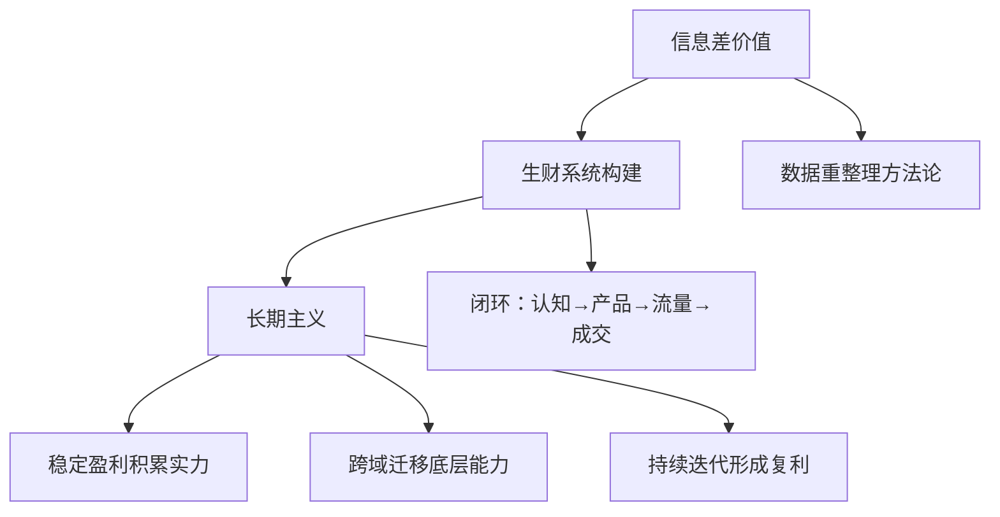

# 第 14 章 构建你的生财系统——信息差实操与长期主义

## 学习目标

-   理解信息差的本质与价值
-   掌握构建个人商业系统的方法
-   整合全书知识形成认知闭环
-   树立长期主义经营观

## 14.1 生活类比

构建生财系统，就像建造一台永动引擎。你看，引擎的每一环都是互相咬合的齿轮：飞轮转动带动曲轴，曲轴推动活塞，活塞又反过来维持飞轮的转动。没有任何一个零件是孤立存在的，也没有任何一环可以偷懒停摆。哪怕其中一个齿轮卡住了，整台机器就瘫在那里；但只要所有部件配合默契，它就能持续运转，越转越顺，甚至在你睡觉的时候，它依然在发出平稳的轰鸣声。我们这一章要做的，就是把你在前面十三章里学到的所有知识——写作的能力、内容的价值、流量的逻辑、成交的方法——组装成一台属于你自己的永动引擎，让它日复一日地为你创造价值。

## 14.2 概念地图



## 14.3 信息差的价值与数据整理

> [P001, p.5] "将市场上散乱的数据在某个维度重新整理并呈现"

这句话听起来平淡无奇，却是整章的第一块基石。我们先把"信息差"这个词拆开看：**信息差**，指的是不同人掌握的信息在数量和质量上存在差距。有人手里握着精确的统计报表，有人手里只有模糊的听说；有人知道某个渠道的量价比，有人只能盲猜。这种差距，本身就是一种可以变现的资源。

为什么说"信息流动本身创造价值"？想象一下：某领域的所有数据散落在上百个网站、几十份报告、无数条帖子中。普通用户为了搞清楚一个事实，要花三天时间到处翻找。而你，把那些散乱的数据整理成一张清晰明了的表格或一张图，用户一眼就能看到答案。你做的事情没有改变任何一条数据，但你把它们从"散乱"变成了"有序"，从"高检索成本"变成了"低检索成本"。这个过程，就是价值的创造。

我们还需要区分两种心态。一种人觉得"数据都在那儿，别人也能查，我整理不算本事"。另一种人则敏锐地意识到：**理成本本身就是一道门槛。** 大多数人不会为了一个小需求花三个小时去翻资料，他们宁愿付费换取一个整理好的答案。前者看到了信息的"公共性"，后者看到了信息的"可获得性差异"。商业机会恰恰藏在后者的视角里。

素材中的关键词是"在某个维度"。这个"维度"是整句话的灵魂，也是难度所在。为什么同样的数据，有人整理出来无人问津，有人整理出来被疯转？差别就在维度选得对不对。什么叫好维度？举个例子：

| 维度类型 | 说明 | 价值 |
|---------|------|------|
| 时间维度 | 按年份/季度排列趋势 | 看清变化方向 |
| 区域维度 | 按城市/地区切割数据 | 发现地域差异 |
| 人群维度 | 按年龄/职业/收入分组 | 锁定目标受众 |
| 价格维度 | 按价位区间归类 | 辅助比价决策 |

这个表格展示了同一个数据集可以有多少种切法。你选择的维度越贴合用户的真实决策场景，你的整理就越有价值。不要为了整理而整理，要为了"用户拿着一份整理好的数据马上能用"而整理。

那么，怎么找到那个"合适"的维度？三步走：

```
1. 找到要解决的具体问题（用户在面对什么决策？）
2. 列出所有可能的分组维度
3. 用"这个维度解决这个问题吗"来筛选
```

这套筛选流程看起来简单，但绝大多数人跳过了第一步直接开始整理数据，结果整理出来一堆没用的东西。记住：数据重整理的本质不是加工数据，而是**加工决策**。

## 14.4 构建个人生财系统

> [P001, p.5] "选对方向 进对圈子 错位竞争 IP放大 轻松成交 案例收集 复盘增势 提升单价 反复循环"

这十几个词是连续排列的，它们不是孤立的短语，而是一条完整的商业闭环链条。我们先把它翻译成一句话：**找到一个适合自己的方向，混进拥有目标客户的圈子，用差异化的定位避免正面竞争，通过内容打造个人品牌，让成交变得顺理成章，然后把成功案例收集起来，复盘并放大优势，逐步提高价格，最后循环往复。** 这一整条链，就是我们所说的个人生财系统。

为什么必须强调"系统"二字？因为只做其中任何一环都不足以持续。你只做内容，不设计成交路径，流量会像沙子一样从指缝漏走；你只做成交，不积累案例，每次都要从零建立信任；你只做复pan，不优化产品，成长会停滞在低水平重复。系统意味着：每一环的输出成为下一环的输入，整体构成闭环。

我们拆开来看这条链上最关键的四块咬合齿轮：

-   **认知层**：你对自己所做事情的深度理解。这是方向感和判断力的来源，决定了你选哪条赛道、如何错位竞争。
-   **产品层**：把认知打包成可交付的东西。可以是一份报告、一门课程、一次咨询，核心是可标准化、可复制。
-   **流量层**：让目标人群通过内容或渠道找到你。IP 的本质，是让陌生人在看到你的内容时，产生"这个人靠谱"的直觉。
-   **成交层**：把信任变成交易。轻松成交的前提，是前面积累的信任足够厚实，客户已经自己说服了自己。

```
闭环循环：
认知 → 产品 → 流量 → 成交 → 案例 → 复盘 → 升级认知 → 迭代产品 → ...
```

这段循环展示了生财系统的基本运转规则。注意它与"一次性的买卖"的本质区别：普通生意做完一单就结束了，而系统要求你把每一单变成下一单的燃料。案例收集和复盘，就是把散落的成功经验提炼成可复用方法论的关键动作。

那么，系统真正运转起来的标志是什么？是**标准化与复制**。当你发现自己做的事情可以拆成固定步骤，可以写出操作手册，可以让别人替你执行的时候，你的系统才真正成型。反之，如果所有环节都依赖你亲力亲为且无法言传，那叫手艺，不叫系统。

## 14.5 长期主义与系统升级

> [P001, p.5] "持续盈利才能等待浪潮"

这是全书收束时最重要的一句话。它的意思是：在浪潮到来之前，你必须保证自己还活着，而且活得还不错。如果你断断续续赚一点、亏一点，永远在生存线上挣扎，那么当真正的风口来临时，你既没有弹药去抓住它，也没有底气去冒险。

为什么长期主义是系统的一部分？因为任何系统在建立初期都是脆弱的。第一版产品不完美，第一批客户不精准，第一个月的数据不好看。如果你用短期视角来评判，很容易得出结论"这个方法不行"，然后放弃换下一个。但系统的威力恰恰在于：它需要时间来咬合、来磨合、来积累数据。

素材中还提到了"跨域迁移底层能力"。这句话要放在长期主义的框架下理解：你的思维方式、内容能力、数据敏感度、系统构建方法，这些底层能力是可以迁移到不同领域的。你今天把数据整理的方法用在了某个垂直行业的市场分析上，明天换一个行业，同样的方法论依然成立。这就是复利效应——你不必每次从零开始，你的能力库在持续长大。

```
积累 → 复利 → 时机 → 跃迁
```

这张图展示了长期主义的运作逻辑。前期的"积累"看起来缓慢、不起眼，但它是在为后续的"跃迁"积蓄势能。长期主义不是被动的等待，而是主动的复利积累：你每多一次有效的复盘，每多一个信任你的客户，每多一条被验证的方法，系统就厚一分。

所以，长期主义不是一种"心态"，而是一种**策略**。它要求你在短期内做出不一样的选择：宁愿慢一点但是可积累，也不愿快一点但是不可复制；宁愿先建立信任再提价，也不愿透支信任做一锤子买卖；宁愿守住基本盘稳住现金流，也不愿All in一个尚未验证的浪潮。

## 14.6 多源对照：生财系统的不同切入角度

我们在全书的各个章节分别学习过关于内容、流量、产品、成交的知识。这些素材虽然来自不同的场景，但当我们把它们放到"生财系统"这个框架下，就能看出它们的互补关系。

### 共识

所有素材都认同：**单一技巧不构成系统，真正的壁垒是由多个环节组成的组合。** 数据重整理、知识付费心法、AI 商业化、长期主义——没有任何一个单独能够撑起一个持续的商业模式，必须组合在一起，才能形成他人难以复制的护城河。同时，所有素材也都强调"循环"和"迭代"：生意不是一锤子买卖，而是持续改进的过程。

### 分歧

-   [P001，数据重整理] 强调"从数据出发找维度"，偏向供给侧——你先发现了一个信息差，然后去找客户；
-   [P001，知识付费心法] 强调"选对方向进对圈子"，偏向需求侧——你先找到人群，再设计产品；
-   [P001，总结] 强调"持续盈利才能等待浪潮"，偏向时间维度——它认为时机和持续性比单次爆发更重要。

这三条路径并不互斥，但它们的起点确实不同。你可以根据自己的禀赋选择切入方式：擅长分析就从数据入手，擅长社交就从圈子入手，擅长忍耐心就突出长期主义。关键是，无论你从哪里切入，都必须最终跑通整条闭环。

## 14.7 设计中的取舍

**为什么不用"一次性赚一大笔"的短期模式做收尾？**

因为短期模式无法积累。每一次的爆发都依赖外部运气，而运气无法复制。生财系统的目标是把不可控的运气变成可控的系统能力：你可以控制内容质量，可以控制数据整理的维度，可以控制复盘的频率，但你控制不了"哪一天忽然火了"。与其赌一天的运气，不如建一个能持续运行的系统——即使今天没有爆发，明天它依然在运转。

**这种设计的 trade-off 是什么？**

最明显的代价是前期慢。系统的每一个环节都需要时间去打磨：数据整理的维度要试错几次才知道哪一个是用户真正需要的；内容的风格要发几十篇才能找到手感；信任要积累几个月才能让用户毫不犹豫地付款。这段"慢"的时期很考验心态，尤其当你看到别人一夜暴富的新闻时。但反过来，系统一旦运转起来，它的边际成本是递减的：你花三天整理的表格可以卖一年，你沉淀的信任可以反复复用。短期模式的"快"和系统模式的"慢"，前者胜在爆发，后者胜在复利。最终，真正的分水岭是时间。

## 14.8 动手练习

-   想一想你所在的领域里，有哪些信息是"大家都知道存在但没人整理过"的？选择一个维度，动手整理一份最小化的数据表格。
-   把本章的生财系统闭环画成一张图，标出你目前已经具备的能力，标出你最大的短板。
-   写下你过去三个月中做得最好的一件事，拆解它成功的要素，并将它沉淀成一个可复用的步骤。
-   设定一个"等待浪潮"的底线：你的系统至少要稳定运行多久、产生多少现金流，才允许自己考虑新的尝试？

## 14.9 本章小结

这一章我们完成了整本书的收束，把前面十三章学到的所有知识和能力，组装成一个完整的个人生财系统。首先，我们理解了信息差的本质——信息流动本身创造价值，而"数据重整理"正是把散乱数据变成可用决策的验证过的路径，关键在于选择合适的整理维度。其次，我们拆解了个人生财系统的完整闭环：选对方向、进对圈子、错位竞争、IP 放大、轻松成交、案例收集、复盘增势、提升单价、反复循环——认知、产品、流量、成交四个齿轮互相咬合，形成持续运转的商业引擎。接着，我们把视角从系统构建拉高到长期主义：持续盈利才能等待浪潮，底层能力可以跨域迁移，持续迭代才能形成复利。最后，我们讨论了这套设计中的取舍——短期快与长期慢的对比，并明确：系统的力量在时间中展现。

本章我们一起学习了以下概念：

| 概念 | 解释 |
|------|------|
| 信息差 | 缩小信息差创造价值应获回报 |
| 生财系统 | 整合思维方法工具形成完整商业闭环 |
| 长期主义 | 稳定盈利持续积累等待时机 |

恭喜你读到了这里。这本书从最基础的理念开始，经历了方法、工具、技巧、实战，最终在生财系统的框架下完成了闭环。你不再是一个盲目的摸索者，而是拥有一整套完整工具箱的构建者。接下来要做的，是把这本书合上，去搭建你自己的引擎，然后让它转起来。祝你在漫长的复利之路上，越走越顺。
