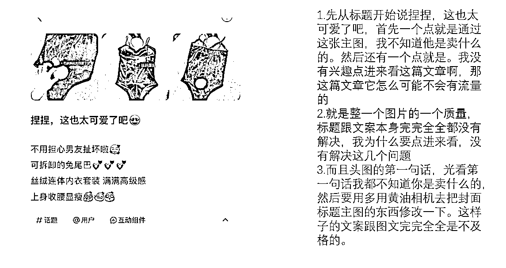
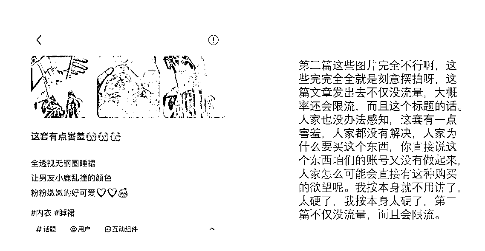
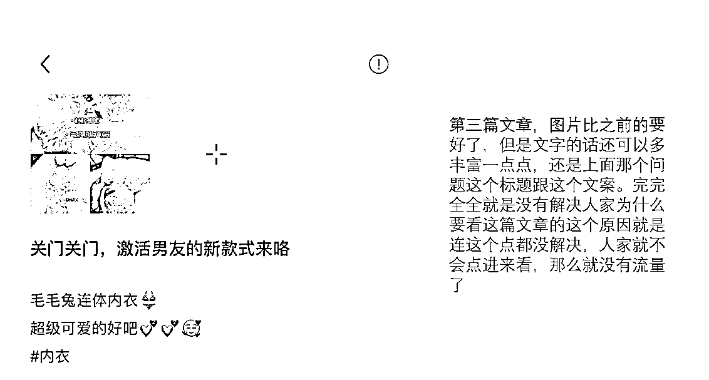
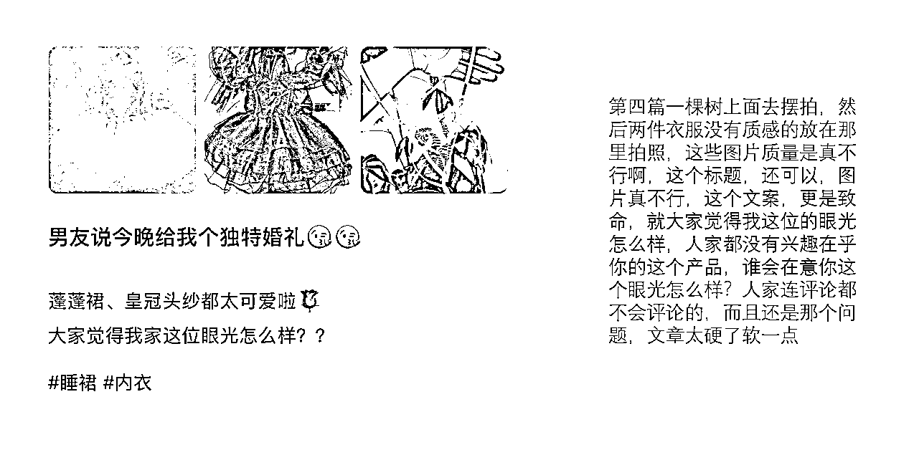
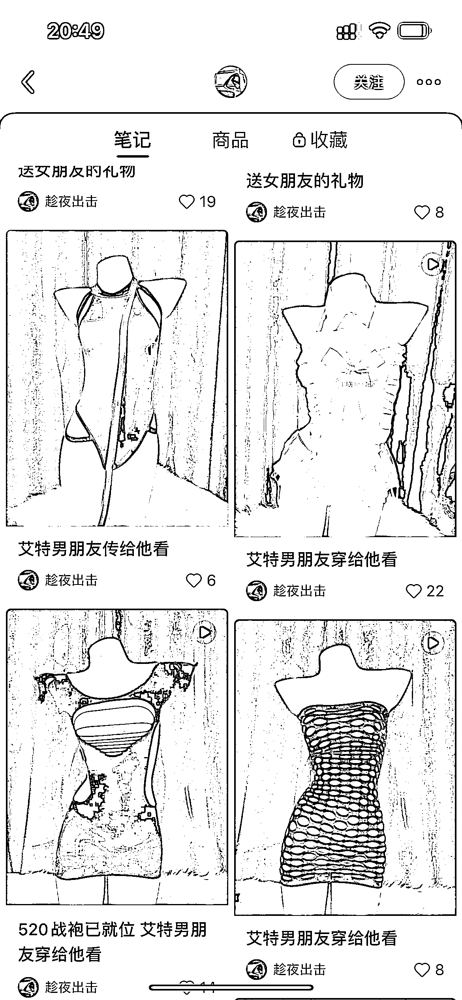
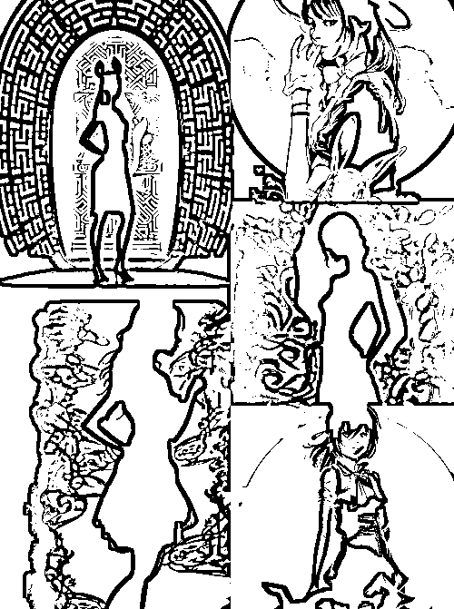
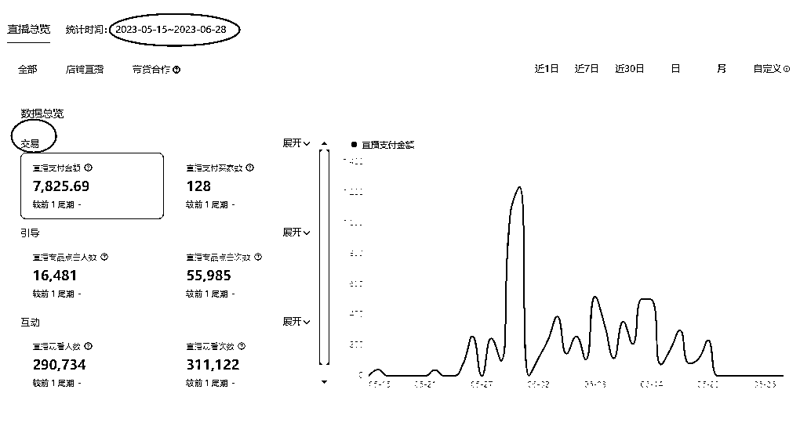
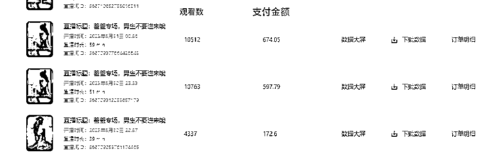
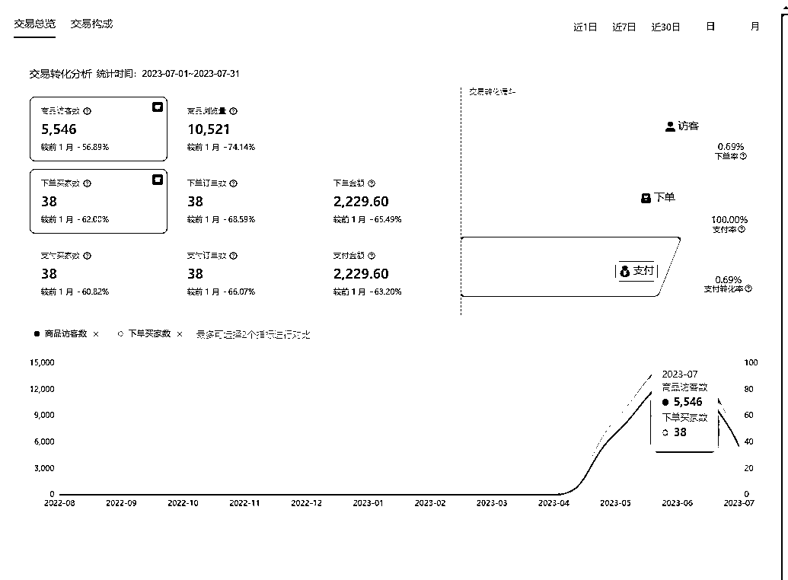
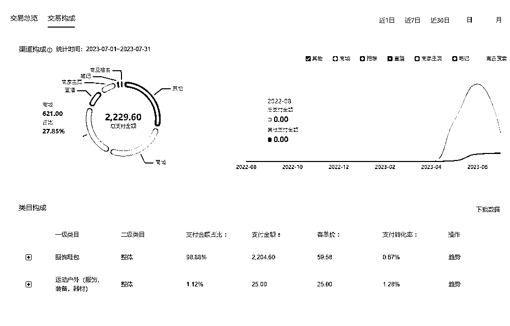

# 小红书做情趣内衣店，笔记+直播组合拳单店月赚6000的实操拆解

> 原文：[`www.yuque.com/for_lazy/thfiu8/lfh1au2nc9yt6vqo`](https://www.yuque.com/for_lazy/thfiu8/lfh1au2nc9yt6vqo)

## 小红书店铺卖情趣内衣，直播+笔记打法月入 6000 保姆级教程

作者： 书豪 

日期：2023-08-01 

各位好，我是杭州的赚钱龙珠成员书豪，连续创业四年，95后，目前已实现四年年入百万。

从3月到8月，我们团队在同步操盘30家小红书店铺，整体月利润稳定在20万上下，摊到单店就是月均6000元左右的利润，今天就拿其中一家情趣内衣店的打法给大家复盘一下。

分享会围绕这几个核心展开：
1. 为什么会入局情趣内衣这个赛道？
2. 情趣内衣该怎么选品？
3. 笔记怎么起标题、拍视频、做封面？
4. 小红书直播如何带货，封面、标题、逼单话术、赠品怎么优化？
5. 如何降低违规风险？

一、为什么选情趣内衣这个品类？
第一点，需求存在且竞争没那么卷。我们提前在抖音和小红书做过市场摸底，这个品类的搜索量和下单意愿都不低，但做的人远不如女装那么多。

第二点，款式迭代快，有品牌化的想象空间。情趣内衣的设计感强，审美门槛相对低，容易做出差异化。我们团队的思路是先靠供应链跑利润，再逐步向自有品牌和源头货源靠拢，小红书店铺的长期稳定，货源才是一体支撑。

第三点，情绪需求在增长。在这个充满不确定性的环境里，人们更在意精神层面的释放，比如孤独、焦虑、渴望亲密连接。情趣内衣本质上是关于自我关怀和情感调和的需求，我不认为它尴尬，这是正常的人性诉求，也是情侣关系中的调和剂。

当然也有人问我，卖这个会不会不好意思。我只说一句话：食色性也，做小红书终究要回到用户要什么、市场要什么。比起女装的红海，情趣内衣的门槛和转化要友好很多。

二、选品思路
选品前先把人设和店铺调性定下来，包括风格定位、品牌名、Logo设计、小红书店铺简介，这些门面工作先完成，再进入选品环节。

选品标准我总结为四条：
1. 小红书上找低粉也能爆的笔记，冷启动参考价值高。
2. 抖音上找真实销量好的款，验证过转化。
3. 1688上筛选销量1000件以上、发货时效24-48小时内的现货，坚决避开预售。
4. 自己主观觉得有质感、有卖点的款。

三、笔记、标题、视频、封面的执行方法
1. 先下样品自己拍。第一次做这个品类，我大部分是自己实拍。标题和关键词直接参考小红书爆款，搬运关键词是最高效的学习方式。呈现手法可以对标做得好的同行。
实拍参考账号：雪乃的试衣间（424511432）、羞羞秘密花园（6147070105）、头文字 D（3810173024）、趁夜出击（882989161）

2. 图文笔记的十个细节
1) 尺寸用1:1/4:3/3:4
2) 文案直白易懂，不绕弯
3) 评论区主动引导互动
4) 封面和标题要统一方向
5) 卖点前置，一眼看懂
6) 人设定位要精准
7) 色调风格保持一致
8) 明确目标人群
9) 避免过高饱和色
10) 修图克制，用emoji做分隔

3. 错误示范
  
  
  
图片要想好看，景和灯光必须先到位，道具不够就去买。

正确示范，封面干净整洁：
  

四、直播为什么能起量，怎么做的
我们这家店前期笔记转化一般，就把重心切到晚上直播，时间段锁定22点-凌晨2点。2023年5月16号开始首播，当天只有20多人看，但我们没有停。次日立刻优化封面和标题，第三场场观破1000，虽然没出单，但方向对了。

我们测了很久的直播封面：
  
封面确定后，点击率提升，场观每天往上走，后续稳定出单，最高场观过1万，当晚成交24单。

  
最高场观数据截图
  
618期间流量集体下滑，我们直播间也受影响。但同行也降，说明是平台周期问题。坚持播了两天，场观又回升到1000+，日成交恢复1-2单。受到大主播挤压后，后续日成交稳定在1-5单。我们判断笔记更可持续，就停播转回笔记运营。

停播后的笔记转化表现
  
  

直播逼单的核心打法
我们常用一个钩子：当晚下单送丝袜。放几个托在评论区抢回复“已拍，记得送丝袜哦”，营造氛围。

我们也总结出一个直播规律：开播后小红书会给初始曝光，场观30分钟内会快速上涨，之后趋于平缓。所以早期我们采用多场次短时长策略，播50-60分钟流量断了就下播，休息10分钟再开。后来平台规则调整，要求3小时才给3000曝光，很多同行也就退出了直播。

现在店铺以笔记为主，笔记是原创视频+混剪，混剪素材来自抖音同款，每天发5-6条，有了粉丝沉淀后，日出单很稳定。

五、违规怎么规避
这个品类最容易踩雷，主要两类：

1. 商品类目错放
解决办法：
1) 办理医疗器械类目资质，门槛高多数人不会做。
2) 标题避免出现敏感情趣词汇，商品图避免直接上身照，用人台实拍代替。即使这样仍可能被判定错放，只能申诉或修改图、标题，实在不过审就下架。

2. 笔记违规
主要表现是过度露骨、诱导不良。解决办法是笔记里不放真人穿戴图，视频氛围不要过于欲感。

笔记进一步优化方向
1. 做原创视频，保持风格统一。
2. 标题不要低俗，要有共情力，可以参考杜蕾斯式广告语。这一招更适合已有粉丝基础、想做品牌的阶段。刚起步建议用抖音/小红书素材混剪+爆文标题。

素材混剪三招：
1. 直接用视频，封面加文字标签如显瘦、聚拢。
2. 对视频抽帧做成静态流动感。
3. 把抖音实拍图下载下来做成短视频。

关于直播人设
情趣内衣直播不适合传统带货嘴炮，更要看款式。我的建议：
1. 可以做情侣同框直播，以轻松互动为主，增加停留时长。
2. 搭建浪漫高级的直播间氛围，聊爱情、讲情话、分享情诗，提升直播价值感，杜绝擦边低俗行为。
3. 语气柔和、有氛围感，但不要做作。

整体来看，情趣内衣赛道比女装更易做，竞争相对小，转化路径清晰，值得尝试。

以上经验供参考，欢迎交流。微信  wshinvest1

## 往期文章： 

### [如何矩阵化经营 30 个小红书店铺月利润过 20 万？](https://articles.zsxq.com/id_3qslvwfcmwn3.html) 

[人生的第一个 100 万，我是怎么赚到的？！](https://articles.zsxq.com/id_kek27cqo56wf.html) 

#### [组织赚钱有术福建厦门圈友聚会复盘！](https://articles.zsxq.com/id_7qqhllpk7tpk.html) 

### [小红书单店铺单月 6000+利润选品保姆级教程](https://articles.zsxq.com/id_xwveu3e0usfv.html) 

### [小红书无货源电商，单品 4w+利润，我做了什么？](https://articles.zsxq.com/id_8o3ptacdp6mj.html) 

### [抖音直播间月消耗过百万的千川投流经验分享](https://articles.zsxq.com/id_dyembkeh2cw.html) 

### [2023 小红书幼教考编保姆级教程](https://articles.zsxq.com/id_cpdec6j4xtho.html) 

### [小红书爆款封面最新设计攻略！带你掌握流量密码](https://articles.zsxq.com/id_bbisulzsup1.html) 

### [如何拆解一个小红书爆款视频](https://articles.zsxq.com/id_op78sxacew9.html) 

### [小红书无货源电商做女装如何选品？](https://articles.zsxq.com/id_1wxixzrofb3.html) 

### [小红书颜值测评变现保姆级教程](https://articles.zsxq.com/id_15njg5hxfr.html) 

### [小红书低粉爆款案例拆解教程](https://articles.zsxq.com/id_0wnwd6mb0l.html) 

### [小红书新人入局月入 100-1000 元保姆级教程](https://articles.zsxq.com/id_sbk1qv5unca.html) 

###   

### [抖音单品短视频带货 1000 万 GMV，我是怎么做到的？！](https://articles.zsxq.com/id_qoak1w7ptnwf.html) 

### [抖音直播间月消耗过百万的千川投流经验分享](https://articles.zsxq.com/id_dyembkeh2cw.html) 

评论区： 

坏孩（大学生） : 书豪哥牛 b sharge : 优秀的豪哥，真诚的分享 蓝子鱼 : 优秀，配合直播提升成交率 书豪 : 期待和坏孩喝一个! 书豪 : 谢谢 S 哥认可[呲牙][呲牙] 书豪 : 子鱼老师的文章我经常看 谢安生 : 这次还带有直播的经验，豪哥真是真诚分享，大赞！ 月起星九 : 豪哥团队是专业的[强] 

