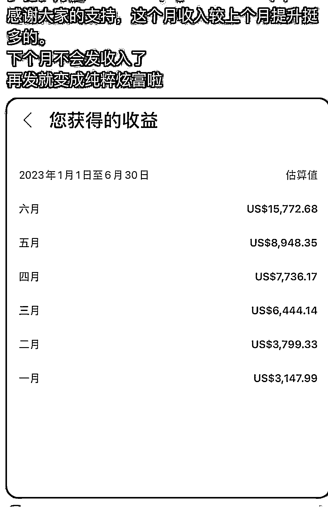
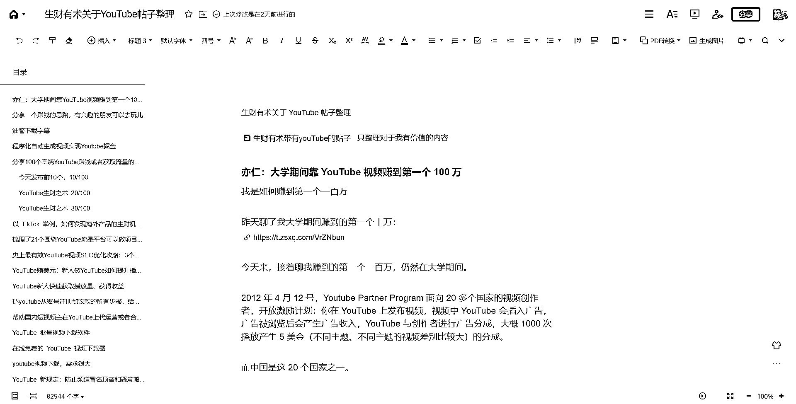
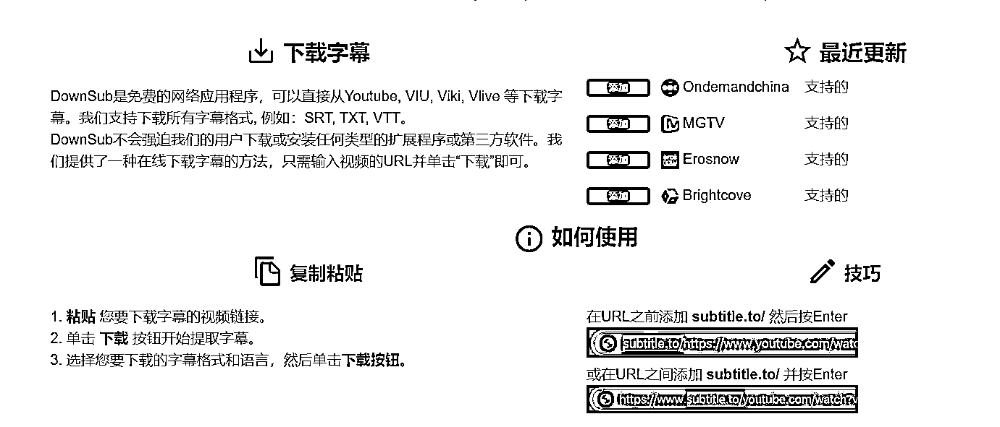
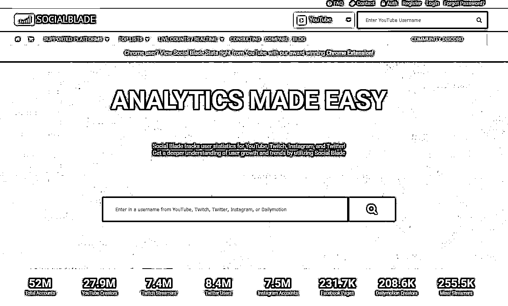
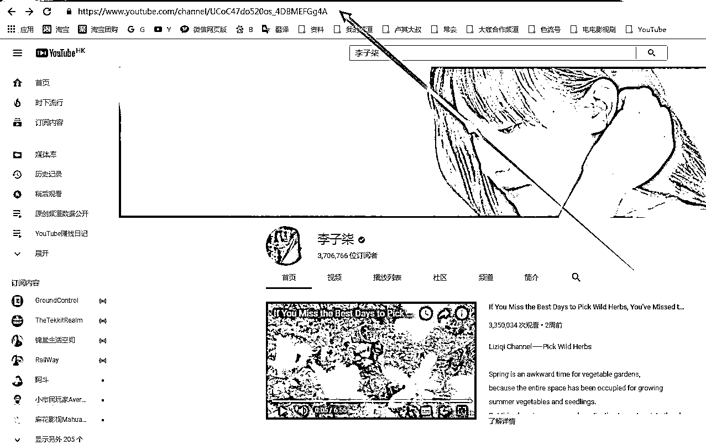
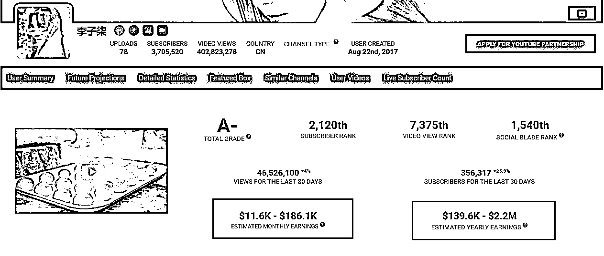

# 关于 YouTube 的赚钱笔记汇总整理

> 原文：[`www.yuque.com/for_lazy/thfiu8/wqf57shwy68ryit1`](https://www.yuque.com/for_lazy/thfiu8/wqf57shwy68ryit1)

## 赚钱有术 YouTube 相关帖子合集整理

作者： 书情小跟班 
日期：2023-07-31 

之前我已经发过几篇相关的讨论：

为什么 YouTube 非常值得你去做？ https://wx.zsxq.com/mweb/views/topicdetail/topicdetail.html?topic_id=588121251252584 
YouTube YTT 收款的大致操作流程 https://wx.zsxq.com/mweb/views/topicdetail/topicdetail.html?topic_id=811858545512582 

做油管能聊的点很多，核心就一点，先动手。动手了才有收入，不动手永远零。最近刷到一张 YouTube 收益图，真的让人上头。

YouTube 这个赛道值得入局，有榜样打底会更有底气。赚钱里那些晒收入的帖子，作用就是在心里点一把火。

言归正传，我把赚钱里关于 YouTube 的帖子整理出来了。整理原因很简单，下半年我的主攻方向就是 YouTube，几乎所有精力都放这上面。

至于赚钱会不会开 YouTube 航海班我也不清楚，那不影响我自己整理。整理完顺手分享出来，大家就不用一篇篇翻了，我已经筛出来了。

如果以后真开了航海，肯定会有航海手册，我这就不做重复工作了。总合集放在这里：【腾讯文档】赚钱有术关于 YouTube 帖子整理 
https://docs.qq.com/doc/DRnFhcVViZkxZcFhi

排版我不太在行，先用腾讯文档顶着，后面有空再做飞书版，毕竟赚钱大家更习惯飞书。

直接看腾讯文档就行，后续我会继续补赚钱的老帖，也会同步更新一些 YouTube 的新资讯。

### 龙哥：读大学时靠 YouTube 赚到人生第一桶金 100 万

我是怎样拿到第一个一百万

前一天聊了大学时期赚到第一个十万，今天接着说第一个一百万，还是在校期间。

2012 年 4 月 12 日，YouTube Partner Program 对 20 多个国家开放创作者激励。简单说就是你发视频，YouTube 插广告，广告被看完就能分成，大概 1000 次播放约 5 美元，不同品类差距很大。

中国就在这 20 个国家之列。

同年 7 月，我在读研，暑假，正在纠结毕业后走专业路线还是做互联网，挺迷茫的。

当时网上有个关系很好的朋友，是在网络电话论坛认识的。我们平时没事就闲聊。有天偶然刷到 YouTube Partner Program 面向中国开放的消息，嗅觉比较灵，觉得可以试试。

怎么会刷到？

平时就爱在网上逛最新消息，而且自己有过赚钱经历，对这类信号比较敏感。

看到新闻后觉得有戏，立刻去验证了一下，当时执行力很强。

我们赶紧注册 YouTube 账号，申请 Adsense，然后把国内的一些视频搬运过去。为了快速验证，连版权问题都没管。结果随便搬的前 10 个视频就来了 5 美元收入。

机会就在眼前！

还记得赚钱日历开篇那句话吗：“有钱可赚时，要把资源和精力全部集中上去 All in，别小富即安。几年后你会拍大腿，当初那么好的捡钱机会为什么错过了。”

这次经历就是这个感悟的来源。

一番思想斗争后，我放弃了正在准备的注册会计师考试，All in YouTube。

从 1 个账号到几百个账号，
从 1 个主题到几百个主题，
从 1 个人干到拉着全班一起，
从搬运到自己找热点做原创，
从手动上传到几百台 VPS 脚本自动化，
从每天几小时到几乎全天在线，
……

印象最深的是伦敦奥运会，全球都在看，流量爆炸。

可 YouTube 当时不支持直播，大家想看最新消息只能等机构做好视频上传。谁先传上去，谁就吃上百万播放、几千美金的红利。时间就是金钱。

没法直播怎么办？

办法总比困难多，只要赚钱欲望够强，问题都能被解决。

我在国内守着奥运会直播，出来立刻配几张图和语音合成，几十条短视频丢上 YouTube，套个关键词刷新一下，播放就破千，搜素流量疯狂涌入。

回头看，那段时间就是捡钱期，一个爆款几千美金很常见。

大概坚持了两年，赚到了人生第一个一百万，还稍多一点。

我们班不少跟着我做的同学，毕业就靠这笔钱在南京买房，没靠家里。

后来竞争者越来越多，我们又不太重质，赚了美金没什么沉淀。流量红利期结束，进入专业创作者时代，我也因毕业去阿里，没继续做下去。

这是我第一个一百万项目。

研期间还做过考研笔记生意，写软文引流到 QQ 卖自整理笔记，送 VIP 群答疑，后来塞满了几个 500 人的 QQ 群，考上这个专业的人大概一半都买过我的笔记。

总结一下从这一百万里学到的：

1. 想清楚自己要什么最重要。
别太在乎别人怎么看。我们学校的学生放弃专业去做 YouTube 会被说不务正业，想明白后就别被外界声音带跑。

2. 多分享，分享是正向循环。
你主动分享一点，别人回馈一点，你再分享，别人再回馈。形成滚雪球。如果你分享了对方不反馈，也没必要难过，这帮你筛掉了不值得深交的人，省时间。

3. 机会来了要产品化、自动化、规模化、矩阵化、建团队，这些都是杠杆，能大幅提效。

4. 项目结束我意识到要做自己的产品，别做没积累的事。长期打磨到临界点会爆发，但做产品要坐冷板凳，这期间需要现金流业务支撑。
这背后还有个 1000 万的故事。

5. 要有自己的小圈子，深度交流。
这个机会是我和一个小伙伴一起琢磨出来的。那个人也是泡论坛认识的，常一起聊打免费网络电话。后来找了个朋友帮忙写批量脚本，后来各忙各的失联。再后来那朋友加入赚钱，才知道他当年帮写脚本的小伙子就是“龙哥大大”，两人微信一顿唏嘘。

6. 保持大量信息输入，尤其是第一手信息。信息越多越值钱。有些人因信息爆炸而退圈，这恰恰是他们该留下的理由。

7. 赚钱要趁早。

### 一个可操作的 YouTube 变现思路

前阵子朋友推荐一个视频，国内找不到无删减版，外网 YouTube 上也没找到。

手机刷了一天 YouTube 发现，很多视频是用电脑语音批量合成的。

就是最简单的搬运，把头条、公众号的爆款直接搬，标题照抄，内容用工具文字转语音，配几张相关图合成。模式完全可以批量化，靠广告费变现。

圈子里估计有人已经在玩了。

### 油管字幕下载工具分享

最近小说推文和中视频的朋友常问怎么从 YouTube 下字幕。有了字幕翻译更顺，剪辑也更顺。

工具免费分享：

### 程序化批量生产视频做 YouTube 掘金

大家好，我是二两，目前在广州一家游戏公司做算法工程师，业余跟着赚钱老师傅研究副业。这里分享一个用程序化方式自动生成视频并实现 YouTube 变现的实操案例。

本文不给完整代码，但会给出代码级别的参考项目，让你少走弯路。

程序化自动生成视频实现 Youtube 掘金 https://www.yuque.com/erliang-vtlak/nynb90/dw1b3q

### 100 条围绕 YouTube 赚钱或引流的思路

#### 首发前 10 条，10/100

分享 100 个围绕 YouTube 赚钱或获取流量的思路，龙哥原创。大多数思路已有成功案例，模仿并超越即可，超越不了分一杯羹也行。

今天放前 10 条，10/100

1. YouTube Channel 代运营平台，服务出海品牌，做海外频道代运营，可大可小；
2. YouTube Adsense 收益估算小工具，类似 similarweb，可命名为 similarchannels，估算频道收入水平；
3. YouTube + Audiam，Audiam 是版权管理联盟，可绕过 YouTube 快速获得 Content ID 功能，具体可自行搜索；
4. YouTube 视频素材库 / 创意库，提供每日热点素材，参考新榜、西瓜集等；
5. PPT 转 YouTube 视频工具，PPT 转视频加配乐，部分人群刚需，也是做 SEO 的利器；
6. 国内分发 YouTube 平台，获取海外网红在国内平台的版权分发，例如南瓜脸在快手获几百万播放几十万粉丝的案例；
7. YouTube 视频监控工具，监测频道、视频、话题、关键词并输出数据报告；
8. YouTube banner 尺寸裁剪工具 + banner 素材聚合，按主题聚合；
9. YouTube 视频 WordPress 聚合插件，做垂直主题视频站，如猫狗可爱视频站；
10. YouTube ideas 生产机，收集大流量视频数据分析后，输入关键词即可提示正在流量的热词，类似 keywordstoo.io / tinykeywords.com。

#### YouTube 赚钱之术 20/100

上次放了 10 条，今天继续 20/100

1. YouTube 与各品牌高清 icon 聚合下载平台，示例站月流量 430 万，70% 来自搜索，提供结构化素材，Adsense 变现约 4300 美元/月；
2. YouTube movie trailers 聚合平台，电影预告片流量巨大，多为 CC，无版权风险，无预告片可用海报生成小视频；
3. YouTube 年度 Top 视频生成工具或聚合频道，类似 Instagram 年度 top9 合成图；
4. YouTube Trueview 海外广告代投放，服务国内出海品牌，外贸推广，可通过社媒或付费推广接单，Fiverr 找供应商；
5. YouTube 粉丝维护工具，垃圾评论清理、订阅解锁、邮件列表收集、着陆页搭建，按月收费 19-129 美元；
6. YouTube 盈利交流社区，创作者论坛，案例月访客 46.8 万；
7. YouTube + CPS，垂直主题 + Clickbank / Amazon / Dropshipping，如大疆无人机官方 CC 视频可下载再创作，换封面换标题导购；
8. YouTube to GIF 小工具，快手早期即做相关，案例月流量 540 万；
9. YouTube 一键分享分发平台，代发布，一键多平台上传；
10. YouTube 搬砖工，国内转国外、国外转国内。

#### YouTube 赚钱之术 30/100

此前分享 20 条，今天继续 30/100。

前两条围绕字幕。

YouTube 字幕功能很强大，从自动识别到自动翻译再到人工互助，体验很好。围绕字幕有需求：

字幕下载器 与 字幕搜索器

1. 下载器解决离线学习需求。想把精彩 TED 演讲字幕导出成文档打印，YouTube 官方不支持导出。搜索 youtube subtitles download 排名第一的站月访客 190 万，日均 6 万+，需求明确。
2. 搜索器解决音视频快速检索需求。如想检索哪些视频提到“苹果”。通过语音转文字效率低，用 YouTube 字幕曲线救国可行，2B 端更有价值。

YouTube 播放列表功能相关

3. 批量下载播放列表里所有视频或音频。如下载 NBA 精彩合集离线看。需求明确，相关站月访问 230 万。
4. 通过他人播放列表建立自己的播放列表。知乎收藏夹搬家同理，可增删，相关方案月访问 310 万。
5. 播放列表迁移到其他平台。之前“一起赚美元”专栏提到开发者做歌单迁移服务月入超 1 万美元。

YouTube 账号相关

6. YouTube 账号买卖。国内注册 Gmail 麻烦，需翻墙和验证手机号，90% 用户被挡住。营销也需多账号，市场可支撑百万美元规模。
7. YouTube username 生成器。注册时用户名被占的痛点，相关产品月访问 160 万，几乎零成本。

垂直频道方向

重点看无需持续更新、能被动收益的细分领域：

8. white noise，类似 Relaxing White Noise 频道近 40 万订阅，靠广告+周边销售，年入百万级，竞争小；
9. Product unwrapping / opening 开箱视频，流量精准，转化高，如大疆新品开箱流量惊人；
10. 圣经相关领域

最近聊到一个反复被验证的逻辑：变一个分发载体，就能把现成的需求放大成可观的现金流。专栏里那位西班牙开发者，用一个西班牙语的 iOS 小工具，每个月就稳定在万元美金级别。YouTube 上也有同款玩法，比如把圣经读成有声书上传，订阅量就轻松破七万六。媒介换了，需求还在，钱就来了。

### 用 TikTok 找海外赚钱机会，本质是在做流量研究

怎么把这种机会系统化？从 TikTok 入手是个不错的切口。本文聚焦 Google 流量研究、关键词挖掘、TikTok 与 SEO 的交叉玩法，约三千字，八分钟能看完。

我是三林，做互联网产品多年。上期讲过一个资源套利下载站：用 SEO 把想装谷歌插件但找不到入口的国内用户引过来，再导到公众号做广告变现。需求先行，载体随之。回到原点，我们该怎么去发现、复制、放大这类机会呢？接下来展开。

### 围绕 YouTube 流量可以做的 21 种项目方向

几乎每一项现在都有人跑通了，不是空想。

1. 白噪音类视频，用 YouTube 引流后卖虚拟服务
2. 聚合垂直频道的内容分发，比如美妆、惊悚、奇葩、搞笑、萌宠，用头条号、公众号、微博矩阵经营，成熟后沉淀到 App
3. 基于关键词的短视频 RSS 订阅服务，视频版的 RedHub 思路
想法孵化
4. YouTube Ideas 聚合服务，按热度和历史数据给创作者供选题，按月收费
5. 榜单和 TOP 导航，提供精华视频、播放列表的入口和分析报告
内容制作
6. 无版权音乐聚合下载，YouTube 自带部分免费音乐资源，整理打包后靠广告或素材付费变现
7. YouTube 标签提取工具，自动扒 Tags。思路是别人做全能收费，我们做单点免费
8. YouTube 频道名生成器，月访问量接近百万量级
9. 关键词分析服务商，给创作者提供选题关键词建议，按月订阅。现在 AdWords 不再免费开放 Keyword Planner，需求在上升，头部服务商月流量可达数百万
推广
10. 广告收入估算工具，日访问量也有两千左右
11. 粉丝、点赞、评论、分享等增长服务，市场非常分散
12. 营销打包服务，把上述服务整合成一套 YouTube 营销方案
13. 网红商务对接，YouTube 上很难直接找到达人联系方式，先深耕一个垂类积累资源，再帮国内出海电商做投放
变现
14. 广告代投服务，掌握 YouTube 投放方法后，为国内外客户代操盘，类似 Facebook 和 AdWords 代投
15. 视频分销服务，和国内版权方或海外红人签约，分发到另一侧市场
周边工具
16. YouTube Logo 下载站，各版本各配色，每天两千左右访问
17. Logo Maker 在线制作器，与上同理
18. YouTube MP3/视频下载器，流量和盈利都非常可观
19. 视频转 GIF 工具，月流量七百多万
20. 国内访问的 YouTube 视频下载服务，卖梯子是思路之一，卖视频本身是另一种思路
21. 字幕引流，利用 YouTube 自动生成字幕导出整理成文章做下载，是一类内容源
22. 视频转文字服务，此前也分享过相关创业案例

### 案例：三个月 SEO 把 YouTube 流量拉升 900%

图帕先生的经验被反复提到。核心就是把 YouTube 当成搜索引擎来做：标题、描述、标签、字幕、封面、播放列表全部对齐搜索意图。三个月内自然流量增长九倍，品牌认知和销量同步提升。办法就是把视频当页面来优化，而不是仅靠算法推荐。

### 新人如何入门 YouTube 赚钱

从兴趣起步到十一万粉丝，频道进入平稳期后就需要结构化运营。内容方向、发布频率、标题关键词、封面点击率、完播率，都是可拆解的优化点。近期也开了新频道做学习日志沉淀。

### 从注册到收款的全流程拆解

运营账号：阿雷科技，10.5 万粉，单条收入约千美金左右。千次播放收益 2-8 美元，取决于内容类型和地区。

注册：YouTube 依托 Google 账号，国内手机号挂梯子即可注册。一个 Google 账号可开多个频道，每个频道独立运营。关键点在于设置国家地区，不要选中国，否则无法申请盈利。

AdSense 就是流量主账户，一个 Google 账号对应一个，需要填真实地址，后续收 PIN 用得上。

盈利门槛：12 个月内 1000 订阅 + 4000 小时观看时长，通过后才可加入 YPP。原创至关重要，搬运或低原创度内容即使达标也可能被拒或后期封号。2020 年后推广来的订阅和播放不计入，门槛持续抬高。真人出镜、原创度高的内容审核更快。

PIN 码：通过盈利且收入达 100 美元后，Google 会平邮 PIN 到填写的地址，国内易丢，有三次补发机会，四次都收不到可人工验证。

收款方式国内主要有三种：个人 5000 美元以内多走招商电汇，超额需外汇局备案；公司对公收款，可电汇或西联汇款，需备案；MCN 代收，抽成约 20%，不推荐。

提醒：YouTube 周期长，适合已有短视频经验的人坚持。

### 代运营国内短视频主是个高利润生意

海外华人阅读量不低，YouTube 分成高。把国内内容搬到 YouTube 几乎零边际成本。比如办公室小野，单个视频播放几百万到几千万，按千次 2-3 美元算，百万播放就是 2000-3000 美元分成的级别。找一百个这样的创作者合作，规模就起来了。

### 工具与灰色地带的提醒

批量下载软件、在线免费下载器 RipYouTube 等工具在圈子里流传很广。搬运短期能变现，但风险高。YouTube 已在 8 月 21 日起收紧规则：禁止同名同头像冒充、利用空格或数字替代字母伪装、假装原作者评论、描述里写“粉丝账号”却搬运正片、仿冒新闻频道等。搬运与洗稿账号被封概率持续上升。

航海三个月突破 4000 小时观看并加入 YPP 的案例也证明，稳定更新与垂直定位依然有效。

### 版权与变现的底层逻辑

李子柒在 YouTube 走红的一个关键点是音频几乎无版权占用。抖音常用的配音配乐在 YouTube 上会被 Content ID 系统匹配，广告收入归版权方。所以做出海内容，先把版权问题解决掉。

查询频道收入可以用第三方估算网站：打开网站 -> 打开 youtube.com -> 复制频道主页链接 -> 粘贴回车即可看到大致年收入区间，以及其他参考数据。

近期实操反馈：一个娱乐向账号一个月做到一千粉、六千小时观看，日更但粉丝增长慢；一个学习向账号一年半三千五粉，长期周更后推荐稳定，粉丝持续增长。长视频的高质量内容虽慢，但生命周期长，依然有价值。

最近总有人把抖音和 B 站拿来对比，我们星球里做抖音的人不少，节奏快、见效快，当成一个变现渠道是挺合适的，我个人觉得要想靠它沉淀成个人 IP 并不容易。B 站天然更偏长视频，这点倒是没错，但长视频生态要做大很难，有人曾用一句调侃说，中国脱口秀的未来在池子，可中国脱口秀本身也未必有未来。B 站很难复制 YouTube 那种多元化，硬要突破大概率得走出海路线。话虽如此，我仍觉得 B 站这个平台是有价值的。

做个人内容，我的建议是尽量垂直，别给自己加戏。做减法、做简单的东西，未必就没价值。

接下来分享两个靠精准需求做起来的美元变现案例。

### 一起赚美元：Shoppe，服务海外微商的社交售卖工具，月入 12 万美元

案例拆解

Shoppe 本质上是海外微商的专属销售助手。直销公司尤其是多级分销体系的代理，必须用它在社交平台上完成交易，既省时间，也能给顾客更顺畅的购物体验。

为什么需要它？很多直销公司明文禁止代理在 Etsy、Amazon、Ebay 或自建 Shopify 店铺售卖，Shoppe 正好填补了这个合规的社交销售空白。

从需求到启动

2015 年 11 月，创始人妻子开始代理美国服饰品牌 LuLaRoe，这是一家典型的多级分销公司。2016 年 4 月，夫妻俩尝试用 Facebook 群组相册来卖货，发现效率低下且受限。创始人意识到：既然没有符合规则的工具，为什么不自己做一个？而且他本人就是目标用户，能很清楚地列出 MVP 需要的基础库存管理、订单管理和简易电商功能。

获客方式非常依赖口碑裂变。微商代理之间联系紧密，形成了明显的金字塔上下级关系，搞定一个头部用户，就能辐射到他整个网络。

他用 6 周做出 MVP，先免费给妻子和她的同事永久使用，其中几位是级别较高、影响力大的头部代理。期间他持续收集痛点，根据反馈快速迭代。用户之所以愿意主动推荐，很大程度上是因为他对需求响应极快。

为了保持沟通，他建了一个 Facebook 群组，把用户都拉进来。这个群既是需求收集池，也是增强用户归属感的渠道。

起初 Shoppe 只服务 LuLaRoe 后来产品通用化，覆盖了更多直销品牌，获客逻辑始终不变：先拿下核心用户，再靠他们内部推荐。

讨论要点
1. 这依然是一个从自身痛点出发找产品方向的典型。
2. 海外微商主要集中在哪些平台？是 Facebook 还是 WhatsApp？
3. 国内微商的成交工具是什么？多数似乎直接在微信里聊完就付款，但我也记得市面上有过类似的 SaaS 产品。

产品信息
产品名称：Shoppe
上线时间：2016
运营渠道：Shoppewith.me、Facebook Page、Twitter、YouTube Channel、Instagram
流量情况：截至 2017 年 7 月，累计用户 22,000 名。Shoppewith.me 月均 UV 约 27,000，近一半流量来自 Facebook，说明核心传播是靠代理间的口碑扩散，海外微商在 Facebook 上确实活跃。
盈利模式：月度订阅收费
盈利水平：2017 年 7 月达 12 万美元/月
作者：Ryan

### 一起赚美元：连接用户与画家的 Instapainting，月入 3.2 万美元

案例拆解

产品名称：Instapainting
上线时间：2014 年 1 月
运营渠道：官网、Twitter、Facebook Page、YouTube Channel
产品简介：上传照片，为你手工绘制成油画。最初是一个代售画作的单页站点，后来演变成连接用户与画家的平台。
流量情况：月均 UV 约 15,000，近 40% 来自搜索引擎，长尾关键词带来不错的 SEO 表现。
盈利模式：向用户收取费用，支付给画家，赚取差价。
盈利水平：2016 年 8 月约 3.2 万美元/月
作者：Chris Chen，YC 2011 年冬季班成员。

Chris 在参加 YC 三年后，差不多把投资和自己的项目资金都用完了。但这些尝试让他对做 MVP 非常熟练。一个朋友从中国带了一批油画来让他帮忙卖，这个灵感促成了 Instapainting 的诞生。

第一版网站极简，只做了三件事：用户上传照片、付款、告知两周后手工油画寄出。

他把链接发到 Reddit 的创业板块，两周内就卖出 2000 美元。订单成本当时偏高，基本是微亏，但验证了需求是真实的。

之后越来越多的画家主动找上门，这些画家原本就在 eBay、Alibaba、Etsy 上提供服务。供应就位后，盈利变得顺理成章，关键是如何优化流程和做大销售。

流程优化主要在三方面：
1. 从人工派单转为平台直连，画家和买家可以直接沟通处理订单。
2. 引入买卖双方互评机制，保障服务质量。
3. 用竞价算法为每个订单匹配最合适的画家，同时提升利润空间。