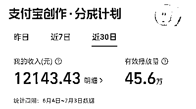
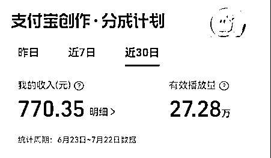
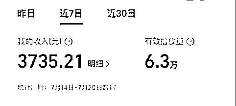
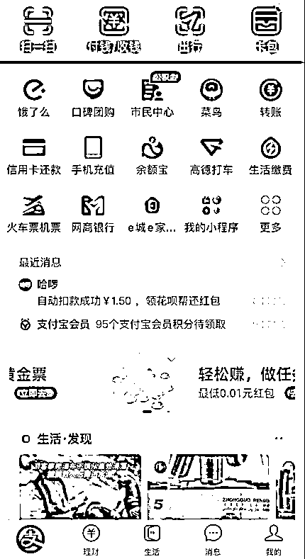
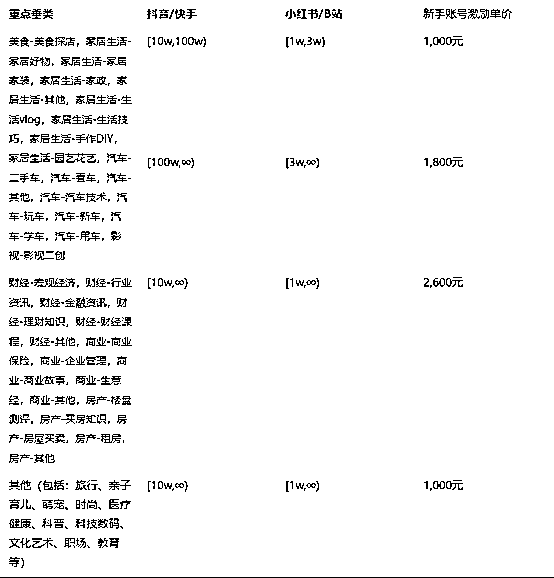
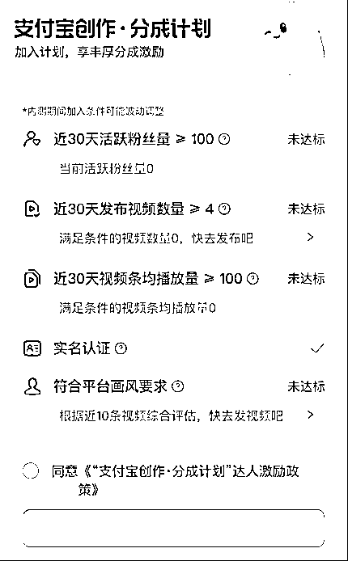
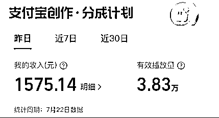
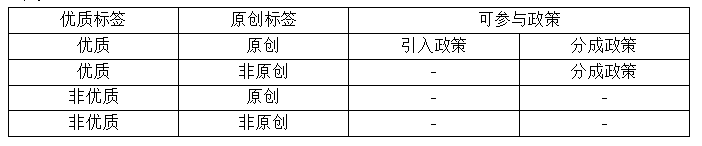
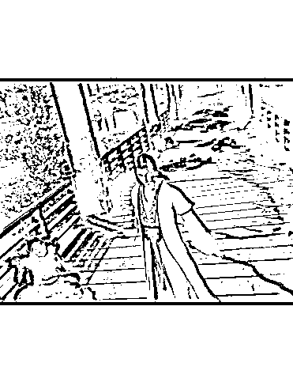
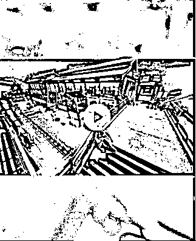

# 支付宝生活号分成计划从入门到避坑的实操拆解

> 原文：[`www.yuque.com/for_lazy/thfiu8/eah3eu9x4pkqds9k`](https://www.yuque.com/for_lazy/thfiu8/eah3eu9x4pkqds9k)

## 支付宝分成计划怎么玩、怎么避坑，实战全记录

作者：白丁  
日期：2023-07-31

《支付宝分成计划玩法实操详解，分享这个项目避坑玩法》

大家好，我是白丁，赚钱圈的新人。这是我在赚钱的首篇分享。2023年4月20号我加入赚钱，在赚钱有术里学到了不少干货，圈子里分享很真诚。这期内容原本是给比高老师高研社做的打卡作业，那边几千人都在跟进，也藏不住了。今天就把我最近做支付宝分成计划的实操路径和踩坑经验完整摊开，希望对想入局的朋友有参考价值。

我会围绕下面这几个核心展开：

1. 为什么现在要做支付宝生活号
2. 现在在支付宝掘金的几类人群
3. 收益开通条件的具体解读
4. 账号单价为什么差距巨大以及如何拉高单价
5. 普通人如何在生活号里变现，怎么搬运起号、开通后如何养号
6. 封面怎么弄，哪些封面会直接导致申请失败
7. 内容上的雷区有哪些

一、为什么要做支付宝生活号

新平台起步期基本都是混沌期，审核相对宽松，只要不触红线基本都是放养。这个阶段就是最佳的窗口期，也是薅收益的黄金期。眼下主流平台的创作者分成已经跌到冰点，没有强内容生产力很难吃到肉，这个时候支付宝出现一个高单价的入口，就很值得去试水。

目前主要流量口还是支付宝首页，但别忘了阿里系还有优酷、大鱼号等内容阵地，未来如果流量互通，对生活号是降维打击式的利好。提前占位，把坑占住，后面让时间发酵。

支付宝生活号其实上线很久了，之前一直没放量。

  

大家最早注意到这个号，大概也是因为这一张图在传。万次播放266元的单价让人心动，之后做流量的博主开始集中推项目，这个项目才真正火起来。实际上这个单价还算保守，我们自己在跑的号，单价从几十到几百都有。

  

不同账号单价差异巨大，后面会专门讲评级逻辑，方便大家在实操中主动提升单价。

二、现在做支付宝生活号的三大群体

支付宝生活号入驻零门槛，打开支付宝底部“生活”入口完成资料完善就算注册了，版本没更新的先升级一下就能看到。目前在上面赚钱大致分三类账号：

  

1. 个人号
有实名支付宝就能开。刚开号是没有分成权限的，需要满足5个条件后才能提交申请。还有一种情况是已有粉丝基础的个人号，可以通过MCN提交。只要在抖音/快手有10W粉，或知乎/小红书/B站有1W粉，内容质量不算低，通常都能拿到分成权限。想走这条路可以联系我代提交，审核通过后发片即有收益。

  

2. 企业号
入驻规则和分成规则跟个人号一致。区别在于企业号可以申请成为生活号MCN，通过后能签约达人拿拉新收益和分成，而个人号没这个权限。

3. 生活号MCN
申请MCN必须是企业主体，经营年限一年以上，一年内无违规，且至少有5个达标账号或5个账号作为背书。MCN的权益非常高，有拉新奖励和达人分成。现阶段通过的MCN很少，支付宝对MCN管控很严，一旦通过就是第一批吃红利的机构，签约达人就能拿到拉新收入。[p.alipay.com](http://p.alipay.com)这是官方申请入口，官方钉钉号：30410015958。

如果符合MCN条件一定要去申请，这是真金白银的红利。另外个人有10W粉抖音/快手或1W粉小红书/B站/知乎的朋友，也可以找MCN提交开通收益，单价参考近10条视频的质量评级。

三、开通收益的五项硬性条件拆解

个人号做分成计划，必须同时满足以下五点：

  

1. 近30天活跃粉丝≥100
这个看起来简单，实操最难。生活号本身用户基数小，发片播放极低，粉丝很难自然增长。这里说的100粉是活跃粉，不是单纯粉丝数。也就是粉丝要真的看过你的生活号内容。我们测试后跑通了补量的方式：先发3条视频，再开始刷粉，粉丝关注后让它刷一下你的视频，或先看再关注，这样就形成活跃。但支付宝能识别批量刷粉，提交“立即加入”进入审核时，一次性刷粉很容易被拒。7月20号前还不严，之后升级了。我们现在的做法是控制节奏，一天不超过15个，分几天刷并且让刷来的粉去看新发内容，这样通过率会高很多。多久会失效看平台。

2. 近30天发布视频≥4条
这一条很轻松，不赘述。

3. 近30天视频平均播放≥100
同样容易完成，硬怼数量就行。有个技巧，如果发了十来条平均被拉低，去掉那条拉低均值的视频即可。

4. 实名认证
需要刷脸，所以最好用自己或身边人的主体。实名也关联提现，选主体要慎重。

5. 符合平台画风要求
这是最大的坑，很多人卡在这里。画风包括标题、版权、内容质量、封面、垂直度等，分成申请前必须严格对齐。参考标准链接：[https://www.yuque.com/mayan-6kuum/cz8y3u/ikpa7rb643kaz7cn](https://www.yuque.com/mayan-6kuum/cz8y3u/ikpa7rb643kaz7cn)

我们也是不断试错，把封面和内容优化到位后，申请通过率明显提升。

四、为什么账号单价天差地别

  

上面两个号单价一个411一个28，这种差距在别的平台几乎见不到。支付宝生活号的单价由领域+评级共同决定，领域和评级不同，单价直接拉开。

  

从表上能看出，高单价基本都是优质原创。我们总结影响单价的关键因素有：

1. 有效播放量
2. 内容质量：垂直度、画面清晰度、解说与画面匹配度
3. 完播时长
4. 账号价值：即生活号内部评级，看不到，只能靠单价反推

基于这些指标，我们给视频制定了统一标准：

1. 时长 1-5 分钟
平台要求15秒到15分钟。实测太短几乎没收益，低于1分钟单价暴跌。1-5分钟是性价比区间，太长制作成本高。

2. 封面是申请分成的重要分
支付宝对封面极度敏感，封面不合格直接导致申请被拒。无论横竖屏，都不能模糊、有黑边白边、元素遮挡主体。封面细节后面单独讲。

3. 领域垂直
越垂直标签越清晰，账号估值越高。

4. 内容质感
目前主做二创，分辨率至少720P，单视频内素材不重复，水文解说不允许，文案要完整。去重时先用工具脱水印，再人工复核，严禁用水印、logo、站外名称。

想快速拉高单价，建议从二创入手。二创做精也能拿到高单价，素材源自抖音、快手、视频号、B站、YouTube还很充足，现在做的人不多，判重风险低。

五、普通人如何入局，搬运起号和开通后维护

原创是长期正道，但没原创能力也能玩，只是要承担风险。我们早期试过一批搬运号，达标后申请分成也能过。

搬运也有技巧：别搬大V，粉丝量大覆盖面广，容易被粉丝举报导致封号。找10W粉以下、内容质量符合要求的小号，把头像、简介、内容整体复制过来，粉丝会误以为博主入驻了生活号，相对安全，直到开通分成。

开通后立刻换皮：把头像、简介换成自己的，把之前搬运内容隐藏。因为是借壳起步，不换皮迟早爆雷。换皮后发布自有原创或二创，既能快速通过审核，也能避免后续被封。

支付宝对搬运打击很重，一经举报核实直接封号。当前方法仍可用，但何时被限服无法保证，可能明天，可能一直可用，全看平台。

六、封面怎么设置，哪些封面会失败

封面看起来小事，我们实操发现支付宝对封面卡得极严，封面问题会直接导致分成申请被拒。下面是我们的经验。

封面结构：背景+主体+元素
  

这是一张标准的探店封面。背景是人物后方，主体是人物+火锅，元素是白色大字“表情武汉zui辣？和今天来汉江路啦~”

生活号要求主体清晰，不能用杂乱图。视频分横屏4:3和竖屏3:4，按素材比例做封面。

我们的封面自检标准：

1. 素材不佳的单独重做
2. 主体明确
3. 清晰不模糊
4. 封面与内容相关，无商品属性
5. 无黑边、虚化背景
6. 文字贴纸不遮挡主体

  

带黑边、虚化背景的封面都不合格。很多人习惯用系统推荐一帧，如果素材不满屏，就必须单独制作。用美图秀秀或稿定设计简单处理即可，满屏且相关即可。

封面别偷懒，偷懒结果就是申请被拒和单价受损。

七、内容雷区清单

部分内容没有“平台可推荐”标识，发出去就是沉没，还容易降权。

  

  

不推荐类目整理如下：

减压类、水文拼接、纯图文视频、画面重复
过期旧闻
PPT类
低俗擦边：小三、出轨、婆媳、地域挑拨、身体擦边
民族冲突
画面不适：挖耳屎、挤痘痘

这些内容不符合平台调性，不要碰。

总结补充：当下我们更倾向二创或原创，能拿高单价且可持续。搬运迟早被举报。支付宝对探店领域是重度扶持，探店博主建议优先入驻。

推荐领域：探店、美食、好物、手工、萌宠、科普、家居、三农、数码、育儿、旅行、汽车，这些都符合平台调性。

做号细节：重视封面，电脑端发布[sweb.alipay.com](http://sweb.alipay.com)可自定义封面。画质至少540P，模糊会被判定非优质内容。开通分成后不要大批量搬运或发低质视频，平台会不定期巡查，低质会降单价甚至清退分成。

心态放平稳，生活号用户基数小，两位数播放很正常。一旦爆一次收益很可观。最近爆文频率明显提升，播放也在回暖。现在就是跑马圈地占坑，等待爆发。

以上就是全部分享，希望对正在做或准备做支付宝生活号分成计划的朋友有帮助，有问题欢迎交流。

评论区：

白丁 : 全文 5000 多字希望对大家有帮助 Alex : [强][强] 阿聪 : 想问下 一天发几条[呲牙] 白丁 : 不要超 10 条 阿聪 : 谢谢 文少 : 感谢分享 梦宸 : [强][强][强] 龙哥 : 感谢分享，已加精华。

