# 老板们注意：凭什么有的公司 90 天就能把业绩干到三倍？

> 原文：[`www.yuque.com/for_lazy/thfiu8/lfna3q62v6gu1clf`](https://www.yuque.com/for_lazy/thfiu8/lfna3q62v6gu1clf)

## 精华梳理 | 用所有权+经营权双轮驱动，让业绩 3 个月翻 3 倍

作者：深圳刘宁培，人称宁老师，龙凤胎奶爸，常年全国出差。

主业是企业咨询，聚焦股权设计、企业经营管理与商业模式搭建。副业做点投资，偶尔开加盟店，年底还跑线下摆摊卖红包对联。

赚钱有术二期至今的老成员，编号1748。我的内容生态位一直钉在股权设计与股权激励上，已连发三篇精华帖：

① 初创期股权避坑：[https://t.zsxq.com/fyNbAuR](https://t.zsxq.com/fyNbAuR)

② 股权顶层设计：[https://t.zsxq.com/UBqVvjU](https://t.zsxq.com/27eqV7A)

③ 股权激励：[https://t.zsxq.com/05iMB2Zfu](https://t.zsxq.com/05iMB2Zfu)

之所以长期做股权，是因为股权依托公司法，落在公司所有权层面。薪酬绩效管理属于经营权层面，老板还能微调；一旦股东间因股权起不可调和的矛盾，往往只能走法律途径，轻则业务重来，重则公司直接停摆。所以几乎每家公司都存在股权设计的刚需。

近半年服务过的赚钱圈友，包含龙哥、谢无敌、盖哥、刀姐、任佳伟、马超、陈亚东、旭教练、刘子荣、高夫人、林蔷七、七小等一批朋友，还有好几位年利润千万级别的大佬。

虽然主打股权，但薪酬与管理部分也常同步交付。

下面这篇，我拆解一次实操案例：我如何通过所有权层面的股权激励，加上经营权层面的薪酬管理，助力@谢无敌老师的闪亮猫传媒在短短 3 个月内，主营业绩直接翻了 3 倍。

先简单介绍谢无敌老师：

1. 闪亮猫传媒创始人，靠小红书矩阵为自家家居品牌导流变现超 2000 万；
2. 小红书实战营带练导师，已孵化美食、职场、设计、艺术、宠物等多赛道 IP，冠军学员最高变现 600W+；
3. 【谢无敌的红书宝】知识星球主理人，深耕小红书运营，已帮 3000+成员实现内容变现。

交付范围涵盖 9 大模块：股权设计 16 大坑、股权 7 大模型、股权顶层设计、三会一层、分子公司、组织架构、薪酬绩效、管理三步走、toC toB to 投资人。

我的交付方式比较直接：客户先把所有卡点问题整理好，100 条 200 条都行，先听我按模块系统讲课。这 9 个模块基本能覆盖 90% 的问题，剩下的现场百问百答。

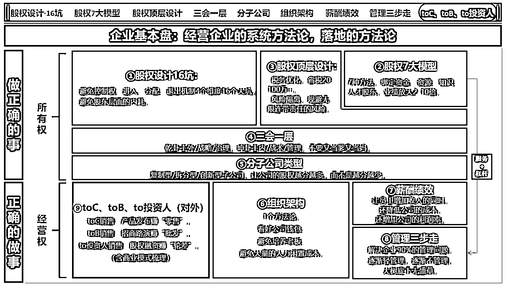

谢无敌老师落地后的变化：

（1）个人工作量直接降了 60% 以上；
（2）到 7 月份，闪亮猫传媒核心业务业绩翻 3 倍；
（3）腾出精力操盘绘素坊新项目，新项目月利润已达 7 位数。我也参与了这个项目，目标年底把月利润再翻 3-5 倍。

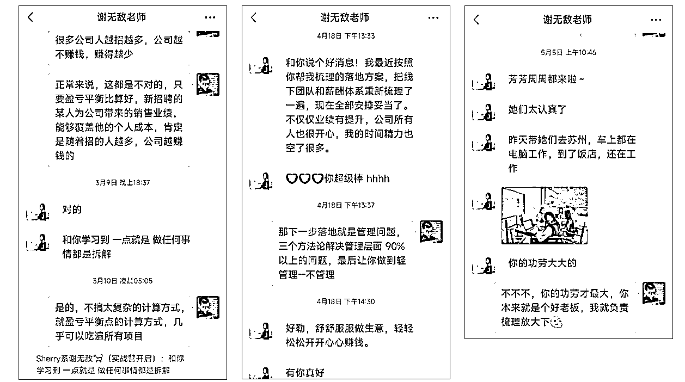

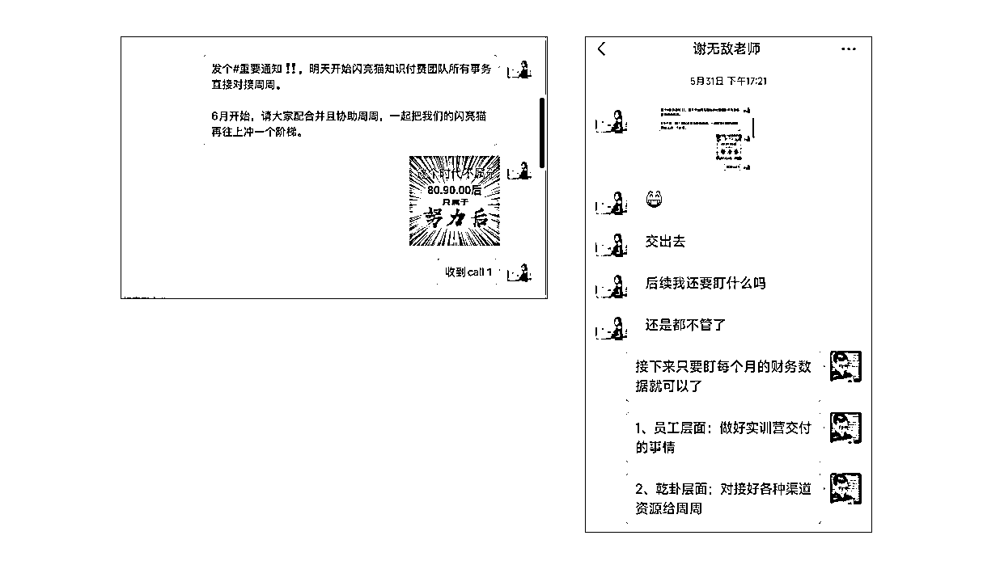

### 一、她当时最痛的三个点

今年 3 月找到我，想解决的核心困局大致是：

1、团队人不少，她却更累；
2、事事亲力亲为，团队极度依赖她；
3、她不盯，工作环节就乱，业绩增长慢。

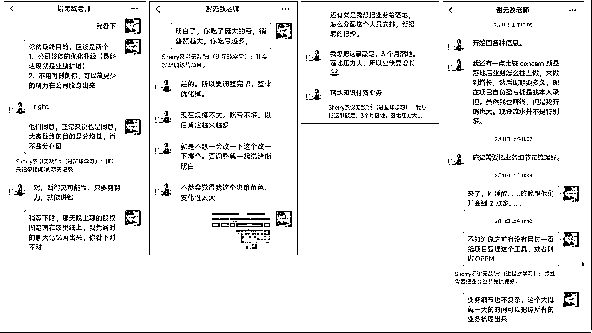

### 二、经营权打法一：组织架构从交叉到垂直

交付时她手上主要是 2 个核心产品，后来扩展到 4 个。

产品①：知识星球社群
产品②：商家实战营课程

原团队负责这两个板块的人，职责重叠、互相交叉。结果就是大锅饭、责权利不清、互相推诿，论功行赏也说不通。

于是我把闪亮猫的组织架构重新拆了。

#### 2.1 先看清钱包，再做部门垂直拆解

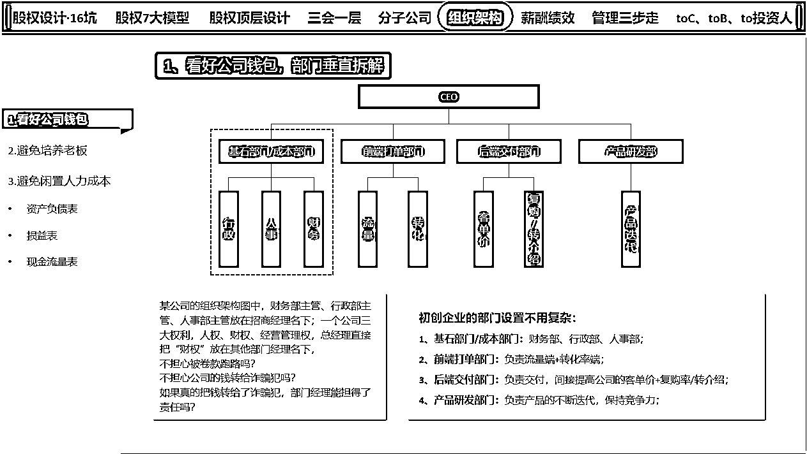

初创企业别搞复杂部门：

（1）基石部门：财务、行政、人事；
（2）前端部门：负责获客和转化率；
（3）后端交付部门：负责交付，提升客单价、复购、转介绍；
（4）产品研发部门：负责迭代，保持竞争力。

知识付费团队被拆成 3 个独立部门：

部门① 前端-流量：负责在小红书、抖音、知乎、视频号、公众号等平台种草获客。考核获客数，如每月 1 万公域流量导入私域。
部门② 前端-转化：负责把流量成交到星球或实战营。考核成交率，以收钱为结果。
部门③ 后端交付-提升 LTV：负责星球/实战营的活动运营、内容运营、培训交付。

重构后，谢无敌老师的角色从老板变身交付板块的一名员工，专做直播交付、答疑、上课，接受 CEO 管理，考核退费率、投诉率、客户满意度。

三个部门职责清晰，磨合后不再重复，避免大锅饭和扯皮。

#### 2.2 避免人力闲置浪费成本

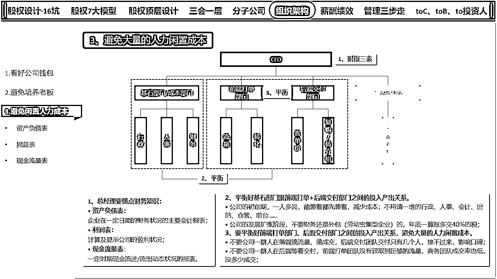

（1）总经理要会看三张表：
· 资产负债表：公司在某时点的财务状况；
· 利润表：公司盈利情况；
· 现金流量表：现金流进出动态。

（2）平衡基石部门与经营部门的投入产出：
· 初创期一人多岗，先兼着，减少成本；
· 扩张期别还用外包财务做劳动密集型企业，年底多缴 40% 税。

（3）平衡前端与后端的人力配比：
· 别前端一堆人做流量，后端几个人忙不过来，口碑崩了；
· 别后端一堆人在等交付，前端没流量、成交率低，人白养着。

谢无敌是特许金融分析师，财务一点即懂。核心是动态平衡前端与后端。

流量方法论升级时，及时沟通转化和交付的人手是否够用，需不需要招人；转化率提升时，也要同步扩充后端运力。

作为 CEO，要看懂三大报表。前端与后端工作量保持 10-20% 不平衡是正常的，大家偶尔摸鱼。但如果因看不懂报表导致前后端不平衡超过 40%，要么流量浪费，要么后端闲置，都是人力成本的直接亏损。

### 三、经营权打法二：薪酬与绩效

#### 3.1 薪酬设计

不同部门需要不同薪酬模型，常见有：

（1）奖金包；
（2）纯佣提成/阶梯提成；
（3）底薪+奖金+提成。

闪亮猫前端流量、转化团队和后端交付团队，均采用底薪+奖金包+纯佣提成+行为指标考核的组合。

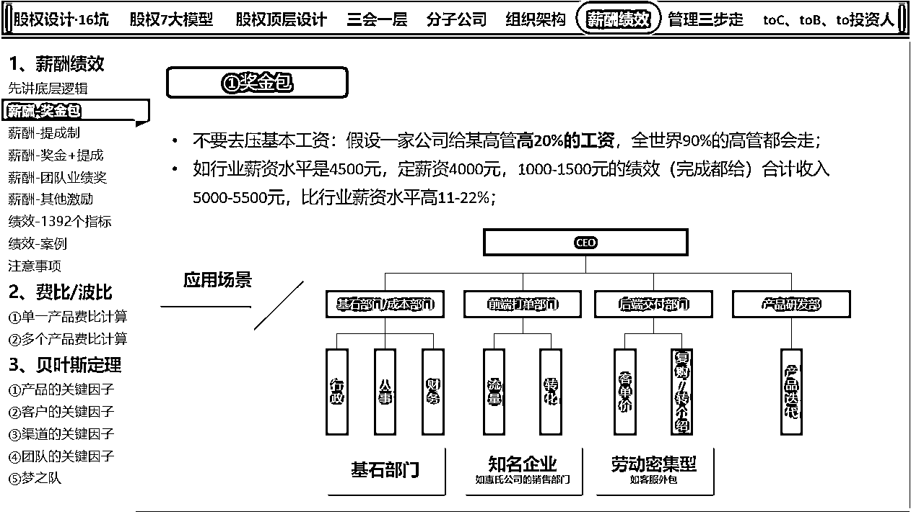

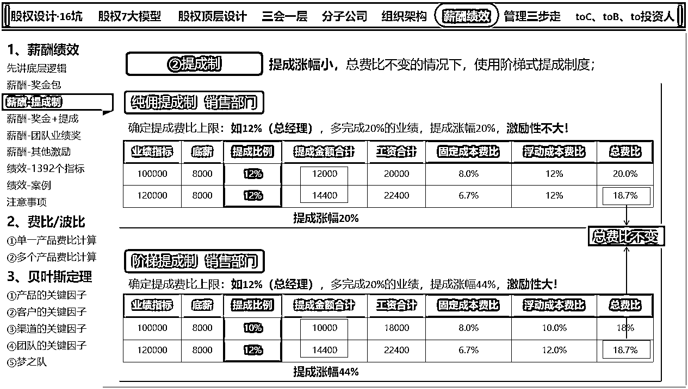

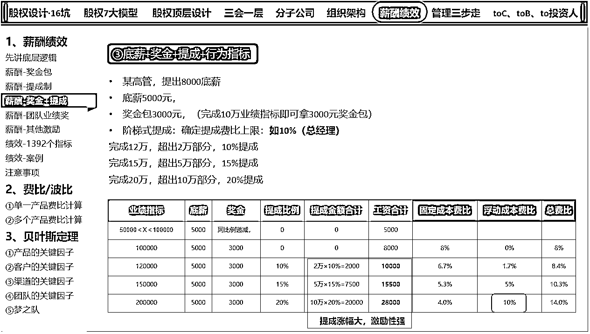

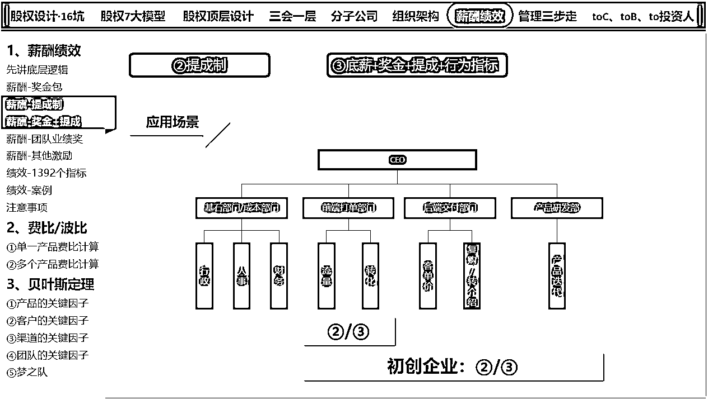

#### 3.2 绩效设计

我手上有一套 KPI 指标库，覆盖各部门行为指标 1392 条，可按需领取 lnp266

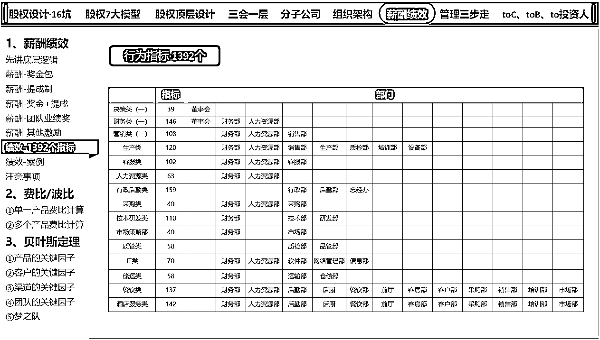

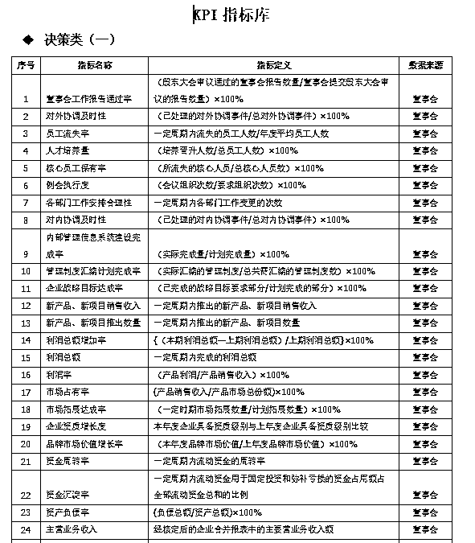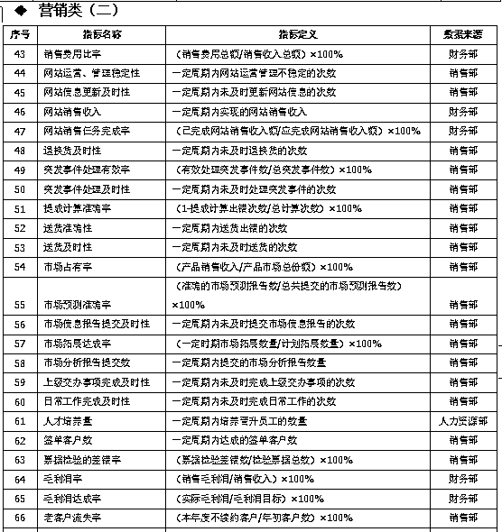

绩效底层逻辑是多快好省新。为闪亮猫团队定制的考核就是围绕这个方向。

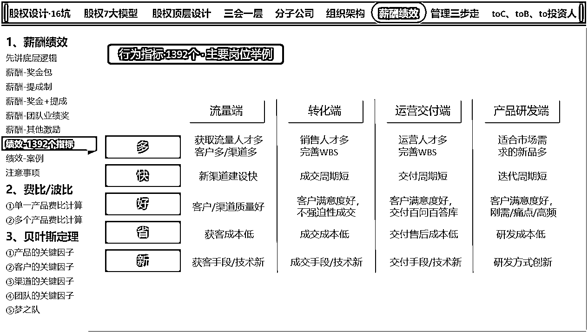

注意几个坑：

（1）考核项控制在 3-7 条，见过 60 条的绩效表；
（2）单项权重不低于 10%，太低没意义；
（3）绩效里别塞老板满意度占 50%，会养出一堆马屁精。

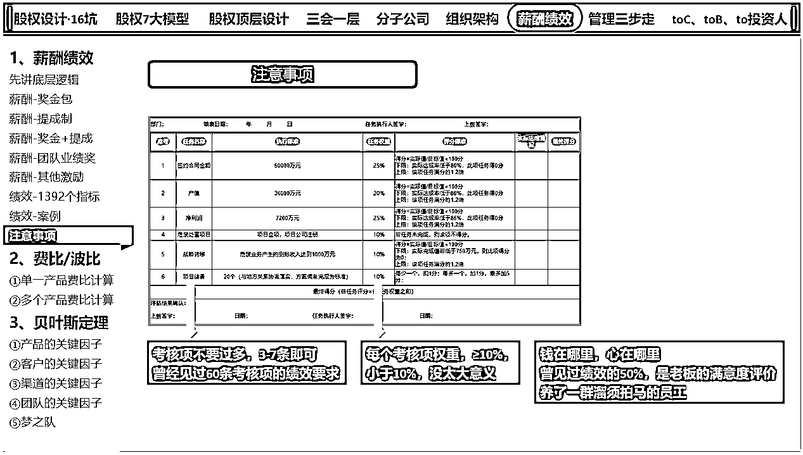

#### 3.3 薪酬绩效的核心是共赢

有人担心员工拿得多就不安分，或薪酬绩效就是用来克扣的。我们的逻辑相反：薪酬绩效是为了共赢而设计的。

通过财务测算，先算出公司、部门、个人的盈亏平衡点，再把增量市场一起分。固定成本不变或微增，销售额上去，费比下降，利润自然上涨。

闪亮猫本身不做盈亏平衡测算。新启动的项目则必须算清：什么销售额才能养活几十人团队，陆家嘴的房租可不便宜。

先算盈亏平衡点，再算保利点。

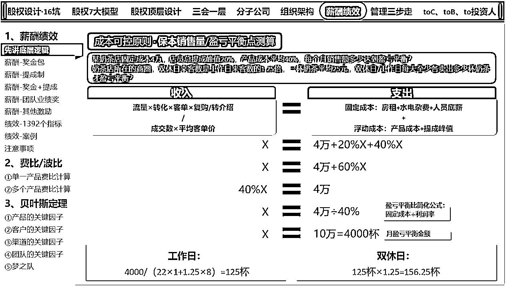

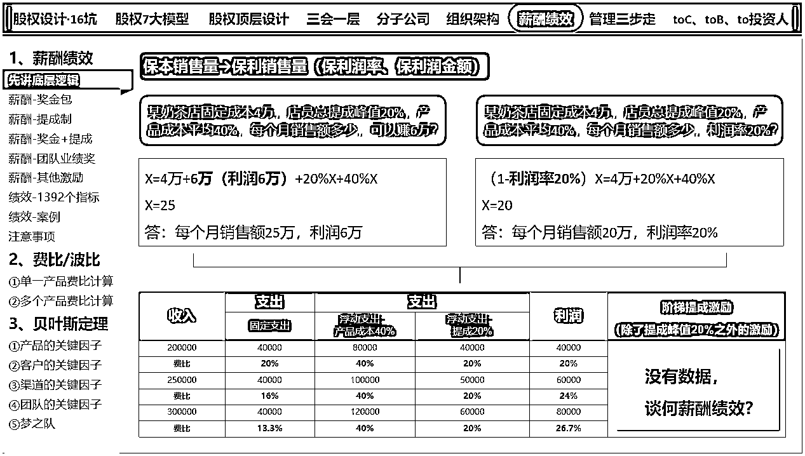

### 四、经营权打法三：管理三步走

#### 4.1 垂直化

每个部门只干垂直的事。人效最高、不扯皮、新人上手快。

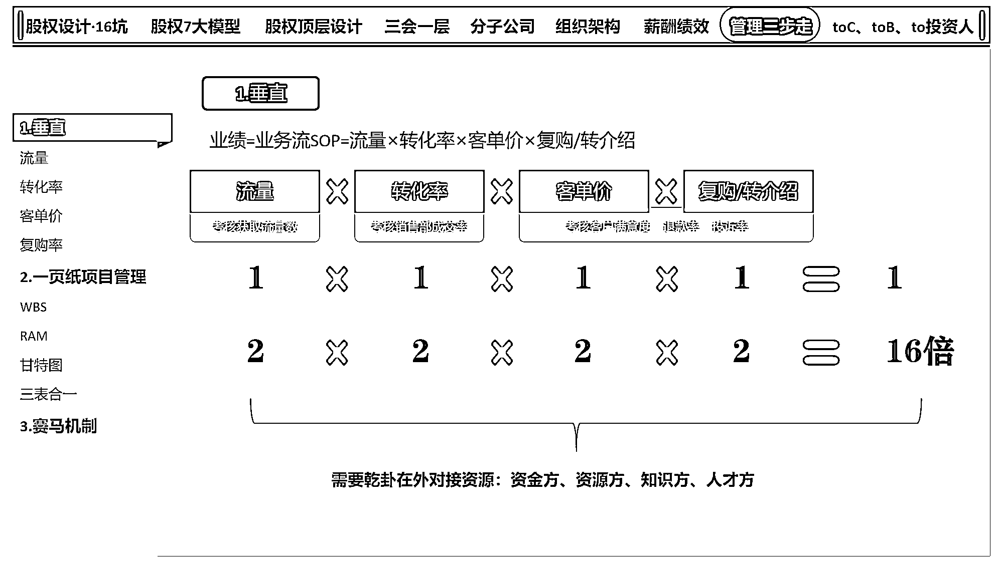

#### 4.2 一页纸项目管理

流量、转化、交付三大部门的关键结果、时间节点、责任人全部列在一页纸上。

月度动作基本固定，周会月会就是拿这张表复盘。运营迭代时，事件增减就同步更新表格。

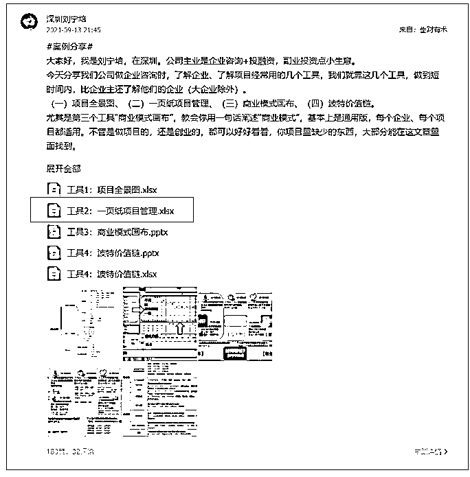

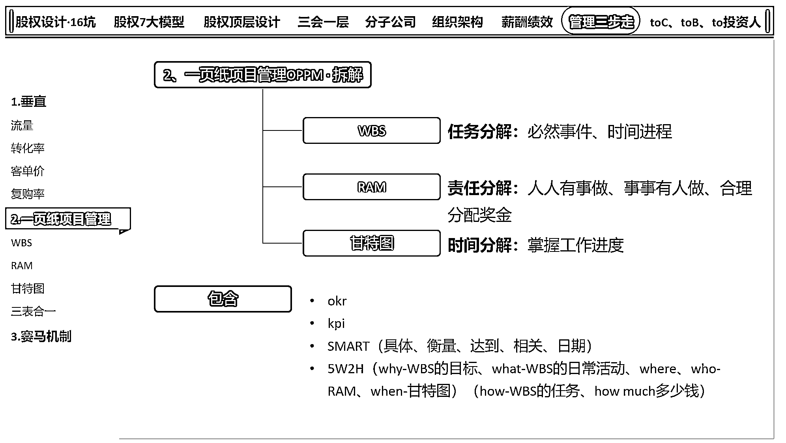

表格模板参考：

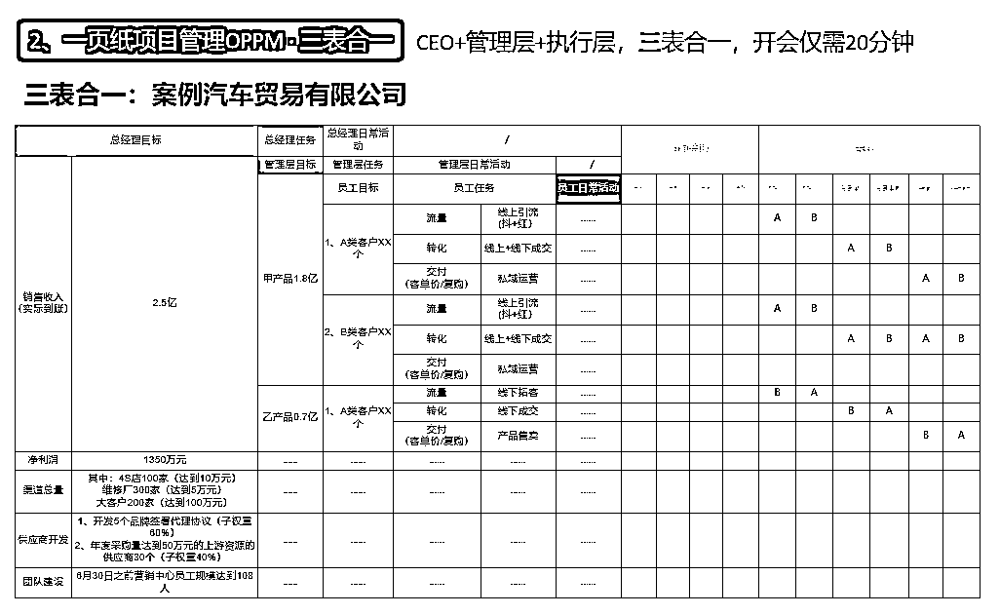

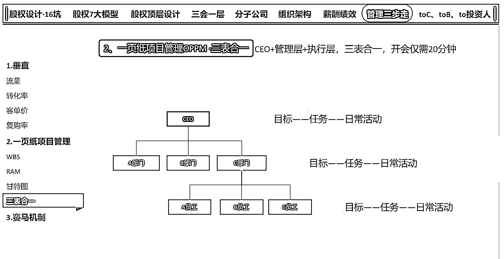

#### 4.3 赛马机制

马云说过，员工离职多是钱没到位或心受委屈。

用合理的薪酬绩效让钱到位，用垂直+一页纸让责任清晰、过程不内耗，让员工心不委屈。

当公司做到不亏待人，就有底气启动赛马机制：能者上，持续犯错不改者让位。

### 五、所有权打法：股权激励与角色清晰

谢无敌老师的终局不只是小红书知识付费，还与鹏老师一起经营绘素坊集团的东方家居设计。

因此在闪亮猫，她的定位调整为执行董事，负责外部资源对接：资金、资源、知识、人才。公司的 CEO 是另一位合伙人。

3 月 24 日在龙哥大哥办公室，我约了闪亮猫的两位股东和未来的 CEO，聊了四件事：

（1）绘素坊集团的整体战略规划；
（2）谢无敌在闪亮猫只做执行董事，CEO负责业绩；
（3）CEO不同业绩梯度对应的分红比例和年薪；
（4）现场答疑。

达成一致，双赢落地。目前 CEO 积极性极高，并带着团队迁至杭州办公，团队拧成一股绳把业绩做大。

以上是我这一次复盘，希望对你有帮助。如果你也有经营上的卡点，欢迎聊聊。

评论区：

菜菜—-福鼎白茶批发* : [强][强]将来再做团队，🈶️股权架构，员工激励一定找宁老师帮忙设计。逻辑清晰，架构清楚[强] 书情小跟班 : 触及到我知识盲区了，这篇文章值得多看几遍啊 七小 : 宁培哥 yyds 嗡嗡嗡起 JoyBoy : 宁老师方便➕个好友吗？想了解一下 Sherry💎谢无敌 : 终于可以成为学生了[害羞]在创业路上一直都是学生。 心想事陈 : 刘宁培老师，想链接下你，怎么加你 深圳刘宁培 : OK，lnp266 深圳刘宁培 : ok，lnp266

