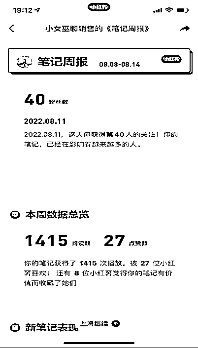
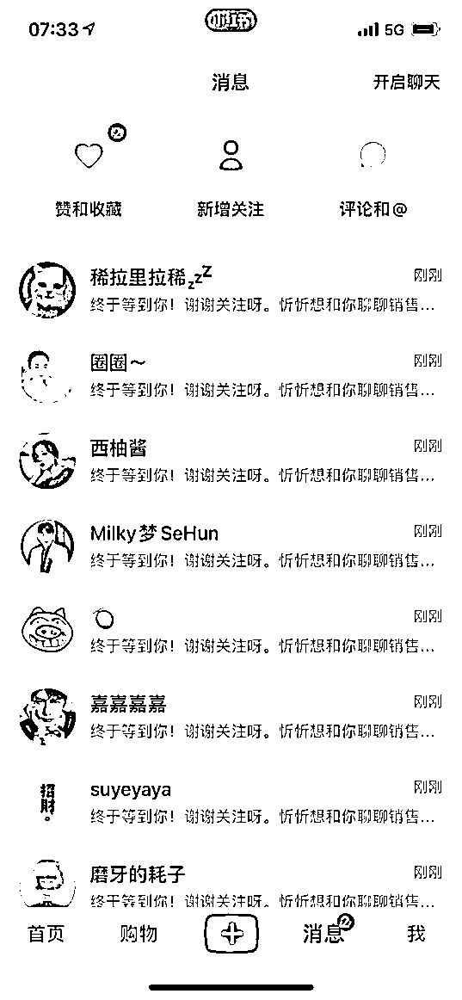

# ('从视频号的失败到小红书的成功，如何调整心态并找到最适合自己的赛道？', (2, 35))

有人把赚钱比作一所实战型商学院，这话我越品越觉得有道理。毕竟，课是平台给的，路却要自己一步步走出来。我是忻忻，主业在一家外资银行做销售教练，副业嘛，其实还是销售教练——只不过服务对象换成了其他银行和保险行业的伙伴，帮他们啃下大单。算下来，我做自媒体也差不多一年了，赚了不到15万。和大神们比，这数字实在普通，但看看我每天只投入不到一小时，这个回报率，我心里已经很知足了。

说实话，我是去年才加入赚钱的。在这之前，我从没想过副业可以有这么多玩法，总以为要么做微商，要么正儿八经开公司。是赚钱让我开了眼界，也让我有机会认真复盘自己这一路。

很多人看到成绩时，总会觉得“运气真好”，但回头看看每一期航海，我才明白：一半靠偶然，另一半靠的是我死磕到底的那股劲。

第一次航海，我不仅没赚钱，还倒贴了100多块。

刚加入赚钱时，我翻了几个月的帖子，却一分钱没赚到。但我也观察到，那些真正跑出来的新人，大多是先“把手弄脏”的。于是我心一横，也报了航海。

可新手犯难的是：航海项目实在太多，个个从零开始。说来不好意思，当时我连押金都抠抠搜搜，怕又被割韭菜，所以只挑了一个——大家都说视频号带货是风口，小红书已有人赚钱，抖音卷得不行，那就视频号吧。

结果惨不忍睹。我老老实实照着手册来，说要有两个号，我就去开了个副卡套餐，还不能按月买，直接包年。21天过去，一分没赚，反而赔了100多。

但我也没怨天尤人。我清楚，一个月就想靠运气暴富，那不是我的初衷。我认真想了想为什么不适合：选品太耗时，剪辑我没基础，重新学这些性价比太低。我得找个更能发挥我已有经验的赛道。

于是，我把目光转向小红书。它的用户群跟我太契合了，女性为主，尤其是我平时培训的理财经理，一线二线城市、有购买力、工作压力大爱刷小红书解压。这不就是天然的目标客户吗？

第二次航海，我坚定地选了小红书。

不过，我的小红书没有一夜爆红。刚开始只有40个粉丝，网感也差，封面标题都不出彩。我硬着头皮发了十几二十个视频，小眼睛几百，点赞个位数到十几。但小红书对新人还算友好，哪怕数据一般，粉丝还是在慢慢涨。

我这个人容易被正反馈驱动，涨几个粉就乐呵呵继续干。关键是我有十几年销售培训经验，录个一两分钟的视频，最笨的时候也就花十几分钟，熟练后十分钟内搞定。投入不多，还有涨粉，我知道自己选对了。

21天航海结束，我第一次突破1000粉。虽然没变现，但已经很开心。后来我慢慢发现，不能只涨粉不引流，否则就是自嗨。复盘时我请教了芷蓝、靠谱等大咖，才明白问题出在话题太泛——销售赛道太大，我这点粉丝体量讲泛话题根本出不来。得抓住垂直人群的痛点。

于是我改变标题策略，专攻理财经理最难搞的保险和基金。效果立刻来了，点赞轻松破200，最爆的一篇小眼睛6000多，点赞收藏都是400多。我终于尝到了小而美话题的甜头。

找到精准用户后，我开始从公域往私域转。

那时主动咨询的人还不多，我就按航海手册和圈友经验，主动私信关注我的人。这个动作，慢慢帮我沉淀了一部分用户。粉丝过3000后，私信来不及一条条发，我就建了红薯群。不过引流数据真拿不出手，做了一年，只引流了191个人。

好在我的转化能力还行——转化率50%，30个私教学员、90个知识星球用户、50多个买课的，加起来给我带来了超过10万的纯利。

有人问我为什么连着报好几期小红书航海。我觉得，深耕一个平台需要氛围。如果你只想拿手册自学，一两期就够了。但大学里真正让我们受益的，难道不是那群同学和实践吗？航海也是同理。多待几期，网感养出来了，标题怎么写、标签怎么打、怎么吸垂直用户，都慢慢有了感觉。而且，当你专注某条路后，之前纠结“选哪个航海”的毛病自然就治好了。比如我后来发现朋友圈文案会影响成交，就又去上了朋友圈航海。这时候的航海不再是任务，而是有选择权的选修课。

最后分享几点心得：

第一，别把粉丝当学生，当路人。路过的第一件事是吆喝，不是递说明书。

第二，内容一定要垂直。别指望所有人都关注你，泛粉很难变现。

第三，先小范围卖产品，验证需求，再迭代新品。别自嗨式开发。

如果你一两次航海没跑出成绩，先想想是不是期待太高，或者赛道本身不适合你。如果赛道不累，只是暂时没结果，那就多给自己点耐心。航海可以一期接一期续下去，一期不行就两期，半年不行就一年。算下来成本几千块，换来的却是商学院给不了的财富。

我是金融出身，习惯算账：哪怕报两期赚钱，也不过是一年大学学费，却能学到EMBA都给不了的东西。把预期放宽点，结果反而来得更快。我当初给自己两年时间，结果两三个月就有起色了。相信再过一年，我一定比现在更好。一起加油吧，我们都没什么天赋，只是多了点努力和愿意学习的心。

