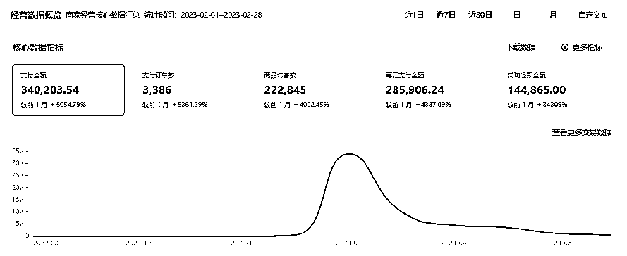
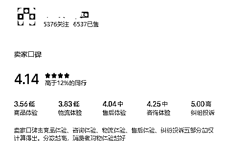
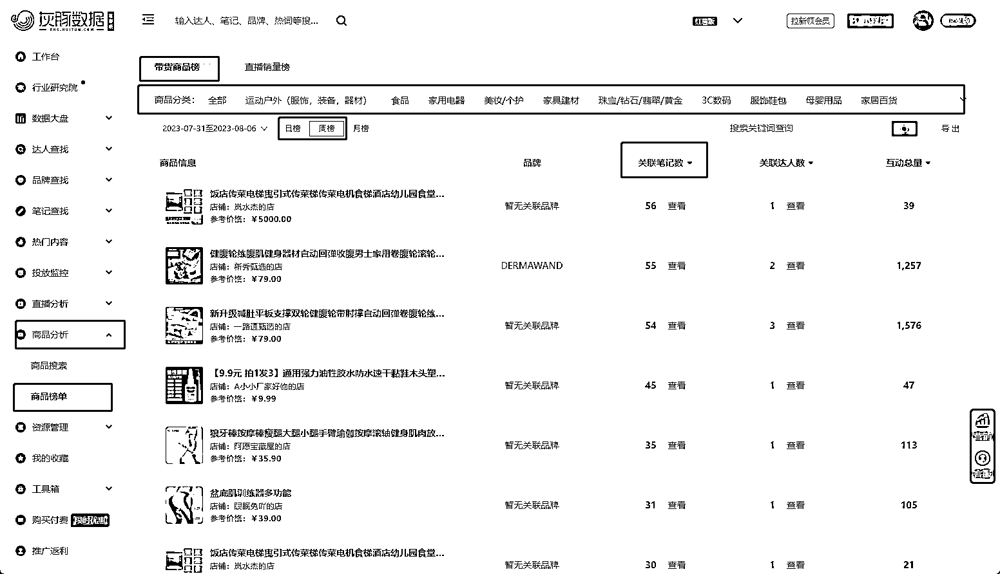
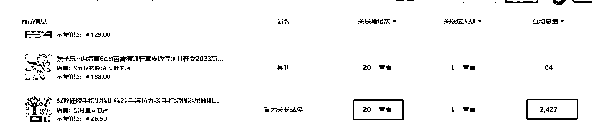
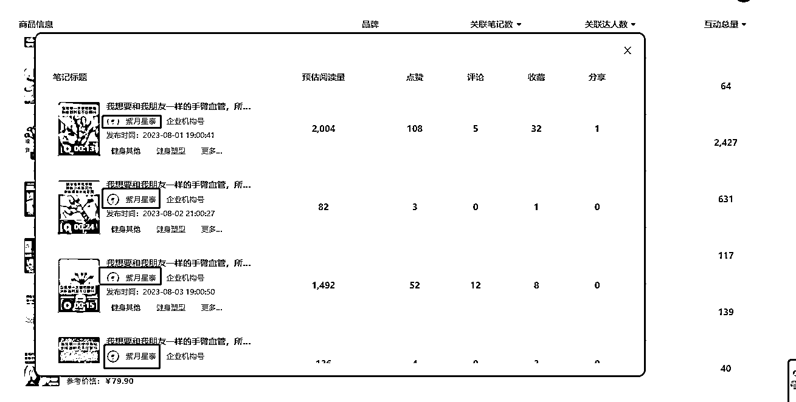
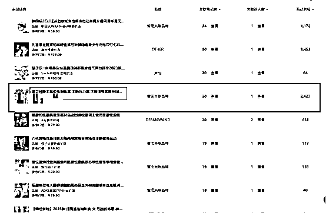
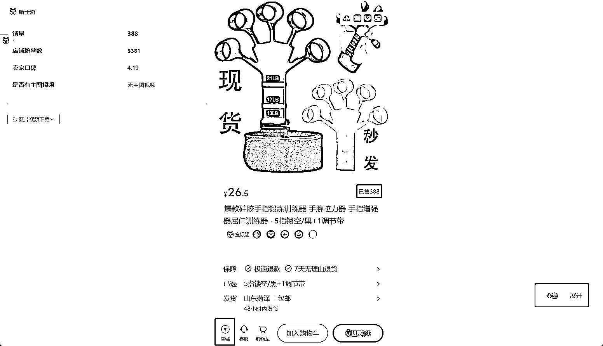
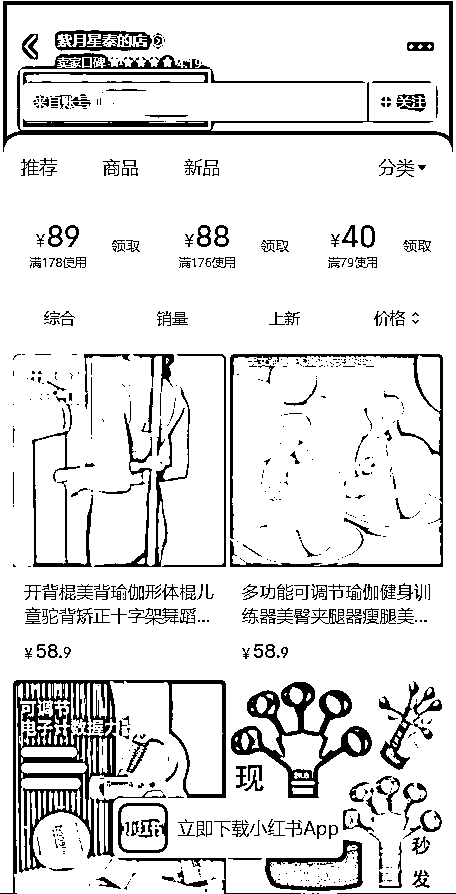
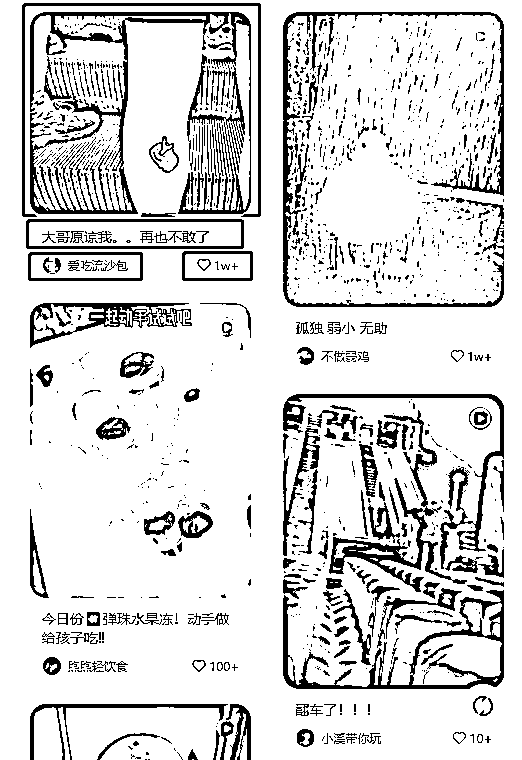
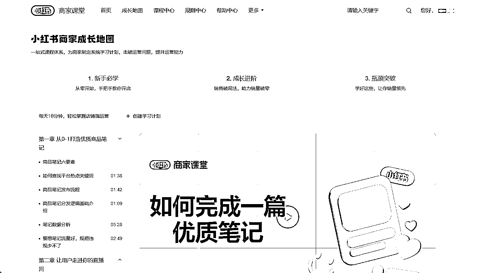

# 小红书店铺选品与内容爆款：一套反向打法

内容来自赚钱有术的分享

作者：表弟
日期：2023-08-09

大家好，叫我表弟就行。本人90后，老家在宝鸡，现在西安工作生活。手上的业务主要是淘宝和小红书，最近还在研究视频号以及抖音带货，西安同城的伙伴欢迎交流。

中学时家里有台打印设备，我把历年高考原题和答案整理成册出售，卖出300多份，赚了3000多块。18岁当天去银行开户，顺手开了人生第一个淘宝店。2014年毕业开始做日用消费品销售，第一年就达成了10万年薪。

2019年辞掉工作做旅游，主营中高端定制和企业团建。为了和客户更亲近，我给自己取了个花名叫“表弟”。后来疫情来了，旅游彻底停摆，我摆过摊、做过小餐饮，最后都因为疫情收场。

2021年花钱学淘宝，月销售额做到1000左右。后来认识了老乡@佳境，他实地带我练了90天，我的日销稳定在1000多，月利润在1万-3万之间。

2022年底打算做小红书，报课后起了三个店，其中一个礼品类店铺每月能赚5000多。2023年初又开了女装店，运气很好，1月底上架，月底就开始放量，2月成交额34万，利润10万以上，短暂体味了一把高毛利。

之后成绩没保持住，但我一直在复盘，也试过很多类目，踩了不少坑。后来经佳境推荐进了赚钱，参加了小红书的航海计划、续航和再续航。

下面聊选品和爆款内容，希望对你有用。

一、选品：数据工具比电商渠道靠谱

选品有两条路：数据工具选品和电商渠道选品。数据平台常用蝉妈妈、考古加、灰豚。

新手建议从数据工具入手，今天只讲这个。电商渠道直接选品容易让人跑偏，没看过几千款商品，很难建立选品意识。

我现在主要用灰豚的小红书数据工具，淘宝买会员一百多一个自然月。其他平台也可以用相同逻辑。

打开灰豚工具，先进入选品数据模块，再打开热卖榜，选好类目，切换日榜或周榜，然后用“关联内容条数”排序。

比如看到一款手指锻炼器，点开“查看”，看关联内容是商家自营账号发的，还是达人分销。如果是达人分销，复制意义有限。

确认没问题后关掉，继续。点击标题进入产品页面，看成交数量，超过100单的可以加入备选。

接着点页面左下方的“店铺”，进店铺首页，按销量多少排，还能看到这个商家在做的其他商品，顺便扩展选品库。再点顶部的“来源账号”，打开博主的主页，先看粉丝量，越少越理想；再看最早那条内容，把出现频率最高的封面存下来，后面写笔记时做参考。

这套逻辑和主流相反。大多数人选品看互动量，我反过来：

1、以内容条数多少倒序，挑互动超过300的（不到300也可能是潜力款）。条数越多，说明这个账号正在全力推，平台也会把它当新品。
2、详情里看成交量，1000以内的还没大爆，竞争不算太激烈。
3、看博主的粉丝体量。头部博主起一条内容的基础数据是你账号的几倍甚至几十倍，照着模仿意义有限；真想学也可以，他吃肉你喝汤。

二、爆款内容：封面是核心

一篇笔记有六个要素：封面、图片或视频、标题、正文、话题、发布时间。但在发现页信息流里，用户只能看到四项：封面、标题、博主昵称、点赞量。

所以真正决定初始流量的就是封面和标题，封面的重要性约八成，标题约两成。

封面是第一个门槛。选品时我习惯保存同行使用最多的封面，二创后再用，不要原图直出，否则笔记爆了可能被投诉。

平台推荐逻辑是：展现-点击率不错-继续给展现-点击率再不错-再给展现，直到流量吃光。所以要先解决初始流量，也就是浏览量问题。如果基础展现一直卡在100左右，先检查封面和标题够不够吸引，再优化其他。

封面相当于淘宝的主图，点击率直接影响笔记权重和后续流量。

新号在标题、正文、话题里尽量带上商品核心词，系统会推得更准，也能顺手吃到搜索流量。

标题很好处理：找已验证的热门标题，换顺序、加表情、微调一下就能用。

视频前期别急着实拍，去其他平台下载种草视频，一定不要在小红书里搬运。按奇杰的混剪思路，把去重做好就行。到了中后期，可以在混剪里加入自己拍的片段，提高原创性。

话题就选产品相关且热度高的。

正文前期可以写短一点，让AI代写也行。内容越多，读者停留时间越长，完播数据更好，权重也会更高。

发布时机用预约定时发送，间隔一小时。后期根据数据表现，把内容集中在效果最佳的时段。

更新节奏建议一个号每天5-10篇，最多不超过20篇，避免被限流。保持稳定输出，让平台觉得你是认真在运营。

某款产品连续投放三天，每天1-5篇，看个人精力和素材量。推不动就换下一款，下一个更香。

不是应季的产品，笔记和商品链接都别删，让子弹飞一会儿，有时要过30天才爆。

电商没有太多秘籍，基础不好的去官方课程学，做好笔记定期回顾，多数难题能解决。

三、不囤货模式怎么防风险

不囤货模式平台很难彻底禁止，想尽量不被判定，注意以下几点：

1、远离拼多多。实在没货，可以找拼多多商家商量一件代发。
2、优先用1688的成熟代发服务。
3、不要一次上架太多商品，这是一种稽查信号。
4、选品时就在1688对接好货源，不要急着上架后再找。
5、遇到面单、短信、返现卡这类无货源投诉，能用钱解决就别省。

第4点最关键，这也是代发和不囤货模式的区别。

我自己的淘宝一直坚持先找好货源再上架，从没被扣过48分，也没被判过无货源。

不囤货玩家喜欢先铺货，等有订单再找货，找不到就下架。一次两次没事，次数一多就会被判定。

如果某款产品实在好，但暂时没货，可以先做15天预售，给工厂留足生产时间，也能降低自己的风险。国内几乎没有15天做不出来的商品，真爆了，直接找工厂定做也来得及。

建议做一张选品清单，提前算好利润，参照同行价格定售价，方便后续复盘和补单。

以上，仅供各位参考。

留言区：
- 西安的朋友@huii 冒个泡
- 西瓜：封面决定8成，先搞定小眼睛和初始曝光，再做选品清单做复盘。
- 淳蓝：怎么分辨商家自营号和达人的号？

