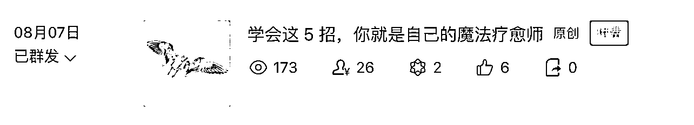

# 1000粉也能变现：我用这套打法把微信公众号付费文章做成高转化小产品

> 原文：[`www.yuque.com/for_lazy/thfiu8/awbpciwdk410zud2`](https://www.yuque.com/for_lazy/thfiu8/awbpciwdk410zud2)

# 低粉也能卖：微信公众号付费文章的实战拆解与心法

大家好，我是君儿。

今天把我做公众号付费内容的实操经验掏出来讲透。

我第一篇付费文章发出时，账号粉丝才刚过千。数据是这样的：173 次阅读，26 人买单。转化率接近15%，对一个小号来说我觉得已经很能打了。

如果你的基数比我大，同样的套路，收益只会更可观。下面是我总结的底层逻辑和使用方法，供做自媒体的朋友参考。

先聊聊为什么值得写付费文章。

最直观的，是能立刻产生现金流，一篇成型就能到账。

更深层的价值有两个。

第一，付费标签本身就是一种定价锚点。当粉丝看到你在卖，而且真的有人买，他们潜意识里就会给你的专业度打高分。这种信任感会顺着带到你后续更贵的付费产品上。

第二，付费文章本质上是最小单元的产品化训练。知道要收费，你对标题、对开头的每一句话都会更较真，被逼着去琢磨用户的决策心理，营销敏感度自然就上来了。

说到怎么写，我的经验主要分三块：选题、标题、免费部分的钩子。

一、选题：只选能戳中本能的点

付费内容别去满足泛泛的好奇心，要直击欲望和焦虑。

换句话说，就要贴近人最原始的驱动力。营销里常说的八大本能需求就是这个意思：活下去、过得舒服、延长生命、吃喝、远离恐惧痛苦危险、找伴侣、追求更好的生活条件、胜负心、守护家人、渴望被认可。

我那篇讲自我疗愈的文章，就是踩在生命安全和摆脱痛苦这两条线上。

二、标题：付费标识在面前，必须让用户想点

公众号的付费文章在列表里自带付费[content]
# 1000粉也能变现：我用这套打法把微信公众号付费文章做成高转化小产品

> 原文：[`www.yuque.com/for_lazy/thfiu8/awbpciwdk410zud2`](https://www.yuque.com/for_lazy/thfiu8/awbpciwdk410zud2)

# 低粉也能卖：微信公众号付费文章的实战拆解与心法

大家好，我是君儿。

今天把我做公众号付费内容的实操经验掏出来讲透。

我第一篇付费文章发出时，账号粉丝才刚过千。数据是这样的：173 次阅读，26 人买单。转化率接近15%，对一个小号来说我觉得已经很能打了。

如果你的基数比我大，同样的套路，收益只会更可观。下面是我总结的底层逻辑和使用方法，供做自媒体的朋友参考。

先聊聊为什么值得写付费文章。

最直观的，是能立刻产生现金流，一篇成型就能到账。

更深层的价值有两个。

第一，付费标签本身就是一种定价锚点。当粉丝看到你在卖，而且真的有人买，他们潜意识里就会给你的专业度打高分。这种信任感会顺着带到你后续更贵的付费产品上。

第二，付费文章本质上是最小单元的产品化训练。知道要收费，你对标题、对开头的每一句话都会更较真，被逼着去琢磨用户的决策心理，营销敏感度自然就上来了。

说到怎么写，我的经验主要分三块：选题、标题、免费部分的钩子。

一、选题：只选能戳中本能的点

付费内容别去满足泛泛的好奇心，要直击欲望和焦虑。

换句话说，就要贴近人最原始的驱动力。营销里常说的八大本能需求就是这个意思：活下去、过得舒服、延长生命、吃喝、远离恐惧痛苦危险、找伴侣、追求更好的生活条件、胜负心、守护家人、渴望被认可。

我那篇讲自我疗愈的文章，就是踩在生命安全和摆脱痛苦这两条线上。

二、标题：付费标识在面前，必须让用户想点

公众号的付费文章在列表里自带付费提示，用户第一反应往往是先略过。所以标题的任务更重，得让人在看到瞬间产生信息差的好奇。

我的标题打法抓住三点。

其一，数字感。《学会这5招，xxx》这种结构。数字会给人清晰、可执行的预期，点击率会明显提升。

其二，能量词。文字自带情绪。我用了“魔法”“疗愈师”这类词，神秘感强，容易让人忍不住点开看。我也常看龙哥这类老师的分享，每个垂类都有自己的高能量词。

其三，直接承诺收益。标题里就说明白学完能得到什么，比如“学会这5招，你就是自己的魔法疗愈师”。好处前置，付费的心理阻力就小很多。

三、开头：免费部分决定买不买

用户要不要掏钱，90%看前面的免费段落。我那篇能做到五分之一的付费比例，主要靠三件事。

第一，先把概念讲通俗。标题里“魔法疗愈师”听起来很玄，我开头用巴菲特的例子，把人比作车，疗愈比作保养。立刻把抽象概念落地，让读者先接受“人需要疗愈”这个前提。

第二，放大痛点恐惧。我引用了医生观点，提到情绪与疾病的关联，并配了一个情绪对应疾病的图。直接点到生命安全这根神经，让焦虑被激活。

第三，重塑价格锚点。文章里我明确写了收费金额，并主动和医院挂号费、治疗费做对比。用户大脑里，支付的就不再是“看文章的费用”，而是一笔极低的看诊成本。心里的账一转，付费就顺理成章了。

以上就是我完整的思路，希望能给同样在做公众号内容的朋友一些参考，我们一起交流进步。

评论区：

书情小跟班 : 优秀，学习了[呲牙] 深元哥 : 感谢分享 暖安 : 谢谢分享 路易 : 谢谢张老师分享，这个如果结合大航海的爆款写作，流量上来了，开一个付费合集，简直又是一大赚钱机器⚙️ 张君儿 : 还有这个，感谢提供思路，我了解一下！

