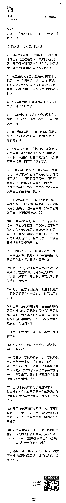

# 写东西，先写起来再说

> 原文链接：[`www.yuque.com/for_lazy/thfiu8/dgckf686xgaygl18`](https://www.yuque.com/for_lazy/thfiu8/dgckf686xgaygl18)

龙哥的收藏夹 · 2023-08-16 · 20 赞

关于“写作”这件小事，这几年越来越有感触：真正拉开差距的，不是谁更有文采，而是谁更能持续输出。很多人总想等一等，等灵感完整、等逻辑清晰、等材料凑齐，最后却一直没动笔。可写作这种能力，恰恰是在“写”的过程中练出来的。

与其憋一篇“完美”的长文，不如先从一条评论、一段复盘、一个观察开始。写作的本质不是堆字数，而是把一个想法讲清楚。情绪、困惑、经验，都能成为素材；先完成，再完善，才是绝大多数人都能上手的路径。

评论区里，胖大魔提到：赚钱的精华帖似乎有个“万字长文”的倾向。这个观察很真实——平台确实会给长篇内容更多曝光。但风向归风向，对普通创作者来说，更重要的不是模仿长文的长度，而是找到自己可持续写的节奏。先让输出成为习惯，再往“深度”和“体系”延伸，可能比一开始就追求万字更现实。

