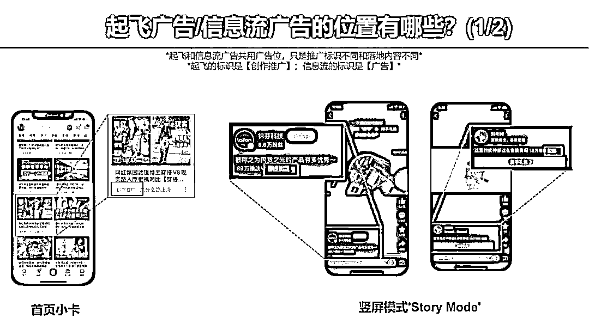
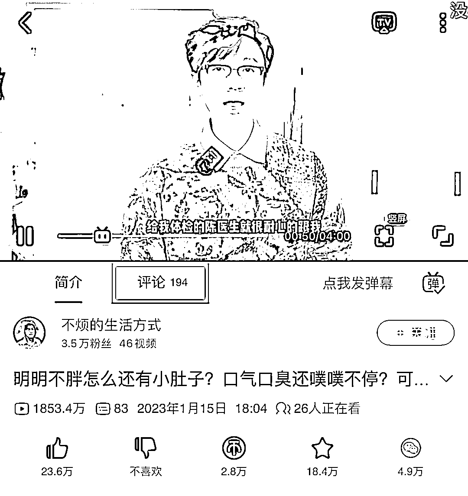
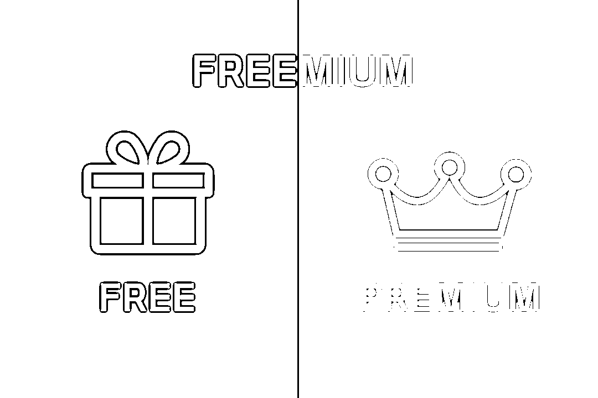
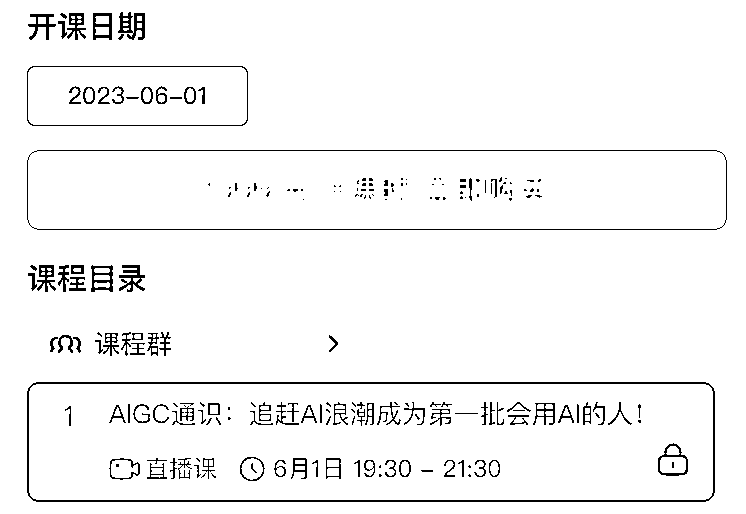
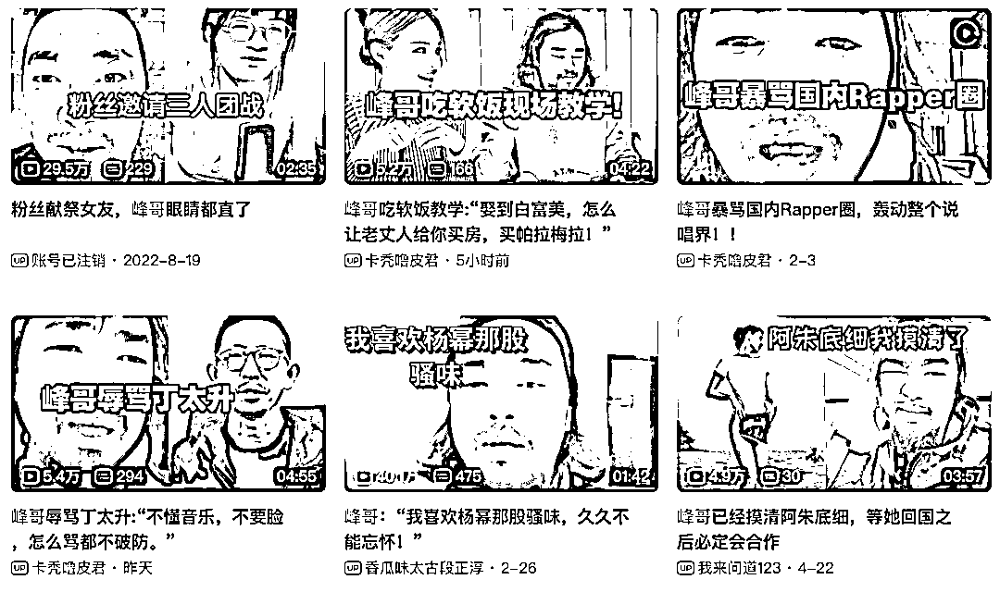
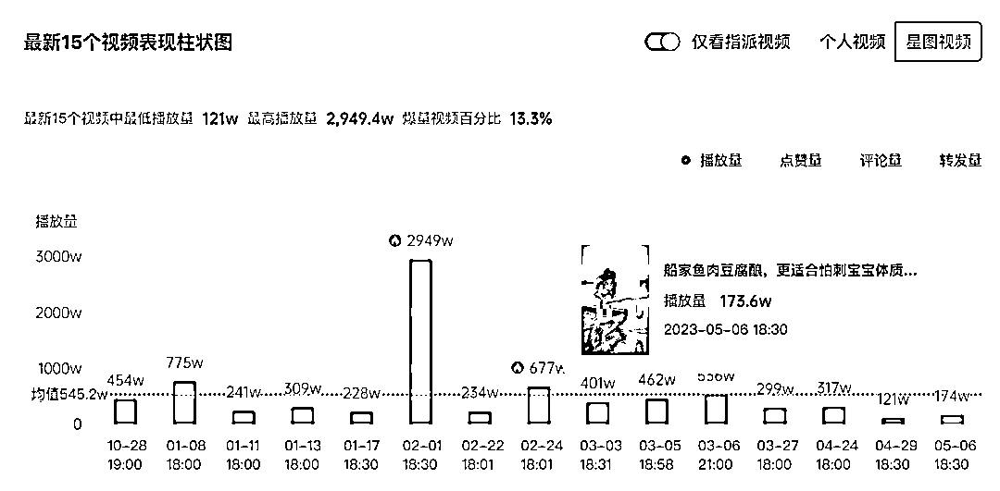
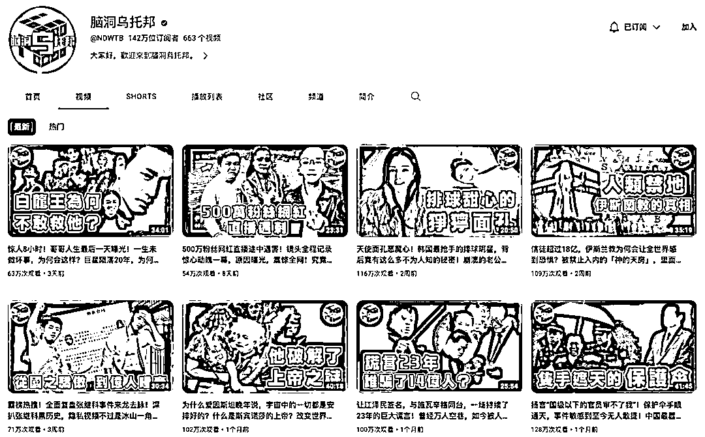
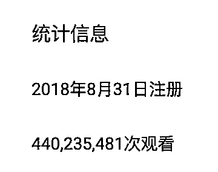

# 要想在自媒体这条路上吃到钱，未来大概只剩这八种打法

> 原文：[`www.yuque.com/for_lazy/thfiu8/wbon5pg5lcthq9qd`](https://www.yuque.com/for_lazy/thfiu8/wbon5pg5lcthq9qd)

## 未来只有这八类 up 主，才能真正赚到钱

作者： 书情小跟班

日期：2023-08-21

前言：不是我原创，内容已经原作者（小五哥）授权

做自媒体的门槛实在太低了，谁都能上手试试。

更重要的是它给了打工人梦寐以求的自由，不用打卡，不用看领导脸色，想走就走。只要做起来有稳定现金流，生活确实能滋润不少。

所以即便现在已不像当年那样遍地是钱，这份身份的吸引力依旧很大。

门槛低，竞争就残酷。蛋糕就这么大，分不到所有人。

源源不断有人涌进来，真正能赚钱而且一直赚下去的，少之又少。

绝大多数翻不起水花，粉丝和播放撑不起商业化。还有一部分数据看着漂亮，几十上百万粉丝，偶尔也能爆。但收入甚至比不上普通上班族，成本都回不来。折腾两三年花光积蓄后黯然收场，只剩一个网红的名号。

下面说的，是把自媒体当成事业来做的那批人。纯当爱好随便发发生活的，不在讨论范围。

当成事业，就得看能不能持续变现，说白了就是能不能赚钱。

同样十万粉，不同赛道的赚钱效率可能差十倍百倍。有些赛道百万粉也看不到钱，有些几万粉却闷声发大财。选赛道比埋头干更重要。

结合我自己的经验和长期观察，接下来这八类方向，更适合长期做下去。逐条展开。

**第一类，真正的头部，且会省钱。**

这个不用多解释，能稳坐各大平台头部位置的，日子普遍不会差。

这里有两个硬条件。第一是真·头部，要在粉丝量和单期均播上都能常年排在平台第一梯队。

B 站每年有百大 up 主，入选百大就等于头部了吗？并不是。很多几年前的百大早已停更了。就算还在更新，数据也平平。更关键的是，百大和赚钱能力并不完全挂钩，我见过不少百大商业化很一般。

**第二点是会控成本。**

头部做到一定规模后，为了做更好的内容、拓更多赛道，往往会组建团队。行情好的时候容易盲目扩张，招太多人、租豪华办公室，这些坑我见得太多了。

像木鱼水心这个例子，如果只有一个人运营，靠平台分成和补贴，虽不富裕也饿不死。但内容质量和更新频率看得出是团队在做。

一旦要发工资，收入下滑的压力会成倍放大。

B 站头部 up 主敬汉卿，粉丝近千万，播放一直稳定。他自己也说经历过大起大落，团队最猛的时候有 40 人，场地租金每月 5 万。

现在团队只剩 8 人，搬离了高档写字楼，住进月租 3000 的老房子。最近一年收入还有 300 多万，扣掉中介返点、工资、房租水电，净利润并不多。吃素的狮子也走过类似的起伏，有兴趣可以去看他自己分享的经历。

在我看来，头部里最舒服的，是人设强、重生活的内容，比如搞笑、吃播。

这类内容基本一个人就能拍，最多带个摄影助理。场景都在室内，一个小屋就够，设备道具要求低。

但要做成头部，对创作者本人要求极高，形象、幽默感、整活能力缺一不可。

**第二类，赛道垂直，且离广告主很近。**

垂直很好理解，基本都在一个细分领域深耕，比如健身、宠物、舞蹈、鬼畜。关键是离商业近。

怎么判断离商业近？就是这个赛道有成熟的消费品牌，且甲方预算充足。

比如男性向的数码、汽车，女性向的美妆、母婴。美妆产品毛利高，有预算做投放。数码汽车客单价高，哪怕毛利一般，甲方的推广费用也不会少。

更关键的是，up 主的测评和体验能直接影响购买决策。年轻人买手机电脑手表前，会不会先看博主测评？买车更不用说了。

所以有些垂直博主粉丝不多，却很能赚钱。我最近聊过一个 B 站不到 50 万粉的数码区 up 主，他说今年商单没减少，反而越来越多。商单视频播放不一定高，客户却一直愿意投钱。他原本有主业，现在商单收入是本职工作的好几倍。

原因很简单，赛道甲方有钱，且竞争激烈。新品上线会找各种量级的 KOL投放，不只找头部。

我个人也常这样，买数码产品时会去搜某个很细的功能点，讲这个点的大多是中小博主。播放只有几千的视频，也会直接改变我的购买决定。

B 站不少数码或汽车区 up 主，粉丝二三十万，开的却是新款 Model S、保时捷 Taycan。看一下花火，合作的商单非常多。互联网男性用户不值钱是错的，看赛道。

**第三类，能把流量直接变现的卖货型赛道。**

简单说就是能把播放变成销量。有些赛道商单不多，但带货很顺，比如宠物。

看宠物视频的观众，很多本身就是铲屎官。围绕猫狗的消费很大，猫粮狗粮、零食、玩具应有尽有。

比如 B 站做猫内容的 up 主柿子菌 meow，粉丝 100 多万，播放不稳定。但她在淘宝卖猫周边的店，已经三皇冠了。靠自有流量做到三冠，干过电商的都知道多难。月销上千的单品不少，抖音上也开店，累计销量超 30 万。

宠物博主自营电商不止她一个，抖音、YouTube 上很多。台湾博主好味小姐，YouTube 粉丝 70 多万，主做猫内容。她走独立站路线，SKU 丰富，经营多年。海外做独立站好处是不用分平台抽成，购物体验沉浸，不用比价，更适合私域运营，和微信生态里的有赞、小商店逻辑类似。

宠物只是其一，适合电商的赛道很多。去年 B 站直播带货一哥 Mr 迷瞪，做家装科普的 up 主，全年带货 7 个亿。

他不是自营，而是和品牌联营开团，更像李佳琦模式。但能卖得动，根基在于他早期家装科普建立的人设和信任。

这也说明 B 站用户并非没消费能力，关键看赛道和商业化打法。

不过电商带货要求更全面，除了内容获客，还要懂选品、有供应链、管库存售后，环节多很辛苦。但天花板高，收入可持续。

不想自己折腾，也可以做带货号，帮别人卖货。

这种模式在抖音很成熟，近两年 B 站也在兴起。首页那些动辄几百万上千万播放的健康、护肤类视频，基本都是。

点进去置顶评论直跳淘宝链接，up 主粉丝才几万。播放量高是因为买的流量。

B 站的起飞计划，和抖音的抖+、YouTube 的付费推广一个逻辑，花钱买曝光。

花钱买流量不便宜，为什么商家愿意买？只要投入产出为正就能持续投。

比如投 1000 块带来 5 万播放，产生 5000 销售额，利润率 40%，净赚 2000。投 1000赚 2000，商家自然会继续投。

为了提高转化，这类视频引导很强，评论区也控评。你看一个 2000 万播放的视频，评论不到 200 条，弹幕不到 100，全是吹捧。

up 主怎么分钱？一般拍摄费很低，后续按销量分成，比如 3%。假设一个 2000 万播放视频带来 100 万销售额，分到 3 万，对几万粉的 up 主也不错。起飞费用由商家出，顺带还能涨粉。

现在 B 站这类号集中在健康领域。前段时间和一个 MCN 老板聊，他说现在 B 站靠投放赚钱的商家主要三类：**教育、美容护肤和保健品**。想做带货号，可以从这三个方向入手。

**第四类，适合做付费增值的内容。**

也就是知识付费，开专栏卖课做社群。哪些赛道适合？以技能提升和职业进阶为主，比如英语、剪辑、UI 设计、摄影摄像、考研等。

这不是新玩法，早在 web1.0 时代 freemium 模式就很常见。free 部分免费建立人设引流，premium 部分收费变现。

你是一个英语博主，平常发零散知识点吸引粉丝，粉丝积累到一定程度，自然会有人问具体问题。这时推出 30 天口语提升课，水到渠成。

技能学习、学历提升、职场充电、理财副业等领域，付费意愿普遍较高。

B 站早就支持专栏课程，比如某位分享软件使用和编程的 up 主，已上线五门课程，价格从几十到近 2000 元不等。

YouTube 卖课更常见，虽然平台本身没有课程功能，但第三方平台能完美解决。做这类博主，最好在某个领域有积累，专业性是基础。别人愿意掏钱，得先有两把刷子。

**第五类，适合长期做直播的。**

现在各大平台直播都是标配，变现最直接的就是打赏。B 站舰长、YouTube 抖内、超级留言，抖音快手更依赖直播转现。

很多网红的策略就是视频涨粉，直播变现。

像最近很火的挖呀挖幼儿园老师，视频爆了涨粉几百万，但真正变现还靠直播间礼物。

直播门槛低，一部手机就能开。但能不能持久是关键。没有留住人的东西，三五场后就没人了。

能否长期直播，取决于个人吸引力：要么颜值高身材好，要么有才艺，比如游戏主播。

颜值主播在美颜滤镜加持下并不稀缺，除非有极强的辨识度。所以除了颜值，还得会互动。观众看的是陪伴和情绪价值，如何让榜一大哥上头又不违规，需要很高的分寸感。

才艺直播常见的是唱歌跳舞，游戏是重头戏。还有一些独特技能表演，比如平衡术等。

第三类是会聊天整活的。对口才和网感要求高。像 B 站的峰哥，直播基本就是聊天，但片段被大量二剪传播，播放量很高。因为他口才好幽默，懂网民心理，金句不断，连麦也有梗。

归根结底直播卖的是娱乐和陪伴。能持续提供精神价值，才能活下来。

**第六类，能高频更新且数据稳定的。**

就是基本能做到日更，播放量不爆但稳定。这种通常以生活类为主，拍摄成本低。

高频更新意味着靠平台补贴也能有稳定收入。

比如 B 站徐大 sao，巅峰时单期百万播放，常有商单。经历风波后流量下滑，300 多万粉平均播放一二十万。商单估计没了，但更新还勤，四月更新 12 条，总播放 200 多万，B 站激励大概两三千。不过他全平台发，西瓜、百家、腾讯、斗鱼、YouTube 加起来估计万把块。内容就是做饭吃播，成本就是食材，能长期经营。

再看 Sean 的世界 TV，一个移民泰国的杭州大哥，做日常 vlog，日更，全平台发布。YouTube 和西瓜抖音粉丝更多。播放量不高但稳定，没有太多商单机会，主要靠各平台分成补贴。用他话说，不至于发财，但养活一家人没问题。

这类频道共性是生活向，通过日常记录保证素材充足，拍摄成本低。

西瓜三农区很多是这种。

为什么流水账也能有稳定观看？逻辑接近直播陪伴。Sean 通过长时间经营，让观众认可他这个人，看他发生活成了习惯。发哪里不重要，粉丝想看他今天逛了哪个夜市吃了什么。

一种是人设强靠人留住观众。另一种是弱人设甚至不出镜的内容农场，比如做饭教学、绘画教学，在 YouTube 也数据不错。

**第七类，不依赖单一平台的。**

有些 B 站 up 主，更新不勤，也看不到商业化，但能一直坚持。原因往往是其他平台变现不错，B 站只是顺手发。

比如船家妹丁，风格类似李子柒，拍精致的船家生活。B 站数据还行但一个月三四更，没有恰饭，看似佛系。答案是她的主要阵地不在 B 站。

前两天刷到一个博主，视频清一色竖屏，而且都很短，一眼就能看出她把抖音当主阵地。翻了下她的主页，商业动作相当频繁，最近半年大概接了15条商业合作，不少置顶评论里也放了推广链接。星图报价动辄几万起步，当然这是对外标价，最终成交未必每单都这么高，但整体不会差太远。有意思的是，这些恰饭视频她一条都没有同步到B站。同一个账号，在B站接不到广告，在抖音却能接到手软。

说实话，我向来不太喜欢那种高度依赖商单的账号。除非你的内容本身就贴着商业走，否则广告投放很不稳定。一旦品牌方收缩预算，或者自己的数据开始下滑，受到的冲击会很大。相比之下，我更欣赏在YouTube做得不错的中文频道，或者说中国创作者做的频道。YouTube的广告分成大家都懂，流量能稳住，创作就更纯粹，不用天天看商单脸色。比如“自说自话的总裁”“X调查”这类专讲奇闻异事的频道，国内外表现都可圈可点。“脑洞乌托邦”也算一个。它在B站的数据并不出彩，关注才二十万上下，但YouTube订阅已过百万，每期播放量还能稳定在五十万以上。所以对这位创作者来说，B站的播放量、有没有商单，根本不影响大局。反正视频都做了，顺手发一份而已。

电影解说赛道也有同样的情况。“科幻梦工场”在B站有64万关注，属于轻人设账号，估计接商单的机会不算多，但那又如何？它的YouTube订阅将近一百万。虽然近期有些视频播放量比较平淡，但隔三差五就会蹦出爆款，整个频道累计播放量超过7亿，光广告分成就是很大一块收入。还有一个“永恒跳动的火焰”，主要做手工视频，人被拍到了，但全程没有旁白，人设同样极轻。B站那边关注量才二十来万，播放时高时低，品牌合作基本没戏。可他在YouTube的订阅量也破百万了，跟“科幻梦工场”一个套路：平均播放不算高，但总有几条爆款牢牢撑着。这些爆款能持续带来新观众，频道总播放量超过4亿，靠分成也能过得不错。

第八类，是把线上影响力延伸到线下变现的。具体有好几种玩法。第一种靠线上攒粉丝、攒流量，反哺线下商业机会和溢价。比如摄影博主，只要在平台有几万几十万粉丝，除了更多线下约拍找上门，这些视频作品也能直接拿给甲方看。有了人气和粉丝，报价自然能开得比别人高。舞蹈博主也是同理，线上曝光多了，线下商演的邀约也会变多。第二种是自己本来就有线下业务，做视频只是为了开辟新客源，移民中介、房产中介在YouTube上特别多。这类博主往往粉丝不多、播放不高，但他们根本不在乎，他们要找的是精准客户。因为客单价高，单个用户价值足够大，转化率才是王道。还有一种更偶然：本来没有线下业务，做着做着发现线下的机会，误打误撞做起来了。比如“艾伦老师是也”，在B站和西瓜视频都只有几万粉丝，但变现能力不差。他的内容主要是分享海外打工经历，业务则是介绍国内的人去海外打工。据他在直播里说，最初只是分享自己的经历，后来有人不断追问细节，才慢慢启动了这项服务。这跟前面说的一样：做中介，粉丝数量不是关键，精准才是关键。

第八类跟前七类最大的不同，在于它把自媒体当成了工具：前端引流靠它，真正的交付在线下。到这里，我把那些能够长期运转、持续做下去的视频账号类型大致梳理完了。把自媒体看作一次微型创业，本质跟判断一家公司能不能活下来是一样的，说到底就是算收入与成本：收入减去成本，剩下的才是你的收益。假设你上班一个月到手一万元，全职做自媒体，忽略其他因素，只要它每月能稳定带给你一万元以上的收入，从金钱角度就不亏。想要达到这个收益，前提是收入先过万。前面八类主要都在讲收入，但成本同样重要。很多账号做不下去，就是栽在成本上。要么是大UP主急着扩张团队，收入却没跟上，甚至往下掉；要么是新手一上来就买最贵的设备、雇一个小团队，还没等到收益，钱已经烧完了。所以，对大多数普通人来说，自媒体还是得回到“自”这个字上。尤其是起步期，一定要轻量化、低成本，等做到一定规模，再去考虑“媒体”的属性。做视频的成本无非包括设备、场地、人员，以及制作环节的开销，比如视频中要用到的物料、拍摄路上的差旅。起步阶段，能省就省。我一直强调精益创业的思路：一开始别追求最好，先求能用。等到赚到钱了，再考虑升级设备、组建团队。我现在收音用的麦克风要7000块，但那是我后来才添置的。粉丝到10万之前，我一直用的是一部很多年前买的二手单反。第一个帮我的小伙伴，也是商业化稳定之后、我自己实在忙不过来才招的。

为了拍视频，我离开了待多年的一线城市上海。以前在上海租房，一年光房租就要10万；现在我租的是老家县城里城中村的私房，上下两层加起来300平米，前后还有院子，一年租金只要2万。办公、拍摄全在这里完成。互联网的好处就是不受地域限制。比如我这样对着镜头说话的内容，真有必要非得在北京、上海、香港、台北拍吗？只要你不是做城市主题的内容，完全可以像我一样，找个安静的小地方。不少大V都是回到老家农村之后才开始拍视频、慢慢做起来的，李子柒、滇西小哥、华农兄弟都是例子。如果他们留在大城市，生活成本和工作压力，说不定会让他们根本走不上这条路。所以，如果你真打算把自媒体当成一项事业，在选择领域和方向之前，一定要想清楚：你的主要收入从哪里来？开支计划又是多少？别稀里糊涂就一头扎进去。

* * *

评论区：

胖大魔 : 把他拉进赚钱啊

书情小跟班 : 哈哈😃

* * *