**一篇“凌晨失眠写出来的复盘”，藏着AI做课的完整闭环**

谢谢你点进来。在知识付费这个圈子里，能被大家关注，本身就是一件很幸运的事。过去一年，我先在大航海活动中做过三次分享；7月底，又在星球给圈友输出了一篇《30天私域卖课60W》的复盘；半个月后，就有了你现在看到的这篇：完整拆解我是如何用ChatGPT做课，并单月卖出1300多单的。

我是宋老师，账号是“宋老师帮你做课”。全网粉丝10W+，同时运营着好几个矩阵号。很多在抖音、小红书做知识付费的朋友，可能都刷到过我。从0起步，我用了将近一年时间，把自己送进了“做课+卖课”赛道的头部阵营。

先看一组可验证的数据：抖音端销量800+，小鹅通私域端500+，累计1300多单，变现52W。

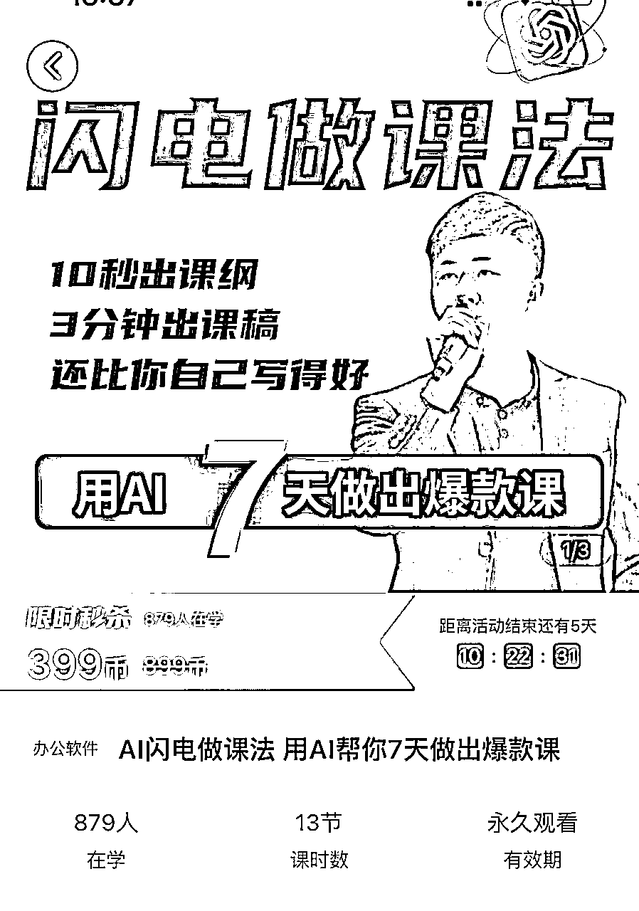

为了让你快速知道我的价值，我给自己贴四个标签：
1. 做课&卖课赛道的头部博主 → 代表我的流量打法
2. 前新东方总监，最高管理过80万学生社群 → 代表我的教学基本功
3. 6000多位知识博主的导师 → 这是成绩
4. 很多百万博主背后的“做课男人” → 这是圈内朋友对我的认可

另外，我想给你一个长期判断：未来写书的人会越来越少，做课的人会越来越多。同样是社交名片，动态视频课的前景，一定比静态文字书更大。

如果你是知识博主，可以按照自己的阶段来用AI：
- 新人：用AI快速跑通0到1；
- 中部：用AI提效，干掉同行；
- 头部：用AI翻新产品，迭代优化。

今天这篇分享，我按“道法术器”四层展开。它们分别回答：年入百万的人为什么都在抢着做课？7天怎么用ChatGPT做出一门爆款课？我如何借AI和做课的结合冲进蓝海？以及6个提效工具。

---

## 一、道：年入百万的人，为什么都在抢着做课？

先看知识博主这个群体。表面上有两种细分：一种教人赚钱，服务B端；一种教人技能，服务C端。但说到底，所有人面对的都是“有学习需求”的人。只要有痛点，就有人愿意为解决方案买单——这就是市场本身。

那为什么普通人非要入局知识付费？三个底层原因。

**第一，投入低，利润高。**
做课卖课的平均净利润，目前能到71%。注意，这是净利润。如果你没有团队，这个数字还会再涨。我还没发现哪个项目比它更赚钱。状态好的时候，一场咨询就是大几千；状态一般，一门课99元，照样有订单。
这里有几个关键思维：
- 边际成本：你花10天做出来的课，可以卖一整年、两年、三年。我有一门“做课课”，一年卖了3000多单。
- 升单：用一套低价课引流，其中30%的人会继续追购高价课，整体效益翻倍。
- 分销：这就是知识付费界的“安利模式”。为什么张琦、周文强的课能被几百位老师一起分销？因为模式已经被验证透了。

**第二，人群基数大得吓人。**
就拿“教人做抖音”来举例。抖音月活8亿，其中3亿是短视频创作者，这3亿人正好都是目标客户。再加视频号的6亿，小红书的3亿，三个平台加起来就是17亿。任何一个再小的细分市场，放进这个池子里，都会被放大到无限。

**第三，风险低到极致。**
别的事情，你7天不干，就要被市场教育。知识付费不会：你哪怕7天不拍视频，流量还在，课也还在卖。
万一你花一个月教人做项目，没出结果，要么是方法有误，要么是IP的定位有问题。最差的结果，无非是一条差评，或者一次退款。你的试错成本，已经被控制到最小。
除开知识博主这条身份，还有哪个赛道能有这样的优势？
而且趋势就在眼前：截至2023年6月，仅学浪一个平台，在售课程就有56000门。这只是一个平台的数据。线上课成为主流，早已不可逆。
变现能力强，意味着想做知识博主的人，必须得有产品、有课。
其实普通人赚到第一桶金，并没有想象中那么难。一套课，就是一劳永逸的资产。
咱们来算一笔账：如果你想赚100万，可以拆成：
- 499元引流课 × 500单 = 249,500元
- 5000元利润课 × 110单 = 550,000元
- 20000元高价课 × 10单 = 200,000元
三者相加，刚好999,500元。
只要你有引流课，后续就能靠升单持续放大。这笔账里，藏着无限可能。

---

## 二、术：我眼中最赚钱的“灰马”赛道

在卖课行业待久了，你会看到许多反常现象。有些品类看上去很土，但它的销量和利润，偏偏高得离谱。
注意，我要说的不是“抖音运营”“电商运营”“英语”这类常见板块——它们在抖音还真不一定赚钱。
真正值得关注的，是这几个“低粉高变现”类目。

### 1. 乐器类：越是普通，越能赚钱
越常见的乐器，往往越有变现空间。像吉他、钢琴，销量好，但讲的人不多。
变现做得好的团队，基本都很小，升单全部拉到线上，不做线下。这恰好符合知识付费直播的“超级个体”属性：人效高，依赖老师本人的内容能力，再加上抖音平台的红利杠杆。
南宁有位赵老师，夫妻两个人，没有团队，一年干了3200万。她跟我说，去年“莫名其妙”就卖了几百万。你可能会酸，但这就是小众品类的风口红利。
所以别总是盯着“透透糖”和“李一舟”了，很多你叫不上名字的老师，卖课能力可能秒杀他们。
赛道选对了，努力才不会被辜负。

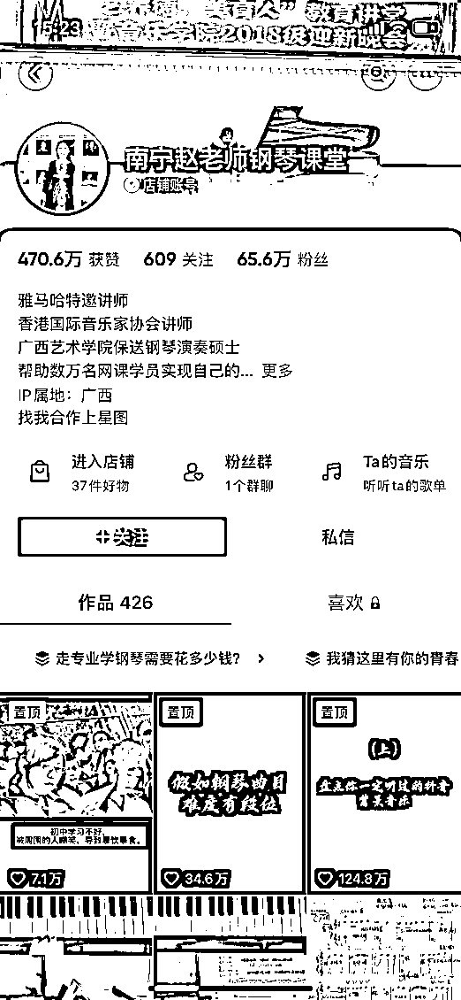

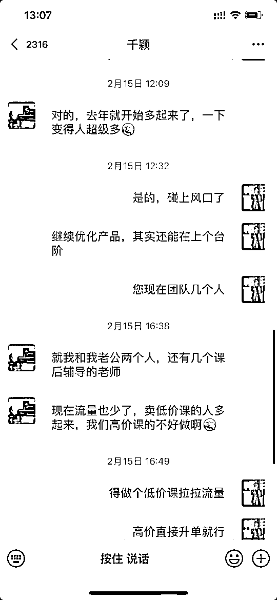

### 2. 口才类：老赛道，新机会
口才听起来够“常识”，但你不知道它有多能打。
我们深度合作过一个IP——“云边口才”。这对夫妻在疫情期间隔离在家，妻子是县城的电台主持人，直播做到了两万多粉丝，来找我商量怎么变现。
他们本来想做少儿口才课，被我劝住了。原因有三：
- 第一，家长普遍爱带孩子去线下学口才；
- 第二，我们分析数据，少儿口才的表现很一般；
- 第三，妻子本人的演讲感染力非常强。
于是我们就改做“成人口才”。结果，15天变现16万。
后来我们又跑出了小红书IP“小哈聊沟通”，同样深耕口才课，效果依然很好。
所以，人群定位这件事，怎么强调都不过分。

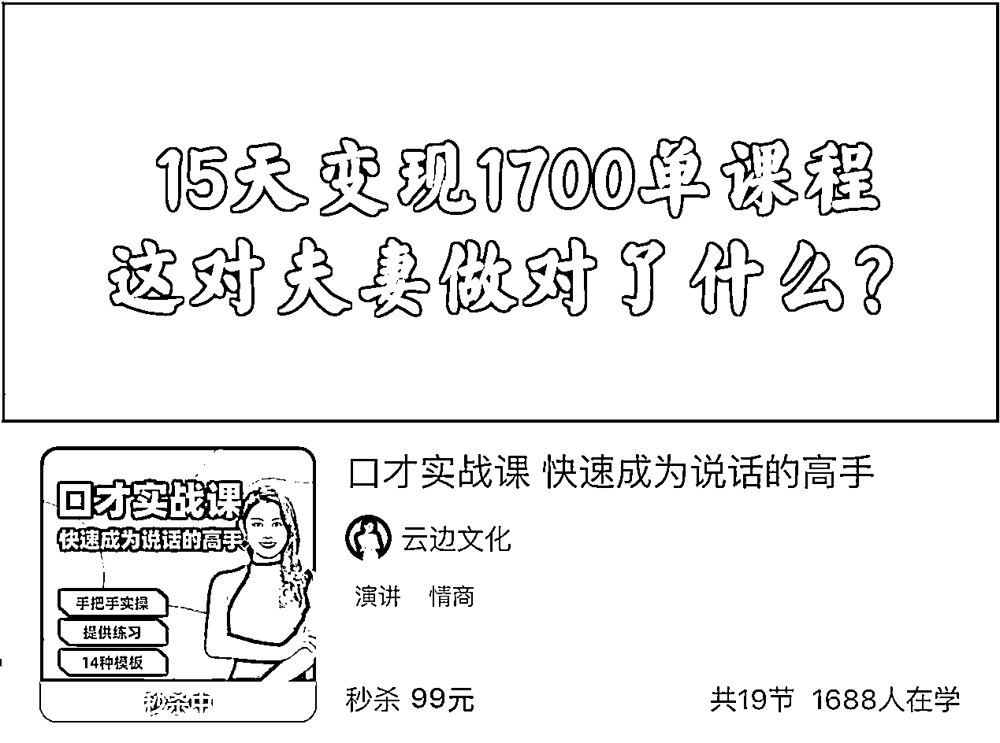

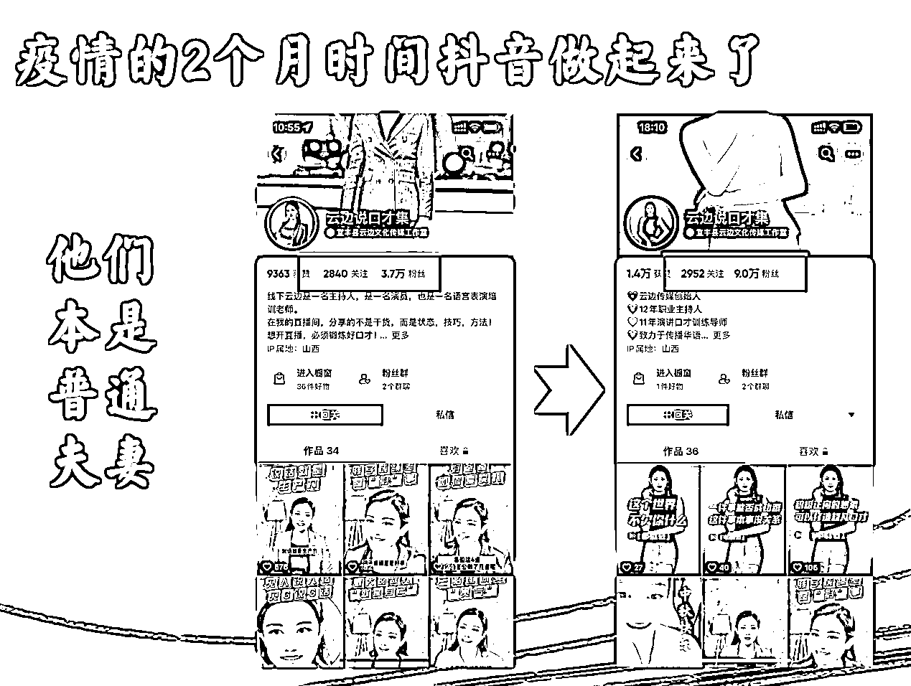

### 3. 造价 & 建工电气：技术壁垒=客单价的护城河
这类课程天然有门槛，像财税、造价、电建、土木，全都跟工程与企业经营相关，客户为高价值买单，所以很容易出大单。
我们的学员“中天电建”，1万左右粉丝，卖课卖了100多万；另一个学员“造价之家”，也有61万的成绩。
小众，高收入，这是知识付费另一条不可忽视的核心路径。

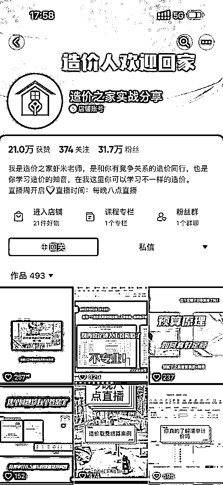

还有更多“灰马”案例：
- 教戒烟的林老师，20多万粉，卖出102万；
- 教产后妈妈长高的“喜悦之路”，24万粉，同样变现100万；
- 教谈恋爱的课，27万粉，赚了244万。

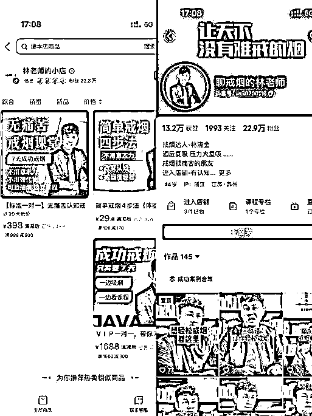

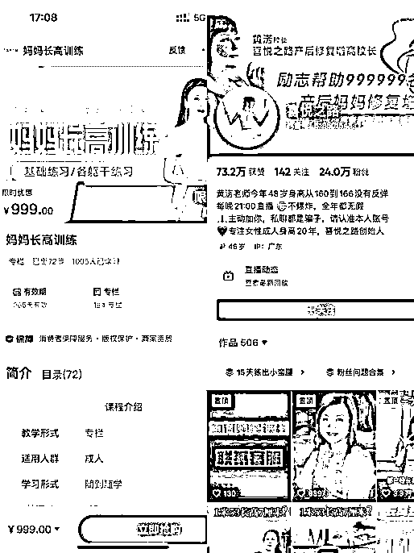

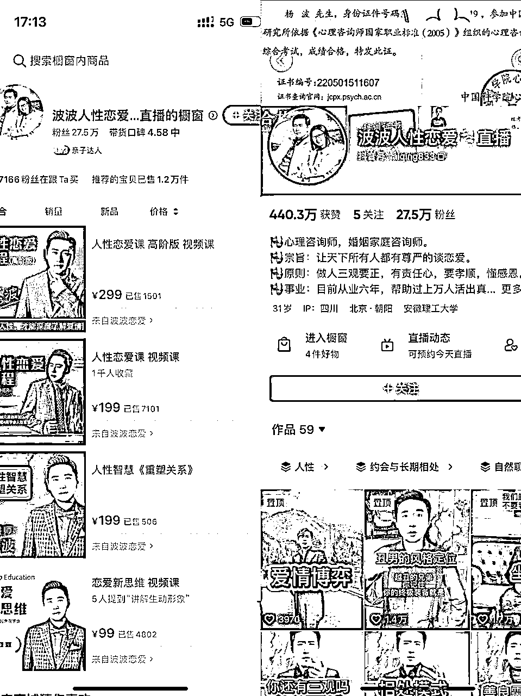

我整理了一份“不起眼但很赚钱”的课程选题表。另外，家庭教育这个品类，我们也做过深度挖掘，欢迎感兴趣的朋友单聊。

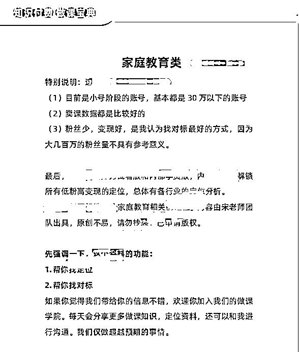

---

## 三、法：7天用ChatGPT做出一门爆款课

我把这套流程叫作“闪电做课法”。核心就六个动作：定方向、起标题、搭大纲、磨内容、录成片、上架。

很多老师迟迟做不出课，通常卡在准备环节：备课慢、列不出大纲、PPT做不出来。这套方法解决的问题，就是让AI把这些“脏活累活”接过去。简单说，ChatGPT自动帮你把课“写”出来。不管你是“没货”，还是不会写大纲/课稿，又或者是PPT和详情图搞不定，这套方法都能让你在7天内完成课设基础配置。

### 第一步：定方向
方向不对，努力白费。定位准了，变现就会很快。
我自己的亲测数据：粉丝只有60的时候，我就靠定位变现了6000元。这直接加速了我后续的进程。
送你一个通用公式：用户花xx元，学你的xx课程或服务，解决xx人群的xx痛点。
只要每个痛点都找准，定位基本就是准的；如果不准，就去拆解对标课程，再优化。
还要提醒一点：别只做一套课。一套课的利润和销量都不够看。举个例子，你卖一套400块的课，全网卖1000份，也就40万；但如果你有后端高价产品，利润可能直接冲到100万。
所以，你的产品矩阵至少要有三档：引流课、利润课、高价课。
用AI做定位，第一步是给AI一个角色。比如你说“你是一位情感专家，想出一门教向上社交的课，最好能包含恋爱技巧”，它就会自动帮你分析、拆解。
AI给出的定位思路，已经足够启发绝大多数老师。再结合对标数据，你还愁课卖不动吗？
如果一开始不会分析痛点，最简单的方法还是找对标、看同行。
最懂市场的，永远是你的同行。
我经常用自研软件拆学浪的内部课程数据，把定位、定价、内容、售价、销量全查一遍。
四个核心指标：
- 看定价：参考行业平均价。数据告诉我们，引流课别超过599，否则公域很难走量。
- 看对标：把对标课程的痛点、卖点、标题、详情页文案都扒下来。人家能卖出去，说明模式已经走通。
- 看课数：超过20节的课，往往不好卖，完课率也低。想一想，上学时45分钟都容易开小差，几十节课谁听得完？
- 看销量：有销量，才能证明这是真蓝海；没销量，就是自嗨的“伪蓝海”。

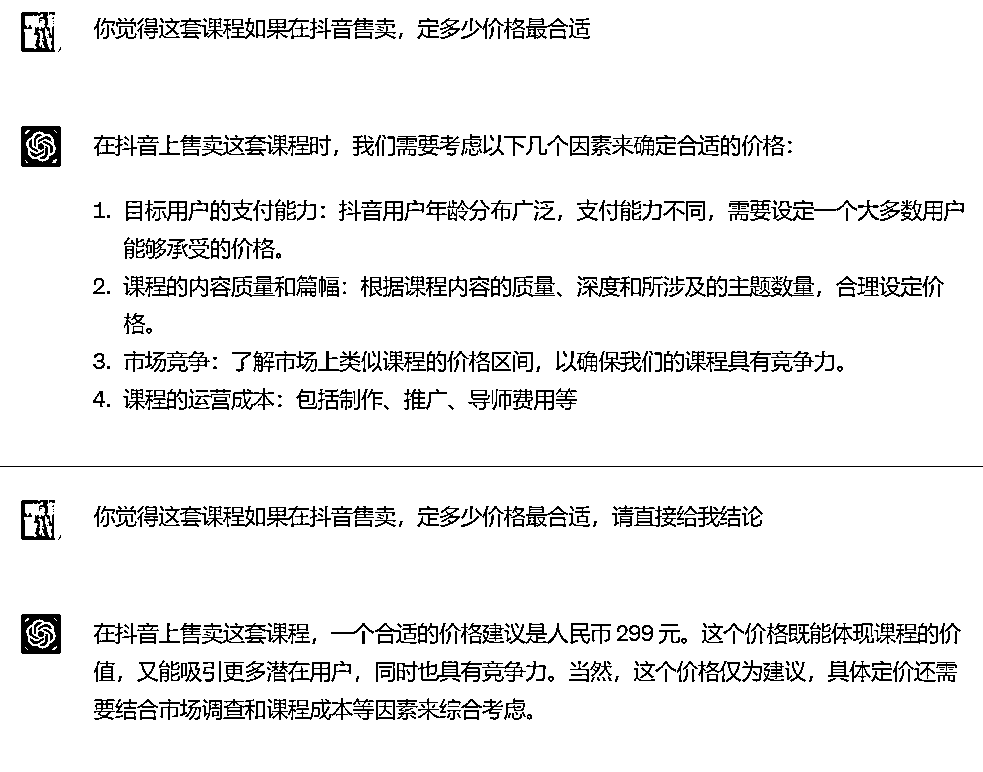

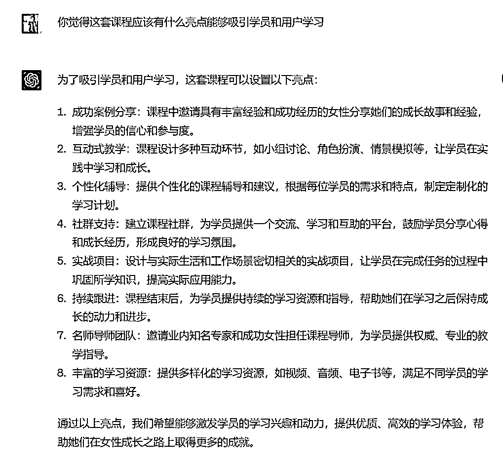

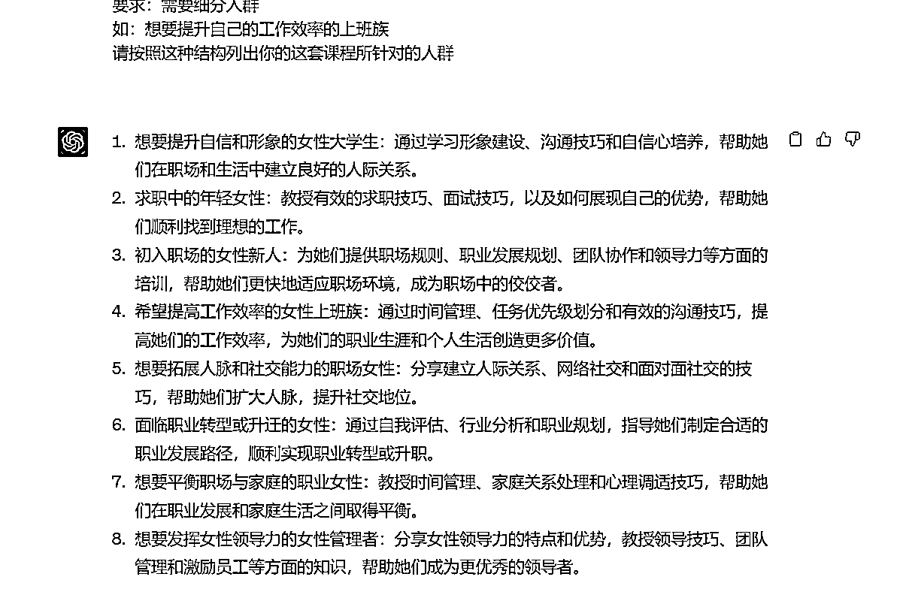

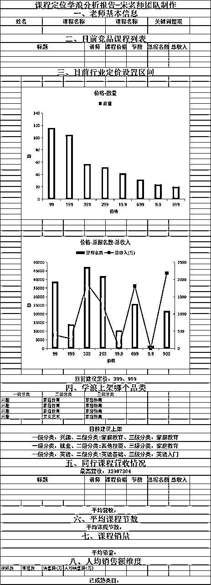

### 第二步：起标题
课程名不一样，命运大不同。
一个好的标题，既能激发好奇，又能拉动销量。起标题最大的忌讳是“自嗨”——你觉得自己写得爽，用户却不搜、不点。反过来，要多想用户到底想听什么、会搜什么。
如果你不能靠销量碾压对手，就要靠搜索词跑赢对手。
我的《AI闪电做课法》，简单、精炼，背后藏了SEO逻辑。
标题公式也很简单：课程知识概要 + 核心卖点。
用正确的方式提问，AI能迅速给你一批高质量标题，绝对不输大多数人手写的水准。
大健康的课、女性成长的课、唱歌的课……AI都可以轻松给出爆款感拉满的大纲和标题。

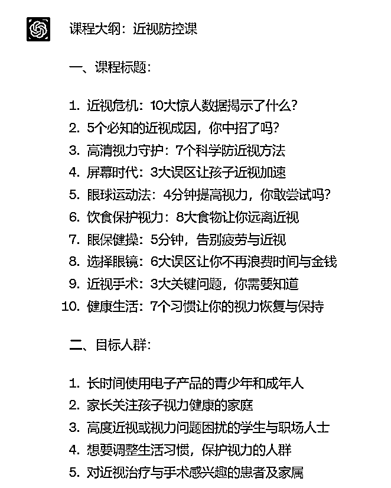

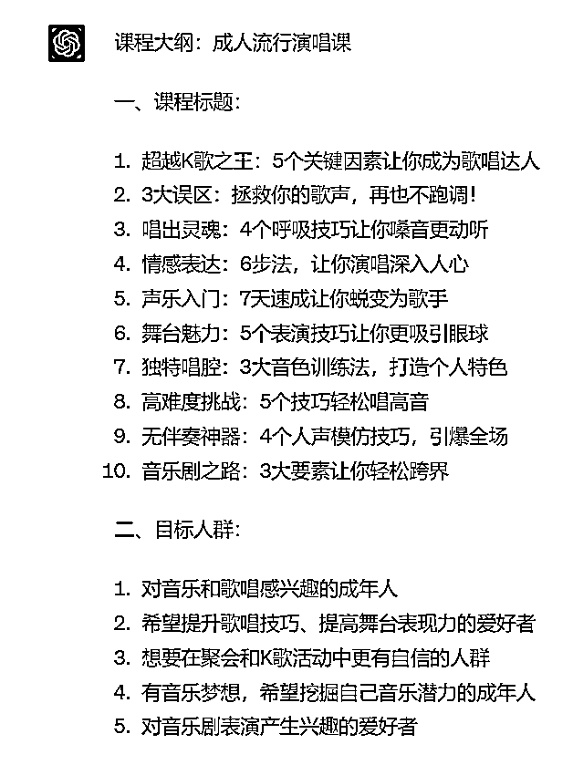

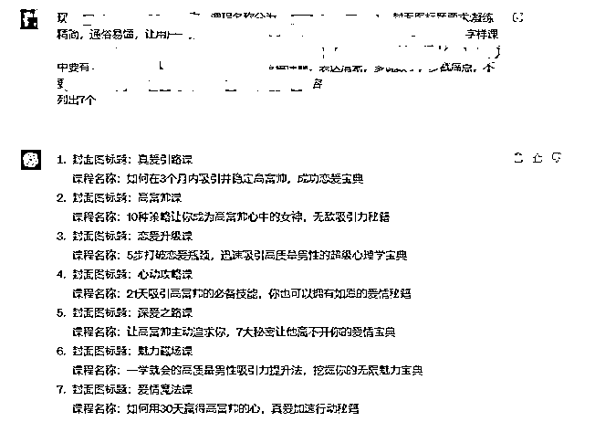

### 第三步：搭大纲
大纲的核心功能，是让课程内容顺序合理、逻辑清晰。
但线上的课程大纲，不能像教科书那样一板一眼，它得自带“钩子”。所以，要按爆款标题的格式去设计。
好的大纲，相当于成功了一半。
两个建议：
1. 不要太专业。术语太多，用户会敬而远之；
2. 不要自嗨。要站在用户角度想问题。如果他想学雪梨老师那种录课方式，我就专门开一节“雪梨老师录课样式教学”的课。
AI编写大纲的能力，真的强到可怕。你只需提供需求，或者给一个模板让它仿写，几秒钟就能产出一版结构完整的大纲。
AI能写得这么好，核心是提示词厉害。
更完整的提示词口令，我后面单独给大家。你也可以直接先试试基础版。

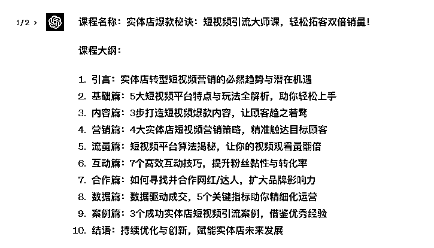

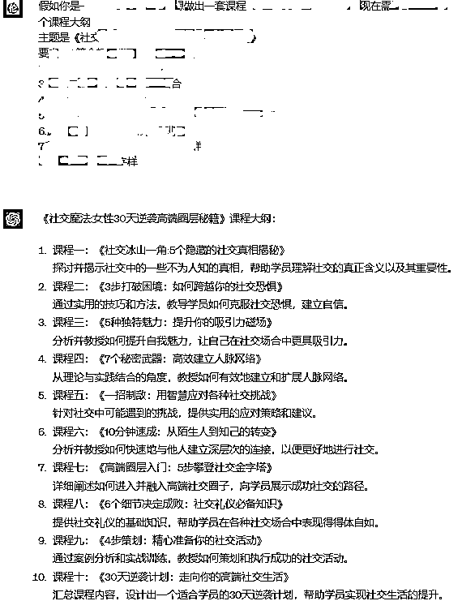

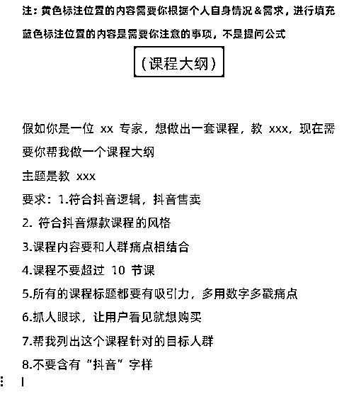

### 第四步：磨内容（正课+试听课）
正课可以放最后，但试听课一定要前置打磨。
试听课决定卖课率，我甚至为它总结了一条“首课7步法”的黄金法则。按这个结构来做，百万级爆款试听课的概率会极大提升。
说起来，我第一次让AI写试听课，心里也打鼓。但这东西太重要，所以我一遍又一遍地调教ChatGPT，前后测了300多次，终于拿到了一条稳定口令。我敢说，它解决了90%老师写课难的问题。
它写出的试听课稿，放在我那4000多个学员里，也能排到中上水平。
现在已经有一大批老师，都是靠这套模板在做试听课，累计卖了几百万的课程。
正课就更轻松了。人工写2000字，一小时；AI写，3分钟。你再把个人经验、干货塞进去，一份几千字的正课稿就出炉了。

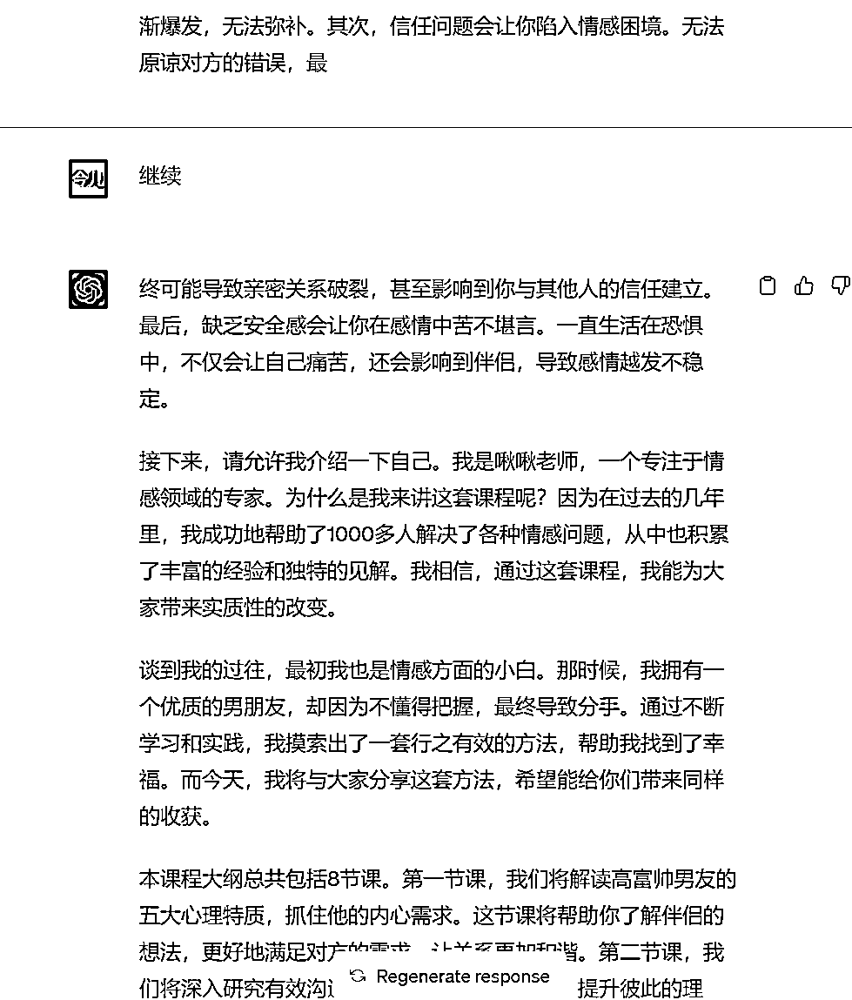

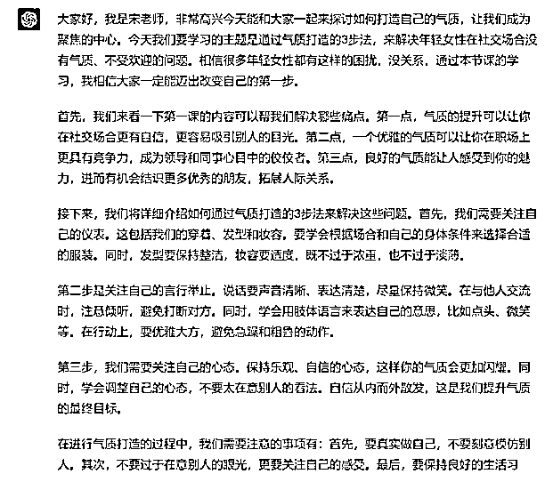

### 第五步：录成片
录课这件事，找一个有经验的老师带一下，或者看看视频教程，很快就能上手。
但我们最大的敌人，是“完美主义”。
有的老师录了几百遍，拖了一个月，还是不满意，结果一直不上架，眼睁睁错过最好的窗口期。
请记住：先完成，再完美。内容没问题就尽快录，录好就赶紧上架，先变现后优化，完全来得及。
录制教程和工具清单我都有，有需要的朋友可以来拿。

### 第六步：上架
主流课程都会上架到学浪——抖音的“亲儿子”。审核会严一点，按教程走基本不会有大问题。
私域方面，用小鹅通、荔枝微课做交付，体验也很好。
综合来看，只要你能坚持跑完这套流程，10天之内一定可以做出课。
我非常建议每个做课卖课的老师，都给自己配一个H5。有用户来咨询时，直接发H5给他，比发一堆文字更有说服力。
很多时候，你只需优化一个细节，做课效率就能提升50%，多卖10万块是真的可以发生的。
下面是部分学员做课卖课的实操截图，直接上证据👇

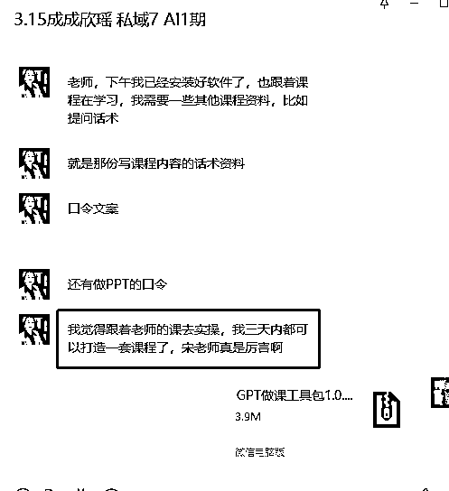

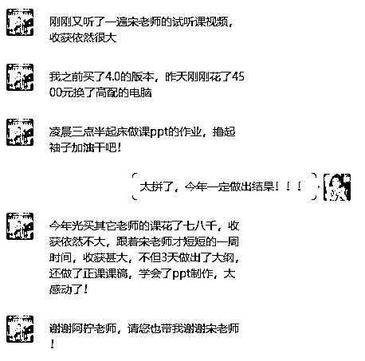

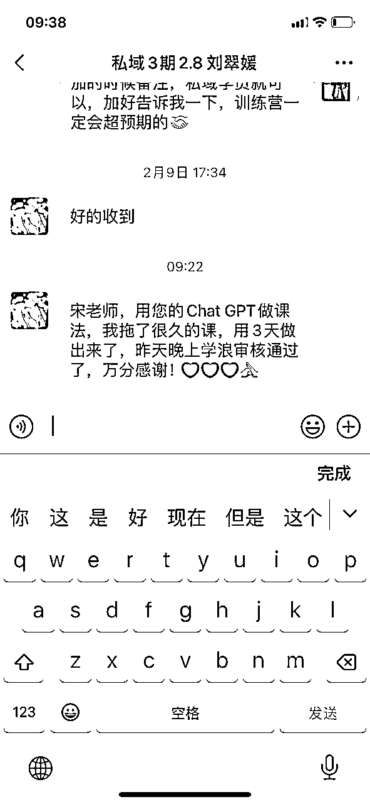

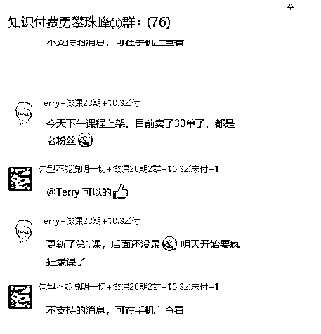

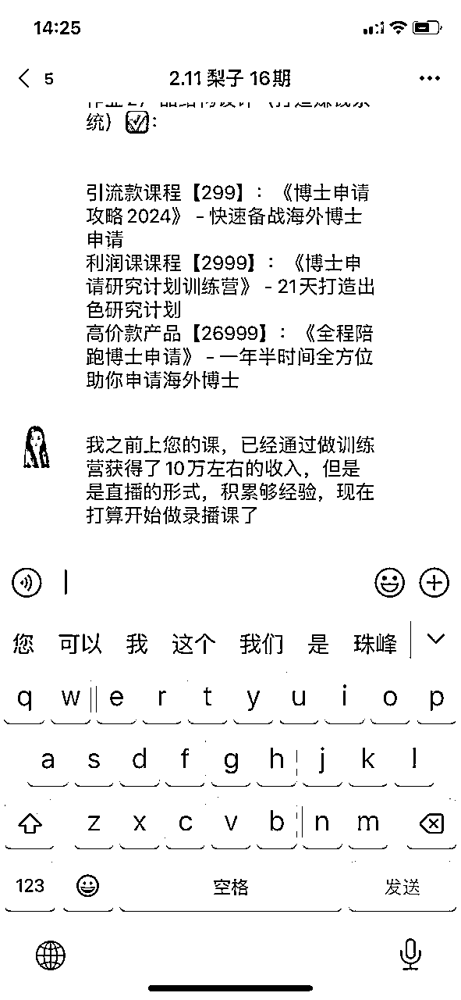

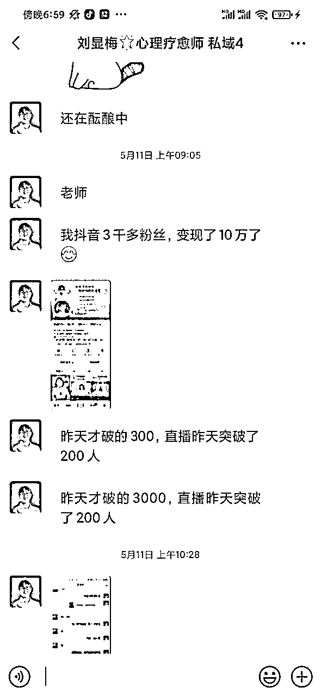

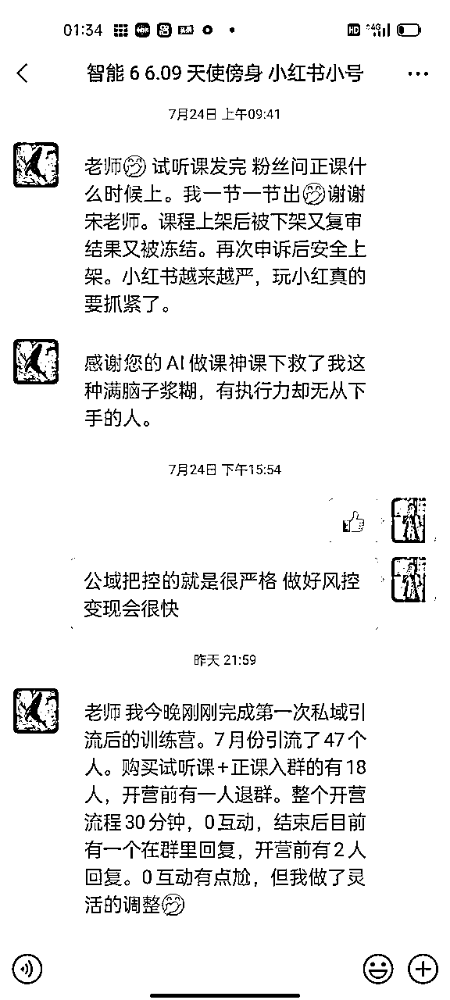

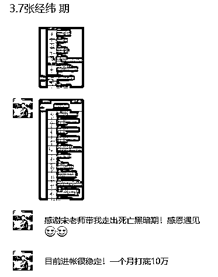

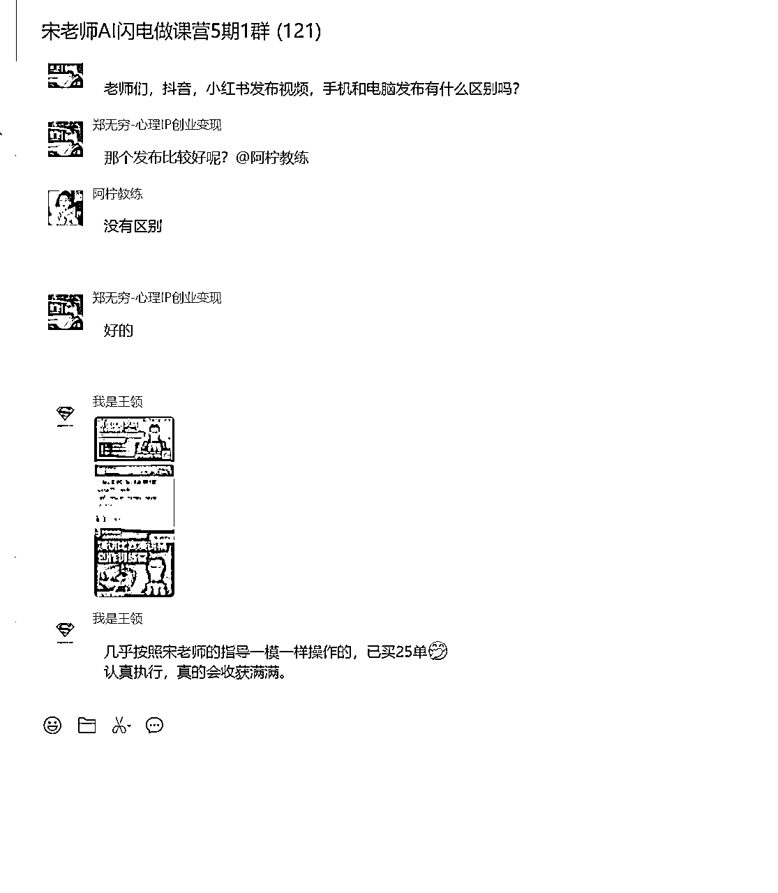

---

## 四、器：AI如何带我从死局到蓝海

### 1. 抖音不让卖课，是危还是机？
所有卖课老师，应该都记得今年4月初的“惊魂一周”。
抖音和苹果因为分成问题闹摩擦，一夜之间，平台上的知识付费课程被全部下架。
那几天，全网的老师都在疯狂找办法，因为每停一天，就可能损失几十万甚至上百万。
我的课程也停在了尴尬的节点：原本一年在公域加私域能卖3000份的课，突然卖不动了。
但这也是流量的窗口期。我借着这波热点，连发了几条视频，引流2000多人。
所以，危的背后，一定是机。
抖音不可能放弃知识付费这么大的赛道，但我们要想不被淘汰，就必须拿出新产品。
两三天后，我拿到了第一版解决方案。借助信息差，我顺势又卖了一波课。
但真正帮我打开局面的，是ChatGPT。7天时间，我用它做出一套新课。
所以，新的命题浮出水面：要么进入“做课2.0”，要么解散。还好，我们选对了。

### 2. 一次失眠，成了转折点
复盘下来，我能踩中“AI+做课”这个交叉口，也靠日常积累。
在赚钱，我一直保持一个习惯：每天刷风向标。今年二三月份，我就看到不少朋友在AI上拿到结果。
当时心里的判断是：AI+行业，还没什么人做，这是极其稀缺的蓝海。
而这一切的起点，是4月的某一次失眠。具体是工作压力也好，是冥冥中的提醒也罢——那个夜晚，ChatGPT做课的大致轮廓在我脑子里出现了。

这是当时参考过的行业风向表格，很多人应该见过：

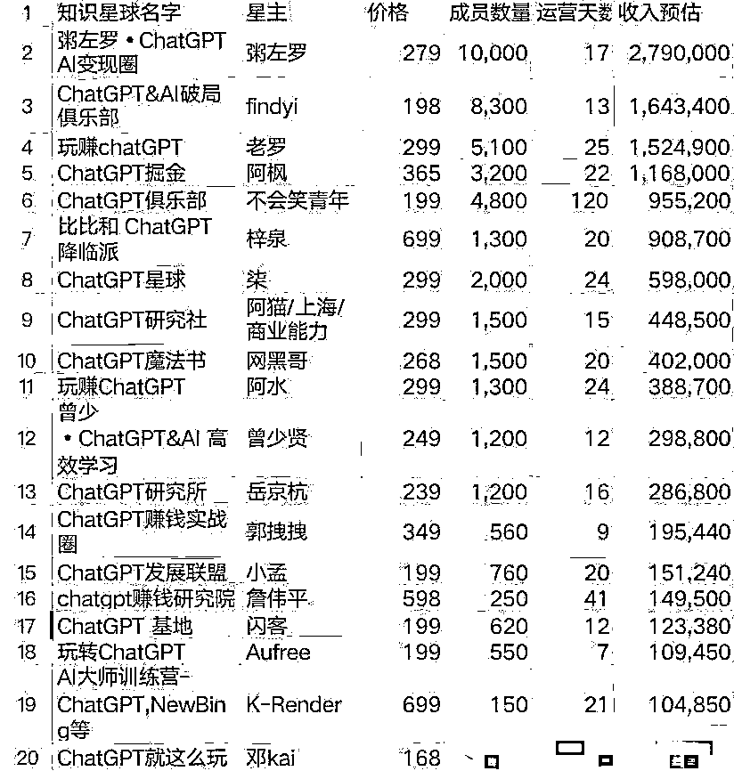

---

最后想对你说：篇幅有限，关于“器”里的6个提效工具，我就不在这里逐一截图了。需要的朋友，直接来问我，我会把工具清单和方法打包给你。做课这件事，从0到1没有想象中那么难，关键是找对工具和路径。希望这篇复盘，能成为你起跑的第一步。

最近身边的讨论几乎都被GPT占据，月入千万的神话听得耳朵都起茧了。早在风声传开时，我和不少同行一样，坚定地认为靠脑力吃饭的知识付费工作，AI是触碰不到的。

现实却给了我一记重击。那天我整夜未眠，凌晨两点爬起来，决定拿自己做一场实验。我自己出课速度很快，如果让GPT也能做出来，就说明它完全可以被复制。于是我给自己定下规则：挑一个我完全陌生的赛道，让它硬做。

我只懂做课的流程，对内容本身一窍不通。最后选了女性情感课，主题是教女性如何找到高富帅白马王子。

我按照常说的五个环节来测。先是课程定位，让它拆人群、定定位、找卖点，再在课程大纲里梳理标题、起个有吸引力的名字。

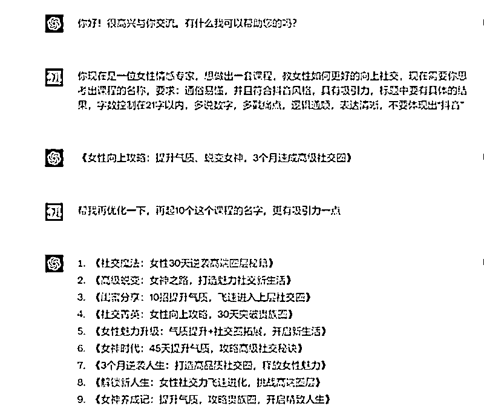

当晚我有点贪心，还想让它写讲稿。没想到这一步直接救了大批老师，稿子一下子就有了，完课率自然水涨船高。

我直接套用了自己常用的首课七步法的要求抛过去，结果它真的完整写出来了。

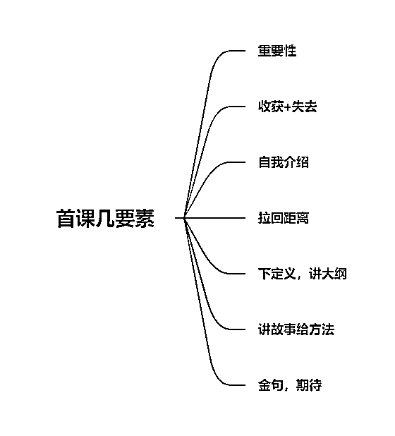

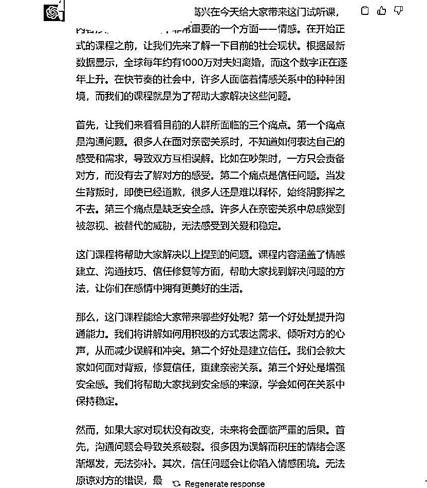

至于录课和上架，这块人必须在场，我没指望它替代。后面我又想，如果能帮老师写详情页文案就好了，很多老师根本不懂营销怎么写，详情图、发售信都卡壳。

我当时还听说它能写短视频选题、短视频脚本、编朋友圈，就一起塞进去测了。这就是我那晚的核心思路。

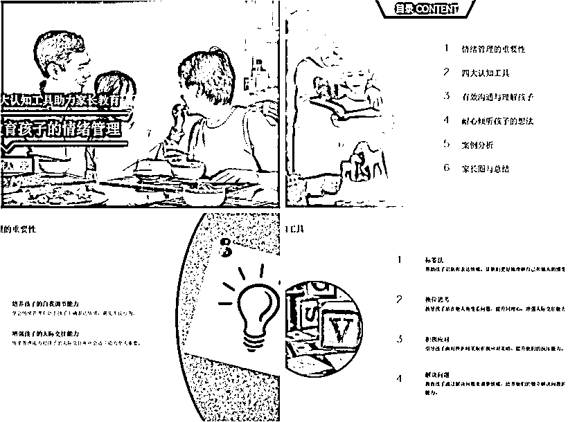

一宿没睡测下来，情感赛道的输出大概有七成能直接用，改一改就能发。那一夜我没觉得累，反而像找到了破局的开关。

第二天回公司立刻和团队开会。AI肯定利弊并存，既冲击我们原有的《做好课的课》，又牵涉翻课风险。争论了两三个小时后，最后投票决定用AI结合做课来破局。

我们团队平均年龄24岁，对新工具接受度很高。定下来就开干：打磨课程框架、把每一步的提问指令越问越准，再把文案、朋友圈作为加餐内容补上。录课、上架，对我们来说都是熟路。

就这么把ChatGPT用起来，七天内啃下整套课程。一边做课录课，一边同步准备发售。

时间点卡在五一假期前，必须在假期前打一仗。筹备了一个月，就为了这场发售。

AI做课终究有不确定性，所以我们先从几千位老学员里筛。两天拉了两个200人的老生群，当晚一场直播转化率接近60%，当天收入近10万。

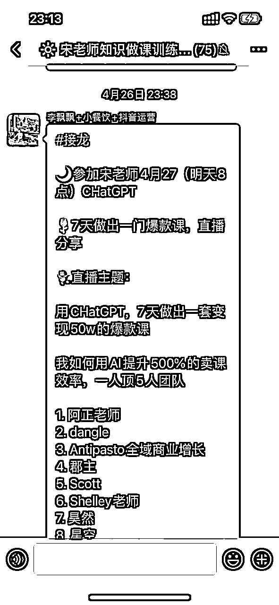

悬了半个月的心终于落地。发售的具体打法篇幅有限就不展开了，以后有机会再聊。记住一点，有产品就一定要发售。

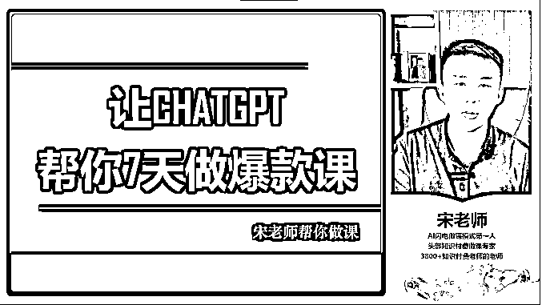

当晚剪辑同事通宵把课程上线并完成交付。我们对上架这块算是摸透了，很多K12、国学类的都能走通，有需要可以私下交流。

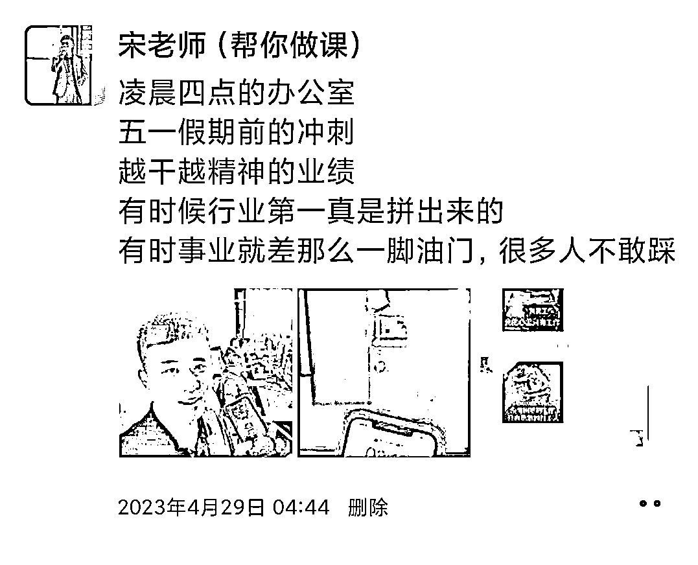

# 四、提升做课效率的6个超级工具

## 1.chatgpt

今年最炸的黑马，用在做课上效率直接翻倍。上面已经演示过了一部分，就不多复述了。

提问方法对了，答案自然就对了。好答案都在等一个好问题。

## 2.闪击ppt、wpsAI

同属今年的新鲜货，这俩做PPT的AI工具口碑很不错。要么给个标题就能生成整套PPT，要么按格式内容自动排版。

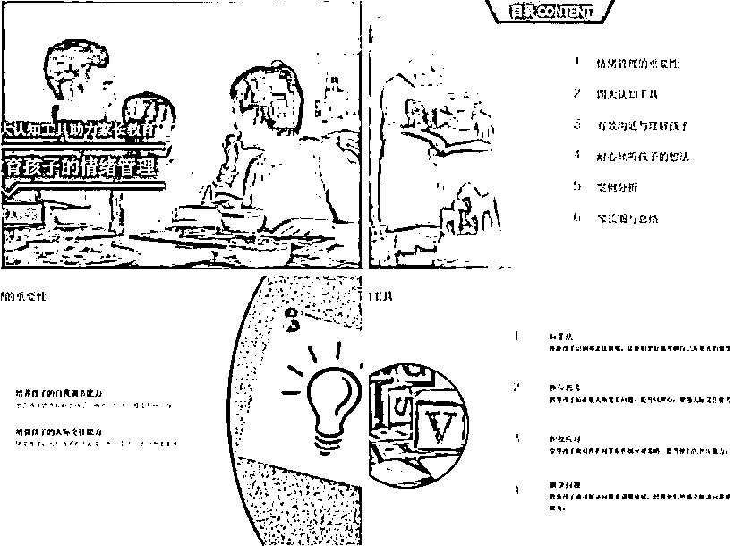

## 3.飞书妙计

这是我个人最爱也最推荐的。录课写稿时用语音转文字，比打字快得多，而且口语自然。很多老师的稿子或短视频就是缺这份口语感。

做直播拆解同行时，视频转文字用它就对了，YYDS。做社群、训练营的老师收集群分享，它也能几分钟整理成文档。

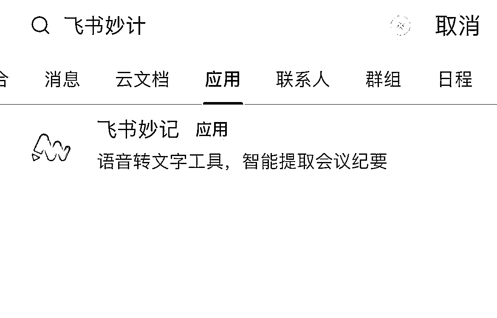

## 4.直播伴侣

录课界的扛把子，现在很多主播已经用它替代OBS了。操作简单自带美颜，又能处理复杂外框、贴片等直播场景，效果比同类工具强不少。

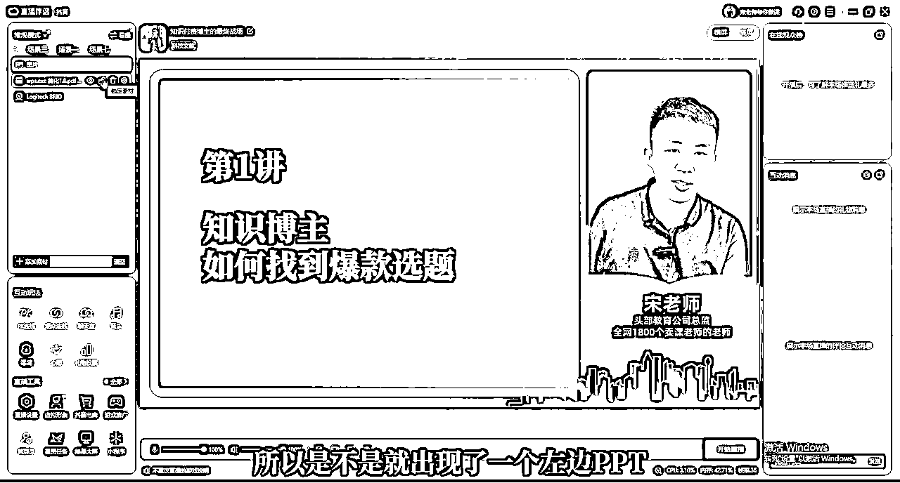

## 5.剪映

做短视频的人都熟。它在做课上的妙用是手机拍人像，后期直接合成带课件外框的录课画面。PPT还能加动画，操作门槛很低。字节的这两款工具确实好用。

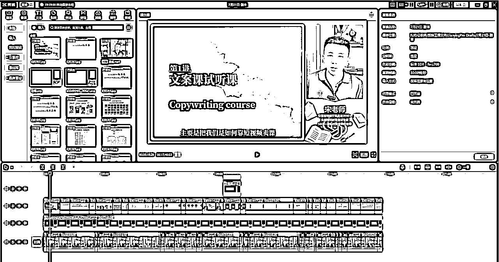

## 5.录课样式

额外分享几种进阶的录课呈现方式，外框素材也备好了。

有需要的老师可通过链接领取，圈友免费安排

https://fkwcd.cn/v/2u83vZ3b/?slv=1&sid=lvbt&v=oosnVwjsA-np9rDGEzS7lHJD9PVI&from=singlemessage

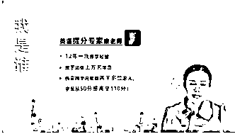

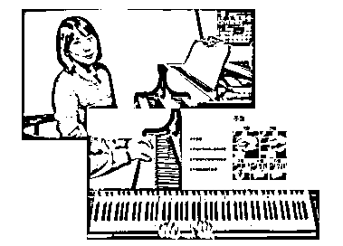

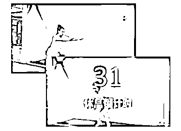

## 6.Xmind

思维导图老用户应该不少了。做课程大纲、设计课程结构时用它思路会特别清晰。

它还有个演说功能，直接能用在录课上，省去做PPT的时间。

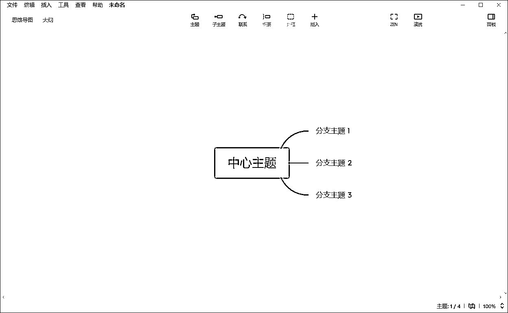

# 写在最后

今天的分享就到这里。无论你是企业老板还是个人博主，知识付费在我看来都是成本极低、回报极高的事，行业利润普遍在75%以上。老板能用课输出产品和管理思维，拿下合作伙伴；个人博主能增收、拉近粉丝、打开后端。

如果你是小白博主，就用AI快速实现0到1；中腰部博主就用AI提效，干掉同行；头部博主就用AI翻新产品做迭代。

欢迎有知识付费问题来找我聊。

2023是AI元年，AI+知识付费是确定的趋势。能把两者结合起来的人，一定能站在风口上。可以想象靠AI知识付费赚到百万的画面。

未来写书的人会越来越少，做课的人会越来越多。同样是名片，动态的课程远比静态的书本更有生命力。

祝大家2023龙哥盟，做课赚钱。感谢每一位看到这里的老师。

我是宋老师，23年已帮助500位老师卖课50万，欢迎一起做课赚钱！