今天聊一个可能被很多人低估的搞钱路子：用抖音帮餐饮店做招商。97年的铁柱，一个南方小伙，没做过餐饮，也没啥专业背景，把这个项目从零跑通——而且这套方法完全是他试跑了好几个餐饮案例，一脚一脚踩出来的，直接就能照着干。

22年9月底，他跟门店敲定合作，10月就开始出单，11月一个月成交35家，流水做到100w。注意，这100w不是他一个人的净利润，还得跟品牌方分润。但即便如此，普通人复制他的打法，每月多赚几个w甚至更多，完全有可能。

先看核心逻辑：找到那些已经跑通0到1的火爆门店或者地摊，跟老板谈合作，用抖音帮他们放大利润，目标是吸引B端客户，也就是招加盟、收学员。整个链条拆成三段：前端搞定流量，中端负责转化，后端品牌方负责交付。利润怎么分？他给自己定的底线是五五开。

很多人卡在哪？他复盘下来，真正的难点就两个：“拿下爆品”和“账号起号”。品选好了，直播场景和现场成交会非常顺，甚至不用话术；号起好了，客户信任建得快，咨询和转化都顺畅。关于品，他说真正赚钱的品自带销售力，像iPhone一样，不需要推销，大批人看到就会主动咨询、花钱；号起得好，一般两到三周就能完成与客户的信任搭建，慢一点也就一个多月，后面决策会非常爽快。

还有一个大家常问的问题：流量和客户资源哪个重要？他的回答是，先有流量，后有客户资源，二者不是平行关系，是先后关系。

直接看他的成绩单：单场直播54分钟，10万场观；单日账号咨询量500+。就是下面这两张图。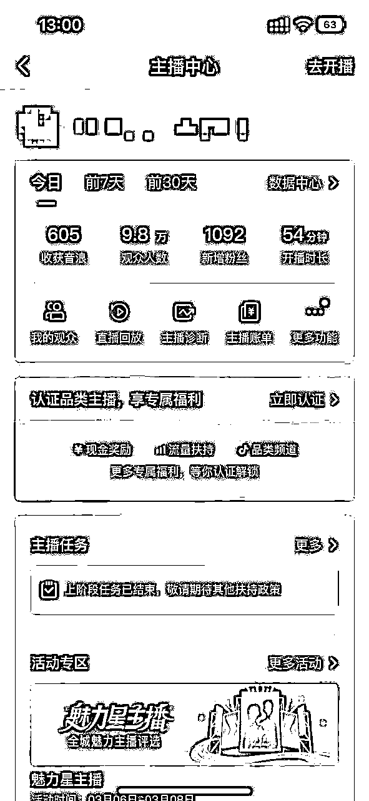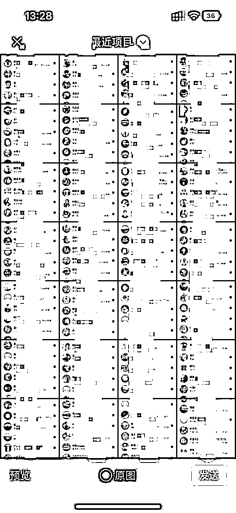

先说怎么选品。他手上跑过的几个品：牛肉粉，100平门店，日营业额2万；肉夹馍，一个地摊，一天9000到13000；豆沙凉粉，40平小店，日流水1.5万。

选品标准有三条：第一，门店建店成本控制在15到20万以内，地摊开摊成本3到5万以内；第二，营业额要够硬，60到80平的门店，单日营收过万，地摊单日6000以上；第三，毛利60%，净利能做到45%以上。总结下来就是投入小、回报高。要是啥都不会看，最简单的办法：去门店蹲几天，盯着人流和流水单号，天天排长队的，基本就是好品。

品从哪找？线上，去抖音和小红书搜“xx排长队的店”“xx十年老店”“xx排队打卡”“老店美食”这类词，看到频繁出现的店就留意；然后搜细分品类，比如卤味、串串；再按地区商圈搜，比如“南宁平西夜市打卡”“南宁中山路火爆门店”。相关参考见图：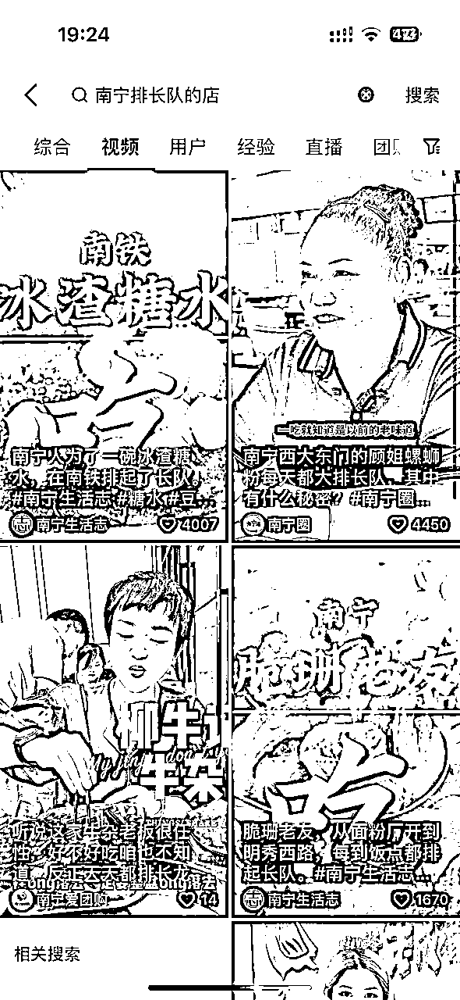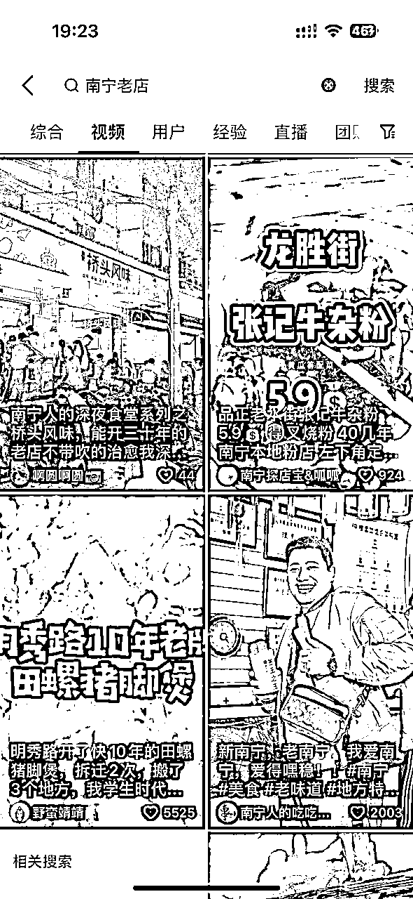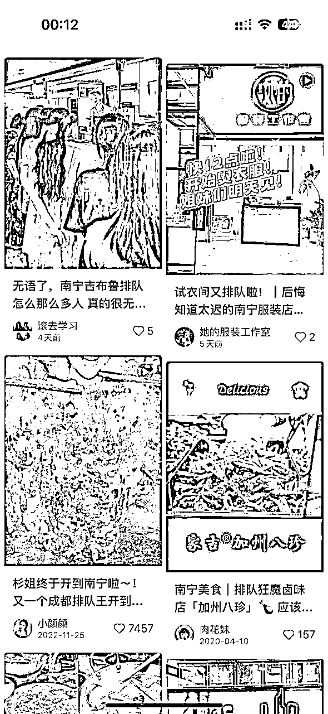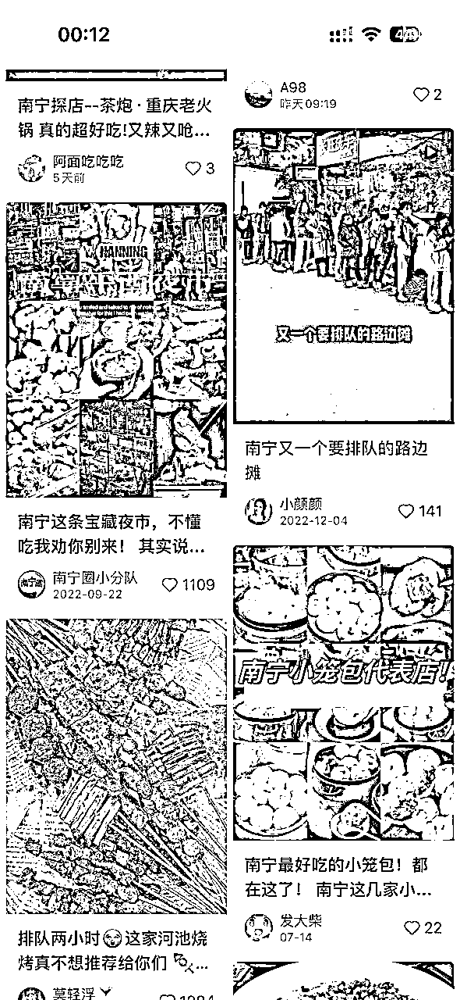

线下就两条路：一是直接去当地夜市、商圈扫街，不要盲目挨家尝，挑一家你想消费的店，买点客单价低的东西，比如热狗、甜品，顺便问老板：“我带外地朋友来，这条街哪家店最火？”问两三家，答案基本出来了。二是找抖音达人或美团做线下拓店的朋友，他们接触的门店最多，请吃顿饭，信息基本到位。

定了几个备选品之后，要详细收集门店的各项数据。还有两个提醒：品牌方最好有招商资质、特许经营证件，不然做大了容易被人搞；门店卫生也要严格盯，被人拍下来发到网上，后患无穷。

流量怎么做？内容上，一个账号必须有四类视频。第一类，置顶视频：一条讲创始人故事，用“十年体”叙事，按时间线记录关键节点，可以去抖音搜“一个创业者的十年”“一个xxx的十年”，筛选半年内的高赞作品，扒下文案改成创始人自己的故事；一条讲门店或摊主的故事，突出用料、卫生、服务、开了多少家店、有什么老字号背书，就是秀肌肉；第三条可以是走访加盟店和学员摊位的案例，也可以放最近跑出来的爆款。总体就一个目的：让人信你靠谱、做得事靠谱、跟你干能拿到结果。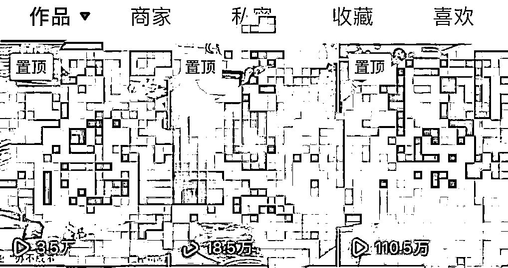

第二类，人设视频。要让抖音里的你是一个活生生的人，有点观点、有生活细节、有节假日给员工发福利的温暖、有对待家人和合作伙伴的义气。这些是成交链路丝滑的隐形推手。第三类，专业视频。像知识付费IP一样，展示你在餐饮这件事上的专业度：怎么带团队、怎么减少员工流失率、产品怎么做、用料怎么讲究、怎么给加盟店做培训，以及你对选址、促销、复购的看法。第四类，营销视频。讲清楚模型店的投入和利润，拍当天营业额、门店火爆场面、学员学习实况；强调产品卖点，比如十年老店、投资小回报快；还可以不经意地炫个富，在豪车里聊餐饮。

文案怎么写？首先想清楚变现目标：收学员，面对的是3到5万预算的小微个体；收加盟，面对的是10到20万预算的中小老板。文案就是写给这批人看的，要戳到他们的兴趣和焦虑，甚至争议点。而且这些文案有个特点：不看出镜IP是谁，谁讲都能爆。

怎么找爆款文案？第一，从对标账号的高赞视频里摘抄。第二，从爆款选题里找：在抖音搜“卤味学习”“卤味加盟”“餐饮加盟”“创业认知”等关键词，优先看个人IP号，进主页看高赞视频，点漏斗符号，筛选“最多点赞-半年”。第三，用轻抖小程序提取文案：转发视频复制链接，微信搜“轻抖”，粘贴链接一键提取。第四，每天存5条，保持文案库持续更新。相关截图在这：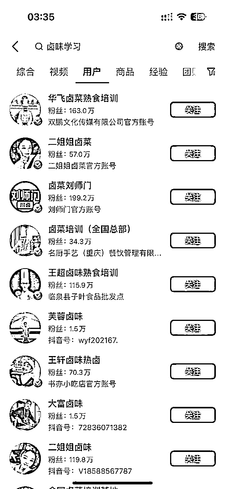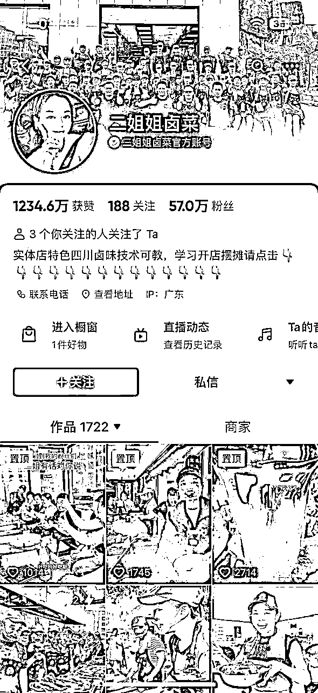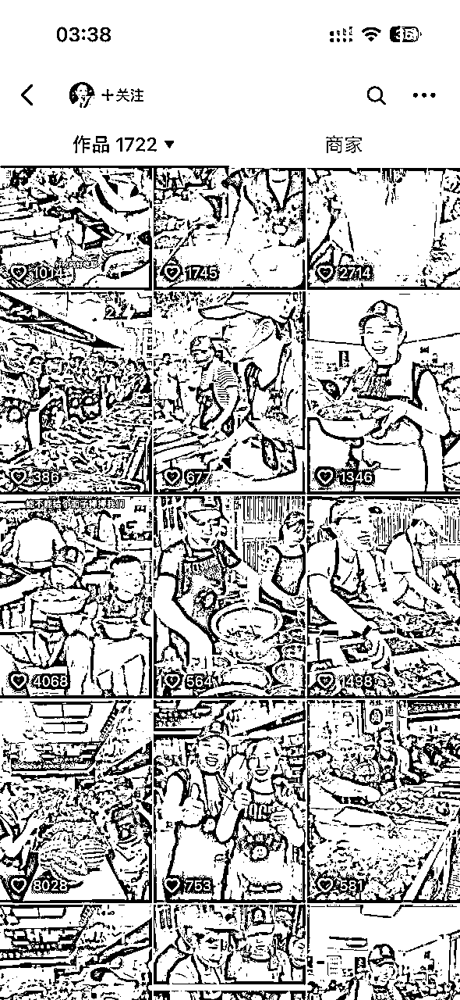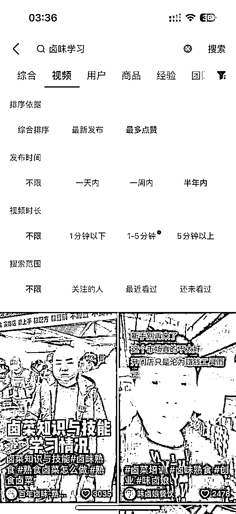

起号与投放。测账号：跟老板合作后，多拿几个手机号注册抖音，一天发3条，发三天就能看出哪个号初始流量好。发布时间他跑出来的是11:30、17:30、20:30三个时段，不同品类可以自己测。为了快速测号，可以混剪：文案用励志正向的餐饮文案；素材横向拍开店全过程（选址、装修、试业、营业），纵向拍一天动作（开门、拿桌椅、备料、清扫、倒汤、切菜），重点拍产品和客流；音乐选80后熟悉的老歌，因为客户大多三十岁以上。

对标账号找什么样的？10万粉丝左右、评论区有明显咨询“想学习”“想加盟”的、最近还在更新的、最好是同城或同省，方便客户考察。找法有四种：关键词搜用户；搜相关话题，看高播放量话题下的好视频；利用关注旁边的“小三角”推荐；用“创作灵感”搜行业话题。见以下截图：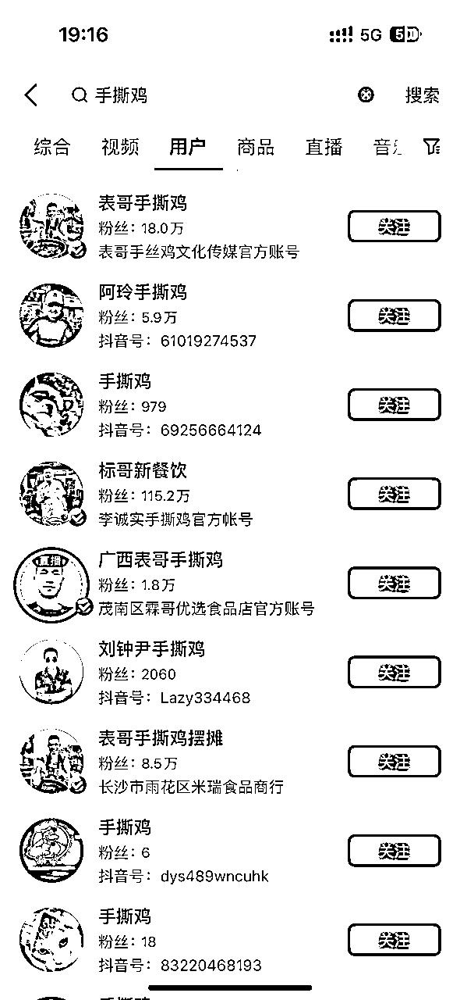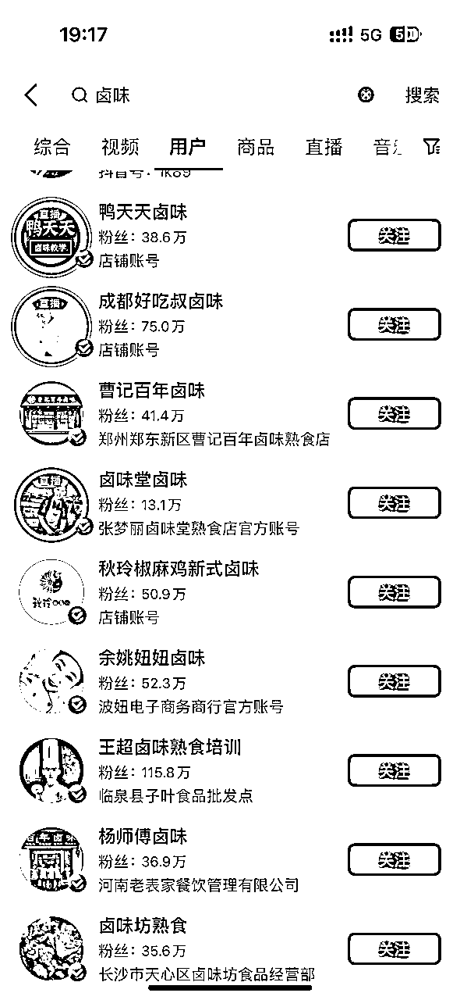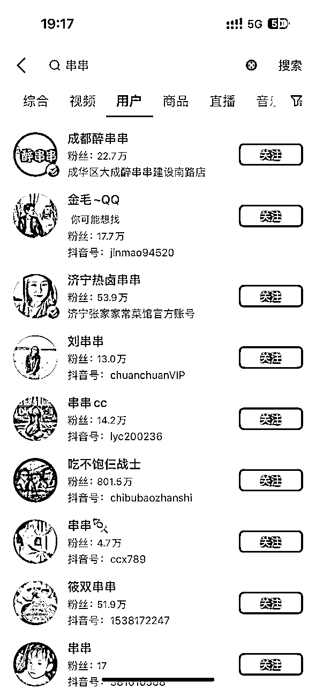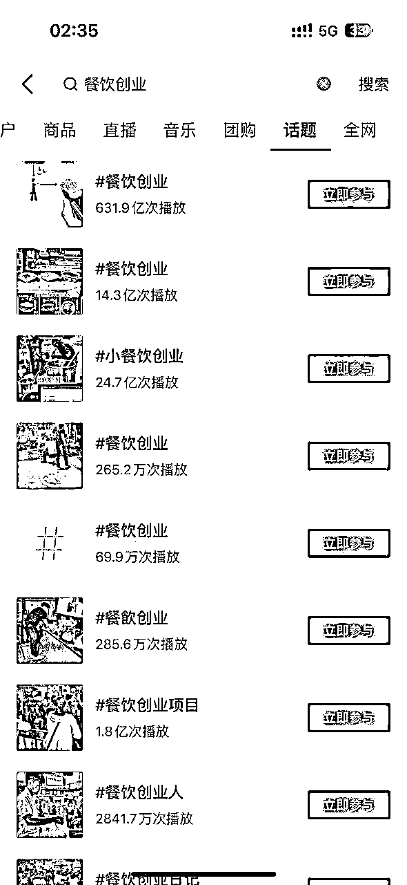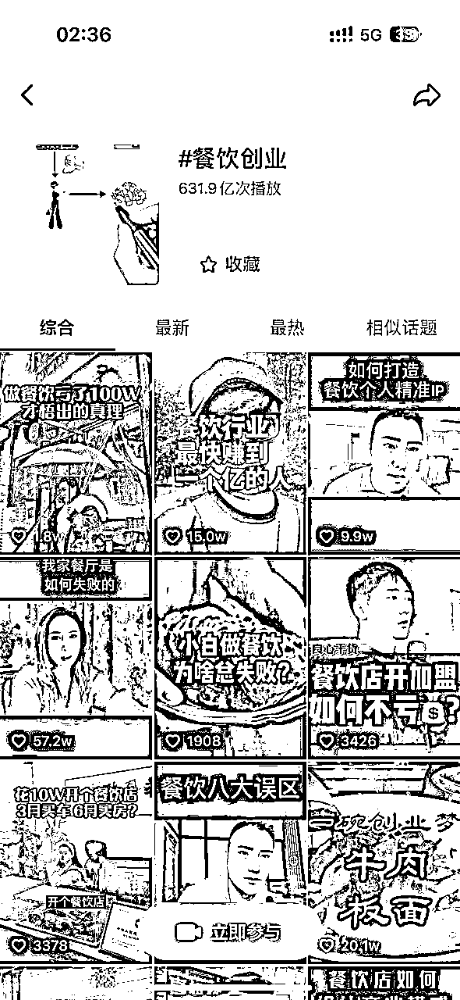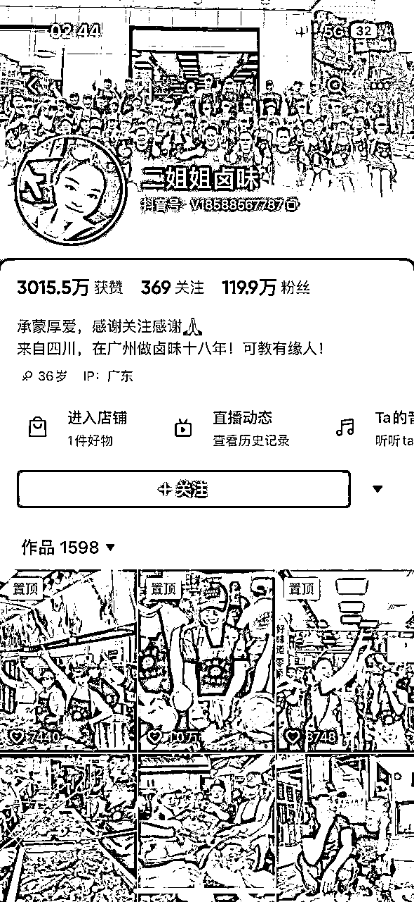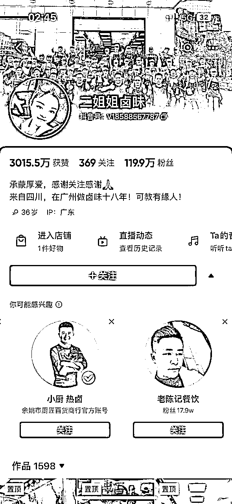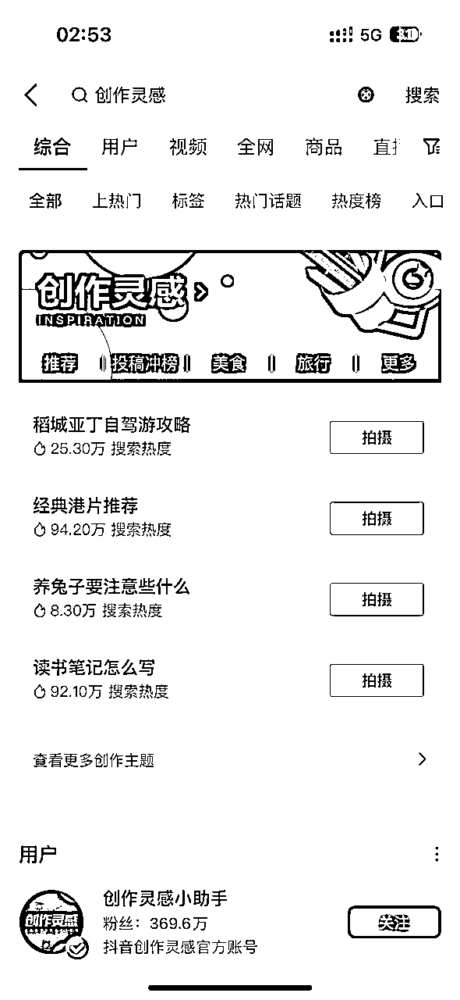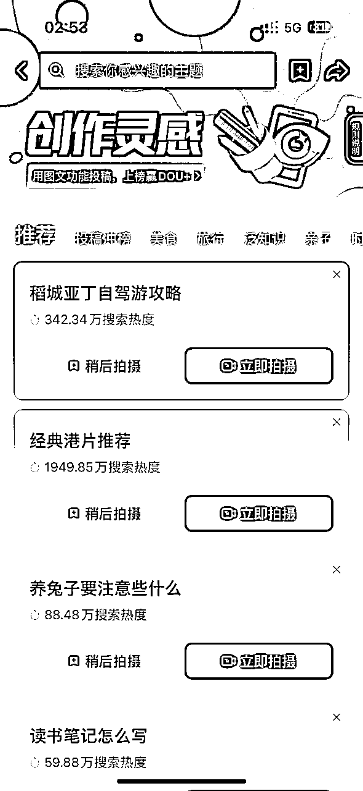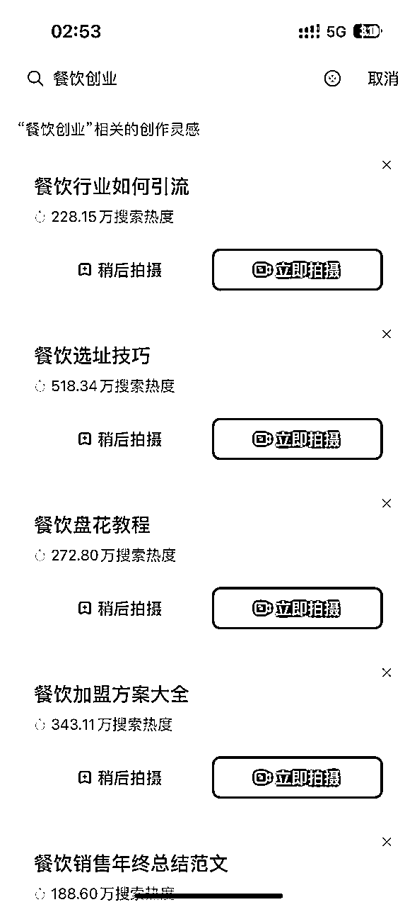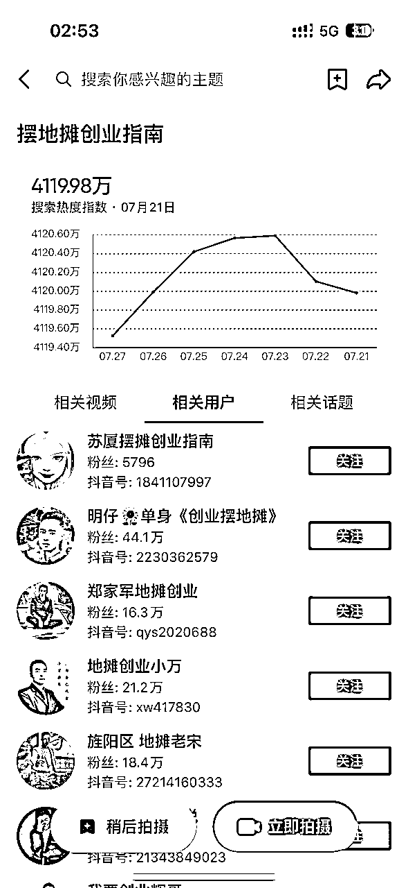

投放也有两种路径。第一种：0到1000粉，投24小时、点赞评论、对标达人，给系统足够时间找到精准用户；1000到10000粉，投粉丝量；1万以上，投智能推荐或账号速推。第二种：先把标签打起来，每条100块，全部投给自带项目的餐饮播主；0到5000粉投6小时、50万粉丝以上的大V；5000粉以上，投餐饮项目评估型博主，每条100，投到不划算为止。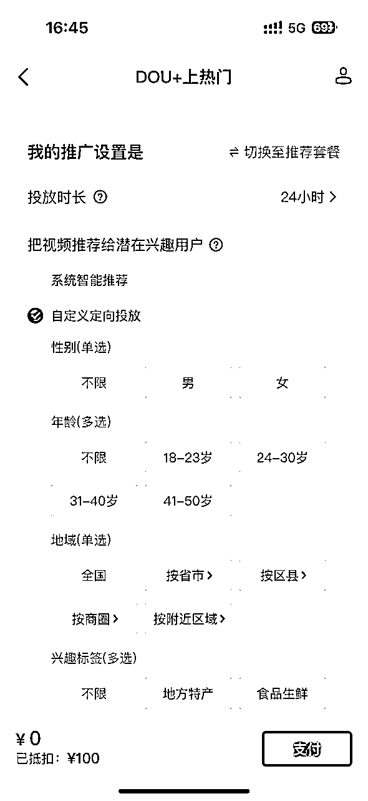

拍摄与剪辑，细节决定质感。拍摄上：画面要稳定、光线要好、人物要清晰；口播别用固定镜头，多角度切换；真实感比打光重要，但要精致就上主光、背光、轮廓光；收音必须清楚；每次拍摄都要重新调参数；一条不顺就重拍，感情没法靠剪辑补；手机横拍看摄像头，竖拍看画面中的自己；要高级质感就用相机；细节要有，但别过度追求完美，真实的错误反而动人；一个人干不过一个团队，专业事交给专业人。剪辑上：如果剪完不如原片，就别硬剪；剪辑要突出内容和情绪，不是炫技；多余镜头一秒不留；节奏和配乐要贴合；字幕声画同步；逻辑和脚本一致；有高潮有低谷；格式设置正确；爆款内容多准备几个版本；建爆款音效和片段素材库。

还有几个注意点：镜头多给产品和客流；引导出镜IP讲过去的经历和情绪，情绪出来了，口播才有力；像素级模仿对标账号的景别、角度、场景和动作；出镜IP能用女的就不用男的；剪辑拼的是网感，音乐节奏和审美决定流量。

如何用直播做引流？设备就是手机加麦克风。场景选出摊/开店的真实时段，主食快餐选中午下午，小吃选下午到晚上，早餐就是早上。直播技巧，他说特别感谢赚钱有术这个平台，直播的很多细节都在航海手册里讲透了，链接放在这：赚钱有术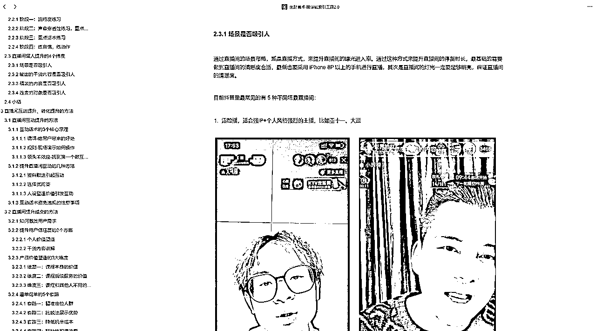。

直接说重点：刚开播要用鱼塘号引导互动，说白了就是有水军提问；开播前半小时发一条有冲突感的预告；和品牌方对接好加盟学习政策；按福袋时间引导私信，企业号挂小风车；资料钩子就是“关注私信发项目手册”；福袋口令设为“怎么开店”“怎么学习”“怎么合作”；不要连麦，防竞对捣乱，有人连麦就让他评论区或私信；把互动、留人、塑造产品、留咨话术整理归档；最后一句万能引导：“有找市场机会的老板可以关注一下，每天中午十二点准时开播带大家线上考察。”

整套东西拆开看，没有高深理论，就是一个动作一个动作死磕。门槛就是选品和起号，这两个啃下来了，剩下的就是执行和迭代。希望这份拆解对大家有启发。

把直播间热度做起来以后，投抖加直接选“100-人气-智能推荐”，再挑一条你最想推的视频去加热直播间——优先选正在跑量的、最新发布的、或者评论区互动特别高的那条。

这里要特别留意，直播间本身需要

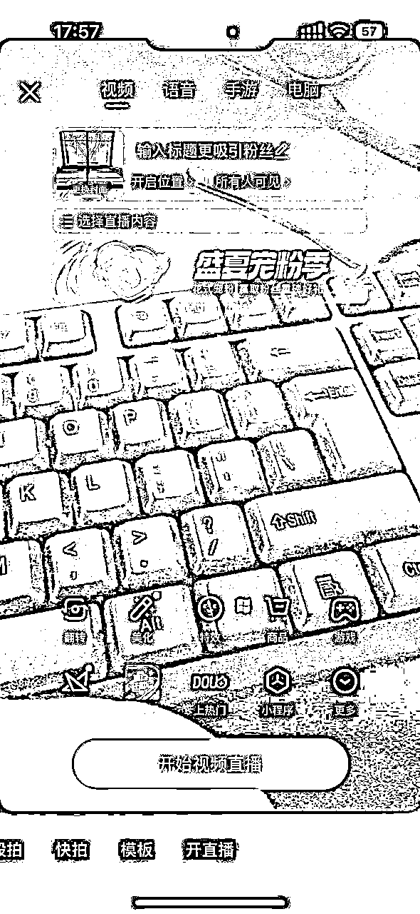

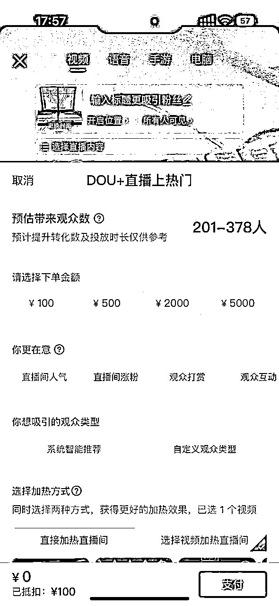

## 转化成交：最省心的一环

拿下某个产品之后，凡是加盟这个品的客户，都跟我们绑定在一起了。线下每个门店和摊点都必须放我们的收款码，方便统一管理客户。品牌老板要做的其实很简单：收好钱、做好交付就行。

为什么说转化成交是整个执行里最轻松的？因为前面选品把关够严。品牌本身够硬，客户自然奔着咱们来。真正需要我们上手的，只有【问题解答】和【私域运营】这两件事。

### （一）问题解答

针对每一个合作的产品，提前把《加盟客户常见问题》梳理清楚，后面沟通直接照着答就成。

### （二）线上运营

1. **标签化管理**  
每个进线客户，我们都会先加标签，搞清楚他从哪来。基本只有两个渠道：一是线下门店扫码进来的，二是通过搜一搜加过来的账号粉。

2. **客户备注**  
统一格式：日期+地区+姓名。比如“0516深圳陈总”。

3. **客户描述**  
把当天聊过的人记下来，重点写这几项：  
- 他做哪个行业，跟餐饮沾不沾边  
- 收入什么水平，有没有实力升级代理  
- 手上有没有门店，是不是需要尽快跟进  
- 意向度高不高，认可度强的就是我们要重点追访的对象  
- 有没有吃过产品，是他自己在管还是雇人管  

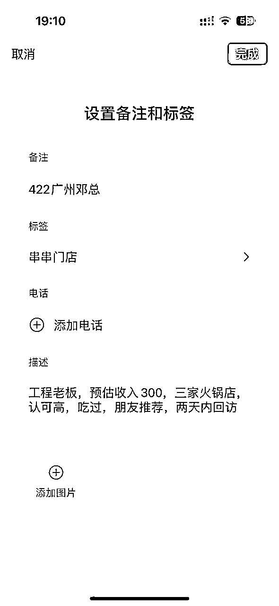

4. **朋友圈塑造**  
这一点不多说，懂的人都懂，朋友圈就是你的第二张名片。

## 项目心得

**第一，坚持执行。**  
刚开播那会儿数据惨不忍睹，在线人数只有几个、十几个。但硬是咬着牙一天天播，最后做到了十万场观。

**第二，选好的品，找对的人。**  
宁愿前期多花时间做筛选。品不行，后面再努力都费劲，还看不到结果；找对合作方同样关键，他配不配合，直接决定项目交付和这个品能走多远。

**第三，开局就打王炸牌。**  
拿到品以后，别犹豫，把全部心思和最好的资源都砸进去。专业的事让专业的人干，虽然刚开始一个人也能顶下来，但会非常累，能外包的尽量外包，无非就是把利润聊明白就行。

**第四，所有执行数据都要盯紧。**  
按日复盘、按周总结，随时调整打法。

最后想说，特别感谢赚钱里的两位贵人。一位是带我进来的钱南老师，95后的执行力真的太顶了，每次我需要帮忙的时候，他给的建议和帮助都特别落地；另一位是我们赚钱的扛把子涛哥，参加完他的线下分享，真的有醍醐灌顶的感觉，对我创业这条路影响太大了。太爱赚钱了，家人们！