# 25个让微信成交更容易的小方法

> 来源：[https://oee5lr7gsk.feishu.cn/docx/JHdGdT6oHo3zL2xx4qBcIdCSn6b](https://oee5lr7gsk.feishu.cn/docx/JHdGdT6oHo3zL2xx4qBcIdCSn6b)

线上做了一年多，从线下搬到线上，首年营收做到220万。

这段经历让我沉淀了不少私域成交的心得。

我一直觉得

### 线上成交的本质，就是线下场景的搬家

在微信上聊成交，说白了就是把线下的人情世故搬到对话框里。

背后的底层逻辑没变，就是先把信任堆起来。

信任够了，成交自然发生。

我也一直认为私域的终点就是微信。

只要微信沟通更顺一点，关系维护效率和产品转化都会明显提升。

趁着这个主题，把去年一整年微信聊单的实操，以及过去十年的销售经验，整理成25个能立刻上手的小技巧。

每一个都很轻，读完就能用。

* * *

## 001 成交率低，先把曝光做到极致

很多单其实靠的是重复曝光。

成交转化不高，就更要做到极致的反复露出。

量到了，成交自然会上去。

要做的就是让客户持续感知到“我能提供什么”。

多提一嘴，总比藏着好。

但要注意分寸，不要刻意推销，反而会适得其反。

抓住合适的聊天氛围，顺势提一句就够了。

下面这段对话截图，就是我和学员闲聊时自然带出的产品信息。

目的就是高频曝光，让对方清楚我手里有什么。

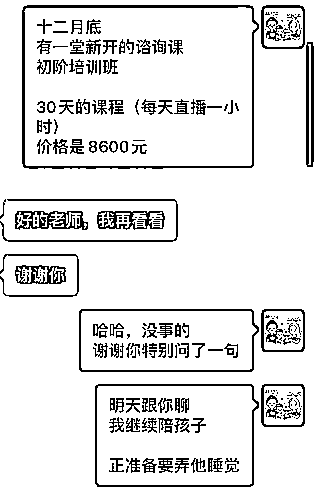

* * *

## 002 意愿有了，先别急着收钱

对方已经表现出意向，这时成交只是时间问题。

与其急着成交，不如先让他更了解自己。

这样成交后信任感会更稳。

确认对方有意愿时，反而可以慢下来。

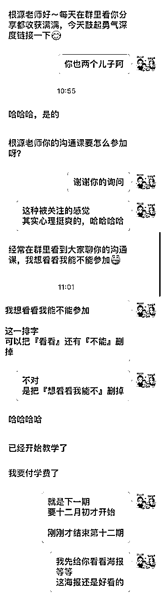

案例里对方很明显想买，但我没有立刻介绍产品，而是先聊几句，加深彼此了解。

* * *

## 003 付款前一定要做一次意愿确认

准备收钱时，最关键的一步是再次确认客户的真实意愿。

这样才能判断是否还要继续跟进。

我的做法很直接。

比如下面这张学员和客户的对话，已经到收尾阶段了。

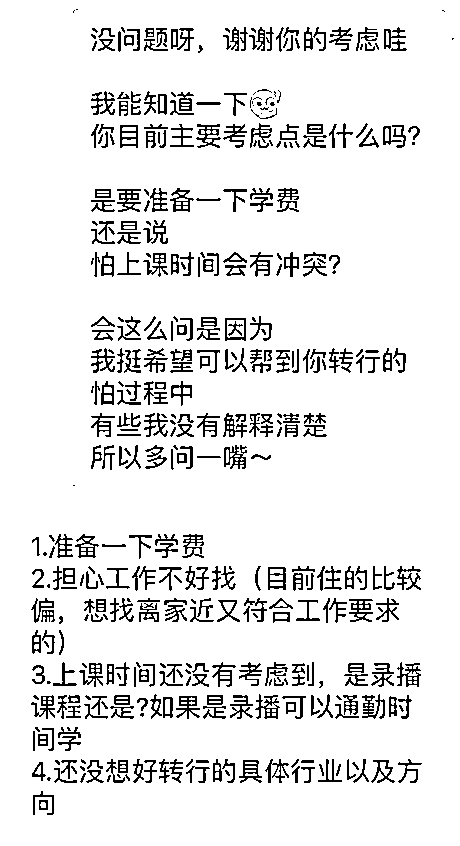

这时候客户已经知道我要卖东西，也有意向，直接问就好。

我会说：

能帮我确认一下，你刚才说的准备学费，是确定要报吗？

如果是我就很欢迎你成为我的学生，等准备好转我之前提前说一声，微信支付宝都可以。

抛出去后，对方会回复确定或不确定。

如果不确定，我就不再追踪。因为他考虑点很多。

我会礼貌回复：我随时在，有疑惑随时问我。

总结：确认意愿，直说最有效。

* * *

## 004 用认同+夸奖点燃对方热情

热情的高低，不在于客户本身，而在于你有没有点燃的方式。

最简单有效的是：认同+夸奖。

这也非常适合作为下一次聊天的开场。

比如：

你发的视频也太棒了吧

你朋友圈第一张图拍的好好看

你昵称前面的三个zzz好特别

……

这样一说，聊天的能量会立刻拉高。

* * *

## 005 怎么判断聊天的能量高不高

聊天能量高低，直接决定能不能切入。

判断标准看两点：字数和回复速度。

如果对方每条都回的很长，有来有回，回复也快，基本就是高能量状态，可以开始切入了。

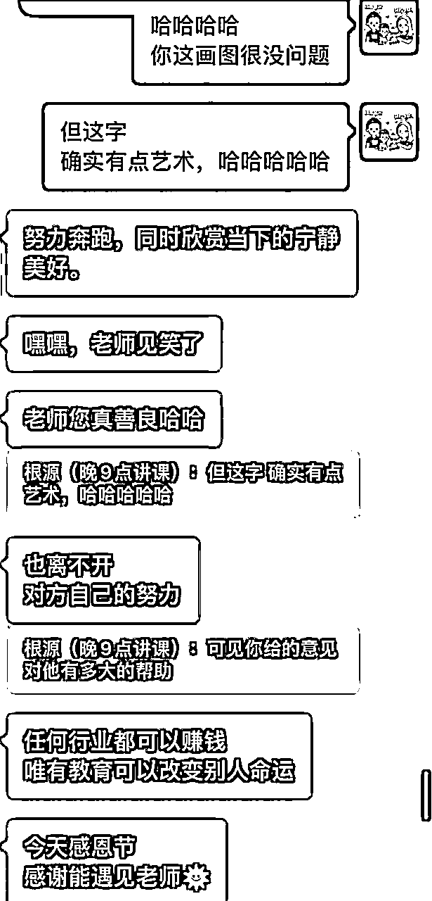

案例里从回复的字数和速度就能判断，对方能量很高。

* * *

## 006 时机不对就别硬推

我曾提到未来可以进社群，虽然要付费。

消息发出去后，对方没反应也没追问，说明时机未到。

这种情况下我不会反复追问，也不会再问第二次，直接带过。

时机很重要，抛出议题没回应，就不要热脸贴冷屁股，等下次更好的窗口再切入。

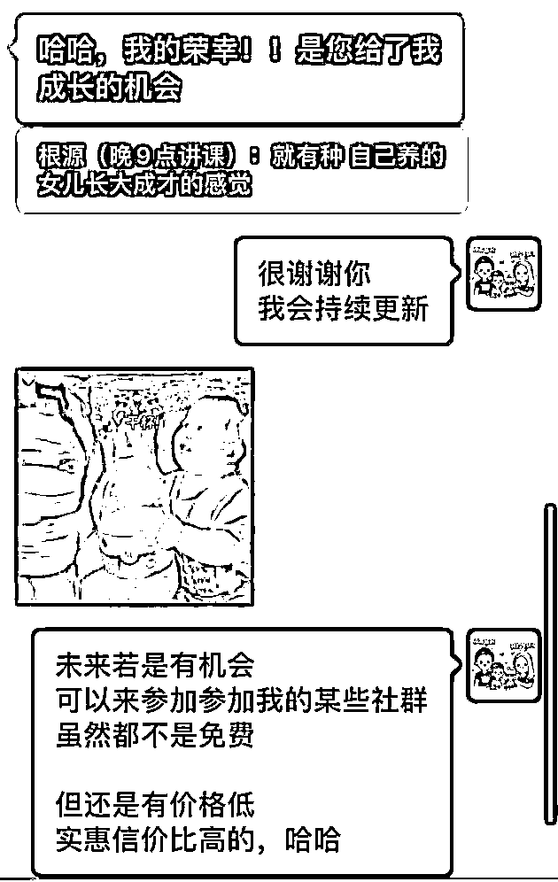

* * *

## 007 客户抱怨时先安抚，别争辩

这是学员的一个客诉案例。

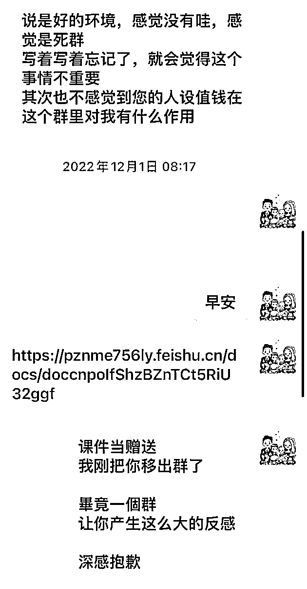

群里朋友加我后没几天，就说被打扰到了。

小tips：对方一抱怨，第一件事不是争论，是安抚。

其实问题不在我，是对方对流程认知不清。但先安抚情绪，再谈理。

* * *

## 008 养成交的习惯，时常自荐

看下面这段对话截图。

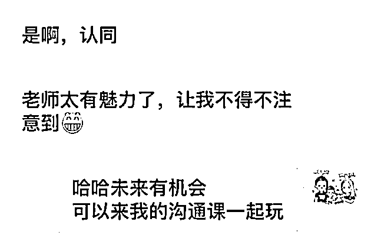

想强调的核心是：习惯性自我推荐。

时不时丢一句自己的服务或产品。

成交是概率游戏，不求次次成交，而是通过大量细节点，增加被选择的概率。

* * *

## 009 很久没聊的朋友怎么破冰

公式很简单：

打招呼 + 温暖关系 + 再次切入主题 + 提前说明有费用

温暖关系部分至少要5句以上，可以参考案例图。

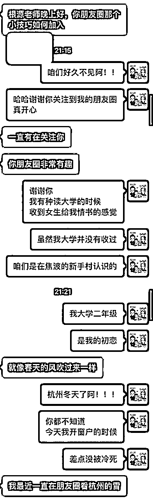

* * *

## 010 温暖关系的6个切入角度

我常用的温暖开场大致分这几类：

⭕️第一：近况
最近还顺利吧
许久未见
突然看到你私信我挺开心的

⭕️第二：朋友圈
许久不见
这几天才刷到你的朋友圈
你最近几条更新都让我印象深刻

⭕️第三：地域/环境
记得你在xx工作
想到那边的状况还好吗

⭕️第四：上次聊天时间
才发现
距离上次聊天已经过了多久了
今天你突然想起我，感觉好暖心

⭕️第五：上次聊天结尾话题
哈哈怎么突然找我了
上次我们还聊到什么什么
今天被你cue到挺开心

⭕️第六：头像
还是这熟悉的头像啊
这么久没聊了
或者
我记得之前头像不是这个吧，是换了吗
我们有多久没聊天了

* * *

## 011 低价品的核心是服务，不是效果

如果产品定价超过500元，建议先做一个百元内的体验版，比如99元套餐，降低尝试门槛。

体验过程中的关键，不在于产品有没有立刻见效。

而是你在服务中展现出的专业度，让客户觉得“这人靠谱，后续可以继续买”。

### 低价品的核心价值，是体验过程中的服务，而不是产品本身的效果

引流品的意义就是让对方认识你的价值。

像减肥产品，7天不可能见效，客户会不会听话更重要。

把对效果的焦虑放下，把精力放在服务体验上。

案例参考：

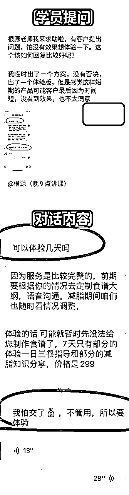

* * *

## 012 新客户先寒暄，别直接甩产品

新加的好友，一定要先寒暄。

问个称呼，问问从哪加的，名字特别之类。

下面这段对话就是新好友的开场，我一定先闲聊暖场。

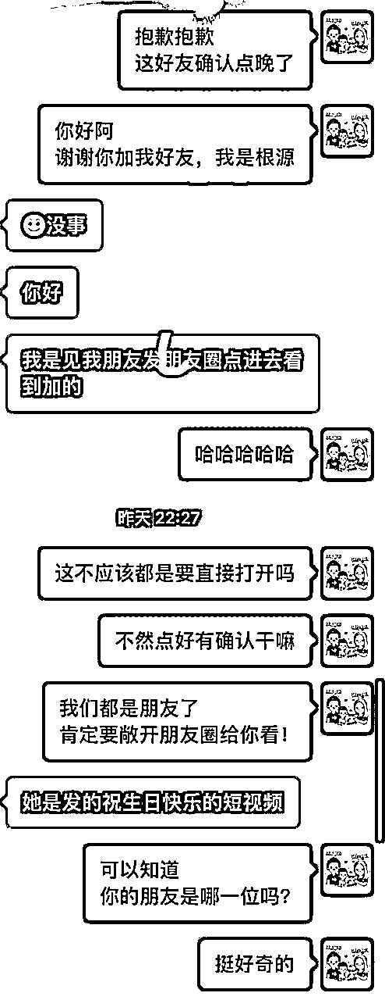

哪怕只是打个招呼也好。直接上来谈产品，成交率会很低。

连需求都没摸清就推销，是大忌。

* * *

## 013 如何拒绝砍价又不伤关系

看学员案例：

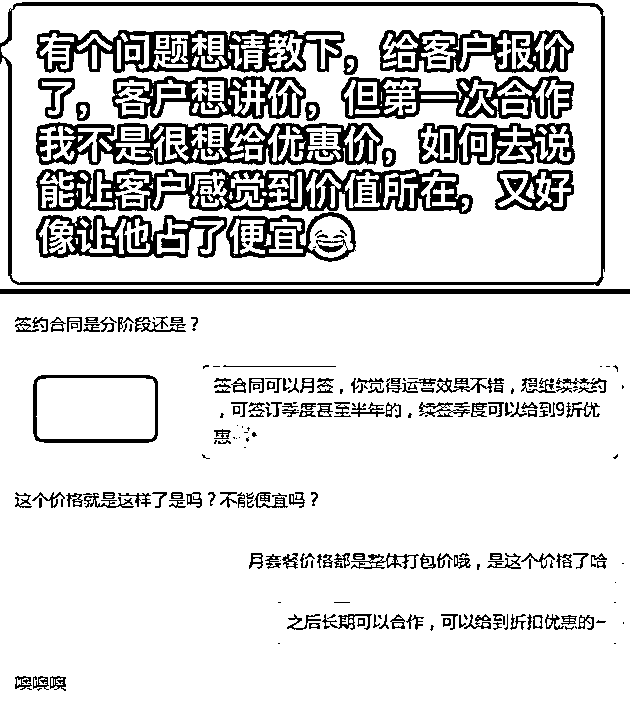

想让客户感知价值，别用嘴说，用行动和规则体现。

先把规则说清楚，并坚守。

可以准备固定话术文档，比如合约说明里写明优惠只针对复购客户。

关键是：拒绝要保持礼貌。

可以说：

很谢谢你支持我的产品
但有个情况需要提前说明
我们的折扣都是针对老客户的
希望你能理解

* * *

## 014 客户拿同行比价怎么回

背景如图，学员案例，对方拿别人的价格来压我。

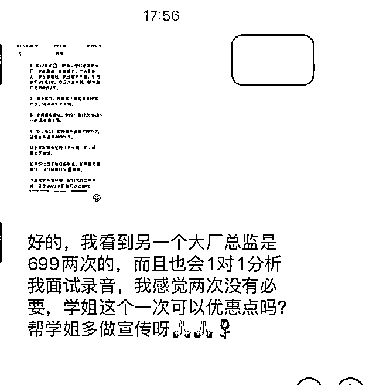

我的回复思路：

很抱歉，这个优惠可能没办法给
因为你们的咨询模式和交付方式不一样
同样价格，对方总监能服务两次，我只能做一次
你怎么不直接找他呢？

如果因为价格就选他，完全合理。

第一段说完，用反问把对方真实需求逼出来。

砍价的核心是学会拒绝，拒绝是门艺术。

* * *

## 015 收款前把规则说在前面

看我自己的一个案例：

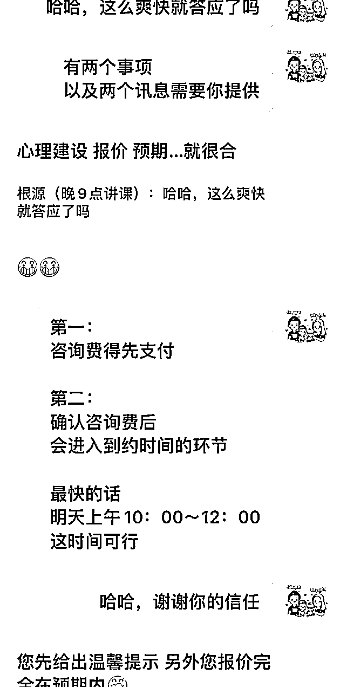

确认收款前，我会把规则先讲清。

转账后我还会再强调一次：我们体系是不退费的。

如果你考虑清楚没问题，我就点收款。

把丑话说在前头，后面才好执行。

这里有一段学员的对话：

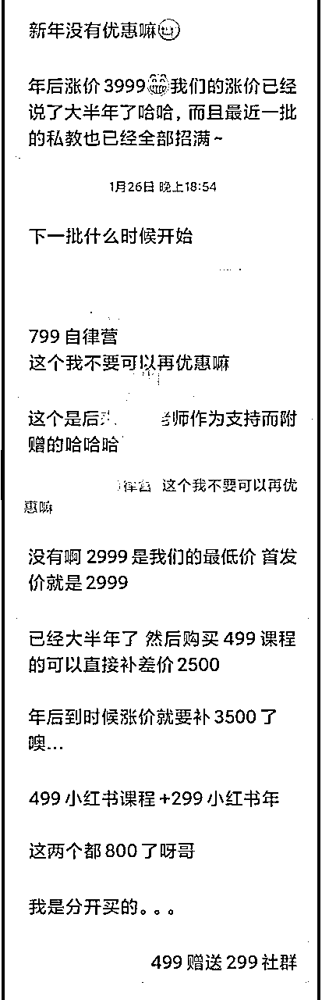

开场就进入讨价还价，后面会很被动。

遇到这种情况我会直接说规则：课程费用固定，优惠只给老学员，录播课可补差价，私教课是赠送，不参与折扣。

讨价还价会让课程价值感瞬间掉价，我尽量避免。

* * *

## 016 先确认需求，再给出答案

看学员案例：

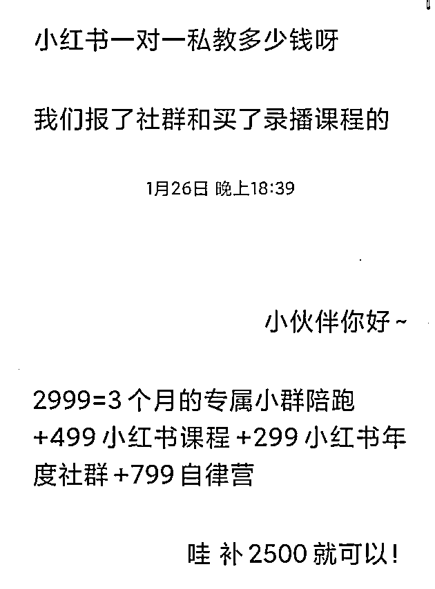

对方提问，说明球在他手里。

我不会立刻接球回答，先夸一句，然后把球再抛回去。

比如：愿意买录播课的人都很上进，谢谢支持。课程看过吗？里面有几章我很喜欢……这个费用比较高，能否先了解下你想问私教课的原因？

这是确认需求的过程。

很多聊天聊死，就是因为没有主导权，被对方牵着走。

* * *

## 017 千万别直接回答客户问题

很多销售聊不下去，就是因为接话系统用错了。

明明该我主导，却被客户带跑。

面对高客单，我一定反问：

这个费用不低，能先告诉我你想了解私教课的原因吗？

只有确认需求后，才能给出合适的方案。

总结：不要习惯性回答，习惯性丢球。高手都是提问高手。

* * *

## 018 客户预算不足怎么留人

前提是学生报完初阶可升级私教，只需补差价。

方案一：

我觉得学习要量力而为。你可以先报初阶，交付需要时间，学完再升级，钱也存的差不多了。

而且未来私教涨价，你仍按3080的价锁定名额。

方案二：

愿意成长的人不该被当下收入限制。我有分期服务，但前提是先报过我的课程。

比如先报初阶，获得私教分期资格，1980先付，剩余分两三期付清。超时未付服务暂停。

这样既不会流失预算清晰的客户，也能筛选信任度。

* * *

## 019 产品涨价要主动说明并道歉

很久没联系的客户，一定要把涨价说清楚，还要道歉。

因为没通知到位是我的责任。

话术参考：

谢谢你开工第一时间来咨询课程
挺抱歉的，年后就涨价了，我没特别通知
关注课程的朋友价格可能没法优惠
但我有个小建议要不要听听？

先把姿态放低，关系不会破。

* * *

## 020 礼貌用心本身就是成交力

我常因为一次礼貌回复就成交。

关系经营中，每一次用心回应都在累积信任。

案例一：

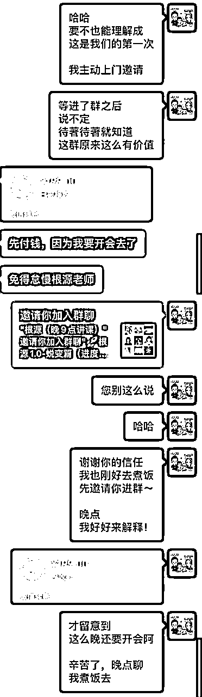

案例二：

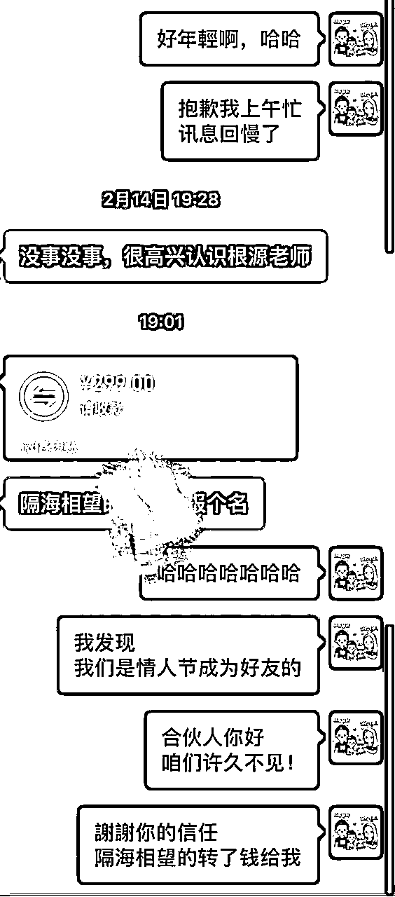

案例三：

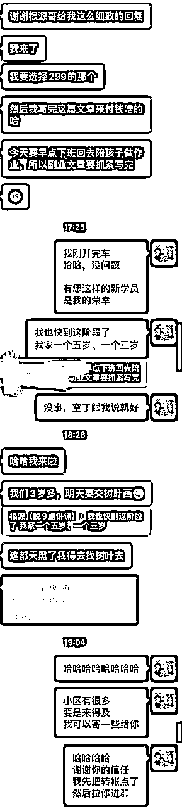

* * *

## 021 聊天结尾要埋下下次伏笔

即使这次不推新品，也不要白聊。

可以在结尾直问：未来如果有新课程或新想法，我私下跟你介绍，你介意吗？

* * *

## 022 需要转介绍时怎么说

对外引流我建议做好4点：有产品、能快速自我介绍、有固定话术、知道该推荐谁。

如果要介绍别人，我会说：

谢谢你的询问
我目前的副业投入成本较高，虽然回报可能更高，但不太适合初学者
我有个很好的朋友/老师，他的建议会更适合你这个阶段
不介意的话我拉个小群让你们认识

* * *

## 023 先抓预算再给方案

成交前一定要先抓预算。

我会问：

能方便了解下，如果你对这个有兴趣，你的预算大概在哪个区间？

我的课程价格不同，知道预算我才能给出更贴合的建议。

抓准预算才知道推什么，客户接受度也更清晰。

* * *

## 024 报价时给两个选项

与其在报价时只丢一个数字，不如直接给客户两条路选。

只给一个价，客户脑子里想的是「买不买」。一旦给出A、B两个方案，客户的注意力就从要不要，变成了我要选哪个。这正是人性决策的惯性，几乎适用于所有产品。

比如课程报名的场景，你可以这样聊：

感谢你把海报认真看完了。

目前你的需求，我这边是可以完整交付的。

方案一，按海报上的标准版走
价格就是海报标的 6599 元，对应的交付范围跟海报写的一样。

方案二，为你做一次定制化交付
因为我们团队现在有三个人可以联动，我可以把整个项目包下来。费用我会控制在你可接受的预算内。

把交付方式、执行路径、能带来的具体结果讲清楚，客户的选择就自然发生了。

* * *

025 微信送资料的万能思路

微信送资料的公式很简单：产品 + 选项 + 更高价值的链接。

最近一个被朋友转介绍来的好友，加上来就直接丢给我一堆资料，看得我都不好意思了。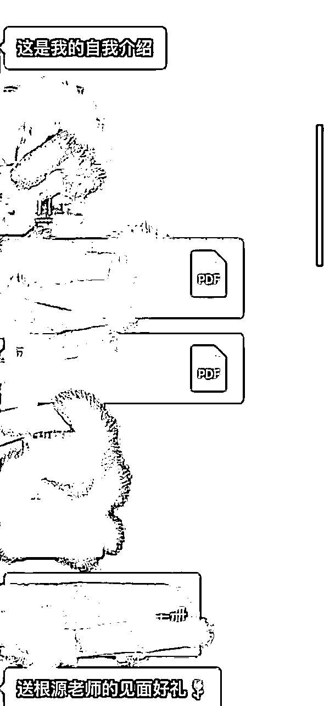

如果你也有想送的东西，先别急着发，先「报备」一下。

比如可以这样开场：

新朋友你好，谢谢你通过好友申请。

我是从XX那里加你的，一直觉得你很棒，不知道方不方便我送你一份我很喜欢的礼物？

送礼看似简单，其实门槛很高。要送得对、送得让对方喜欢，还得让对方觉得值。

怎么送完东西还能加分，还能顺势拉到第二步互动，就是关键技巧。

举个例子，我手上有一份销售档案本想分享给新朋友。不会直接丢过去，而是先探一下：

对了，请问你的工作跟销售有关系吗？

等对方回复后，我再说：

因为我刚整理好一份《销售技巧大全》，是我过去一年成交100单的实战沉淀。

如果你是做销售相关的工作，会不会对这份资料有兴趣？

领取方式我也给两个选项：

一是直接免费领取，我现在就发给你。

二是花49元加我进一个专属群，群里会持续更新迭代版资料，我每天还会分享新的销售小技巧。

东西既然要送了，不妨多一个选项，让链接更快地发生。

* * *

# 尾声 我的过往经历

我是根源，赚钱圈第四期学员，同时也是一名拥有2万+实战案例的心理咨询师。

12年线下销售与团队管理经验，2022年开始转向线上做知识付费项目。

往期写过的一些文章，或许你会感兴趣：

2021年

1. 精华《直觉式萨克斯 透过社群成功变现146万》 https://t.zsxq.com/116B1bcYc
2. 《73项被动收入打造》 https://t.zsxq.com/11EHjTH0P
3. 《杭州夜话02场，夜话官复盘》 https://t.zsxq.com/19IkX4UMl
4. 《年入百万，团队从20人到4万人》 https://t.zsxq.com/19JYt77hL
5. 《主题：如何更有效的链接见面会认识的圈友》 https://t.zsxq.com/19VY2LWg4

2022年

1. 《互联网小白，第 1 次做线上产品，7 天赚回 10 倍门票》 https://t.zsxq.com/11ooZZbM7
2. 《把捣乱分子『逆势』转成爱用者的好方式》 https://t.zsxq.com/19lipLhJ5
3. 《 好的内容，是目前依旧没退旧流行的变现方式 》 https://t.zsxq.com/19BLMAYw1
4. 《明白老师的一个启发，让我从100天日耕的过程赚了30W+》 https://t.zsxq.com/19BgNoxfi

2023年 精华x6

1. 《私域的意义不是管理，而是经营》 https://t.zsxq.com/19WEsfSq1
2. 精华《9年传统行业 1 年时间，从一无所有，到年入 200 万》 https://t.zsxq.com/10nmEr1cA

加入龙哥盟后，我少走了不少弯路，也积累了一些实战心得。

如果你有想聊的，欢迎加我微信「 AF54094 」交流~ 

▲

也可以扫码联系我。