哈喽，我是七小，一个在深圳生活的99年青年。平常做知识管理，喜欢把碎片信息整理成能变现的知识产品。圈里人叫我“赚钱课代表”，因为总帮新圈友解决各种问题。长期目标是成为企业咨询顾问，未来想给20-30岁的草根年轻人，写一份关于【个体创业】和【人生关键决策】的游戏攻略。

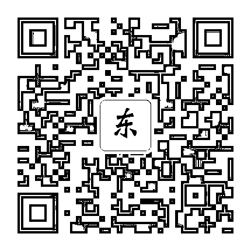

上次发帖还是六月份，当时花半个月写一篇万字长文，之后就去闭关了。这三个月，我不少地方跑了一圈：在杭州待了俩月，又跟女朋友去了长沙、南昌、郑州，最后回深圳。说真的，商业思维提升不少，但变化更大的，是赚钱的心态。

刚混赚钱第一年时，我也算猛：一年肝出15篇精华帖，拿了10颗龙珠。万字长文三四天一篇没问题，要是愿意爆肝，一晚上也能整出来。于是有圈友叫我“精华帖卷王”。

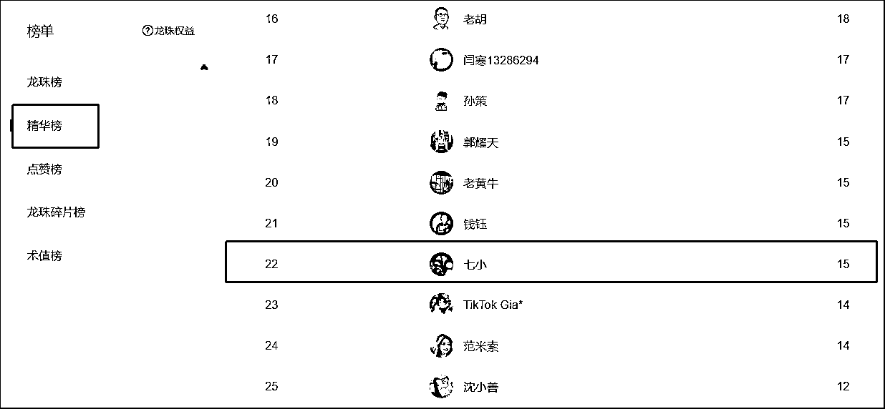

以前之所以卷，一方面是新接触网赚这块，看什么都新鲜，热情高涨；另一方面，身边玩得好的朋友，个个把努力当喝水一样自然。在这种环境里，不卷才奇怪。

但这三个月出门看了一圈，因为各种机缘，我认识了50岁身家过亿的大哥，也见了40岁在国企上班、副业年入百万的姐，还接触了30岁出头、被动月入六位数的老哥。回到同龄人的圈子呢，又听了炒股亏20万负债的哥们、月入过万却月光的哥们、被老板欠薪的哥们，还有月入三五万却天天哭的学霸姐妹，以及月入10万但仍想摆烂躺平的姐妹……逛完一圈，只觉得世界真大，每个人的活法都不一样。有些人的想法，确实冲击了我过去的认知。如果总结我的变化，就两条：

1. 不再带着【紧迫、着急】的心态去奋斗了。
2. 尊重个体差异和个人追求，不轻易劝别人奋斗了。

下面讲讲发生了什么。

先说旧观念一：赚钱猛就是牛逼。

以前我对赚钱的理解很单薄，觉得谁月收入高谁就牛，我就羡慕谁。但看过更多人之后，我不再那么羡慕了。

第一，把所有长期代价算进去，这事还赚吗？

以前我只看账面上的赚和亏，看不到隐形代价。比如今年一季度，我收入还行，一个月也有好几个w，加上认知能力在涨，每天很兴奋，晚上熬到一两点不想睡，白天靠咖啡续命。后来心绞痛，吓得去医院检查，花了200块，还好没事。还有一次，为了赶工作，鸽了答应女朋友的饭局，气得她不行。家庭聚餐也经常饭没吃完就走，没怎么陪家人。表面看，省时间多干活，账面收益挺好。但要是长期熬夜把身体整垮了，被迫停工半个一个月，算上停工损失，还赚吗？要是严重到要手术，或者落下失眠、甚至猝死，那一个月多赚3W真的还赚吗？为了工作不陪女朋友，时间久了闹分手，轻则无心工作一两个月，重则无可挽回，再花几个月去认识新人、磨合，这些成本算上，还赚吗？爷爷奶奶都90岁了，奶奶癌症化疗后瘦得皮包骨头，爷爷老年痴呆，夏天还穿棉袄。为了每天多赚一千块，不去周末探望，真的值吗？

把这些隐性风险、错过就不再的体验都算进去，很多原来觉得赚的事，算出来其实是亏的。

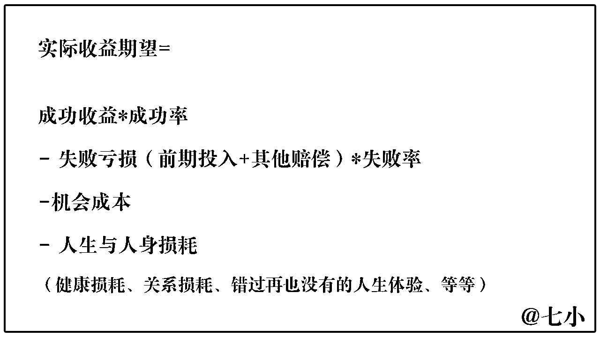

第二，就算赚到了，赚得爽吗？

我有两个朋友，一个月入5到10W，一个月入1万。前者做客单五六千的私教服务，天天被学员追着问，两小时不回就催，烦得要死；后者离职了，之前淘客项目找了合伙人打理，每个月躺着分1万，最近还准备去新疆玩。你说这俩谁更幸福？

第三，赚到了，守得住吗？

还有个朋友，之前在金融公司，兜里20多万，听了些内幕消息就加杠杆炒股，结果现在亏到-6万。我劝了他五六次，没用。另一个朋友来深圳打工，第二个月做到月入过万，三个月后项目不行，想跳槽，我问他存款能扛过空窗期吗？他三个月月入过万，却买电子设备啥的花成月光，扛不住。没过几天，他说去亲戚那边找活，离开深圳了。

所以金钱是一整套系统：赚钱、花钱、存钱、投资、保险，每块都有讲究。除了收益，还得看风险和成本。扣掉潜在风险和隐形成本，再谈自己赚没赚。赚到钱不是重点，拿到还得守得住。钱要越花越有、越花越快乐才行；反过来，花完觉得自己是冤大头，经济越来越紧，那就该想想自己懂不懂【花钱有术】了。

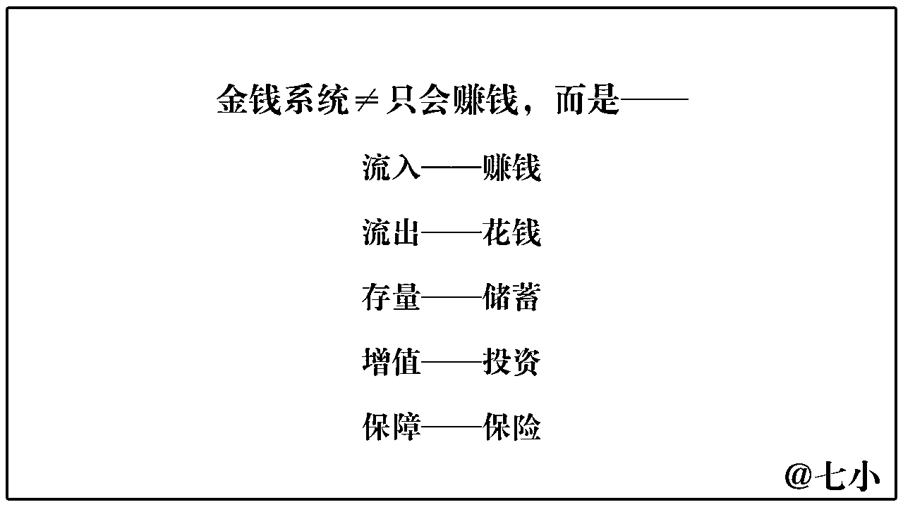

再说旧观念二：奋斗应该是种常态，8小时工作像喝水一样自然。

以前我真的不懂什么叫个体差异。对我来说，从早到晚输入信息、思考、写东西，就像呼吸一样自然。吃饭时要播学习视频下饭，下午骑车时找小助手打电话输出内容，晚上兜风还开录音笔自言自语。

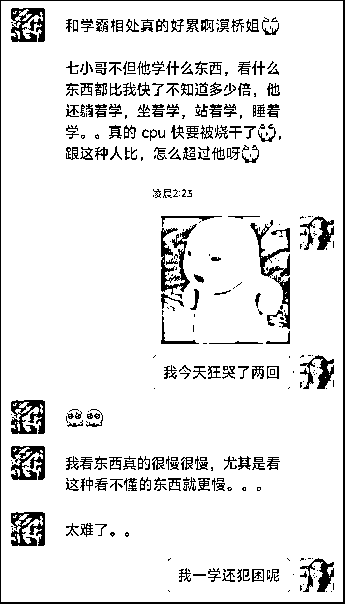

但我女朋友之前干活一个多小时就要歇半小时，我那时特纳闷，她怎么就不能好好干活？她也纳闷，我怎么天天干活不出去玩？

直到今年五月之后，我带她去见我的朋友，她带我去见她的朋友，我们才互相理解。

五一我带她去郑州，见了一尘学长和凡灵逸尘。有次喝咖啡，我女朋友问凡总：你们平时空闲时间干嘛？凡总说：不是工作，就是找朋友聊思考、聊发展、谈业务合作。女票又问：没有休闲娱乐吗？凡总说：工作本身就像游戏，和朋友聊天就是休息。她转头跟我说：原来你没忽悠我，你们真这样。

六月之后，她带我去见她那边的人。完全是另一种画风。30多岁的姐姐们不卷，因为要带娃；20多岁的小姑娘不卷，因为情绪内耗。被客户骂几句就哭；学员做不出成绩觉得自己不行也哭；遇到玻璃心学员，还得哄完再哭；累死累活不赚钱，觉得是自己能力问题，哭；一个月赚三五万的，竟然觉得自己不配赚这么多，也哭。那姐妹的男友说她一个月30天能哭15天。我：啊？

原来早起、午饭后、晚上都犯困才是大多数人的常态，而我这种一天到晚精力旺盛的，才是变异物种吧。

我的一天：起床干活、中午干活、晚上出去溜溜再继续肝。她们的常态则是：起床气、午饭后犯困、晚上犯困、十点后没精力。好家伙。

人和游戏一样，有各自的能力面板：体力值、精力值、心力值、智力值、专注力、成长性……每个人面板不同，做同一件事，耗费的时间精力也不一样。我不能要求精力值只有50分的人去做需要100分精力的事，那就是把电池榨干也做不完。同样，我女朋友也不能要求我这个精力值300分的人，每天干完100分的事就停手，否则多余的精力没处去，会闷坏。

上次和圈友米斗喝咖啡，他说我以前一次看二三十篇精华帖太猛，他看十篇就头大。我说：你说错了，我一般从50篇开始看。所以，对我来说连开胃菜都不算的事，对别人可能已经满负荷了。我不能再用自己的标准去衡量别人有没有努力。

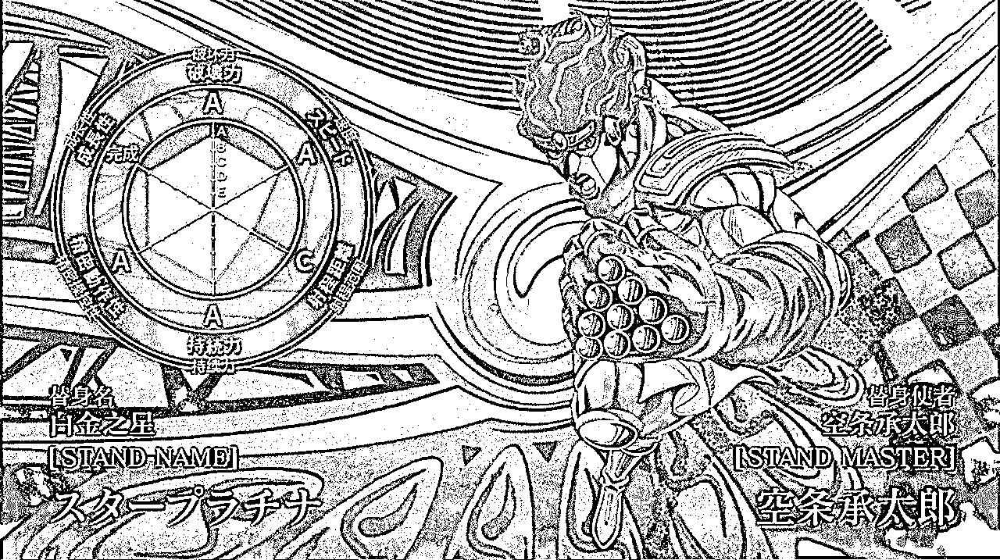

想帮别人奋斗，首先得尊重个体差异。以前我做知识付费，习惯分享自己的成功经验，让学员照做。但这样有两个问题：一是有些解法非常依赖我个人的能力和资源，别人复制不了；二是有些路径虽通用，但每个人走的成本差距太大。我之前做的，其实是把成功的路径强行嫁接给学员，可移植的部分，往往活不长。

现在明白了，真正的好老师，除了分享自己的经验，还要根据学员的个人能力、资源，量身定制适合他的方案，帮他建立属于自己的成功方法论。没想通这个时，我跟我女朋友一周吵一架；想通之后，再也没吵过。

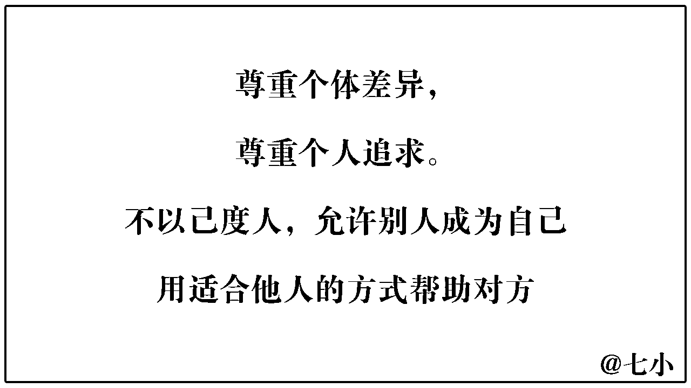

最后说说旧观念三：每个人都应该奋斗，早日成为独当一面、年入百万的大佬。

2023年“超级个体”这个概念很火，好像只要还在职场，就必须修炼成六边形战士，自己当小老板。我以前觉得这话有点怪，但说不出哪里怪。后来见过更多人，明白了。

人是分物种的。有的像老虎，能独立生存；有的像狼，得和同伴一起行动才好活；有的像寄居蟹，需要找个大物来掩护自己。大多数人都不是老虎，强行补短板，想一个人解决所有问题，大概率既痛苦又收益不高。早日认清自己是什么人、能力边界在哪、要融入哪种生态、和谁互补、怎么互补，才是正道。

还有胃口差异。有个同龄朋友潜力不错，我劝他多奋斗，他跟我说：我现在月入一两万已经很开心了，为啥要拼死拼活？我当时气得不行，觉得他浪费才华。后来一个前辈拿同样的话对我说：七小啊，你这么有才华，目标怎么才30岁1000万？以你的实力，至少得奔5000万啊。我心想：我一个普通家庭出身，爸妈小学文凭，没资源没传承，全靠自己开悟，能到千万已经很牛了。你让我奔5000万，不现实。瞬间就明白了。每个人的起点和成长经历，决定了他的目标感。人家积累的时间没我长，目标没那么大很正常。我现在不会轻易劝别人更努力。如果人家对现状很满意，何必把人喂撑呢？哪怕我是好心，想加菜也不行。

还有两个大学生小兄弟，A是盖洛普影响力型，天生卷王，他说B成长得慢，不愿意带他玩。我以前也会这么想。但和女朋友磨合之后，我理解了B这类人。其实A和B都很优秀，差别不在于上不上进，而在于对当下的满意程度和对未来的渴望程度不同。

总之外出三个月，我最大的转变是：不再带着紧迫感去奋斗，也尊重每个人的活法。奋斗可以，但不必急急忙忙地奔命；人可以向上走，但不该用同一把尺子量所有人。现在如果有人对现状很满足，我不会指手画脚；但谁想往上走，我乐意帮忙。

这就是我这个“前卷王”外出三个月的一点见闻，希望对你也有点启发。

我身边其实分两种节奏的人，一种像我这样，无论现在手上有什么成果都总觉得不够，总盯着下一步能怎么把缺口补上、还能往哪儿再冲一截；眼里只有【增量】，很少去数自己已经攒下的【存量】。另一种就是像B同学那样，对当下的满足感很高，对未来的渴望没那么强烈。他更享受此刻的安稳，目标只要能稳步推进、在路上就行，并不会逼着自己必须冲刺、马上去达标。

如果要用出行来比喻，我和A这种人大概就是骑着摩托飙到150km/h往前冲，B则是骑着小电驴以20km/h慢慢晃，还会时不时停车拍照留念。一种人沉迷的是到达时的短暂高峰快感，另一种人珍惜的是路上绵长的平和愉悦。

我特别想对那些被身边卷王带着节奏、自己却卷不动的朋友说一句：人的底色本就不同，有人天生喜欢一路狂飙，有人偏爱慢慢走。只要基本生活能兜住不会饿肚子，并且走在一条能成长、未来仍有期待的路子上，快慢都不算错，没必要自责。

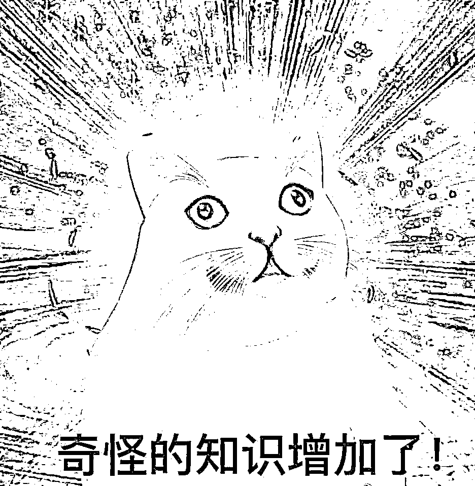
当然，现实里如果生存压力在那儿，或者正好撞上机会窗口，该收紧节奏加快脚步也理所当然。关键是学会看情形切换速度，慢悠悠可以，但一直慢悠悠就危险了。

# 旧观念4：每天都应该奋斗，等足够有钱了，我们就有自由和幸福了

## 1）赚够钱了，然后呢？

以前我总拉着女朋友一起卷时，她反问我：你现在这么拼着要达成1000万的目标，等真的达成了，你的生活会跟现在有什么不一样？

这个问题直接把我问住了。想想过去一年收入大概翻了十倍，但日常状态基本没变，还是每天读书琢磨输出、健身骑车、约朋友聊天。手里宽裕了一些，最直观的变化也就是兜风的车从我妈那辆旧电动车换成了九号新电动车，见面的范围从深圳本地扩到全国各地，多了一个周末去做SPA按摩的小爱好。吃穿用度没明显上涨，花钱最大的地方还是知识付费。

就算是收入再翻十倍到年入几百万，我估计也就把电动车换成新能源小车，朋友圈从国内扩到国外，偶尔吃顿千元的餐厅、玩次游艇民宿，其余生活还是读书、思考、输出、锻炼、骑车、交朋友，核心开销仍然在学习上。

如果现在的生活和“钱够了后的理想生活”其实差别不大，那我为什么要等到达标才允许自己享受呢？我这么急着去追那个目标到底是为了什么？自由和幸福吗？难道现在就不自由、不幸福了吗？

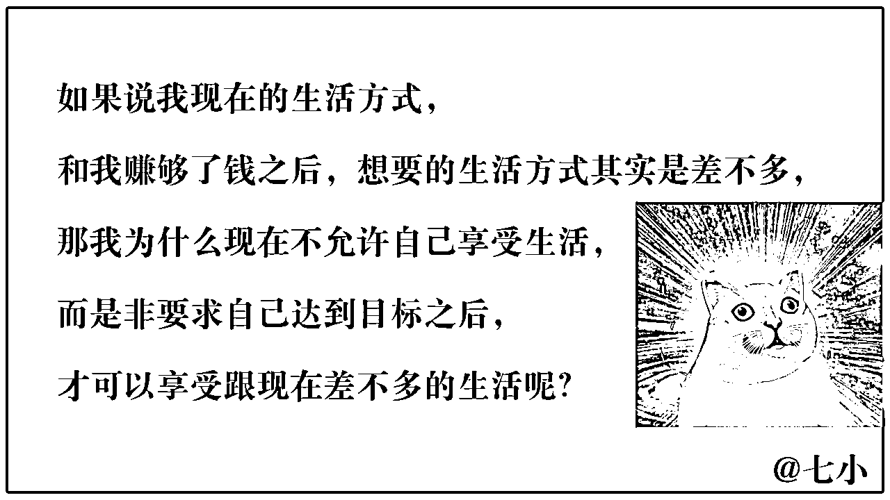
我这才明白女朋友以前说的那句话：你讲的全是未来更美好的画面，可我对现在拥有的已经很知足了，我已经在过自己想要的生活了，还要往上追那么多干嘛？

是啊，是我把手段和目的搞反了。o(╯□╰)o

## 2）我明明进步巨大，却感觉心慌?

其实最近三个月我的内在进步很大。

以前在赚钱接触的多是项目型玩家，顾问型几乎没接触过。我一直以为自己不像项目人，更偏向思维认知，但具体是什么定位始终模糊，也因此内耗。

到了杭州跟宁培哥聊过企业咨询顾问这件事，我一下子觉得这就是我想要的事业方向。下一步我想把能力往企业咨询顾问上靠。定位清楚后，我不再纠结，也不再为在赚钱写不出详细的项目拆解而自责了。

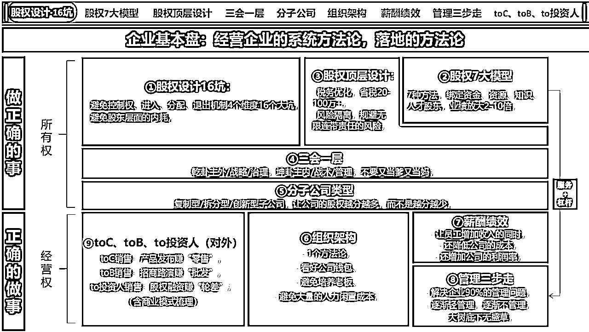
比如别人问我做什么，我现在能说清楚了：我打算为20到30岁的草根年轻人，围绕财富和幸福，提供关于【个体创业】和【人生关键决策】的游戏攻略。长期来看我会成为企业咨询顾问，短期我会把公司经营的方法论先用在个体发展上，成为个体创业的顾问。

有意思的是：我才23岁，长短期甚至终身的职业路径已经相对清晰了，这三个月算是半停更状态在外面实地历练，存款也没怎么掉。按理说该很踏实自豪才对，可一段时间我还是提不起劲，甚至有点不安、落后感。

捋清楚后发现好笑又可怕：这种不适感的根源竟然是——这个月没赚到钱。

跟当年刚毕业自由职业半年没收入，被小区叔叔阿姨问“这个月赚了多少”，一听没赚就劝我去上班一样。当年我很倔地说你们不懂。现在我却用“这个月没赚钱”来否定自己三个月的成长，太讽刺了。大概是“金钱是创业者的唯一成绩单”这句话在我心里成了执念，让我变得急功近利。

我现在依然认同金钱是创业者的成绩单，但想补充一句：随堂测验不计入总分，我们只看期末成绩。要分清当下没赚钱是期中测验还是期末大考。随堂测验就别太在意，真的是期末考再认真复盘也不迟。

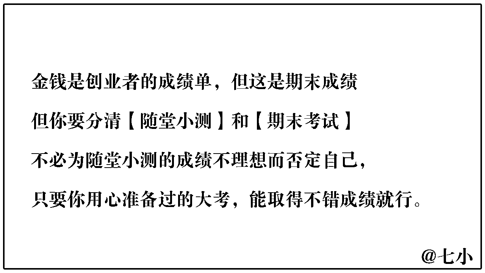

# 旧观念5：他们都这么牛逼，我也能不太菜了呀！

## 1）如果说厉害会让你焦虑，那换成幸运呢？

以前在赚钱认识太多厉害的朋友，总会产生压力：他们怎么这么有钱？怎么这么牛？我什么时候才能像他们那样？

一旦把对方定义成“比我厉害”，焦虑就来了。但我换个说法想，如果把“厉害”换成“幸运”呢？人家成绩更好，未必全是能力碾压，可能只是出生早、家庭条件好、赶上红利，运气比我好。这样想，心里马上松快很多。

这不是纯阿Q，也有现实依据。

比如求职，2015-2016年那会刚毕业就能进大厂拿高薪、还能贷款买房。现在的毕业生很多是毕业即失业，好不容易找到工作还怕被忽悠去东南亚，房价高企且交房不稳。

再比如我2019年做的洗衣机项目，交接时要求负责人每人拿出5-10万启动资金。有一个做事积极聪明的小伙伴因为父母不同意拿不出钱被刷掉，后来走职场，现在月入一万出头。另一个能力相对平庸但家里支持资金的同学顺利留下，毕业后回潮汕做电商，现在月入3-5万。

再比如杭州认识的那位身家过亿的前辈，据说十几岁辍学，赶上政策倒卖淘汰的外国设备赚了第一桶金，80-90年代十几万，后来重仓房产身家暴涨，现在收租年入百万。

了解越多越觉得【时运】对成就的影响至少占八成，【个人努力】可能只占两成不到。时势造英雄，出生晚、入场晚，就是差距的主因。控制变量，出生时间和红利入场时间一样，我未必不如人。

“厉害”这个词不能只看结果，得剥掉环境和助力看纯能力。只看结果的话，图上那个胖子就比瘦子厉害，但你真的认同这种比较吗？

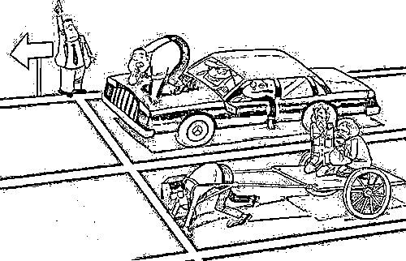
所以与其感叹别人怎么都这么厉害就我这么菜，不如感慨人家运气真好，祝自己早日撞上好运。拿能改变的点比较会自卑，拿难改变的点比较反而能放过自己。

## 2）无论别人再快，你都只能达到你自己的上限

把担忧推到极端反而能平静。参考下图。

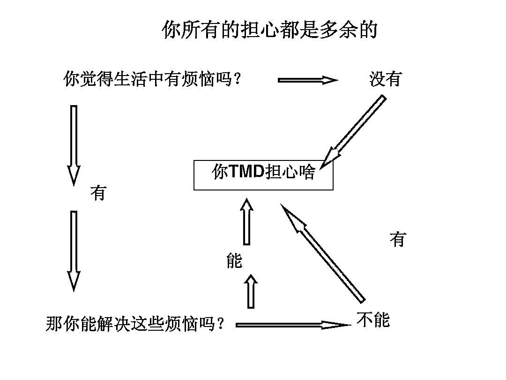
类比一下，我画了这张图。

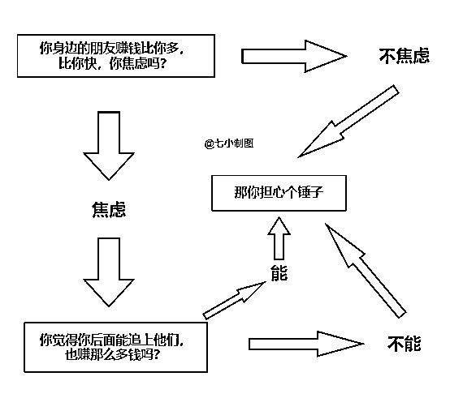
总结一句话：打得过就相信自己，打不过就放过自己。

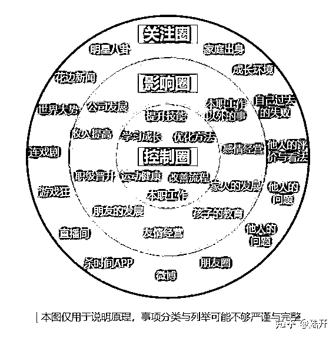
我们接触的事可分三类：

1、关注圈：能看到但完全无法改变的，比如家庭出身、俄乌战争。
2、影响圈：能看到、能部分影响但无法100%掌控的，比如升职加薪、孩子成长、笔记是否爆款。
3、控制圈：只要愿意下决心付出，就是100%能掌控的，比如读书、运动饮食。

控制圈全力以赴，我命由我不由天。影响圈尽力而为，问心无愧。关注圈别瞎操心，庸人自扰。

别人开兰博基尼也好、哈雷也好、小电驴也好，你是跑者，你只能跑到你的跑速上限。别人的快慢与你无关，你要做的只是努力达到自己的上限，然后换辆车，再突破旧上限。

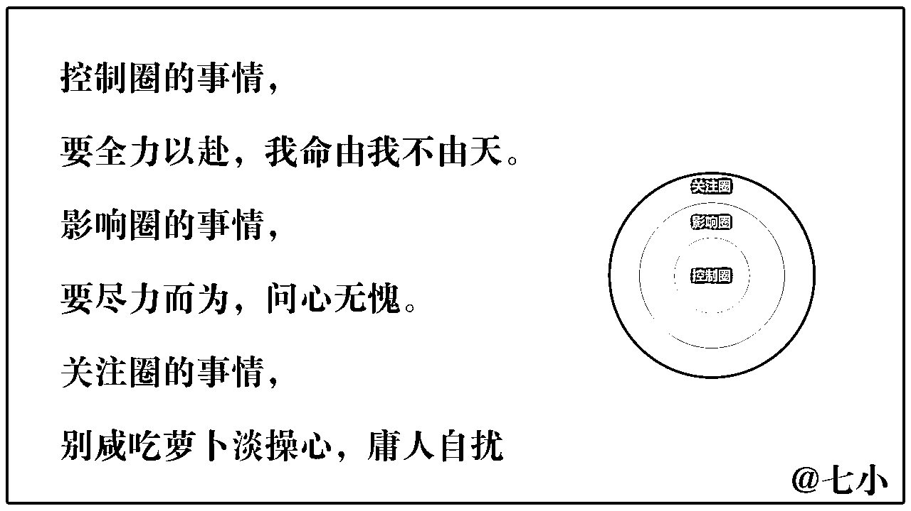

# 尾言碎碎念

最后说清楚，这篇文章标题说“不当奋斗逼了”，不是劝躺平。我可没劝大家不奋斗。

这几个月见人思考下来，我觉得奋斗依然是必须的，只是心态可以从被催命般的紧迫焦虑里走出来，换成更从容、更享受的过程去奋斗。

在路上多给自己找点乐子、多找点能被自己夸的理由，用这些来替代苛责和否定，我们会走得更远。

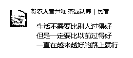