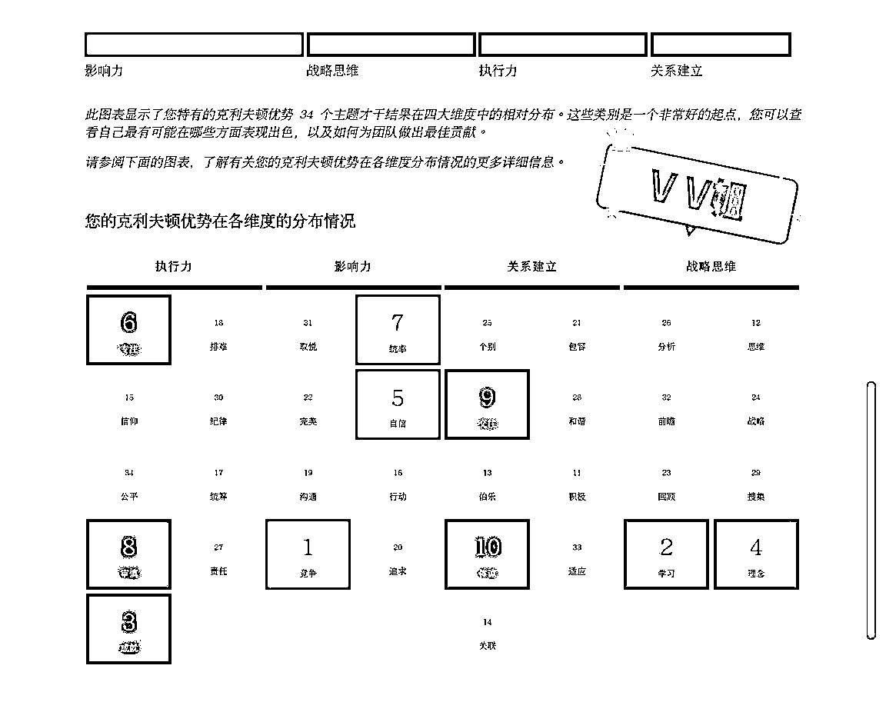

43天，从大厂焦虑女到月入2W+的成长教练：我的优势挖掘逆袭记

曾经的我，是别人眼里的人生赢家：互联网大厂管理层、行业顶级证书、过硬的专业能力。可只有我自己清楚，光鲜的壳子里装满了多少不安和恐慌。今年4月，我加入了赚钱社群，机缘巧合下推开了一扇门——盖洛普优势。正是这扇门，帮我认回了自己，也让我在43天的时间里，从自媒体“纯素人”成长为优势成长教练，副业单月收入突破了2W+。

2W+在各位大佬面前确实不算什么，但对我而言，它代表副业MVP跑通，代表我终于从单一的主业路径走向了主副业双线奔跑，更代表那个被焦虑困住的中年女人，和自己、和家人、和团队达成了和解。

### 一、在别人羡慕的岗位上，我跌进了“绝望之谷”

过去四年，我的内心一直在打一场无声的仗。职位稳定，专业过硬，照理说该高枕无忧。可行业的巨变，让“降本增效”成了悬在每个职场人头上的剑。组织架构不断调整，业务方向反复变化，我一次次被推进陌生领域，又一次次在新鲜感消退后陷入倦怠。

我不是怕失去钱和名，我是害怕从此不再被需要。

为了稳住位置，我几乎把80%的业余时间都砸在学习和考证上。可这样的我，在家人眼里变成了一个“上满发条的学习机器”。他们说：“你太焦虑了。”甚至连最支持我的母亲也劝我别再学了。我开始反复怀疑自己：是不是我出了问题？为什么我越是努力，越是得不到理解？

### 二、遇见盖洛普之后，我认出了藏在身体里的“卷王”

真正让我看见答案的，是5月份的那场航海。第一次接触盖洛普优势，我才明白：我不是“有问题”，我只是天生自带一套极其耗能的“战斗系统”。

我的前五才干是竞争、学习、成就、理念、自信，后面跟着专注和统率。这套组合属于影响力+战略思维主题，简称“天生的卷王”。竞争让我处处想赢，学习让我对新事物上瘾，成就让我停不下来，理念让我满脑子奇思妙想，自信让我觉得万事皆可为。专注和统率又让我不由自主地带动整个团队一起冲锋。

可这样的天赋，既成就过我，也伤过身边所有人。我心里默认“所有人都应该像我一样拼”，谁稍微放慢脚步，我就给对方贴上“不努力”的标签。团队业绩虽然亮眼，幸福感却低得可怜。我自己也越卷越快，越卷越累，却根本刹不住车。

是航海结束后的圈友微光，让我认识了北大苏姐。苏姐是国内最早的盖洛普认证教练，也是“优势动力”创始人。她帮我深入解读才干，帮我重新认识了自己的34个使用说明书。我开始懂得，我的“理所当然”不过是天赋滤镜，不是所有人的出厂设置。

从那时起，我不再想当然，而是愿意表达感受，愿意换位思考。奇妙的是，和家人、和团队的冲突开始溶解，我也第一次完成了与自己的和解。

更意外的是，优势理念像一门内功注入我的身体，把我过去十几年学到的管理知识、专业技能全部串了起来。我不仅能解决自己的问题，还能帮别人找到卡点。顺着这条路，我快速成长为一名优势成长教练，并成功在43天内让副业月入破2万。

### 三、给所有想挖掘优势的朋友，7句掏心窝的话

8月【个人优势挖掘】航海马上开始了。作为亲历者，我想把这些真实经验分享给你。

**1. 34个才干就像34张牌，没有好坏，只有会不会打**

我一开始看见自己的“竞争”排第一，是有点羞耻的，觉得这不是“中庸之道”。但后来我才发现，“竞争”正是让我完成“不可能任务”的引擎。当年那个20天完成半年项目的战绩，靠的就是“想赢”。

所以，别羡慕别人有而你缺的才干。“适应”靠前可以是定海神针，“和谐”靠前可以是天然润滑剂。每一个才干用对了地方，都是王炸。

**2. 成也才干，败也才干**

最大的天赋旁边，往往藏着最深的坑。“自信”适量是金子，过量就是自负。我曾因为盲目相信“零经验也能挑战别人十年功力”，在新项目上栽了跟头，到现在还在填坑。所以要学会管理才干的负向影响，而不是被它自动带跑。

**3. 职业选择，尽量避开“靠后才干”**

虽然34个才干都能通过练习调用，但在选择职业赛道时，还是要尊重天性。我是做财务的，但我的分析、纪律、取悦都在后十，理念却排第四。这意味着别人眼里的财务规则、数据敏感、跨部门沟通，对我来说都是消耗。我能做到管理层，全靠竞争和成就硬撑，但那种疲惫是每天都要承受的。

所以，如果条件允许，请优先选择能反复使用你前10才干的职业。如果实在绕不开，就主动申请调整，或者找同盟来补位，别一个人硬扛。

**4. 副业定位，就是让才干充电**

很多人副业迷茫，其实答案就在你的才干里。优先尝试能发挥前10才干的领域。比如我，主业压抑了影响力，副业却满足了我“改变世界”的渴望，整个人反而更有能量回归主业了。

体谅和个别靠前的人，适合做情感咨询；取悦靠前的人，适合社群运营；战略、理念、分析靠前的人，做咨询和解决方案会很有深度。才干被满足，就像充电一样让你动力满格。

**5. 关系不和，往往只是才干不同**

以前我总觉得“学习”是最好的事，谁不学就是不求上进。后来才明白，这只是我的“学习”才干在作祟。对学习才干靠后的人来说，学习真的非常耗电，不是懒。

我的“体谅”才干靠前，过去总等着家人来猜我的情绪，猜不到就生气。但那些“体谅”靠后的直男们，是真的猜不到。他们需要我把话说出口。理解这一点之后，我的怨气少了大半，亲密关系和团队关系也肉眼可见地变顺了。

**6. 向上沟通，用对方舒服的方式**

别怕领导。就算不知道他的盖洛普报告，也可以观察他的日常行为来判断。比如我有个领导“完美”才干突出，那我去要资源时就先表态：“这件事我一定精益求精。”然后说明：“因为要追求最好，所以需要更多时间打磨。”这样，我顺利拿到了支持。

当然，前提是你真的能把结果做成“完美”级别，否则信任会清零。

**7. 你的重启人生，可以随时开始**

这43天，我最庆幸的不是变现，而是我终于看清了自己。现在的我，能帮朋友解决职场焦虑、亲密关系问题。每解读一次才干，就帮他们照见一个卡点，也帮自己收获一份正反馈。

如果你也正站在迷茫的漩涡里，请别急着否定自己。不如来听听你身体里那些天赋的声音。也许你和更好的自己之间，只差一次“优势挖掘”。

愿你也能在认识自己的路上，捡回那些与生俱来的光，并由此照亮身边的人。

当来访者陆续传来好消息、晒出阶段性成果时，我心里那种被点燃的踏实感与成就感，每一次都格外强烈。这种持续的正面回馈，也让解读优势这件事越来越上瘾，停不下来。

即便主业每天已是十多个小时的高强度运转，我依旧坚持每天抽出时间做一到两个咨询。在这一边稳定输出一边持续深耕的过程中，我完成了个人初期的产品闭环：优势报告解读、职业与副业定位规划咨询、季度与年度私教服务。结果是实打实的：6位私教学员、十余次付费咨询落地，7月单月变现就突破了2万+。

正是借助优势这把钥匙，我按下了人生的重启键，收获远超预期。

第一份谢意，要送给赚钱，以及航海项目带我遇见盖洛普优势。对我而言，这套工具的意义不只是方法论，它帮我终结了长达四年多的精神内耗，结束了内外撕裂、不自洽的状态，彻底松绑。这种解脱，价值无法用数字衡量。

方向找对了，方法用对了，结果自然会跟着对。

第二份谢意，要给盖洛普优势本身，以及北大苏姐的陪伴与打磨。通过系统学习，我的沟通力、管理力与教练力都有明显跃升，真正学会了去理解他人、做到共情同理。

亲密关系的温度更稳了，古稀的父母更安心了，上级也更放心了。更关键的是，我的领导方式发生了根本转变：从过去十年的命令式、指导式，转向启发式、引导式。团队的凝聚力与主动性随之提升，配合更顺畅，动力与效率同步上扬，大家的工作幸福感也很真实。

最后，也是最重要的感谢，献给芷蓝、理白和靠谱。他们帮我把定位收窄到职场跃迁这个赛道，力出一孔，让我的天赋优势“嵌入”到客户的核心需求里。

一月有余的时间里，副业雏形迅速成型：43天完成MVP验证并跑通，单月实现2万+变现。双通道的收入结构就此建立，也为我未来能够真正自主掌控人生，留下了可能性。

### 写在最后

感恩是在今年四月加入赚钱，五月入航【个人优势挖掘】。这一趟航行，让我这个大影响力加战略思维的人，既能尽情使用自己的长处，也能帮助他人成长、滋养自我，真正做到达人成己。

“夫唯不争，故天下莫能与之争”，不刻意争夺，反而收获更多。

很庆幸在这个年纪能进入这样的圈子，也感谢遇见更好的自己，感恩所有相遇。

也特别感谢赚钱官方在八月再次开设【个人优势挖掘】航海项目！

愿每一位同行者，都能借由航海遇见盖洛普，发现优势，了解自我、理解他人，找到属于自己的优势赛道，尽情发挥，活出成人达己的美好人生。

我是VV姐，一起赚钱！一起抱富！

附上我的才干图：

