上个月，我干成了一件自己都没敢想的事——单场群发售，收款2.5万。

先简单介绍一下自己：我是Andrew，一个从职场裸辞后转型的内容创业者，目前专注做知识管理赛道，也是“知识管理五维模型”的提出者。潜水在赚钱有术一年多，这次终于浮出水面，写下这篇复盘。

这篇文章可能有点长，但我想尽量把整个过程的来龙去脉，包括我踩过的坑、想明白的道理、具体做了什么，都原原本本讲清楚。本文会围绕五个板块展开：背景与动机、发售目标、前期筹备、完整流程复盘、不足与反思。

如果你也走在创业路上，或者正准备把知识变成产品，那这篇复盘或许能给你一些参考。

### 从一个噩梦说起

先说说我为什么离开职场。

我曾是一名互联网设计师，在南京待了五年半。刚毕业那会儿，我也和大多数人一样，觉得只要肯干，总能在这条路上越走越宽。

但现实是——需求、加班、内卷，一样一样扑过来。每天深夜十点多，我拖着发沉的身体赶上地铁末班车，车厢里灯火通明，我却觉得眼前发黑。

那一刻我突然想到：如果就这么走下去，等到五十多岁，我是不是还坐在某间写字楼的小格子里，眯着眼对着密密麻麻的文档，揉着酸胀的眼睛，一天又一天重复同样的日子？

我问自己：这是我想要的生活吗？

所有人都告诉我：好好读书，找份稳定工作，每个月有固定进账。我照做了，但为什么心里越来越空？

我开始怀疑很多东西：怀疑那些毫无意义的消耗式内卷，怀疑那些让人上瘾的设计逻辑，怀疑自己是不是已经成了商业机器里一颗“不需要思考的螺丝钉”，甚至连“涨薪、晋升、跳槽”这些从前觉得理所当然的目标，也开始被重新审视。

那种感觉，就像《楚门的世界》里，楚门突然发现天空有一道裂缝，真实的光照了进来。

我想清楚了：我真正想成为的，从来不是什么设计专家、设计高管。

我想成为我自己。

正如纳瓦尔所说：“在成为自己这件事上，没有人能比得过你。”

去年十月，我裸辞了。走出办公楼的那一步，我好像第一次踩在了属于自己的地面上。

### 为什么偏偏是“知识管理”？

决定裸辞之后，很现实的问题来了：靠什么吃饭？

我发现自己有一个藏了很多年的“瘾”——知识管理。从读研开始，我断断续续在这个方向摸索了七年。这七年里，我大量自学、试错、走弯路，几乎一分钱没赚过，但依然乐此不疲。

为什么？

因为那是我真心喜欢的事情。我做知识管理，不需要别人给我鲜花和掌声，我自己就能从中获得足够的满足感。

梁宁说过一段我很认同的话：上天给一个人的使命，其实就是给他一个爱好，一种真实的喜欢，一种叫作“瘾”的东西。

只是，光有热爱是不够的。每个想打造个人IP的人，都得回答一个问题：你做这件事，有市场吗？

知识管理恰恰是一个有巨大潜在需求、但极少有人意识到“这也是个问题”的赛道。

你看，所有顶级聪明人都在强调“学习”这件事：

德鲁克说，现在最紧迫的任务，是教会人们如何学习；雷军说，学习能力是最重要的能力；李笑来反复强调，要把“学习”这个本事先学会，再去学别的。

学习能力是一切能力的底座。这个底座不稳，上面长什么都是虚的。

但问题是：我们从小到大都被要求“好好学习”，却从来没人教过我们“如何学习”。

我们想当然地以为，学习和呼吸一样自然——你会呼吸，所以你理所应当会学习。

于是，大多数人带着学生时代养成的旧习惯，一路自动驾驶，猛踩油门，却始终到不了想去的地方。

这几年我做咨询，和上百位潜在客户、意向客户打过电话，发现很多人的学习状态惊人相似：

看了很多书和文章，看的时候颅内高潮，合上书三秒清空；买了很多课，报了很多训练营，学完却不知道怎么用；信息过载、屏幕成瘾、收藏夹塞满、干货囤了一堆，真正需要时什么都调不出来；知识点和知识点之间像一个个孤岛，永远串不成体系；一到写文章就挤牙膏，憋半天憋出两行字，最后索性不写了。

还有个学员让我印象很深。他习惯用微信“文件传输助手”当收藏工具，我和他打电话时让他往上翻翻，结果翻不到底——微信成立了多少年，他就囤了多少年的信息。

这些问题的共性是：不解决，也能凑合活着。但正因为如此，我们习惯了忍受。

就像周岭在《认知觉醒》里写的：“承受痛苦，只需要陷在那里不动。”王兴那句话更狠：“多数人为了逃避真正的思考，愿意做任何事情。”

而我做知识管理，想解决的，恰恰就是这些被大多数人当成“正常”的问题。

### 为什么我的目标人群，锁定自媒体创业者？

在最开始，我并没有限定人群。直到三件事接连发生，我才意识到：知识管理，简直像是为自媒体创业者“量身定制”的。

第一件事，是我看到赚钱圈友们的真实痛点。

龙哥说过：“人和人认知上最大的竞争，其实是信息输入量的竞争。”张一鸣也说，你对一件事的认知，就是你在那件事上的竞争力。

但现实是，很多圈友在“信息输入”这一关就被击垮了。

为了搞清楚真实情况，我翻了不少前辈的帖子，从里面提炼出了大量圈友的反馈：

“信息太多了，看完很焦虑，干脆不打开星球”“精华帖太多，不知道从哪看起”“文章太长，根本看不完”“读的时候觉得很厉害，但自己并没有变厉害”“好像之前看过，但话到嘴边就是说不出来”……

这些问题，和普通人学习时遇到的问题几乎一模一样，只是输入的对象从“书本”变成了“星球”。根源都在于同一件事：学习方式出了问题。

而“会学习”，恰好是知识管理能解的题。

第二件事，是我做了一份问卷调研。

我根据平时被问到的频率，梳理出18个跟知识管理有关的问题，通过社群和一对一咨询的渠道广泛分发，累计收回了128份有效问卷。

数据非常诚实。占比最高的痛点是：碎片化严重，不知道怎么把新知识纳入自己的知识体系（59.80%）。排在前几名的还有：不会建写作素材库（56.86%）；经常断更，找不到持续创作的方法（46.08%）；不懂底层原理，总是凭经验试错（45.10%）；输出效率低，一篇稿子要憋好几个小时（40.20%）。

这些选项里，有三个都直指同一个能力——持续输出。

对自媒体创业者来说，持续输出有多重要，不用我多说。芷蓝姐有句话我特别认同：“爆款不重要，持续生产才重要。没人会记住一年一个爆款内容的你，只会记住365天不间断写字的你。”

我自己佩服的前辈们也都在做这件事：明白老师日更1000天，逆熵增者叶老师日更800天，芷蓝姐每天输出5000字，靠谱和理白一年四季在社群分享干货。李笑来老师更是从2005年到2023年，几乎每天都写三千字，累计写了近两千万字。

为什么持续输出这么关键？咱们代入一下就懂了。

假设你想提升沟通表达能力，面前有两个老师都在卖相关课程。A不怎么写东西，朋友圈也三天打鱼两天晒网；B持续输出沟通主题的内容，还经常真诚分享自己的思考、价值观。

你更愿意向谁付费？大概率是B。

不是因为B比A专业多少，而是B让我们**确定**：他确实有料，他靠谱，他和我们的三观一致。持续的内容创作，本质上就是在不断降低用户对你的“不确定性”。

内容持续生产力，直接影响变现力。

第三件事，是来自我前四期招募的“迎头棒喝”。

从今年五月开始，我的招生突然陷入泥潭。产品和服务我一直在优化，朋友圈和公众号一直在宣传，老学员也帮我转介绍，但——咨询人数归零。

有个晚上我做了个噩梦：招生截至那天，只有一个人报名，最后对方还找我说要退款。

我醒来时，后背全是冷汗。那阵子我焦虑到夜夜失眠，甚至动过“要不要回去上班”的念头。

后来通过靠谱引荐，我加入了芷蓝姐的“玩赚合伙人”。和芷蓝姐深聊之后，我终于看清了问题所在：

不是产品不好，是我的受众选错了。

因为过去三年我一直在做设计相关的内容输出，微信好友和公众号粉丝大多是设计师。但职场人最大的痛点集中在职业规划、求职、作品集这些方向，他们并没有强烈的“知识管理”需求。

我就像在吐鲁番卖雨伞——不是产品不行，是这个地区常年不下雨。

而自媒体创业者不同：他们在内容输出、知识体系搭建、做课等方面，有明显的卡点，甚至有迫切的需求。如果产品能解决他们的问题，那就是刚需。

### 产品推翻重来

这三件事，让我做了一个重大决定：把目标人群，正式锁定为自媒体创业者。

但这意味着，产品也必须跟着彻底调整。

我原来的产品内核是“知识管理五维模型”，从信息获取、采集、处理、整合到内化，是一条完整的链条。但当时没有锚定人群，课程大纲平均用力，什么都讲，反而没有重点。

而且，旧课程里的资源配置和新人群的痛点完全不匹配。比如“读书速度”这个痛点，在调研里排倒数第三，旧课程却用了一整节大课来讲；而“内容输出”是最高频的痛点，旧课程只留了最后一节写作课草草带过。

这已经不是修修补补能解决的了。

最好的方案，只有四个字：推翻重做。

说实话我犹豫过，毕竟那门课花了我好几个月打磨。但为了让产品真正对用户有用，这件事没有退路。

新的产品逻辑完全变了：底层依然是“知识管理五维模型”，但贯穿始终的主线，是“个人IP”。整门课程从研究到打磨，全部围绕自媒体创业者的真实场景来设计——你如何输入信息、消化信息、沉淀素材、持续输出、形成体系、最终让知识服务于你的商业变现。

就这样，带着全新定位的产品，我开始了第一次群发售。

这场发售最终跑出了累计2.5w的收入。

对很多人来说，这个数字可能不算大，但对我来说，它意味着很多：它验证了方向，验证了产品，也验证了“找准人群”这件事本身，才是最值钱的事情。

### 最后说几句心里话

我始终觉得，一个人能做什么、能走多远，很大程度上取决于他“是不是在做自己真正喜欢的事”。

如果一件事不是出于热爱，只是因为看到别人做得好、赚得多才去做，那你大概率会在还没有成绩之前，就被自己的“不够坚定”打败。

找到那个让你产生“瘾”的方向，然后踏踏实实做下去。

你会发现，所有的路都不会白走。就像我在知识管理这条路上，摸索了七年没赚到一分钱——但前七年所有“没有变现”的时间，都在为今天这笔2.5万做铺垫。

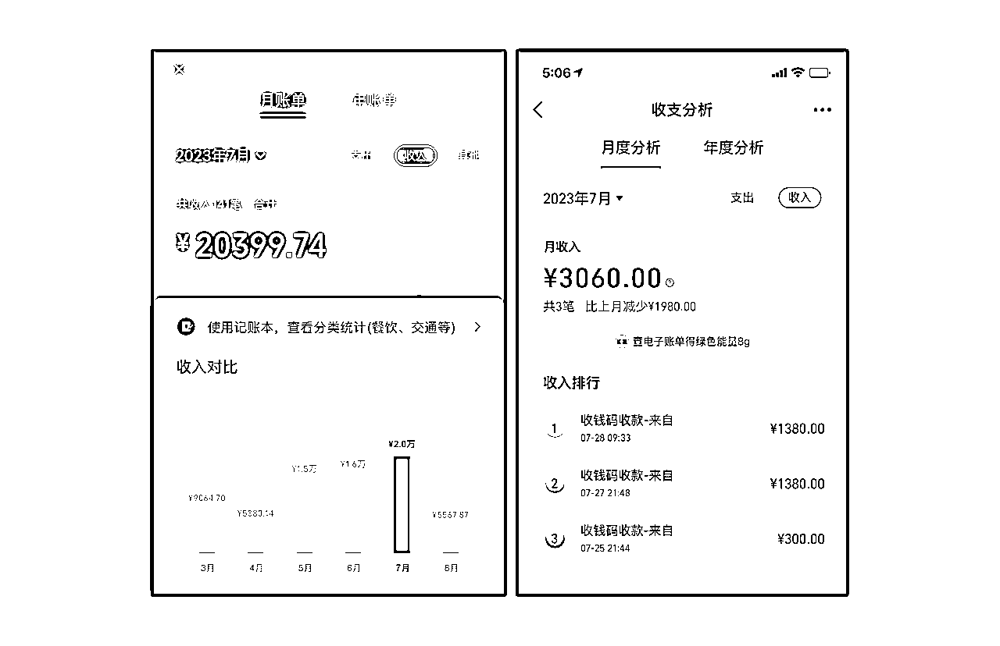 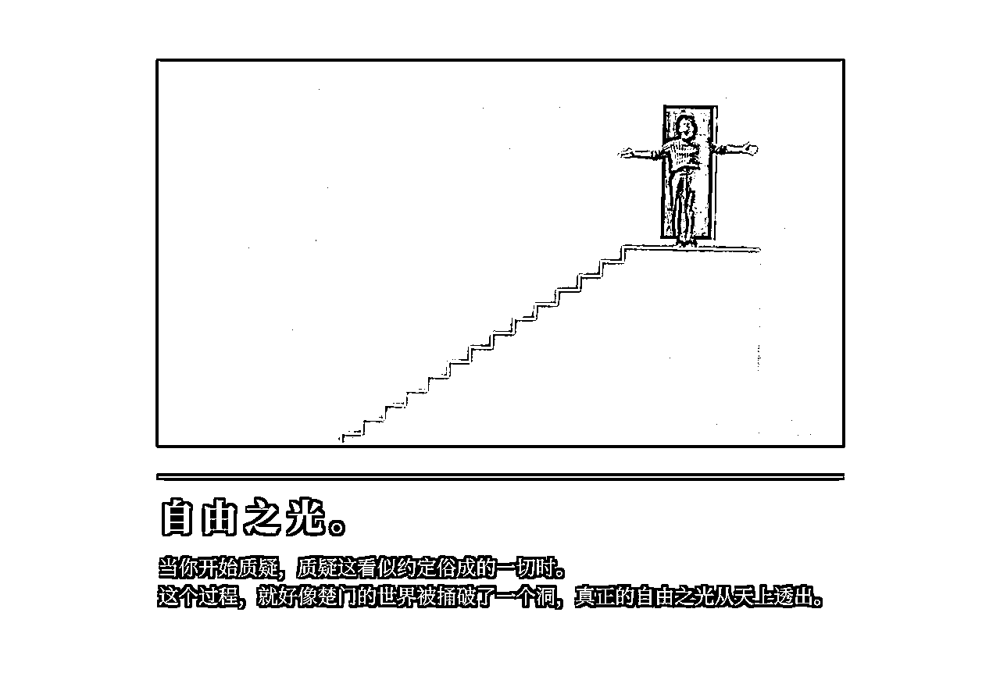 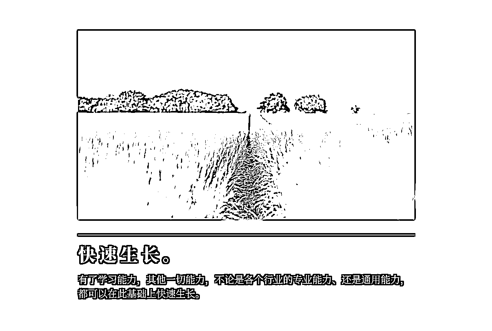 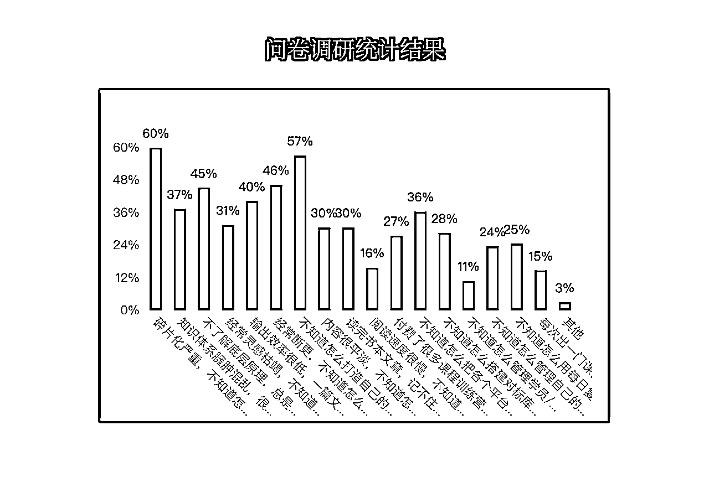 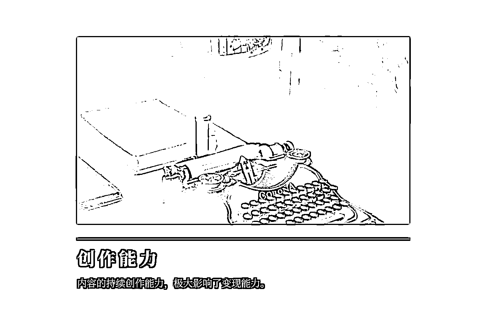 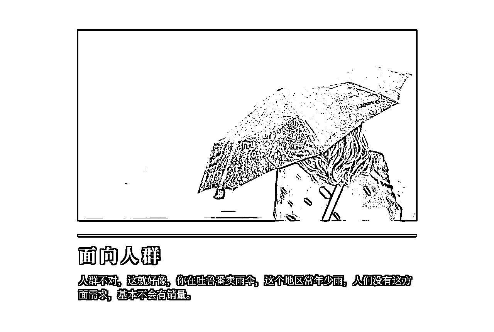 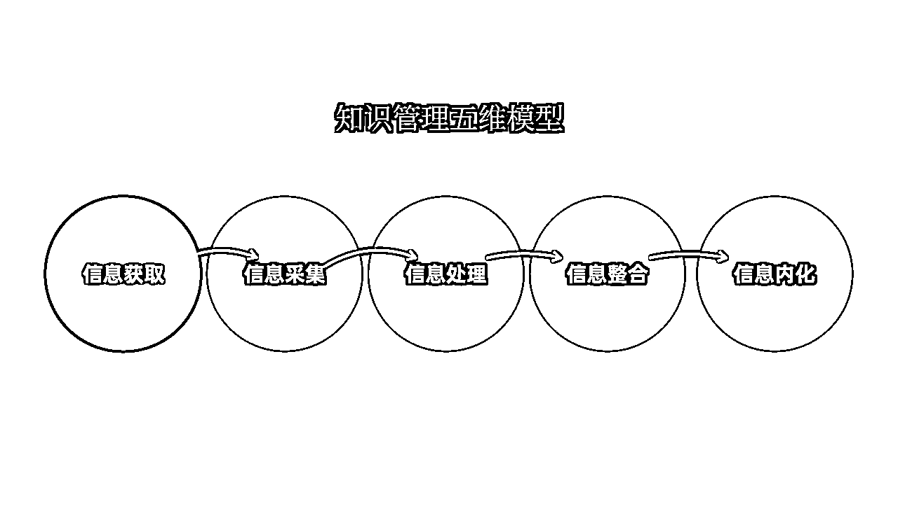 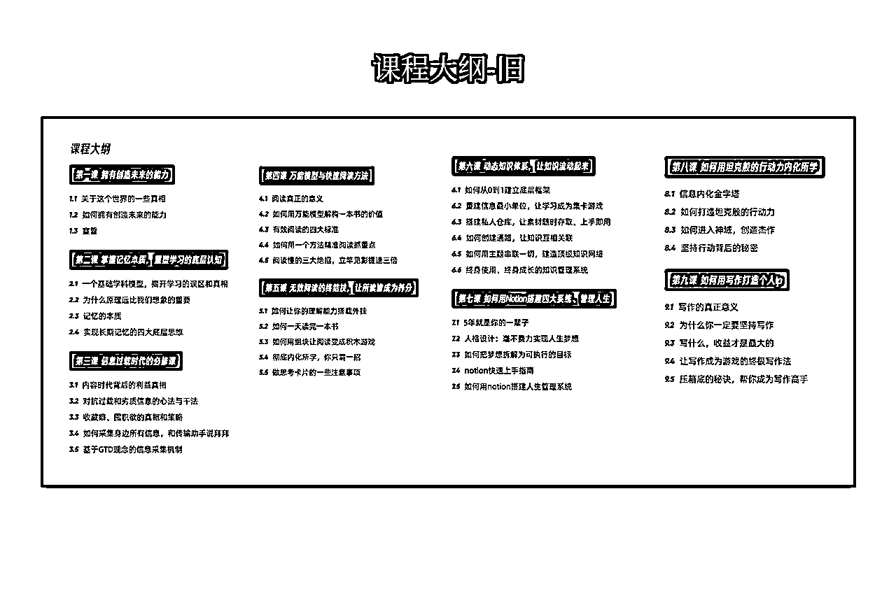 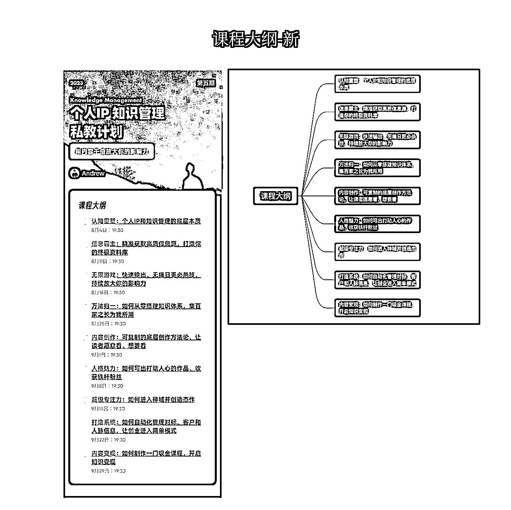

这次课程迭代的幅度挺大，超过了70%。原本9节直播课里，有一节专门讲“阅读速度”，考虑到大多数人在这方面问题不大，就直接砍掉了，后面靠加餐形式轻量分享。更关键的变化是：原来只有1节输出课，现在直接变成了5节，涵盖持续输出秘籍、底层方法论、写出打动人心的作品、超级专注力，以及最后的做课。几乎一半篇幅都在讲“输出”。另外，第一课新增了“个人IP的本质”，第二课新增了“基于动机的信息源筛选方式”，第八课是全新的“用自动化系统管理对标、客户、人脉信息”。

这件事值得做，一方面我自己也在做自媒体，平时学到的东西正好能反哺课程；另一方面，想到这产品能帮更多创业者解决实际问题，就有动力继续做。后来在芷蓝姐和靠谱的鼓励下，我决定7月下旬做一场群发售。下面是完整的流程复盘和沉淀。

整体时间线如下：
朋友圈造势：7.13～7.21
拉群、裂变：7.21～7.23
开营：7.23
干货分享：7.24
学员分享+产品发售：7.25
学员分享+直播连麦：7.26
Q&A+追销：7.27
之后快闪群解散。

先说做这场群发售的三个目的。

第一是集中成交。快闪群的功能定位很清晰：以前想买但没下决心的，这次会买；不清楚状况但被氛围带动起来的，也会买；就算这次不买，草也已经种下了；原本不认识你的人，一下子记住了你。朋友圈日常营销像柜台卖货，群发售则像品牌活动——有展示、有故事、有嘉宾、有福利，能带来一波集中转化。但活动不能天天做，预算和人力都扛不住，观众也会觉得品牌天天促销，所以一两个月做一次最合适。

第二是打造认知。要反复告诉大家：我是谁，我有什么产品，能解决什么问题，有哪些用户证言。只在朋友圈发这些，很容易触达不到目标人群，很多人根本不知道你在做这件事。尤其靠谱帮我拉了近300个新人进群，他们完全不了解我，所以打造认知尤其重要。群发售就像举着大喇叭对全群喊话：哪怕这次没下单，后面只要对方有需求、又信任我，自然会找过来。

第三是整合SOP。这是我第二次做群发售，第一次东西和话术都记得稀碎，正好借这次机会倒逼自己梳理一套可复用的SOP。

前期准备里，朋友圈造势是关键。受芷蓝姐那篇“朋友圈剧本＋快闪群成交”的启发，我提前规划发圈节奏，核心是让用户参与见证。用户不喜欢被“告知”和“强推”，把他们代入营销场景，才能增强纽带和信任。

我发过几种朋友圈。坦白圈：真诚说出升级产品的原因，让大家知道我的产品面向人群确定了，同时用“后续会持续透露迭代细节”引导关注。这条圈小鹿帮我改过，效果好了N倍，最后有近30个人点赞。

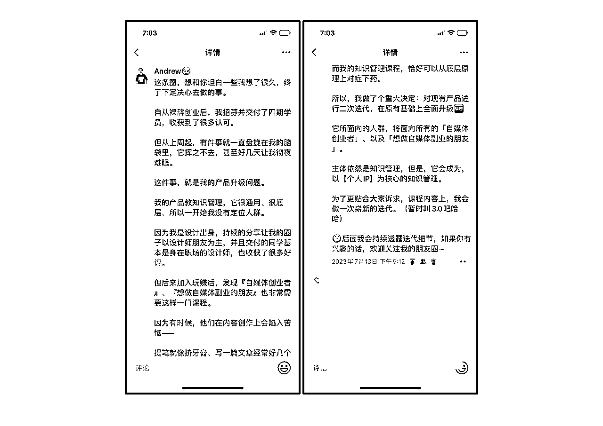

生活圈：展示做课真实过程，从早上9点半做到下午4点多，用剧透的方式让大家见证我的投入。

干货圈：有朋友好奇我怎么做到沉浸式做课，我就顺势发一条干货，既给实用价值，又用“接上条”引导没看到上一条的人来主动触达。

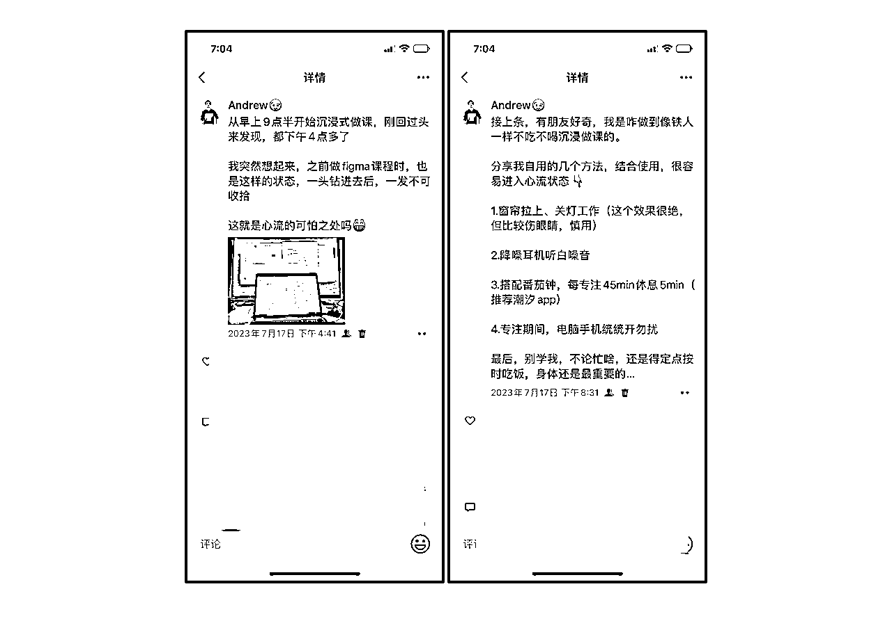

剧透圈：预告产品迭代成本，同时说晚上8点会剧透神秘福利，强化产品期待感。可惜这条点赞很少，可能是发送时机不对，临近饭点大家没空看手机。

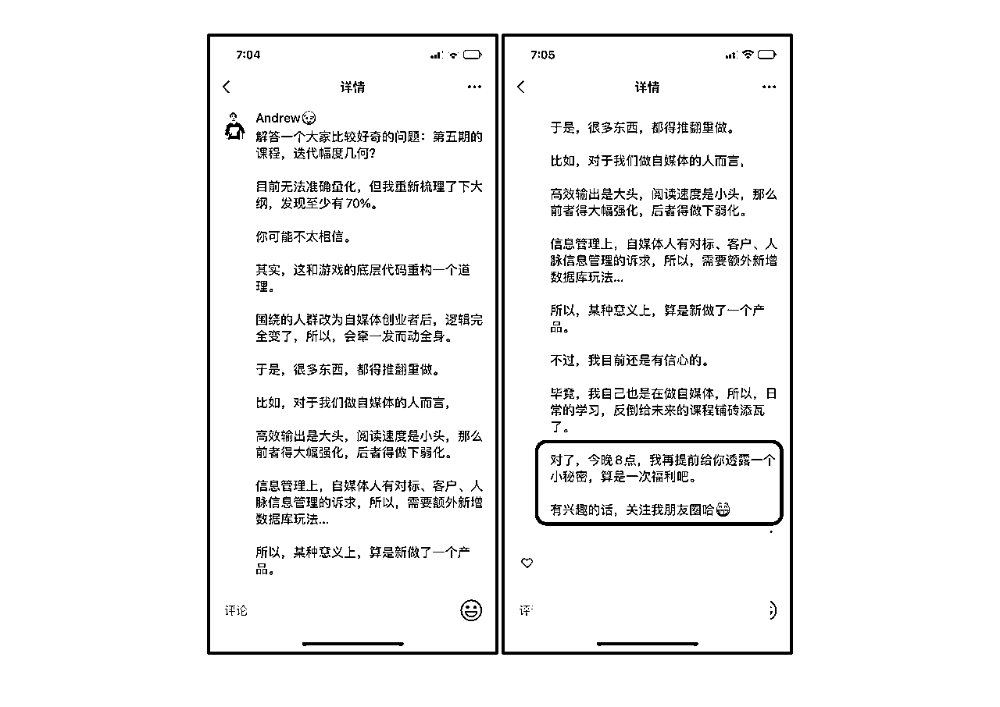

预告圈：晚上8点公布超级福利——我准备了一节干货满满的免费课程，同时剧透海报进度和关键词，引导大家点赞。这条圈的价值很高：“接上上条”能继续触达未看的人；公布进度可以引导参与；关键词露出吸引感兴趣的人；点赞指令还能让大家在明天官宣时收到提醒。

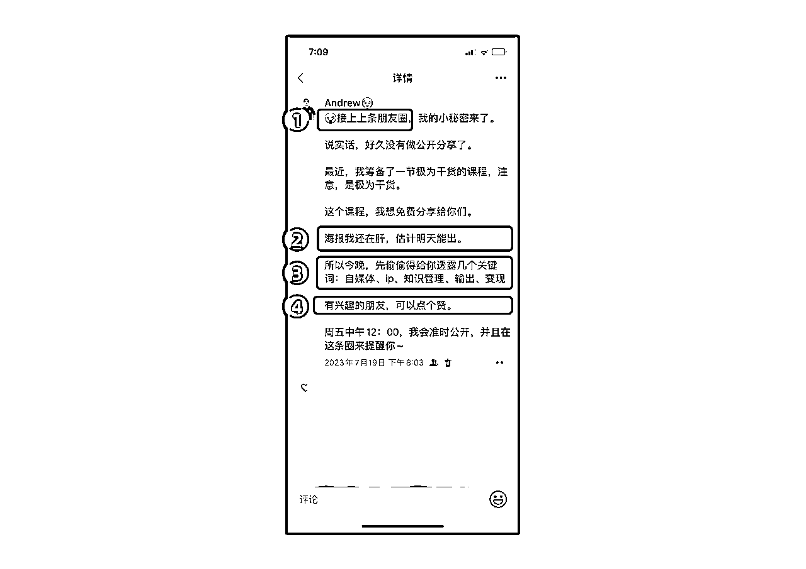

官宣：两天后中午12点正式公布分享会活动，讲我的前后变化、持续输出内容的重要性，以及大家的痛点，配上活动海报，吸引扫码进群。

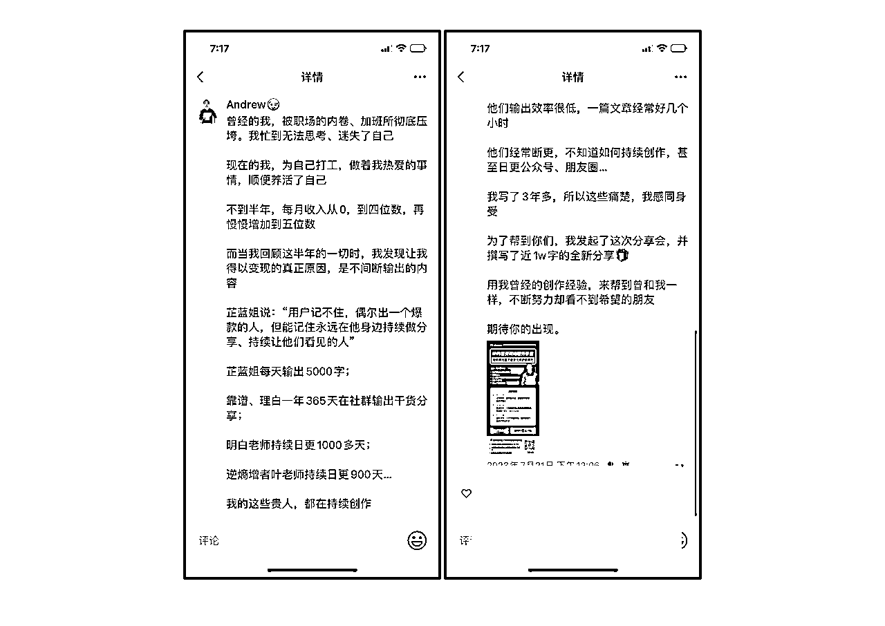

活动海报的字段也有讲究。主标题要吸引目标人群，所以我把“IP”“变现”这种关键词放进去，而不是只写“知识管理”或“内容创业”。次标题字号小，可以长一些，同样亮出利益点。个人背书要把成就和荣誉列出来，而且自己所在的赛道要放在第一行，让人一眼知道你在做什么。分享内容要写清楚，比如我的安排是干货分享、两次学员分享、一次与靠谱连麦。时间起止要明确，最好和内容放在同一张卡片上。价格用原价和限时价对比，产生锚点效应。进群福利放最末，用高亮和emoji抓眼球。二维码旁边一定要写“立即扫码”，这4个字能明显提升扫码率。

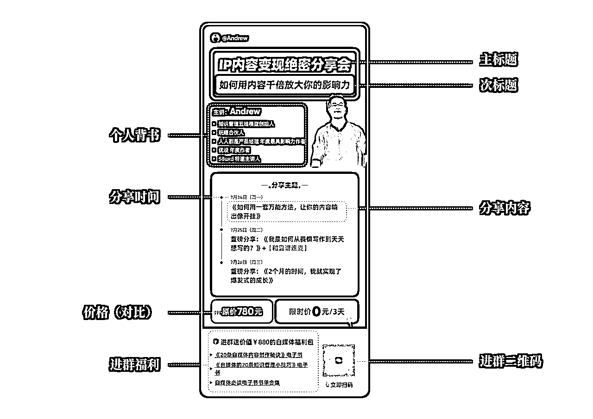

朋友圈文案要提前写好，我统一放在Notion里，到点复制粘贴就行。类型包括：活动宣传、人数造势、裂变圈、群内发福利的圈、好评圈、开营/分享造势圈、发售/成交圈、结束感恩圈。裂变圈尤其要准备多套文案，帮用户省去自己想的麻烦。

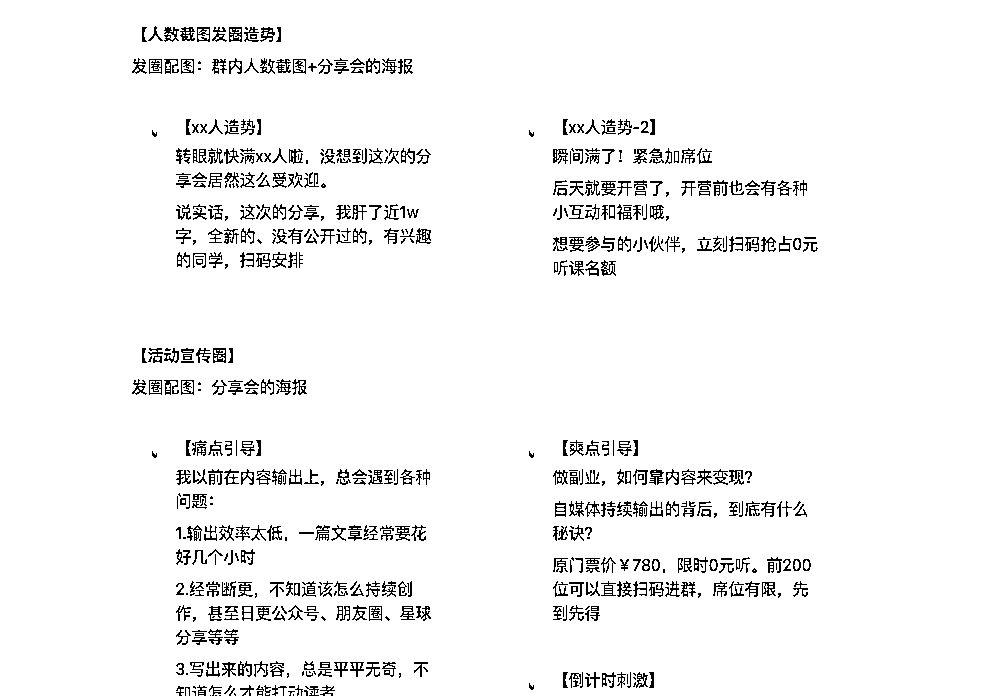

分享稿和主持话术也提前备好：干货分享稿、学员分享稿、发售稿、Q&A稿；主持人这边则有新人欢迎语、引导加好友和裂变的话术、分享串场词、日常运营话术。福利分三类：进群福利、裂变福利、群内报名福利。氛围组人员要从学员里找，或者找足够信赖的熟人，千万别临时拉交集很少的人凑数——我踩过坑，一开始热闹，后面喊不动了。

从第一批观众进群，发售就正式开启了。进群方式直接用了二维码，因为对用户来说最省事。刚进群时大家兴趣很高，要赶紧发引导文案。主持人在每进10人左右发一次欢迎语，间隔至少5分钟，文案要准备多种形式，不能千篇一律。前期人多时每3-5分钟发一次，后期人少、突然进来两三个时，不到1分钟就可以发。

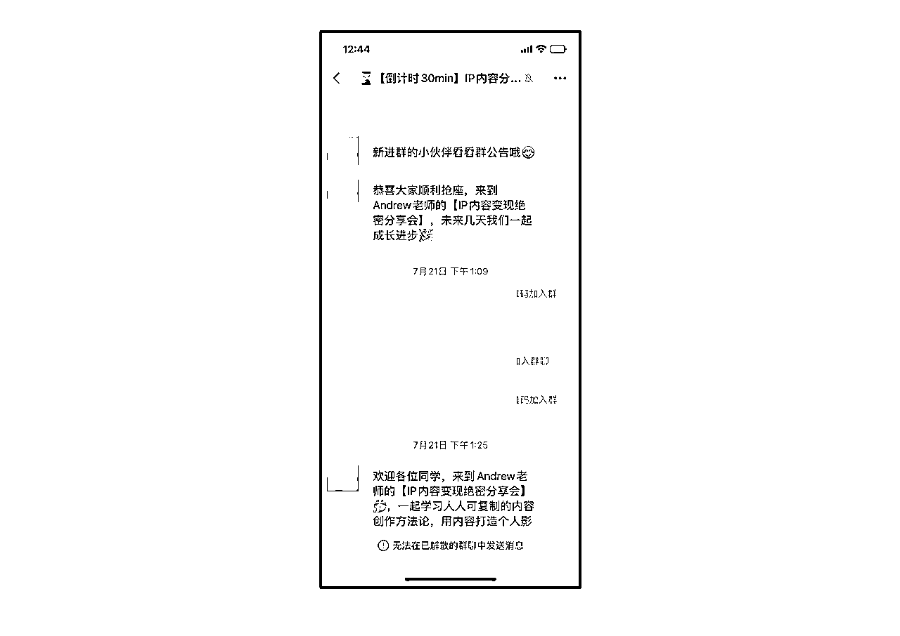

群人数增加变缓时，可以玩人数竞猜游戏：让大家猜群满50人具体是几点几分，最接近的送红包。这能鼓励互动、提升参与感，也能把截图发朋友圈继续引流。注意3点：最好在人数接近整数节点时发起，比如40人、85人、139人；必须限制“每人一次竞猜机会，以第一次为准”；1分钟内没人参与，就让氛围组带头响应。我这次的疏忽是没写明红包金额，如果直接写“6.66元红包”，参与的人会更多。

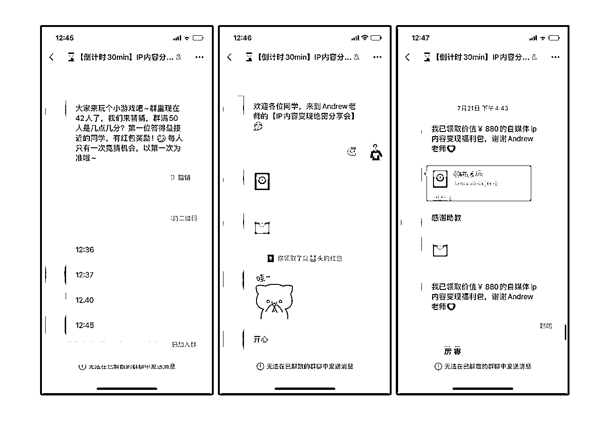

福利派送不要一进群就扔出来，要设计好环节逐层公布，否则大家领完就走，互动和参与感也会大打折扣。主持人做完欢迎后，引导大家扣666，氛围组先带头。等回复差不多了，再公布进群福利，并引导大家加我微信领取。

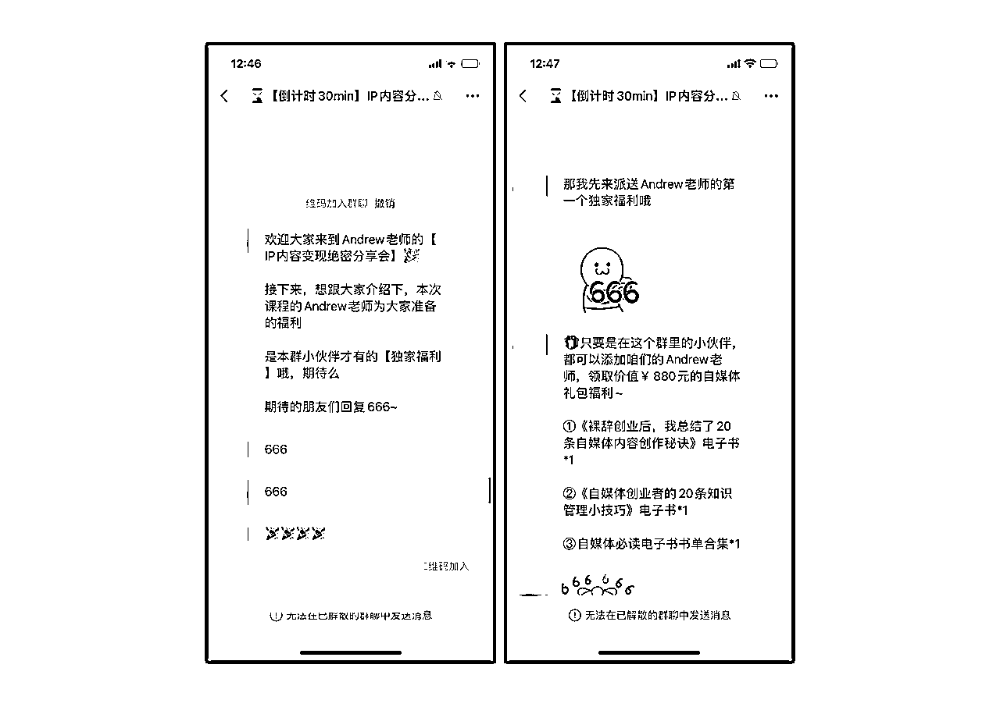

我的进群福利包括：①《裸辞创业后，我总结了20条自媒体内容创作秘诀》电子书；②《自媒体创业者的20条知识管理小技巧》电子书；③自媒体必读电子书书单合集。这里有几个经验：福利名称要贴合目标用户的赛道、人群和可量化利益点，比如“自媒体创业者”是赛道+人群，“20条小技巧”是可量化利益点，还可以加上“价值￥880元”这类具象价值；一定要引导大家加微信领取，否则新人不会加你；对方领到后要引导在群里回复“我已领取价值￥880的自媒体IP内容变现福利包，谢谢Andrew老师”，既能带动更多人领取，也能作为朋友圈素材。我写的电子书，对方阅读后也能感受到我的专业。这个环节我有个失误：没有让主持人推送我的微信名片，导致大家添加时多了一步操作，直接推名片会顺畅很多。

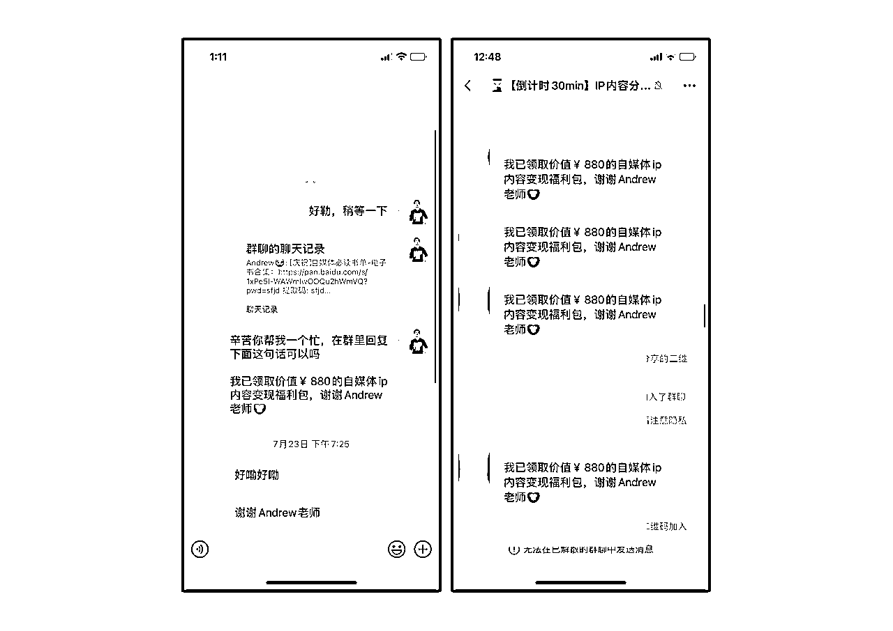

裂变引导的设置是：邀请3位新人，即可获得《自媒体万用金句素材包》。注意事项有三点：第一，提前准备好多个朋友圈文案，降低用户发圈阻力。

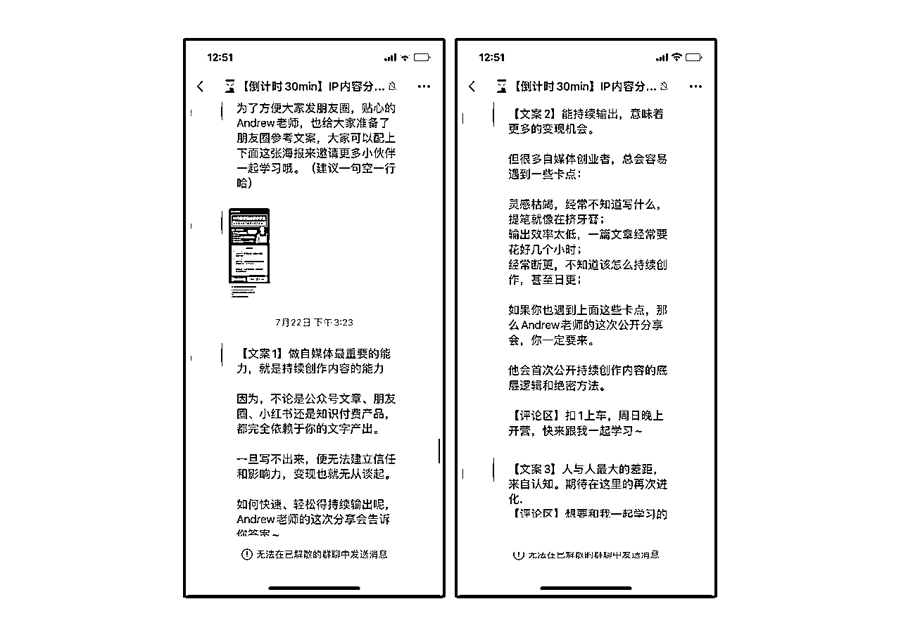

第二，主持人发完话术要主动打消用户顾虑，很多人不好意思发圈，可以说“你就当推荐给身边好友，他们听完价值这么高的分享，感谢你还来不及呢”。第三，如果没人牵头，氛围组要带头，并截图到群里激励大家。这次小鹿第一个站出来支持我，还自己编辑了朋友圈文案来帮我邀请新人。

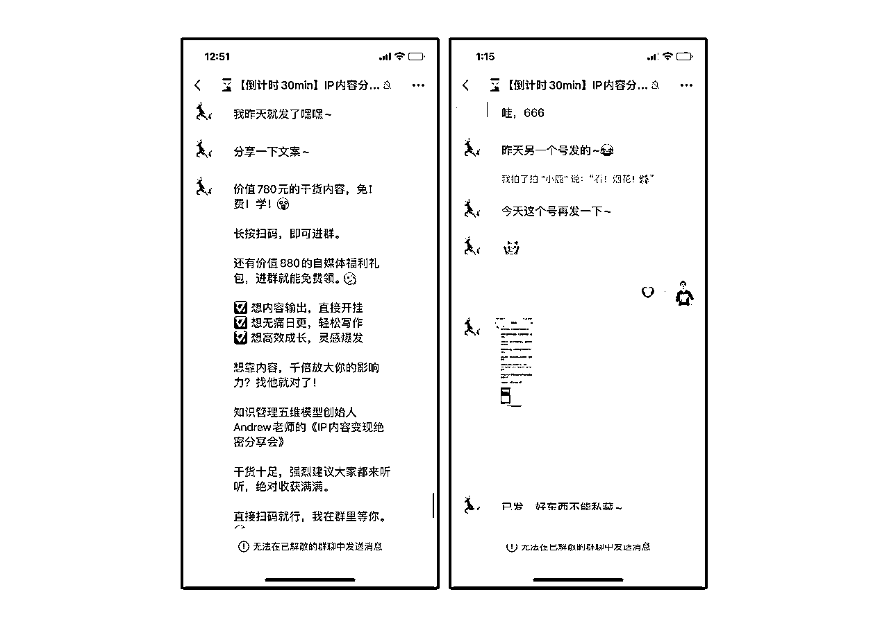

但这次裂变效果并不理想，我分析可能有两个原因：一是拖到第二天才让主持人发，大家热情已经凉了；二是金句素材包有点单薄，不够吸引人。

中间还有一个插曲：靠谱托举。建群第三天时，群人数只有200多，每次发朋友圈宣传都只进来一两个人，遇到了瓶颈。纠结了很久，我终于鼓起勇气找靠谱帮忙。我本来很怕麻烦别人，尤其怕给厉害的人添麻烦。结果靠谱二话不说，直接在自己朋友圈和陪伴群帮我大力推荐，让我特别意外和感动。

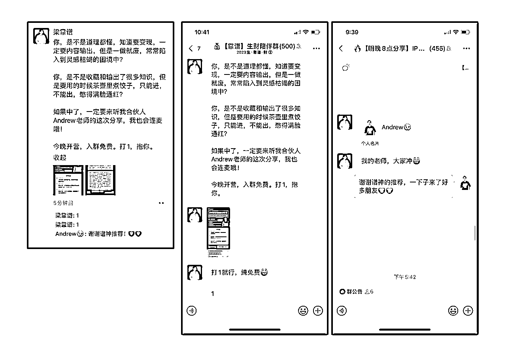

靠谱的流量太惊人了，不到半小时，群里就哗啦啦进来100多个新人。她还直接引导大家加我微信，没几分钟我的微信就被加爆了，光通过好友和发福利就花了近两个小时。当天粗略数了下，新加了150多个好友。

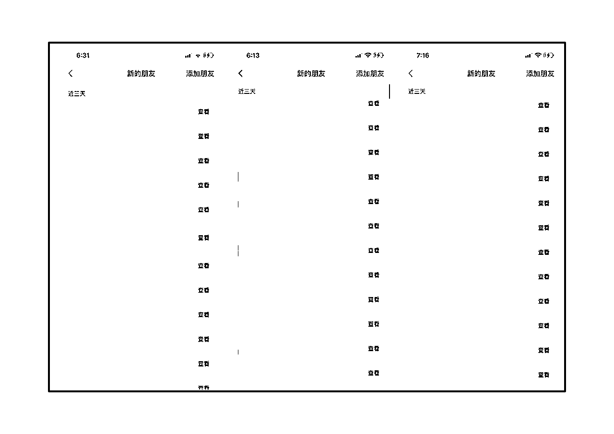

一个人一生中能遇到的贵人很有限，我很庆幸遇到了愿意提携我的靠谱。

开营仪式原本我更简单，准备的是自我介绍加愿景，第二天直接分享干货。但开营当天下午，我意识到大部分人不了解我，如果只做简单开场，很难留下印象，也影响第二天的到场率。所以我把开营文案大幅迭代，效果超出预期。

流程是这样的：第一，安排主持人预热，预热话术包含简单介绍和红包雨利益点，同时给出接龙行动指令，提升到场率，氛围组也可以提前安排。预热话术可以放在多个时间节点。

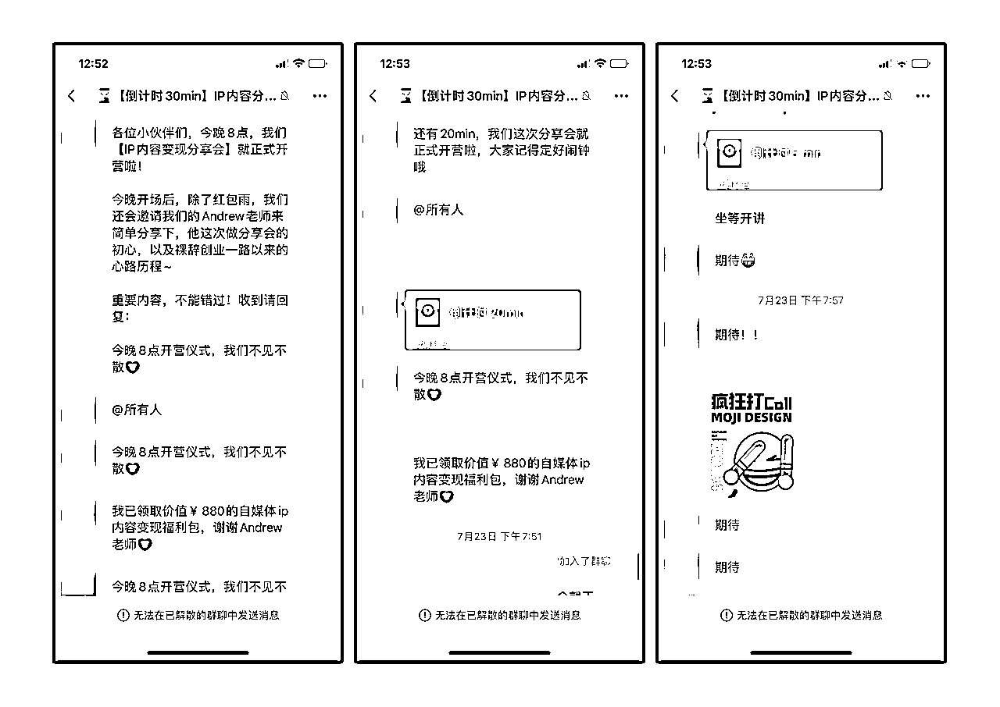

第二，主持人介绍我。而且之后每次分享都应该让主持人来介绍，给自己造势，就像综艺节目里嘉宾登场前，主持人先介绍各种成就，然后在大家欢迎下嘉宾亮相。

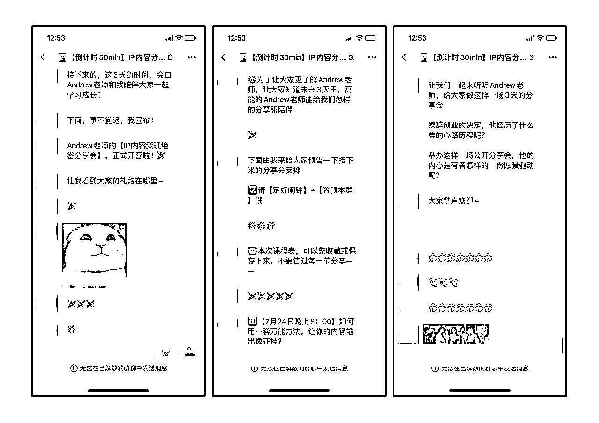

第三，开营分享时，我连发4个红包，封皮上分别写了打招呼、感谢大家听分享、感谢合伙人和靠谱助力。红包雨既炸了场，又通过感谢完成破冰，顺便提升了大家的好感。

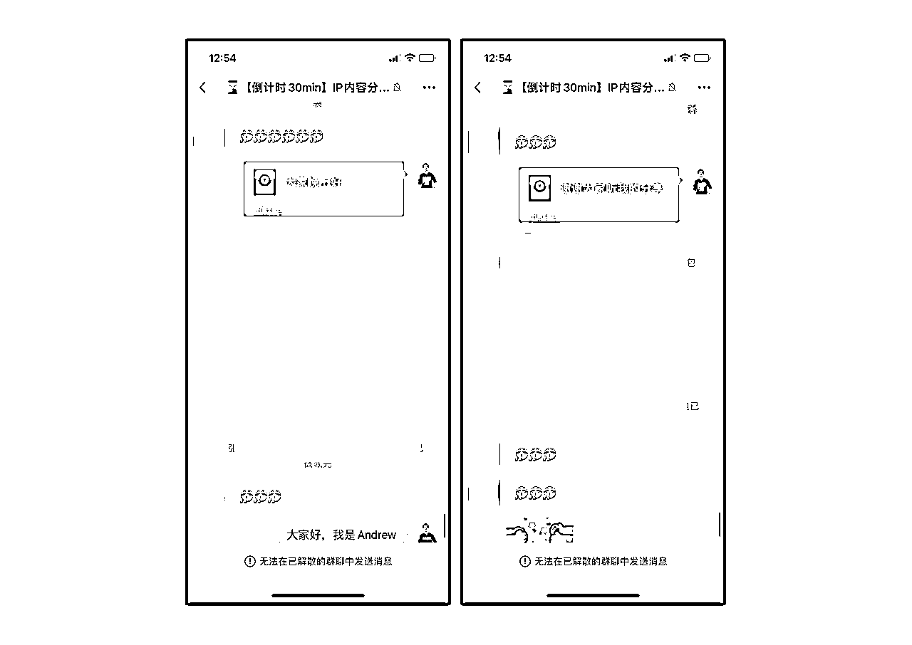

总的来说，群发售不只是集中成交，也是一次完整的自我梳理和品牌曝光。把每个环节准备到位，节奏守住，即使有瑕疵，也依然能收获远超预期的结果。

4天，15个私教课学员，营收额2.5w+。成绩谈不上惊艳，却实打实地让我“翻身”了。

先从开营那天聊起。现场400多人，大多是生面孔，我紧张得手心冒汗。索性没有藏着掖着，直接坦白：“我有点紧张，台下的社恐朋友来拍拍我。”话音刚落，收获了一大片善意的回应。看，真诚永远是最有效的通行证。

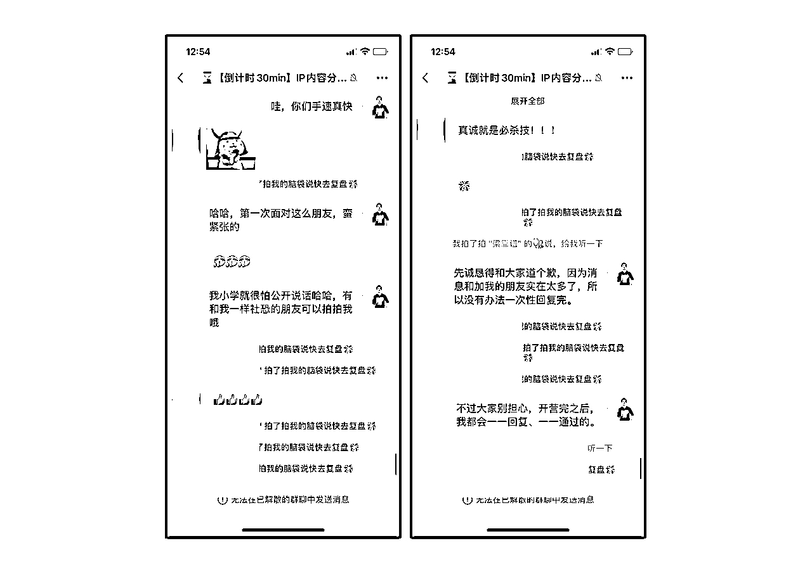

自我介绍，我只用一句话带过。主持人已经介绍过，海报上也写得明明白白，又何必堆砌头衔？

真正的重头戏，落在我“为什么裸辞”这件事上。从初入职场时的一腔热血，到被加班内卷一点点消磨，再变成地铁末班车上反复盘旋的迷茫——这些心里话，我都细细铺开。直到《楚门的世界》里那道门出现在脑海里，我终于决定，再也不要活在别人设定的剧本里。

这段成长经历，确实是全场最戳人的部分。讲成长，其实就是在立人设。但人设必须来自真实的自己，绝对不靠凹造型。后来许多听众私信告诉我，这部分最打动他们。

讲完裸辞，顺理成章过渡到“为什么要办这场分享会”。从我开始更新公众号，到一点一点汇聚起同频的读者，我始终抱着一个信念：个人IP的核心，从来不是变现和涨粉，而是“成人达己”——成就他人，找到自己。这句话后来成了我的招牌金句，几天里反复讲，一次比一次笃定。

随后，我坦诚地讲出过去写作路上的痛，以及当下的理想状态——如何靠持续输出优质内容，吸引越来越多愿意信任我、为我付费的朋友，让月收入持续突破。专业与实力，最终要靠结果来背书。

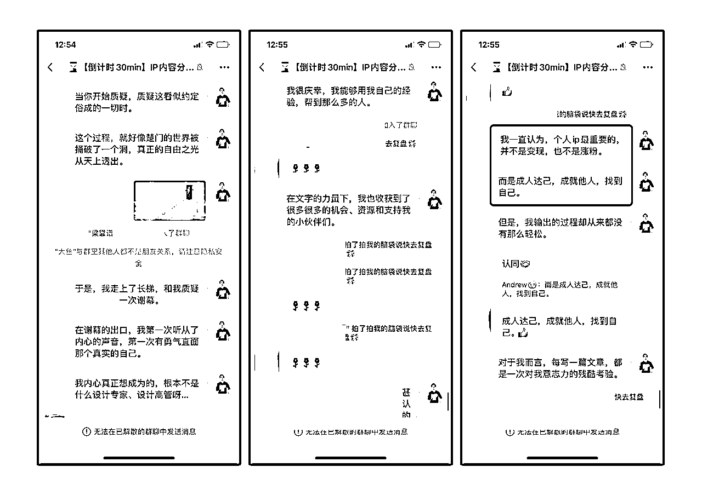

再说愿景。我告诉大家，正是因为淋过雨，所以想为别人撑伞。这场分享会，就是为了帮到更多曾经的“我”。顺带我还卖了个关子，把第二天的干货夸到“炸裂”，吊足了所有人的胃口。

结束后收到的反馈，远超我的预期。复盘一下，开营分享之所以能打，无非靠这四点：

第一，有冲突。故事里有曲折、有失败、有至暗时刻，但每一步都靠自己走了过来。
第二，有共鸣。把痛写得越具体，越容易引发共情——因为亲历过，才真正懂得。
第三，有实力。光讲故事不够，还要露出专业功底，让人相信你是来真的。
第四，有升华。讲清楚为什么办这场分享，落脚到“分享与利他”上，高度自然就出来了。

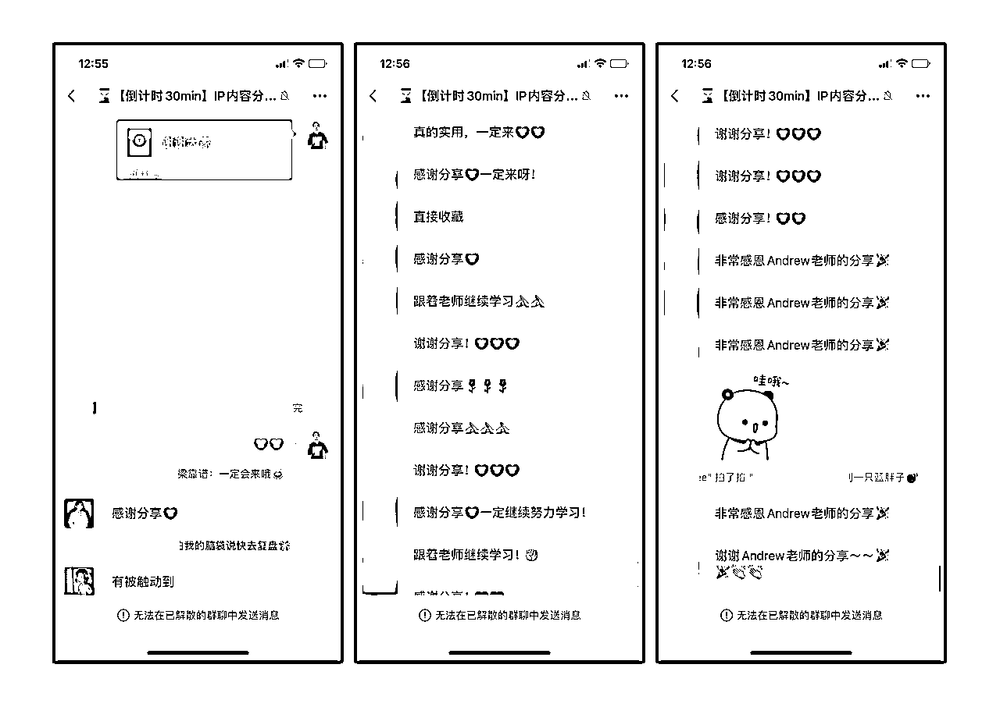

干货分享那一天，我只安排了三件事：欢迎新伙伴、引导大家加微信做裂变；让主持人把开营的打包内容发到群里；收集反馈、发朋友圈。流程照旧——主持人预热、介绍，然后我登场开讲。

原本我打算分享完就直接发售，靠谱一句话点醒了我：“大家进群才多久？先把干货喂饱，明天再谈产品，抵触感会小很多。”真是千金不换的建议。

开场我先带了一波红包雨。每人一个1块钱小红包，封皮统一写着“我会完成这次挑战”。这样既让大家因为“真金白银”的付出而更重视分享，也让潜水的人纷纷浮出水面。丢出第一个红包后，我紧张得不行，生怕没人接。没想到，30多个红包陆续冒出来，满屏红彤彤，看得我鸡皮疙瘩都起来了。

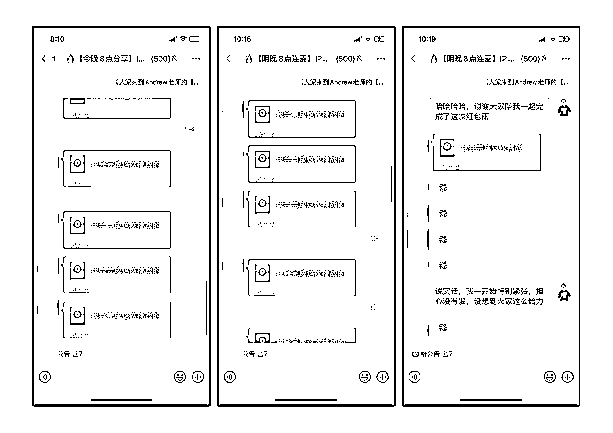

整场分享，我非常看重互动。给学员讲课也是同一个道理，绝不能一个人自嗨。互动不仅能集中大家的注意力，还能让参与感蹭蹭上涨，信任感也随之加码。方式很简单——开场问一问大家的职业，中间抛几个选择题，让“中枪”的同学扣个数字。尽量用数字、字母让大家回应，把参与成本压到最低。

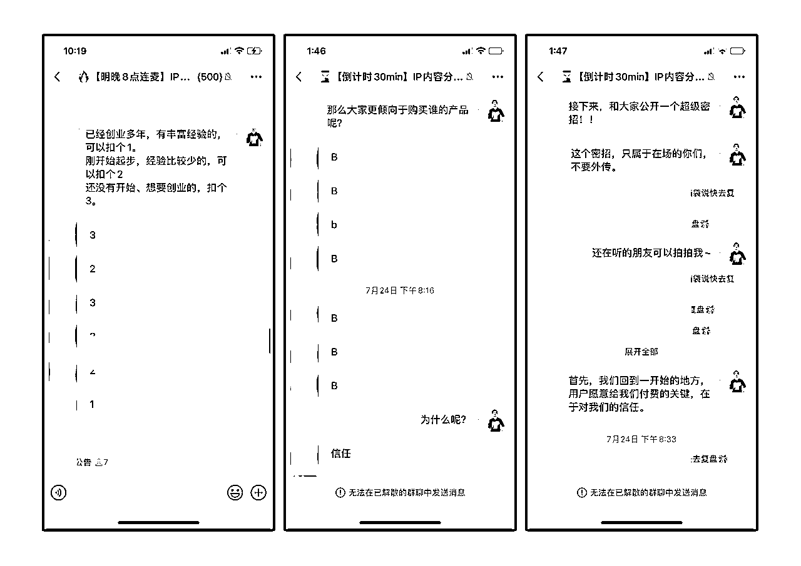

视觉上也要照顾到位。我坚持每段内容不超过4行，十几行的一大坨，内容再好也没人愿意看。

碰到要讲重点的节点，我会发个小红包。一来把气氛重新点着，二来通过红包被抢的速度，大致判断此刻还有多少人在听。

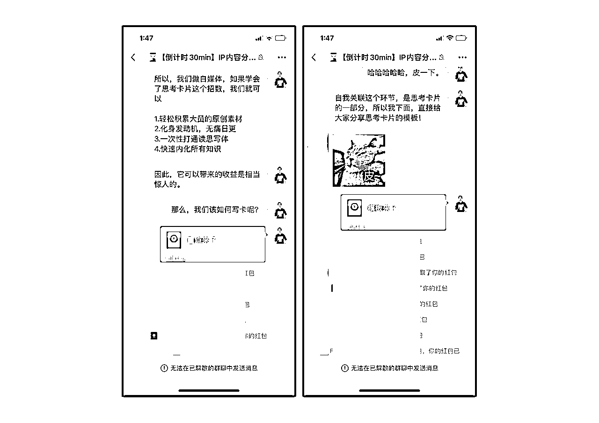

我也不爱讲“纯干货”。理论和方法的背后，得融入个人经历和价值观。因为大家真正记住的，不是知识点，而是你这个活生生的人。就像我常挂在嘴边的那句：“当你无所顾忌地输出关于你自己的一切时，你才能真正成为你自己。”这句金句，击中了不少人。

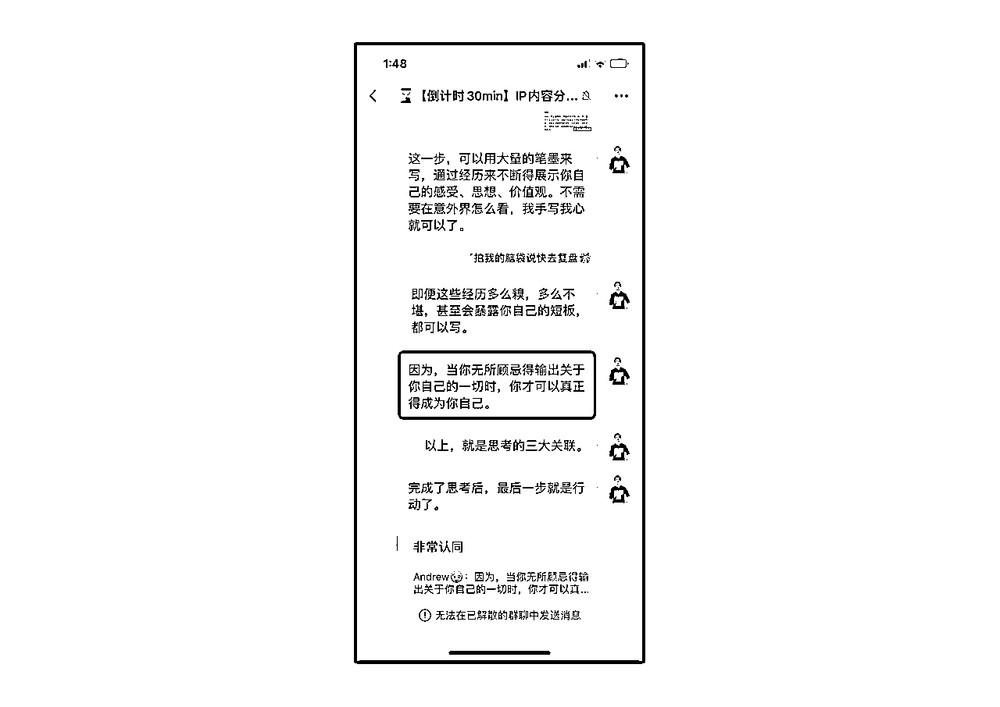

临近结束，我把学员应用方法前后的变化展示了出来，用意很清楚：让所有人看到这套方法是可复制、有效果的，也顺手替第二天的发售埋下伏笔。

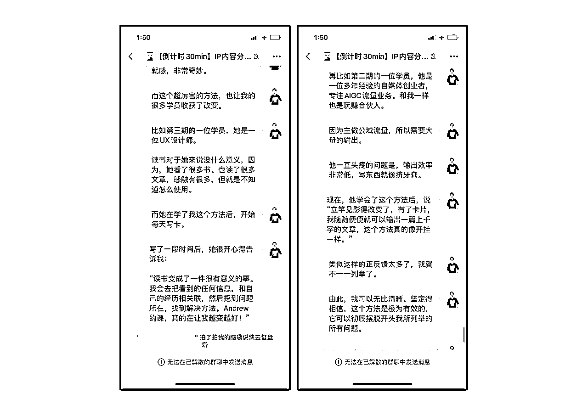

唯一遗憾的，是配图太少。本来计划搭配大纲图、重点图、金句图来缓解视觉疲劳，但时间实在没赶上，只能作罢。

分享结束后，意外收到了4位小伙伴的专属红包，心里暖意涌动。

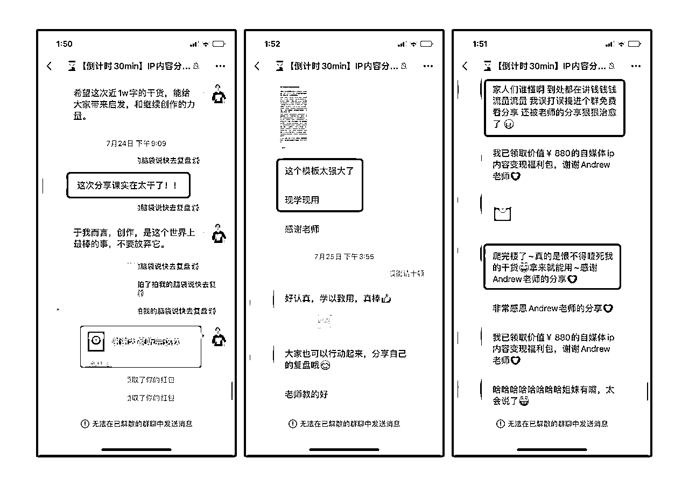

更让我感动的是，一些朋友自发写下了长篇感悟，甚至主动发朋友圈。作为一个ISFJ，看到自己的内容真真切切帮到了他人，那种满足感，胜过一切数据。那一刻我就知道，这一步走对了。

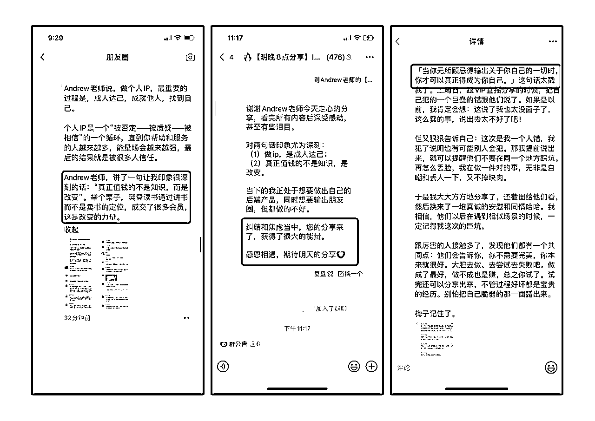

到了学员分享环节，靠谱建议我在白天引导大家做了个问题接龙，把每个人做业务遇到的困惑都聚拢起来，留着直播时统一答疑。氛围组也悄悄在群里帮着暖场。

安排学员分享，有两个细节必须留心：第一，人选至少提前一周定下来。很多学员晚上要加班，临时约根本排不开，越早锁定越好。第二，提前和学员沟通分享细则——文字速度别太快也别太慢、每段控制在4行以内、开场发红包、多互动，基本就是把我的那套操作细节完整复制过去。

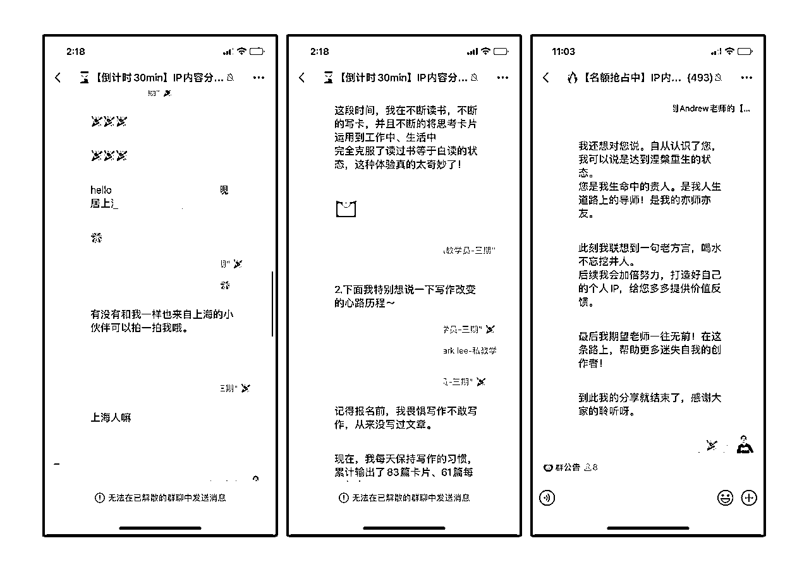

正式发售紧跟在学员分享之后，但绝不能硬推。我选择先铺一段过渡：先带大家回顾这两天的分享精华，感谢每一位支持者；接着点明一个现实——做个人IP的路上，仍有很多单靠分享解决不了的痛点；最后顺势带出，为了更系统地帮到大家，我把自己打磨的课程推了出来。

就这样，产品水到渠成地走到了台前。细节部分，我再逐一向大家展开。

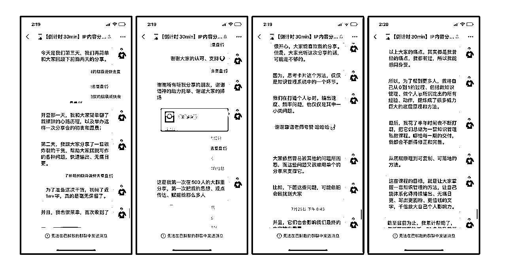

引导接龙后，不到半小时就收到了5份审核金。复盘发售全过程，几个关键动作至关重要：

权益要标出价值。别含糊其辞，直接写明“价值xxx元的加餐小课”“价值xxx元的一对一答疑”，具体数字往往更能让人产生“很值”的直觉。

福利要分阶梯。前5名送什么、后5名送什么、10名开外送什么，层层递进，一方面让人觉得超值，另一方面制造稀缺感——越早报名，占的便宜越大。

审核要够严格。因为我的产品是私教，我得确认自己真的能帮上对方，也确认对方预算和时间合适。审核制本身也在传达两个信号：不是交钱就能上，交付质量有底线；名额确实有限，得抢。

海报要做成长图。把痛点、权益、报名方式统统塞进一张图里，既方便大家完整阅读，也方便随手转发推荐。不过我的海报实在长，展示时得分三栏。

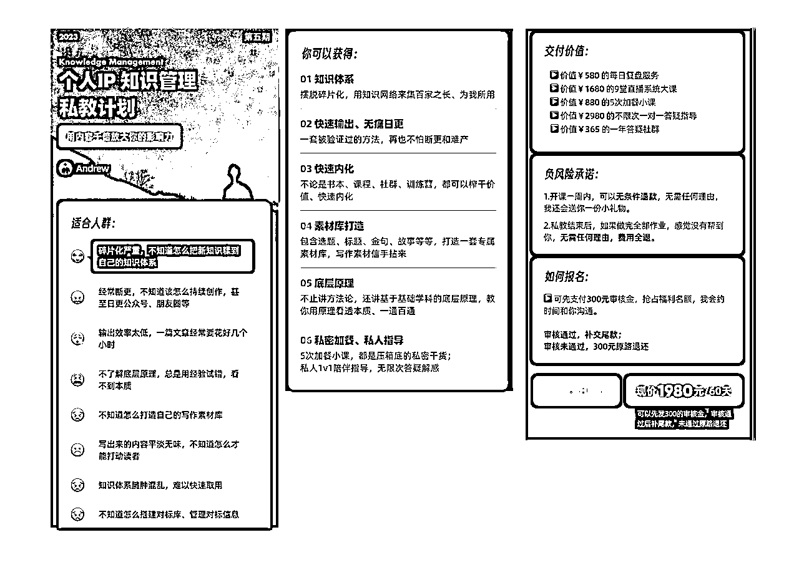

发完付款码，一定要马上接龙。这是我做得最狼狈的地方——接龙文案没提前写，现场现编，硬生生拖了5分钟。接龙的价值在于：每新增一条，都是对“前X名福利”的一次重复触达；同时接龙天然符合《影响力》中的社会认同原则，会带动更多人跟上。万一开始冷场，就让氛围组先牵个头。

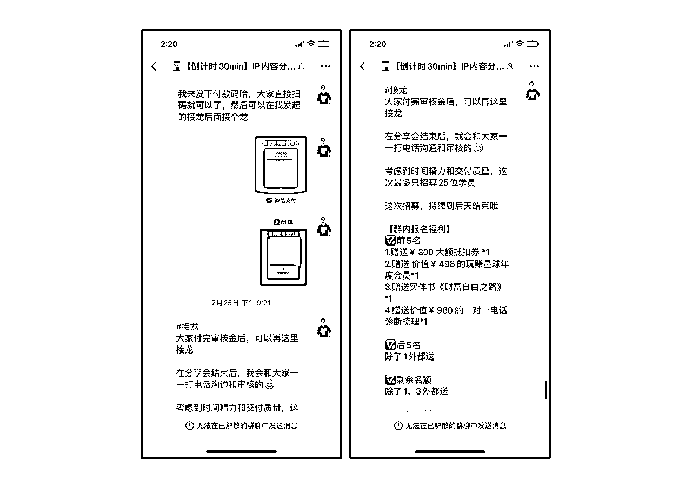

有人付下审核金，要及时恭喜：“恭喜xx抢占第x名，还剩x位优惠名额！”一句话，既庆祝了对方，又用剩余名额继续撩拨后来者。不过我的阶梯福利设置有不少瑕疵，6-10名的福利和1-5名差距太大，导致前5名抢完后，当晚的转化几乎陷入停滞。

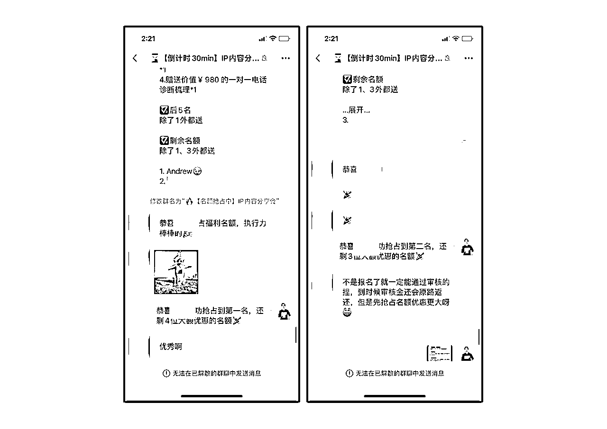

到了追销日，中午安排另一位明星学员分享，下午照旧重复发售动作，又成功收到3份审核金。晚上，是我人生第一场直播。原本排练了整整一个下午，真正开播时还是紧张到声音打颤，各种意外层出不穷。但不管怎样，这是一次全新的突破。

直播的教训，值得记下三条：一、提前评估好答疑时间。这次答疑拖太久，差点耽误了后续连麦；二、手机千万不要放在电脑旁边。信号干扰产生了电流噪音，好几位朋友都反馈了；三、多多练习。眼神、肢体、语气，全程僵硬到不行，离“自然”还有很长一段路。

最后一天，安排第三位学员分享，接着进入Q&A环节。大家听完分享和产品介绍，心里多少会有些顾虑，Q&A就是用来解开这些心结的。

除了常规疑问，我特别针对三个方向做了准备：时间上的顾虑——每一期都在涨价，可以先趁最低价用定金占住名额；咨询上的顾虑——我很珍惜和大家的交流机会，不必背负心理压力；上课上的顾虑——有问题随时可以提问，随时能得到指导。

Q&A结束后，进入最后一轮冲刺。先把群昵称前缀统一改成“倒计时xx小时”，让时间紧迫感肉眼可见；每次有人下单接龙，都照常送上恭喜。

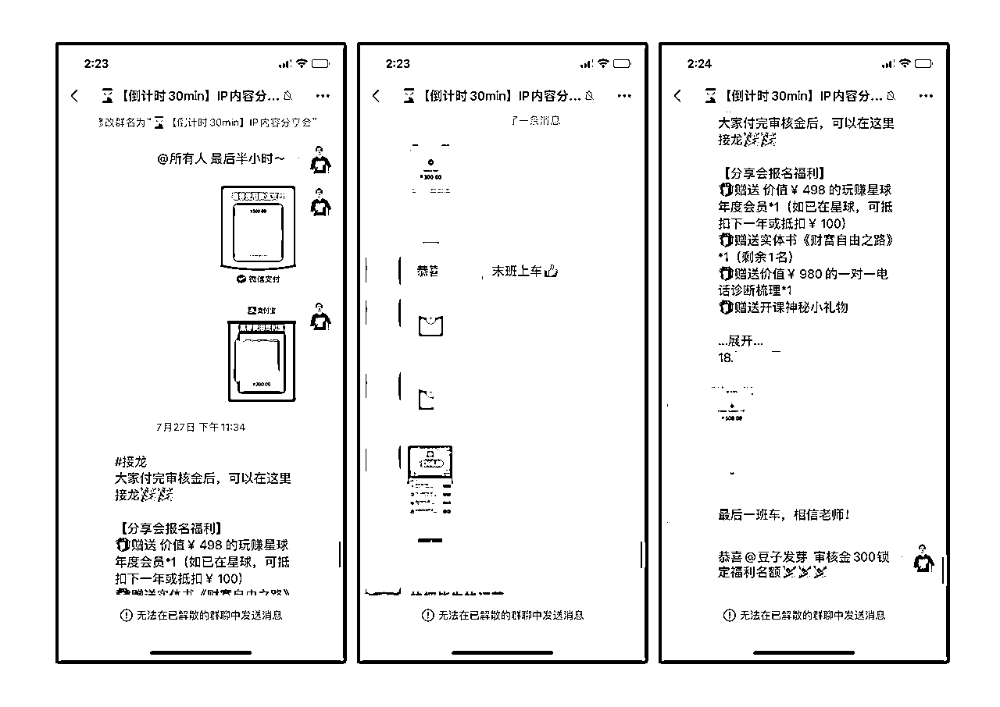

其实在冲刺开始前，我已经和付过审核金的伙伴们约好一对一电话咨询。审核通过的，便在倒计时期间引导大家发出尾款截图和录取通知书。当签约的仪式感被公开展示出来，这本身就是最有力的催单信号。倒计时收尾后，我再次恭喜所有下单同学，感谢大家的信任与支持，送上祝福，给整个发售画上句号。

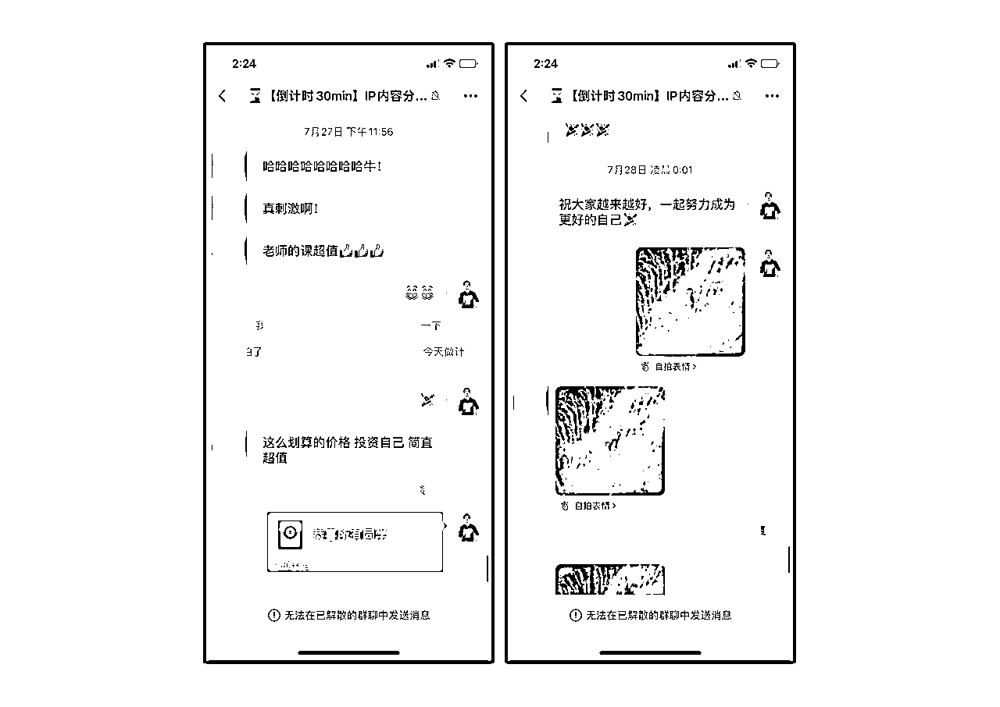

最后，一定要及时解散社群。靠谱有句话让我深以为然：所有社群都逃不过自己的使命和生命周期，完事就该解散，否则只会变成死群、广告群，体验直线下降。解散后，我逐一打电话完成审核，同时核对成交客户的推荐人，把佣金一一落实。

这4天，最终成交了15位私教课学员，营收2.5w+。虽然谈不上辉煌，却稳稳超出了我的预期。相比上一期，收入整整涨了56%，也是头一回大幅超过我裸辞前的月薪。

但问题同样清晰。

第一，前期规划不足。群发售的节奏环环相扣，任何一个环节和对应话术都要提前准备到位。可我偏偏漏了接龙文案，对于第一次发售来说，这个失误相当致命。

第二，没有引导主持人主动推送我的微信名片。那意味着大家想要加我，还得额外多走一步。靠谱说过一句话，我至今记得：“不要增加你的制作成本和用户的使用成本。”很多看似不起眼的麻烦，都可能在悄悄影响用户的决策。互动时只让大家扣个数字、及时打包分享、发售末尾直接发付款码——这些细节，全是在给用户体验做减法。

第三，意向客户的跟进不到位。这是我认知上的一个重大偏差：我自以为500人都在认真听讲，实际上很多人领完进群福利就再也没出现过。那意味着大量真正有意向的客户，压根没看到我的分享内容。正确的做法是私聊转发，并且在发售环节主动询问。

第四，产品体系太单薄。目前只有一款1980的私教课，没有几百块的入门课或者知识星球等低客单产品。这样一来，既没法做价格锚点，也照顾不到预算和需求各不相同的人。

心里话，有太多想讲。这次发售，靠我一个人绝对走不到最后。靠谱不但在社群和朋友圈大力推荐我，给我直播连麦的机会，还在全程耐心细致地指点。很多人说，一生中能遇见的贵人屈指可数。我何其有幸，遇到了这样一位愿意提携和托举我的领路人。

感谢芷蓝姐搭建的玩赚新媒与合伙人圈子，让我不断破圈，有机会认识那么多优秀的前辈；也感谢她对我产品问题的指点，以及那些极具战略性的建议。感谢理白的支持和认可，他的朋友圈一直给予我无穷启发。感谢小鹿、小米老师、俊雄、橘子、张弛有道、青一，还有我的老学员们，愿意替我大力吆喝，甚至主动推荐产品。感谢梅子、saki、月儿、胡桃、美楠等朋友的认可与鼓励。也谢谢所有合伙人在海报和产品细节上给出的宝贵意见。

最后，说点掏心窝的话。我出身农村，没有优渥的家境、没有过硬的资源、没有强大的人脉，性格又极度内向，在公开场合说话都容易结巴。但有三件事，一直稳稳地托着我走到现在。

第一，我相信选择的力量。当下所有的苦难、焦虑、痛苦，都源于我自己的选择；而我完全有权利选择另一种未来，也有足够的力量去创造我想要的未来。

第二，我相信内心的声音。每一天、每一刻、每一秒的念头，都在塑造着我的人生轨迹。别人怎么看我不重要，重要的是我怎么看自己。

第三，我相信“成人达己”。个人IP真正的分量，不在变现与涨粉，而在成就他人、找到自己。而这一切的第一步，是找到自己——找到热爱，找到真正想成为的模样。

就像乔布斯在斯坦福演讲里说的：你的时间有限，别把它浪费在过别人想要的生活上。不要被教条束缚，也别让世间的喧嚣淹没心声。最重要的是，要有跟随内心与直觉的勇气，它们会告诉你，你想成为一个什么样的人。其他一切，都是次要的。

谢谢你花了这么久读完我的故事。希望它在某个瞬间，能为你递去一点力量。

我是Andrew，文中有任何细节没看明白，都欢迎来找我一起探讨。如果有什么能帮上忙的，我也随时都在。祝我们一起，赚钱有术。