# 视频号暴力起号全流程拆解：15天顶到3万GMV，新手照着做就行

这段时间很多朋友都在问我，视频号还能不能做？我的判断是：红利期依旧在，而且特别适合普通人入场。

先简单介绍一下自己，我从2019年开始尝试创业，做过抖音带货团长，日均销量冲到过30万+；后来和朋友合伙开广告公司，两年做到年营业额近两千万；公司旗下的B站MCN全网粉丝接近千万，其中包括4位百大UP主；再后来又经营过茶馆。说实话，这些经历放到现在，都不如这次视频号项目让我感到兴奋。

之所以这么说，是因为我亲身验证了一条普通人也能走的变现路径。从认知项目到真正落地，只用了2天。刚开播第一天，GMV只有100块；痛定思痛后，我调整了“暴力起号”的打法，两周内，单场GMV做到了接近3万。

这个成绩当然不敢跟大佬比。但更重要的是，整套逻辑在我们反复测试后，发现人人都能上手——不需要团队、不需要砸钱，唯一的要求是：执行力拉满。

8月7日，我顺手发了个风向标，也想告诉更多圈友视频号仍然有流量机会。感谢龙哥大佬的中标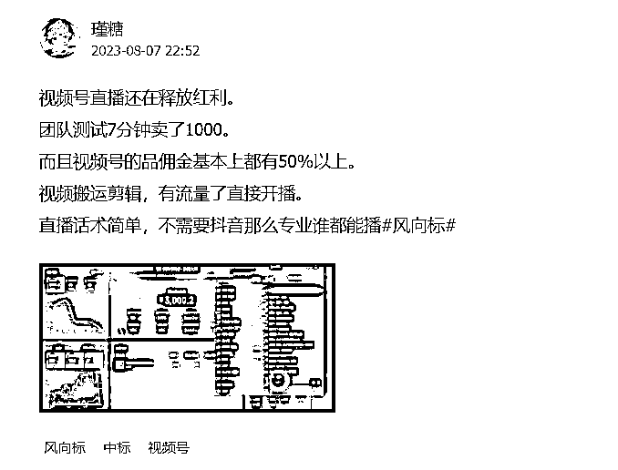。

有位圈友是我这套玩法的“活体测试案例”：看到我8月8日凌晨发布的朋友圈后，当天白天就动手实操，轻松跑出1715的GMV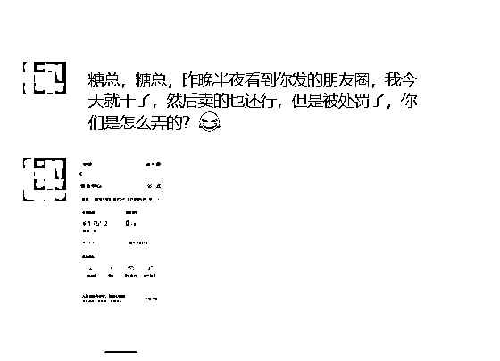。

这种“从0到1”的体验，远比我当初自己摸索更快。我和团队在做这个项目前，对视频号了解少得可怜，基本都是边学、边测、边直播。从7月18日首播，到8月15日，中间只实际播出9天，总GMV拿下三万五，佣金约有1.6万。其中最高一场2.8万；往前数25天，真正投入的天数只有15天左右。

完整数据如下：

7月18日，GMV 100
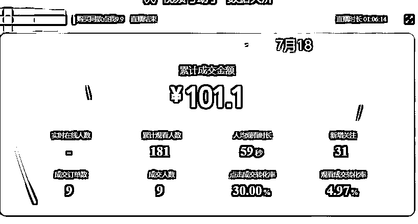

7月19日，GMV 511
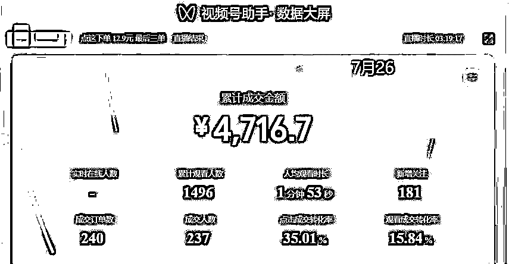

7月26日，GMV 4716
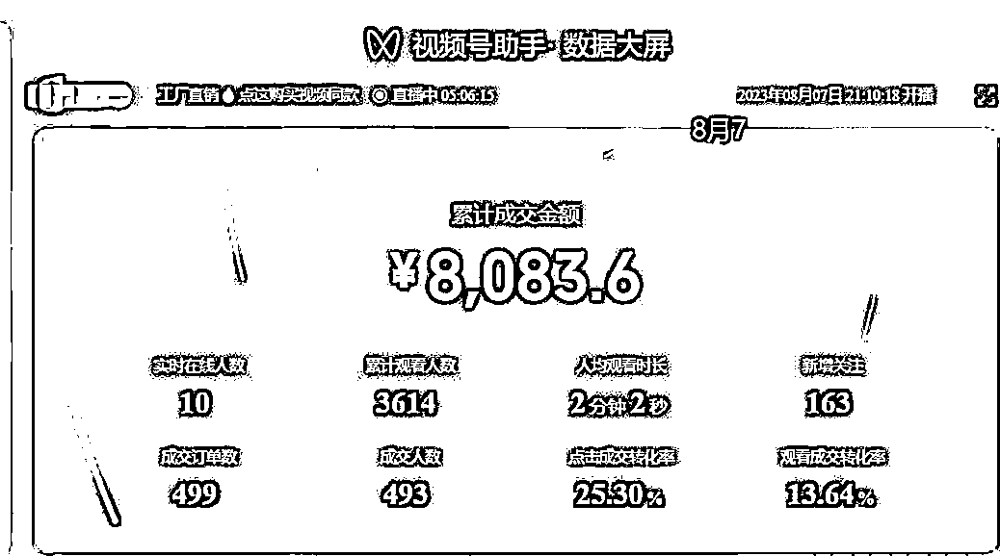

7月31日，GMV 28000
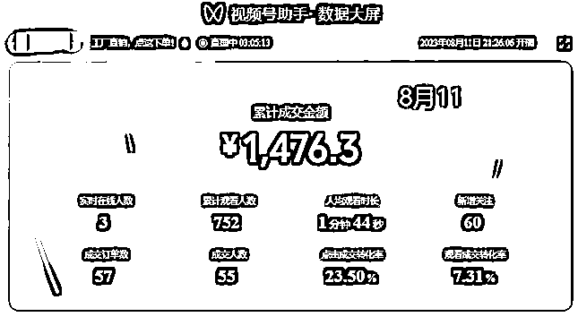

8月7日，GMV 8000
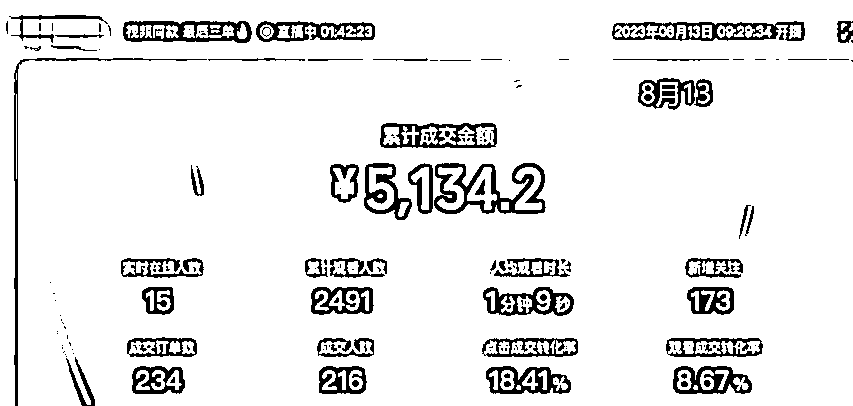

8月10日，GMV 5666
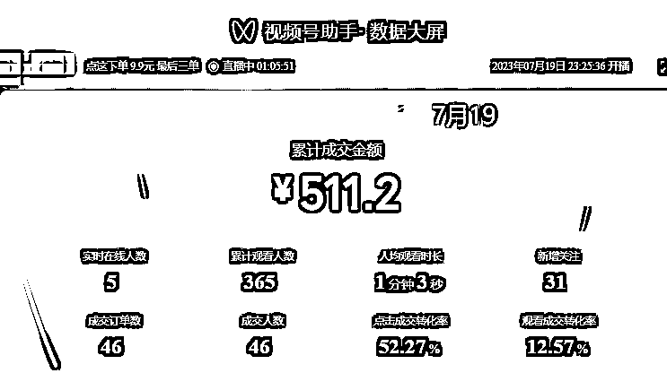

8月11日，GMV 2935
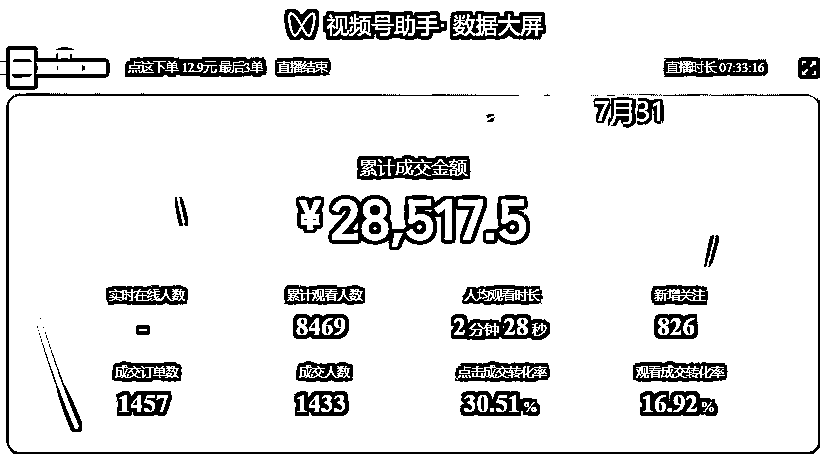

8月13日，GMV 6000
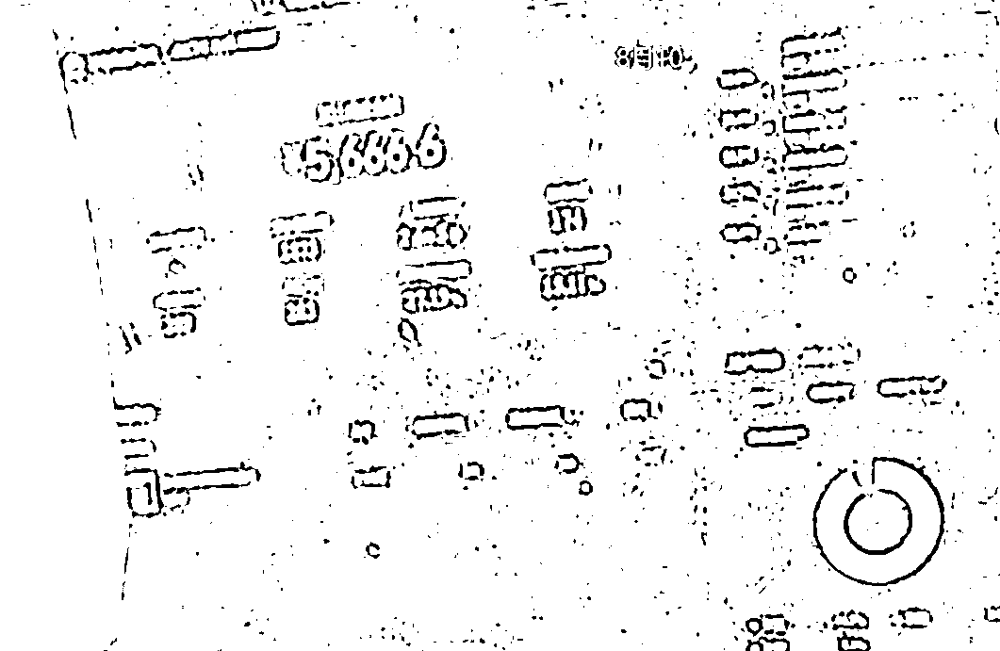

8月14日，GMV 3552
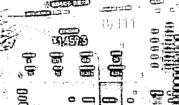
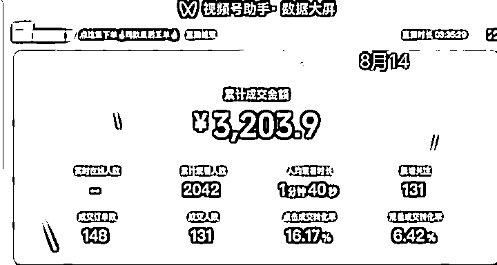

就在今天（8月17日），我的另一个号也迎来爆发，直播加橱窗，单日GMV破万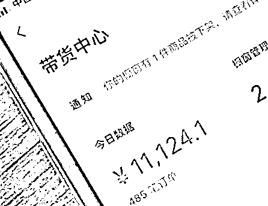。边跑边更新，这些数据还在继续刷新。

那么，“暴力起号”到底是什么？用一句话概括就是：搬运其他平台已经跑出爆款势能的商品素材，用混剪方式完成去重，再连续发布视频，借助自然流量把直播间接住，顺势卖出低价高佣的产品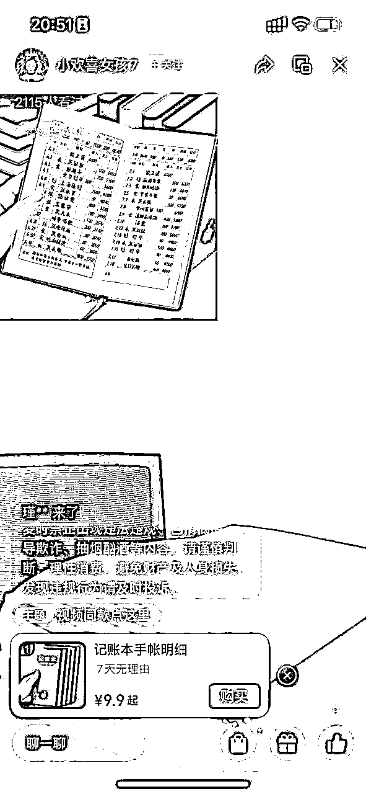。你平时在视频号广场或者瀑布流刷到的那些直播间，很多都是这种打法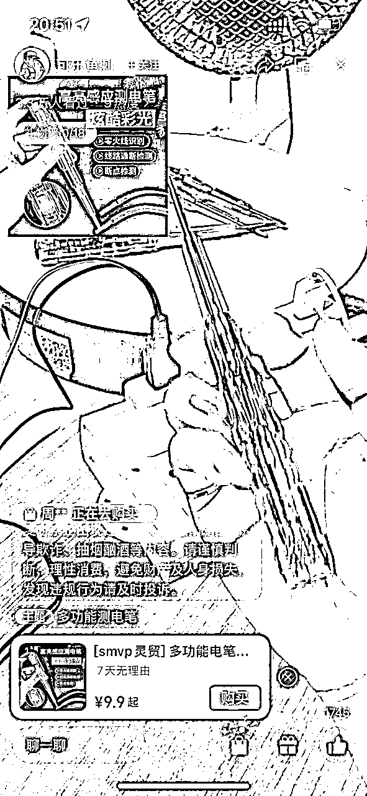。它们的封面通常直接挂产品图，一看便知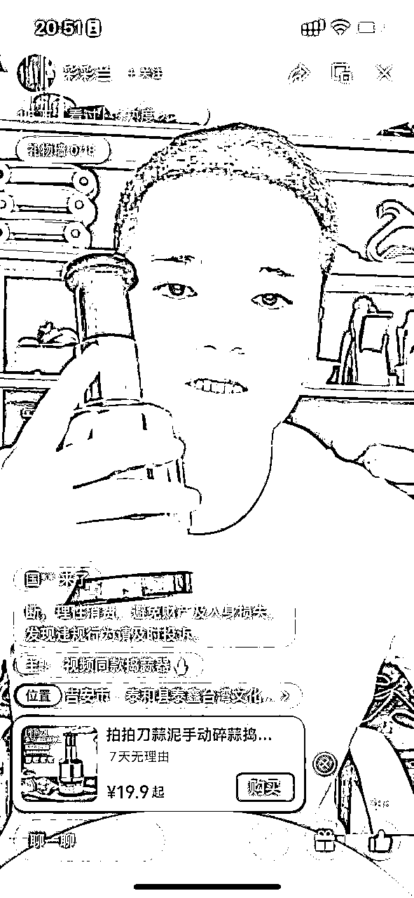。这类玩法基本只打9.9到19.9的价格带，偶尔上29.9，佣金大多数在50%上下。

要入场，先按清单备好物件：
- 至少一部苹果手机，最好有1台是11以上型号，可以连接电脑做摄像头开播；有条件尽量多准备几台，记住一机一号一卡。
- 一台Windows电脑。
- 5个已经开通视频号、完成绑定银行卡实名认证的微信，用来做视频号直播。
- 手机散热支架、能连接电脑的麦克风。
- 每个视频号100元橱窗保证金，5个号就是500元。
- 最重要的还有心态：死号是正常代谢，没流量是日常状态，所以要多号、多品、多素材轮番测试。

操作路径并不复杂：注册视频号 → 直播人脸实名认证 → 交保证金开通橱窗 → 养号 → 选品 → 筛选素材 → 剪辑 → 发布 → 开播。

账号怎么选？优先考虑没被染指的新号：
- 老微信从来没有注册过视频号的；
- 新注册的微信开通视频号后，先刷几天老年向内容，养一养，隔天再实操；
- 老微信没带过货、没有爆过的号，本身就是好苗子。

接下来就是“养号”，目的是把账号调教成带货属性的兴趣用户，让系统不断推同行内容给你。这样做的好处很多：可以随时跟品，能够学习同行爆款模板，说白了就是快速提升你对视频号带货的判断力。

操作上分三条路：
第一，人工干预。找到10个同行账号关注，挑一条爆款视频评论、点赞、收藏。如果找不到目标，直接参考我关注的对标账号就行。有一点要留意：有部分账号后来被原主删掉了带货内容，这种就不必再关注了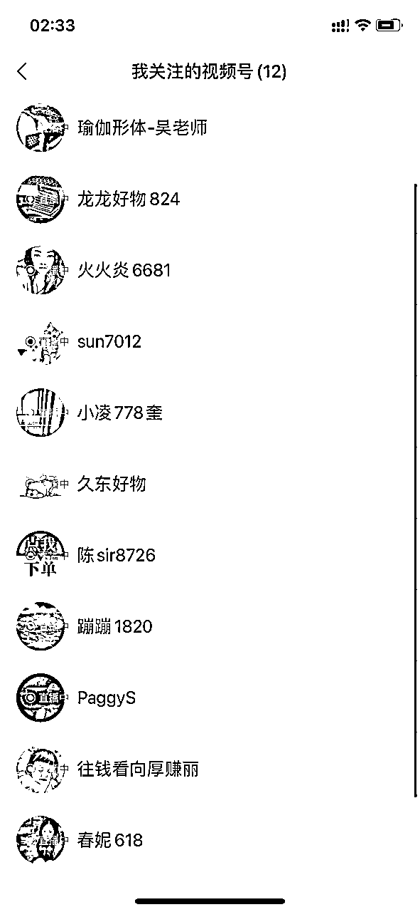。
第二，刷自己的视频号。刷到同行类内容时点赞并停留；与带货无关的内容，直接点“不感兴趣”。
第三，逛直播广场。封面带产品贴图的，基本都是自己人，进去评论点赞互动，系统随后会推送更多同类直播间。号养熟后，一开直播广场，至少80%都是带货账号。

养号完成后，进入选品环节。

视频号的核心购买人群画像很清晰：45岁以上，集中在二三线城市及小镇。这群人价格偏好强，极度看重性价比。所以选品需要智取：

一是便宜、极致性价比。比如9.9元的水管、沥水篮、干发帽；或者29.9元三提纸巾再送三提，听着就觉得划算到“买一次用一整年”。
二是新奇特、素材自带吸引力。因为是搬运混剪，产品本身的视觉效果越强，引流能力越好。像小滚刷秒变新墙、老鼠夹一夹一个准，以及抖快上的剧情带货，走的是同一个路子。
三是强卖点、直击痛点。拿防蚊香茅精油举例子：夏天蚊子多，防蚊驱蚊就是强需求；产品不用点火、不用通电、成分安全、母婴可用、室内外随身携带打开即用，和传统蚊香片、驱蚊喷雾区隔开来。
四是踩周期节点。七夕、9月开学季、中秋、10月国庆出游季、万圣节——全是可以提前布品的时间窗口。

结合我们这套“短视频拉爆直播间”的玩法，选品能总结出三个公式：
1. 便宜+强卖点=入门品
2. 入门品+新奇特=降低难度品
3. 降低难度品+规律强=直接爆单

至于怎么提升选品的命中率，核心是选对品、跟对时间。
- 直接跟随正在直播的爆品。在直播广场刷到的在播商品，先看视频类型，再看视频数据，然后观察直播间人数和销量。如果点赞评论转发不错、直播间有真实互动、销量在线，并且视频你能搬运、选品中心也有这个品，不要犹豫，上就完了。时间就是金钱。
- 用第三方平台找抖音爆品。考古加、蝉妈妈能看到抖音近期爆品、黑马达人，快速捕捉趋势品和视频素材，直接测试。

注意：无论用哪个平台，尽量选以视频带货为主的品，剔除品牌方和明星效应带爆的商品。

具体来看，怎么用考古加？打开主页，进入「个护家清」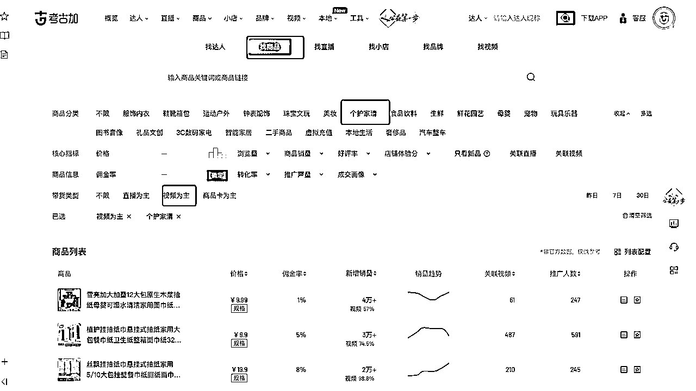。选品标准优先看日常好物，价格定在9.9上下；同时把前20条素材去抖音、快手、视频号搜一遍，要是三个平台都有爆款素材，立刻冲就完事。

再看看蝉妈妈。进入商品页，点开“潜力爆品榜”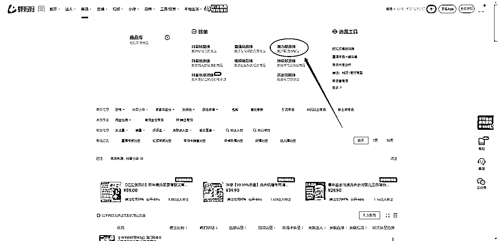。比如选日用百货，点“三日热销”，找销量趋势持续向上的品。数据平台有延迟敏感，榜单里有些商品可能是突然爆量后回落，也可能是数据还没更新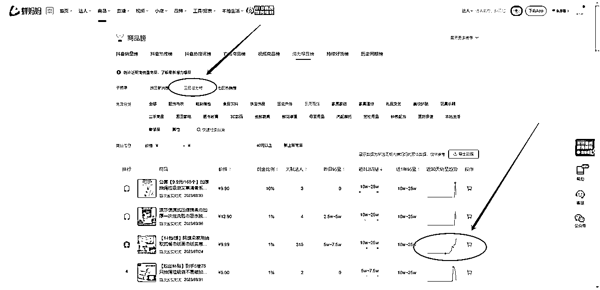。举个例子，金刚砂百洁布，价格不高，抖音佣金能做到40%以上，视频号也差不多，销量整体处于上升通道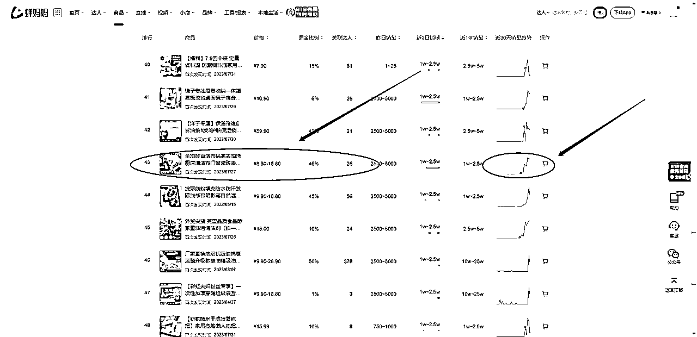。点进视频分析看具体素材，判断能不能搬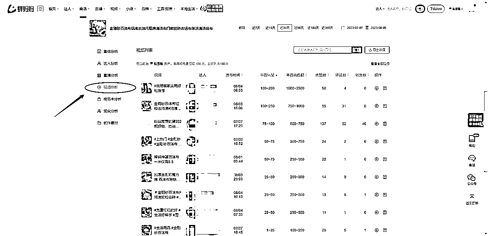。

还有一招很灵：用巨量百应嫁接抖音趋势。视频号反应速度永远比抖音慢半拍，所以抖音刚冒头的东西，马上搬到视频号，能吃第一波红利。需要一个带橱窗能进选品中心的抖音号；打开巨量百应，进入创意中心—爆款视频，行业选“智能家居”或“个护家清”，作者等级不限，按“近一小时”飙升排序。看到低价又好用的品，随即去抖音找素材开测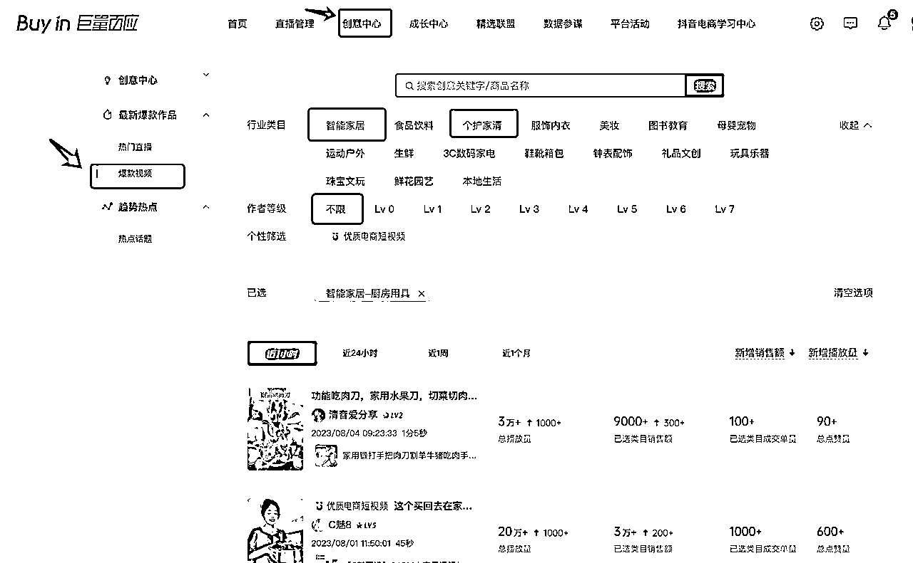。不过要记得，我们是搬运混剪，一定要避开大IP和明星出镜的画面，也不要选真人长时间出镜的视频。

同行也永远是最好的老师。在直播广场碰到同行，他的最早视频在6小时内，而且这个品你以前没见过，可以直接跟。或者复盘一周前的爆品，拆解视频模板、销售情况，再判断能不能跟上。关键操作：如果同行是第一个发这个品的人，且是4小时内发的，立刻去跟；顺便把同行的爆款视频剪辑模板拆透，化为己用。

接着是素材与剪辑。找素材时，先锁品，然后去抖音和快手找对应的爆款视频，或者借用同行的爆款，再去搜同款素材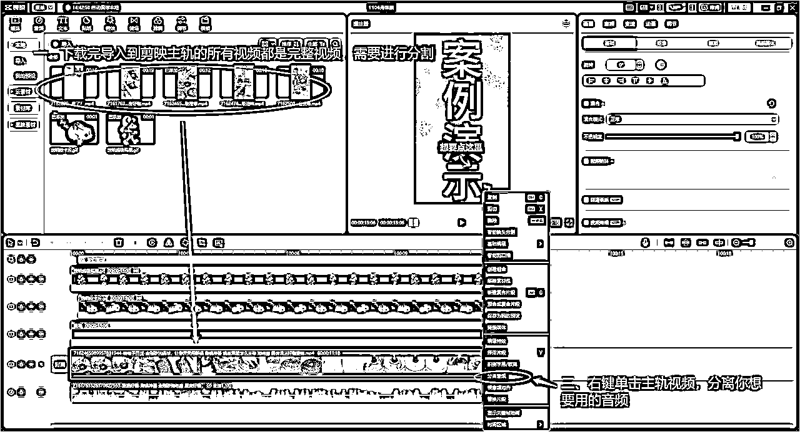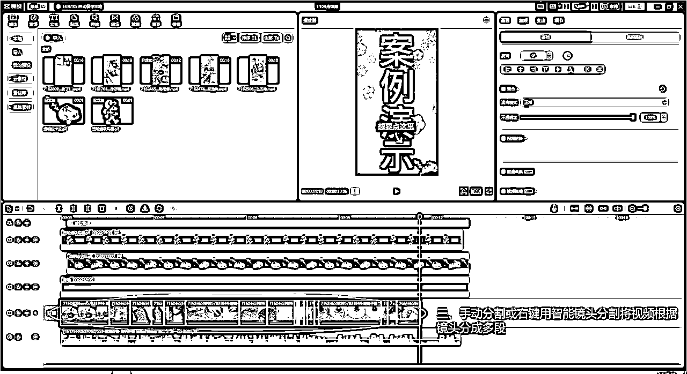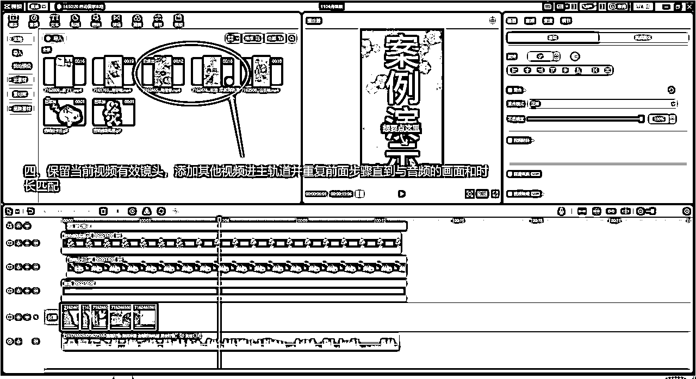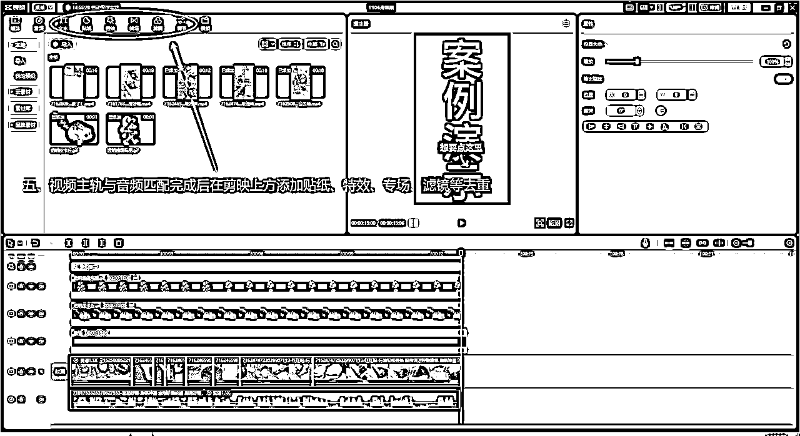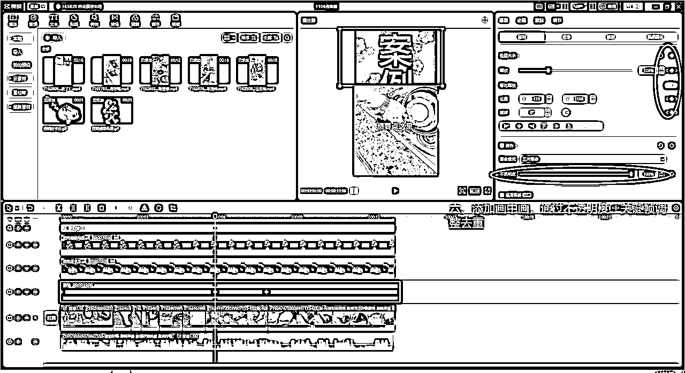。只要该素材在视频号还没泛滥，剪辑要求就不高；如果你本身剪辑能力和灵敏度都在线，直接拆解同行的爆款模板和爆品，起量会非常快。

我的习惯性剪辑框架是这样：把主视频复制到第二轨道，设置镜像，不透明度调到4%，下方两个角落加2个贴纸，再叠一层扫光素材。音频部分做分割，塞进两个音频轨道，音量分别调到-80和-60，识别文字后导出。一条成片完成后，替换两套贴纸，又能产出两条。等于一个素材变三份。

发布环节也同样讲究节奏。

如果你用电脑直播，先把直播人脸认证解决。注意这里不是开播，只是提前过审，免得流量爆发时来不及认证。

素材传到手机后，用流量发布。时间有讲究：早上6点-7点之间，醒来马上发视频，每条约隔15分钟，把3条一口气发完。

发完后紧盯数据：
- 15分钟内有200播放，基本说明过审了；
- 30分钟内达到1000播放，可以开播；
- 3条里有一条破2万播放，立刻补发下一条；等补发视频播放过1200，再补最新一条，形成接力；
- 如果30分钟没到1000，不用慌张，观察1小时内的增长趋势。流量能保持每秒50左右的增加，就继续观察1分钟是否降速；只要还在每秒几十到上百的节奏，直接开播；
- 1小时后仍没流量，每隔一小时再看一轮。发布满4小时还是原地打转，就果断删掉，换品或换素材重新来。
- 另外，前面发的三条视频，每隔5分钟点一次“上热门”按钮，测试能不能加热，点开两次就够。

直播准备还得做足：
直播直接用手机开播，点击“视频号—直播—贴图”。苹果手机不能直接贴文字，建议用醒图这类工具把文字做成图片再贴上去。

直播间的名称要设置成能引导点击的样式：“视频同款🔥”“同款点这里🔥”“同款xx热卖中”“同款商品在这买”。用户刷到带货视频后，会在右下角看到入口，被引导进入直播间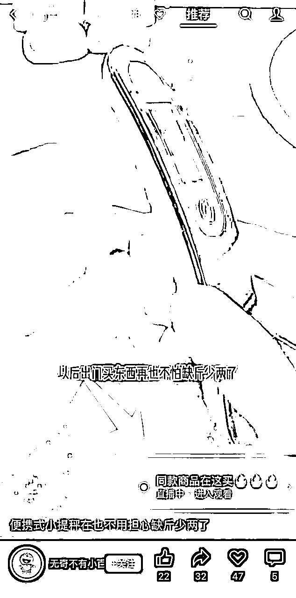。

封面就用产品图片，但要小心：图片上别堆大量文字，万一出现违禁词，直播间会被限流。实在拿捏不准，干脆放一张美女自拍或者“好物分享”图，安全第一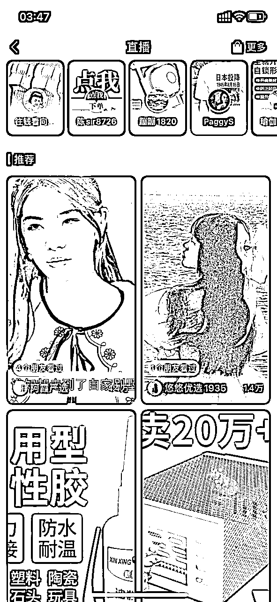。

直播画面方面，直接贴产品图+文字即可。关键点在于真人必须出镜，且不要被贴纸挡脸；最好手里拿着同款样品，显得有真实感。没有样品的话，持续出单后立刻去美团等平台买一个回来播。记住：挡住脸、没有样品，是新手死号的两大雷区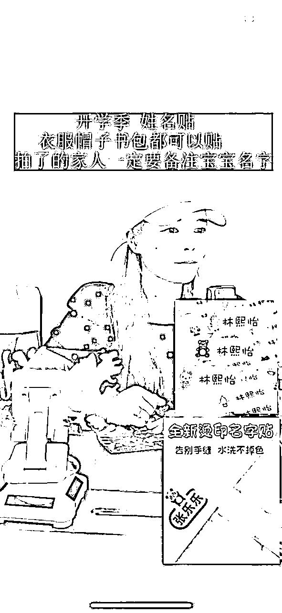。

关于直播话术，简单直接反而好用：
“欢迎刚进来的哥哥姐姐们，今天直播间有活动，价格只要9.9，工厂直销价。日常价39，今天只要9.9，活动不是天天有，能拍抓紧拍。”
“喜欢的哥哥姐姐不要错过，拼手速拼网速，最后三单，拍完就下播。”
“今天拍下都有七天无理由，拿回去试试，满意留下，不满意退掉就行。”
“拍了的哥哥姐姐们，把已拍扣在公屏上，优先给你安排发货。”

卖低价品并不需要花太多精力塑造产品本身价值——用户被视频种草后已经完成心理种草了，进直播间就是来下单的。你反复强调价格划算、货不多了、再不抢就没了，就能快速刺激下单。如果产品有高SKU，也别闲着，积极往双支装或家庭装引导，比如“两只装比一只装更划算”，把客单价抬高。

最后是大家最关心的FAQ，全是实战踩坑后总结出来的：

1. 能不能无人播？非常不建议。无人播出的出单量大概只有真人平播的十分之一，还容易触发违规。一个能稳定出单的号很难得，能多活一天是一天。
2. 不会直播怎么办？把上面的话术抄下来，替换成你的产品名，照着念就行。一旦流量起来，就是栓条狗在椅子上也能出单。
3. 每天播多久？不固定，跟着流量走。视频还在涨、直播间持续进人，就一直播下去；累了让家人朋友顶上，直到没流量了再下播。
4. 没有那么多号怎么办？自己最多能实名5个号，前期完全够用；指标耗尽后，再请家人辅助实名，还能带来4个备用号。
5. 有哪些需要特别注意？账号一旦违规，把手机恢复出厂设置，WiFi也重置一波，再登录账号，并适当养号缓冲。
6. 选品怎么搞？你选的品大概率在选品广场都有；个别没有的，可以找后端人员上架走线下结算，但要注意后端跑路风险。最近就有个头部线下结算跑路的事件，好在我们的损失不大。
7. 一直出不了单怎么办？老生常谈，执行力拉满。每天至少2个号、多则四五个号，不断测试不同品和素材，总有一条能起量。只要品不是垃圾品，视频播放稳定在大几万，怎么也能卖出一两千GMV。
8. 需要做数据吗？纯粹做数据没必要，但可以做评论引导，比如引导“已拍”来提升互动、吸引更多人进入直播间。
9. 要不要养号？要，而且必须养成。这一步本身就是整个起号流程的基石。

这套暴力起号的底层逻辑，说到底就是：跟爆品、搬素材、做混剪、按时发、勇敢播。现在视频号的窗口期还在，真正拉开差距的不是资源，而是行动力。希望这份实操笔记，能成为你变现之路的第一块踏板。

说实话，以前我不太信“养号”这事儿——直到8月16号那天，我把自己一个近10万粉丝的号卖了，只卖了40块，场观才50人。一看后台推荐人群，全是年轻人，我瞬间就明白了：号没养对，必须把标签刷成老年人群才行。

接着聊大家最关心的干货：违规了该怎么办？

其实只要你不搞挡脸、不做无样品直播间，基本很难踩到违规红线。但要注意，视频一旦冲到10万+，就会进入人工审核。这时候如果直播间GMV足够猛，可以赌一把，让它继续冲到20万，搏一搏能不能过审。要是这个号对你太重要、不想冒险，那就果断删掉那条视频。万一是视频不能加热的情况，也别慌——连发10条原创内容，分两天发完，每天5条，然后去申诉。

申诉话术也给你备好了：“您好，为什么我的账号发布作品没有流量，可以帮我解决一下吗，求求了，谢谢”

最后再啰嗦几句真心话。

执行力真的比什么都重要。不知道怎么起步，就用概率思维去砸爆款：多开几个号、多测几个品，总有一个能跑出来。等跑通了几次，你自然就懂什么品能打、什么素材能爆、什么样的同行不能跟——这些全是拿真金白银换来的经验。

直播时机也一样。开太早浪费时间，开太晚错失流量。怎么判断什么时候开播？我写过，但更建议你自己记录数据，慢慢建立逻辑感。

这里要特别感谢涛哥、六月、嘉丽宝贝、鱼丸、子安的指导，还有沐文哥带我进广州群、带我做项目。赚钱有术一直讲“利他就是利己”，这句话我特别认同。进来这么长时间，我拿到的多、分享的少，心里挺惭愧的。希望这篇内容能对想做视频号、正在做视频号的圈友有点帮助。

关于视频号还有想聊的，咱们评论区见，有问必回，文档也会不定期更新，常见问题一起同步！