# 小红书无货源实操拆解：一个单品如何做到80%+利润率

> 来源：[https://kds96nqxnz.feishu.cn/docx/UaxldXPH4ogRHexIo56cIeEmnGc](https://kds96nqxnz.feishu.cn/docx/UaxldXPH4ogRHexIo56cIeEmnGc)

嗨，我是Zoey，目前在多个平台做搬运混剪变现的老号手。今天把我最近在小红书跑无货源的完整思路摊开讲，希望对你有参考价值。

# 一、真实数据复盘

先上结果。五月底上线的这个店铺，全店就吃透一支单品，带动它起来的是一篇笔记。店铺与笔记的关键数据如下：

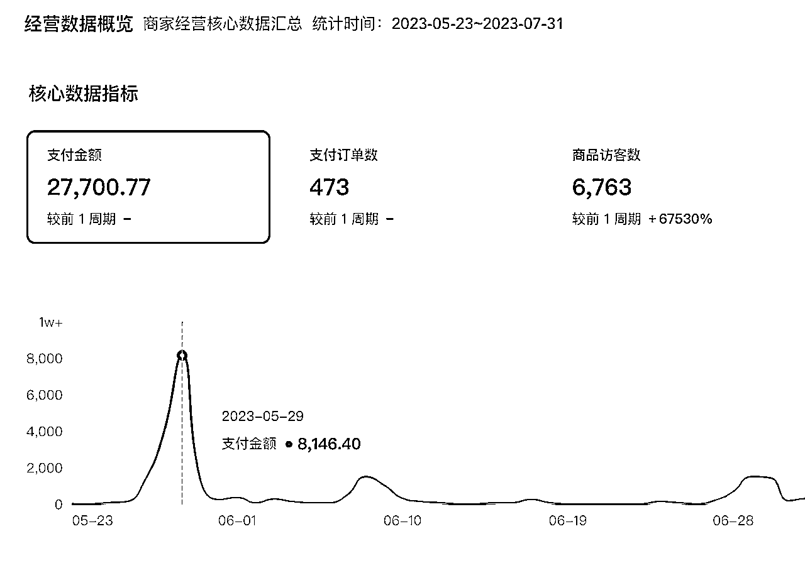

这只单品最终贡献了27000+的GMV，利润率稳定在80%以上，实际到手大约2.5万左右。下方是逸淘的后台截图，部分订单未被全部抓取：

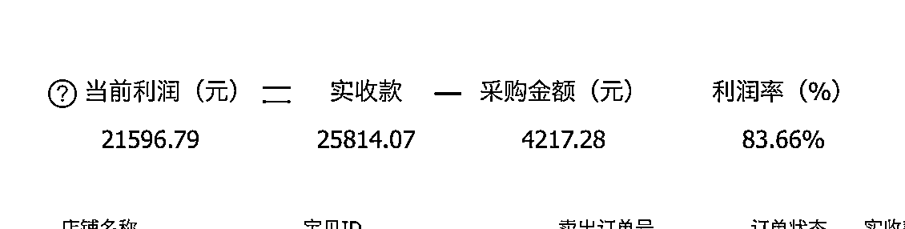

下面进入无保留的选品和执行复盘。

# 二、选品逻辑与笔记打法

*   一开始对小红书的调性并不熟。为了边学边做，我采取了最笨也最有效的方式：每天花三小时刷平台，重点找自己能打过来的对手进行对标学习。
*   大概刷到第三天，刷到一个在卖脖套的号。正好我自己也有关注脖子前倾和富贵包的问题，就顺着进了主页。发现他的笔记封面和结构高度雷同，只是素材做了小范围替换。于是第一个标杆就锁定了。
*   随后开启地毯式搜索，在拼多多、淘宝、抖音、小红书都搜“脖子前倾”、“脖套”等词向下挖素材。意外发现，对标账号的封面图直接来源于淘宝买家秀，这让我意识到买家秀也是一条可被复用的素材来源。
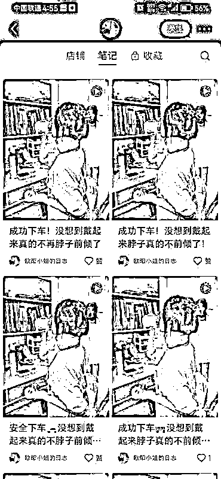

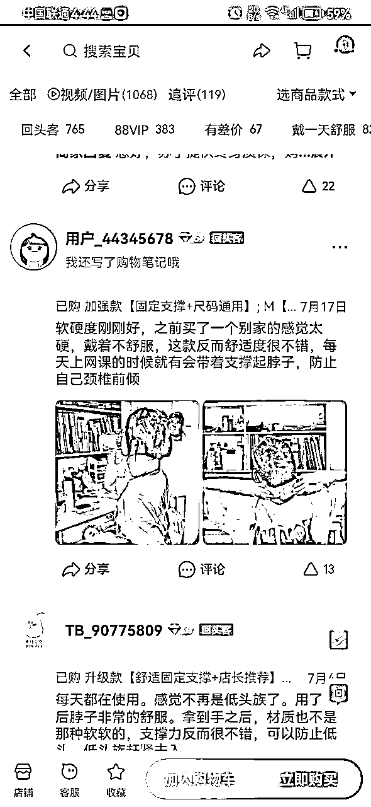

*   接着借助小红书的搜索和推荐继续拓宽标杆池。这一波对标账号有几个共同点：目测都不是硬核实拍，即便出单，实拍场景也非常简陋。封面风格高度同质化，内容也是素材局部替换。
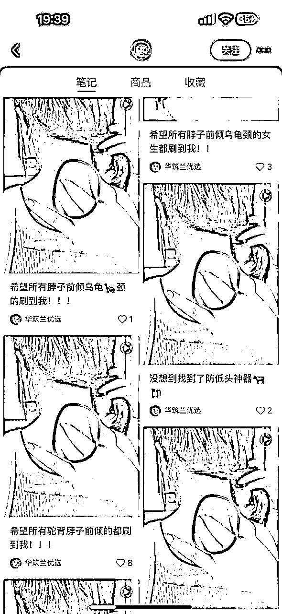

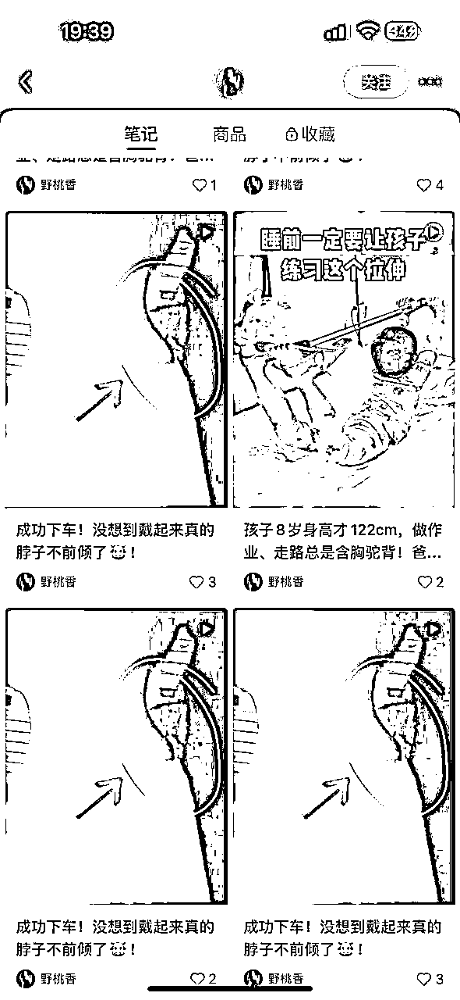

*   确定方向后，我用三号一起开测。先复刻不同同行的重复封面做AB测试，再替换内页素材做迭代，基本是像素级跟随。同时测试的同时我还在持续找新品和新对标。
*   事实证明首个测试品大概率不是赚钱品。第一个脖套相关品发了一周毫无成交。但过程中我挖出了「脖子前倾」「体态」这两个有潜力的关键词。随后用巨量算数继续延展关联词。
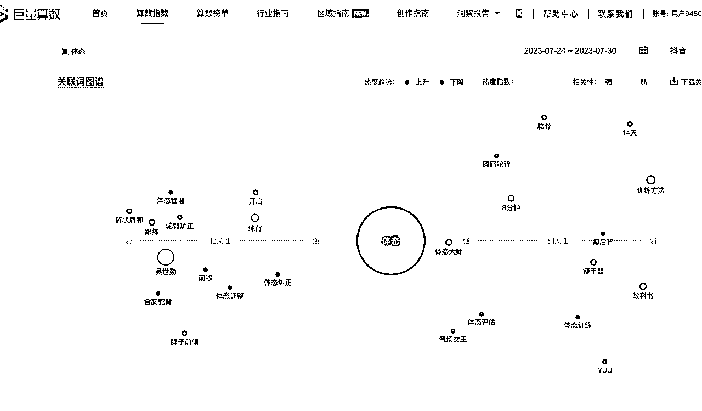

*   在商品垂搜阶段，沿着关键词去购物平台找对应产品，天选之子「十字棍」就出现了。
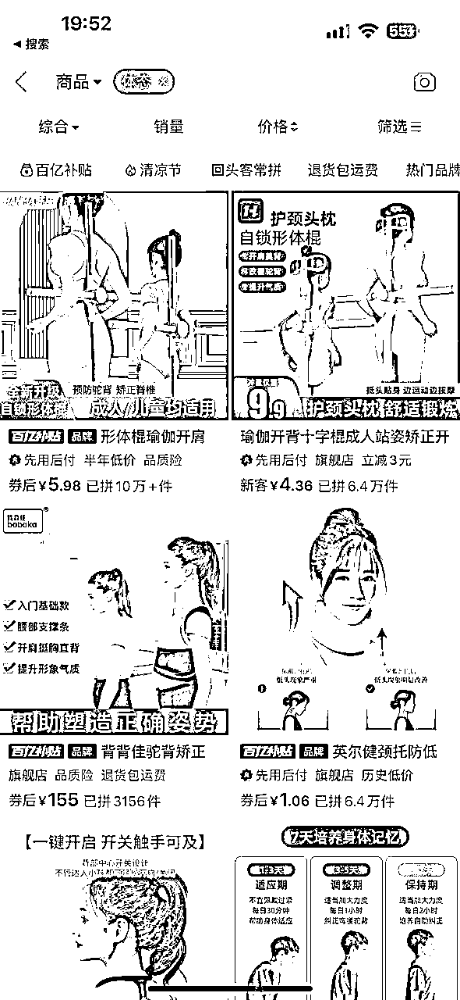

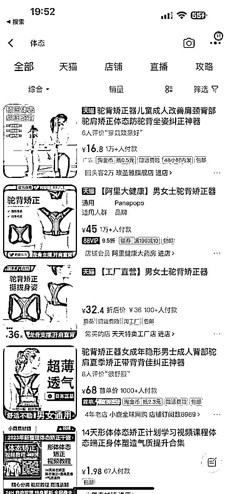

*   笔记打法也跟着做了升级。
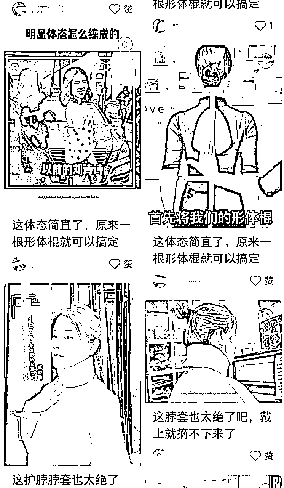

*   继续深挖素材，发现做十字棍的账号有批量在剪辑吴昕的片段，这类名人类素材的完播和播放表现明显优于素人图。于是我转向名人片段混剪的路线。
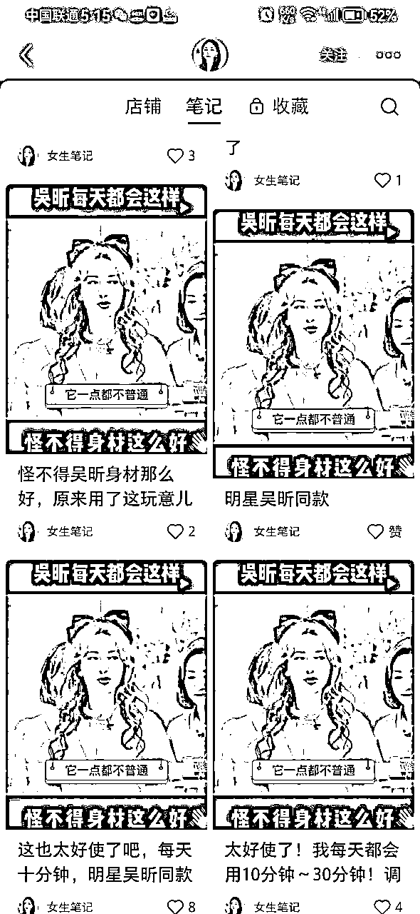

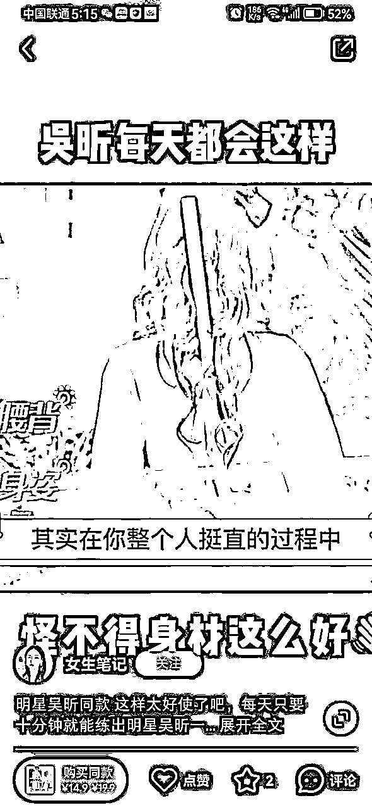

*   边发边测不断迭代，最终沉淀出「陆仙人」版本。陆仙人在小红书本身就有一定粉丝基础，走秀素材极其丰富，便于我源源不断替换画面发新。很快一篇笔记就炸了，单篇小眼睛45万+，点赞837，累计成交400+，单品利润2万+，也就是文章开头呈现的数据。
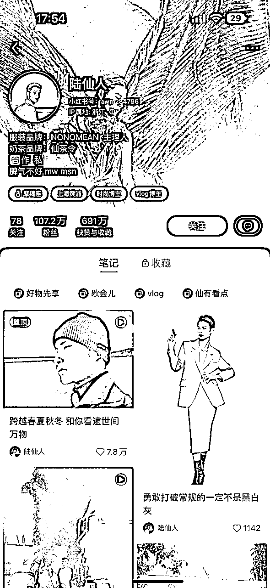

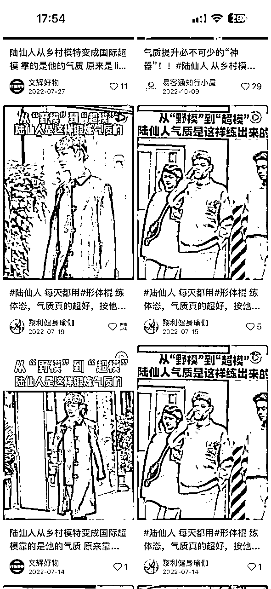

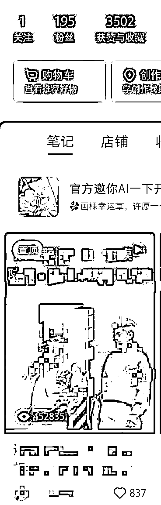

# 三、定价与供应链选择

*   高利润的核心变量是定价。小红书核心人群集中在北上广深等一线城市的年轻女性。她们普遍认同「一分钱一分货」的逻辑，对价格不敏感，反而觉得贵有贵的道理。于是我参考了同类高价高销量的对手定价，从不盲目打低价。
*   在成交量维持的前提下，这套定价策略直接把利润率拉到了80%以上。
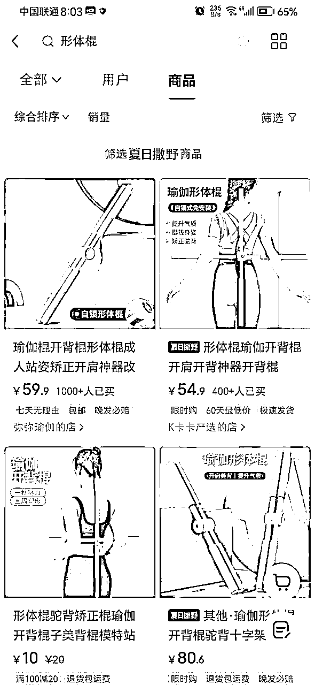

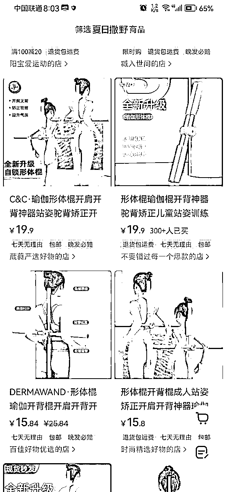

*   为规避售后和短信投诉，我统一对接1688的靠谱牛头厂。相对拼多多，1688单价贵一些，但四百多单几乎零售后，客服压力极小。

# 四、踩坑与经验沉淀

*   感谢赚钱圈的陪伴，在店铺航海复盘里，我通过试错最终实现了盈利，也走出了一些弯路，分享出来供大家避雷：
*   笔记爆了之后我急着开播带货，却发现账号粉丝量不够挂车。这导致直播转化只能靠口播引导回店，转化路径不顺畅，体验割裂。
*   另外一个大坑是，我直接用开店的账号发布混剪内容，导致触发违规，影响了店铺权限。开店号一旦违规，会连带影响绑定的个人专业号。原本一个个体店可绑三个个人号，因为开店号出问题，被限流或注销的号就无法重新绑定。最终我放弃了该品和该店，把整体方法论整理出来。
*   后续在稳定发帖的节奏里，配合店铺优惠券投放，可以额外吃到一部分自然流量扶持。

希望这份拆解能给你带来灵感，一起把小红书的变现做深做稳。