# 从风向标里挖到的红利：支付宝生活号直播，两个月跑出600万场观

大家好，我是猫叔。先简单介绍一下自己：老自媒体人，从公众号图文时代一路做到抖音、视频号、支付宝生活号这些视频平台；这些年折腾过不少互联网项目，也自称“老韭菜”，但对新鲜事物一直很敏感。现在和朋友合开两家公司，一家做跨境电商，另一家专攻支付宝直播相关业务。

今年6月到7月，我们在支付宝生活号直播上跑出了一组数据：4个生活号、10多个主播账号，累计曝光超过600万场观，单场直播GMV做到1万+，总订单量2万+。很多人问我怎么看这个平台？我的判断是：支付宝坐拥10亿用户，日活超过3亿，今年把直播当成战略级方向来推，趋势不亚于当初的视频号和抖音。关键是，普通人怎么抓住窗口期？

我自己做项目一直有个原则：只做蓝海平台，只抢早期红利，只用小成本快速试错。原因很简单：一是我没有足够资金去烧成熟供应链；二是平台规则变得太快，该止损时必须果断。下面讲一讲这次探索的全过程。

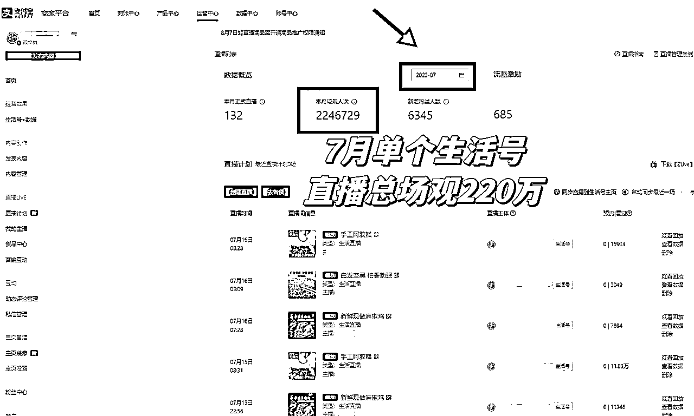
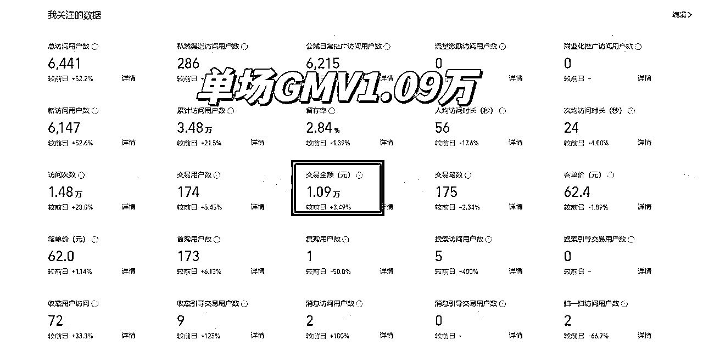

大概一个多月前，跨境电商业务已经比较稳定，我每天在赚钱有术刷风向标，想找找有没有新项目可做。偶然看到一条关于支付宝生活号创作者分成计划的内容。说实话，我以前根本没认真研究过生活号，只知道支付宝去年开始放开这个板块；当时心里还嘀咕，短视频主战场明明在抖音、快手、小红书。出于好奇打开支付宝，发现首页下方导航栏正中间专门放了“生活”频道。点进去刷短视频，内容大多还是搬运混剪，流量好的以官方号为主，粉丝量普遍不高，想满足创作者分成门槛并不容易。按我的经验，这个方向暂时不值得重仓。

但接着我点开了直播栏目，一下子被震住了。大部分直播间是无人或半无人状态，还有官方号用数字人在播；可点赞量和流量却夸张到不行。直播界面不像视频号那样显示具体场观，但每个房间都有几万甚至几十万的观看量。做过视频号的朋友应该明白，这个数据意味着什么。更关键的是，当时直播的商家并不多，刷来刷去基本都是官方号和企业号。我马上意识到：这可能是个机会，立刻联系合伙人商量。

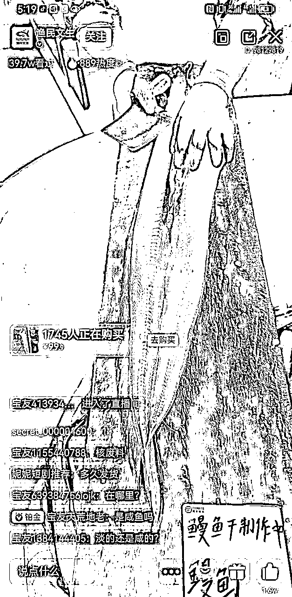
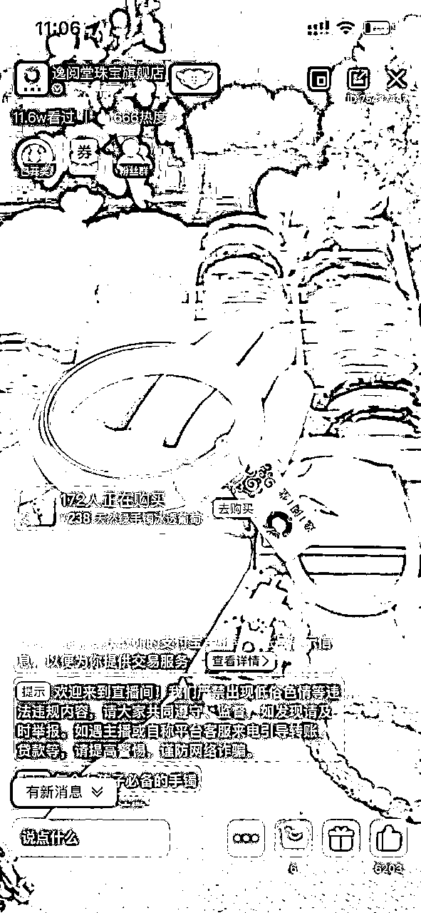

合伙人在直播领域经验丰富，国内国外都做过；他早期参与过视频号，是第一批视频号精选联盟商家，后来因为供应链价格战太凶选择退出。一开始他也有疑问：这平台听都没听过，会有人看吗？无人直播很容易被风控，能长久吗？我们翻了支付宝官方白皮书，发现生活号当时没有自己的购物车，也没有优选联盟，更没有MCN机构和直播商城。所谓“小蓝车”只能挂第三方小程序，当时还支持企业支付宝T+1提现，之后规则才改。凭着多年电商经验，我们花了一周研究规则、搞定入驻，正式开播。

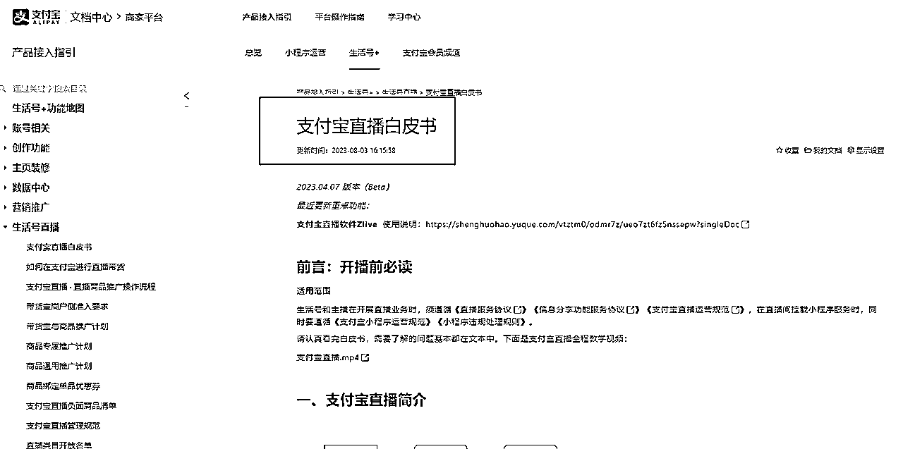

## 从0场观到第一次爆单

新平台刚起步，与其想太多创新玩法，不如低成本快速试错。我们很直接选了无人/半无人直播来测流量。开局并不顺，连续几天场观都是0。

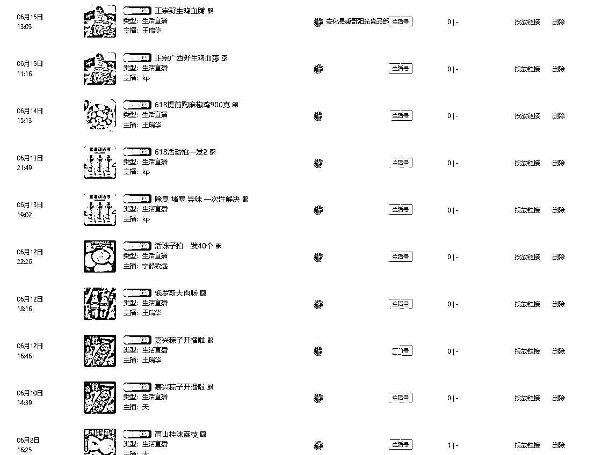

我一边复盘一边调整。直播电商说白了就是人、货、场；除此之外，网络环境和账号IP也很关键。我们换了不少IP、账号和主播去测，发现不同组合带来的流量差异很大。直到6月14日，第一次在支付宝直播跑出了爆款感觉：卖养生产品，直播间场观冲到30万，成交金额1.05万。虽然转化不算高，但商机已经摆在眼前。

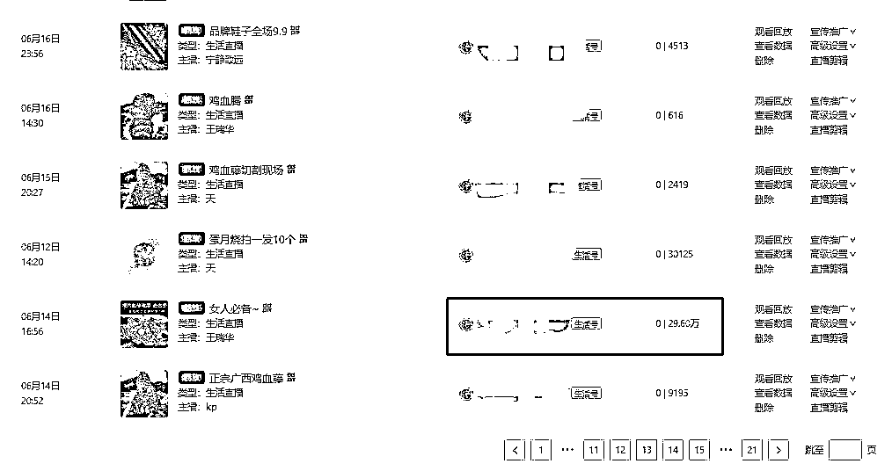
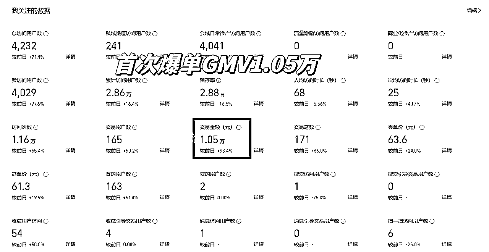

## 两个月数据复盘：支付宝直播才刚开始

做电商必须复盘数据。每个平台都有起步、增长、成熟、衰退四个周期。对比2013年的淘宝、2018年的抖音、2020年的跨境，支付宝生活号直播目前最多算起步期。6月到7月，我们4个生活号、10多个主播账号，一共播了200多场；正常场观的直播，单场GMV基本都能过万。其中一个生活号的数据比较典型：7月单月跑了220万场观，6、7两个月合计400万场观。

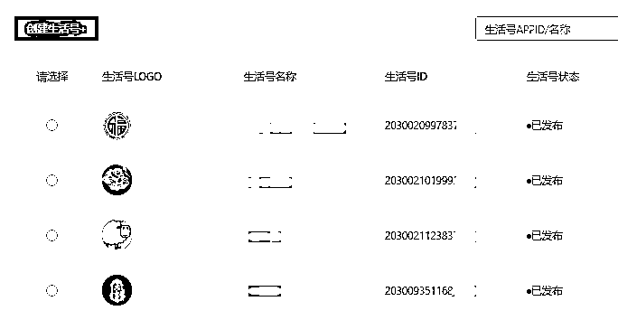
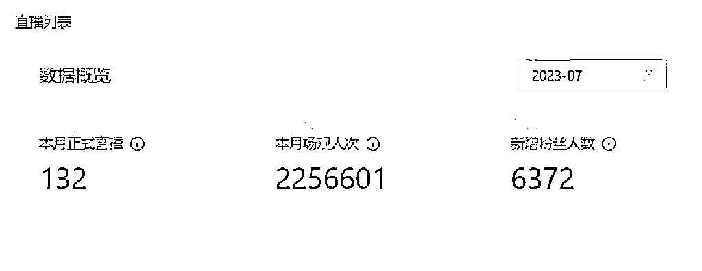
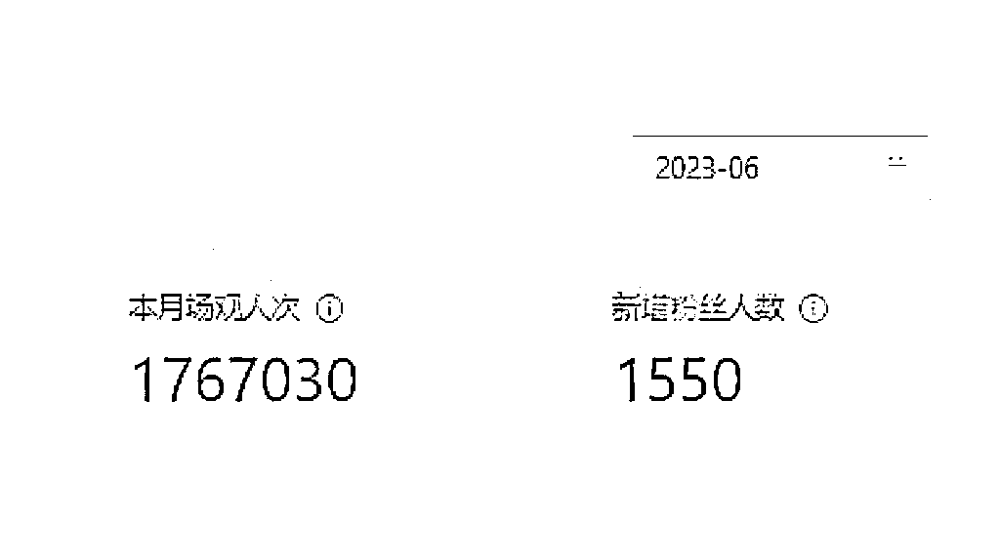

关于选品，我们是去年7月视频号第一批优选联盟商家，供应链打法很熟。我的原则是：宁愿高利润、少出单，也不要低客单、爆单。一般只看50%以上利润的品类，特殊品类不能低于35%。这也是我不想留在视频号卷价格的原因。最终我们选了最熟悉、最容易落地的食品类目，用不同IP的主播号大量测品，很快跑出了稳定的大流量。

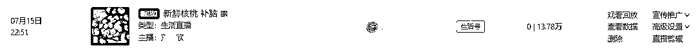

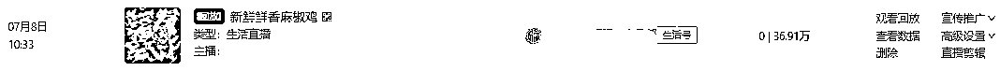

很多朋友关心支付宝直播的人群画像和消费力。因为生活号还没有类似抖音罗盘的数据工具，我只能从关注的粉丝占比看：两个不同生活号的粉丝中，约80%在30岁以上，男女比例基本各占一半。

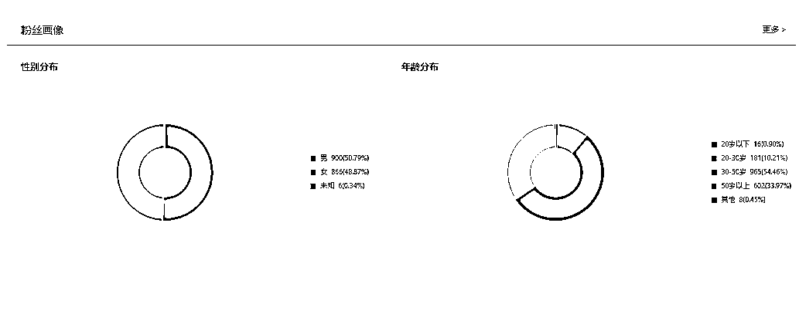
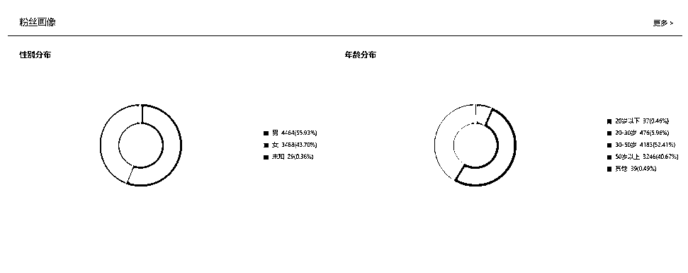

还有人担心：流量这么大，是不是不精准、不消费？我拿连续两场食品直播举例：10元的东西能卖，60元能卖，100元以上也能卖。电商还是那句老话：三分靠运营，七分靠选品。只要选品符合人群需求，数据就能跑出来。支付宝本身是金融业务起家，用户的消费能力并不弱。

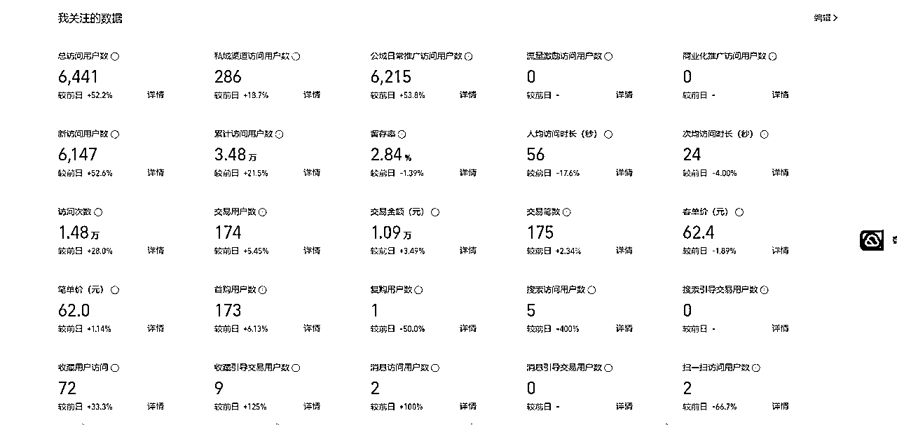

一场直播小蓝车点击1.48万，成交金额1.09万，成交用户174人，客单价62元。

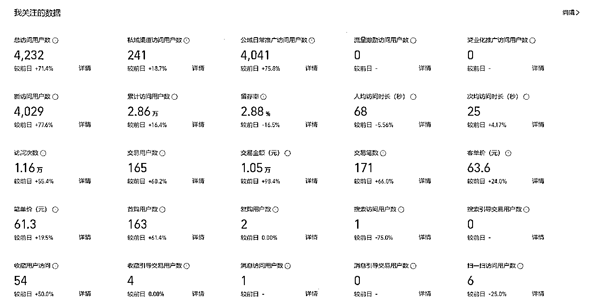

另一场小蓝车点击1.16万，成交金额1.05万，成交用户165人，客单价61元。

我也很好奇支付宝直播的流量从哪里来。一个日活3亿的App，用户到底从哪些入口进直播间？观察两个月，我总结出至少6个公域入口：首页卡片、首页九宫格、底部导航栏、PUSH消息、生活频道、品牌Box。甚至有粉丝问我：为什么我在支付宝打个车，也能跳到生活号直播间？

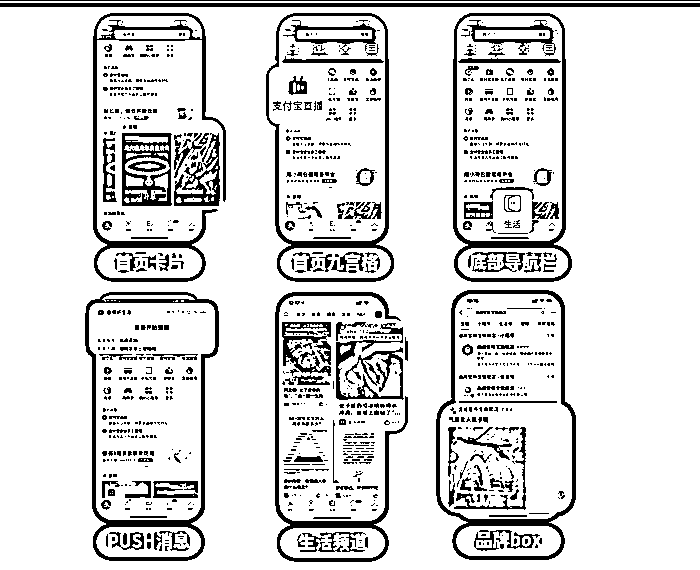

## 风控变严：好事还是坏事？

每个新平台起来，总有一批“资深玩家”想钻漏洞。六七月份，支付宝直播能挂小程序，小程序又支持T+1到账，也就是卖货佣金第二天就能进卡，不用等平台账期。于是有自称“马扁专家”的人开始玩套路，专门卖9.9元吸引下单，甚至有人收款不发货。结果第二天平台就封了一大批店铺，随后出台新规，要求交押金、对公转账。支付宝不愧是金融公司，风控可以说是所有平台里最严的。但换个角度想，有管控、有门槛，对真想长期做事的人反而是好事。

## 入驻门槛：真的有点折腾

必须吐槽：支付宝生活号开直播的流程太复杂了。抖音、视频号可能两天就能注册开播，生活号往往要七天甚至更久。现阶段只支持企业或个体户主体入驻，还要绑定并开发小程序作为直播购物车；珠宝、丽人（美容美发、美睫、美甲、瘦身等）、教育等类目必须官方内邀报白。个人达人暂时没放开，只有少部分特邀内测；生活号也没有自己的橱窗和优选联盟。所以这个阶段的特点就是：流量大、入驻难、生态不成熟、人群不精准。我最初研究白皮书时，因为企业支付宝的财务问题打了20多个客服电话也没解决，还踩了各种限流坑，一度很崩溃，还好坚持下来了。

## 从直播到服务商：把资源做成杠杆

账号数据跑出来后，每天都有朋友在后台私信咨询生活号直播。我还和一批“大麦”建立了合作：有在视频号带30多个宝妈达人的MCN机构，有在其他平台月流水过400万的珠宝商家，也有做东南亚和美国站TikTok本土店的水晶卖家。官方也邀请我参加活动、帮忙宣传生活号直播。

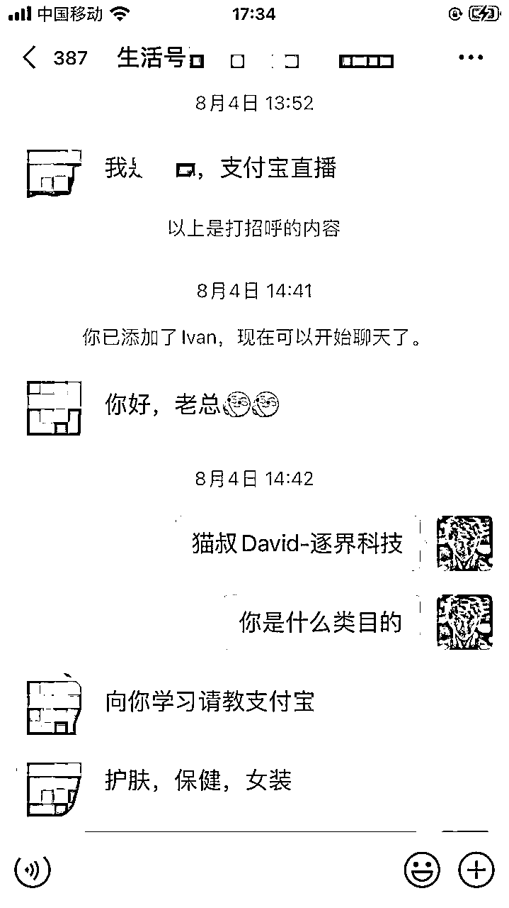
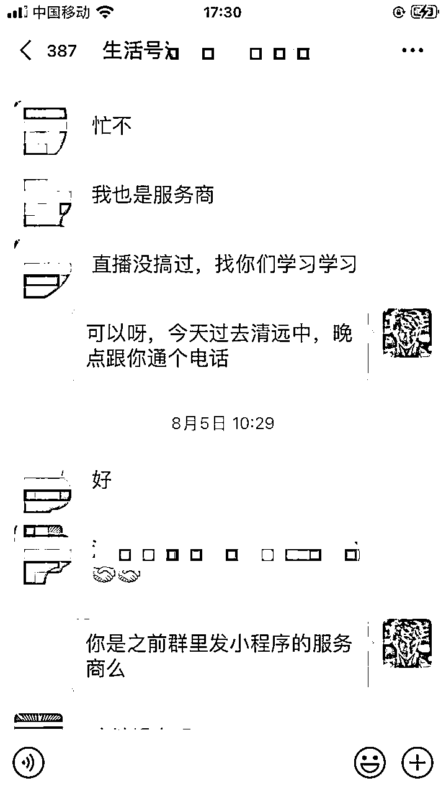
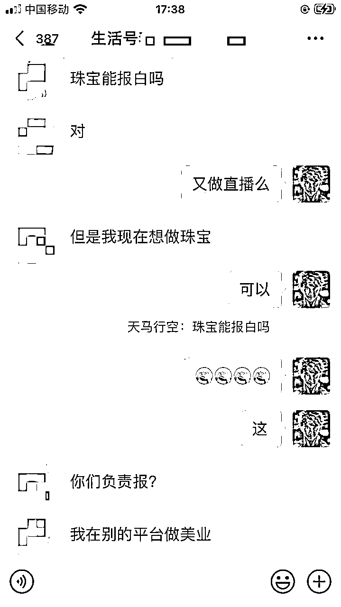

我开始重新想：我的核心竞争力到底是什么？不是直播本身，而是把资源整合起来。后来在官方引导下，我正式成为支付宝直播服务商。除了继续跑自己的直播间，我也帮有资质的商家入驻官方内测白名单类目，比如珠宝、丽人这类必须对接官方特邀才能开的项目，平台还会看商家在其他平台的流水和实力。我也会协助解决直播购物车小程序、直播风控违规、官方活动流量补贴报名等问题。

现在支付宝上的商家还很少，大部分是品牌方。凌晨去刷生活号，在播的商家不多，刷到的很多还是直播回放，但流量依然很大——这跟视频号、抖音完全反过来。

## 几句心里话

想进入一个新平台，第一步永远是研究它的要求和规则。很多人太盲目，反而适得其反。平台初期，规则每天都可能变，所以也要问自己：支付宝直播，我真的准备好了吗？大家关注这个平台，不只是因为它有10亿用户；小蓝车可以接小程序，未来还可能打通消费圈、团购、本地生活、会员频道等支付宝生态，形成一个大的商业闭环。对坐拥3亿日活的支付宝来说，这也是它完善电商版图的重要一步。

命运的齿轮什么时候开始转动，没人知道。人生总有岔路，选了这条路，就看不到另一条路的风景；无论前方是仙境还是深渊，先把眼前的路走好，别留遗憾。

最后，欢迎做直播、做供应链的老板和对直播电商感兴趣的朋友一起交流，探索支付宝直播的可能性。感谢赚钱有术提供分享机会，希望大家2023年都能赚钱有术！

微信：DavidYeh8，添加请备注：赚钱圈友。

