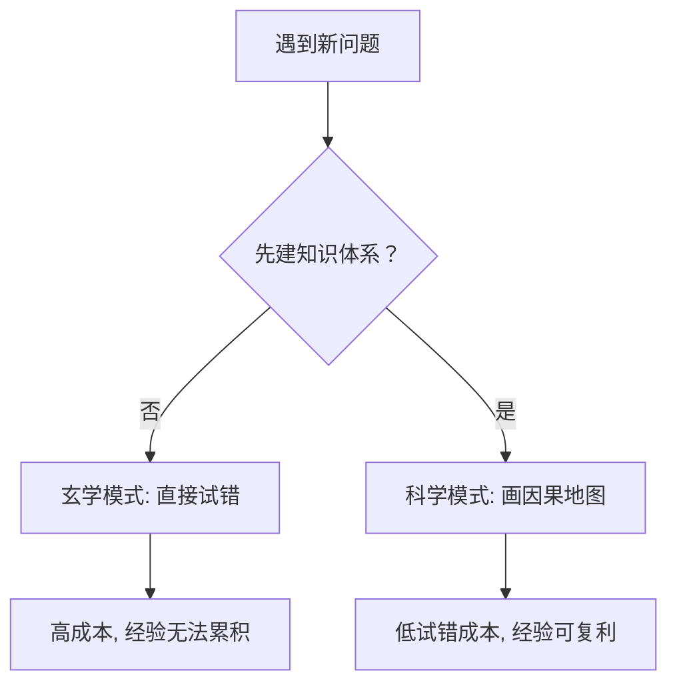
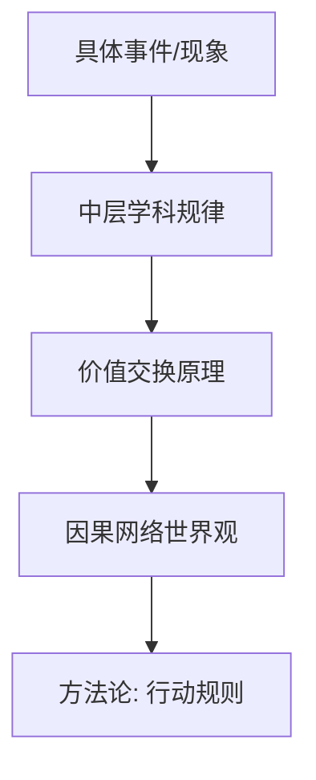
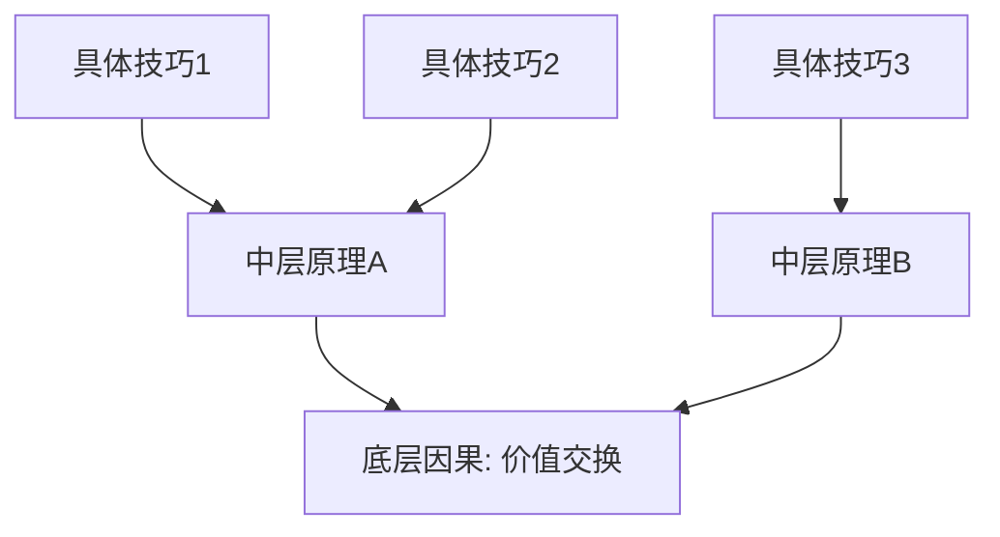

# 第三章 知识体系建设——从玄学试错到科学模式

## 学习目标

- 对比科学模式与玄学模式
- 掌握知识体系本质
- 学会从案例到假设
- 掌握底层能力提炼

## 3.1 生活类比

想象你要去一个陌生的城市完成一项重要任务。玄学模式的做法是：出门右转碰碰运气，走到哪儿算哪儿，走错了就退回来重走，运气好能到达目的地，运气不好就一直在街上打转。而科学模式的做法是：先买一张城市地图，标出起点和终点，规划好主干道和备选路线，再出发。虽然买地图、读地图花了一点时间，但一旦出发，你走的每一步都在地图的框架内，错了也知道错在哪条街、该怎么绕回正道。知识体系就是这张地图，先画地图再行军，是我们这一章要带你建立的做事新模式。

## 3.2 概念地图

- 科学模式vs玄学模式
  - 玄学模式：碰运气、试错、高成本
  - 科学模式：先建知识体系、再行动
  - 核心收益：降低试错成本
- 知识体系本质
  - 因果关系的网络
  - 世界观：解释世界
  - 方法论：改造世界
  - 底层原理：价值交换
- 案例到假设
  - 案例不是事实
  - 降格为假设，置入体系验证
  - 避免信息带来的负面状态
- 底层能力提炼
  - 找到最根本因果
  - 以不变应万变
  - 知识相通

## 3.3 科学模式与玄学模式

我们先来区分两种做事模式。素材 [P001, p.1] 开篇提出了一个核心判断：**科学模式是先建知识体系**。这个判断看似简单，但它直接挑战了我们大多数人默认的做事方式——遇到问题，直接上手，边做边改。

> [P001, p.1] “科学模式先建知识体系。”

这里的“知识体系”不是指读书多、学历高，而是指**在行动之前，先把事情运作的规律摸清，形成一张因果地图**。

为什么我们需要区分这两种模式？因为我们默认的做事方式，通常是玄学模式。

**玄学模式：碰运气。** 玄学模式最大的特征是：不做前期调研，直接尝试。成功了，归结为“我运气好”；失败了，归结为“这次运气差”。这看起来是随机应变，实际上是把命运交给概率。比如，你听说某个行业赚钱，立刻辞职入场，结果亏了；又听说另一个风口，再冲进去，又亏了。你并不是不努力，而是你每一次行动都缺乏一个稳定的坐标。

**科学模式：先画地图。** 科学模式会先问三个问题：这件事的参与方是谁？他们之间的因果关系是什么？我处于什么位置？把这三个问题回答清楚，一张简易的地图就画出来了。地图不保证你每一步都对，但保证你每一步都知道自己在哪儿、下一步该往哪儿走。

> 科学模式方法（来源：《知识体系科学模式》）

```
1. 遇到新问题：先不急着行动，列出已知事实
2. 搜索已有知识：找出与当前问题同类的历史场景
3. 提炼因果链：画出关键因素之间的因果关系
4. 制定行动方案：基于因果链推导出最可能的路径
5. 行动并记录偏差：行动后对照因果链，修正体系
```

这段伪代码展示了科学模式的五个标准动作。注意第 2 步——“搜索已有知识”——这正是区分科学模式与玄学模式的要害：玄学模式认为“我的问题很特殊”，科学模式则假设“我的问题大概率是某个普遍规律的实例”，而规律是可以被预先描摹的。

这两种模式的成本结构差异巨大。玄学模式看起来启动快，但它每一次试错都是全额的学费，且试错结果无法累积——上次失败的原因和这次失败的原因之间没有逻辑连接，经验无法复利。科学模式看起来启动慢，但它把试错成本分摊在行动前的“思考期”，且每一次行动结果都可以回收进因果地图中，下次行动更准。

因此，科学模式的核心收益是**降低试错成本**。它不能消灭失败，但它能让每一次失败都变成体系的一部分，而不是孤立的坏运气。



这张图对比了两种模式的分流点：是否在行动前建立知识体系。分流的岔路口，正是节省成本的关键开关。

## 3.4 知识体系本质

上一节我们确立了“先建知识体系”的原则，这一节我们要回答一个更本质的问题：**知识体系到底是什么？** 素材 [P001, p.2] 给出了定义性的主张。

> [P001, p.2] “核心是世界观与方法论。”

这句话高度凝练，我们把它拆开来看。知识体系不是知识点的堆砌——不是“我知道 30 个概念”就叫有体系。知识的堆积只带来信息的冗余感，并不会改变你做决策的质量。真正改变决策质量的是**知识点之间的因果关系**。

> 知识体系本质**定义**（来源：《知识体系科学模式》）

$$KnowledgeSystem = (C, R)$$

其中，$C = \{c_1, c_2, ..., c_n\}$ 是概念节点的集合，$R = \{r_{ij} | c_i \rightarrow c_j\}$ 是概念之间的因果边集合。

这个公式展示了知识体系的本质结构：它是一张因果网络，而不是一棵孤立的树。“概念”是节点，“因果”是边。知识体系的价值不在于你拥有多少节点，而在于你拥有多少条边——即你能否从 A 推导出 B。

为什么要把知识体系定义为“因果网络”而不是“知识清单”？因为只有因果网络可以用来**做预测**。清单只能回答“是什么”，网络才能回答“如果……那么……”。而“如果-那么”正是行动的基础。

基于这个定义，我们可以把知识体系的功能拆成两半：**世界观**与**方法论**。

**世界观：解释世界。** 世界观是你对“世界如何运转”的因果模型的集合——价格为什么波动？人为什么拖延？组织为什么会僵化？有了世界观，你遇到新现象时，可以把它安放到已有的因果网络中，获得解释。解释不是终极目的，解释是为了定位。

**方法论：改造世界。** 方法论是“基于世界观，我应该怎么行动”的推导规则。如果你的世界观告诉你“价格由供需决定”，那么你的方法论就是“当供大于求时，不要囤货”。方法论是世界观在行动端的投影。

**价值交换：底层原理。** 素材进一步指出，解释世界、改造世界的底层抓手是观察价值交换——人与人、组织与组织、系统与系统之间的互动，本质上都是价值交换。价值交换的规律是因果网络中比较靠底层的节点，法学、经济学、管理学、社会学的大量现象几乎都能投影到“价值如何流动”这张图上。

关于知识体系的层次结构，我们可以画一张架构分层图：



这个分层图展示了知识体系从现象到原理的抽象过程。越靠近底层（如价值交换），解释力越强，迁移范围越广——但离具体操作也越远；越靠近顶层（具体事件），越能直接指导行动——但迁移范围越窄。知识体系的质量，取决于你能否在两者之间快速建立通路。

## 3.5 从案例到假设

有了知识体系的框架，我们来看一个实操中最容易踩的坑：**把别人的案例当成真理**。素材 [P001, p.3] 给出了一个反直觉的主张。

> [P001, p.3] “一切都是假设。”

这句话很容易被误解为“什么都不信”，其实它的意思是：**别人讲的故事，对你而言不是事实，而是假设；你需要把它降格为假设，置入自己的知识体系中去验证。**

为什么案例不是事实？原因有三层。

第一，**案例本身经过了裁剪**。别人讲述案例时，只会讲他认为重要的情节，而略过他认为不重要的。你听到的是一个被编辑过的故事，不是完整的事件。第二，**案例的因果归属未必可靠**。成功案例经常被归因到某个“关键决策”上，但那个决策可能只是幸存者偏差的一部分——其他做了同样决策的人失败了，只是没有被讲述。第三，**案例产生于特定条件**。A 公司靠“烧钱换增长”成功了，但这个案例成立的前提是当年资本充足、竞争不激烈；条件一变，同一动作可能失效。

因此，面对他人案例的正确姿势是：

> 案例降格方法（来源：《知识体系科学模式》）

```
1. 把案例视为一个待验证命题，而非结论
2. 提取案例中的因果关系主张，如 "P导致S"
3. 对照自己的因果网络：该主张的适用条件是什么
4. 在小范围内试错验证，观察结果是否符合预测
5. 验证通过后，才将其补充进自己的知识体系
```

这段伪代码展示了从“听到案例”到“纳入体系”的五步处理流程。关键转折在第 2 步到第 3 步：把原本融为一体的故事拆成“主张 + 适用条件”，这是把案例转化为假设的核心动作。

为什么要坚持这一套流程？因为未经处理的信息会带来**负面状态**。

**信息带来的负面状态**，指的是：盲目相信案例会侵蚀你的判断力。你并不是多了一个工具，而是多了一个错误的过滤器——你会倾向于用别人的成功路径去硬套自己的问题，结果就是南橘北枳。更隐蔽的负面状态是“知道感错觉”：你听了很多案例，产生了“我懂了很多”的错觉，但真正面临问题时，却无法做出有效决策。这就是信息量≠知识体系的反面例证：信息是原料，而案例只有在经过假设-验证流程后，才有资格成为原料。

我们把“案例→事实”与“案例→假设→验证”两条路径对比如下：

| 路径 | 对待案例的态度 | 失败时的解释 | 经验能否累积 |
|------|----------------|--------------|--------------|
| 案例即事实 | 全盘接受，直接模仿 | “我执行得不到位” | 否，归因于个人 |
| 案例即假设 | 拆出主张与条件，验证后再用 | “条件不匹配”或“主张错误” | 是，归因于体系 |

## 3.6 底层能力提炼

最后一节，我们要回答一个战略问题：既然知识体系要不断扩展，我们是不是要无限地学下去？素材 [P001, p.4] 给出了相反的答案。

> [P001, p.4] “掌握100个思维模型。”

这个主张的核心是：**知识体系不在于量，而在于提炼底层能力。** 与其掌握一万个具体技巧，不如提炼出支撑这些技巧的少数几个底层思维模型。

为什么不需要穷举知识？因为知识之间的因果结构是分层的。**表层技巧服务于场景，底层规律则跨场景通用**。如果你只在表层积累，那么每换一个行业、每换一个岗位，知识就清零重建；如果你提炼到了底层，那么换场景只是换了应用对象，核心模型不变。

**找最根本因果。** 底层能力提炼的第一步，是对着你的知识体系反复追问：这条规律还能不能继续抽象？它是不是某个更普遍规律的特例？比如，“供需决定价格”能不能抽象成“资源稀缺性与需求的匹配程度决定交换条件”？可以。后者就更底层、更可迁移。

**以不变应万变。** 体验过“找根本因果”之后，你的知识体系就会呈现出一种塔形结构：塔尖是少量最底层的原理，塔身是中层规律，塔基是大量具体应用。什么才是真正的以不变应万变？塔尖不变，塔基千变万化。你用塔尖的原理去推导各个应用，而不是背诵每一个应用本身。

**知识相通。** 当越往上抽象时，你会发现不同领域的底层规律开始收敛。金融市场上的“流动性”与组织管理中的“信息流通”，在底层都指向同一个因果机制——节点的连通性决定系统的效率。这不是巧合，而是因为世界的底层规律是有限的。



这个图展示了底层能力提炼的结果：多个具体技巧向上收敛到少数中层原理，再进一步收敛到个别底层因果。越往上层，数量越多、越具体；越往下层，数量越少、越通用。而底层能力提炼的目标，就是尽可能把知识压到最下面的少数层。

“掌握 100 个思维模型”不是让你找 100 个技巧，而是让你在众多具体的知识中，找到那真正支撑起大多数应用的 100 个根本模型，以模型为锚点去组织所有经验。这 100 个模型的本质，是 100 条最底层的因果规律——它们撒得再开，也依然共用一个根基：对世界因果网络的把握。

## 3.7 多源对照

本章素材当前仅来自单一来源 [P001]。由于“科学模式/知识体系”是一个跨学科主题，在现有素材之外，我们还可以期待更广泛的共识。但基于现有素材，我们内部整理如下。

### 共识

素材内部的四个概念——科学模式 vs 玄学模式、知识体系本质、案例到假设、底层能力提炼——统一于一个主张：**知识体系的建立先于行动，且知识体系的核心是因果网络。** 这一主张贯穿全章，无论是“先画地图”还是“底层能力提炼”，都在强调用规律去指导实践。

### 分歧

当前素材 [P001] 未对该主题提供多视角的对比。因此，关于“知识体系中是否应该包含大量具体技巧”“100 个思维模型是否足够”“价值交换是否是解释一切的最底原理”等问题，现有素材没有给出反方论证。 [需要补充文献：可引入柏拉图《美诺篇》中“知识=有根据的真信念”的标准定义、波普尔“可证伪性”标准，以及查理·芒格《穷查理宝典》对“多元思维模型”的讨论，形成多源对照。]

## 3.8 设计中的取舍

**为什么不能只用玄学模式，而要显得更“慢”地先建体系？**

玄学模式看起来快——不调研、直接做。但它是一种不累积的投入：失败了，学费白交。这不是“快”，而是“反复从零开始”。科学模式的“慢”是前期慢，它用一次性的思考成本，换取后续所有行动的路线修正效率。取舍的本质是：你愿意付“地图费”，还是愿意付“多次迷路费”？

**这种设计的代价是什么？**

科学模式最大的代价，是你可能在画地图阶段过度设计——为了建体系而迟迟不动手。知识体系的价值必须在与真实问题的碰撞中才能被校准；如果地图画得太细，可能滞后于市场变化。因此，实际采用的做法应该是“画够用级别的草图，先走起来，在行动中持续补丁”，这和冶炼中“先用小批量试错，成熟后再扩大规模”是同一逻辑。

## 3.9 动手练习

- 知识体系构建实践（#1）：选取你当前最常遇到的一个问题领域，按照“观察现象→提炼因果主张→检索已有知识→在小范围内验证→修正主张”的流程，构建一个最小版的知识体系草稿，记录每一步的输入与输出。

## 3.10 本章小结

这一章中，我们学习了如何从玄学试错模式切换到科学模式。首先，我们对比了玄学模式与科学模式的成本结构差异，确立了“先画地图再行军”的原则；其次，我们给出了知识体系的定义——概念与因果关系的网络，并将它的功能拆解为世界观（解释世界）与方法论（改造世界）；接着，我们针对实操中最常见的误区，提出了“案例不是事实，而是待验证的假设”这一主张，并给出从案例到假设的操作五步法；然后，我们讨论了底层能力提炼的原则——与其积累大量具体技巧，不如向上收敛到少数底层因果模型，以不变应万变。整个章节的论证逻辑，从“为什么要建体系”到“体系是什么”再到“怎么对待外界信息”最后到“怎么提炼自身体系”，构成了一套从认知到操作、由外而内的完整闭环。

本章我们一起学习了以下概念：

| 概念 | 解释 |
|------|------|
| 科学模式vs玄学模式 | 做事前先建知识体系而非碰运气 |
| 知识体系本质 | 因果关系的网络世界观方法论 |
| 案例到假设 | 他人案例是假设需验证 |
| 底层能力提炼 | 掌握核心思维模型以不变应万变 |

下一章中，我们将进入“知识体系怎么用来解决具体问题”的讨论——如果知识体系是为了指导行动，那么面向实践时，应该用什么标准来判断知识体系中哪一个因果链才是当前问题的切入手段。这会引出从“学科知识”到“项目操作”的转化方法。
