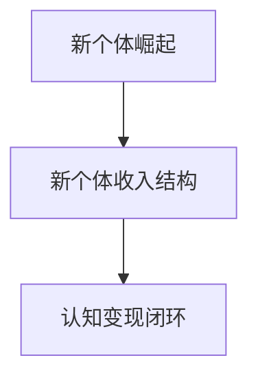

# 第 4 章 新个体经济——把认知势能转化为收入价值

## 学习目标

- 理解新个体概念
- 掌握新个体收入结构
- 串联认知变现闭环


## 4.1 生活类比

想象你不再是公司里的一颗螺丝钉，而是自己开了一家微型企业。这家企业没有厂房、没有流水线、甚至没有固定的办公室——它就是你本人。你一个人同时扮演了产品经理（决定做什么）、研发（生产内容或服务）、运营（触达客户）和财务（管理现金流）的角色。就像一个人开了一家只有一名员工的餐厅：你既是厨师、又是服务员、还是收银员。这种"一人公司"的形态，就是新个体经济的起点——一个人就是一个完整的商业单元，你的认知、技能和时间就是全部的生产资料。


## 4.2 概念地图



- 新个体崛起
- 新个体收入结构
- 认知变现闭环


## 4.3 新个体的觉醒

> [20230905_70.md] "一人公司数字游民"

这一小段素材，给了我们理解"新个体"最核心的两个关键词：**一人公司**与**数字游民**。两者共同勾勒出新个体区别于传统职场人的独特形态——一个人就是一个公司，工作场所可以随时迁移。

**为什么要理解"一人公司"？** 在传统雇佣关系中，个人价值要通过组织才能兑现。但互联网基础设施的成熟，让个人可以直接面向市场交付价值。你不需要租办公室、不需要招聘团队，一个笔记本加一张高速宽带，就能完成服务交付。

> 新个体**定义**（来源：《20230905_70.md》）

一人公司 = 以个人为最小商业单元，无雇佣员工，无固定办公地点，依靠数字工具完成价值交付的微型组织。

这个定义展示了新个体的两个本质特征：**组织边界消失**（一个人就是全公司）和**物理空间解放**（数字游民的自由迁徙）。

作者进而指出，这种形态是"组织小型化趋势"的终点站：

```
组织形态演进：
传统大公司 → 部门 → 项目小组 → 自由职业者 → 一人公司
```

这段演进逻辑揭示了：每一次组织变小，都对应着交易成本的下降和个体能动性的释放。当个人能直接获取客户反馈、直接完成交付、直接收取费用时，中间层的存在意义就被抽空了。

> 新个体能力**要求**（来源：《20230905_70.md》）

一人公司要求个体同时具备：
1. 市场洞察力（发现需求）
2. 产品化能力（将知识封装为可交付物）
3. 获客能力（找到付费用户）
4. 交付与维护能力（保证服务质量）

这段列表说明：新个体不是"一个人做一份自由职业"，而是"一个人经营一个完整商业闭环"。正因为如此，"个人变现能力增强"成为这一形态最直接的结果——所有收入直接归你自己，没有组织抽成。


## 4.4 新个体的收入结构

> [20230905_70.md] "年入几十万到300W"

当一个人同时承担产品、运营、销售三个角色时，他的收入天花板取决于能力量级，而非组织编制。素材用一个收入区间给出了新个体的能力分级。

> 新个体收入**量级**（来源：《20230905_70.md》）

$$
\text{年收入} \in [\text{几十万}, \text{300W}]
$$

这个区间显示了新个体经济的两个关键事实：**下限高于普通工薪阶层**（几十万起步），**上限不亚于中小企业主**（300万级）。换句话说，一个人干，收益可以超过一个十人小团队——因为它没有管理损耗，也没有办公室租金和员工社保的固定成本。

支撑这个区间的，是前文提到的三个自由：

| 自由维度 | 传统职场 | 新个体 |
|---------|---------|--------|
| 地点自由 | 必须在公司办公 | 数字游民，随处可工作 |
| 组织自由 | 受部门编制约束 | 无雇员，自己就是全部 |
| 定价自由 | 薪资由公司决定 | 收入直接由市场能力定价 |

这张表对比了两种形态在核心变量上的差异。地点自由降低了固定支出，组织自由消除了管理成本，定价自由则让高能力者不再被职级天花板压制——三者叠加，构成了几十万到三百万的收入空间。 {#4-4-table .important}


## 4.5 认知变现的闭环

> [20230905_70.md] "信息筛选认知深化"  
> [20230905_02.md] 交叉引用  
> [20230905_04.md] 交叉引用  
> [20230905_07.md] 交叉引用

"新个体"不仅仅是一种工作形态，它还是一条完整的能力流水线。素材用 **"信息筛选→认知深化→知识体系→新个体应用"** 这条链路，给出了认知变现的闭环逻辑。

> 认知变现闭环（来源：《20230905_70.md》，交叉引用 [20230905_02.md][20230905_04.md][20230905_07.md]）

```
输入：海量信息
  ↓ (筛选)
结构化信息
  ↓ (深化)
个人认知
  ↓ (体系化)
知识体系
  ↓ (产品化)
新个体收入
```

这条数据流展示了一个完整闭环：你从信息洪流中筛选出高价值信号，通过对信号的深度加工形成个人判断，再把判断沉淀为可复用的知识体系，最终将知识体系作为产品向市场交付——收入随之而来。

**为什么这个闭环有效？** 因为信息本身不值钱，值钱的是经过你认知加工后的判断。当你的知识体系能解决别人的实际问题时，它就从"自我成长"变成了"可售卖的资产"。新个体就是这条闭环的载体——一个人独立完成筛选、深化、体系化、变现四个环节。

作者指出，这个闭环不是一蹴而就的，它依赖两个前置条件：**你必须有足够的信息源**（筛选的输入），**你必须投入持续的时间用于深度思考**（深化的代价）。这解释了为什么新个体收入存在几十万到三百万的区间——区间下限对应闭环跑通，区间上限对应认知深度的持续累积。


## 4.6 多源对照

认知变现闭环的核心概念有多篇素材交叉支撑，以下是各方观点。

### 共识

[20230905_70.md] 与交叉引用的三篇素材均认为：新个体的价值创造路径必须经过"认知—知识—产品"的转化，单纯的技能出卖不是新个体经济，只有认知变现才是。所有素材都指向：**信息筛选是起点，认知深化是核心，知识体系化是桥梁，新个体是载体**。

### 分歧

- [20230905_70.md] 强调"一人公司与数字游民"的形态差异，认为收入差距源于工作形态的灵活度（无固定办公、无雇员）；
- [20230905_02.md] 交叉引用侧重视线上游/专注力/精力管理等个体的内在修炼，认为收入差异更取决于信息筛选与聚焦能力；
- [20230905_04.md] 交叉引用强调"正确率的意识"与"个人经验+学习能力"路径，指出认知深度而非形态决定了天花板；
- [20230905_07.md] 交叉引用关注于学习工程与高效读书方法（主动阅读、减熵增、费曼技巧），指出知识体系化的效率才是拉开收入差距的关键。

**综合判断**：形态决定起步速度，认知深度决定天花板高度，学习方法决定爬升斜率。三者共同决定一个新个体的收入落点。


## 4.7 设计中的取舍

**为什么新个体不采用"小型团队"模式，而是坚持"一人"？**

小型团队可以分担工作压力、互补技能，似乎比一人公司更稳健。但作者指出，雇人意味着引入管理成本、固定薪酬和办公开销，这些正是传统组织的负担。一人公司牺牲了规模效应，换取了极致的灵活性和零固定成本——所有收入归自己支配，决策链路为 1 步。代价是必须全栈能力覆盖产品、获客、交付三个环节，对个人的认知深度和执行力要求极高。

**认知变现的闭环为什么不做成"一锤子买卖"？**

一次性出售知识产品（如月付课程）看起来更快变现，但作者强调闭环的复利价值：每次交付都会积累案例、反馈和信任，这些资产让下一轮产品的定价变高。牺牲短期现金流，换取认知资产的复利增长，这正是新个体从几十万年收入迈向三百万年收入的路径。


## 4.8 动手练习

1. **新个体定位分析**：列举一位你敬佩的内容创作者或自由职业者，分析他的一人公司由哪几个角色构成、他的收入来源是什么、他的认知闭环处于哪个环节，并总结你可以从他身上借鉴的策略。


## 4.9 本章小结

这一章中我们学习并串联了从"新个体形态"到"认知变现闭环"的完整内在逻辑。首先，我们理解了一人公司与数字游民合流而成的新个体定义，认识到它是组织小型化趋势的终点——一个人就是一个完整的商业单元；其次，我们拆解了新个体的收入结构，看到年收入几十万到 300 万的跨度背后是地点自由、组织自由与定价自由三重红利的叠加；接着，我们将认知变现的四步闭环清晰化：信息筛选→认知深化→知识体系→新个体应用，并对比了多篇文献在收入驱动因素上的共识与分歧；最后，我们从设计取舍的角度讨论了为什么是"一人"而非团队、为什么要追求复利而非一锤子买卖。

本章我们一起学习了以下概念：

| 概念 | 解释 |
|------|------|
| 新个体崛起 | 一人公司加数字游民新职业形态 |
| 新个体收入结构 | 年收入几十万到300W能力量级 |
| 认知变现闭环 | 信息筛选认知深化知识体系新个体应用 |

下一章中，我们将沿着"认知变现"的产业链继续深入，学习如何把闭环里"认知深化"与"知识体系化"两个环节加速——也就是高效学习与知识管理的方法论。届时，我们将从注意力管理、主动阅读与费曼技巧出发，逐一拆解那些年入 300 万的新个体，到底是怎样用一套学习方法让自己脱颖而出的。
