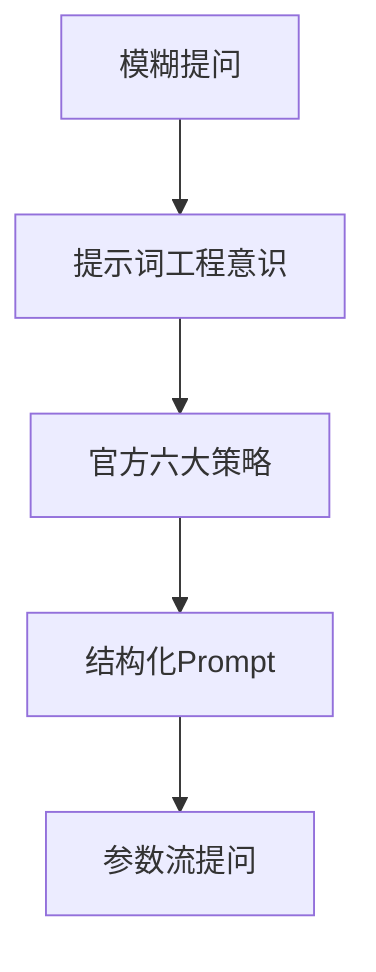
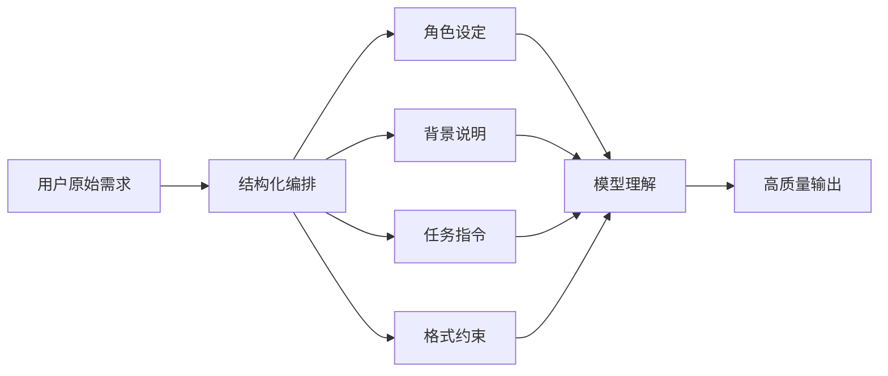
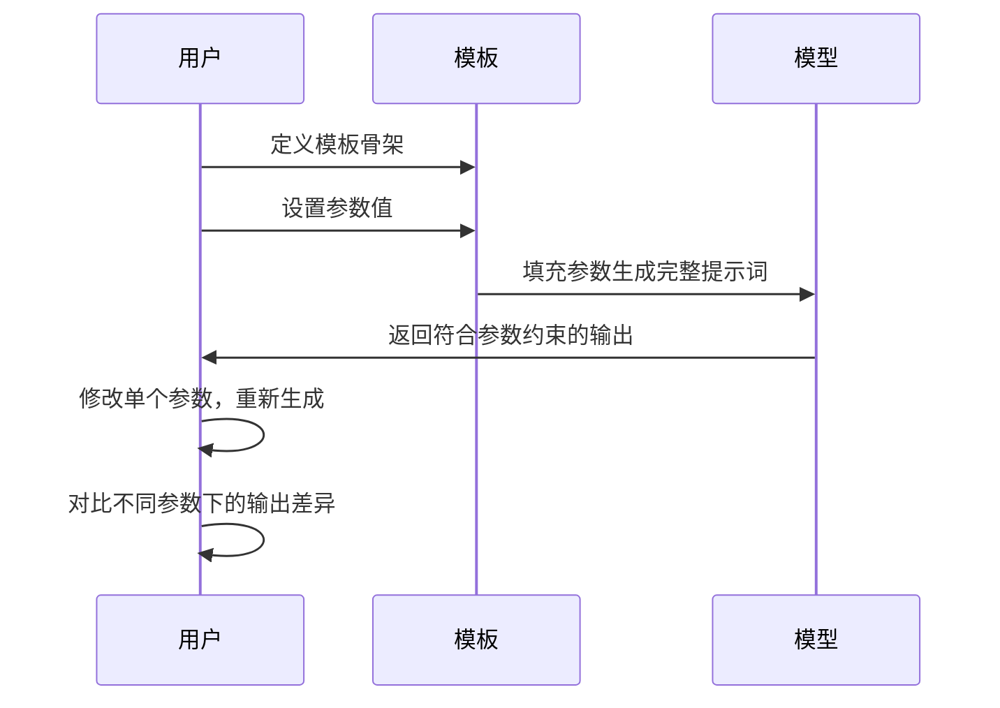

# 第 5 章 提示词工程基础——学会与模型对话

## 学习目标

- 理解提示词工程价值
- 掌握官方六大策略
- 学会结构化Prompt
- 了解参数流提问

## 5.1 生活类比

想象你站在一扇厚重的门前，手里攥着一串钥匙。锁芯的构造精妙复杂，不是随便哪把钥匙都能打开它——只有齿纹完全匹配的那一把，才能让门锁"咔哒"一声弹开。提示词之于大语言模型，正是这把钥匙。模型内部蕴含着海量的知识与能力，但如果没有合适的"钥匙"（即精心设计的提示词），这些能力就像锁在保险柜里的珍宝，无法被真正取用。更关键的是，钥匙的齿纹决定了你能打开哪扇门：同样的模型，用一个模糊的问题可能得到泛泛而谈的平庸回答，而用一个结构清晰、指令明确的问题，则可能激发出模型深层次的推理与创作能力。这就是提示词工程的本质——**问对问题，比回答问题更重要**。

## 5.2 概念地图

```text
提示词工程基础
├── 为什么需要提示词工程（钥匙与锁）
├── 官方六大策略
│   ├── 编写清晰指令
│   ├── 提供参考文本
│   ├── 分解复杂任务
│   ├── 给予思考时间
│   ├── 使用外部工具
│   └── 系统测试
├── 结构化Prompt
│   ├── 分节标签
│   ├── 角色设定
│   └── 提升可预测性
└── 参数流提问
    ├── /参数指令控制
    ├── 像函数调用
    └── 约束输出风格
```

## 5.3 为什么需要提示词工程

### 原文摘录

> "AI降低普通人创作门槛"
> 
> ——《AI赋能》

在过去，创作一篇高质量的文章、设计一份复杂的商业计划书，往往需要数年积累的专业技能。而今天，大语言模型让这些能力"平民化"了——但它有一个前提：你必须学会如何"指挥"它。提示词工程，就是这门指挥艺术。

### 直觉：钥匙与锁

我们先用一个直觉问题切入：为什么同一个模型，有的人能让它写出惊艳的方案，有的人却只能得到干巴巴的几句话？

答案藏在"指令的精确度"里。模型并不是万能的读心者，它只能根据你给的文字去预测最可能的回答。如果你的指令模糊，模型的输出空间就大，结果就不可控；如果你的指令精确，模型的输出就被约束在高质量区间。**提示词决定了模型输出的上限**——模型本身的能力是下限，而你的提示词决定了你能触达多高的天花板。

### 形式化定义

> **提示词工程**定义（来源：《AI赋能》）

我们可以把提示词工程形式化为一个"输入-输出映射"问题：

$$
\text{Output} = f_{\theta}(\text{Prompt})
$$

其中，`f_θ` 是冻结参数的大语言模型，`Prompt` 是你的输入文本，`Output` 是模型的生成结果。

这个公式展示了提示词工程的核心逻辑：模型参数 `θ` 是固定的，**唯一可变的变量是你输入的 Prompt**。因此，提升输出质量的全部杠杆，都集中在"如何设计 Prompt"这一个旋钮上。这与传统机器学习"调参"不同——提示词工程是"调输入"，而不是"调模型"。

### 具体例子

假设你想让模型帮你写一封请假邮件：

- **模糊提示词**："帮我写封邮件"
- **清晰提示词**："帮我写一封给经理的请假邮件，请假时间是下周一至周三，原因是家中有事，语气要正式礼貌，结尾表达感谢。"

第二种提示词之所以效果更好，是因为它为模型提供了五个关键约束：收件人角色、时间范围、原因、语气、结尾要求。每一个约束都在缩小模型的输出空间，让生成结果更贴近你的真实需求。

### 方法演进图



## 5.4 官方六大最佳实践

### 原文摘录

> "编写清晰指令"
> 
> ——《提示词最佳实践》

OpenAI 在官方文档中总结了六大提示词策略，它们构成了提示词工程的地基。这些策略并非空想，而是从大量真实用户交互中提炼出的"最佳实践"。

### 策略一：编写清晰指令

> **清晰指令**方法（来源：《提示词最佳实践》）

模型没有"读心术"，它只能理解你写下的文字。模糊的指令（如"写点有趣的东西"）会让模型在巨大的输出空间中随机游走，结果往往平庸。而清晰的指令（如"用三句话向小学生解释量子纠缠，避免数学公式"）则显著提升输出的针对性。

**改写前的提示词**：
```
写一段产品介绍。
```

**改写后的提示词**：
```
写一段产品介绍，产品是智能手表，目标用户是健身爱好者，突出心率监测和睡眠分析功能，控制在100字以内。
```

这段对比展示了清晰指令的力量：它为模型设定了**角色**（产品介绍）、**对象**（智能手表）、**受众**（健身爱好者）、**重点**（心率与睡眠）和**长度约束**（100字）。每一项约束都在帮助模型缩小搜索空间。

### 策略二：提供参考文本

> **参考文本**方法（来源：《提示词最佳实践》）

当我们要求模型按特定风格或特定事实写作时，与其让模型"猜测"参考标准，不如直接把参考文本塞进提示词。

```
请参考以下文段的风格，为我们的新产品写一段宣传语：
【参考文段：此处粘贴一段品牌宣传文案】
```

这个技巧的关键在于"少让模型猜"。与其说"写得像某某品牌的风格"，不如直接给它一篇范文。模型的 few-shot 能力使它能够从参考文本中提取风格特征，并将其迁移到新任务中。

### 策略三：分解复杂任务

> **任务分解**方法（来源：《提示词最佳实践》）

复杂任务往往超出模型单次处理的能力范围。与其让模型"一口吃成胖子"，不如把任务拆解为多个简单子任务，逐步引导。

```
任务分步指令：
1. 第一步：列出该问题的三个关键维度。
2. 第二步：针对每个维度给出分析。
3. 第三步：基于分析给出最终结论。
```

这段伪代码展示了"分而治之"的思想：每个子任务的复杂度被人为降低，模型在每一步都能集中注意力处理单一维度，避免在长输出中"迷失方向"。

### 策略四：给予思考时间

> **思考时间**方法（来源：《提示词最佳实践》）

语言模型是"逐词预测"的，如果你让它立即给出答案，它可能在推理的"半路"就草草收尾。通过明确要求模型"逐步思考"或"先分析再作答"，可以显著提升答案质量。

```
请先逐步分析这道数学题的解题思路，每一步都要写清楚理由，最后再给出答案。
```

这个技巧利用了模型的**自回归特性**：当模型被要求"先写推理过程"时，它生成的中间文本会为后续的结论提供上下文锚点，从而引导它走向更正确的答案。这种方法也被称为 Chain-of-Thought（思维链）的简化版。

### 策略五：使用外部工具

> **外部工具**方法（来源：《提示词最佳实践》）

有些任务超越了纯语言模型的能力范畴，例如精确计算、实时信息检索、代码执行。此时，正确做法是让模型"调用工具"，而不是硬猜。

```
如果需要查询实时数据，请使用搜索工具；如果需要精确计算，请使用计算器。
```

这个策略承认了一个重要事实：语言模型不是万能的。通过外部工具的补充，模型的输出可靠性和实用性都大幅提升。

### 策略六：系统测试

> **系统测试**方法（来源：《提示词最佳实践》）

提示词工程不是一次性的，而是迭代的。你设计的提示词可能在 80% 的情况下表现良好，但在某些边界输入上崩溃。因此，建立一套测试集来评估提示词的鲁棒性，是工程化的关键步骤。

| 测试用例 | 输入 | 期望输出 | 实际输出 | 通过 |
|---------|------|---------|---------|------|
| 正常情况 | 常规问题 | 正确的回答 | 正确的回答 | ✅ |
| 边界情况 | 空输入 | 礼貌提示 | 礼貌提示 | ✅ |
| 对抗情况 | 误导性问题 | 拒绝回答 | 胡编乱造 | ❌ |

这个表格展示了系统测试的流程：通过构造不同类型的测试输入，我们可以定位提示词的弱点，并有针对性地优化。

### 多源对照

本单元有两篇素材支撑（《提示词最佳实践》与后续衍生的实践总结），两者在核心策略上高度一致，但在强调重点上存在细微差异。

**共识**：两篇素材都认可"清晰指令"是六大策略中最基础、最常用的一条，也是其他策略的隐含前提。

**分歧**：

- 《提示词最佳实践》更强调**策略的独立性**，将六大策略视为并列的"工具箱"，用户应根据任务类型选择最合适的一个；
- 后来的实践总结则将六大策略视为**递进式的**，认为"编写清晰指令"是基础，"分解复杂任务"和"给予思考时间"是在基础之上的叠加技巧。事实上，这两种视角并不冲突——前者是文档视角，后者是实战经验视角。对于初学者，我们建议先掌握并列视角（每个策略单独使用），再过渡到叠加视角（组合使用多个策略）。

## 5.5 结构化Prompt

### 原文摘录

> "高效可控"
> 
> ——《结构化Prompt》

当我们从"会用"阶段进入"用好"阶段，一个关键转变发生了：从"写一段提示词"变成"设计一个提示词结构"。结构化 Prompt 的核心思想是——**用格式约束行为**。

### 直觉：为什么需要结构化

想象你给下属布置任务。如果你只说"把项目做好"，对方会手足无措；但如果你给出一份结构清晰的"任务书"——包含背景、目标、步骤、截止时间、验收标准——对方就能高效执行。模型也是如此。一份结构化的提示词，就像一份"任务书"，让模型无须猜测意图，直接按节执行。

### 核心要素：分节标签、角色设定、结构化格式

> **结构化Prompt**定义（来源：《结构化Prompt》）

一条典型的结构化 Prompt 包含以下组成部分：

```
# 角色
你是一位资深数据分析师，擅长用通俗语言解释复杂数据。

# 背景
我们是一家电商公司，最近三个月销售额下降了15%。

# 任务
请分析可能的原因，并提出三条可执行的改进建议。

# 输出格式
每一条建议用一段话描述，包含：原因分析、行动方案、预期效果。
```

这段伪代码展示了结构化 Prompt 的四个关键节：**角色**（告诉模型"你是谁"）、**背景**（告诉模型"发生了什么"）、**任务**（告诉模型"你要做什么"）、**输出格式**（告诉模型"结果长什么样"）。每一节都在压缩模型的输出空间。

### 为什么结构化能提升可预测性

语言模型本质上是一个"概率分布生成器"。未结构化的提示词让模型的概率分布发散，而结构化提示词则将分布集中在高质量区域——因为它为模型提供了更多的"条件"。

$$
P(\text{Output}|\text{Prompt}) \xrightarrow{\text{结构化}} P(\text{Output}|\text{Role}, \text{Context}, \text{Task}, \text{Format})
$$

这个公式展示了结构化 Prompt 的本质：它将一个笼统的条件 `Prompt` 分解为四个具体的条件变量。根据条件概率的链式法则，条件越多，输出的确定性越高——因为我们为模型提供了更多"约束信息"来引导生成方向。这就像是在给模型画了一张更精细的"藏宝图"，让它更容易找到你要的宝藏。

### 数据流图



这张图展示了从"原始需求"到"高质量输出"的数据流：原始需求经过结构化编排，拆分为四个并行维度，共同作为模型的条件输入，最终汇聚为更可控的输出。

### 结构化 Prompt 的好处

结构化 Prompt 有三个核心收益，我们用表格总结：

| 收益 | 解释 | 案例 |
|------|------|------|
| 提升可预测性 | 输出格式被约束，减少意外 | 固定用 JSON 输出，便于程序解析 |
| 增强控制力 | 角色与背景设定引导模型立场 | 设定"医学专家"角色，避免错误建议 |
| 便于迭代优化 | 修改某一节即可调整整体行为 | 只改"输出格式"一节，测试不同格式 |

这个表格展示了结构化 Prompt 的三大优势。**可预测性**解决"模型乱说"的问题，**控制力**解决"模型说偏"的问题，**可迭代性**解决"调优困难"的问题。三者共同构成了工程化使用模型的基础。

## 5.6 参数流提问

### 原文摘录

> "参数流结构化"
> 
> ——《参数流》

在结构化 Prompt 之上，还存在一种更精细的控制方式——参数流提问。它的核心思想是：把提示词中的关键变量提取为"参数"，通过修改参数来精确控制输出。

### 直觉：像函数调用一样使用模型

如果你写过代码，你一定熟悉函数调用的概念：`函数名(参数1, 参数2, ...)`。参数流提问正是把这种思维方式应用到提示词中。你不是每次重写整段提示词，而是固定一个"提示词模板"，只改变其中的参数值。

### 形式化定义

> **参数流提问**定义（来源：《参数流》）

我们可以把参数流提问形式化为一个模板函数：

$$
\text{Prompt}(X_1, X_2, ..., X_n) = \text{Template}(X_1, X_2, ..., X_n)
$$

其中，`Template` 是固定的提示词骨架，`X_1` 到 `X_n` 是可替换的参数。

这个公式展示了参数流提问的工作方式：提示词的"骨架"固定不变，只有参数值在变化。这种方式类似于编程中的"模板方法模式"——**结构是稳定的，变化被隔离在参数层面**。这对于需要批量生成不同风格、不同对象、不同场景内容的场景尤其有效。

### 具体实现：/参数指令

在许多提示词工程实践中，参数流提问表现为 `/参数指令` 的形态：

```
/角色 = 产品经理
/受众 = 初创公司CEO
/风格 = 简洁有力
/长度 = 200字以内
/重点 = 突出市场机会与差异化优势

请基于以上参数，为我们的SaaS产品写一段融资用的一页纸介绍。
```

这段伪代码展示了参数流提问的实操形态：每个 `/参数` 都是一个可独立修改的变量。当我们想生成不同版本时，只需改动对应参数，而无需重写整段提示词。这种方法不仅提升了效率，还让输出的**风格可控性**大幅提升。

### 参数流 vs 结构化：两种控制粒度

参数流提问与结构化 Prompt 并非对立，而是互补的。我们用表格来对照两者的差异：

| 维度 | 结构化 Prompt | 参数流提问 |
|------|---------------|-----------|
| 控制方式 | 通过"节的划分"控制 | 通过"参数的值"控制 |
| 关注点 | 输出的整体结构 | 输出的局部风格 |
| 适用场景 | 单次高质量生成 | 批量多风格生成 |
| 类比 | 表单填写 | 函数调用 |

这个表格展示了两种方法的定位差异：结构化 Prompt 解决"输出的骨架是什么"，参数流提问解决"输出的血与肉是什么"。**最佳实践是将两者结合**——用结构化 Prompt 搭建整体框架，用参数流控制局部细节。

### 时序图



这张时序图展示了参数流提问的完整生命周期：用户先定义模板，再设置参数，模型根据填充后的提示词生成输出，用户通过修改单个参数实现快速迭代与对比。**这种"参数化"的工作流，让提示词工程从"手工艺"进化为"工业化"**——你可像工厂流水线一样，批量产出不同风格的优质内容。

## 5.7 设计中的取舍

### 为什么不让模型自己"懂"我们，非要精心设计提示词？

理想情况下，我们希望模型能像人类朋友一样，即使我们语焉不详也能猜到我们的意图。但当前的技术现实是，模型的能力边界是给定的，它对模糊指令的处理方式是"取概率最大的延续"，而非"追问澄清"。因此，提示词工程本质上是**把思考负担从模型转移到用户**——你写得更清晰，模型才输出得更准确。代价是用户的学习成本，收益是输出的可控性。

### 结构化 Prompt 与自由写作的 trade-off 是什么？

自由写作的优势是灵活，劣势是输出不可控。结构化 Prompt 的优势是可控，劣势是可能"过度约束"——当结构过于死板时，模型的创造性会被压制，输出变得干瘪。合理的做法是**分级约束**：对关键维度（格式、受众）严格约束，对次要维度（措辞、语气）留下自由度。这就像指挥乐队——你规定节奏、音高和速度，但让乐手在细微处自由发挥。

### 为什么参数流提问不适合所有场景？

参数流提问适合"输出风格或内容随参数变化"的场景，但它要求用户事先定义好完整的参数空间。如果任务本身是开放式的探索（如"帮我想一个新产品创意"），参数化反而会限制思维的广度。此时，更合适的是**开放式提示词**，给模型更多的自由发挥空间。

## 5.8 动手练习

1. **提示词优化实践**：选取一个你日常使用的模型任务（如写周报、写邮件、写代码注释），先用模糊提示词生成一次输出，再用官方六大策略中的"编写清晰指令"方法改写提示词，对比两次输出的差异，总结哪些约束最有效。

## 5.9 本章小结

这一章中我们学习了提示词工程的基础知识。首先，我们通过"钥匙与锁"的类比理解了提示词工程的核心价值——**提示词决定了模型输出的上限**；其次，我们系统学习了 OpenAI 官方六大最佳实践，包括编写清晰指令、提供参考文本、分解复杂任务、给予思考时间、使用外部工具和系统测试；接着，我们探索了结构化 Prompt 的方法，理解了通过分节标签、角色设定和格式约束来提升输出的可预测性；最后，我们学习了参数流提问的技巧，掌握了像函数调用一样使用参数来控制输出风格与内容。四个层次递进展开，从"知道为什么"到"知道怎么做"，构成了提示词工程的完整入门路径。

本章我们一起学习了以下概念：

| 概念 | 解释 |
|------|------|
| 提示词工程基础 | 问对问题比回答问题更重要 |
| 官方六大策略 | 编写清晰指令提供参考文本等 |
| 结构化Prompt | 格式化输入提升输出可预测性 |
| 参数流提问 | 用参数精确控制输出 |

下一章中，我们将进入提示词工程的高阶应用，深入探索如何将多个思维链、工具调用和迭代优化组合成复杂的"提示词系统"，以解决现实世界中更复杂的任务。

