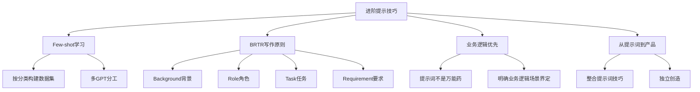
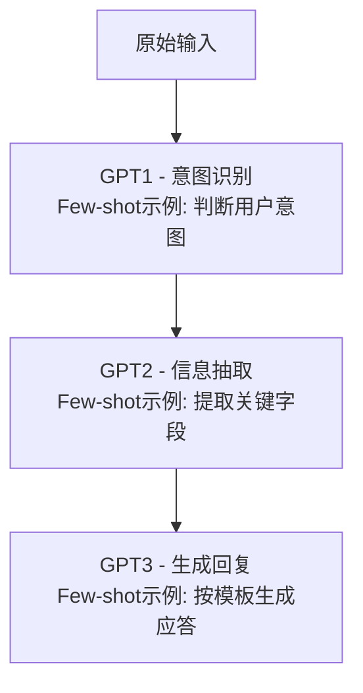
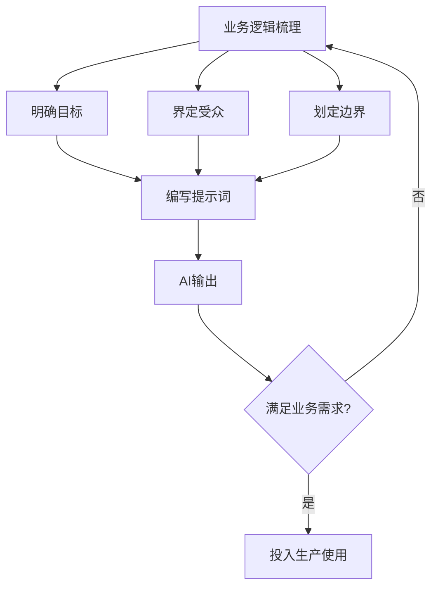

# 第 6 章 进阶提示技巧——从会问到问得好

## 学习目标

- 掌握 Few-shot 学习
- 学会 BRTR 写作指令
- 理解业务逻辑优先
- 整合 AI 生产力

## 6.1 生活类比

想象你是一位新来的实习生，第一天上班就接到了写周报的任务。你完全不知道格式是什么样。如果主管只丢给你一句"写周报去"，你大概率会手足无措。但如果主管从抽屉里翻出上个月的几份优秀周报说"照这个格式写"，你立刻就有了方向——标题怎么写、开头分几段、哪里放数据、结尾怎么总结，一切都有了参照物。Few-shot 学习的核心思想正是如此：与其给模型长篇大论的规则说明，不如直接甩给它几个"模范生"的例子，让它照猫画虎，从范例中自己归纳出规律。这也像一个厨艺新手学做菜，与其背诵火候和调料的抽象理论，不如看师傅颠勺三五次，便心领神会了。

## 6.2 概念地图



## 6.3 Few-shot 学习

> [20230920_27.md] "按分类构建数据集"

这句简短的话背后，隐藏着提示词进阶的第一把钥匙：**Few-shot 学习**。它的核心思想是"用少量示例引导模型规律学习"——你不需要告诉模型"你要学会做分类"，只需要给它几个已分类的样本，它就能模仿你的分类逻辑。

### 直觉：为什么"给例子"比"讲规则"更有效？

大语言模型在海量文本上训练时，已经内化了大量的语言规律和任务模式。当你给出几个例子时，你不是在"教"它新知识，而是在**激活**它已有的能力。这就像你不需要给一位资深编辑讲解什么是新闻导语，只需要甩给他三篇范例，他立刻就明白了你想要的行文风格。

相比之下，用自然语言描述规则往往充满歧义。你说"要写得简洁有力"，模型可能理解为"字数少"而非"信息密度高"。而示例则无歧义——它就是标准答案的具象化。

### 形式化定义：Few-shot 提示的结构

我们可以将 Few-shot 提示形式化为一个结构：

> **Few-shot 提示**（来源：《按分类构建数据集：GPT 与提示词进阶实践》）

```
系统指令: 你是一个文本分类器，请对以下文本进行分类。
示例1: 文本: "今天天气真好" → 分类: 日常闲聊
示例2: 文本: "本公司发布新款手机" → 分类: 商业新闻
示例3: 文本: "研究人员发现新行星" → 分类: 科技报道
待分类文本: "国足今晚迎战日本队" → 
```

这段结构展示了 Few-shot 的核心三要素：**任务声明**（告诉模型做什么）、**示范样本**（展示输入—输出对）、**待处理输入**（模型需要推理的新样本）。模型通过类比示范样本的模式，完成对未知输入的预测。

### 如何构建高质量的 Few-shot 示例？

构建 Few-shot 示例的关键在于"按分类构建数据集"。这意味着你需要：

1. **覆盖全部分类**：每个类别至少提供 1-2 个示例，确保模型见识过每个类别的特征。
2. **示例代表性要强**：每个示例应体现该类别的典型特征，而不是边缘案例。
3. **保持格式一致**：输入输出的格式要统一，减少模型的格式困惑。

例如，如果你要构建一个"客服工单分类器"，你的 Few-shot 示例应该覆盖"退款问题""物流查询""产品咨询""投诉建议"等所有类别，且每个示例的措辞和长度尽量一致。

### 多 GPT 分工：将 Few-shot 扩展到复杂任务

单个 Few-shot 提示能解决的问题是有限的。当任务复杂到需要多个步骤时，一个更强大的模式是**多 GPT 分工**——将一个大任务拆解成多个子任务，每个子任务由独立的 GPT 调用（或独立的提示片段）完成，每个环节都使用 Few-shot 示例引导。



这段流程图展示了多 GPT 分工模式：第一个模型识别意图，第二个模型抽取关键信息，第三个模型根据抽取结果生成最终回复。每一环都通过 Few-shot 示例约束输出质量，形成一条流水线。

与单次调用相比，多 GPT 分工的优势是每个环节的 prompt 更短、示例更精准，模型犯错的空间更小。代价是延迟增加、API 调用成本上升。实际场景中，你需要根据任务复杂度在两者之间做权衡。

## 6.4 BRTR 写作指令原则

> [20230926_19.md] "BRTR原则"

如果你只有一次机会向模型下达指令，那么 BRTR 原则是最高效的姿势。BRTR 不是某种花哨的算法，而是四个维度的缩写：**B**ackground（背景）、**R**ole（角色）、**T**ask（任务）、**R**equirement（要求）。它的本质是"用结构化信息消除歧义"——把人类的写作经验和沟通智慧编码成模型可精确解析的指令格式。

### 为什么需要 BRTR？

零提示（Zero-shot）时，模型只能猜测你要什么。比如"帮我写一封邮件"，模型不知道你是谁、收件人是谁、邮件的目的是什么。而 BRTR 通过四个维度把上下文补充完整，让模型"有据可依"。

### 四个维度的逐一拆解

> **BRTR 写作指令**（来源：《BRTR 原则：让 GPT 准确理解你的写作需求》）

```
Background: 我是某科技公司的市场部实习生，需要向部门主管汇报下季度的推广计划。
Role: 你是一位拥有十年经验的市场营销专家。
Task: 帮我撰写一份 500 字的季度推广计划汇报摘要。
Requirement: 
  1. 语言正式、简洁；
  2. 分为背景回顾、目标设定、执行策略三部分；
  3. 突出"短视频营销"这一核心策略；
  4. 署名和日期留空。
```

这段示例展示了 BRTR 的完整结构。与一条模糊的指令相比，BRTR 提供了模型推理所需的全部上下文：**Background** 定义了写作的语境（你是谁、写给谁、为什么写），**Role** 定义了模型应采用的视角（专家、同事、或中立信息员），**Task** 定义了输出物的类型和范围（摘要、报告、邮件），**Requirement** 则细化了风格、长度、结构和内容的边界条件。

我们可以把 BRTR 的四个维度对照实际写作经验来理解：

| 维度 | 类比 | 关键作用 |
|------|------|----------|
| Background | 交代写作的"来龙去脉" | 让模型理解语境和动机 |
| Role | 选择"谁的口吻" | 影响语言风格和专业深度 |
| Task | 明确"要交付什么" | 决定输出物的类型和长度 |
| Requirement | 划定"质量边界" | 控制格式、语气和内容取舍 |

这张表格展示了 BRTR 四要素与写作经验的映射关系。你会发现，BRTR 本质上是在把人类写作时的"隐性知识"变成"显性指令"——我们在给同事交代任务时，这些信息都在脑子里，只是没说出口而已。

### BRTR 的一种变异：从"原则"到"模板"

将 BRTR 固化为模板后，你可以把它嵌入到日常使用的提示词库中。比如你在完成一份周报时，只需替换括号中的字段：

```
Background: 本周我们完成了 [项目A] 的 [功能X] 开发。
Role: 你是一位熟悉敏捷开发的资深技术主管。
Task: 将本周进展浓缩成 150 字的周报。
Requirement: 
  1. 用三句话概括进展；
  2. 指出一个风险点；
  3. 结尾给出下一步计划。
```

这段模板展示了 BRTR 的可复用性。你不需要每次重新构思提示词，只需填充变化的部分，就能获得高质量输出。这是 BRTR 从"原则"走向"产品"的关键一步。

## 6.5 业务逻辑优先

> [20230920_29.md] "业务逻辑为前提"

无论你的提示词写得多么精妙，如果脱离了业务逻辑，一切皆是空中楼阁。**业务逻辑优先**意味着：在动手写提示词之前，先想清楚你要服务于什么样的业务场景、解决什么样的问题、对谁负责。

### 提示词不是万能药

很多新手误以为"提示词写得够好，AI 就能解决一切"。但实际上，**提示词只是表达意图的载体**。如果你的业务逻辑本身是混乱的——目标不清晰、受众不明确、评价标准缺失——那么再花哨的提示词也只是用精美的包装纸裹住一个错误的产品。

举个例子：如果你让 AI"写一篇关于公司产品的推文"，但你没有想清楚这篇推文是发给老客户做复购提醒，还是发给新用户做品牌曝光，那 AI 输出的内容要么泛泛而谈，要么偏离目标。提示词很好地执行了你的指令，但指令本身的方向就是错的。

### 明确业务逻辑与场景界定

在编写任何提示词之前，先回答三个问题：

1. **业务目标是什么**——这个输出要达成什么效果？（增加转化？提高阅读？完善知识库？）
2. **受众是谁**——输出给谁看？他们有什么特征？在乎什么？
3. **边界在哪里**——哪些内容是必须包含的？哪些是绝对不能出现的？

用如下模板来界定场景：

```
业务场景: [客户投诉处理流程优化]
核心目标: [减少人工响应时间与提升用户满意度]
使用人: [客服团队一线人员]
边界条件: [回复必须低于 100 字；不得承诺未经审核的赔偿；语气需温和但专业]
```

这段模板展示了"业务逻辑优先"的落地方式。只有当你把业务逻辑的边界框定清楚，提示词才有足够的约束力，模型的输出才能真正嵌入到业务流中。

### 避免"美丽废物"

当业务逻辑缺位时，AI 往往会产出"美丽废物"——语言华丽流畅、结构无懈可击，但内容空洞无用。这类文本读起来像是那么回事，却既不能指导行动，也不能提供决策信息。

要识别"美丽废物"，你可以问自己三个检验问题：

- 这段输出能让我做出一个具体决策吗？
- 它是否包含可执行的步骤或可验证的事实？
- 如果将它交给一位对业务不熟的新同事，他能立刻上手吗？

如果三个问题都是"否"，那么说明你的提示词缺少业务逻辑的锚点。



这张流程图展示了"业务逻辑优先"的完整闭环：先梳理业务逻辑，再写提示词，最后验证输出是否真正满足需求。如果不满足，则回到起点重新迭代。这就是为什么"业务逻辑优先"不是一句口号，而是一个可循环的工作流。

## 6.6 设计中的取舍

**为什么不用"更多的规则描述"而用 Few-shot 示例？**

规则描述是用自然语言建模"我想要什么"，而示例是直接用数据建模"输出应该是什么形状"。自然语言存在歧义，模型可能把你的"简洁"理解为"短"，而示例则不存在这种问题——模型可以直接从输入输出对的映射中推断模式。但 Few-shot 的代价是：示例占据上下文窗口的 token 预算，示例越多，留给真实内容的 token 越少。所以你需要权衡：是给 3 个高质量示例，还是给 10 个泛泛示例？实践中，3-5 个精准示例往往比 10 个平庸示例更有效。

**BRTR 会不会限制模型的创造性？**

BRTR 的 Requirement 约束越多，模型的"自由发挥空间"越小。如果你的目标是获取创意方案，那么过度约束会扼杀模型的发散思维；如果你的目标是让输出嵌入到严谨的业务流程中（比如写合规文件），那么约束是保障。因此，一个有用的经验法则是：**在高不确定性的探索阶段，减少 Requirement；在需要稳定复用的生产阶段，增加 Requirement。** 这类似于设计思维中的"发散—收敛"循环。

**多 GPT 分工的延迟问题怎么解决？**

多 GPT 分工意味着多次 API 调用，每次调用都有网络延迟和推理时间。如果你的业务对实时性要求高，可以将部分环节合并到同一提示中，用 Few-shot 强行实现"一步到位"。反之，如果你处理的是离线批量任务，多 GPT 分工带来的质量提升就值得额外的延迟成本。

## 6.7 动手练习

- Few-shot 实践

## 6.8 本章小结

这一章中，我们学习了提示词从"会问"到"问得好"的进阶路线。首先，我们认识了 Few-shot 学习的核心思路——用少量示例引导模型从范例中归纳规律，并学会了按分类构建数据集、以及用多 GPT 分工模式处理更复杂的任务。其次，我们掌握了 BRTR 写作指令原则，通过 Background、Role、Task、Requirement 四个维度把模糊的需求变成结构化指令。接着，我们强调了业务逻辑优先的理念——提示词不是万能药，先梳理清楚业务目标和边界，再动笔写提示词，才能避免产出"美丽废物"。最后，我们讨论了如何把零散的提示词技巧整合成可复用的生产力工具，实现从提示词到产品的跨越。

本章我们一起学习了以下概念：

| 概念 | 解释 |
|------|------|
| Few-shot 学习 | 用少量示例引导模型规律学习 |
| BRTR 写作指令 | Background-Role-Task-Requirement 系统方法论 |
| 业务逻辑优先 | 先理解业务再应用 GPT |
| 从提示词到产品 | 整合为生产力工具实现独立创造 |

下一章中，我们将把这一整套提示词技巧应用到具体的工作流实践中，深入学习如何构建一套完整的"AI 驱动的内容生产流水线"，从单次问答走向系统化的人机协作。

