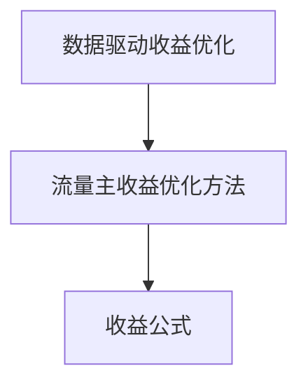
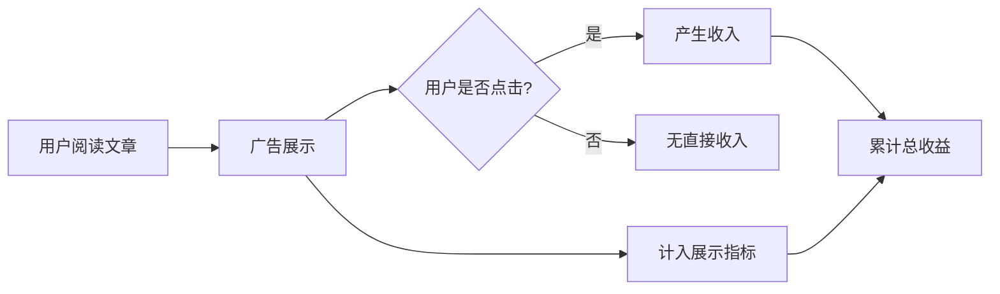

# 第 7 章 流量变现的底层逻辑——从阅读量到收益的距离

## 学习目标

- 理解收益与流量的距离
- 掌握数据驱动优化方法
- 分析广告位与内容匹配

## 7.1 生活类比

阅读量是车流量，收益是收费站收入。一条繁忙的公路（高阅读量）不一定带来高额收入（高收益），因为收入还取决于收费站的设置（广告位）和收费标准（广告单价）。如果收费站位置不佳（广告位不显眼）、收费规则不合理（广告与内容不匹配），即使车流如织，收入也可能惨淡。优化收益的本质，就是像聪明的收费站管理者一样，在车流不变的情况下，通过调整收费策略、优化收费亭位置来最大化收入。

## 7.2 概念地图



## 7.3 数据驱动的收益优化

我们首先要回答一个核心问题：为什么阅读量很高，收益却不见涨？答案在于，从阅读量到收益之间，存在一道需要精心设计的"转化桥梁"。这道桥梁的蓝图，就是收益公式。

> [P001, p.5] "在阅读量不变下提升收益"

这里揭示了一个关键的优化思路：优化不仅仅是追求更高的阅读量，更是在既有的流量池中，通过精细化运营挖掘更多价值。

> 收益公式**定义**（来源：《公众号流量主收益提升》）

$$
收益 = 阅读量 \times 广告单价 \times 点击率
$$

这个公式展示了收益的三个核心杠杆：**阅读量**（流量规模）、**广告单价**（每千次展示或每次点击的价格）、**点击率**（用户点击广告的比例）。它告诉我们，当阅读量（流量）增长遇到瓶颈时，我们依然可以通过提升另外两个因素来增加收益。

以公式为基础，我们可以绘制一张数据流图，清晰地看到从用户阅读到最终收益的转化过程：



这张数据流图展示了收益的构成，也暗示了优化动作的着眼点：要么提高广告的曝光量（与阅读量相关），要么提高广告的吸引力（与点击率相关），要么提高广告的价值（与广告单价相关）。接下来，我们将聚焦于如何在"阅读量不变"的约束下，通过优化后两个因素来提升收益。

## 7.4 流量主收益优化方法

明确了收益公式之后，我们的任务就从"玄学"变成了"工程"：具体该怎么做，才能提升广告单价和点击率？这一节，我们将拆解一套以数据为驱动的系统化优化方法。

> [P001, p.5] "流量主收益优化方法"

这句话点名了本节的核心：我们讨论的不是泛泛而谈的涨粉技巧，而是针对流量主的、可操作的收益优化方法。

> 流量主收益优化方法（来源：《公众号流量主收益提升》）

```
1. 观察后台数据（分析现状，找到问题）
2. 调整广告位位置、样式（优化展示，提升点击率）
3. 内容相关性（优化匹配，提升单价与体验）
```

这段伪代码勾勒了一套从"诊断"到"治疗"的标准流程。它不是一次性的，而是一个需要持续观察、调整、再观察的循环。下面我们把这套方法类比成一次完整的"收益诊疗"，来详细解读每一步的意图。

### 诊断：观察后台数据

优化的第一步永远是"望闻问切"。运营者需要观察后台的各项指标，例如各篇文章的阅读量、广告的曝光量、点击量、点击率以及千次展示收益（rpm）等。这些数据是诊断运营健康状况的"化验单"，能够告诉我们问题出在公式的哪一环。是广告曝光不足，还是点击率过低？通过数据分析，我们才能避免盲目调整，做到有的放矢。

### 治疗：调整广告位位置与样式

数据诊断可能会发现，文章的阅读量很高，但广告点击率很低。此时，治疗的重点就落在了广告位本身。广告放在文章开头、中间还是结尾，效果天差地别。广告的样式（如banner、卡片、图文）也会影响用户的视觉注意力和点击意愿。通过A/B测试，尝试不同的位置和样式，找到对用户体验干扰最小、广告效果最好的组合。

### 调理：内容相关性匹配

这是提升收益的"内功"。如果一篇文章讲的是美食食谱，旁边却推荐游戏下载，转化效果必然不佳。当广告内容与文章主题高度相关时，读者对广告的抵触情绪会降低，甚至会因为"正合我意"而点击。这种相关性不仅直接提升了点击率，也会让广告主更愿意为精准流量支付更高的单价，从而反哺广告单价。

## 7.5 多源对照

关于"优化"的来源较为单一，但我们依然可以从概念的内部逻辑进行辨析。

**共识**：所有有效优化都始于对数据的观察，而非凭空猜测。

**分歧**：

- 素材本身提出了"观察数据 -> 调整广告位 -> 内容相关性"的线性流程。
- [需要补充文献]若引入其他优化方法，如调整发文时间、标题策略来提升阅读量，则与素材"在阅读量不变下提升收益"的假设构成了范围上的分歧。素材聚焦于存量优化，而后者是对增量（阅读量）的优化。

## 7.6 设计中的取舍

- 为什么不在阅读量上做文章，而是强调"阅读量不变"？

在公众号生态趋于成熟、获客成本高企的今天，提升阅读量的难度和成本都远高于内部优化。素材的策略是更现实、更具性价比的选择。它避开了"红海"（争夺用户注意力），转而深耕"蓝海"（挖掘既有流量的价值）。这是一种典型的精细化运营思维。

- 这种设计的 trade-off 是什么？

放弃对阅读量的追求，意味着收益增长的天花板被限定在了当前流量池内。如果你所处的是一个高速增长的赛道，这可能意味着错失更快的增长机会。同时，深度优化广告位和内容相关性，需要投入大量精力进行数据分析和试验，这要求运营者具备较强的数据能力和耐心，而非简单的"发布-等待"模式。

## 7.7 动手练习

1. 流量主收益分析
   - 使用素材中提供的流量主后台指标（如阅读量、广告点击量、点击率等），模拟一份当前运营的收益报表。
   - 将各指标代入收益公式，计算出当前的广告单价和总收益。
   - 根据计算出的数据，分析"阅读量-收益"之间的转化效率，判断当前优化的侧重点应放在哪个环节。

## 7.8 本章小结

这一章中，我们学习了流量变现的底层逻辑，重点在于理解从阅读量到收益之间的距离。首先，我们通过一个生活类比（收费站）建立了对收益构成的基本直觉，并给出了清晰的概念地图。其次，我们引入了收益公式，将模糊的"变现"过程拆解为阅读量、广告单价和点击率三个可量化的部分，这为我们的优化指明了方向。接着，我们详细介绍了一套数据驱动的收益优化方法，包括观察数据诊断问题、调整广告位提升点击率、优化内容相关性提升单价与体验。最后，我们讨论了这一优化策略背后的取舍，认识到在存量市场中深耕效率是我们当前的核心任务。

本章我们一起学习了以下概念：

| 概念 | 解释 |
|------|------|
| 数据驱动收益优化 | 读懂后台指标与收益公式，找到优化方向 |
| 流量主收益优化 | 优化广告位与内容匹配，提升单价与点击率 |

下一章中，我们将学习如何将这些平台内部的优化策略，与更宏观的账号定位和目标受众分析相结合，从而构建一个从内容生产到商业变现的完整闭环。

